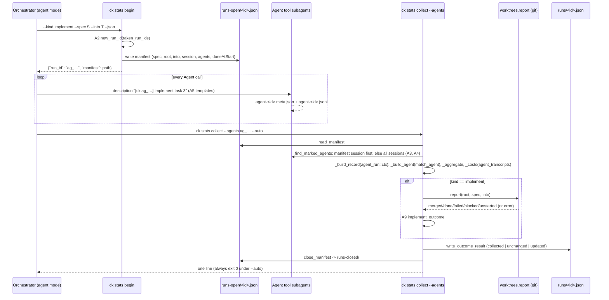

# Design: Agent-Mode Analytics

## Overview

`ck stats` today has one collection source: Workflow-tool run files (`projects/*/*/workflows/wf_*.json`) plus their
agent transcripts under `subagents/workflows/<wf_id>/`. This feature adds a second source, **agent-mode runs**,
built from the Agent-tool subagent files Claude Code already writes at
`projects/<proj>/<session>/subagents/agent-<id>.jsonl` + `agent-<id>.meta.json`. Both sources go through the same
record builder (`collect._build_record`), the same per-agent builder (`collect._build_agent`), the same aggregation
(`collect._aggregate`) and the same pricing (`collect._costs` -> `bench._price_by_model`), so the numbers compare
directly and there is still one pricing path.

New runs are grouped exactly, by a run id the orchestrator gets from `ck stats begin` and puts at the start of every
Agent description as `[ck:<run_id>]`. A machine-local **run manifest** stores what the descriptions must not carry
(spec name, project root, target branch). Collection reads the manifest, finds the marked agents, builds the record,
runs the git report for the outcome, and closes the manifest. Old unmarked implement-mode runs can be recovered
heuristically, behind a dry run.

How the PLAN.md decisions shape it:

| Decision | Effect on this design |
|---|---|
| D1 schema stays `/1` | `share.py` gains an optional `source` field (`workflow`/`agents`) and one `COST_SOURCES` member `agent_transcripts`. Nothing else in the shareable tree changes; local "manifest"/"outcome" missing kinds map onto the existing `runfile`/`result` members. |
| D2 `begin` best-effort | `ck stats begin` prints a valid id even when the manifest cannot be written (exit 0, warning on stderr); the instructions say to go on without a marker if `begin` fails. Collect handles a missing manifest of a marked run (partial record, by id only, D14). A run whose `begin` failed has no marker and is not recoverable (D10): backfill is for runs from before this feature only, and the instructions end such a run's report with the line `⚠ ck stats begin failed: this run is not recorded in ck stats` (2.5). |
| D3 grouping | New runs: marker only (`agentrun.select_marked`). Time-gap grouping exists only in `backfill.group_agents`. |
| D4 content-free descriptions | A fixed template grammar (`roles.match_agent`). The docs write every template out with placeholders limited to `<run_id>`, `<N>`, `<k>` (each create step and lens written literally); `agentrun.template_violations` enforces it over the instruction docs. |
| D5 local detail, shared content-free | Spec/root/branch come from the manifest into the local record and its `terms`; `build_shareable` is still allowlist-built and has no path for them. |
| D6 collector runs the git report | `agentcollect` calls `claude_kiro.worktrees.report(root, spec, into=...)`, the function behind `ck worktree report`, in-process. Any failure gives outcome `None` and a `missing` entry. |
| D7 `general-purpose` only with a marker | `select_marked` only admits descriptions starting with the exact marker of the run being collected; backfill admits spec agent types only. |
| D8 backfill v1 | `ck stats collect --agents-backfill [--dry-run] [--gap MIN]`, spec agent types only, session -> spec -> gap grouping, `partial: true`, deterministic record ids. |
| D9 open manifests | `ck doctor` counts open manifests older than 6 h; `ck stats collect --all` collects them as partial records, and closes a stale manifest whose run has no marked agent as `abandoned` (6.5). `ck run` collects a session's agent-mode runs that have a manifest after it exits (5.5, D13, D14). |

## Components

### Existing Components to Modify

- `src/claude_kiro/analytics/collect.py` - the collector core.
  - `_Agent` gains `agent_type: Optional[str] = None` (from the meta `agentType`).
  - `_build_agent` gains a `matcher` argument: a callable `(label, agent_type) -> LabelMatch`. The workflow paths pass
    the current `roles.match_label(label, workflow_name)` behaviour; agent mode passes `roles.match_agent` (or
    `roles.match_legacy` for backfill). The info dict it returns gains `"terms"`: the meta's `worktreePath` and
    `worktreeBranch` strings when present (9.1).
  - `_costs` gains `transcript_source: str = "priced_from_transcripts"`; agent mode passes `"agent_transcripts"` so
    the run-scope figure is `agent_transcripts` or `estimate` via `agentrun.agent_cost_label` (3.7).
  - `_build_record` gains one optional keyword, `agent_run: Optional[AgentRunContext] = None`. When `None` the
    function behaves exactly as today except that worktree terms from metas are added (9.1); a workflow record whose
    metas carry no worktree keys therefore re-collects byte-identical (`unchanged`), and one whose metas carry them
    changes only in `terms` (3.18). When given it: uses the context's matcher; takes `project.root/spec/branch` from
    the context (manifest, or session head when the manifest is missing; never from descriptions, 3.3/3.10); passes
    `timing_from_transcript=True` to `_build_agent` for every agent, whatever `partial` is (3.2); never adds the
    `result` missing entry (today's `if not partial and not isinstance(result, dict)` branch is skipped: agent mode
    has no run file and reports a missing `manifest` or `outcome` instead); sets `start_ms` to the context's
    `start_ms` (parsed manifest `startTime`, or the earliest agent `first_ts` when there is no manifest) and `wall_ms`
    to the latest agent `last_ts` minus that start (`None` only when no agent has a timestamp; backfill: the group's
    spec-named `end_ms` minus its `start_ms`, so a spec-less joiner never moves them, 7.5, D15); adds the run id,
    spec, root and target branch to `terms` (9.2); writes `source: "agents"`, `partial` and `agentRun` (see Data Models); and
    replaces `_workflow_metrics` with `agentcollect.agent_metrics` (outcome and task lists from the git report,
    3.4-3.6).
  - `collect_all` is unchanged (it remains the workflow-run sweep); `--all` merges it with
    `agentcollect.collect_open_manifests` in the CLI (6.4).
  - `write_outcome_result` unchanged; agent-mode records use the same replace-by-run-id and the same
    `collected | unchanged | updated` semantics (3.9, 7.6).
- `src/claude_kiro/analytics/roles.py` - add the agent-mode grammar `match_agent` and the old free-form grammar
  `match_legacy` (Decision Seams A5, A6), plus the constants `SPEC_AGENT_TYPES`, `CREATE_STEPS`, `CREATE_LENSES`.
  `match_label` is unchanged.
- `src/claude_kiro/analytics/store.py` - manifest locations and I/O next to the record store: `open_manifests_dir`,
  `closed_manifests_dir`, `manifest_path`, `write_manifest`, `read_manifest`, `iter_open_manifests`,
  `close_manifest`, `taken_run_ids`. All writes go through the existing `write_private_json` (0600 files, 0700
  directories).
- `src/claude_kiro/analytics/share.py` - `COST_SOURCES` becomes `("priced_from_transcripts", "estimate",
  "agent_transcripts")`; new `SOURCES = ("workflow", "agents")`; `_TREE` gains optional `"source": _enum(SOURCES)`;
  `build_shareable` sets `source` via `source_of(local)` (A15); `_MISSING_MAP` gains `"manifest": "runfile"` and
  `"outcome": "result"` (existing enum members, so no schema change beyond D1). `REQUIRED` fields unchanged (8.3,
  8.6).
- `src/claude_kiro/analytics/leak.py` - `_vocabulary()` adds `share.SOURCES` (8.4/9.4; `agent_transcripts` comes in
  through `COST_SOURCES`). `GENERIC_PATTERNS` gains `("agent_run_id", "id", re.compile(r"\bag_[0-9a-f]{8}\b", re.I))`
  so an agent-mode id is a hit even without a local record (9.3). `build_terms` needs no change: record `terms`
  already carry the worktree paths/branches and the run id, and `_candidates` already splits paths into segments.
- `src/claude_kiro/analytics/health.py` - `decide` gains `stale_manifests: int = 0, bad_manifests: int = 0`
  (defaults keep current callers). `doctor_findings` gains `now_ms: Optional[float] = None` and counts open manifests
  through `agentrun.classify_open_manifest` (6.1, 6.2, 6.6).
- `src/claude_kiro/cli/stats.py` - new `begin` command; `collect` gains `--agents RUN_ID`, `--agents-backfill`,
  `--dry-run`, `--gap MINUTES`; argument rules go through `agentrun.decide_collect_args` (A11); new helpers
  `collect_agents_auto`, `_collect_agents_one`, `_collect_backfill`; `_collect_all` merges workflow outcomes with
  open-manifest outcomes in one summary; `_is_partial(record)` replaces the inline `missing == runfile` checks.
  `collect_agents_auto` follows `collect_auto`'s sandbox branch: when the home is unreadable and
  `CK_RUN_SANDBOXED == "1"` it prints `ℹ️ <run_id>: ck run collects this run after the session exits (without a run
  manifest: ck stats collect --agents <run_id>)`, leaves the manifest open and returns 0 (5.5, D14).
- `src/claude_kiro/cli/main.py` - the `doctor` analytics block passes `now_ms` to `health.doctor_findings` (no
  other change).
- `src/claude_kiro/cli/run.py` - `auto_collect_after_run` also collects the session's agent-mode runs (5.5). After
  the workflow ids it calls `agentcollect.session_agent_runs(home, sid, since_ms)`, which returns the ids of open
  manifests whose `sessionId` is `sid`, or whose `sessionId` is null and whose start is at or after `since_ms`;
  a manifest with another session's `sessionId` is never returned (D13). It never returns a marked run id that
  has no manifest: such a run needs `ck stats collect --agents <run_id>` (3.17, 6.7, D14). Each id goes through `stats.collect_agents_auto` with `CK_RUN_SANDBOXED`
  unset for that call (the session has exited, so the home is readable), giving one `stats: ...` line per id as
  for workflow runs. Never raises.
- `analytics/SCHEMA.md` - documents `source` (enum `agents`, `workflow`), `cost.source` with `agent_transcripts`, the
  "sources" and "cost sources" fixed-enum lines, and the `agent_run_id` generic pattern; schema id stays
  `ck-run-analytics/1` (8.4).
- `plugin/resources/without-workflow-tool.md` - new section "Run id and Agent descriptions": run
  `ck stats begin --kind <kind> --spec <name> --into <into> --json` outside the sandbox before the first Agent call;
  the template list (Public Interfaces), every template written out; "if `begin` failed or printed no id, use the same templates without the
  marker and never stop or retry the run because of it" (1.6, 2.5); the closing step
  `ck stats collect --agents <run_id> --auto` outside the sandbox (5.1), or, when `begin` gave no id, the
  report's last line `⚠ ck stats begin failed: this run is not recorded in ck stats` instead, with no claim that
  a later command or backfill recovers the run (2.5, D10). Line 45's `implement <spec>: task <N>` and
  every other role's description are replaced by the templates (2.1).
- `plugin/skills/spawn-worktree/SKILL.md` - Phase 1 runs `ck stats begin --kind implement` when a spec is given and
  the Agent path is used (no Workflow tool, or every role `inherit` with review off); the Phase 3 JSON description
  becomes `[ck:<run_id>] implement task <N>`; reviewer/revision/fix descriptions use the templates; the final report
  step runs the agent-mode collect line, or the `begin` failed line when there is no id (2.4, 2.5, 5.1). Ad-hoc batches (no spec) use `implement task <n>` without a
  marker and are not collected (out of scope).
- `plugin/skills/implement/SKILL.md`, `plugin/skills/create/SKILL.md`, `plugin/skills/review/SKILL.md` - the
  reporting step that runs `ck stats collect --run <wf_id> --auto` adds: "In agent mode (no `wf_id`), run
  `ck stats collect --agents <run_id> --auto` instead" (5.1). The existing workflow line stays verbatim
  (`tests/test_stats_skills.py`).
- Vendored renderings `.claude/workflows/without-workflow-tool.md`, `.claude/commands/spec/implement.md`,
  `create.md`, `review.md`, `spawn-worktree.md` - regenerated from the packaged sources with
  `claude_kiro.plugin.vendor_files()` (which already rewrites `spec:<role>` to `ck-<role>` and drops plugin-only
  lines), so they stay identical apart from those differences (2.6). These are protected `.claude/**` paths: all of
  them are updated in a single task that lands by hand.
- `README.md` - the `ck stats` section gains agent-mode usage (`begin`, `collect --agents`, `--agents-backfill
  --dry-run`) and states that create and review runs from before this feature cannot be recovered, and that runs whose
  `begin` failed (no marker) cannot be recovered either, as backfill covers only runs from before this feature
  (7.9, D10).

### New Components

- `src/claude_kiro/analytics/agentrun.py` (new) - pure rules of agent mode: run-id format and generation, the
  marker, marked-agent selection, description-template checks, the git-report-to-outcome mapping, manifest format
  check and open-manifest classification, collect-argument rules, the agent-mode cost label. No I/O, no clock
  (Decision Seams A1-A4, A7-A11, A14).
- `src/claude_kiro/analytics/backfill.py` (new) - pure backfill rules: candidate filter, grouping by session, spec
  and gap, deterministic group ids (A12, A13).
- `src/claude_kiro/analytics/agentcollect.py` (new) - the I/O side of agent mode: `begin_run` (manifest creation),
  discovery of subagent metas, `collect_agent_run`, `collect_open_manifests`, `plan_backfill`, `collect_backfill`,
  the in-process git report call, and `agent_metrics`. It builds `_Agent` lists and calls
  `collect._build_record(..., agent_run=ctx)`; it never prices or aggregates on its own (Constraints).

## Public Interfaces

### CLI

```
ck stats begin --kind {implement|create|review} --spec NAME
               [--into BRANCH] [--session SESSION_ID] [--override ROLE.KEY=VALUE ...] [--json]
```
- stdout (plain): the run id alone on one line, e.g. `ag_3f9c01ab`. stdout (`--json`): exactly one object
  `{"run_id": "ag_3f9c01ab", "manifest": "<path>" | null}` (1.3).
- Writes `<data_dir>/runs-open/<run_id>.json` (0600; directory 0700 when created) (1.2).
- `--kind` is a `click.Choice`; missing/invalid `--kind`, missing or empty `--spec`: usage naming
  `implement, create, review`, no manifest, exit 2 (1.4). `--spec` is reduced to its last path component, as
  `ck worktree` does.
- Manifest write fails: id still printed, stderr `⚠ could not write the run manifest (<reason>); this run will be
  collected without it`, exit 0 (1.5). `"manifest": null` under `--json`.
- Project root: `git rev-parse --show-toplevel` of the cwd (cwd resolved when not a repo). Target: `--into`, else
  the current branch. Session: `--session`, else `bench.latest_session` limited to the project directory Claude
  Code uses for the cwd, else `null`. Manifest key `agents`: `agents.resolve(cwd, overrides)["roles"]` projected
  to `{"model", "effort", "enabled"}` for the seven config roles (implementer, test_writer, reviewer,
  reviewer_risky, fixer, resolver, orchestrator). `reviewer_risky` is not a key of `roles`; it is derived as
  spec-implement.js derives it: `{"model": reviewer.risky_model, "effort": reviewer.risky_effort, "enabled":
  reviewer.enabled}`. Keys a role does not have (e.g. `enabled` outside the reviewer) are `null`; `run.allowed_domains`, `machine_label`, `sources` and `runtime`
  are never stored (1.2). `doneAtStart` (implement only): task ids Done in `specs/<spec>/tasks.md` on the target,
  via `git show`; `null` on any failure (1.2, 3.4). No network (1.7).
- Run-id draws: `secrets.token_hex(4)`. Test hook: when `CK_TEST_RUN_ID_DRAWS` is set (comma-separated 8-char
  tokens), `begin_run` draws from that list in order before falling back to `secrets.token_hex(4)`, the same
  test-only env pattern as the netguard. A2 still skips taken and invalid draws (1.1).

```
ck stats collect --agents RUN_ID [--auto] [--json]
ck stats collect --agents-backfill [--dry-run] [--gap MINUTES] [--json]
ck stats collect --run RUN_ID [--auto] [--json]        # unchanged
ck stats collect --all [--json]                         # now also sweeps open manifests older than 6 h
```
- Argument rules: `agentrun.decide_collect_args` (A11). Exit 2 on: not exactly one of `--run/--all/--agents/
  --agents-backfill` (3.14); `--dry-run`/`--gap` without `--agents-backfill`; `--auto` with `--all` or
  `--agents-backfill`; `--agents` id not matching `ag_[0-9a-f]{8}` (3.13, message shows `ag_` + 8 lowercase hex);
  `--run` given an `ag_` id (message: "agent-mode run ids go to --agents"); `--gap` not a positive integer (7.8).
  Under `--auto` the id checks do not exit 2: they print the one-line failure and exit 0 (5.2).
- `--agents` success, plain: `✓ <run_id>: wrote <path>` plus ` (partial: <why>)` when partial. `--json`:
  `{"run_id", "result": "collected"|"unchanged"|"updated", "path", "partial"}` (3.8). Failure, `--json`:
  `{"run_id", "result": "failed", "error": "<code>"}`; plain: `❌ <text>`; exit 1 (3.11, 3.12, 3.16, and a
  malformed manifest: error `malformed`, text `run manifest not recognised`, no record, manifest untouched, its
  contents never printed).
- `--agents ... --auto`: always exit 0; one line: `✓ <run_id>: wrote <path>`, or `ℹ️ auto-collect is off (ck agents
  set run.analytics true)`, or `⚠ could not collect <run_id>: <reason>; retry: ck stats collect --agents <run_id>`
  (5.2, 5.3). Failures are appended to `collect.log` as today.
- `--all` summary (plain and `--json`) keeps today's keys and spellings (text `already had: N`, JSON
  `already_had`); agent-mode outcomes are counted in the same `collected/already_had/updated/unfinished/failed/
  failures` totals (6.4). Young open manifests count as `unfinished`. A stale manifest whose run has no marked
  agent in any session is closed (`closedAt` set, `abandoned: true`) and reported once as
  `ℹ️ <run_id>: abandoned (no agents carry the marker)`; it is counted in a new `abandoned: N` line (JSON
  `abandoned`, printed only when N > 0) and never in `failed`, so it does not set exit 1 (6.5). A malformed
  manifest is `failed` with reason `run manifest not recognised` and its contents are never printed (6.6). The "no ck spec runs found" line is printed only when both sources gave nothing.
- `--agents-backfill --dry-run`: per group one block `group <record id>  session <sid>  spec <name>  agents <n>
  start <iso>  wall <min> min  est. $<usd>` followed by its agent ids and roles, then `left out:` lines
  `<agent id>  <reason>` (7.1). Reasons are exactly the A12/A13 strings (`workflow agent`, `not a spec agent
  type`, `carries a marker`, `no spec`, `no timing`) plus `overlaps backfill record <id>` from `plan_backfill`'s
  overlap rule (A13 is pure and never sees existing records). `--json` (the Harness
  Contract shape): `{"groups": [{"id", "session", "spec", "agents", "start", "wallMinutes", "usd"}], "excluded":
  [{"agentId", "reason"}]}`. Nothing is written.
- `--agents-backfill`: writes each group (7.5), then the summary lines `collected: N`, `already had: N`,
  `updated: N`, `failed: N`, `left out: N` (7.9); `--json`: `{"results": [{"id", "result"}], "collected",
  "already_had", "updated", "failed", "excluded"}` (counts; `result` is `collected|unchanged|updated|failed`). No candidates: `ℹ️ no unmarked spec-agent runs to backfill`, exit 0 (7.7). Exit 1 iff a group failed.

```
ck doctor        # analytics block gains two findings
```
- warning `<n> agent-mode run(s) older than 6 h not collected - run ck stats collect --all` (6.1); no spec, root or
  branch in the text; nothing when every open manifest is 6 h old or younger (6.2).
- warning `<n> agent-mode run manifest(s) could not be read` (6.6).

### Description templates (the doc contract, 2.1)

The instruction docs list these templates verbatim, each in backticks, using only the placeholders `<run_id>` (the id
from `begin`), `<N>` (a task number) and `<k>` (a positive integer) (2.2, A7). Every create step is written out as
its own template, lenses and consistency passes included, so the doc never carries `<step>`, `<lens>` or `<p>`. In
this design's prose `<step>` stands for one member of `roles.CREATE_STEPS` (the keys of `AGENT_CREATE_STEPS`, lenses
expanded) and `<lens>` for one of `roles.CREATE_LENSES` (`fidelity`, `grounding`, `implementability`,
`verification`); those names live only here and in the `match_agent` grammar.

| Template | Used for | Role (with agent type) |
|---|---|---|
| `[ck:<run_id>] implement task <N>` | first attempt of a task | implementer, or test-writer when the type is a test-writer type |
| `[ck:<run_id>] implement task <N> retry <k>` | retry / escalation `k` | as above, attempt `k + 1` |
| `[ck:<run_id>] revise task <N> round <k>` | revision after review round `k` | as above, round `k` |
| `[ck:<run_id>] review task <N> round <k>` | review of a task's diff | reviewer |
| `[ck:<run_id>] resolve task <N>` / `... resolve task <N> round <k>` | merge conflict | resolver |
| `[ck:<run_id>] fix <k>` | red target branch, attempt `k` | fixer (step `target`) |
| `[ck:<run_id>] fix task <N> attempt <k>` | task red on landing, attempt `k` | fixer (step `landing`) |
| `[ck:<run_id>] create requirements`, `... create design`, ... (one written-out template per `CREATE_STEPS` entry below) | spec-create / spec-review agents | the role and phase spec-create.js gives that step |

`CREATE_STEPS` (the keys of `AGENT_CREATE_STEPS`) and their workflow equivalents. Role and phase come from
`roles._create` on the equivalent label, so they cannot drift (4.3). The doc writes each row as
`` `[ck:<run_id>] create <step>` `` with the step literal, for example `` `[ck:<run_id>] create review fidelity` ``.

| Step (literal) | spec-create.js label | Phase title |
|---|---|---|
| `requirements` | `write requirements.md` | Requirements |
| `design` | `write design.md` | Design + Test Plan |
| `test-plan` | `write test-plan.md` | Design + Test Plan |
| `impl-track` | `write implementation track` | Task Tracks |
| `test-track` | `write test track` | Task Tracks |
| `link` | `link tracks into tasks.md` | Link |
| `review fidelity`, `review grounding`, `review implementability`, `review verification` | `review: <lens>` | Adversarial Review |
| `refute fidelity`, `refute grounding`, `refute implementability`, `refute verification` | `refute: <lens>` | Adversarial Review |
| `snapshot` | `snapshot spec before revision` | Revise |
| `revise` | `revise spec + write review.md` | Revise |
| `consistency 1`, `consistency 2` | `consistency check: pass <n>` (`MAX_CONSISTENCY_PASSES = 2`) | Consistency Check |
| `cleanup` | `remove pre-revision snapshot` | Consistency Check |

Without a run id (1.6, 2.5) the same templates are used with the `[ck:<run_id>] ` prefix left out, and the report
ends with `⚠ ck stats begin failed: this run is not recorded in ck stats` in place of the collect step. Those agents
carry no marker, so the run is never collected (D10).

### Python entry points

```python
# analytics/agentcollect.py
def begin_run(*, kind: str, spec: str, cwd: Path, into: Optional[str], session_id: Optional[str],
              overrides: Sequence[str], home: Path, now: datetime,
              env: Optional[Mapping[str, str]] = None) -> BeginResult
def collect_agent_run(home: Path, run_id: str, *, now: datetime, pricing: Optional[dict] = None,
                      fresh: bool = False, partial: bool = False,
                      env: Optional[Mapping[str, str]] = None) -> collect.CollectOutcome
def collect_open_manifests(home: Path, *, now: datetime, workers: int = 8, pricing: Optional[dict] = None,
                           env: Optional[Mapping[str, str]] = None) -> Tuple[collect.CollectOutcome, ...]
def finish_collected(outcome: collect.CollectOutcome, env: Optional[Mapping[str, str]] = None
                     ) -> Tuple[Optional[Path], str]   # write_outcome_result + close_manifest on success (3.8)
def plan_backfill(home: Path, *, gap_minutes: int = 120, pricing: Optional[dict] = None,
                  env: Optional[Mapping[str, str]] = None) -> BackfillPlan
def collect_backfill(home: Path, plan: BackfillPlan, *, now: datetime, pricing: Optional[dict] = None,
                     env: Optional[Mapping[str, str]] = None) -> Tuple[collect.CollectOutcome, ...]
def find_marked_agents(home: Path, run_id: str, session_id: Optional[str], workers: int = 8
                       ) -> Tuple[List[AgentFile], List[Path]]   # (agents, directories searched)
def agent_metrics(ctx: AgentRunContext, rows: List[dict]) -> dict
def session_agent_runs(home: Path, session_id: str, since_ms: int) -> Tuple[str, ...]   # ck run sweep, manifests only (5.5)

# analytics/store.py
def open_manifests_dir(env=None) -> Path          # <data_dir>/runs-open
def closed_manifests_dir(env=None) -> Path        # <data_dir>/runs-closed
def manifest_path(run_id: str, env=None) -> Optional[Path]   # open first, then closed; None if neither
def write_manifest(manifest: Mapping, env=None) -> Path      # into runs-open, private
def read_manifest(run_id: str, env=None) -> Tuple[Optional[dict], str]   # (data, "open"|"closed"|"missing"|"malformed")
def iter_open_manifests(env=None) -> List[Path]
def close_manifest(run_id: str, closed_at: str, env=None) -> None        # sets closedAt, os.replace into runs-closed
def taken_run_ids(env=None) -> FrozenSet[str]     # stems in runs-open, runs-closed and runs

# analytics/health.py
def decide(newest, auto_collect, uncollected, stale_manifests: int = 0, bad_manifests: int = 0) -> List[DoctorFinding]
def doctor_findings(home, auto_collect, records, now_ms: Optional[float] = None) -> List[DoctorFinding]

# analytics/share.py
SOURCES = ("workflow", "agents")
def source_of(local: Mapping) -> str

# cli/stats.py
def collect_agents_auto(run_id: str, *, home: Optional[Path] = None) -> int   # always 0
```

### Decision Seams

All seams are pure: no I/O, no clock, no network; every input is an argument. Callers never re-implement them. Seam
numbers are `A*` to stay clear of run-analytics' `S1-S27`.

| # | Seam (module) | Signature | Decides | Criteria |
|---|---|---|---|---|
| A1 | `agentrun.valid_run_id` | `(value: object) -> bool` | True only for a `str` that fully matches `ag_[0-9a-f]{8}` | 1.1, 3.13 |
| A2 | `agentrun.new_run_id` | `(taken: AbstractSet[str], draw: Callable[[], str], attempts: int = 64) -> str` | `"ag_" + draw()` for the first draw that is 8 lowercase hex digits and not in `taken`; raises `RuntimeError` after `attempts` (callers pass `lambda: secrets.token_hex(4)`) | 1.1 |
| A3 | `agentrun.parse_marker` | `(description: object) -> Optional[Marker]` | `Marker(run_id, rest)` when the description starts (index 0, no stripping) with `[ck:<id>]` where A1 holds for `<id>`; `rest` is what follows one space (empty when nothing follows). Otherwise `None` | 2.1, 3.1 |
| A4 | `agentrun.select_marked` | `(metas: Sequence[MetaView], run_id: str) -> Tuple[MetaView, ...]` | keeps exactly the metas whose `parse_marker(description).run_id == run_id`, in input order. Agent type, session and timing play no part; an unmarked `general-purpose` agent or one with another run's marker is never kept | 3.1, 3.17, D7 |
| A5 | `roles.match_agent` | `(rest: object, agent_type: object) -> LabelMatch` | the template grammar above, anchored, exact (`fullmatch`, no stripping). Verb sets the role family; for `implement`/`revise` a test-writer type (`spec:test-writer`, `ck-test-writer`) gives `test-writer`, every other type `implementer`; `review`/`resolve`/`fix` give reviewer/resolver/fixer whatever the type (4.1 refinement); `create <step>` (the step one literal `CREATE_STEPS` entry) delegates to the spec-create grammar and sets `step` and the phase title (via `LabelMatch.step` + `CREATE_STEP_PHASES`). A type outside `SPEC_AGENT_TYPES` (`general-purpose`, `Explore`, `None`) gets its role from the verb alone, as above (4.6). Task ids are `[0-9A-Za-z_]+` (no paths). Anything else: `other`, `matched=False`, no task/attempt/round | 2.3, 4.1-4.4, 4.6 |
| A6 | `roles.match_legacy` | `(description: object, agent_type: object) -> LegacyMatch` | for old unmarked descriptions: `implement <spec>: task <N>...`, `fix <spec>: ...`, `revise <spec> task <N>[:...]`, `review task <N>...`, and the same with `ck-*` types. Role from the type (`SPEC_AGENT_TYPES` map), refined by the verb as in A5; `spec` is the token before `:` (or after `revise `), `None` when absent; `task` when given. Unparseable: role from the type, `matched=False`, `spec=None` | 7.3, 7.4, 4.1 |
| A7 | `agentrun.template_violations` | `(template: str) -> Tuple[str, ...]` | every `<placeholder>` in the template not in `ALLOWED_PLACEHOLDERS = {"run_id", "N", "k"}` (an allowlist, so `<spec>`, `<feature>`, `<title>`, `<task-summary>`, `<path>`, `<branch>`, and also `<step>`, `<lens>`, `<p>`, all fail); also flags a template that does not start with `[ck:<run_id>] ` | 2.2 |
| A8 | `agentrun.render_template` | `(template: str, samples: Mapping[str, str]) -> str` | substitutes each allowed placeholder; with `description_templates(markdown: str) -> Tuple[str, ...]` (backtick spans that start with `[ck:<run_id>]`) the static test renders every template and checks `match_agent(parse_marker(d).rest, t)` is matched for each spec agent type and `general-purpose` | 2.1, 2.3 |
| A9 | `agentrun.implement_outcome` | `(report: Optional[Mapping], done_at_start: Optional[AbstractSet[str]], start_ms: Optional[int], end_ms: Optional[int], run_tasks: Optional[AbstractSet[str]] = None) -> ReportSummary` | `None` report (or one missing any of the five lists): every field `None`. Each `mergedAt` (a `%cI` committer ISO string) is parsed with `datetime.fromisoformat` (a trailing `Z` read as `+00:00`) into epoch ms; an unparseable one counts as outside any window. `merged` = (`merged` ∪ `done` task ids) minus `done_at_start` when `done_at_start` is given (3.4); when it is `None`, `merged` = `merged` entries whose parsed `mergedAt` lies in `[start_ms, end_ms]` (no bound on a side whose value is `None`). Callers pass `end_ms` = the latest agent `last_ts` + `MERGE_SLACK_MS` (30 min) for manifest runs, and + `min(MERGE_SLACK_MS, gap_ms)` for backfill groups, so two same-session groups of one spec (more than `gap_ms` apart, A13) never claim the same merge (3.4, 7.5). `failed`, `blocked`, `not_started` (= `unstarted` + `blocked`) from the report minus `merged`, each limited to `run_tasks` when it is given (D11). `run_tasks` is the set of task ids this run worked on: `agent_metrics` passes the non-null `task` of every agent row of the run (backfill: of the group's spec-named agents only, D15); `None` (the Harness one-argument form) judges the whole spec. Outcome over those lists: any failed -> `failed`; else any blocked or not started -> `blocked`; else `complete`; an empty `run_tasks` (the run named no task) gives outcome `None`. Tasks of the spec that the run never named never change the outcome or these lists (a one-task or "Just these tasks" run is `complete` when its tasks merged, whatever an older failed branch says) | 3.4, 3.5, 7.5 |
| A10 | `agentrun.manifest_start_ms` / `agentrun.check_manifest` / `agentrun.classify_open_manifest` | `manifest_start_ms(value: object) -> Optional[int]`; `check_manifest(data: object) -> FormatCheck`; `classify_open_manifest(check: FormatCheck, now_ms: int, threshold_ms: int = STALE_MS) -> Literal["collect", "young", "malformed"]` | `manifest_start_ms` parses an ISO-8601 string with a `Z` or `±hh:mm` offset (fractional seconds and missing seconds allowed) into epoch ms; a naive time, a non-string or an unparseable string gives `None`. `check_manifest` sets `FormatCheck.start_ms` from `startTime` through it and fails when it is `None`. `classify_open_manifest`: `malformed` when the check failed; `collect` iff `now_ms - check.start_ms > threshold_ms` (strictly older than 6 h, `STALE_MS = 6 * 3600 * 1000`); else `young`. Doctor, `--all` and the Harness `open_manifest_due` / `classify_manifest` all go through these three functions | 6.1-6.3, 6.6 |
| A11 | `agentrun.decide_collect_args` | `(run_id: Optional[str], all_: bool, agents: Optional[str], backfill: bool, auto: bool, dry_run: bool, gap: Optional[str]) -> ArgsDecision` | `ArgsDecision(ok, mode: "run"|"all"|"agents"|"backfill"|None, exit_code: 0|2, message, gap_minutes: Optional[int])` per the CLI rules above; `gap` must be a decimal string of a positive integer (`"0"`, `"-1"`, `"1.5"`, `"x"` refused); `--run` with an A1-valid id is refused with the `--agents` pointer; with `auto` the id-format checks return `ok=False, exit_code=0` | 3.13, 3.14, 5.2, 7.8 |
| A12 | `backfill.candidate_reason` | `(meta: MetaView) -> Optional[str]` | `None` (a candidate) iff `agent_type in SPEC_AGENT_TYPES`, `parse_marker(description)` is `None`, and the meta is not under a `subagents/workflows/` directory (`meta.under_workflow` False). Otherwise a reason, checked in this order: `"workflow agent"`, `"carries a marker"`, `"not a spec agent type"`. These are the Harness Contract strings and exactly what the dry-run text and `--json` `excluded[].reason` print (workflow agents may be left out of the list; every other excluded agent is listed) | 7.1, 7.2 |
| A13 | `backfill.group_agents` | `(agents: Sequence[BackfillAgent], gap_ms: int) -> GroupPlan` | group by `session_id`; within a session, by `spec` (agents ordered by `start_ms`, then `agent_id`); split a spec group where the gap from the latest `end_ms` among the members so far (a running maximum, so an agent still running when a shorter one ends keeps the group open) to the next `start_ms` exceeds `gap_ms`; a group's `end_ms` is that maximum (7.3, P-11; a 150-minute agent followed 10 minutes after its end stays in one group under the 2 h default). Groups and their `[start_ms, end_ms]` are formed from spec-named agents first; then an agent with `spec=None` joins the group of its session whose `[start, end]` contains it or lies within `gap_ms` of it (nearest group; tie: earliest start); none: left out with reason `"no spec"`. A joiner never moves its group's `start_ms`/`end_ms`, so the merge window (A9) and the spacing between groups (P-11, P-18) come from spec-named agents only; it adds its cost and time to the record only (7.5, D15). An agent with no timestamps: left out, `"no timing"`. `plan_backfill` and the Harness `group_backfill` both call this one function (and A12), so the property and the CLI see the same grouping. Each group's id is `group_id(session_id, first_agent_id)` = `"ag_" + sha256("backfill\0" + session_id + "\0" + first_agent_id)[:8]`; output ordered by session id then group start | 7.3, 7.4, 7.6 |
| A14 | `agentrun.agent_cost_label` | `(transcript_agents: int, estimated_agents: int, unpriced_agents: int) -> str` | `"agent_transcripts"` iff `collect.cost_label(...) == "priced_from_transcripts"`, else `"estimate"` | 3.7, 8.2 |
| A15 | `share.source_of` | `(local: Mapping) -> str` | `"agents"` iff `local.get("source") == "agents"`, else `"workflow"` (records written before this feature have no `source`) | 8.1, 8.6 |
| A16 | `health.decide` (extended) | as above | adds the stale-manifest warning iff `stale_manifests > 0` and the unreadable-manifest warning iff `bad_manifests > 0`; messages carry counts only | 6.1, 6.2, 6.6 |
| — | `collect.auto_collect_enabled` (existing S10) | unchanged | reused by `collect_agents_auto` | 5.3 |

Owning components: `agentrun.py` (A1-A4, A7-A11, A14), `roles.py` (A5, A6), `backfill.py` (A12, A13), `share.py`
(A15), `health.py` (A16).

## Data Models

```python
# analytics/agentrun.py
RUN_ID_RE = re.compile(r"ag_[0-9a-f]{8}")          # fullmatch
MARKER_RE = re.compile(r"\[ck:(ag_[0-9a-f]{8})\]")  # matched at index 0 only
KINDS = ("implement", "create", "review")
STALE_MS = 6 * 60 * 60 * 1000
MERGE_SLACK_MS = 30 * 60 * 1000                    # A9 window after the last agent (3.4)
MANIFEST_SCHEMA = "ck-run-manifest/1"              # the Harness Contract spelling
ALLOWED_PLACEHOLDERS = frozenset({"run_id", "N", "k"})

@dataclass(frozen=True)
class FormatCheck:
    ok: bool
    start_ms: Optional[int]   # parsed from startTime by manifest_start_ms; None when ok is False
    reason: Optional[str]     # short code, never the file's contents

@dataclass(frozen=True)
class Marker:
    run_id: str          # ag_<8 hex>
    rest: str            # the description after "[ck:<id>] " ("" when nothing follows)

@dataclass(frozen=True)
class MetaView:          # what the seams see of one subagent meta (built by agentcollect)
    agent_id: str        # from the file name agent-<id>.meta.json (must match collect._SAFE_ID)
    session_id: str      # the session directory name
    agent_type: Optional[str]   # meta "agentType"
    description: Optional[str]  # meta "description"
    under_workflow: bool        # the file lies under subagents/workflows/ (never agent mode)

@dataclass(frozen=True)
class ReportSummary:
    outcome: Optional[str]                 # "complete" | "blocked" | "failed" | None (unknown)
    merged: Optional[Tuple[str, ...]]      # task ids; None = unknown, never ()
    failed: Optional[Tuple[str, ...]]
    blocked: Optional[Tuple[str, ...]]
    not_started: Optional[Tuple[str, ...]] # unstarted + blocked
    head: Optional[str]                    # target commit the report read (local only)

@dataclass(frozen=True)
class ArgsDecision:
    ok: bool
    mode: Optional[str]          # "run" | "all" | "agents" | "backfill"
    exit_code: int               # 0 or 2 when not ok
    message: Optional[str]       # usage text; never echoes a path
    gap_minutes: Optional[int]   # backfill only; default 120

@dataclass(frozen=True)
class BeginResult:
    run_id: str
    manifest_path: Optional[Path]   # None when the write failed (1.5)
    warning: Optional[str]          # stderr text when the manifest was not written
```

Run manifest, `<data_dir>/runs-open/<run_id>.json` (moved to `runs-closed/` on close), mode 0600:

```python
class RunManifest(TypedDict):
    schema: str               # "ck-run-manifest/1"
    runId: str                # ag_<8 hex>
    kind: str                 # "implement" | "create" | "review"
    startTime: str            # ISO-8601 UTC, ms precision (collect._iso); the only clock field, read by A10
    sessionId: Optional[str]  # orchestrator session when known
    ckVersion: str            # manifest.ck_version() at begin
    spec: str                 # spec directory name (local only; never in a description)
    root: str                 # project root: checkout top level (local only)
    into: Optional[str]       # target branch (local only)
    agents: Dict[str, Dict[str, Any]]  # config role -> {"model": str|None, "effort": str|None, "enabled": bool|None};
                              # only implementer, test_writer, reviewer, reviewer_risky, fixer, orchestrator, resolver
                              # (the model/effort/enabled projection of `ck agents --json` "roles";
                              # reviewer_risky from reviewer.risky_model/risky_effort/enabled); never
                              # run.allowed_domains, machine_label, sources or runtime (1.2)
    doneAtStart: Optional[List[str]]  # implement: task ids Done on `into` at begin; None when unknown (1.2, 3.4)
    closedAt: Optional[str]   # ISO time the run was collected or abandoned; None while open
    abandoned: Optional[bool] # true when --all closed it with no marked agent anywhere (6.5)
```

`check_manifest` requires: `schema == MANIFEST_SCHEMA`, `runId` A1-valid and equal to the file stem, `kind in KINDS`,
`startTime` parseable by `manifest_start_ms` (Z or offset forms), `spec`/`root` non-empty strings; other keys are
optional and tolerated. There is no `startMs` key: the parsed `startTime` is the value A9, A10 and
`AgentRunContext.start_ms` use, so a test that backdates `startTime` alone moves every clock consumer.

```python
# analytics/agentcollect.py
@dataclass(frozen=True)
class AgentFile:
    meta: MetaView
    meta_path: Path
    transcript: Path          # sibling agent-<id>.jsonl (may not exist)

@dataclass(frozen=True)
class AgentRunContext:        # passed to collect._build_record(agent_run=...)
    run_id: str
    kind: str                 # implement | create | review; without a manifest: "create" when every marked agent
                              # matched a `create <step>` template, else "implement" (3.10)
    workflow_name: str        # "spec-implement" for implement, "spec-create" for create/review
    matcher: Callable[[object, object], roles.LabelMatch]   # match_agent on the marker rest, or match_legacy
    spec: Optional[str]       # manifest (or backfill-parsed) spec; None when the manifest is missing
    root: Optional[str]       # manifest root; else the session head cwd
    into: Optional[str]       # manifest target; else the session head gitBranch
    start_ms: Optional[int]   # manifest startTime via manifest_start_ms; else the earliest agent first_ts
    end_ms: Optional[int]     # A9 window end: latest agent last_ts + slack (MERGE_SLACK_MS; backfill min(slack, gap))
    roles: Optional[Mapping[str, Mapping[str, Any]]]   # manifest "agents"
    done_at_start: Optional[FrozenSet[str]]
    manifest: str             # "present" | "missing"
    partial: bool             # missing manifest, stale sweep, or backfill
    backfill: bool
    gap_minutes: Optional[int]
    spec_agent_ids: Optional[FrozenSet[str]]   # backfill: the group's spec-named agents, which alone give the A9
                              # run_tasks and the bounds (D15); None = every agent row of the run counts (D11)

@dataclass(frozen=True)
class BackfillAgent:          # one candidate as A13 sees it
    agent_id: str
    session_id: str
    spec: Optional[str]
    start_ms: Optional[int]
    end_ms: Optional[int]
    role: str

@dataclass(frozen=True)
class BackfillGroup:
    record_id: str            # A13 group id
    session_id: str
    spec: str
    agent_ids: Tuple[str, ...]        # spec-named agents and joiners
    spec_agent_ids: Tuple[str, ...]   # spec-named agents only; start_ms/end_ms come from these (D15)
    start_ms: int
    end_ms: int

@dataclass(frozen=True)
class GroupPlan:
    groups: Tuple[BackfillGroup, ...]
    excluded: Tuple[Tuple[str, str, str], ...]   # (agent_id, session_id, reason); A12/A13 reason strings

@dataclass(frozen=True)
class BackfillPlan:
    plan: GroupPlan
    est_usd: Dict[str, Optional[float]]          # record_id -> priced cost (None when no transcript)
    overlaps: Dict[str, str]                     # record_id -> id of an existing backfill record sharing agents
    files: Dict[str, AgentFile]                  # agent_id -> files
```

Overlap rule (7.6): a group that shares an agent with an existing backfill record whose agent-id set is not exactly
the group's (e.g. after a `--gap` change split or merged groups, whether or not the ids coincide) is left out with
reason `overlaps backfill record <id>`, and the existing record is kept as it is. A group whose agent set equals an
existing record's has that record's id (A13 ids depend on the session and first agent only) and is written as
`unchanged` or `updated`. So no agent is counted in two records, and the total cost across backfill records never
changes because of a regrouping.

Local record additions (`ck-run-local/1`, all optional so older records load unchanged):

```python
source: Literal["agents"]     # set only on agent-mode records; absent = workflow (A15)
partial: bool                 # agent-mode records; workflow partials keep using missing "runfile"
agentRun: {
    "kind": str,              # implement | create | review
    "manifest": str,          # "present" | "missing"
    "backfill": bool,
    "gapMinutes": Optional[int],
}
costs[scope == "run"].source  # "agent_transcripts" | "estimate" for agent-mode records
missing[].what                # adds "manifest" (no manifest) and "outcome" (git report unavailable)
mode: Optional[str]           # spec-create records: "create" | "review" (existing field, now set from the kind)
reportSource: Optional[str]   # implement: "git" when the report was read, else None
tasks: Optional[List[dict]]   # implement: one row per merged/failed task: {"task", "ok", "attempts", "reviewRounds",
                              #   "resolves", "mergedAt"}; attempts = max attempt, reviewRounds = max reviewer round,
                              #   resolves = resolver rows, all from this run's agent rows; None when the report failed
stats: Optional[dict]         # {"notStarted": int, "blocked": int} from A9; None when unknown
terms                         # adds run id, manifest spec/root/into, every meta worktreePath and worktreeBranch
```

Agent rows (`agents[]`) keep today's keys; `label` is the full meta description (marker included, local only), and
`phase` is the spec-create phase title for `create <step>` agents, else `None`.

Shareable record (`ck-run-analytics/1`) additions:

```python
source: Literal["workflow", "agents"]                                        # optional; A15
cost.source: Literal["priced_from_transcripts", "estimate", "agent_transcripts"]
```

## Data Flow



Open manifests and backfill:

```mermaid
flowchart TD
    D[ck doctor] --> H[health.doctor_findings]
    H --> K{A10 per open manifest}
    K -- collect --> W1[count stale: warning]
    K -- malformed --> W2[count unreadable: warning]
    K -- young --> N[not reported]
    ALL[ck stats collect --all] --> WF[collect.collect_all: workflow runs]
    ALL --> OM[agentcollect.collect_open_manifests]
    OM --> K2{A10}
    K2 -- collect --> CA[collect_agent_run partial=True] --> CL[write + close]
    K2 -- young --> U[unfinished]
    K2 -- malformed --> F[failed: run manifest not recognised]
    CA -- no marked agent in any session --> F2[abandoned: manifest closed, no record, not a failure]
    WF --> S[one summary]
    CL --> S
    U --> S
    F --> S
    F2 --> S
    BF[collect --agents-backfill] --> P[plan_backfill: metas -> A12 -> A6 -> A13]
    P -- --dry-run --> V[print groups + left out, write nothing]
    P -- write --> BW[collect_backfill: _build_record partial, git report via A9 with mergedAt in spec-named group start .. end + min 30 min, gap, run_tasks from spec-named agents]
```

## Error Handling

| Criterion | Handling |
|---|---|
| 1.4 | `click.Choice` on `--kind` and an explicit empty check on `--spec` print usage naming `implement, create, review`; exit 2 before any store access, so no manifest. |
| 1.5 | `begin_run` catches `OSError` (and `PermissionError`) from `write_manifest`; the id is already generated (A2 against whatever `taken_run_ids` could read), printed, `BeginResult.warning` goes to stderr, exit 0. |
| 1.6 | Instruction text in `without-workflow-tool.md` and `spawn-worktree/SKILL.md`: on a non-zero exit, no output, or "command not found", continue with marker-less templates; never retry or stop; end the report with the `begin` failed line instead of the collect step, as the run cannot be collected later (2.5, D10). `begin_run` itself wraps session/role/tasks lookups so they degrade to `null` instead of failing. |
| 3.5 | `agentcollect._git_report` returns `None` on a missing root, non-repo, missing branch, `WorktreeError`, or any exception; A9 then returns all-`None`; the record gets `outcome: None`, `tasks: None`, `stats: None`, `missing += {"what": "outcome"}` and is still written. |
| 3.6 | `agent_metrics` never calls the report for `create`/`review`; `outcome: None`, no `outcome` missing entry (nothing was expected). |
| 3.10 | `read_manifest` -> `"missing"` but marked agents found: `AgentRunContext(manifest="missing", partial=True, spec=None, root=head cwd, into=head gitBranch)`, `missing += {"what": "manifest"}`; outcome unknown (no spec, so the report is never called). Kind: `create` (`workflow_name="spec-create"`, `mode` None) when every marked agent's `match_agent` result has a create `step`, else `implement` (`spec-implement`). `start_ms` = earliest agent `first_ts`. |
| 3.3 (malformed manifest) | `collect --agents <id>` when `read_manifest` -> `"malformed"`: exit 1, `❌ run manifest not recognised` (`--json` error `malformed`), no record, manifest left untouched, contents never printed; under `--auto` the same reason as the one line, exit 0. |
| 3.11 | No manifest and no marked agents: `CollectOutcome(kind="failed", error="not_found")`; text `run <id> not found: no manifest in <runs-open>, <runs-closed> and no agent carries [ck:<id>] under <home>/projects`; exit 1; nothing written. |
| 3.12 | Manifest present, no marked agents: `error="no_agents"`, text `no agents carry the marker [ck:<id>]`; manifest left open; exit 1. |
| 3.13 | A11: invalid `--agents` id -> exit 2 with `RUN_ID must look like ag_ followed by 8 lowercase hex digits`; `--run ag_…` -> exit 2 with `<id> is an agent-mode run id: use ck stats collect --agents <id>`. |
| 3.14 | A11: any combination of `--agents` with `--run`, `--all` or `--agents-backfill` -> exit 2, `give exactly one of --run, --all, --agents or --agents-backfill`. |
| 3.15 | Per agent, `_build_agent`'s existing handling: missing/unparseable/truncated transcripts and metas are listed in `missing`, figures stay `None`; with no transcript an agent is unpriced, so the run label is `estimate` (A14). A meta that cannot be parsed has no readable description, so it cannot be shown to belong to the run and is not collected (A4 is the only way in); `find_marked_agents` counts such files and, when any exist in the searched sessions, the record gets `missing += {"agentId": None, "what": "meta"}` so the gap is visible. A marked meta whose transcript is missing is collected with `transcript` missing and its figures `None`; one whose transcript is cut is collected with `transcript-truncated` missing, keeps the figures of the requests it could read (any figure that reads 0 becomes `None`, as `_build_agent` does today), and has all figures `None` when no complete request precedes the cut. |
| 3.16 | `_classify(home) == "sandboxed"` is checked before reading anything: `❌ ck stats collect must run outside the sandbox: <home> is not readable here`, exit 1; nothing written; `close_manifest` is not reached. Under `--auto`: the same text as one line, exit 0. |
| 3.17 | Structural: only A4 admits agents; backfill admits only A12 candidates, which excludes `general-purpose` and marked agents. |
| 5.2 | `collect_agents_auto` wraps everything in `try/except Exception`, prints one line, logs the failure, returns 0. |
| 5.3 | `auto_collect_enabled(...)` false: `ℹ️ auto-collect is off (ck agents set run.analytics true)`, return 0 before touching the manifest. |
| 5.4 | Instruction text: the collect line comes after the run's report is composed and states "never let its result change what you report"; the command exits 0 under `--auto`. |
| 5.5 | `collect_agents_auto` under `CK_RUN_SANDBOXED=1` with an unreadable home: the deferral line (naming `ck stats collect --agents <run_id>` for a run without a manifest, D14), exit 0, manifest open. `auto_collect_after_run` wraps each `session_agent_runs` id in its own `try`, so one failure gives one `stats: <id> not collected (...)` line and the others still run. |
| 6.5 | `collect_open_manifests`: a stale manifest for which `collect_agent_run` returns `error="no_agents"` (it has already searched the manifest session and then every session, 3.1) is closed with `abandoned: true` and returned as an `abandoned` outcome (reason `no agents carry the marker`); `summarize_outcomes` counts it in `abandoned`, never in `failed`; the loop continues. A closed manifest is never iterated again, so later `--all` and doctor runs do not see it. Manual `collect --agents` on a young manifest keeps 3.12 (left open, exit 1). |
| 6.6 | `read_manifest` -> `"malformed"` (unparseable JSON or `check_manifest` fails): `--all` counts `failed` with reason `run manifest not recognised` (the content is never echoed); doctor counts it in `bad_manifests`. |
| 7.4 | A13 leaves out spec-less agents with no nearby group, reason `no spec`, listed under `left out:` in the dry run. |
| 7.7 | `plan_backfill` with no candidates: `ℹ️ no unmarked spec-agent runs to backfill`, exit 0. |
| 7.8 | A11 rejects a non-positive or non-integer `--gap`: `--gap must be a positive whole number of minutes`, exit 2. |
| 2.2, 2.3 | Static checks (A7, A8) fail the test suite when a doc template carries a forbidden placeholder or renders to an unmatched description. |

## Security, Performance, Migration

**Security / privacy.**
- Descriptions carry only the marker, a verb, a task number and an attempt/round (A5, A7). Spec name, root and
  target branch live in the 0600 manifest and the local record only.
- The manifest's `agents` key stores only model/effort/enabled per config role, never `run.allowed_domains`,
  `machine_label`, `sources` or `runtime` (1.2).
- Shared records: `build_shareable` still builds a new dict from named fields; `source` and `cost.source` are enum
  members. Run id, session id, agent ids, labels, `agentRun`, `partial` and `project.*` have no path into it (8.5).
- Leak check: worktree paths/branches and the run id are added to record `terms` (9.1, 9.2); the `agent_run_id`
  generic pattern catches an `ag_` id with no local record; `workflow`, `agents` and `agent_transcripts` are in the
  vocabulary so they are never hits (9.4). Doctor and `--all` messages never print manifest contents.

**Performance.**
- `find_marked_agents` reads meta files (small JSON) with a `ThreadPoolExecutor(max_workers=8)`, results collected
  in input order. The manifest's session directory is searched first; the full `projects/*/*/subagents/agent-*.meta.json`
  glob runs only when that gives nothing.
- `_build_record` runs `_build_agent` per agent as today; agent transcripts are scanned once each. Target: 100 agents
  < 5 s.
- `plan_backfill` reads metas in parallel (8 workers), scans transcripts only for candidates (timestamps and the
  dry-run estimate), and memoises session heads. Target: 50 sessions < 30 s.
- `begin_run` limits session detection to the cwd's Claude project directory, uses at most three `git`
  subprocesses, and makes no network call (1.7).

**Migration.**
- No migration step. Records without `source`/`partial`/`agentRun` load, show, export and submit as before (8.6).
- Re-collecting an existing workflow run whose agent metas carry `worktreePath`/`worktreeBranch` now adds those to
  `terms`, so such a record reports `updated` once. No other workflow-record field changes.
- The vendored `.claude/**` copies are regenerated from `plugin/` in one hand-landed task; `ck upgrade` refreshes
  vendored projects as it does today.

## Requirements Traceability

| Criterion | Design element |
|---|---|
| 1.1 | A1 `valid_run_id`, A2 `new_run_id` over `store.taken_run_ids` (runs-open, runs-closed, runs) |
| 1.2 | `agentcollect.begin_run`, `RunManifest` (`agents` projection, `doneAtStart`), `store.write_manifest` (0600/0700) |
| 1.3 | `ck stats begin --json` output object |
| 1.4 | `click.Choice` kind, empty-spec check, exit 2 (Error Handling 1.4) |
| 1.5 | `BeginResult.warning`, exit 0 (Error Handling 1.5) |
| 1.6 | `without-workflow-tool.md` / `spawn-worktree/SKILL.md` fallback text; degraded lookups in `begin_run` |
| 1.7 | `begin_run` performance notes (no network, bounded git calls, scoped session lookup) |
| 2.1 | Description templates table; `without-workflow-tool.md`, `spawn-worktree/SKILL.md` edits; `roles.CREATE_STEPS` |
| 2.2 | A7 `template_violations`, `ALLOWED_PLACEHOLDERS` |
| 2.3 | A8 `description_templates` + `render_template` with A3 + A5 |
| 2.4 | `spawn-worktree/SKILL.md` Phase 1 `ck stats begin --kind implement` and Phase 3 template |
| 2.5 | Marker-less template rule and the `begin` failed report line in both docs; no recovery path (D10) |
| 2.6 | Vendored copies regenerated with `plugin.vendor_files()` in one `.claude/**` task |
| 3.1 | `find_marked_agents` (manifest session first, then all sessions), A3, A4 |
| 3.2 | `_build_agent` / `_aggregate` / `_costs` reuse, `timing_from_transcript` always on in agent mode |
| 3.3 | `AgentRunContext.spec/root/into` from the manifest; `_build_record(agent_run=...)` |
| 3.4 | `agentcollect._git_report` -> `worktrees.report`, A9 `implement_outcome` (minus `doneAtStart`, else the `[start_ms, end_ms]` window; outcome and failed/blocked/not-started over `run_tasks`, D11), `agent_metrics` (collects `run_tasks` from the agent rows) |
| 3.5 | A9 all-`None` path, `missing` `outcome` (Error Handling 3.5) |
| 3.6 | `agent_metrics` skips the report for create/review |
| 3.7 | `source: "agents"`, A14 `agent_cost_label`, `_costs(transcript_source=...)` |
| 3.8 | `finish_collected` (write + `close_manifest`), CLI plain/`--json` output |
| 3.9 | `collect.write_outcome_result` reuse |
| 3.10 | `manifest="missing"` context, `missing` `manifest`, kind from the matched templates, no report (Error Handling 3.10) |
| 3.11 | `error="not_found"` with searched directories (Error Handling 3.11) |
| 3.12 | `error="no_agents"`, manifest left open (Error Handling 3.12) |
| 3.13 | A1, A11 (Error Handling 3.13) |
| 3.14 | A11 (Error Handling 3.14) |
| 3.15 | `_build_agent` missing handling, A14 (Error Handling 3.15) |
| 3.16 | `_classify(home)` check before collection (Error Handling 3.16) |
| 3.17 | A4 `select_marked`, A12 `candidate_reason` |
| 3.18 | `_build_record(agent_run=None)` path unchanged apart from 9.1 terms (records without worktree keys re-collect `unchanged`; with them, `updated` once, `terms` only); `collect_all`, `collect_run`, `match_label` unchanged |
| 4.1 | A5 `match_agent` type/verb table; A6 for backfill |
| 4.2 | A5 task / attempt (`retry k` -> `k + 1`) / round fields on `LabelMatch` |
| 4.3 | A5 `create <step>` via `roles._create` on the workflow label + `CREATE_STEP_PHASES` |
| 4.4 | A5 `other` / `matched=False`; existing `show.run_breakdown` `other_role` (agents, minutes, dollars) and share `counts.agents_other` |
| 4.5 | `_build_agent` model rule (meta `model`, else dominant transcript model), unchanged |
| 4.6 | A5 verb-only role for types outside `SPEC_AGENT_TYPES` |
| 5.1 | Collect line in `without-workflow-tool.md`, `spawn-worktree/SKILL.md`, `implement/create/review/SKILL.md` and vendored copies |
| 5.2 | `collect_agents_auto` (always 0, one line with path or reason + retry command) |
| 5.3 | `auto_collect_enabled` check in `collect_agents_auto`; manifest untouched |
| 5.4 | `--auto` exit 0 + instruction text (Error Handling 5.4) |
| 5.5 | `collect_agents_auto` `CK_RUN_SANDBOXED` deferral; `cli/run.py` `auto_collect_after_run` + `agentcollect.session_agent_runs` (own session's manifests and session-less ones started at or after it; never another session's, never manifest-less ids, D13, D14) |
| 6.1 | A10, A16, `doctor_findings(now_ms=...)` stale-manifest warning |
| 6.2 | A10 strict `> STALE_MS` |
| 6.3 | `collect_open_manifests` (A10 `collect` -> `collect_agent_run(partial=True)` -> close; `young` -> unfinished) |
| 6.4 | CLI `_collect_all` merges both outcome lists into one `summarize_outcomes` |
| 6.5 | stale + `no_agents` -> `abandoned`, manifest closed, not a failure (Error Handling 6.5) |
| 6.6 | `read_manifest` `malformed`, A10, A16 `bad_manifests` (Error Handling 6.6) |
| 6.7 | `collect_open_manifests` iterates manifests only; never calls `find_marked_agents` without a manifest id or `plan_backfill` |
| 7.1 | `plan_backfill` + dry-run view (groups, agents, start, wall, est. cost, left out) |
| 7.2 | A12 `candidate_reason`, `SPEC_AGENT_TYPES` |
| 7.3 | A6 `match_legacy` spec parse, A13 grouping (end-to-start gap), `--gap` default 120 |
| 7.4 | A13 spec-less attachment rule (bounds from spec-named agents, D15), `no spec` reason |
| 7.5 | `collect_backfill`: partial, `missing` `manifest`, `source: "agents"`, root/branch from session head, A9 with `mergedAt` in `[group start, group end + min(30 min, gap)]` (spec-named bounds) and `run_tasks` from the spec-named agents (D11, D15) |
| 7.6 | A13 deterministic `group_id`, `write_outcome_result` unchanged/updated, overlap rule (agent-set inequality) |
| 7.7 | `plan_backfill` empty -> message, exit 0 |
| 7.8 | A11 `--gap` rule |
| 7.9 | Backfill summary output; `README.md` limitation note (pre-feature create/review runs, and runs whose `begin` failed, D10) |
| 8.1 | A15 `source_of`, `_TREE` `source` |
| 8.2 | `COST_SOURCES` + `agent_transcripts`; `share._cost` passes it through |
| 8.3 | `validate_shareable` over `_TREE` with optional `source` enum and extended `cost.source` enum |
| 8.4 | `analytics/SCHEMA.md` entries; schema id unchanged |
| 8.5 | `build_shareable` allowlist construction unchanged; no new path for ids, labels, `project`, `agentRun` |
| 8.6 | A15 default `workflow`; `source` not required |
| 9.1 | `_build_agent` info `terms` (meta `worktreePath`, `worktreeBranch`) -> record `terms`; `leak._candidates` segments |
| 9.2 | `_build_record(agent_run=...)` adds run id, spec, root, into to `terms` |
| 9.3 | Record `terms` + `leak.build_terms` ids; `agent_run_id` generic pattern; existing export/notes gate |
| 9.4 | `leak._vocabulary()` includes `share.SOURCES` and `COST_SOURCES` |
