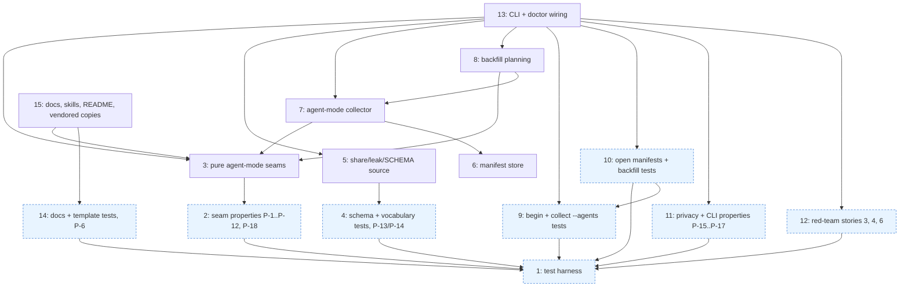

# Implementation Tasks: Agent-Mode Analytics

**Status:** Not Started
**Spec:** [requirements.md](requirements.md) · [design.md](design.md) · [test-plan.md](test-plan.md) · [PLAN.md](PLAN.md)

Naming rule for every task: test-plan.md "Harness Contract" fixes the names, CLI flags, JSON keys and file shapes the
tests call; design.md may add names but never rename those. Impl tasks implement design.md's functions and also
expose the Harness Contract name as a thin wrapper, exported lazily from `claude_kiro.analytics` (`_EXPORTS`):
`SPEC_AGENT_TYPES` (a `FrozenSet[str]` of the ten types; design's type-to-role map may live under another name),
`AGENT_CREATE_STEPS` (step name -> spec-create workflow label), `is_agent_run_id` (design `valid_run_id`),
`new_agent_run_id(taken, *, token=None)` (design `new_run_id`), `parse_agent_description(description, agent_type) -> dict`
with keys `run_id, role, matched, task, attempt, round, step` (design `parse_marker` + `match_agent`),
`implement_outcome(report)` (one-argument form of design A9), `implement_summary(report, *, done_at_start, start_ms,
end_ms, run_tasks) -> dict` (design A9 in full), `open_manifest_due(start_time, now, *, hours=6)` and `classify_manifest(manifest,
now)` (design A10 `manifest_start_ms` + `check_manifest` + `classify_open_manifest`, the same functions doctor and
`--all` call), `group_backfill(agents, *, gap_minutes=120) -> {"groups", "excluded"}` (a dict view over design A12
`candidate_reason` and A13 `group_agents`, the same two functions the CLI's backfill calls). The backfill reason
strings `workflow agent`, `not a spec agent type`, `carries a marker`, `no spec`, `no timing` are returned by
A12/A13 themselves, and `overlaps backfill record <id>` by `plan_backfill`'s overlap rule (A13 is pure); these are
exactly what the dry-run text and `--json` `excluded[].reason` print. On disk and in `--json` the Harness Contract spellings win (design.md uses them too): run
manifest `schema` is `ck-run-manifest/1` with `startTime` as its only clock field, backfill dry-run JSON uses
`excluded`, `--all` keeps `already had` / `already_had`. Every test drives the `ck` CLI through a subprocess
(`stats_helpers.stats` / `ck_sub`) or imports analytics seams inside test bodies; none imports `claude_kiro.cli`,
except TC-61, which calls `claude_kiro.cli.run.auto_collect_after_run` in-process as `tests/test_run.py` already
does for `ck run` code.

## Task Breakdown

### Task 1: Extend the stats test harness with Agent-tool subagents, manifests and spec repos
**Status:** Done
**Track:** test
**Requirements:** 1.2, 3.1, 3.4, 3.15, 6.1, 7.3, 9.1
**Description:** Build the shared test infrastructure that test-plan.md "Add to `tests/stats_helpers.py`" lists (items 1-11), so every other test task can write agent-mode fixtures without touching ck code. In `tests/stats_helpers.py` add:
1. `ToolAgentSpec` dataclass (`description`, `agent_type="spec:implementer"`, `model="claude-sonnet-5-5"`, `meta_model`, `requests` in the `AgentSpec` tuple shape, `duration_ms`, `started_at_ms`, `worktree_path`, `worktree_branch`, `extra_meta`, `meta=True`, `agent_id`).
2. `FakeSession.tool_agents(specs, *, start=...) -> FakeToolAgents`: writes `projects/<slug>/<sid>/subagents/agent-<id>.jsonl` (same line shape and timestamps as `_write_agent`) and `agent-<id>.meta.json` with the real-machine keys (`agentType`, `description`, `toolUseId`, `spawnDepth: 1`, `requestShape`, `requestNonInteractive`, `isBuiltIn: false`, plus `model`, `worktreePath`, `worktreeBranch` when set, then `extra_meta`); no start/end keys in the meta. Also appends the orchestrator's `Agent` `tool_use` line (no usage) to the session transcript. `FakeToolAgents` exposes `agent_ids`, `transcript(i)`, `meta_path(i)`, `drop_transcript(i)`, `truncate_transcript(i)`, `drop_meta(i)`, `corrupt_meta(i)` (writes `{not json`).
3. `AgentSpec.extra_meta` merged into workflow-agent metas (for 9.1 on workflow runs).
4. `marker(run_id)` and `described(run_id, rest)`.
5. `begin(env, cwd, kind="implement", spec="demo", into=None) -> (run_id, manifest_path)` running `ck stats begin ... --json` via `ck_sub` and asserting exit 0.
6. `backdate_manifest(path, hours)` (rewrites `startTime`, the manifest's only clock field) and `set_manifest(path, **keys)`.
7. `spec_repo(root, spec="demo", into="integrate/demo", tasks=4, deps=None)`: a real, unlanded git repo with `specs/<spec>/tasks.md` on `main` and branch `into`; plus the landing helpers `land(repo, spec, into, task, done=True)` (task branch merged with `git merge --no-ff -m "Merge feat/<spec>-task-N (task N)"` and marked Done), `fail(repo, spec, task)` (unlanded branch) and `mark_done(repo, spec, into, task)` (Done without a merge), following `tests/test_worktree_report.py`. Split so tests run `begin` after `spec_repo` and before landing, as a real run does (3.4 counts only merges this run made).
8. `logging_git(bin_dir, log)`: a `git` shim on PATH logging argv as JSON lines and exec'ing the real git (resolved with `shutil.which` before PATH changes).
9. `read_only(path)` context manager (chmod 0o500, restored on exit; callers skip as root).
10. `backfill_home(env, sessions, per_session)` with unmarked spec-type agents using old free-form descriptions.
11. `SPEC_TYPES` (the ten spec agent types) and `OLD_DESCRIPTIONS` (with `{spec}` and `{n}` slots).
Add self-checks to `tests/test_stats_helpers.py` that exercise only the harness (file layout, meta keys, the `tool_use` line, the fault injectors, `spec_repo` merge subjects and `ck worktree report --json` lists over it, `logging_git` logging, `read_only` restore, `backdate_manifest` arithmetic on a hand-written JSON file). The `begin` helper is not self-checked here (it needs the feature); it is exercised by Task 9. Fixture names use invented names only (`demo`, `ledger`, `calc`, the existing `CONFIDENTIAL` set). This task implements no TC directly; it is the infrastructure every TC in test-plan.md uses.
**Files:**
- `tests/stats_helpers.py` - add `ToolAgentSpec`, `FakeSession.tool_agents`, `FakeToolAgents`, `AgentSpec.extra_meta`, `marker`, `described`, `begin`, `backdate_manifest`, `set_manifest`, `spec_repo`, `land`, `fail`, `mark_done`, `logging_git`, `read_only`, `backfill_home`, `SPEC_TYPES`, `OLD_DESCRIPTIONS`
- `tests/test_stats_helpers.py` - self-checks of the new helpers
**Verify:** `uv run pytest -q tests/test_stats_helpers.py` `uv run pytest -q -n auto tests/test_stats_*.py tests/test_plugin.py tests/test_cost.py tests/test_worktree_report.py`
**Verifies:** None
**Acceptance:**
- [x] The fake layout matches the real Claude Code layout named in the requirements' Constraints (`projects/<proj>/<sid>/subagents/agent-<id>.{jsonl,meta.json}`, meta keys as listed), checked by a self-test that reads the written files back
- [x] `spec_repo` plus `land` / `fail` / `mark_done` produce a repo over which the real `ck worktree report <spec> --into <into> --json` returns the expected merged/done/failed/unstarted lists, with each `mergedAt` at or after the moment `land` ran (real git, real `ck worktree report`, no mocks of project code)
- [x] Fault injectors leave exactly the damage they name (dropped file absent, truncated file cut mid-line, corrupted meta not JSON)
- [x] The existing stats suite still passes unchanged with the extended helpers (`AgentSpec.extra_meta` defaults to `{}` and changes no existing fixture's bytes)
- [x] Project modules are imported inside test bodies only; no ck code is mocked
- [x] Helpers write no real project or client names
**Dependencies:** None
**Complexity:** Medium
**Risk:** normal

---

### Task 2: Property tests for the pure agent-mode decision seams
**Status:** Done
**Track:** test
**Requirements:** 1.1, 1.2, 2.1, 3.1, 3.4, 3.13, 3.17, 4.1, 4.2, 4.3, 4.4, 6.1, 6.2, 6.3, 6.6, 7.1, 7.2, 7.3, 7.4, 7.5, 7.6
**Properties:** P-1, P-2, P-3, P-4, P-5, P-7, P-8, P-9, P-10, P-11, P-12, P-18
**Description:** Write `tests/test_stats_properties_agents.py` with Hypothesis properties over the pure seams in test-plan.md's Harness Contract, imported inside test bodies from `claude_kiro.analytics`: `new_agent_run_id` (P-1), `is_agent_run_id` (P-2), `parse_agent_description` grammar, no-guess and marker rules (P-3, P-4, P-5), create-step parity with `parse_label` via `AGENT_CREATE_STEPS` (P-7), `implement_outcome` and the run-scoped `implement_summary` (`done_at_start` subsets, `mergedAt` just inside and outside `[start_ms, end_ms]`, outcome and failed/blocked/not-started limited to `run_tasks` with tasks outside it never changing the outcome and an empty set giving `None`, P-8), `open_manifest_due` incl. the exact 6 h boundary and offset surface forms, and its agreement with `classify_manifest` on whole manifests (P-9), `group_backfill` allowlist, partition, end-to-start gap with long agents, group bounds and spacing from spec-named agents only with joiners never moving them, and stable ids (P-10, P-11, P-12), and disjoint merged sets across same-session groups, spec-less joiners included (P-18). P-6 (doc templates) lives with the docs tests in Task 14 and P-13/P-14 (shareable records) with the schema tests in Task 4, so this file needs only the seams Task 3 owns. Each property uses the generator domain in its test-plan row, including every listed surface form and negative (fullwidth digits, trailing `\n`, `[CK:`, etc.). Settings: `@settings(derandomize=True, max_examples=200, database=None, deadline=None, suppress_health_check=list(HealthCheck))`. Declare `PROPERTIES = {"P-1": "...", ...}` mapping each of the twelve properties to its test function(s).
**Files:**
- `tests/test_stats_properties_agents.py` - P-1 to P-5, P-7 to P-12, P-18 and the `PROPERTIES` map
**Verify:** `uv run pytest -q tests/test_stats_properties_agents.py`
**Verifies:** Task 3 (owns every seam these properties call)
**Acceptance:**
- [x] Generators cover every surface form and negative listed in each P-row (near-miss ids, marker variants, old-style descriptions, timezone forms)
- [x] Settings are deterministic (`derandomize=True`, `database=None`)
- [x] Tests call the decision seams directly, not the CLI, and mock nothing
- [x] `PROPERTIES` lists exactly P-1 to P-5, P-7 to P-12 and P-18, each pointing at an existing test name, so `ck gate` sees full coverage
- [x] Before the implementation exists each test fails with `AttributeError` from `claude_kiro.analytics` (missing seam), not a collection error
**Dependencies:** Task 1 (uses `SPEC_TYPES`, `OLD_DESCRIPTIONS`, `described`)
**Complexity:** High
**Risk:** normal

---

### Task 3: Add the pure agent-mode rules (role grammar, run ids, markers, outcome, backfill grouping)
**Status:** Done
**Track:** impl
**Requirements:** 1.1, 2.2, 2.3, 3.4, 3.7, 3.13, 3.14, 3.17, 4.1, 4.2, 4.3, 4.4, 4.6, 6.1, 6.2, 6.6, 7.1, 7.2, 7.3, 7.4, 7.5, 7.6, 7.8
**Description:** Implement every pure Decision Seam of design.md except A15/A16. No I/O, no clock, no network; every input is an argument. This task owns the Harness Contract seams `SPEC_AGENT_TYPES`, `AGENT_CREATE_STEPS`, `is_agent_run_id`, `new_agent_run_id`, `parse_agent_description`, `implement_outcome`, `implement_summary`, `open_manifest_due`, `classify_manifest` and `group_backfill` (see the naming rule above) and adds all of them to `claude_kiro.analytics._EXPORTS`.
- `roles.py`: add constants `SPEC_AGENT_TYPES` (the ten `spec:*` and vendored `ck-*` types; keep design's type-to-role map alongside), `CREATE_STEPS` (literal step strings with lenses and consistency passes expanded: `review fidelity` ... `refute verification`, `consistency 1`, `consistency 2`, per design.md's step table), `CREATE_LENSES` (`fidelity`, `grounding`, `implementability`, `verification`), `CREATE_STEP_PHASES`, `AGENT_CREATE_STEPS` (keys = `CREATE_STEPS`); add `match_agent(rest, agent_type) -> LabelMatch` (A5: the description-template grammar of design.md "Description templates", anchored `fullmatch`, no stripping; verb sets the role family, `implement`/`revise` give `test-writer` for test-writer types else `implementer`; types outside `SPEC_AGENT_TYPES` take the role from the verb alone (4.6); `retry k` is attempt `k + 1`; `create <step>` delegates to the existing spec-create grammar `roles._create` on the equivalent workflow label from the step table so role/phase cannot drift; task ids `[0-9A-Za-z_]+`; anything else `other`, `matched=False`) and `match_legacy(description, agent_type) -> LegacyMatch` (A6: old `implement <spec>: task <N>`, `fix <spec>: ...`, `revise <spec> task <N>`, `review task <N>` forms; role from type refined by verb; `spec` None when absent). `match_label` stays byte-for-byte unchanged.
- New `agentrun.py`: `RUN_ID_RE`, `MARKER_RE`, `KINDS`, `STALE_MS`, `MERGE_SLACK_MS`, `MANIFEST_SCHEMA = "ck-run-manifest/1"`, `ALLOWED_PLACEHOLDERS = {"run_id", "N", "k"}`; dataclasses `Marker`, `MetaView`, `ReportSummary`, `ArgsDecision`, `BeginResult`, `FormatCheck`; seams A1 `valid_run_id`, A2 `new_run_id(taken, draw, attempts=64)`, A3 `parse_marker`, A4 `select_marked`, A7 `template_violations`, A8 `render_template` + `description_templates(markdown)`, A9 `implement_outcome(report, done_at_start=None, start_ms=None, end_ms=None, run_tasks=None)` (unknown report -> every field None, never empty tuples; `mergedAt` parsed with `datetime.fromisoformat`, `Z` read as `+00:00`; with `done_at_start` given, merged = (merged ∪ done) minus it; else merged = entries with `mergedAt` in `[start_ms, end_ms]`; failed/blocked/not-started limited to `run_tasks` when given and the outcome judged over them only, an empty `run_tasks` giving outcome None, `None` meaning the whole spec (D11); the one-argument Harness Contract form returns the outcome string or None, `implement_summary` returns the dict view), A10 `manifest_start_ms` + `check_manifest` (requires a parseable `startTime`, no `startMs`) + `classify_open_manifest(check, now_ms)` (strictly older than 6 h -> `collect`), with `open_manifest_due` and `classify_manifest` built on exactly these, A11 `decide_collect_args` (exact messages from design.md Error Handling 3.13/3.14/7.8; under `auto` id-format failures give `ok=False, exit_code=0`), A14 `agent_cost_label` (wraps existing `collect.cost_label`).
- New `backfill.py`: A12 `candidate_reason(meta)` returning the Harness reasons `workflow agent`, `carries a marker`, `not a spec agent type`; A13 `group_agents(agents, gap_ms) -> GroupPlan` with `BackfillAgent`, `BackfillGroup` (with `spec_agent_ids`), `GroupPlan` dataclasses, groups and their bounds formed from spec-named agents first and spec-less joiners attached afterwards without moving `start_ms`/`end_ms` (7.5, D15), the gap measured from the latest end among the members so far (a running maximum; the group's `end_ms` is that maximum) to the next start (7.3, P-11), reasons `no spec` and `no timing`, and `group_id(session_id, first_agent_id)` = `"ag_" + sha256("backfill\0"+sid+"\0"+first)[:8]`; spec-less attachment rule as design.md A13. `group_backfill` is only a dict view over `candidate_reason`, `match_legacy` and `group_agents` (no grouping logic of its own), so the properties check the functions the CLI runs.
**Files:**
- `src/claude_kiro/analytics/roles.py` - add `SPEC_AGENT_TYPES`, `CREATE_STEPS`, `CREATE_LENSES`, `CREATE_STEP_PHASES`, `AGENT_CREATE_STEPS`, `match_agent`, `match_legacy`, `LegacyMatch`
- `src/claude_kiro/analytics/agentrun.py` - new module: seams A1-A4, A7-A11, A14, their data classes, `is_agent_run_id`, `new_agent_run_id`, `parse_agent_description`, `implement_summary`, `open_manifest_due`, `classify_manifest`
- `src/claude_kiro/analytics/backfill.py` - new module: seams A12, A13, backfill data classes, `group_backfill`
- `src/claude_kiro/analytics/__init__.py` - export the Harness Contract seams in `_EXPORTS`
**Verify:** `uv run pytest -q tests/test_stats_properties_agents.py` `uv run pytest -q -n auto tests/test_stats_roles.py tests/test_stats_properties_roles.py tests/test_stats_label_corpus.py`
**Verified by:** Task 2 (properties over every seam this task owns)
**Acceptance:**
- [x] `valid_run_id` / `is_agent_run_id` accept only strings fully matching `ag_[0-9a-f]{8}`; `new_run_id` never returns an id in `taken` and raises after the attempt budget
- [x] `parse_marker` matches only at index 0; `select_marked` keeps exactly the metas carrying the given run's marker, in input order, regardless of agent type
- [x] Every template in the design table, rendered with sample values, is `matched` by `match_agent` for each spec agent type and `general-purpose`, with role, task, attempt (`retry k` -> `k + 1`) and round as specified; `create <step>` gives the same role and phase as the equivalent spec-create label
- [x] Unmatched descriptions give role `other`, `matched=False`, and no task/attempt/round
- [x] `template_violations` flags any placeholder outside `{run_id, N, k}` (so `<step>`, `<lens>`, `
` are flagged too) and any template not starting with `[ck:<run_id>] `
- [x] `implement_outcome` returns all-None for an unusable report and maps failed -> `failed`, blocked/not started -> `blocked`, else `complete`, judged over `run_tasks` only when given (tasks the run never named never change it; an empty set gives None); merged excludes `done_at_start`, or (unknown) any merge outside `[start_ms, end_ms]`
- [x] `classify_open_manifest` returns `collect` only when strictly older than 6 h, `malformed` on a failed check; `check_manifest` fails on a missing, naive or unparseable `startTime`
- [x] `decide_collect_args` exits 2 on every forbidden combination and bad `--gap`, points `--run ag_...` at `--agents`, and returns exit 0 for id errors under `--auto`
- [x] `candidate_reason` admits only unmarked spec-agent-type metas outside `subagents/workflows/` and returns the Harness reason strings otherwise; `group_agents` is deterministic (same input -> same group ids) and splits only where the end-to-start gap exceeds the threshold; a spec-less joiner never moves its group's `start_ms`/`end_ms`
- [x] `match_label` behaviour and all existing role tests are unchanged
**Dependencies:** Task 2 (its tests are the oracle)
**Complexity:** High
**Risk:** normal

---

### Task 4: Test the shareable `source` / `agent_transcripts` schema and leak vocabulary
**Status:** Done
**Track:** test
**Requirements:** 8.1, 8.2, 8.3, 8.4, 8.5, 8.6, 9.4
**Properties:** P-13, P-14
**Description:** Implement the seam half of the privacy boundary in `tests/test_stats_agents_schema.py` (a new file split out of test-plan.md's `test_stats_agents_share.py` so it runs before the agent-mode CLI exists): TC-49 (validator table: accepts no/`workflow`/`agents` source; rejects `Agents`, `agent`, `workflows`, `""`, `null`, `1`, and `cost.source` `claude_total`, `agent-transcripts`; messages never echo the bad value), TC-50 (`analytics/SCHEMA.md` documents `source` and `agent_transcripts`; `SCHEMA_SHARED == "ck-run-analytics/1"`), TC-51 (0.10.1 shareable fixture without `source` validates; an export into a kiro checkout already holding it leaves its bytes unchanged, using the existing `ck stats export` over a workflow record), the vocabulary half of TC-55 (`leak.VOCABULARY` holds `workflow`, `agents`, `agent_transcripts`), and Hypothesis properties P-13 (`build_shareable` over `seeded_local_record` variants with `source: "agents"` and agent-mode extras: `source`, `cost.source`, validity, no `CONFIDENTIAL` term, `ag_` id, session id, agent id or label) and P-14 (`validate_shareable` accept/reject table and the delete-`source` metamorphic rule), with `derandomize=True, max_examples=200, database=None, deadline=None, suppress_health_check=list(HealthCheck)` and a `PROPERTIES = {"P-13": ..., "P-14": ...}` map. Create the fixture `tests/fixtures/stats/shared_0_10_1.json` by hand from the current schema (no `source`), with invented values only.
**Files:**
- `tests/test_stats_agents_schema.py` - TC-49, TC-50, TC-51, TC-55 vocabulary half, P-13, P-14 and the `PROPERTIES` map
- `tests/fixtures/stats/shared_0_10_1.json` - a valid ck 0.10.1 shareable record without `source`
**Verify:** `uv run pytest -q -n auto tests/test_stats_agents_schema.py` `uv run pytest -q -n auto tests/test_stats_export.py tests/test_stats_leak.py tests/test_stats_submit.py`
**Verifies:** Task 5 (owns `SOURCES`, `source_of`, `COST_SOURCES`, the validator tree and `VOCABULARY`)
**Acceptance:**
- [x] Seam tests call `build_shareable`, `validate_shareable` and `leak.VOCABULARY` directly; the TC-51 export runs the real `ck stats export` against a real git kiro checkout and a fake `gh`
- [x] Leak assertions scan raw JSON bytes, not parsed fields only
- [x] The 0.10.1 fixture is checked to validate today (before the feature) so later failures point at a regression, not at the fixture
- [x] `PROPERTIES` lists P-13 and P-14, each pointing at an existing test name
- [x] Before the implementation exists the new-schema tests fail for the right reason (no `source` in shareable output, `agent_transcripts` rejected, `SOURCES` missing), not broken fixtures
- [x] No mocks of the project's own code; existing export/leak/submit tests are not edited
**Dependencies:** Task 1 (uses `CONFIDENTIAL`, `seeded_local_record`, `kiro_checkout`, `fake_gh`)
**Complexity:** Medium
**Risk:** safety (oracle for what leaves the machine in shared records; a missed leak is irreversible once exported)

---

### Task 5: Add `source` and `agent_transcripts` to the shareable schema and extend the leak check
**Status:** Done
**Track:** impl
**Requirements:** 8.1, 8.2, 8.3, 8.4, 8.5, 8.6, 9.3, 9.4
**Description:** In `share.py`: `COST_SOURCES` becomes `("priced_from_transcripts", "estimate", "agent_transcripts")`; add `SOURCES = ("workflow", "agents")` and `source_of(local)` (A15: `"agents"` iff `local.get("source") == "agents"`, else `"workflow"`); `_TREE` gains optional `"source": _enum(SOURCES)`; `build_shareable` sets `source` via `source_of` and passes the run cost source through unchanged; `_MISSING_MAP` gains `"manifest": "runfile"` and `"outcome": "result"`. `REQUIRED` stays unchanged and no other field is added: the allowlist construction must give run id, session id, agent ids, labels, `agentRun`, `partial` and `project.*` no path into the shared record. In `leak.py`: `_vocabulary()` adds `share.SOURCES` (`agent_transcripts` arrives via `COST_SOURCES`); `GENERIC_PATTERNS` gains `("agent_run_id", "id", re.compile(r"\bag_[0-9a-f]{8}\b", re.I))`. `build_terms` is not changed (record `terms` carry the new values once Task 7 lands). In `analytics/SCHEMA.md`: document `source` (enum `agents`, `workflow`), `cost.source` with `agent_transcripts`, the sources and cost-sources fixed-enum lines, and the `agent_run_id` generic pattern, keeping the schema id `ck-run-analytics/1`; follow the format `tests/test_stats_export.py` and `tests/test_stats_leak.py` already check. This task owns the Harness Contract names `share.SOURCES` and the extended `share.COST_SOURCES`.
**Files:**
- `src/claude_kiro/analytics/share.py` - `SOURCES`, `source_of`, `COST_SOURCES`, `_TREE` `source`, `_MISSING_MAP`, `build_shareable`
- `src/claude_kiro/analytics/leak.py` - `_vocabulary()` includes `SOURCES`; `agent_run_id` generic pattern
- `analytics/SCHEMA.md` - document `source`, `agent_transcripts`, `agent_run_id`
**Verify:** `uv run pytest -q -n auto tests/test_stats_agents_schema.py` `uv run pytest -q -n auto tests/test_stats_export.py tests/test_stats_leak.py tests/test_stats_submit.py tests/test_stats_properties_share.py tests/test_stats_properties_enums.py`
**Verified by:** Task 4 (schema, validator and vocabulary tests plus P-13/P-14)
**Acceptance:**
- [x] A shareable record built from a local record with `source: "agents"` has `source: "agents"`; one from a record without `source` has `source: "workflow"`
- [x] `validate_shareable` accepts records with or without `source`, rejects any other `source` value and any `cost.source` outside the three documented values
- [x] Existing 0.10.1 shareable records validate and submit exactly as before; schema id stays `ck-run-analytics/1`
- [x] SCHEMA.md documents `source` and `agent_transcripts`, and the existing doc-vs-validator tests pass
- [x] `workflow`, `agents`, `agent_transcripts` are never leak hits; any `ag_<8 hex>` string in an export or note is a hit
- [x] No run id, session id, agent id, description, spec name, path or branch can reach a shareable record
**Dependencies:** Task 4 (its tests are the oracle)
**Complexity:** Medium
**Risk:** safety (governs what leaves the machine in shared records and the leak gate before export; a leak is irreversible)

---

### Task 6: Add run-manifest storage next to the local record store
**Status:** Done
**Track:** impl
**Requirements:** 1.1, 1.2, 3.8, 6.6
**Description:** Foundation task. Extend `store.py` with the manifest locations and I/O from design.md "Python entry points": `open_manifests_dir` (`<data_dir>/runs-open`), `closed_manifests_dir` (`<data_dir>/runs-closed`), `manifest_path(run_id)` (open first, then closed, else None), `write_manifest(manifest)` (into runs-open, through the existing `write_private_json` so files are 0600 and created directories 0700), `read_manifest(run_id) -> (data, "open"|"closed"|"missing"|"malformed")` (unparseable JSON is `malformed`; never echo contents in errors), `iter_open_manifests()`, `close_manifest(run_id, closed_at)` (sets `closedAt`, then `os.replace` into runs-closed; no deletion), `taken_run_ids()` (file stems in runs-open, runs-closed and runs). Format checks beyond JSON parsing are left to callers (`agentrun.check_manifest`), so this task has no dependency on Task 3. All functions take the existing `env=None` argument for the data directory, like the rest of `store.py`.
**Files:**
- `src/claude_kiro/analytics/store.py` - manifest directories, read/write/iterate/close, `taken_run_ids`
**Verify:** `uv run python -c "from claude_kiro.analytics import store; store.open_manifests_dir; store.write_manifest; store.read_manifest; store.iter_open_manifests; store.close_manifest; store.taken_run_ids"` `uv run pytest -q -n auto tests/test_stats_collect.py tests/test_stats_show.py`
**Verified by:** None
Foundation task: its tests drive `ck stats begin` / `collect`, so its criteria are verified at Task 13 (Tasks 9, 10).
**Acceptance:**
- [x] `write_manifest` creates `runs-open/<run_id>.json` with mode 0600 and the directory with mode 0700 when it creates it
- [x] `read_manifest` reports `open`, `closed`, `missing` or `malformed` correctly and never raises on bad JSON
- [x] `close_manifest` moves the file to `runs-closed/` with `closedAt` set, so `iter_open_manifests` no longer lists it
- [x] `taken_run_ids` contains every id in runs-open, runs-closed and runs
- [x] Existing record-store behaviour and tests are unchanged
**Dependencies:** None
**Complexity:** Low
**Risk:** normal

---

### Task 7: Build the agent-mode collector (begin, marked-agent discovery, record building, open-manifest sweep)
**Status:** Done
**Track:** impl
**Requirements:** 1.1, 1.2, 1.5, 1.7, 3.1, 3.2, 3.3, 3.4, 3.5, 3.6, 3.7, 3.8, 3.9, 3.10, 3.11, 3.12, 3.15, 3.17, 3.18, 4.4, 4.5, 5.5, 6.3, 6.5, 6.6, 6.7, 9.1, 9.2
**Description:** Foundation task (its behaviour is reached only through the CLI of Task 13).
- `collect.py`: `_Agent` gains `agent_type: Optional[str] = None`; `_build_agent` gains a `matcher` argument `(label, agent_type) -> LabelMatch` (workflow paths pass a wrapper around today's `roles.match_label(label, workflow_name)`), and its info dict gains `"terms"` with the meta's `worktreePath` and `worktreeBranch` when present (9.1, for workflow runs too); `_costs` gains `transcript_source="priced_from_transcripts"`; `_build_record` gains keyword `agent_run=None`. With `None` it behaves exactly as today plus the worktree terms. With `None`, a workflow record whose metas have no worktree keys must re-collect `unchanged`, and one whose metas have them changes only in `terms` (3.18). With an `AgentRunContext` it uses the context's matcher, passes `timing_from_transcript=True` for every agent whatever `partial` is, never adds the `result` missing entry, sets `start_ms` from the context (parsed manifest `startTime`, else the earliest agent `first_ts`) and `wall_ms` = latest agent `last_ts` minus that start (design.md Components, `_build_record`), takes `project.root/spec/branch` from the context (never from descriptions), adds run id, spec, root and target branch to `terms`, writes `source: "agents"`, `partial`, `agentRun`, `mode` (create/review), sets the run cost source via `agentrun.agent_cost_label`, and replaces `_workflow_metrics` with `agentcollect.agent_metrics`. `collect_all`, `collect_run`, `write_outcome_result` stay unchanged.
- New `agentcollect.py` (design.md "Python entry points" and Data Models): `AgentFile`, `AgentRunContext` (with `end_ms`); `begin_run` (A2 over `store.taken_run_ids` with `secrets.token_hex(4)`, drawing first from `CK_TEST_RUN_ID_DRAWS` when that env var is set, project root from `git rev-parse --show-toplevel`, target from `into` or the current branch, session from the argument or `bench.latest_session` limited to the cwd's Claude project directory, manifest `agents` = `agents.resolve(...)["roles"]` projected to model/effort/enabled for the seven config roles, `reviewer_risky` derived from the reviewer's `risky_model`/`risky_effort`/`enabled` as spec-implement.js does, keys a role lacks `null` (never `allowed_domains`, `machine_label`, `sources` or `runtime`, 1.2), `doneAtStart` from `specs/<spec>/tasks.md` on the target via `git show` (null when unreadable); every lookup degrades to null; at most three git subprocesses; writes the Harness Contract manifest keys `schema`, `runId`, `kind`, `startTime`, `sessionId`, `ckVersion`, `spec`, `root`, `into`, `doneAtStart`, `agents` (no `startMs`); catches `OSError` from `store.write_manifest` and returns `BeginResult(manifest_path=None, warning=...)`); `find_marked_agents(home, run_id, session_id, workers=8)` (manifest session first, else the full `projects/*/*/subagents/agent-*.meta.json` glob, metas read with a `ThreadPoolExecutor`, results in input order, skipping `subagents/workflows/`; counts unparseable metas); `collect_agent_run` (errors `not_found` with the searched directories, `no_agents` and `malformed` as in Error Handling 3.11/3.12 and "3.3 (malformed manifest)"; missing manifest -> partial context with root/branch from the session head, `missing += manifest`, kind `create` iff every marked agent matched a `create <step>` template else `implement`, no report (3.10)); `_git_report` calling `claude_kiro.worktrees.report(root, spec, into=...)` in-process and returning None on any failure; `agent_metrics` (implement: A9 over the report with the manifest's `doneAtStart`, the start, `end_ms` = latest agent end + `MERGE_SLACK_MS`, and `run_tasks` = the non-null `task` of the run's agent rows (of `ctx.spec_agent_ids` only when set, backfill), so the outcome covers only the tasks this run worked on (D11), `tasks`, `stats`, `reportSource: "git"`, `missing += outcome` when the report is unavailable; create/review: outcome None and no report call); `finish_collected` (`write_outcome_result` then `close_manifest` on success only); `collect_open_manifests` (A10 per open manifest: `collect` -> partial collect + close, `young` -> unfinished, malformed -> failed `run manifest not recognised` without echoing contents, `no_agents` (none in any session) -> close with `abandoned: true` and return an `abandoned` outcome that is not a failure (6.5); never searches for manifest-less marked agents or runs backfill); `session_agent_runs(home, session_id, since_ms)` for the `ck run` sweep (5.5: open manifests of that session, or session-less ones started at or after `since_ms`; never a manifest with another session's id (D13) and never a marked run id without a manifest (3.17, 6.7, D14)).
- `agentcollect.py` must not price or aggregate on its own: it builds `_Agent` lists and calls `collect._build_record(..., agent_run=ctx)`.
**Files:**
- `src/claude_kiro/analytics/collect.py` - `_Agent.agent_type`, `_build_agent(matcher)` + worktree terms, `_costs(transcript_source)`, `_build_record(agent_run=...)`
- `src/claude_kiro/analytics/agentcollect.py` - new module: begin, discovery, run collection, git report, metrics, finish, open-manifest sweep, `session_agent_runs`
**Verify:** `uv run python -c "from claude_kiro.analytics import agentcollect; agentcollect.begin_run; agentcollect.collect_agent_run; agentcollect.finish_collected; agentcollect.collect_open_manifests"` `uv run pytest -q -n auto tests/test_stats_collect.py tests/test_stats_auto.py tests/test_stats_show.py tests/test_cost.py tests/test_worktree_report.py`
**Verified by:** None
Foundation task: Tasks 9, 10, 11 and 12 reach this code only through the CLI of Task 13, so its criteria are verified there.
**Acceptance:**
- [x] A collected run contains exactly the agents whose meta description starts with that run's marker; unmarked `general-purpose` agents and other runs' agents are never included
- [x] Per-agent model, tokens, cost and timing reuse the workflow collector; the run's priced total equals `ck cost` over the same transcripts to the cent; run cost source is `agent_transcripts` when all agents are transcript-priced, else `estimate`
- [x] Spec, root, target branch and kind come from the manifest and appear only in the local record and its `terms`, together with the run id and every meta `worktreePath`/`worktreeBranch`
- [x] Implement runs take failed/blocked/not-started and outcome from the in-process git report over the tasks this run's agent rows name only, and merged only for this run (minus `doneAtStart`, else within the start..end window); any report failure gives unknown (None) counts and a `missing` `outcome` entry, and the record is still written; create/review never run the report
- [x] A complete agent-mode record has no `result` missing entry and a non-null `wallMs`
- [x] Missing manifest with marked agents gives a partial record with `missing` `manifest` and the kind from the matched templates; neither gives `not_found` naming the searched directories; manifest without marked agents gives `no_agents` and leaves the manifest open; a malformed manifest gives `malformed` and is left untouched
- [x] `collect_open_manifests` closes a stale manifest with no marked agent anywhere as `abandoned` and does not report it as failed
- [x] Missing/truncated transcripts or unparseable metas are listed in `missing` and never shown as zero
- [x] Re-collecting gives `unchanged` or `updated`; the manifest is closed only after a successful write
- [x] `begin_run` writes a 0600 manifest with the documented keys (role projection only, `doneAtStart`), makes no network call, honours `CK_TEST_RUN_ID_DRAWS`, and returns an id plus warning when the write fails
- [x] `collect_open_manifests` collects only manifests strictly older than 6 h, counts younger ones unfinished, malformed ones failed without printing contents
- [x] Every existing workflow-collection, show and cost test passes unchanged
**Dependencies:** Task 3 (calls `match_agent`, `agentrun` seams), Task 6 (calls the manifest store functions)
**Complexity:** High
**Risk:** safety (fills the confidential-terms list the leak gate uses before records leave the machine, and closes run manifests)

---

### Task 8: Add backfill planning and writing for older implement-mode runs
**Status:** In Progress
**Track:** impl
**Requirements:** 7.1, 7.2, 7.3, 7.4, 7.5, 7.6, 7.7
**Description:** Foundation task (reached only through `ck stats collect --agents-backfill` in Task 13). In `agentcollect.py` add `BackfillPlan` and `plan_backfill(home, gap_minutes=120, pricing=None)`: read every `projects/*/*/subagents/agent-*.meta.json` in parallel (8 workers, input order kept), filter with `backfill.candidate_reason`, parse spec/role/task with `roles.match_legacy`, scan only candidate transcripts for start/end timestamps and a priced estimate, memoise session heads, group with `backfill.group_agents` (the same two functions behind the Harness `group_backfill`, so the dry run prints exactly their reason strings), and apply the design.md overlap rule: a group that shares an agent with an existing backfill record whose agent-id set is not exactly the group's is left out with reason `overlaps backfill record <id>` and the existing record is kept (7.6). Add `collect_backfill(home, plan, now=...)`: for each group build an `AgentRunContext` (`partial=True`, `backfill=True`, `manifest="missing"`, `gapMinutes`, spec from the group, root from the session head cwd, target from its `gitBranch`, matcher `match_legacy`, `spec_agent_ids` = the group's spec-named agents) and call `collect._build_record(..., agent_run=ctx)`; the implement outcome uses A9 with `done_at_start=None`, `start_ms` = group start and `end_ms` = group end + `min(MERGE_SLACK_MS, gap)`, both bounds from spec-named agents only, and `run_tasks` = the tasks the spec-named agents name; spec-less joiners add their cost and time to the record only (7.5, D11, D15). Record ids are the A13 group ids so a second run yields `unchanged`. No new pricing path.
**Files:**
- `src/claude_kiro/analytics/agentcollect.py` - `BackfillPlan`, `plan_backfill`, `collect_backfill`
**Verify:** `uv run python -c "from claude_kiro.analytics import agentcollect; agentcollect.plan_backfill; agentcollect.collect_backfill"` `uv run pytest -q -n auto tests/test_stats_collect.py tests/test_stats_perf.py`
**Verified by:** None
Foundation task: Task 10 reaches this code only through the CLI of Task 13, so its criteria are verified there.
**Acceptance:**
- [ ] Only unmarked agents of spec agent types outside Workflow-tool directories are considered; `general-purpose` and workflow agents never appear in a group
- [ ] Groups are by session, then legacy-parsed spec, split where the end-to-start gap exceeds the threshold; spec-less agents join a nearby group or are left out as `no spec`
- [ ] The plan carries, per group, session, spec, agent count, start, wall time and estimated cost, plus the excluded agents with reasons, and writes nothing
- [ ] Written records are partial, have `source: "agents"`, `missing` `manifest`, root and branch from the session, and the git-report outcome rules of 3.4-3.5
- [ ] Running backfill twice gives the same record ids and `unchanged` results, with no duplicate or overlapping records; regrouping with another `--gap` leaves overlapping groups out and never changes existing records
- [ ] Merges are credited only inside each group's window, set by its spec-named agents, so two same-session groups of one spec never share a merged task; a spec-less joiner adds cost and time but never moves the window or the record's start and wall time
- [ ] A 50-session dry-run fixture plans in under 30 s
**Dependencies:** Task 3 (calls `candidate_reason`, `group_agents`, `match_legacy`), Task 7 (edits `agentcollect.py` it creates and calls `_build_record(agent_run=...)`)
**Complexity:** Medium
**Risk:** normal

---

### Task 9: Test `ck stats begin` and `ck stats collect --agents` (grouping, pricing, outcome, attribution, `--auto`)
**Status:** Done
**Track:** test
**Requirements:** 1.1, 1.2, 1.3, 1.4, 1.5, 1.7, 3.1, 3.2, 3.3, 3.4, 3.5, 3.6, 3.7, 3.8, 3.9, 3.10, 3.11, 3.12, 3.13, 3.14, 3.15, 3.16, 3.17, 3.18, 4.1, 4.2, 4.3, 4.4, 4.5, 4.6, 5.2, 5.3, 5.4, 5.5
**Description:** Implement the run-start and collector boundaries through the real CLI inside `fresh_env()` with `no_network`. Implement-run fixtures call `begin` after `spec_repo` and land tasks with `land` / `fail` / `mark_done` afterwards, as a real run does; landing before `begin` is how a test builds a resumed spec.
`tests/test_stats_agents_begin.py` (real CLI subprocess, real git, real store): TC-1 (JSON shape, `^ag_[0-9a-f]{8}$`, manifest keys incl. `root` = repo top level from a subdirectory, `into` from current branch, `doneAtStart` `[]` over a `spec_repo` and `null` without a tasks.md, `agents` equal to the model/effort/enabled projection of `ck agents --json` `roles` for the seven config roles (`reviewer_risky` from the reviewer's risky keys), no `allowed_domains`/`machine_label`/`sources`/`runtime` key and no planted `CONFIDENTIAL` machine label or allowed domain in the manifest bytes, mode 0600 / dir 0700), TC-2 (text mode, `--into`, `--kind review`), TC-3 (with `CK_TEST_RUN_ID_DRAWS` whose first three draws are a record id, an open manifest id and a closed manifest id, `begin` prints the fourth; plus 30 distinct ids without the hook), TC-4 (table of bad `--kind`/`--spec`: exit 2, usage names the three kinds, no store files), TC-5 (read-only store: exit 0, valid id, `manifest` null in JSON, stderr warning, no file), TC-6 (begin minus `--version` baseline under 1 s, net log empty), TC-59 (directories ck created 0700, manifest 0600; record 0600 after `collect --agents`).
`tests/test_stats_agents_collect.py` (CLI `collect`, `cost`, `show`, `doctor`): TC-13 (marked agents of five roles collected, unmarked `general-purpose`, other-id `spec:implementer` and a workflow run excluded; `source: "agents"`, `workflow: "spec-implement"`, project from manifest, no description holds the spec, run cost `agent_transcripts`, no `result` in `missing` and a non-null `wallMs`, agents timed after the manifest start, text mode prints path; the manifest backdated 7 h before the collect, so afterwards `ck doctor` reports none and `collect --all` neither collects nor counts it), TC-14 (per-agent model/tokens/usd/ms from transcripts; run `usd` = sum of agents = `ck cost --session <sid> --json` `priced_usd` to the cent), TC-15 (session lookup order a/b/c), TC-16 (`begin`, then landing, parametrized states -> `complete`/`failed`/`failed`/`blocked`; `tasks_merged` = (report merged ∪ done) minus `doneAtStart`, `tasks_not_started` = unstarted + blocked; resumed spec with task 1 landed before `begin` and task 2 after -> `tasks_merged == 1`; `doneAtStart` null -> only merges from the start to 30 min after the last agent's end; agent transcripts timed after `begin` around the landings; agents name every task in the four states; partial run naming only task 1 (task 2 failed before `begin`, 3-4 unstarted) -> `complete` / `failed` by task 1 alone with failed and not-started counts 0, tasks 1 and 3 with 3 unstarted -> `blocked`, no named task -> outcome null (D11)), TC-17 (root deleted / plain dir / `into` deleted / no tasks.md -> record written, outcome null, `missing` outcome, counts keys absent), TC-18 (create/review kinds with `logging_git`: outcome null, `spec-create` + mode, no `show <into>:specs/<spec>/tasks.md` call), TC-19 (`unchanged` then `updated`, one file), TC-20 (no manifest -> partial, `missing` manifest, root = session cwd, spec/outcome null, `spec-implement`; all-`create <step>` variant -> `spec-create`, no report git call), TC-21 (neither -> non-zero, names both directories, store unchanged), TC-22 (manifest, no marked agents -> non-zero, "no agents carry the marker", manifest still open), TC-23 (id format table, `--run ag_...` points to `--agents`), TC-24 (option combinations exit 2), TC-25 (five fault kinds; `missing` per agent; cost `estimate`; dropped transcript's figures null; truncated transcript, built with one complete request before the cut, has `transcript-truncated` missing and no figure equal to 0 (non-zero partial figures allowed); corrupted/dropped meta never a zero row), TC-26 (unreadable `projects/` -> "outside the sandbox", no record, manifest open), TC-27 (unmarked / unknown-id / mid-string / `[CK:` / `[ck: ` markers never collected, by `--agents` or `--all`), TC-28 (metamorphic: workflow record byte-identical with and without agent-mode data present, re-collect `unchanged`; variant with worktree keys in the workflow metas: `updated` once with only `terms` changed, then `unchanged`), TC-29 (role/task/attempt/round table incl. `ck-*` types and `general-purpose` verb-only rows (4.6), meta model wins over transcript model, each row equals `parse_agent_description`), TC-30 (create run of `general-purpose` agents per `AGENT_CREATE_STEPS` step has the same role/phase lists as the workflow spec-create run), TC-31 (non-template marked descriptions -> `other`, unmatched count 4, `ck stats show` `other:` line with agents, minutes, dollars), TC-33 (`--auto` table: exit 0, one line with path or reason + retry command), TC-34 (setting off: skipped, no record, manifest open; manual collect works), TC-58 (read-only store + unreadable home: `begin` exit 0 with id, `--auto` exit 0 with one line), TC-61 (`CK_RUN_SANDBOXED=1` deferral line, naming `ck stats collect --agents <id>` for a run without a manifest, with the manifest left open; then `claude_kiro.cli.run.auto_collect_after_run` in-process collects the session's own manifest run and a session-less manifest started after the session, one `stats:` line each, and leaves another session's open manifest open and a manifest-less marked run without a record (D13, D14); workflow run still collected). Also TC-56 (100-agent run collected in under 5 s) in `tests/test_stats_perf.py`.
**Files:**
- `tests/test_stats_agents_begin.py` - TC-1 to TC-6, TC-59
- `tests/test_stats_agents_collect.py` - TC-13 to TC-34 (except TC-32, a docs test in Task 14), TC-58, TC-61
- `tests/test_stats_perf.py` - add TC-56 (agent-mode collect of 100 agents under 5 s)
**Verify:** `uv run pytest -q tests/test_stats_agents_begin.py` `uv run pytest -q -n auto tests/test_stats_agents_collect.py` `uv run pytest -q tests/test_stats_perf.py`
**Verifies:** Task 13 (the `begin` / `collect --agents` CLI these tests drive, built on Tasks 3, 6 and 7)
**Acceptance:**
- [x] Every test exercises the real boundary: the `ck` CLI as a subprocess over a fake Claude home with the real transcript/meta layout, real store, real git and the real `ck worktree report` / `ck cost` (no mocks of the project's own code)
- [x] Permissions are checked on the real filesystem; network asserted absent via `$CK_TEST_NET_LOG`
- [x] Cost agreement is checked against `ck cost`, not against a number computed in the test
- [x] Unknown values are asserted `null`, never `0`, wherever the requirements say "unknown"
- [x] Manifest open/closed state is observed only through `ck doctor` and `collect --all`, not by reading store internals the design may change
- [x] Before the implementation exists the tests fail for the right reason (click "No such command" for `begin`, "No such option: --agents", `AttributeError` from `claude_kiro.analytics` seams), not because of broken fixtures
- [x] The existing workflow-run tests are not edited (TC-28 proves compatibility metamorphically)
**Dependencies:** Task 1 (uses `ToolAgentSpec`, `tool_agents`, `begin`, `read_only`, `spec_repo`, `land`, `fail`, `mark_done`, `logging_git`, `backdate_manifest`, `set_manifest`)
**Complexity:** High
**Risk:** safety (oracle for closing run manifests after collect; a wrong close or a mis-grouped agent loses or misattributes a run's data)

---

### Task 10: Test open manifests (`ck doctor`, `collect --all`) and `--agents-backfill`
**Status:** Done
**Track:** test
**Requirements:** 6.1, 6.2, 6.3, 6.4, 6.5, 6.6, 6.7, 7.1, 7.2, 7.3, 7.4, 7.5, 7.6, 7.7, 7.8, 7.9
**Description:** Implement the two recovery flows through the real CLI in `fresh_env()` with `no_network`.
`tests/test_stats_agents_open.py`: TC-35 (in a `ck init` project, two manifests backdated 7 h and one 5 h with `CONFIDENTIAL` specs/roots/branches: `ck doctor` warns "2" open runs, suggests `ck stats collect --all`, prints no `CONFIDENTIAL` term; only the 5 h manifest -> no warning), TC-36 (`collect --all` summary `collected: 2`, `unfinished: 1`, `failed: 0`, existing `already had` / `already_had` spellings; stale record partial and its manifest closed; young untouched and open; nothing recorded for marked agents without a manifest or for unmarked spec-type agents), TC-37 (stale manifest without marked agents in any session -> reported once as `abandoned` with "no agents carry the marker", `abandoned: 1`, `failed: 0`, exit 0, no record, workflow run still collected; a second `--all` and `ck doctor` do not mention it), TC-38 (truncated-JSON and list-JSON manifests -> both failed without printing `zephyr-payroll`; `ck doctor` separate warning counting 2 unreadable manifests; `collect --agents <that id>` exit 1 `run manifest not recognised`, no record, manifest bytes unchanged; `--auto` exit 0 one line).
`tests/test_stats_agents_backfill.py`: TC-39 (dry run text and `--json` with `groups` and `excluded`: groups with session, spec, count, start, wall time, cost; excluded agents with reasons; store bytes unchanged), TC-40 (only unmarked spec-type agents grouped; `general-purpose`, marked and workflow agents never), TC-41 (session/spec/gap grouping incl. `--gap 300` and `--gap 30`; a 150-minute agent followed 10 minutes after its end stays one group under the default gap), TC-42 (spec-less `review task 4 diff` joins the group within gap, else excluded "no spec"; a joiner between two close groups leaves the first group's `start` and `wallMinutes` unchanged while adding to its `agents` and `usd`, D15), TC-43 (write: one partial record per group, `missing` manifest, `source: "agents"`, outcome from git report with merges inside the group window, root/branch from session; gone cwd -> outcome null + `missing` outcome), TC-44 (rerun: same file names, `already had: N` = group count, `--json` `results[].result` all `unchanged`), TC-45 (no candidates -> says so, exit 0, with and without `--dry-run`), TC-46 (`--gap` `0`, `-5`, `abc`, `1.5`, `""` -> exit 2, nothing written), TC-47 CLI half (summary lines `collected`, `already had`, `updated`, `failed`, `left out`; `--json` `already_had` and `excluded`), TC-60 (backfill with the default gap, then `--gap 30` dry run lists `overlaps backfill record <id>`, then `--gap 30` write: no agent in two records, record files unchanged, total `usd` unchanged). Also TC-57 (`backfill_home` 50 sessions x 6 agents, dry run under 30 s) in `tests/test_stats_perf.py`, added after Task 9's TC-56 test in the same file.
Age is controlled by backdating whole hours (5 h vs 7 h); the clock is not faked.
**Files:**
- `tests/test_stats_agents_open.py` - TC-35 to TC-38
- `tests/test_stats_agents_backfill.py` - TC-39 to TC-46, CLI half of TC-47, TC-60
- `tests/test_stats_perf.py` - add TC-57 (backfill dry run perf)
**Verify:** `uv run pytest -q tests/test_stats_agents_open.py` `uv run pytest -q -n auto tests/test_stats_agents_backfill.py` `uv run pytest -q tests/test_stats_perf.py`
**Verifies:** Task 13 (the doctor, `collect --all` and `--agents-backfill` CLI these tests drive, built on Tasks 7 and 8)
**Acceptance:**
- [x] Tests run the real `ck doctor` and `ck stats collect --all` / `--agents-backfill` CLI over fake Claude homes, a real store and real git repos (`spec_repo`), the boundary named in the test plan; no mocks of project code
- [x] Dry-run tests compare `store_files(xdg)` before and after to prove nothing was written
- [x] Doctor and failure output are scanned for every `CONFIDENTIAL` term
- [x] Before the implementation exists the tests fail for the right reason (missing doctor warning, unknown `--agents-backfill` option), not broken fixtures
**Dependencies:** Task 1 (uses `begin`, `backdate_manifest`, `spec_repo`, `land`, `fail`, `backfill_home`, `tool_agents`), Task 9 (both add to `tests/test_stats_perf.py`; append after it to avoid an edit conflict)
**Complexity:** High
**Risk:** safety (oracle for `collect --all` closing stale manifests and backfill writing records; a wrong close or a wrong group loses or corrupts run history)

---

### Task 11: Test agent-mode privacy end to end and the CLI-wide properties
**Status:** Done
**Track:** test
**Requirements:** 3.2, 5.2, 8.1, 8.2, 8.5, 9.1, 9.2, 9.3, 9.4
**Properties:** P-15, P-16, P-17
**Description:** The CLI half of the privacy boundary plus the collector-wide properties. Implement-run fixtures that need a git outcome call `begin` after `spec_repo` and land with `land` / `fail` afterwards (Task 1).
`tests/test_stats_agents_share.py`: TC-48 (agent-mode run with `CONFIDENTIAL` spec/root/branch/worktree paths/branches/descriptions plus a workflow run, collected and exported with `ck stats export --to <kiro checkout> --yes`: `source` values and `cost.source: "agent_transcripts"`; `all_bytes(analytics/)` holds no confidential term, run id, session id, agent id, description or worktree value; both files pass `validate_shareable` and `assert_documented`), TC-52 (parametrized workflow and agent mode: `worktreePath`/`worktreeBranch` values in `record["terms"]`; `confidential_terms([record])` superset of a probe's), TC-53 (manifest spec, root, `into`, `ag_` id in confidential terms), TC-54 (pty `World` flow: a drafted note holding the worktree path, the worktree branch, or the run id -> leak hit with note pseudo-path and line, no note written), the export half of TC-55 (an exported agent-mode record has no leak hits against its own terms).
`tests/test_stats_properties_agents_cli.py`: P-15 (for 1-6 marked agents over three model families plus an unknown model, token counts 0-1e6 and duplicated `requestId`s split across lines, the collected run `usd` equals the sum of agent `usd` and `ck cost --session <sid> --json` `priced_usd` to the cent, or both unknown together), P-16 (for any `worktreePath`/`worktreeBranch` surface form: absolute, relative, `..`, trailing `/`, `~/`, spaces, unicode, Windows-style; branches nested and unicode, values mixed from `CONFIDENTIAL`, `confidential_terms([record])` is a superset of a probe's and of the manifest's spec/root/into and run id), P-17 (for any id string incl. P-2 negatives and shell-hostile strings, and any failure state: no manifest, no agents, unreadable projects, malformed manifest, read-only store, setting off, `ck stats collect --agents <id> --auto` exits 0 and prints exactly one line). Every example is built inside `with fresh_env() as env:` and runs the real CLI. Settings: `derandomize=True, max_examples=20, database=None, deadline=None, suppress_health_check=list(HealthCheck)`. Declare `PROPERTIES = {"P-15": ..., "P-16": ..., "P-17": ...}`.
**Files:**
- `tests/test_stats_agents_share.py` - TC-48, TC-52 to TC-54, export half of TC-55
- `tests/test_stats_properties_agents_cli.py` - P-15 to P-17 and the `PROPERTIES` map
**Verify:** `uv run pytest -q -n auto tests/test_stats_agents_share.py` `uv run pytest -q -n auto tests/test_stats_properties_agents_cli.py`
**Verifies:** Task 13 (the `begin` / `collect --agents` / export CLI these tests drive, built on Tasks 5 and 7)
**Acceptance:**
- [x] Export tests run the real `ck stats collect` and `ck stats export` against a real git kiro checkout and a fake `gh`; the note test runs under a pty with the fake `claude` drafter
- [x] Leak assertions scan raw bytes of every exported file, not parsed fields only
- [x] Property generators cover every surface form and negative listed in the P-15 to P-17 rows; each example has its own isolated env
- [x] The decision is checked against `ck cost` and `confidential_terms`, not re-implemented in the test
- [x] `PROPERTIES` lists P-15, P-16, P-17, each pointing at an existing test name
- [x] Before the implementation exists the tests fail for the right reason (unknown `--agents` option, `worktreePath` not in terms), not broken fixtures or generators
**Dependencies:** Task 1 (uses `ToolAgentSpec` with worktree keys, `AgentSpec.extra_meta`, `begin`, `set_manifest`, `read_only`, `kiro_checkout`)
**Complexity:** High
**Risk:** safety (guards confidential project names, paths and branches from leaving the machine in exported records and issue notes)

---

### Task 12: Red-team the SHALL NOT clauses of Stories 3, 4 and 6
**Status:** Done
**Track:** test
**Requirements:** 3.3, 3.4, 3.6, 3.9, 3.17, 4.4, 6.2, 6.7
**Description:** Try to break each SHALL NOT clause with adversarial inputs: unusual surface forms, near-miss values from the real data, the system's own outputs fed back as inputs, boundary and encoding tricks. Every way you find to break it becomes a test. Written from requirements.md only, never from the implementation. Every case cites the clause it attacks in its test id or docstring.
- `tests/test_stats_redteam_agents_collect.py` (Story 3): 3.6 (create/review kinds SHALL NOT run `ck worktree report`: a create manifest whose spec has a perfect `tasks.md` and merged branches; `PATH` with `logging_git` capturing every git call, the report's `show <into>:specs/<spec>/tasks.md` call (worktrees.py) being the observable; the report runs in-process, so no `ck` wrapper is used. A manifest edited to `kind: "Create"` or `"review "` is malformed under `check_manifest`: assert `collect --agents` exits 1 with `run manifest not recognised`, writes no record and makes no report call (design Error Handling "3.3 (malformed manifest)"). A manifest edited to `kind: "implement"` is an implement run by 3.3, so the inverse is asserted: the report does run (3.4)) and the 3.17 "never include" rule (D7: zero-width and fullwidth characters in `[ck:`, homoglyph `с`/`k`, a description equal to the record path or run id printed by a previous `collect --json`, the marker inside `extra_meta` keys or in `toolUseId` but not `description`, a marker in the transcript's first user message but not the meta, a meta `description` that is a list or number, a valid marker after a BOM or leading newline, two agents with the same id in different sessions). Closed manifest (3.9, 3.17): a `general-purpose` agent with a valid marker of a run whose manifest is already closed is included by `collect --agents <that id>`, which reports `updated`, and it appears in no other run's record. Assert through `collect --agents`, `collect --all` and `ck stats show` that every 3.17 case appears in no record and no forbidden report call happened.
- `tests/test_stats_redteam_agents_roles.py` (Story 4): 4.4 (a marked description that matches no template SHALL be `other`, never guessed): case folding, `\d` matching Arabic-Indic or fullwidth digits, `strip()` traps (trailing space, tab, `\n` before `$`), prefix matching (`implement task 3 please`, `... retry 2 retry 3`), `retry 0`, `round 0`, leading zeros, huge numbers, path-shaped task ids, workflow labels with a marker, create steps with case or `.md` changes or the workflow label itself, an `Explore` type with an invalid template (a valid template on a non-spec type is matched by verb, 4.6, so it is not a 4.4 case), the role names themselves, and the `ck stats show` role names fed back. Check every case through `parse_agent_description` and through `collect --agents` then `ck stats show <id> --json`, where the agent counts only under `other`. Follow the style of `tests/test_stats_redteam_roles.py`.
- `tests/test_stats_redteam_agents_open.py` (Story 6): 6.2 (`ck doctor` SHALL NOT report open manifests 6 h old or younger: `startTime` 5 h 59 m with a `+02:00` offset, a start in the future, fractional seconds, a `startTime` copied from a closed manifest, many young manifests at once, a manifest backdated after being closed) and 6.7 (`collect --all` SHALL NOT collect marked agents without a manifest nor run the backfill heuristic: marked agents whose id equals a closed manifest's id or differs from a stale manifest's id by one hex digit, a stale manifest whose `runId` disagrees with its file name, unmarked spec-type agents with old descriptions next to a stale manifest, a backfill-shaped group in the same session as a workflow run, a backfill record id written into a fake manifest and fed back). Assert through `ck doctor` and `ck stats collect --all` (store file list before/after, summary counts); ages are set by backdating, the clock is not mocked.
**Files:**
- `tests/test_stats_redteam_agents_collect.py` - adversarial cases for 3.6 and 3.17
- `tests/test_stats_redteam_agents_roles.py` - adversarial cases for 4.4
- `tests/test_stats_redteam_agents_open.py` - adversarial cases for 6.2 and 6.7
**Verify:** `uv run pytest -q -n auto tests/test_stats_redteam_agents_collect.py tests/test_stats_redteam_agents_roles.py tests/test_stats_redteam_agents_open.py`
**Verifies:** Task 13 (every file drives the CLI built on Tasks 3, 7 and 8, which implement these SHALL NOT clauses)
**Acceptance:**
- [x] Each case runs the real `ck` CLI over a fake Claude home, a real store and real git; forbidden calls are observed with a logging wrapper, not by mocking project code
- [x] Every role case asserts `role == "other"`, `matched` false, and no task, attempt or round, at the seam and in the CLI record and `ck stats show`
- [x] Every case cites the clause it attacks
- [x] Before the implementation exists the tests fail for the right reason (unknown `--agents` option / `begin` command, `AttributeError` for the seam, missing open-manifest behaviour), not broken fixtures
**Dependencies:** Task 1 (uses `tool_agents`, `described`, `begin`, `spec_repo`, `logging_git`, `set_manifest`, `backdate_manifest`, `backfill_home`, `SPEC_TYPES`)
**Complexity:** High
**Risk:** safety (oracle for `collect --all` closing manifests and writing records; collecting the wrong agents corrupts run history)

---

### Task 13: Wire `ck stats begin`, `collect --agents`, `--agents-backfill`, the merged `--all` and the doctor warnings into the CLI
**Status:** Not Started
**Track:** impl
**Requirements:** 1.1, 1.3, 1.4, 1.5, 3.8, 3.11, 3.12, 3.13, 3.14, 3.16, 5.2, 5.3, 5.5, 6.1, 6.2, 6.4, 6.5, 6.6, 7.1, 7.6, 7.7, 7.8, 7.9
**Description:** This task owns the Harness Contract CLI (`begin`, `collect --agents`, `--agents-backfill`, the `--all` summary, the `ck doctor` warnings). Exact texts are in design.md Public Interfaces (CLI) and Error Handling; JSON keys follow the Harness Contract.
In `cli/stats.py`:
- New `begin` command: `--kind` as `click.Choice(implement, create, review)`, required non-empty `--spec` (reduced to its last path component), `--into`, `--session`, repeatable `--override`, `--json`. Usage errors exit 2 before any store access. Calls `agentcollect.begin_run`; plain prints the id alone, `--json` prints exactly `{"run_id", "manifest": path|null}`; a `BeginResult.warning` goes to stderr with exit 0.
- `collect` gains `--agents RUN_ID`, `--agents-backfill`, `--dry-run`, `--gap MINUTES`; all argument rules go through `agentrun.decide_collect_args`. `--agents`: check the sandbox (`_classify(home) == "sandboxed"`) before reading anything, then `collect_agent_run` + `finish_collected`; plain `✓ <run_id>: wrote <path>` (+ ` (partial: <why>)`), `--json` `{"run_id", "result", "path", "partial"}`; failures `❌ <text>` / `{"run_id", "result": "failed", "error"}` exit 1, including a malformed manifest (`run manifest not recognised`, manifest untouched, contents never printed).
- New `collect_agents_auto(run_id, home=None)`: wraps everything in `try/except Exception`, respects `collect.auto_collect_enabled` (prints `ℹ️ auto-collect is off (ck agents set run.analytics true)` without touching the manifest), follows `collect_auto`'s sandbox branch (unreadable home with `CK_RUN_SANDBOXED == "1"`: `ℹ️ <run_id>: ck run collects this run after the session exits (without a run manifest: ck stats collect --agents <run_id>)`, manifest open, 5.5, D14), prints one line with the path or `⚠ could not collect <run_id>: <reason>; retry: ck stats collect --agents <run_id>`, appends failures to `collect.log`, always returns 0.
- `_collect_all` merges `collect.collect_all` outcomes with `agentcollect.collect_open_manifests` in one `summarize_outcomes` (same keys and spellings, `already had: N` / `already_had`; plus an `abandoned: N` line and JSON `abandoned` only when N > 0, never counted in `failed` or the exit code, 6.5; "no ck spec runs found" only when both are empty). Add `_is_partial(record)` replacing the inline `missing == runfile` checks.
- `--agents-backfill`: `plan_backfill(gap_minutes=...)`; `--dry-run` prints the per-group blocks, agent ids/roles and `left out:` lines with the A12/A13 reason strings (or the `--json` `{"groups": [{"id", "session", "spec", "agents", "start", "wallMinutes", "usd"}], "excluded": [{"agentId", "reason"}]}`) and writes nothing; otherwise `collect_backfill` + write each, then the summary lines `collected: N`, `already had: N`, `updated: N`, `failed: N`, `left out: N` (`--json` `{"results": [{"id", "result"}], "collected", "already_had", "updated", "failed", "excluded"}`); no candidates -> `ℹ️ no unmarked spec-agent runs to backfill`, exit 0; exit 1 iff a group failed.
In `cli/run.py`, `auto_collect_after_run` also sweeps the session's agent-mode runs that have a manifest after its workflow ids (never another session's manifest, never a manifest-less marked run, D13, D14): each id from `agentcollect.session_agent_runs(home, sid, since_ms)` goes through `collect_agents_auto` with `CK_RUN_SANDBOXED` unset for that call, one `stats:` line per id (reuse `_collect_line` with the `--agents` retry command), each in its own `try`; never raises (5.5).
In `health.py`, extend `decide(newest, auto_collect, uncollected, stale_manifests=0, bad_manifests=0)` (A16) with two warnings whose text carries counts only: `<n> agent-mode run(s) older than 6 h not collected - run ck stats collect --all` and `<n> agent-mode run manifest(s) could not be read`. Extend `doctor_findings(home, auto_collect, records, now_ms=None)` to walk `store.iter_open_manifests()`, read each with `store.read_manifest`, check with `agentrun.check_manifest`, and classify with `agentrun.classify_open_manifest` (`collect` -> stale, `malformed` -> bad, `young` -> ignored). Defaults keep existing callers working. In `cli/main.py` the doctor analytics block passes the current time in ms as `now_ms`; no other change there. Never print a spec, root, branch or manifest contents; no network.
**Files:**
- `src/claude_kiro/cli/stats.py` - `begin` command, new `collect` options and branches, `collect_agents_auto`, merged `_collect_all`, `_is_partial`
- `src/claude_kiro/analytics/health.py` - `decide` and `doctor_findings` extensions
- `src/claude_kiro/cli/main.py` - pass `now_ms` to `health.doctor_findings`
- `src/claude_kiro/cli/run.py` - `auto_collect_after_run` collects the session's agent-mode runs
**Verify:** `uv run pytest -q tests/test_stats_agents_begin.py` `uv run pytest -q -n auto tests/test_stats_agents_collect.py tests/test_stats_agents_backfill.py tests/test_stats_agents_share.py tests/test_stats_properties_agents_cli.py tests/test_stats_redteam_agents_collect.py tests/test_stats_redteam_agents_roles.py tests/test_stats_redteam_agents_open.py` `uv run pytest -q tests/test_stats_agents_open.py tests/test_stats_perf.py` `uv run pytest -q -n auto tests/test_stats_*.py tests/test_stats_doctor.py tests/test_doctor_xdist.py tests/test_run.py`
**Verified by:** Task 9, Task 10, Task 11, Task 12
**Acceptance:**
- [ ] `ck stats begin` prints a fresh `ag_<8 hex>` id (or the one JSON object under `--json`), exits 2 with usage naming `implement, create, review` on bad `--kind`/`--spec`, and exits 0 with a stderr warning when the manifest cannot be written
- [ ] `collect --agents` prints the record path (or the JSON object with result and partial), exits 1 on not found / no agents / sandboxed without writing or closing anything
- [ ] Invalid ids, `--run ag_...`, forbidden option combinations and bad `--gap` exit 2 with the documented messages
- [ ] `--agents ... --auto` always exits 0 with one line; with auto-collect off it says so and leaves the manifest open
- [ ] `--all` reports workflow and agent-mode outcomes in one summary with today's keys and spellings; a stale manifest without marked agents is reported once as `abandoned`, closed, and does not set exit 1
- [ ] Under `ck run` (`CK_RUN_SANDBOXED=1`) `--agents ... --auto` prints the deferral line, and `auto_collect_after_run` collects the session's own and session-less (started after it) manifest runs after it exits, leaving other sessions' manifests and manifest-less marked runs alone
- [ ] `--agents-backfill --dry-run` lists groups and excluded agents and writes nothing; without `--dry-run` it writes the groups and prints the count summary; no candidates exits 0 with the message
- [ ] With open manifests older than 6 h, `ck doctor` reports their count and suggests `ck stats collect --all`, naming no spec, root or branch; with all open manifests 6 h old or younger no manifest warning appears; unreadable or malformed manifests are counted in a separate warning without their contents
- [ ] All existing `tests/test_stats_*.py` and doctor tests pass unchanged
**Dependencies:** Task 3 (calls `decide_collect_args`, `check_manifest`, `classify_open_manifest`), Task 5 (Task 11's exports of agent-mode records need the new `source` / `agent_transcripts` enums), Task 7 (calls `begin_run`, `collect_agent_run`, `finish_collected`, `collect_open_manifests`), Task 8 (calls `plan_backfill`, `collect_backfill`), Task 9 (its tests are the oracle), Task 10 (its tests are the oracle), Task 11 (its tests are the oracle), Task 12 (its tests are the oracle)
**Complexity:** High
**Risk:** safety (closes run manifests and writes records in every agent-mode run via `--auto`; a wrong close loses run history)

---

### Task 14: Test the agent-mode instruction documents and their templates
**Status:** Done
**Track:** test
**Requirements:** 1.6, 2.1, 2.2, 2.3, 2.4, 2.5, 2.6, 5.1, 5.4, 7.9
**Properties:** P-6
**Description:** Implement the orchestrator contract in `tests/test_stats_agents_docs.py` (static reads of packaged files and `claude_kiro.plugin.vendor_files()` renderings, as `tests/test_stats_skills.py` does): TC-7 (continue without marker, never stop/retry on begin failure; marker-less form has no spec/title/path; that path ends the report with `⚠ ck stats begin failed: this run is not recorded in ck stats` instead of the collect step and never claims backfill or a later command recovers the run, D10), TC-8 (extract every inline-code template starting with `[ck:<run_id>]`; required forms present; the create steps written out equal `AGENT_CREATE_STEPS` keys, which are literal with lenses and consistency passes expanded, e.g. `review fidelity`, `consistency 2`), TC-9 (placeholder allowlist `<run_id>`, `<N>`, `<k>` only, so a `<step>`, `<lens>` or `
` left in a doc fails; every `"description":` value and "description `...`" phrase is a marker template; old `implement <spec>: task <N>` and `implement <feature>: <task-summary>` gone; self-check that a planted `[ck:<run_id>] implement <spec>: task <N>` fails naming the template), TC-10 (render every template, marked and marker-less, with each agent type the doc's table pairs with that work; `parse_agent_description` gives a role other than `other`), TC-11 (spawn-worktree's "No Workflow tool" and "Everything `inherit`, review off" paths say `ck stats begin --kind implement` and use marker templates), TC-12 (the `vendor_files()` rendering contains each packaged `begin` / `collect --agents` line; the checked-in copies are compared by the existing `tests/test_plugin.py` dogfood test), TC-32 (each agent-mode path ends with `ck stats collect --agents <run_id> --auto` outside the sandbox, ordered after the spend line (implement) / before open questions (create, review), reports record path or retry command, says the result never changes the run's report), TC-47 doc half (README.md run-analytics section says pre-feature create/review runs cannot be recovered, and neither can runs whose `begin` failed, D10), and Hypothesis property P-6 (every extracted template, rendered with any allowed placeholder values, marked and marker-less, contains no `CONFIDENTIAL` term and no `<`/`>`, and parses to a known role for the agent types the doc pairs with it, incl. vendored `ck-*`), with `derandomize=True, max_examples=200, database=None, deadline=None, suppress_health_check=list(HealthCheck)` and `PROPERTIES = {"P-6": ...}`. The extractor and checker are written from the requirements' template rules, not from any implementation helper.
**Files:**
- `tests/test_stats_agents_docs.py` - TC-7 to TC-12, TC-32, README half of TC-47, P-6 and the `PROPERTIES` map
**Verify:** `uv run pytest -q tests/test_stats_agents_docs.py`
**Verifies:** Task 15 (owns the packaged docs and vendored copies these tests read)
**Acceptance:**
- [x] Doc tests read both the packaged sources and the vendored renderings for implement, create, review, spawn-worktree and `without-workflow-tool.md`
- [x] The template checker's self-check proves it fails on a planted spec placeholder (a checker that passes everything is caught)
- [x] `PROPERTIES` lists P-6, pointing at an existing test name
- [x] Before the implementation exists the tests fail for the right reason (`AttributeError` for `parse_agent_description` / `AGENT_CREATE_STEPS`, missing templates in the docs), not import or fixture errors
- [x] No mocks of the project's own code
**Dependencies:** Task 1 (uses `described`, `CONFIDENTIAL`, `SPEC_TYPES`)
**Complexity:** Medium
**Risk:** normal

---

### Task 15: Update the agent-mode instructions, skills, README and their vendored `.claude/` copies (lands by hand)
**Status:** Not Started
**Track:** impl
**Requirements:** 1.6, 2.1, 2.2, 2.3, 2.4, 2.5, 2.6, 5.1, 5.4, 7.9
**Description:** Edit the packaged sources, then regenerate the vendored copies in the same task, so the dogfood-copy test never sees them out of step. The vendored files are protected `.claude/**` paths: this is the only task touching them and it is landed by hand outside the sandbox.
- `plugin/resources/without-workflow-tool.md`: new section "Run id and Agent descriptions": run `ck stats begin --kind <kind> --spec <name> --into <into> --json` outside the sandbox before the first Agent call; the full template list from design.md "Description templates" with every template in backticks and only the placeholders `<run_id>`, `<N>`, `<k>`; each `CREATE_STEPS` entry written out as its own template with the step literal (`` `[ck:<run_id>] create requirements` ``, `` `[ck:<run_id>] create review fidelity` `` and the other three lenses, the four `create refute <lens>` forms written out, `` `[ck:<run_id>] create consistency 1` `` and `` `... create consistency 2` ``) per the Harness Contract "Documents" rule, so no `<step>`, `<lens>` or `
` appears in a doc; the fallback "if `begin` failed or printed no id, use the same templates without the `[ck:<run_id>] ` prefix and never stop or retry the run because of it", ending that run's report with `⚠ ck stats begin failed: this run is not recorded in ck stats` in place of the collect step, with no claim that backfill or a later command recovers it (2.5, D10); replace line 45's `implement <spec>: task <N>` and every other role's description with the templates; the closing step `ck stats collect --agents <run_id> --auto` outside the sandbox, after the report is composed, stating never to let its result change what is reported.
- `plugin/skills/spawn-worktree/SKILL.md`: Phase 1 runs `ck stats begin --kind implement` when a spec is given and the Agent path is used (no Workflow tool, or every role `inherit` with review off); the Phase 3 JSON description becomes `[ck:<run_id>] implement task <N>`; reviewer/revision/fix descriptions use the templates; the final report step runs the agent-mode collect line; ad-hoc batches use `implement task <n>` without a marker.
- `plugin/skills/implement/SKILL.md` (:95), `plugin/skills/create/SKILL.md` (:99), `plugin/skills/review/SKILL.md` (:35): after the existing `ck stats collect --run <wf_id> --auto` line (keep it verbatim), add "In agent mode (no `wf_id`), run `ck stats collect --agents <run_id> --auto` instead".
- `README.md`: the `ck stats` section gains agent-mode usage (`begin`, `collect --agents`, `--agents-backfill --dry-run`) and states that create and review runs from before this feature cannot be recovered, and that runs whose `begin` failed cannot be recovered either (backfill covers only runs from before this feature, D10).
- Vendored copies: regenerate with `claude_kiro.plugin.vendor_files()` (which rewrites `spec:<role>` to `ck-<role>` and drops plugin-only lines) and write them over the checked-in copies; do not hand-edit them.
Use invented project names only; no template may carry a spec, feature, title, summary, path or branch placeholder.
**Files:**
- `plugin/resources/without-workflow-tool.md` - run id section, template table, fallback, closing collect step
- `plugin/skills/spawn-worktree/SKILL.md` - begin in Phase 1, marker templates, final collect step
- `plugin/skills/implement/SKILL.md` - agent-mode collect line
- `plugin/skills/create/SKILL.md` - agent-mode collect line
- `plugin/skills/review/SKILL.md` - agent-mode collect line
- `README.md` - agent-mode `ck stats` usage and backfill limitation
- `.claude/workflows/without-workflow-tool.md` - regenerated from `plugin/resources/without-workflow-tool.md`
- `.claude/commands/spec/spawn-worktree.md` - regenerated from `plugin/skills/spawn-worktree/SKILL.md`
- `.claude/commands/spec/implement.md` - regenerated from `plugin/skills/implement/SKILL.md`
- `.claude/commands/spec/create.md` - regenerated from `plugin/skills/create/SKILL.md`
- `.claude/commands/spec/review.md` - regenerated from `plugin/skills/review/SKILL.md`
**Verify:** `uv run pytest -q tests/test_stats_agents_docs.py` `uv run pytest -q -n auto tests/test_plugin.py tests/test_stats_skills.py tests/test_plugin_modes.py`
**Verified by:** Task 14 (docs, template and P-6 tests)
**Acceptance:**
- [ ] The instructions list at least `[ck:<run_id>] implement task <N>`, `... implement task <N> retry <k>`, `... review task <N> round <k>`, `... fix <k>`, `... resolve task <N>`, and every `CREATE_STEPS` entry written out as `[ck:<run_id>] create <literal step>`
- [ ] Every `[ck:<run_id>]` template in these docs uses only `<run_id>`, `<N>`, `<k>` and renders to a description `parse_agent_description` parses to a known role
- [ ] The begin step, the marker-less fallback (never stop or retry) and the final `--agents ... --auto` collect step appear in the agent-mode instructions and spawn-worktree
- [ ] The implement/create/review skills keep their workflow collect line verbatim and add the agent-mode line
- [ ] README documents agent-mode usage, the create/review backfill limitation and that runs whose `begin` failed are not recoverable
- [ ] The marker-less path ends its report with the `begin` failed line instead of the collect step
- [ ] `tests/test_plugin.py::test_dogfood_copies_in_this_repo_match_the_plugin_source` passes; each vendored copy contains the packaged `begin` and `collect --agents` lines (with `ck-*` agent types where the source says `spec:*`)
**Dependencies:** Task 3 (templates must parse with `parse_agent_description` and use `AGENT_CREATE_STEPS` / `CREATE_LENSES`), Task 14 (its tests are the oracle)
**Complexity:** Medium
**Risk:** normal

---

## Dependency Graph

## Schedule

There are no waves: each task starts as soon as its own Dependencies are merged, so the plan is the dependency graph above. Two lines, copied from `ck lint`:
- **Ready at start:** Tasks 1, 6
- **Critical path:** Task 1 -> Task 2 -> Task 3 -> Task 7 -> Task 8 -> Task 13 (6 of 15 tasks; the floor on wall-clock time however many agents run)
