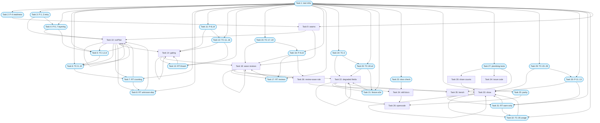

# Implementation Tasks: Deterministic Plan

**Status:** Not Started
**Spec:** [requirements.md](requirements.md) · [design.md](design.md) · [test-plan.md](test-plan.md) · [PLAN.md](PLAN.md)

## Task Breakdown

### Task 1: Build deterministic-plan test infrastructure
**Status:** Done
**Track:** test
**Requirements:** 1.1, 2.1, 4.1, 5.2
**Description:** Build the shared test-only infrastructure all other test tasks depend on. 1) Extend `tests/js/fake_project.mjs` additively (same module, no fork): `planSeq` canned plan answers consumed in order, `badReady` shorthand, `risk` passthrough, `state.reviewTasks` ledger parsed from review prompts, `timestamps` on plan/review/land calls via existing `stamp()` pattern. The Node suite created below accepts TC ids as argv (`node tests/js/deterministic_plan.test.mjs TC-1 TC-3`) and runs only those cases, so later impl gates can run subsets. 2) Create skeleton `tests/js/deterministic_plan.test.mjs` wired into the `tests/test_workflow_scripts.py` parametrize glob. 3) Extend `tests/landing_bridge.py` `scenarios()` with `risk` (10–20% safety) and `planSeq` draws (consistent / first-bad-then-good / always-bad); `bridge.run` forwards unknown keys unchanged. 4) Extend `tests/stats_helpers.py` `implement_result()` with optional `degraded`/`planFallbacks` kwargs (default absent so pre-change records stay byte-identical). 5) Generate and commit `tests/fixtures/stats/pre-deterministic-record.json` from today's collector over a FakeClaudeHome run. 6) Scaffold fixture-spec directory at `specs/deterministic-plan/fixtures/fallback-spec/` (3-task spec with forced-inconsistent plan shim modes). Owns the Harness Contract items 5–7 test-side: bridge/fake-project options, label grammar helpers, and the fixture-run contract. No TCs asserted here; this task only builds harnesses.
**Files:**
- `tests/js/fake_project.mjs` - additive `planSeq`/`badReady`/`risk`/ledger/timestamps
- `tests/js/deterministic_plan.test.mjs` - skeleton suite with TC-id argv subset filter (assertions in Tasks 5, 6, 12, 15, 19, 20)
- `tests/landing_bridge.py` - `risk` + `planSeq` scenario draws
- `tests/stats_helpers.py` - optional `degraded`/`planFallbacks` kwargs
- `tests/fixtures/stats/pre-deterministic-record.json` - committed pre-change record
- `specs/deterministic-plan/fixtures/fallback-spec/` - scaffold (tasks.md, ck.json, shim)
**Verify:** `uv run pytest -q tests/test_workflow_scripts.py` `node tests/js/deterministic_plan.test.mjs`
**Verifies:** Task 9 (skeleton suite loads the decisions block that task extends; proven when Task 2 runs)
**Acceptance:**
- [x] Harness extensions are additive; existing Node suites and landing-speed properties still pass unmodified
- [x] Tests exercise the real boundary named in the test plan (real script via `load_workflow.mjs`/`bridge.mjs`, real CLI via subprocess)
- [x] No mocks of the project's own code in integration paths (only fake runtime/agents, FakeClaudeHome, fixture shim)
**Dependencies:** None
**Complexity:** Medium
**Risk:** normal
---
### Task 2: Contract property for fallback readiness vs ck plan
**Status:** Done
**Track:** test
**Requirements:** 1.2, 2.4
**Description:** Covers P-4 (requirements 1.2, 2.4, NFR-3; seam `fallbackReady`/`readyTasks` vs real `ck plan --json`). For any acyclic graph, Done set and exclude set, deterministic ready equals `ck plan` `ready`: same set, same order (longest chain first, then numeric id). Metamorphic: reordering keys/dep lists/done/exclude never changes the list. Generator `dags()`: 1–25 tasks, non-contiguous multi-digit ids (1,2,9,10,11,100), empty dep lists, diamonds, long chains, duplicate deps, deps on Done/excluded, dangling deps; Done/exclude any subsets incl. Done ids and absent ids. CLI-driven per example (table-driven ≥60 draws + Hypothesis seam-side). Also hosts TC-8/TC-29 bodies.
**Files:**
- `tests/test_deterministic_plan.py` - `test_fallback_matches_ck_plan` + `PROPERTIES` entry
- `tests/test_landing_readiness.py` - reuse pattern (no change or additive writer only)
**Verify:** `uv run pytest -q tests/test_deterministic_plan.py -k fallback_matches_ck_plan`
**Properties:** P-4
**Verifies:** Task 9 (calls the `fallbackReady` seam directly plus the real `ck plan` CLI; needs no runner code)
**Acceptance:**
- [x] The generators cover every surface form and negative listed in the row (multi-digit ids, diamonds, chains, duplicates, dangling deps, Done/excluded subsets)
- [x] Settings are deterministic (`@settings(derandomize=True, max_examples=200, database=None)`; CLI table ≥60 draws)
- [x] The tests call the decision seam, not a server (seam vs real `ck plan` CLI binary, no mocked ck module)
- [x] File declares `PROPERTIES = {"P-4": ...}` (merged map with sibling property tasks in same file)
**Dependencies:** Task 1 (needs `dags()` strategies + readiness writer pattern)
**Complexity:** High
**Risk:** normal
---
### Task 3: Property tests for retry-once, fallback-continue, degraded marking
**Status:** Done
**Track:** test
**Requirements:** 1.1, 1.2, 1.3
**Description:** Covers P-1, P-2, P-3 (Story 1 group; decision seams `planConsistent` + `fallbackReady`). P-1: any inconsistent first answer (ready has non-ready id, omits ready id, lists unknown id) → exactly one retry with same inputs; consistent never retried; count `plan k`/`plan k retry` labels. P-2: retry also inconsistent/unusable → continues from deterministic list, never `planning step failed`, running tasks land; merged set equals deterministic-oracle set. P-3: every fallback run → `result.degraded is True`, count equals triggering attempts, triggers ⊆ trace labels. Bridge-driven via `scenarios()` × `planSeq` shapes, maxConcurrent 1–4, red landings, conflicts. Complements TC-1/TC-2 example cases. Runs green on the seam plus `runPlan` alone (Tasks 9–10); needs no schedule gating.
**Files:**
- `tests/test_deterministic_plan.py` - `test_retry_once`, `test_fallback_continues`, `test_degraded_marking` + `PROPERTIES` map
**Verify:** `uv run pytest -q tests/test_deterministic_plan.py -k "test_retry_once or test_fallback_continues or test_degraded_marking"`
**Properties:** P-1, P-2, P-3
**Verifies:** Task 10 (exercises the `runPlan` retry/fallback path; passes without later gating code)
**Acceptance:**
- [x] The generators cover every surface form and negative listed in the row (non-ready id, omitted ready id, unknown id; healthy-second-answer complement; red landings/conflicts)
- [x] Settings are deterministic (`@settings(derandomize=True, max_examples=60, database=None)` for bridge-driven properties)
- [x] The tests call the decision seam, not a server (`planConsistent`/`fallbackReady` directly + script behavior via bridge)
- [x] File declares `PROPERTIES = {"P-1": ..., "P-2": ..., "P-3": ...}` for `ck gate`
**Note (generator domain):** corruptions are inconsistent *after* the script's `normalizePlan` (unknown ids are filtered there, so `runPlan` never sees them): the "unknown" form replaces the list with `[max-id+1]` instead of extending it. A redundant unknown id next to the full correct list normalizes to the oracle and is adopted without retry by the existing check that Task 10 keeps.
**Dependencies:** Task 1 (needs `planSeq` scenario draws + bridge harness)
**Complexity:** High
**Risk:** normal
---
### Task 4: Property tests for fallback layering and unknown deps
**Status:** Done
**Track:** test
**Requirements:** 1.5, 2.1, 2.2, 2.5
**Description:** Covers P-5, P-6, P-7 (Story 2 group; seam `fallbackReady`). P-5: no merged/running/failed/excluded task ever in fallback ready; scheduling one never alters another record (exclude = running ∪ failed ∪ merged; running via `planDurations`). P-6: no-`args.deps` runs use exactly last-good-ready minus finished/excluded, never script readiness/guess; [bad,bad] with no good plan schedules nothing. P-7: task with dep absent from map never scheduled even when id appears in `done` (unknown = max-id+1, removed id, done-only id — near-miss negatives); complement: deps all known-and-Done + not excluded + sole open task IS schedulable. Runs green on the seam plus `runPlan` last-good store (Tasks 9–10); needs no schedule gating.
**Files:**
- `tests/test_deterministic_plan.py` - `test_fallback_exclusions`, `test_last_good_layering`, `test_unknown_dep_never_ready` + `PROPERTIES` entries
**Verify:** `uv run pytest -q tests/test_deterministic_plan.py -k "test_fallback_exclusions or test_last_good_layering or test_unknown_dep_never_ready"`
**Properties:** P-5, P-6, P-7
**Verifies:** Task 10 (exercises `runPlan` layering/exclusion; passes without later gating code)
**Acceptance:**
- [x] The generators cover every surface form and negative listed in the row (all exclusion sets; [good,bad,bad]/[bad,bad]/[good] shapes; max-id+1 / removed / done-only unknown deps + complement)
- [x] Settings are deterministic (`@settings(derandomize=True, max_examples=60, database=None)`)
- [x] The tests call the decision seam, not a server (`fallbackReady` + bridge-run behavior)
- [x] File declares `PROPERTIES = {"P-5": ..., "P-6": ..., "P-7": ...}` (merged map)
**Dependencies:** Task 1 (needs `scenarios()` × always-inconsistent plans + exclude seeding)
**Complexity:** High
**Risk:** normal
---
### Task 5: Workflow examples for plan retry and clean adoption
**Status:** Done
**Track:** test
**Requirements:** 1.1, 1.4, 1.5
**Description:** Implements TC-1, TC-3, TC-4 in `tests/js/deterministic_plan.test.mjs` (real script `plugin/workflows/spec-implement.js` via `load_workflow.mjs`, fake runtime + extended fake project). TC-1: `planSeq` [inconsistent, consistent] → `plan 1` then `plan 1 retry`, retry adopted, no degraded, fallback 0. TC-3: healthy plan agent → no degraded, fallback 0. TC-4: always-inconsistent with tasks 1–2 merged/running at fallback (seeded via `done`/in-flight `planDurations`) → fallback ready excludes merged/running/failed, their records unchanged (labels appear exactly once). (TC-2 lives in Task 19: it asserts no third plan attempt, which needs the Task 14 gating.) Assert only on `events`/`prompts`/`result`/`logs`, never script internals.
**Files:**
- `tests/js/deterministic_plan.test.mjs` - TC-1, TC-3, TC-4 cases
**Verify:** `node tests/js/deterministic_plan.test.mjs TC-1 TC-3 TC-4`
**Verifies:** Task 10 (exercises `runPlan` retry/adopt/exclude; passes without later gating code)
**Acceptance:**
- [x] Tests exercise the real boundary named in the test plan (real workflow script under fake runtime, labels + result + logs)
- [x] Tests fail before the implementation exists for the right reason (script halts `planning step failed` on twice-inconsistent plan; no `degraded`/`plan_fallbacks` fields)
- [x] No mocks of the project's own code in integration tests
**Dependencies:** Task 1 (needs extended fake_project + Node suite skeleton)
**Complexity:** Medium
**Risk:** normal
---
### Task 6: Workflow examples for fallback ready sources
**Status:** Done
**Track:** test
**Requirements:** 2.1, 2.2, 2.3, 2.5, 2.6
**Description:** Implements TC-5, TC-6, TC-7, TC-9, TC-10 in `tests/js/deterministic_plan.test.mjs` (TC-8 is the contract property, covered in Task 2). TC-5 (2.1): `args.deps` present + always-inconsistent → every `task N` request is head of `readyTasks` over `args.deps` + Done/running/merged, run completes. TC-6 (2.2): no `args.deps`, `planSeq` [good ready=[1,2], bad, bad] → third failure schedules from last-good-ready minus finished, degraded. TC-7 (2.3): no deps, [bad, bad], no good plan ever → no `task` label requested, running tasks still land, stop reason is planning failure. TC-9 (2.5): `deps={1:[],2:['99']}` unknown dep → `task 2` never requested, rest proceed. TC-10 (2.6): fallback-scheduled task reports BUSY then ERROR/blocked → `ok:false` with same `worktree busy:` reason as plan-scheduled, exactly one agent, run continues. Passes on seam plus `runPlan` alone (Tasks 9–10); asserts nothing about plan-agent counts.
**Files:**
- `tests/js/deterministic_plan.test.mjs` - TC-5, TC-6, TC-7, TC-9, TC-10 cases
**Verify:** `node tests/js/deterministic_plan.test.mjs TC-5 TC-6 TC-7 TC-9 TC-10`
**Verifies:** Task 10 (exercises `runPlan` fallback sources; passes without later gating code)
**Acceptance:**
- [x] Tests exercise the real boundary named in the test plan (real script + fake runtime; per-request readiness checks)
- [x] Tests fail before the implementation exists for the right reason (halt on second failure; unknown-dep or last-good behavior absent)
- [x] No mocks of the project's own code in integration tests
**Dependencies:** Task 1 (needs `planSeq`/`badReady` injector and bridge scenario draws)
**Complexity:** Medium
**Risk:** normal
---
### Task 7: Red-team fallback counting
**Status:** Done
**Track:** test
**Requirements:** 1.4
**Description:** Try to break each SHALL NOT clause of Story 1 with adversarial inputs: unusual surface forms, near-miss values from the real data, the system's own outputs fed back as inputs, boundary and encoding tricks. Every way you find to break it becomes a test named `test_redteam_fallback_counting_*`. Targets 1.4 (consistent first/retry plan SHALL NOT count a fallback): retry-success-after-transient-error counted, plan echoing fallback `ready` back counted as fallback, `ready` ordering-only difference counted, empty-ready consistent plan counted, double-retry attempts counted. Runs against `runPlan` counting (Task 10); needs no gating.
**Files:**
- `tests/test_deterministic_plan.py` - red-team cases for 1.4 (adversarial `planSeq` shapes)
**Verify:** `uv run pytest -q tests/test_deterministic_plan.py -k redteam_fallback_counting`
**Verifies:** Task 10 (exercises `runPlan` fallback-counting; passes without later code)
**Acceptance:**
- [x] Tests exercise the real boundary named in the test plan (real script via bridge; adversarial plan answers through `planSeq`)
- [x] Tests fail before the implementation exists for the right reason (fallback counting absent or over-counts consistent adoptions)
- [x] No mocks of the project's own code in integration tests
**Dependencies:** Task 1 (needs bad-ready injector harness)
**Complexity:** Medium
**Risk:** normal
---
### Task 8: Red-team fallback guessing
**Status:** Done
**Track:** test
**Requirements:** 2.5
**Description:** Try to break each SHALL NOT clause of Story 2 with adversarial inputs: unusual surface forms, near-miss values from the real data, the system's own outputs fed back as inputs, boundary and encoding tricks. Every way you find to break it becomes a test named `test_redteam_unknown_dep_*`. Targets 2.5 (unknown-dep task SHALL NOT start on a guess): numeric-vs-string id confusion (`'2'` vs `2`, `'02'`), dangling id that matches a `done`-only entry, dep id present only in `exclude`, case/whitespace-mutated dep keys, fallback fed the plan's own bad `ready` as `done`. Runs against seam plus `runPlan` scriptReady computation (Tasks 9–10); needs no gating.
**Files:**
- `tests/test_deterministic_plan.py` - red-team cases for 2.5 (adversarial deps maps)
**Verify:** `uv run pytest -q tests/test_deterministic_plan.py -k redteam_unknown_dep`
**Verifies:** Task 10 (exercises `runPlan` scriptReady path; passes without later code)
**Acceptance:**
- [x] Tests exercise the real boundary named in the test plan (real script scheduling + `fallbackReady` seam on adversarial maps)
- [x] Tests fail before the implementation exists for the right reason (task starts on guessed dep instead of staying unready)
- [x] No mocks of the project's own code in integration tests
**Dependencies:** Task 1 (needs `dags()` + adversarial deps harness)
**Complexity:** Medium
**Risk:** normal
---
### Task 9: Add pure scheduler seams fallbackReady and reviewGroups
**Status:** Done
**Track:** impl
**Requirements:** 1.2, 2.1, 2.2, 2.3, 2.4, 2.5, 4.1, 4.2, 4.3, 4.6
**Description:** In the decisions block of `plugin/workflows/spec-implement.js` (next to `readyTasks`/`planConsistent`/`planDecision`, before the `--- end decisions ---` marker so `tests/js/load_decisions.mjs` can load them via the `extra` option), add two pure functions with no script globals, no I/O, no clock. Owns Harness Contract seam 1 (`fallbackReady`; the implementation reuses `readyTasks` ordering for the `scriptReady` input rather than re-implementing it) and seam 3 (`reviewGroups`, the `batchGroups` role under its final name): `fallbackReady({ hasDeps, scriptReady, lastGoodReady, exclude, done }) -> { ready, source }` implementing the D5 layering (scriptReady minus excluded/done when hasDeps and non-empty yields source `deps`; else lastGoodReady minus excluded/done yields source `last-good`; else empty/`null` for the halt path), and `reviewGroups({ merged, risk }) -> { batched, individual }` (individual = merged tasks whose risk tag is `safety` case-insensitive via existing `isSafety`; batched = the rest; empty merged yields both empty). Add `OVERHEAD_WARN_THRESHOLD = 0.5` script-local constant. Ordering is inherited from the inputs (already ck-plan order); do not re-sort inside the seams. Keep `readyTasks`/`planConsistent`/`planDecision` signatures unchanged in this task.
**Files:**
- `plugin/workflows/spec-implement.js` - decisions block: add `fallbackReady`, `reviewGroups`, `OVERHEAD_WARN_THRESHOLD`
**Verify:** `uv run pytest -q tests/test_deterministic_plan.py -k fallback_matches_ck_plan` `node -e "import('./tests/js/load_decisions.mjs').then(m => m.loadDecisions({extra: ['fallbackReady', 'reviewGroups']}))"`
**Verified by:** Task 2 (its tests are the oracle; calls the seam directly plus the real `ck plan` CLI)
**Acceptance:**
- [x] `fallbackReady` with `hasDeps` and non-empty scriptReady returns the deps layer minus excluded/done with source `deps` (1.2, 2.1)
- [x] `fallbackReady` without deps data falls back to lastGoodReady minus excluded/done with source `last-good`, and returns empty/null when both layers are empty (2.2, 2.3)
- [x] `reviewGroups` splits safety tasks to individual and the rest to batched; empty merged yields no review groups (4.1, 4.2, 4.3, 4.6)
**Dependencies:** Task 1 (built against the harness extended there); Task 2 (its tests are the oracle)
**Complexity:** Medium
**Risk:** normal
---
### Task 10: Retry-once-then-fallback in runPlan with degraded marking
**Status:** Not Started
**Track:** impl
**Requirements:** 1.1, 1.2, 1.3, 1.4, 1.5, 2.1, 2.2, 2.3, 2.5
**Description:** Modify `runPlan(trigger)` in `plugin/workflows/spec-implement.js`: keep two attempts with the same per-attempt exclude capture and `planConsistent` check, incrementing `planFailures` per failed attempt. On second failure call `fallbackReady(...)` (scriptReady computed from script-side `readyTasks` over `view` plus run's Done/running/failed/merged sets when `SCRIPT_READINESS`, else empty — so unknown-dep tasks never start on a guess per 2.5; lastGoodReady from stored last-good plan). If it yields a non-empty list, append `{ planStep, trigger, source, ready }` to a new `planFallbacks` array, set `degraded = true`, adopt the fallback as the scheduling ready list, and return a synthetic plan view (`{ fromFallback: true, ... }`) instead of null. Only when `fallbackReady` yields nothing, return null so the existing `PLAN_FAILED` halt path in `requestPlan` runs (start-plan failure with hand-built args lacking `deps`). Add `lastGood = { ready, deps, order } | null` state: update it in `applyPlanView` on every consistent plan (first attempt or retry success counts no fallback per 1.4); a fallback view never overwrites it. `fallbackReady` must subtract running/failed/parked/`mergedInRun`/`done` so merged/running tasks are excluded and their records untouched (1.5).
**Files:**
- `plugin/workflows/spec-implement.js` - `runPlan`, `applyPlanView` lastGood store, `planFallbacks`/`degraded`/`lastGood` state
**Verify:** `uv run pytest -q tests/test_deterministic_plan.py -k "test_retry_once or test_fallback_continues or test_degraded_marking or test_fallback_exclusions or test_last_good_layering or test_unknown_dep or redteam_fallback_counting or redteam_unknown_dep"` `node tests/js/deterministic_plan.test.mjs TC-1 TC-3 TC-4 TC-5 TC-6 TC-7 TC-9 TC-10`
**Verified by:** Task 3, Task 4, Task 5, Task 6, Task 7, Task 8 (its tests are the oracle)
**Acceptance:**
- [ ] Inconsistent first plan triggers exactly one retry with the same inputs; consistent retry is adopted with no fallback counted (1.1, 1.4)
- [ ] Twice-failed plan with deterministic data continues scheduling instead of halting, with a `planFallbacks` entry recording planStep, trigger, source, ready (1.2, 1.3)
- [ ] Twice-failed plan with neither deps nor last-good data returns null into the existing `PLAN_FAILED` halt while running tasks finish/land (2.3)
- [ ] Fallback scriptReady comes from script-side `readyTasks`, so unknown-dep tasks never appear in the fallback list (2.5)
**Dependencies:** Task 9 (calls `fallbackReady` seam added there); Task 3 (its tests are the oracle); Task 4 (its tests are the oracle); Task 5 (its tests are the oracle); Task 6 (its tests are the oracle); Task 7 (its tests are the oracle); Task 8 (its tests are the oracle)
**Complexity:** High
**Risk:** normal
---
### Task 11: Property tests for plan-agent schedule
**Status:** Not Started
**Track:** test
**Requirements:** 3.1, 3.2, 3.3, 3.4
**Description:** Covers P-8, P-14 (Story 3 group; seam `planDecision`). P-8: healthy plans, any scenario → no non-retry `plan` between task finish and next `task N` when deterministic ready non-empty; plans only start / first-after-landing / idle. P-14: freed slot with non-empty ready starts next task(s) before any plan; idle re-read finding nothing ready arms no second re-read until landing end or task record. Generators `scenarios()` with `args.deps`, healthy plans, maxConcurrent 1–4; freed-slot timing (`planDurations`, slow tasks) and empty-ready draws. Tightens landing-speed P-6 relation. Needs the Task 14 gating to pass.
**Files:**
- `tests/test_deterministic_plan.py` - `test_no_plan_between_finish_and_start`, `test_freed_slot_and_idle_arming` + `PROPERTIES` entries
**Verify:** `uv run pytest -q tests/test_deterministic_plan.py -k "test_no_plan_between_finish_and_start or test_freed_slot_and_idle_arming"`
**Properties:** P-8, P-14
**Verifies:** Task 14 (exercises the `planDecision` gating; fails until that code exists)
**Acceptance:**
- [ ] The generators cover every surface form and negative listed in the row (maxConcurrent sweep; slow-task timing; empty-ready idle draws)
- [ ] Settings are deterministic (`@settings(derandomize=True, max_examples=60, database=None)`)
- [ ] The tests call the decision seam, not a server (`planDecision` directly + trace predicates via bridge)
- [ ] File declares `PROPERTIES = {"P-8": ..., "P-14": ...}` (merged map)
**Dependencies:** Task 1 (needs label-grammar helpers + trace predicates)
**Complexity:** High
**Risk:** normal
---
### Task 12: Workflow examples for plan-agent schedule
**Status:** Done
**Track:** test
**Requirements:** 3.1, 3.2, 3.3, 3.4, 3.5, 3.6
**Description:** Implements TC-11, TC-12, TC-13, TC-14, TC-15, TC-16 in `tests/js/deterministic_plan.test.mjs`. TC-11 (3.1): 12-task graph, healthy plans → non-retry plans only at start / first-after-landing / idle. TC-12 (3.2): maxConcurrent 2, task 1 long → task 2/3 requested with no intervening plan. TC-13 (3.3): freed slots with non-empty deterministic ready → no plan between finish and next `task N` (plan count ≤ 1 + landings + idle). TC-14 (3.4): idle re-read empty with landing in flight → at most one idle plan per arming. TC-15 (3.5): plan with externalDone + relink at plan 2 → view replaced, Done = plan Done ∪ merged-in-run. TC-16 (3.6): no `args.deps`, healthy plans → plan agent runs before next `task N` after freed slots. Needs the Task 14 gating and view replacement to pass.
**Files:**
- `tests/js/deterministic_plan.test.mjs` - TC-11 through TC-16 cases
**Verify:** `node tests/js/deterministic_plan.test.mjs TC-11 TC-12 TC-13 TC-14 TC-15 TC-16`
**Verifies:** Task 14 (exercises scheduling/trigger code; fails until that code exists)
**Acceptance:**
- [x] Tests exercise the real boundary named in the test plan (real workflow script trace label ordering vs queue trace)
- [x] Tests fail before the implementation exists for the right reason (plan re-runs after every freed slot)
- [x] No mocks of the project's own code in integration tests
**Note:** TC-11..16 pass pre-Task-14 because the landing-speed base already gates freed/finished triggers and replaces the view; mutation check (freed/finished forced to `run` in a scratch copy) makes TC-12 spans and the TC-13 bound fail with plans after every freed slot, so the tests are non-vacuous oracles for Task 14.
**Dependencies:** Task 1 (needs fake_project timing controls + bridge scenarios)
**Complexity:** Medium
**Risk:** normal
---
### Task 13: Red-team plan-agent thrash
**Status:** In Progress
**Track:** test
**Requirements:** 3.3
**Description:** Try to break each SHALL NOT clause of Story 3 with adversarial inputs: unusual surface forms, near-miss values from the real data, the system's own outputs fed back as inputs, boundary and encoding tricks. Every way you find to break it becomes a test named `test_redteam_plan_thrash_*`. Targets 3.3 (SHALL NOT run a plan agent after every freed slot when deterministic ready decides): rapid successive finishes with ready always non-empty, freed slot racing a landing end, empty-then-instantly-ready transitions, dep-less-shaped `deps` (`null`/`[]`/string) smuggled into a deps run. Needs the Task 14 gating to pass.
**Files:**
- `tests/test_deterministic_plan.py` - red-team cases for 3.3 (adversarial timing/slot shapes)
**Verify:** `uv run pytest -q tests/test_deterministic_plan.py -k redteam_plan_thrash`
**Verifies:** Task 14 (exercises `planDecision` gating; fails until that code exists)
**Acceptance:**
- [ ] Tests exercise the real boundary named in the test plan (real script trace ordering under adversarial finish/landing interleavings)
- [ ] Tests fail before the implementation exists for the right reason (extra plan agents between finish and ready start)
- [ ] No mocks of the project's own code in integration tests
**Dependencies:** Task 1 (needs freed-slot timing + label-grammar helpers)
**Complexity:** Medium
**Risk:** normal
**Blocker (2026-11-02):** `plugin/workflows/spec-implement.js` does not load: `function fallbackReady` (decisions block, line 648) collides with `let fallbackReady = []` (scheduler body, line 790), so every `bridge.run` fails with `Identifier 'fallbackReady' has already been declared`. Pre-existing on `integrate/deterministic-plan` (worktree == integrate); breaks all previously-merged bridge tests too. Tests added below collect but cannot verify predicates until the rename lands (owned by Task 9/10/14).
---
### Task 14: Idle-gated plan triggers and deterministic freed-slot scheduling
**Status:** Not Started
**Track:** impl
**Requirements:** 3.1, 3.2, 3.3, 3.4, 3.5, 3.6, 2.6
**Description:** Modify `planDecision`, `planContext`/`schedule()`, `releaseSlot`/`finishTask`, and `applyPlanView` in `plugin/workflows/spec-implement.js`. Owns the modified Harness Contract seam `planDecision`: returns `run` only for `start`, `landing`, and `idle` (gated on `freeSlot && readyCount===0 && openCount>0 && idleArmed`); `freed`/`finished` return `none` when `SCRIPT_READINESS` is true and `run` when false (dep-less mode keeps landing-speed behaviour per 3.6). `schedule()` starts from script-side `readyTasks` directly on freed slots without a plan agent (3.2, 3.3). Keep `idleArmed` gating: disarm after an idle re-read (3.4), re-arm on landing completion or task record arrival (existing `idleArmed = true` sites); landing trigger stays. `applyPlanView` on a consistent plan replaces remaining/deps/lint and sets `done = plan.done ∪ mergedInRun` (3.5). Fallback-scheduled task BUSY/blocked reports flow through the unchanged `worktreeOutcome`/guard/park/fail paths (2.6, no new handling).
**Files:**
- `plugin/workflows/spec-implement.js` - `planDecision` gating, `schedule`/`planContext` freed-slot path, `applyPlanView` view replacement, idleArmed wiring
**Verify:** `uv run pytest -q tests/test_deterministic_plan.py -k "test_no_plan_between_finish_and_start or test_freed_slot_and_idle_arming or redteam_plan_thrash"` `node tests/js/deterministic_plan.test.mjs TC-11 TC-12 TC-13 TC-14 TC-15 TC-16`
**Verified by:** Task 11, Task 12, Task 13 (its tests are the oracle)
**Acceptance:**
- [ ] Plan agents run at start, after each landing, and idle-only when gated; no plan after every freed slot when deterministic ready is non-empty (3.1, 3.2, 3.3)
- [ ] Empty idle re-read triggers no second idle plan until a landing completes or a task record arrives (3.4)
- [ ] Consistent plan replaces remaining/deps/lint and Done = plan Done ∪ merged-in-run; dep-less runs still plan per freed slot (3.5, 3.6)
**Dependencies:** Task 10 (extends the scheduler state and `applyPlanView` touched there); Task 11 (its tests are the oracle); Task 12 (its tests are the oracle); Task 13 (its tests are the oracle)
**Complexity:** High
**Risk:** normal
---
### Task 15: Workflow examples for wave-batched reviews
**Status:** Done
**Track:** test
**Requirements:** 4.1, 4.2, 4.3, 4.4, 4.5, 4.6
**Description:** Implements TC-17, TC-18, TC-19, TC-20, TC-21, TC-22 in `tests/js/deterministic_plan.test.mjs` using `risk` maps and `state.reviewTasks` ledger. (The TC-26 workflow half lives in Task 20: it needs Task 22's overhead fields.) TC-17 (4.1): 3 non-risky merged wave → exactly one batched review covering the wave, all approved. TC-18 (4.2): 2 normal + 1 safety → risky gets individual `review N`, normals share one batch. TC-19 (4.3): only-risky wave → each individual, no combined review. TC-20 (4.4): batched `changes` for task 2 only → task 2 revises alone, 1/3 approved untouched. TC-21 (4.5): batched `approve` → every covered task records approval. TC-22 (4.6): no wave merged since last review → no review requested. Needs the Task 18 review batching to pass.
**Files:**
- `tests/js/deterministic_plan.test.mjs` - TC-17 through TC-22 cases
**Verify:** `node tests/js/deterministic_plan.test.mjs TC-17 TC-18 TC-19 TC-20 TC-21 TC-22`
**Verifies:** Task 18 (exercises wave-review scheduling; fails until that code exists)
**Acceptance:**
- [x] Tests exercise the real boundary named in the test plan (real script review scheduling, coverage from `state.reviewTasks`/prompts not label text)
- [x] Tests fail before the implementation exists for the right reason (reviews are one-per-task; no batch label)
- [x] No mocks of the project's own code in integration tests
**Deviation:** `tests/js/fake_project.mjs` (owned by Task 1) extended additively: a `reviews` entry may now be `{ verdict, findings }` so a batched verdict can flag individual tasks with design.md-shaped per-task findings `{ task, severity, file, issue, fix }` (needed by TC-20). String entries behave exactly as before; no existing suite changed behavior.
**Dependencies:** Task 1 (needs `risk` passthrough + review-task ledger)
**Complexity:** Medium
**Risk:** normal
---
### Task 16: Property tests for wave-review batching bound
**Status:** Done
**Track:** test
**Requirements:** 4.1, 4.2, 4.3, 4.4, 4.5, 4.6
**Description:** Covers P-9, P-10 (Story 4 group; seam `reviewGroups`). P-9: any run with W merged waves (≥1 non-risky) and R risky → review count ≤ W + R, every risky task has individual label, zero-merged waves get no review. P-10: any batched review with per-task verdicts → flagged tasks get own revise + re-review, unflagged record approval without extra agents; all-approve batch approves all covered. Generators `scenarios()` × `risk` maps (0–100% safety incl. all-risky/no-risky waves) × verdict sequences incl. `changes`; wave sizes 1–6 × flagged subsets (none/some/all). Also hosts TC-30 body. Needs the Task 18 review batching to pass.
**Files:**
- `tests/test_deterministic_plan.py` - `test_review_bound`, `test_batch_verdict_fanout` + `PROPERTIES` entries
**Verify:** `uv run pytest -q tests/test_deterministic_plan.py -k "test_review_bound or test_batch_verdict_fanout"`
**Properties:** P-9, P-10
**Verifies:** Task 18 (exercises `reviewGroups` plus script review labels; fails until that code exists); Task 36 (counts each `review-wave` label as one review agent via the role mapping)
**Acceptance:**
- [x] The generators cover every surface form and negative listed in the row (all-risky / no-risky waves; changes/approve verdicts; none/some/all flagged subsets)
- [x] Settings are deterministic (`@settings(derandomize=True, max_examples=60, database=None)`)
- [x] The tests call the decision seam, not a server (`reviewGroups` directly + script review labels via bridge)
- [x] File declares `PROPERTIES = {"P-9": ..., "P-10": ...}` (merged map)
**Dependencies:** Task 1 (needs `risk` scenario draws + review ledger)
**Complexity:** High
**Risk:** normal
---
### Task 17: Red-team review batching
**Status:** Not Started
**Track:** test
**Requirements:** 4.3, 4.6
**Description:** Try to break each SHALL NOT clause of Story 4 with adversarial inputs: unusual surface forms, near-miss values from the real data, the system's own outputs fed back as inputs, boundary and encoding tricks. Every way you find to break it becomes a test named `test_redteam_review_batching_*`. Targets 4.3 (risky-only wave SHALL NOT run a combined review) and 4.6 (SHALL NOT run an empty batched review): `risk` tags with case/whitespace variants (`Safety`, `SAFETY`, ` safety `), missing/unknown risk values, single-risky-task waves, empty merged wave after failed landing, wave whose tasks were all already reviewed. Needs the Task 18 review batching to pass.
**Files:**
- `tests/test_deterministic_plan.py` - red-team cases for 4.3/4.6 (adversarial `risk` maps + empty waves)
**Verify:** `uv run pytest -q tests/test_deterministic_plan.py -k redteam_review_batching`
**Verifies:** Task 18 (exercises wave-review scheduling; fails until that code exists)
**Acceptance:**
- [ ] Tests exercise the real boundary named in the test plan (real script review scheduling; coverage from review ledger/prompts)
- [ ] Tests fail before the implementation exists for the right reason (spurious combined or empty reviews run)
- [ ] No mocks of the project's own code in integration tests
**Dependencies:** Task 1 (needs `risk` maps + review ledger harness)
**Complexity:** Medium
**Risk:** normal
---
### Task 18: Wave-batched reviews with risky tasks kept individual
**Status:** Not Started
**Track:** impl
**Requirements:** 4.1, 4.2, 4.3, 4.4, 4.5, 4.6
**Description:** Replace the per-task `review` call in `runTask` with wave batching in `plugin/workflows/spec-implement.js`: after a `landBatch` reports MERGED, call `reviewGroups(mergedTasks, RISK)`; non-risky tasks go in one `review-wave` agent (label `review-wave <wave> tasks <ids>`, e.g. `review-wave 2 tasks 4 5 7`) over the combined diff (prompt names the wave, its non-risky tasks, the combined `git diff <merge-base>...<INTO>` over their files, each task's block/requirements, and design.md), each safety/risky task in its own `review` agent with the existing risky reviewer settings (`reviewOpts`). Add optional `tasks: string[]` echo to `REVIEW_SCHEMA` so a batched verdict names its coverage. Fan out the verdict to per-task `rec.review` rows: a batched `changes` verdict routes only flagged tasks to revision (4.4), an `approve` records approval on every covered task with `fromBatch` attribution (4.5). No review agent when the wave merged nothing new (4.6); a risky-only wave runs only individual reviews with no combined review (4.3).
**Files:**
- `plugin/workflows/spec-implement.js` - review path in `runTask`/`landBatch`, `REVIEW_SCHEMA` tasks echo, verdict fan-out
**Verify:** `node tests/js/deterministic_plan.test.mjs TC-17 TC-18 TC-19 TC-20 TC-21 TC-22` `uv run pytest -q tests/test_deterministic_plan.py -k "test_review_bound or test_batch_verdict_fanout or redteam_review_batching"`
**Verified by:** Task 15, Task 16, Task 17 (its tests are the oracle)
**Acceptance:**
- [ ] A merged wave of non-risky tasks gets exactly one combined review-wave agent covering the wave's changes (4.1)
- [ ] Risky/safety tasks always get individual reviews; risky-only waves get no combined review (4.2, 4.3)
- [ ] Batched `changes` revises only flagged tasks; batched `approve` approves every covered task; empty waves get no review (4.4, 4.5, 4.6)
**Dependencies:** Task 14 (builds on the scheduler/landing flow edited there); Task 9 (calls `reviewGroups` seam added there); Task 15 (its tests are the oracle); Task 16 (its tests are the oracle); Task 17 (its tests are the oracle)
**Complexity:** High
**Risk:** normal
---
### Task 19: Workflow example for degraded fallback completion
**Status:** Not Started
**Track:** test
**Requirements:** 1.2, 1.3
**Description:** Implements TC-2 in `tests/js/deterministic_plan.test.mjs` (split from the Task 5 retry cases: TC-2 asserts scheduling continues with no third plan attempt, which needs the Task 14 gating, and asserts `result.degraded` plus fallback count/triggers, which needs the Task 22 result fields). Given `planSeq` [inconsistent, inconsistent] with truthful `deps` in args: a second `plan 1 retry` is followed by no third plan attempt; every task merges; `result.degraded is True`, fallback count ≥ 1, and the log/result names the triggering plan attempt (`plan 1`). Assert only on `events`/`prompts`/`result`/`logs`, never script internals.
**Files:**
- `tests/js/deterministic_plan.test.mjs` - TC-2 case
**Verify:** `node tests/js/deterministic_plan.test.mjs TC-2`
**Verifies:** Task 22 (needs fallback scheduling plus degraded result fields; fails until both exist)
**Acceptance:**
- [ ] Tests exercise the real boundary named in the test plan (real workflow script under fake runtime, labels + result + logs)
- [ ] Tests fail before the implementation exists for the right reason (script halts `planning step failed` on twice-inconsistent plan; no `degraded`/`plan_fallbacks` fields)
- [ ] No mocks of the project's own code in integration tests
**Dependencies:** Task 1 (needs extended fake_project + Node suite skeleton)
**Complexity:** Low
**Risk:** normal
---
### Task 20: Workflow example for overhead warn-only
**Status:** Done
**Track:** test
**Requirements:** 5.4
**Description:** Implements the workflow half of TC-26 in `tests/js/deterministic_plan.test.mjs` (CLI half in Task 29). Given a run whose plan/review/landing share is forced above the published threshold (tiny task durations, many plan/review agents): the run still completes with no stop reason naming overhead (warn-only: no halt/fail/retry), while the report flags the overhead warning. Needs the Task 22 warn-only wiring to pass; pairs with the Task 29 CLI assertions on the same run shape.
**Files:**
- `tests/js/deterministic_plan.test.mjs` - TC-26 workflow-half case
**Verify:** `node tests/js/deterministic_plan.test.mjs TC-26`
**Verifies:** Task 22 (exercises overhead warn-only wiring; fails until that code exists)
**Acceptance:**
- [x] Tests exercise the real boundary named in the test plan (real script scheduling over a forced-overhead run)
- [x] Tests fail before the implementation exists for the right reason (run halts/fails/retries naming overhead, or warning missing)
- [x] No mocks of the project's own code in integration tests
**Dependencies:** Task 1 (needs fake_project timing controls for forced overhead)
**Complexity:** Medium
**Risk:** normal
---
### Task 21: Fixture-spec e2e gate and manual headline record
**Status:** Done
**Track:** test
**Requirements:** 6.1, 6.2, 6.3
**Description:** Implements TC-31, TC-32, TC-33 against the fixture scaffold from Task 1 (`specs/deterministic-plan/fixtures/fallback-spec/`). Owns the Harness Contract fixture-run contract test-side: the shim exposes a forced-inconsistent plan mode and a healthy mode. TC-31 (6.1, NFR-1): fixture spec with planning agent forced inconsistent → run retries once, falls back deterministically, completes, report shows degraded with fallback count ≥ 1. TC-32 (6.2): healthy mode → zero fallbacks, no degraded. TC-33 (6.3, NFR-2, manual not CI): equity re-run vs baseline `ck stats show --json` comparison recorded in the run report (lower plan/review/land share, no planning halt). This task runs real paid agents and mutates fixture branches, unlike every other test task.
**Files:**
- `tests/test_deterministic_fixture.py` - TC-31/TC-32 assertions (or fixture assert step)
- `specs/deterministic-plan/fixtures/fallback-spec/` - forced-inconsistent + healthy modes
**Verify:** `uv run pytest -q -n auto`
**Verifies:** Task 22 (e2e proves fallback completion plus degraded marking; fails until that code exists)
**Acceptance:**
- [x] Tests exercise the real boundary named in the test plan (real workflow script + real `ck plan` data path on fixture repo; TC-33 manual `ck stats` comparison)
- [x] Tests fail before the implementation exists for the right reason (fixture halts with planning failure instead of completing degraded)
- [x] No mocks of the project's own code in integration tests
**Dependencies:** Task 1 (needs fixture scaffold + shim contract)
**Complexity:** High
**Risk:** safety (runs real paid agents and mutates fixture branches, including the manual equity re-run)
---
### Task 22: Degraded result, overhead fields, and warn-only report
**Status:** Not Started
**Track:** impl
**Requirements:** 1.3, 5.1, 5.4, 2.4, 2.5, 6.1
**Description:** Extend the workflow return shape and report in `plugin/workflows/spec-implement.js` with additive fields only. Result gains `degraded: boolean`, `planFallbacks: FallbackEntry[]`, `stats.planFallbacks: number` (planFallbacks.length; pre-change runs omit it), and `overhead: { share, threshold, warned }` where share is the plan/review/land share of agent ms (computed from in-script agent timing, reviewer share including `review-wave` agents (counted as review agents, consistent with the Task 36 role mapping); null when unknown), threshold is `OVERHEAD_WARN_THRESHOLD` (0.5), warned is `share != null && share > threshold`. Report gains a "deterministic fallback" section (degraded mark, fallback count, triggering attempts — what the Task 21 fixture gate asserts per 6.1) and an overhead line with the warn-only flag. After the report is built, an `overheadWarning(share)`-equivalent check sets `overhead.warned` but never sets `stopLaunching` (warn-only per 5.4). `stats.planSteps`/`planFailures` semantics unchanged. Old records without the new fields are untouched (rendered `not recorded` downstream).
**Files:**
- `plugin/workflows/spec-implement.js` - result/report shape: `degraded`, `planFallbacks`, `stats.planFallbacks`, `overhead`
**Verify:** `node tests/js/deterministic_plan.test.mjs TC-2 TC-26` `uv run pytest -q -n auto tests/test_deterministic_fixture.py`
**Verified by:** Task 19, Task 20, Task 21 (its tests are the oracle)
**Acceptance:**
- [ ] Fallback runs return `degraded: true` with fallback count and triggering attempts; healthy runs carry no degraded mark (1.3, 5.1, 6.1)
- [ ] Result carries `stats.planFallbacks` and `overhead { share, threshold: 0.5, warned }`; overhead above threshold warns without halting/failing/retrying (5.4)
**Dependencies:** Task 18 (extends the return/report built on the review/fallback flow edited there); Task 19 (its tests are the oracle); Task 20 (its tests are the oracle); Task 21 (its tests are the oracle)
**Complexity:** Medium
**Risk:** normal
---
### Task 23: Skill-docs content check
**Status:** Done
**Track:** test
**Requirements:** 3.1, 4.1
**Description:** Asserts the Task 24 documentation actually says what the criteria require: Step 6 still passes `deps`/`remaining`, Step 7 documents the start / after-each-landing / idle-only triggers with no re-read after every freed slot (3.1, 3.2), and wave-batched review with the risky-always-individual rule (4.1, 4.2). Grep-level pytest over the skill and vendored command docs; no behavior exercised.
**Files:**
- `tests/test_plugin.py` - docs-content assertions for trigger and review-batch docs
**Verify:** `uv run pytest -q tests/test_plugin.py -k deterministic_docs`
**Verifies:** Task 24 (checks the documented content; fails until that docs edit exists)
**Acceptance:**
- [x] Test reads the real docs files (no mocks, no copies of the content under test)
- [x] Test fails before the docs edit for the right reason (trigger/review-batch wording absent)
**Dependencies:** Task 1 (uses the repo pytest harness conventions)
**Complexity:** Low
**Risk:** normal
---
### Task 24: Skill docs and vendored workflow copies
**Status:** Not Started
**Track:** impl
**Requirements:** 3.1, 3.2, 4.1, 4.2
**Description:** Update `plugin/skills/implement/SKILL.md` (and vendored `.claude/commands/spec/implement.md`): Step 6 keeps passing `deps`/`remaining`; Step 7 documents the new plan triggers (start / after each landing / idle-only, no re-read after every freed slot when deterministic ready exists) and wave-batched review (one review-wave per merged wave for non-risky tasks, risky/safety tasks always individual). Regenerate `.claude/workflows/spec-implement.js` via `uv run ck vendor` so it is byte-identical to the plugin source. No semantics decided here beyond documenting Tasks 9–22.
**Files:**
- `plugin/skills/implement/SKILL.md` - Step 6/7 trigger and review-batch docs
- `.claude/commands/spec/implement.md` - vendored Step 6/7 docs
- `.claude/workflows/spec-implement.js` - regenerated byte-identical copy
**Verify:** `uv run pytest -q tests/test_plugin.py -k deterministic_docs` `uv run pytest -q tests/test_plugin.py`
**Verified by:** Task 23 (its tests are the oracle)
**Acceptance:**
- [ ] Skill docs describe start/landing/idle-only plan triggers and wave-batched review with risky-individual rule (3.1, 4.1, 4.2)
- [ ] Step 6 still passes `deps`/`remaining`; vendored workflow copy is byte-identical to the plugin source
**Dependencies:** Task 22 (documents the scheduler/review behaviour implemented there); Task 23 (its tests are the oracle)
**Complexity:** Low
**Risk:** normal
---
### Task 25: Vendored parity and seam-usage proofs
**Status:** Done
**Track:** test
**Requirements:** 1.2, 2.1, 2.2
**Description:** Implements the TC-34 parity half of the draft test track (TC-35 seam-usage lives in Task 32): any workflow script change keeps the OpenCode vendored copy byte-identical to the plugin source (extended `tests/test_plugin.py` dogfood test), and `validateWorkflowArgs` still requires `spec`+`root` for spec-implement while `deps` stays optional by design (`opencode/test/workflow-tool.test.ts`). This protects the deps/last-good/halt layering (2.1, 2.2) on both harnesses. OpenCode path verified with `node --test test/*.test.ts` from `opencode/`.
**Files:**
- `tests/test_plugin.py` - extended vendored-copy parity for workflow script
- `opencode/test/workflow-tool.test.ts` - validation assertions (TC-34 OpenCode half)
**Verify:** `uv run pytest -q tests/test_plugin.py` `node --test test/*.test.ts`
**Verifies:** Task 26 (checks both vendored copies plus validation; fails until that refresh exists)
**Acceptance:**
- [x] Tests exercise the real boundary named in the test plan (real files for parity; real CLI/validation for args)
- [x] Tests fail before the implementation exists for the right reason (stale vendored copy or relaxed validation)
- [x] No mocks of the project's own code in integration tests
- [x] OpenCode path verified with `node --test test/*.test.ts` from `opencode/`
**Dependencies:** Task 1 (needs harness contract seams + bridge)
**Complexity:** Low
**Risk:** normal
---
### Task 26: OpenCode harness parity for the fallback script
**Status:** Not Started
**Track:** impl
**Requirements:** 1.2, 2.1, 2.2
**Description:** Refresh `opencode/vendor/workflows/spec-implement.js` from the plugin source so the fallback code ships on the OpenCode path, and confirm `opencode/src/workflow-tool.ts:validateWorkflowArgs` still requires only `spec`+`root` for spec-implement (`deps` stays optional by design so dep-less runs take the last-good/halt path on both harnesses). `args` pass-through is unchanged. A stale vendored copy is the only allowed divergence, caught by the byte-identity test.
**Files:**
- `opencode/vendor/workflows/spec-implement.js` - refreshed byte-identical copy
- `opencode/src/workflow-tool.ts` - confirm `validateWorkflowArgs` stays `spec`+`root` only
**Verify:** `uv run pytest -q tests/test_plugin.py` `node --test test/*.test.ts`
**Verified by:** Task 25 (its tests are the oracle)
**Acceptance:**
- [ ] Vendored OpenCode workflow copy is byte-identical to `plugin/workflows/spec-implement.js`
- [ ] `validateWorkflowArgs` requires `spec`+`root` and leaves `deps` optional so both harnesses share the deps/last-good/halt layering (2.1, 2.2)
**Dependencies:** Task 22 (vendors the finished fallback script); Task 24 (test: oracle compares both vendored copies); Task 25 (its tests are the oracle)
**Complexity:** Low
**Risk:** normal
---
### Task 27: Stats plumbing tests for counts, issue code, and bench passthrough
**Status:** Done
**Track:** test
**Requirements:** 5.1, 5.2, 5.6, 6.3
**Description:** Collect-level (no `ck stats show` rendering) tests for the three analytics plumbing tasks, all over records synthesized via the Task 1 `implement_result()` kwargs so they run without the workflow or show code. Shareable counts: collected runs from post-change results carry `counts.plan_fallbacks` equal to `stats.planFallbacks`; pre-change records produce no key and every existing figure is unchanged (5.2, 5.3, 5.6). Issue code: `derive_issue_codes` on a record with `stats.planFallbacks > 0` emits `planning_fallback` (and not otherwise), with existing `planning_failed` behaviour unchanged; collected shareable `issues` include it (5.1, 5.2). Bench: `summarize_report` output includes the run's degraded flag, fallback counts, and overhead share when present and omits them when absent, so the TC-33 equity comparison can read them (5.1, 6.3).
**Files:**
- `tests/test_deterministic_stats.py` - collect-level `plan_fallbacks` and issue-code cases
- `tests/test_bench.py` - `summarize_report` degraded/fallback/overhead passthrough cases
**Verify:** `uv run pytest -q tests/test_deterministic_stats.py -k "plan_fallbacks_counts or planning_fallback_code"` `uv run pytest -q tests/test_bench.py -k degraded_passthrough`
**Verifies:** Task 28, Task 34, Task 35 (collect/pure-function level; needs none of the show or workflow code)
**Acceptance:**
- [x] Tests exercise the real boundary named in the test plan (real `ck stats collect` subprocesses over FakeClaudeHome stores; real `derive_issue_codes`/`summarize_report` calls)
- [x] Tests fail before the implementation exists for the right reason (no `plan_fallbacks` key, no `planning_fallback` code, bench summary drops the fields)
- [x] No mocks of the project's own code in integration tests
**Dependencies:** Task 1 (needs `implement_result()` kwargs + pre-change fixture record)
**Complexity:** Medium
**Risk:** normal
---
### Task 28: Shareable counts carry plan_fallbacks
**Status:** Done
**Track:** impl
**Requirements:** 5.2, 5.3, 5.6
**Description:** In `src/claude_kiro/analytics/share.py`, add `"plan_fallbacks"` to `COUNT_KEYS` and extend `_counts` to read `stats.planFallbacks` (int) into `counts.plan_fallbacks`, additive only: when the local stats block lacks the field, the key is absent (never zero-filled). No change to `ck stats collect` plumbing (it already carries `stats.*` through to `counts.*`). Shareable schema gains the dotted path via the existing `counts.*` map.
**Files:**
- `src/claude_kiro/analytics/share.py` - `COUNT_KEYS` plus `_counts` planFallbacks mapping
**Verify:** `uv run pytest -q tests/test_deterministic_stats.py -k plan_fallbacks_counts`
**Verified by:** Task 27 (its tests are the oracle)
**Acceptance:**
- [x] Collected runs from post-change results carry `counts.plan_fallbacks` equal to `stats.planFallbacks`
- [x] Pre-change records without the field produce no `plan_fallbacks` key and every existing figure is unchanged (5.5, 5.6)
**Dependencies:** Task 27 (its tests are the oracle)
**Complexity:** Low
**Risk:** normal
---
### Task 29: CLI examples for overhead visibility
**Status:** Done
**Track:** test
**Requirements:** 5.1, 5.2, 5.3, 5.4, 5.5, 5.6
**Description:** Implements TC-23, TC-24, TC-25, TC-26 (CLI half), TC-27, TC-28 in `tests/test_deterministic_stats.py` via real `ck stats` subprocesses over `FakeClaudeHome` stores (`tests/stats_helpers.py`). TC-23: degraded run with 2 fallbacks at `plan 2`/`plan 3 retry` → report names degraded + count + triggers. TC-24: plan/review/land agent share beside `plan_fallbacks`. TC-25: `--json` values equal text-view parsed numbers. TC-26: forced-overhead run → warning flagged, completes, no overhead stop reason (pairs with Task 20 workflow half). TC-27: pre-change `pre-deterministic-record.json` → `not recorded`, existing figures unchanged. TC-28: old + new records → old reads without re-collection, bytes identical. Needs Tasks 28 + 33 (counts + show rendering).
**Files:**
- `tests/test_deterministic_stats.py` - TC-23 through TC-28 cases
**Verify:** `uv run pytest -q tests/test_deterministic_stats.py -k "TC23 or TC24 or TC25 or TC26 or TC27 or TC28 or degraded_report"`
**Verifies:** Task 33 (exercises `ck stats show` rendering end to end; fails until that code exists)
**Acceptance:**
- [x] Tests exercise the real boundary named in the test plan (real `ck stats show`/`collect` subprocesses over FakeClaudeHome stores)
- [x] Tests fail before the implementation exists for the right reason (no `degraded`/`plan_fallbacks`/overhead-share fields in records or show output)
- [x] No mocks of the project's own code in integration tests
**Dependencies:** Task 1 (needs `implement_result()` kwargs + pre-change fixture record)
**Complexity:** Medium
**Risk:** normal
---
### Task 30: Property tests for overhead stats
**Status:** Not Started
**Track:** test
**Requirements:** 5.1, 5.2, 5.3, 5.4, 5.5, 5.6
**Description:** Covers P-11, P-12, P-13 (Story 5 group; seams `overheadShare`/`overheadWarning`). P-11: any collected run → `show --json` fallback counts + overhead shares equal text-view parsed numbers and `overheadShare(record)` on the same record; plan/review/land-present runs show all three shares. Table-driven FakeClaudeHome runs (plan/review/land mixes, zero-duration, missing `startedAt`, pre-change records). P-12 (metamorphic warn-only): any overhead share 0–100% × thresholds {0%,50%,100%,absent} → flagged run's merged set, stop reason, agent sequence equal threshold-disabled run; warning iff share > threshold. P-13: any pre-change record → `not recorded` + pre-existing keys unchanged, re-collect never rewrites bytes; complement: post-change degraded runs always show {degraded, count, triggers}. 8+ table runs × committed `pre-deterministic-record.json`. Needs Tasks 28 + 33.
**Files:**
- `tests/test_deterministic_stats.py` - `test_stats_text_json_agree`, `test_warn_only_metamorphic`, `test_prechange_not_recorded` + `PROPERTIES` entries
**Verify:** `uv run pytest -q tests/test_deterministic_stats.py -k "test_stats_text_json_agree or test_warn_only_metamorphic or test_prechange_not_recorded"`
**Properties:** P-11, P-12, P-13
**Verifies:** Task 33 (exercises show rendering plus `overheadShare`/`overheadWarning`; fails until that code exists)
**Acceptance:**
- [ ] The generators cover every surface form and negative listed in the row (agent mixes, zero-duration, missing timestamps, failed/revise/red-landing/unfinished runs, all threshold levels)
- [ ] Settings are deterministic (`@settings(derandomize=True, max_examples=200, database=None)`; table-driven where CLI-bound)
- [ ] The tests call the decision seam, not a server (`overheadShare`/`overheadWarning` directly + real `ck stats` CLI for text/JSON)
- [ ] File declares `PROPERTIES = {"P-11": ..., "P-12": ..., "P-13": ...}` for `ck gate`
**Dependencies:** Task 1 (needs FakeClaudeHome table harness + pre-change record)
**Complexity:** High
**Risk:** normal
---
### Task 31: Red-team warn-only budget
**Status:** Not Started
**Track:** test
**Requirements:** 5.4
**Description:** Try to break each SHALL NOT clause of Story 5 with adversarial inputs: unusual surface forms, near-miss values from the real data, the system's own outputs fed back as inputs, boundary and encoding tricks. Every way you find to break it becomes a test named `test_redteam_warn_only_*`. Targets 5.4 (SHALL NOT halt, fail or retry because of overhead): share exactly at threshold, share 100% with all-plan agents, `None`/missing share with threshold 0, threshold-shaped strings fed back as share values, overhead warning coinciding with a real failure (warning must not mask or rename the real stop reason). Needs the Task 22 workflow wiring plus Task 33 show rendering.
**Files:**
- `tests/test_deterministic_stats.py` - red-team cases for 5.4 (adversarial shares + coincident failures)
**Verify:** `uv run pytest -q tests/test_deterministic_stats.py -k redteam_warn_only`
**Verifies:** Task 33 (exercises workflow warn-only plus `ck stats show` over adversarial records; fails until that code exists)
**Acceptance:**
- [ ] Tests exercise the real boundary named in the test plan (real script scheduling + real `ck stats show` over adversarial records)
- [ ] Tests fail before the implementation exists for the right reason (run halts/fails/retries naming overhead, or warning missing at 100%)
- [ ] No mocks of the project's own code in integration tests
**Dependencies:** Task 1 (needs FakeClaudeHome + overhead table harness)
**Complexity:** Medium
**Risk:** normal
---
### Task 32: Vendored seam-usage proofs
**Status:** Not Started
**Track:** test
**Requirements:** 1.2, 4.1, 5.2, 5.3
**Description:** Implements the TC-35 seam-called-by-real-code half of the draft test track (TC-34 parity lives in Task 25). On a fallback run the script's per-request scheduling agrees with `fallbackReady(…)` on the same inputs (1.2); each batched review's coverage agrees with the `reviewGroups` seam (4.1); `ck stats show` overhead numbers equal `overheadShare(…)` on the record (5.2, 5.3). (TC-8/TC-29/TC-30 contract bodies live in Tasks 2 and 16; this task only proves the seams are actually called.) Needs Tasks 10 + 18 + 33 to pass.
**Files:**
- `tests/test_deterministic_plan.py` - TC-35 fallback/batch seam-usage case
- `tests/test_deterministic_stats.py` - TC-35 overhead seam-usage case
**Verify:** `uv run pytest -q tests/test_deterministic_plan.py -k seam_usage` `uv run pytest -q tests/test_deterministic_stats.py -k seam_usage`
**Verifies:** Task 33 (latest code it exercises: show rendering; fails until that code exists)
**Acceptance:**
- [ ] Tests exercise the real boundary named in the test plan (real files for parity; real script/CLI + seams for TC-35)
- [ ] Tests fail before the implementation exists for the right reason (stale vendored copy or unused seam diverges from behavior)
- [ ] No mocks of the project's own code in integration tests
**Dependencies:** Task 1 (needs harness contract seams + bridge)
**Complexity:** Low
**Risk:** normal
---
### Task 33: Stats show renders fallback counts and overhead share
**Status:** Not Started
**Track:** impl
**Requirements:** 5.2, 5.3, 5.4, 5.5, 5.6
**Description:** In `src/claude_kiro/analytics/show.py`, add pure `overheadShare(byRoleMs) -> float | None` (plan/review/landing share of agent time: `(ms_plan + ms_reviewer + ms_land) / ms_total` over `byRole` ms cells; `None` when no ms recorded) and `overheadWarning(share) -> bool` (`share is not None and share > 0.5`, mirroring `OVERHEAD_WARN_THRESHOLD`; pure threshold compare, never halts). Owns Harness Contract seams 4 (`overheadShare`/`overheadWarning`, the `overhead_share`/`overhead_warning` role under final names): first task needing them, no server/HTTP dependency. Extend `run_breakdown` with `plan_fallbacks: { recorded, count, entries }` (from `counts`) and `overhead: { recorded, share, threshold: 0.5, warned }`; `render_run` prints a `plan fallbacks:` line (with steps/sources, or `not recorded` when absent) and an `overhead (plan/review/land share):` line (percent plus warn suffix only when over threshold, or `not recorded`); `run_json` adds `planFallbacks` and `overhead` with identical values to the text view. All reads use `.get` so pre-change records render `unknown`/`null` without re-collection.
**Files:**
- `src/claude_kiro/analytics/show.py` - `overheadShare`, `overheadWarning`, `run_breakdown`, `render_run`, `run_json`
**Verify:** `uv run pytest -q tests/test_deterministic_stats.py`
**Verified by:** Task 29, Task 30, Task 31, Task 32 (its tests are the oracle)
**Acceptance:**
- [ ] Text view shows `plan fallbacks:` count next to the `overhead (plan/review/land share):` line; `--json` carries `planFallbacks` and `overhead` with identical values (5.2, 5.3)
- [ ] Missing fallback/overhead data renders `not recorded` with every existing figure unchanged; over-threshold share warns only (5.4, 5.5, 5.6)
**Dependencies:** Task 28 (reads `counts.plan_fallbacks` produced there); Task 36 (reviewer share includes `review-wave` agents via that role mapping); Task 29 (its tests are the oracle); Task 30 (its tests are the oracle); Task 31 (its tests are the oracle); Task 32 (its tests are the oracle)
**Complexity:** Medium
**Risk:** normal
---
### Task 34: planning_fallback issue code
**Status:** Done
**Track:** impl
**Requirements:** 5.1, 5.2
**Description:** In `src/claude_kiro/analytics/issues.py`, add `planning_fallback` to `ISSUE_CODES` and extend `derive_issue_codes` to emit it when `stats.planFallbacks > 0` (alongside the existing `planning_failed` on `planFailures`); no halt/fail semantics change. Pure function of the local record's result fields.
**Files:**
- `src/claude_kiro/analytics/issues.py` - `planning_fallback` code and derive rule
**Verify:** `uv run pytest -q tests/test_deterministic_stats.py -k planning_fallback_code`
**Verified by:** Task 27 (its tests are the oracle)
**Acceptance:**
- [x] Runs with at least one fallback carry the `planning_fallback` issue code; runs without fallbacks do not
- [x] Existing `planning_failed` behaviour on `planFailures` is unchanged
**Dependencies:** Task 27 (its tests are the oracle)
**Complexity:** Low
**Risk:** normal
---
### Task 35: Bench summary carries degraded and overhead through
**Status:** Not Started
**Track:** impl
**Requirements:** 5.1, 6.3
**Description:** In `src/claude_kiro/bench.py`, extend `summarize_report` to copy `degraded`, `planFallbacks`/`plan_fallbacks`, and `overhead` through from the workflow report so the equity re-run comparison (lower plan/review/landing share, no planning halt) can read them. Additive copies with `.get`; absent fields stay absent.
**Files:**
- `src/claude_kiro/bench.py` - `summarize_report` degraded/fallback/overhead passthrough
**Verify:** `uv run pytest -q tests/test_bench.py -k degraded_passthrough`
**Verified by:** Task 27 (its tests are the oracle)
**Acceptance:**
- [ ] `summarize_report` output includes the run's degraded flag, fallback counts, and overhead share when present and omits them when absent
- [ ] Equity re-run comparison can read lower overhead share with no planning halt from the summary (6.3)
**Dependencies:** Task 22 (data: copies the result fields added there); Task 27 (its tests are the oracle)
**Complexity:** Low
**Risk:** normal
---

### Task 36: Review-wave label role mapping
**Status:** Not Started
**Track:** impl
**Requirements:** 4.1, NFR-4, 5.2
**Description:** In `src/claude_kiro/analytics/roles.py`, add a `review-wave` pattern to the spec-implement grammar: the batched-review label `review-wave <wave> tasks <ids>` emitted by Task 18 maps to role `reviewer` with `matched=True`, `wave=<wave>`, and `tasks` set to the covered task ids (criterion 4.1: the batched review is a review agent, never `other`). This is what the W + R review-count bound (NFR-4, counted over role-`reviewer` labels) and the overhead reviewer share (5.2, Task 33) count. Extend the `tests/js/emit_labels.mjs` review branch to answer `review-wave ...` labels (parse covered ids from the label, return a verdict shaped like an individual review) and add a wave-merge scenario so the emitted corpus includes a `review-wave` label; assert the mapping directly in `tests/test_stats_label_corpus.py` (role reviewer, wave number, covered tasks, `matched=True`).
**Files:**
- `src/claude_kiro/analytics/roles.py` - `review-wave` pattern mapping to reviewer with wave + tasks
- `tests/js/emit_labels.mjs` - `review-wave` branch plus wave-merge scenario
- `tests/test_stats_label_corpus.py` - direct review-wave mapping assertions
**Verify:** `uv run pytest -q tests/test_stats_label_corpus.py`
**Verified by:** Task 16 (its P-9 review-count bound counts each `review-wave` label as one review agent via this mapping)
**Acceptance:**
- [ ] `review-wave <wave> tasks <ids>` parses to role reviewer with the wave number and covered task ids; no batched-review label parses as `other` (4.1)
- [ ] W + R bound and overhead reviewer share count `review-wave` labels as review agents (NFR-4, 5.2)
- [ ] Tests exercise the real boundary named in the test plan (real script emission via emit_labels plus real `parse_label`)
**Dependencies:** Task 18 (maps the batched-review label that code emits); Task 16 (its tests are the oracle)
**Complexity:** Low
**Risk:** normal
---

## Dependency Graph

## Schedule

There are no waves: each task starts as soon as its own Dependencies are merged, so the plan is the dependency graph above. The plan is the dependency graph above. Two lines, copied from `ck lint` in step 5:
- **Ready at start:** Tasks 1
- **Critical path:** Task 1 -> Task 2 -> Task 9 -> Task 10 -> Task 14 -> Task 18 -> Task 22 -> Task 24 -> Task 26 (9 of 36 tasks; the floor on wall-clock time however many agents run)
