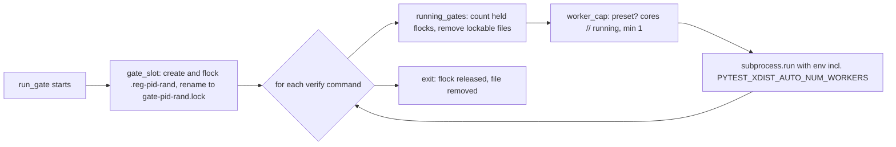

# Design: Landing Speed

## Overview

The whole-spec `/spec:implement` run is one Workflow script, `plugin/workflows/spec-implement.js` (vendored verbatim to `.claude/workflows/spec-implement.js`). Today it runs a plan agent after every freed slot and every finished task (`ck plan --json` plus `ck worktree create`), and it starts new tasks whenever an implementing slot frees, even while reviews and landings wait for a runtime agent slot. This feature changes the scheduler inside that script, the prompts and brief its agents follow, and four Python areas: `ck agents` (one new run setting), `ck worktree create` (a creation lock), `ck gate` (an xdist worker cap) and `ck stats` (queue-wait metrics). `ck doctor` / `ck init` get a hint. This project's own `specs/ck.json` and `pyproject.toml` switch the suite to pytest-xdist.

How the PLAN.md decisions shape it:

- **D1 (scope A + B + D, plus E; C deferred).** Nothing in the landing gate, `ck worktree land`, the land lock, bisection, protected-path checks, sandbox rules or `ck worktree report` changes. The landing queue (`requestLanding` / `pumpLandings` / `landBatch`), one landing at a time, the batch window and the full gate every `fullGateEvery` merges stay as they are.
- **D2 (adaptive finish-first, configurable off), refined by D9 and D10.** A pure decision `startDecision` holds new task starts while any review, revise or land agent is *queued*, and caps new task starts at the free runtime slots, `max(0, agentSlots - inFlight)`, so a start never itself queues ahead of a later review, revise or land (D10, requirement 3.9). The Workflow runtime does not tell a script when an agent it requested has started, so "queued" is an estimate from the documented runtime cap (D9; see "Queued: the observable approximation" below). There is no fixed reserve and no `reserve_slots` setting. The only switch is `run.finish_first` (default on).
- **D3 (plan agent at start, after each landing, and when idle).** A pure decision `planDecision` allows a plan agent only on those three triggers. Between them the script works out readiness itself from the dependency graph (`readyTasks`, which mirrors `ck plan`'s `ready` ordering exactly).
- **D4 (task agent creates its own worktree).** The plan prompt loses its `ck worktree create` step. `taskPrompt` gains it, and the task result reports the creation outcome. A pure `worktreeOutcome` maps that outcome to proceed, busy or error.
- **D5 (measure with real runs).** `ck stats` records each agent's queue wait and splits each task's wait between finishing and merging into review time and landing time. There is no `ck bench` work.
- **D6-D8 (parallel tests).** `ck gate` sets `PYTEST_XDIST_AUTO_NUM_WORKERS = max(1, cores // gates running)` for its verify commands unless the variable is already set. The count of gates running comes from a per-host registry of flock-held files. `ck doctor` / `ck init` suggest xdist and the stable-id check. This repo's verify becomes `uv run pytest -q -n auto`. The pid-parametrized test already has fixed ids (`tests/test_worktree_cli.py:121`).

### Queued: the observable approximation (requirements 3.1, 3.9, Constraints, Assumptions; PLAN.md D9)

A workflow script sees only `agent(prompt, opts) -> Promise`. It cannot see when the runtime moves an agent from its queue to a running slot. The Workflow runtime runs at most `min(16, CPUs - 2)` concurrent `agent()` calls per workflow, and further calls wait their turn (that is the documented cap of the Workflow script API; the 14-agent peak on a 16-core machine matches it). The design assumes the runtime starts queued agents in request order (FIFO); both the documented cap and FIFO order are recorded as assumptions in requirements.md. Under them:

> Of the agents the script has requested and that have not yet returned, ordered by request sequence, the first `agentSlots` are running and the rest are queued.

The script counts every `agent()` call it makes through one wrapper (`call`). `agentSlots` comes from the skill (`runtime.agentSlots` in `ck agents --json`, computed once by `runtime_agent_slots` from the affinity-aware CPU count). `CK_AGENT_SLOTS` overrides it, and nothing in the script hard-codes a number. The same estimate gives the free runtime slots, `max(0, agentSlots - inFlight.length)`, which cap new task starts (3.9). If `agentSlots` is absent (or null), no agent is presumed queued, so finish-first never defers a start (it is inert, and the run schedules exactly as with finish-first off). An `agentSlots` that is present but not a positive integer throws at load. The skill always passes `agentSlots` (TC-1 checks the wiring), so only hand-built args, such as every existing `tests/js/spec_implement.test.mjs` case, hit the inert fallback; those tests keep their current start order (requirements 3.1, 3.3, NFR-6).

## Components

### Existing Components to Modify

- `plugin/workflows/spec-implement.js`: the scheduler (stories 1-3).
  - **Args.** New fields: `deps`, `remaining` (the order), `agentSlots` and `finishFirst`. A non-boolean non-null `finishFirst` or a non-null `agentSlots` that is not a positive integer throws at load, in the style of `roleOpts`.
  - **Agent wrapper.** Every `agent()` call goes through `call(kind, prompt, opts)`. The wrapper records `{ seq, kind }` in an in-flight list and removes it when the call settles. Each settle runs `poke()`, which wakes the main loop. The wake-up runs `schedule()` only after the settling call's own continuation has made its follow-up request (a finished implementer's `review`, an approval's `land`), so that request is already in the in-flight list when `startDecision` counts free slots and the review gets the freed slot ahead of any new task (3.9, TC-65). Labels, phases and options are unchanged, so the `ck stats` label grammar (`src/claude_kiro/analytics/roles.py`) and the label corpus keep matching.
  - **New pure decisions block.** It sits between the markers `// --- decisions (pure; loaded by tests) ---` and `// --- end decisions ---`, and holds `readyTasks`, `chainLengths`, `applyPlanView`, `planConsistent`, `planDecision`, `queuedAgents`, `startDecision` and `worktreeOutcome` (see Decision Seams). Code inside the block uses no script globals and no `agent`/`log`.
  - **`PLAN` schema and `planPrompt`.** These change to "run `ck plan --json --exclude …` and copy `done`, `remaining`, `deps`, `ready`, `cycles`, `verifyCycles`". The worktree step and the `busy` field are gone. `usablePlan`/`normalizePlan` are updated to match. `planConsistent` checks the copy: the script's readiness over the copied view must equal the copied `ready`, or the attempt counts as a planning failure and is retried once, as today.
  - **`plan()`** becomes `requestPlan(trigger)`. It runs asynchronously, keeps at most one plan agent in flight, and coalesces a trigger that arrives while one is running into one follow-up. Each attempt captures the exclude list (running, failed, merged in run) when it builds its prompt, and passes that same captured list to `planConsistent`; tasks that start or finish while the plan agent runs never make a correct copy look inconsistent (1.6, 1.8). On success it applies `applyPlanView`, `applyLint` and `poke()`. Two failed attempts set `stopLaunching` with `PLAN_FAILED`, as today. The start plan is still awaited before the first launch, and the cycle refusal at start is unchanged.
  - **`landBatch`.** After it resolves the batch outcomes (after any full gate, exactly where `b.resolve(t)` runs today), it adds each MERGED task to `mergedInRun`, calls `requestPlan('landing')` and `poke()`s.
  - **`launch`** becomes `schedule()`. It computes ready tasks with `readyTasks`, asks `startDecision` which to start (it passes the in-flight list and `agentSlots`, so starts are capped at free runtime slots), and logs a finish-first deferral once per deferral period. Where `planDecision` says so, it requests the idle plan. Busy handling moves out of `launch` and into `runTask` (via `worktreeOutcome`).
  - **`taskPrompt`.** It now creates the worktree first: `ck -C ROOT worktree create SPEC N --install --base INTO --json`. On CREATED or EXISTS the agent claims the worktree and works. On BUSY or ERROR it stops at once, doesn't touch the worktree, and reports the creation result. `RESULT` gains `worktree: { state, detail }`.
  - **`retryPrompt`.** It keeps `--takeover` on the existing worktree. Only when the claim reports MISSING (the first agent died before creating it) does it run the same create command.
  - **`runTask`.** After the first attempt it calls `worktreeOutcome(r)`. Busy records `rec.busy = true` with reason `worktree busy: <detail>` and returns without retries or escalation. Error records reason `worktree create failed: <detail>` and returns without retries.
  - **Main loop.** It waits on `running` records plus the `poke()` signal, and keeps going while tasks run or a plan agent is in flight. On a task record it re-arms the idle plan. A busy task never triggers the `onFailure: halt` stop, matching today's plan-step BUSY handling; every other failed task does.
  - **Fallback when `args.deps` is absent (requirement 1.9).** `requestPlan` runs on every freed slot and every finished task, as today, and `schedule()` launches only from the plan that was just returned.
  - **Unchanged:** landing, fix ladders, review ladders, cross-test, final gate, report and the return shape. `stats.planSteps` still counts plan agents.
- `.claude/workflows/spec-implement.js`: regenerated by `uv run ck vendor` and byte-identical to the plugin source (NFR-3; `tests/test_plugin.py::test_dogfood_copies_in_this_repo_match_the_plugin_source`).
- `plugin/resources/spec-implement-brief.md` (and its vendored copy `.claude/workflows/spec-implement-brief.md`): "inside a pre-created git worktree" becomes "inside a git worktree that your prompt tells you to create (`ck worktree create`) if it doesn't exist yet". The claim step stays first after creation. The BUSY instruction gains the creation-BUSY case: stop and report `worktree busy: <detail>` (requirements 2.1, 2.3).
- `plugin/skills/implement/SKILL.md` (and its vendored copy `.claude/commands/spec/implement.md`):
  - Step 6 args gain `"deps": "<deps from ck plan>"`, `"remaining": "<remaining from ck plan>"`, `"agentSlots": "<runtime.agentSlots from ck agents --json>"` and `"finishFirst": "<run.finish_first from ck agents --json>"`.
  - Step 7 says the plan is re-read at start, after each landing and when nothing is ready (not after every task), and that task agents create their own worktrees (requirements 1.1, 1.4, 1.9).
- `src/claude_kiro/agents.py`:
  - `DEFAULTS["run"]["finish_first"] = True`, `"finish_first"` is added to `ROLE_KEYS["run"]`, and it joins the boolean branch of `_coerce`. The boolean branch gains a None pass-through before its bool check, so `null`/`none`/`default` reset any boolean setting (finish_first included) to its default, as they already do for every other setting (`write_setting` pops the key on None; property P-12). An invalid value raises `AgentConfigError("run.finish_first must be true or false (also yes/no, on/off)")` before `write_setting` writes anything (requirements 3.5, 3.6, 3.8).
  - New `runtime_agent_slots(cpus, env)` (below).
- `src/claude_kiro/cli/agents.py`: `ck agents --json` output gains `"runtime": {"cpus": int, "agentSlots": int}` (requirement 3.1). `cpus` is the affinity-aware count (`len(os.sched_getaffinity(0))` where available, else `os.cpu_count()`, the same rule as `xdist.core_count`), and `agentSlots = runtime_agent_slots(cpus, os.environ)`. The text view shows `run.finish_first` as on/off, like `analytics`.
- `src/claude_kiro/worktrees.py`:
  - `create()` holds a new blocking `create_lock(root)` (an flock on `<git common dir>/ck-create.lock`) around each `git worktree add` / unlock, but not around the install step. Many task agents now run `ck worktree create` at the same moment; the lock is a guard against git's own lock files colliding, not a fix for a reproduced failure (requirement 2.1).
  - One intended outcome change (requirement 2.4): when `git worktree add` fails for a task, `create()` catches the `WorktreeError` and appends `Outcome(num, "ERROR", <git's message>, rel, branch)` instead of raising, so `ck worktree create … --json` prints an ERROR entry (and the text form an `ERROR <n> …` line) and exits 3. Today the command prints a plain `❌ git worktree add …` line with no JSON. Other tasks in the same call still get their own outcome. Every other state, detail and exit code is unchanged.
- `src/claude_kiro/gate.py`: `run_gate` holds `xdist.gate_slot()` for its whole run. When `gate_slot` yields None or `running_gates` returns None, `run_gate` prints one line, `ck gate: gate registry <path> unusable (<reason>); counting only this gate for xdist workers`, at most once per gate run however many verify commands it has, and carries on (requirement 6.6, TC-47). `_run(command, project_dir, timeout, env=None)` passes `env` to `subprocess.run`. Before each verify command, `run_gate` builds the env with `xdist.verify_env(os.environ, registry)`. This covers `ck gate`, the in-process landing gate (`cli/worktree.py::_gate_fn`) and the done-verify hook, since all three call `run_gate`. Commands are never rewritten (requirements 6.1-6.7).
- `src/claude_kiro/cli/main.py`:
  - `doctor` appends `xdist.suggestion(load_config(project_dir)["verify"])` to `warnings` when it is not None. Warnings never change the exit status (requirements 7.1-7.3, 7.5).
  - `init` prints the same suggestion after the config step, for the effective `verify` (new or existing `specs/ck.json`), and writes nothing extra (requirement 7.4).
- `src/claude_kiro/analytics/collect.py`:
  - `_Agent` gains `queued_ms`, read from the run file entry's `queuedAt` in `_collect_file`. It is None for orphan runs.
  - Each agent row gains `queuedAtMs` and `queueMs` (via `queue_ms`).
  - In `_implement_metrics`, each task entry gains `reviewWaitMs` and `landingWaitMs` (via `wait_split` over that task's review and revise rows).
  - `SCHEMA_LOCAL` stays `ck-run-local/1`: the fields are additive (requirements 4.1, 4.2, 4.4, 4.7).
- `src/claude_kiro/analytics/show.py`:
  - `run_breakdown` adds `queue_wait` (from `queue_summary`) and `wait_split`.
  - `render_run` prints a `queue wait (runtime slot)` section, or `queue wait (runtime slot): not recorded`, plus a `wait before merge split` line next to `idle before merge`.
  - `run_json` adds `queueWait` and `waitSplit` with the same values.
  - `COVERAGE` gains `queue_wait` and `wait_split` notes (requirements 4.3-4.7).
- `specs/ck.json`: `"verify": ["uv run pytest -q -n auto"]` (requirement 5.2).
- `pyproject.toml` / `uv.lock`: `pytest-xdist>=3.6` in `[dependency-groups] dev`, then re-lock (requirement 5.1).

### New Components

- `src/claude_kiro/xdist.py` (new): the parallel-test support for `ck gate`, `ck doctor` and `ck init`. It holds the gate registry (`gate_slot`, `running_gates`), the worker-cap decision (`worker_cap`, `verify_env`), the core count (`core_count`) and the doctor/init hint (`suggestion`, `has_pytest_without_n`). It is one module because E2 and E3 share the pytest-command parsing.
- `tests/js/load_decisions.mjs` (new; the interface only, owned by the test plan): it reads `plugin/workflows/spec-implement.js`, cuts the text between the decision markers, and evaluates it with `new Function(...)` returning `{ readyTasks, chainLengths, applyPlanView, planConsistent, planDecision, queuedAgents, startDecision, worktreeOutcome }`. With it, property and contract tests can call the seams without the fake runtime.

## Public Interfaces

### Workflow args (`plugin/workflows/spec-implement.js`)

The new fields below are added to the existing args object (spec, root, worktreeDir, into, targetDir, wave, titles, tracks, risk, complexity, maxRetries, onFailure, maxConcurrent, fullGateEvery, mergeBatch, agents, model, effort, brief).

```js
{
  deps: { '1': [], '2': ['1'] },   // "deps" from ck plan --json; absent/not an object = fallback mode (1.9)
  remaining: ['1', '2'],           // "remaining" from ck plan --json; tasks.md order, used as the readiness order
  agentSlots: 14,                  // runtime.agentSlots from ck agents --json; absent/null = nothing presumed queued (finish-first inert)
  finishFirst: true,               // run.finish_first from ck agents --json; absent/null = true (3.6)
}
```

Invalid `finishFirst` (not boolean/null) or `agentSlots` (not a positive integer/null) throws `spec-implement: finishFirst must be true or false` / `spec-implement: agentSlots must be a whole number of 1 or more`.

### Plan agent result (`PLAN` schema)

```js
{
  done: string[],                         // "done" from ck plan
  remaining: string[],                    // "remaining" from ck plan, in order
  deps: { [task: string]: string[] },     // "deps" from ck plan, every entry
  ready: string[],                        // "ready" from ck plan, as printed (used only by planConsistent)
  cycles: string[][],
  verifyCycles: { task: string, message: string }[],
  error?: string,
}
```

The prompt's command is `ck -C <targetDir> plan <spec> --json --exclude <running,failed,merged-in-run>`, with the flag left out when the list is empty.

### Task agent result (`RESULT` schema), one new field

```js
worktree: { state: 'CREATED' | 'EXISTS' | 'BUSY' | 'ERROR', detail: string }  // the ck worktree create entry for this task
```

It isn't required, so retry/revise results (which don't create) leave it out.

### Workflow return value

The shape is unchanged. `stats.planSteps` counts plan agents (NFR-1). Busy and creation-error tasks appear in `failed` with the reasons above.

### Run log lines (requirement 3.7)

- `finish-first: holding new task starts while <k> review/revise/land agent(s) wait for a slot`, or `finish-first: holding new task starts while all <agentSlots> runtime slots are busy` when the hold comes from the free-slot cap alone (3.9): once when a deferral period begins, whichever reason starts it. A period ends when a task starts or nothing is deferred any more.
- `plan <n> (idle): nothing ready, <m> task(s) open; re-reading the plan`: once per idle trigger.

### `ck agents`

- `ck agents set run.finish_first <true|false|yes|no|on|off>`. An invalid value exits non-zero with `run.finish_first must be true or false (also yes/no, on/off)`, and the file is unchanged.
- `ck agents --json` adds `"runtime": {"cpus": <int>, "agentSlots": <int>}`.

```python
# src/claude_kiro/agents.py
def runtime_agent_slots(cpus: Optional[int], env: Mapping[str, str]) -> int:
    """Workflow runtime's concurrent agent() cap: CK_AGENT_SLOTS if a positive int, else max(1, min(16, cpus - 2)); cpus None -> 1."""
```

### `ck gate` environment (requirements 6.x)

For each verify command it runs, `run_gate` passes `os.environ` plus `PYTEST_XDIST_AUTO_NUM_WORKERS=<n>` unless the key is already present. There are no CLI changes.

```python
# src/claude_kiro/xdist.py
REGISTRY_ENV = "CK_GATE_REGISTRY"        # override of the registry directory (tests)
def registry_dir(env: Mapping[str, str]) -> Path:
    """CK_GATE_REGISTRY, else Path.home() / ".cache" / "ck" / "gates" (a fixed per-user path).
    Never TMPDIR or tempfile.gettempdir(): sandboxed commands get their own writable TMPDIR while
    /tmp is read-only, and gettempdir() can fall back to the cwd (a task worktree)."""
@contextmanager
def gate_slot(registry: Optional[Path] = None) -> Iterator[Optional[Path]]:
    """Register this gate atomically: create <registry>/.reg-<pid>-<random>, take LOCK_EX on it,
    then os.rename it to <registry>/gate-<pid>-<random>.lock (the flock stays with the inode), and
    hold the lock until exit, when it unlinks its own file. A gate-*.lock name therefore never
    exists unlocked while its gate lives. Yields None (and registers nothing) if the directory
    can't be created (mode 0700) or the file can't be created, locked or renamed."""
def running_gates(registry: Optional[Path]) -> Optional[int]:
    """Count gate-*.lock files in the registry whose flock is held (LOCK_EX|LOCK_NB fails).
    A gate-*.lock file it can lock belongs to an ended gate: it unlinks it while still holding
    that LOCK_EX, then releases. Every other name (.reg-*, stray files, directories) is ignored
    and never removed. None if the directory can't be read or isn't a directory."""
def core_count() -> Optional[int]:
    """len(os.sched_getaffinity(0)) where available, else os.cpu_count()."""
def verify_env(base: Mapping[str, str], registry: Optional[Path]) -> Dict[str, str]:
    """dict(base) plus PYTEST_XDIST_AUTO_NUM_WORKERS from worker_cap(base.get(...), core_count(), running_gates(registry))."""
def suggestion(verify: Sequence[str]) -> Optional[str]:
    """The doctor/init hint text, or None (see has_pytest_without_n)."""
```

Hint text (both commands):

```
pytest runs serially in "verify": pytest-xdist can run it in parallel (add pytest-xdist as a dev dependency and "-n auto" to the command). Check first that test ids are stable: unstable ids make xdist fail with "Different tests were collected between gw0 and gw1". One-line check: PYTHONHASHSEED=1 <cmd> --collect-only -q > /tmp/ids1 && PYTHONHASHSEED=2 <cmd> --collect-only -q > /tmp/ids2 && diff /tmp/ids1 /tmp/ids2
```

Here `<cmd>` is the pytest prefix of the first pytest command without `-n` (as in `config.collect_command`).

### `ck stats show` (requirements 4.3-4.6)

The text view is the existing lines plus:

```
queue wait (runtime slot):                                     # or "queue wait (runtime slot): not recorded"
  review: 62 agents, median 77 s, p90 154 s, total 77.0 min
  task: 42 agents, median 0 s, p90 102 s, total 26.0 min
  ...                                                          # one line per kind present, fixed order then alphabetical
wait before merge split: review median 2.3 min, total 104.0 min; landing median 4.4 min, total 133.0 min  [<coverage>]
                                                               # or "wait before merge split: not recorded"
```

JSON (`ck stats show <run> --json`) adds:

```json
"queueWait": {"recorded": true, "byKind": {"review": {"count": 62, "medianMs": 77000, "p90Ms": 154000, "totalMs": 4620000}}},
"waitSplit": {"recorded": true, "review": {"medianMs": 138000, "totalMs": 6240000}, "landing": {"medianMs": 264000, "totalMs": 7980000}}
```

When nothing is recorded: `{"recorded": false, "byKind": {}}` and `{"recorded": false, "review": null, "landing": null}`. The two are independent: a run file with start times but no `queuedAt` anywhere has `queueWait.recorded` false and a recorded `waitSplit` (its intervals start at `startedAtMs`). All existing keys are unchanged.

### Decision Seams

Every rule that allows, refuses or holds something is a pure function: no I/O, no clock, all inputs as arguments. The callers listed never re-implement the rule.

| Seam | Module (owner) | Signature | Decides |
|---|---|---|---|
| `readyTasks` | `plugin/workflows/spec-implement.js` decisions block (scheduler) | `readyTasks({ order: string[], deps: {[t]: string[]}, done: string[], exclude: string[], blocked: string[] }) -> string[]` | Which tasks may start, and in what order. A task is ready if it is in `order`, not in `done`, `exclude` or `blocked`, and every dependency d is met. d is met only if d is a key of `deps` AND d is in `done`; a dependency missing from the `deps` keys is never met, even when `done` lists it, so its dependent is not ready (1.10). `ck plan`'s `deps` includes Done tasks and its `done` holds only task ids from tasks.md, so this matches `ck plan`'s ready list on every real input (1.2, P-1). Order: `chainLengths` descending, then `Number(t)` for all-digit ids (else 0) ascending, with the sort stable over `order` (1.2, NFR-2). `blocked` = verify-cycle tasks ∪ tasks in dependency cycles. |
| `chainLengths` | same | `chainLengths(order: string[], deps, done: string[]) -> {[t]: number}` | The longest open chain of dependents per open task. It is a line-for-line port of `cli/worktree.py::_chain_lengths`, including its memoization order, so ties and cycles match (1.2). |
| `applyPlanView` | same | `applyPlanView(plan: PlanResult, mergedInRun: string[]) -> View` | The view after a plan returns. `deps`, `order` (= `plan.remaining`), `cycles` and `verifyCycles` are replaced, and `done = plan.done ∪ mergedInRun` (merges never un-happen, so a plan that read the target just before a merge never makes a merged task look open) (1.6). |
| `planConsistent` | same | `planConsistent(plan: PlanResult, exclude: string[]) -> boolean` | Whether a plan agent's copy holds together: `readyTasks` over `{order: remaining, deps, done: plan.done, exclude, blocked}` equals `plan.ready` with every task that has a dependency missing from the `deps` keys removed (the script's stricter 1.10 rule never turns into a planning failure), and every `remaining` task has a `deps` entry. `exclude` is the list captured when that attempt's prompt was built, not the scheduler's list at return time. False counts as a failed planning attempt (1.6, 1.8). |
| `planDecision` | same | `planDecision({ trigger: 'start'\|'landing'\|'idle'\|'freed'\|'finished', scriptReadiness: boolean, planInFlight: boolean, idleArmed: boolean, freeSlot: boolean, readyCount: number, openCount: number, stopLaunching: boolean }) -> 'run' \| 'coalesce' \| 'none'` | Whether a plan agent runs. With `scriptReadiness`, only `start`, `landing` and `idle` can run one. `idle` needs `freeSlot && readyCount === 0 && openCount > 0 && idleArmed` (1.4, 1.5). Without `scriptReadiness`, `freed` and `finished` run one too (1.9). Any trigger while `planInFlight` is `coalesce`. `stopLaunching` gives `none` for every trigger except `start`. `openCount` = tasks in `order`, not done, not running, not failed. |
| `queuedAgents` | same | `queuedAgents(inFlight: {seq: number, kind: string}[], slots: number \| null) -> {seq, kind}[]` | Which in-flight agents are presumed queued. With a positive integer `slots`, it is the entries after the first `slots` by ascending `seq`. With `slots` null or absent, it is no entry (finish-first inert; see "Queued: the observable approximation") (3.1, 3.3, NFR-6). |
| `startDecision` | same | `startDecision({ finishFirst: boolean, inFlight, slots, ready: string[], working: number, maxConcurrent: number, stopLaunching: boolean }) -> { start: string[], deferred: boolean, waiting: number }` | Which ready tasks start now. If `stopLaunching`, none. If `finishFirst` and any `queuedAgents` entry has kind `review`, `revise` or `land`: none, with `deferred: true` and `waiting` = their count (3.1). Otherwise the first `min(maxConcurrent - working, free)` of `ready`, where `free = max(0, slots - inFlight.length)` when `finishFirst` and `slots` is a positive integer, else unbounded (3.2, 3.3, 3.5, 3.9, NFR-6). When `free` holds back a start that `maxConcurrent` allows, `deferred: true` with `waiting: 0`. It is never asked about non-task agents, so it can't delay them (3.4). |
| `worktreeOutcome` | same | `worktreeOutcome(result: TaskResult \| null) -> { kind: 'proceed' \| 'busy' \| 'error', reason: string \| null }` | How a task agent's creation step ended. `worktree.state` BUSY, or a `blocker` matching `/worktree busy/i`, gives `busy` with reason `worktree busy: <detail>` (2.3). ERROR gives `error` with reason `worktree create failed: <detail>` (2.4). CREATED, EXISTS or no `worktree` field gives `proceed` (2.2, 2.5). |
| `worker_cap` | `src/claude_kiro/xdist.py` (gate) | `worker_cap(preset: Optional[str], cores: Optional[int], running: Optional[int]) -> Optional[str]` | The `PYTEST_XDIST_AUTO_NUM_WORKERS` value to set. `preset` is not None (key present, any value) → None, so the value passes through unchanged (6.2). Otherwise `str(max(1, c // r))`, where `c = cores` if it is ≥ 1 else 1 and `r = running` if it is ≥ 1 else 1 (6.1, 6.3, 6.4, 6.6). |
| `has_pytest_without_n` | `src/claude_kiro/xdist.py` (doctor/init) | `has_pytest_without_n(verify: Sequence[str]) -> Optional[str]` | Which verify command, if any, earns the hint. It returns the first command that invokes pytest (a `pytest` token, or `-m pytest`) and has none of `-n`, `-n<x>`, `-n=<x>`, `--numprocesses`, `--numprocesses=<x>`. Otherwise None (7.1, 7.3). It tokenizes with `shlex.split` and falls back to `str.split` on a parse error. |
| `queue_ms` | `src/claude_kiro/analytics/collect.py` (collector) | `queue_ms(queued_at: Any, started_at: Any) -> Optional[int]` | An agent's queue wait: `started - queued` when both are ints with `started ≥ queued`, else None. Never 0 for unknown (4.1, 4.2). |
| `wait_split` | `src/claude_kiro/analytics/collect.py` | `wait_split(finished_ms: Optional[int], merged_ms: Optional[int], intervals: Sequence[Tuple[Optional[int], Optional[int]]]) -> Tuple[Optional[int], Optional[int]]` | `(review_ms, landing_ms)` for one task. `review_ms` is the length of the union of the `(queuedAtMs, startedAtMs + ms)` intervals of its review and revise agents (an interval starts at `startedAtMs` when `queuedAtMs` is unknown), clipped to `[finished, merged]`. `landing_ms` = `(merged - finished) - review_ms`. `(None, None)` if `finished` or `merged` is unknown, `merged < finished`, or any interval has an unknown end (4.4). |
| `agent_kind` | `src/claude_kiro/analytics/show.py` (stats view) | `agent_kind(row: Mapping) -> str` | The queue-wait kind of an agent row: implementer/test-writer with `round` → `revise`, implementer/test-writer otherwise → `task`, reviewer → `review`, fixer → `fix`, resolver → `resolve`, and `plan`, `land`, `gate`, `cross-test`, `report` and `other` as their role (4.3). |
| `queue_summary` | `src/claude_kiro/analytics/show.py` | `queue_summary(rows: Sequence[Mapping]) -> Optional[Dict[str, Dict[str, int]]]` | Per kind: `count`, `medianMs` (`statistics.median`, rounded to an int), `p90Ms` (nearest rank: `sorted[ceil(0.9·n) − 1]`) and `totalMs`, over rows with an int `queueMs`. None ("not recorded") when no row has one (4.3, 4.5). |
| `_coerce` (existing) | `src/claude_kiro/agents.py` (settings) | `_coerce("run", "finish_first", value) -> Optional[bool]` | Accepts true/false/yes/no/on/off (case-insensitive) and bools. `null`/`none`/`default` give None, which resets the setting to its default (P-12). Anything else raises `AgentConfigError` naming the allowed values (3.8). |

## Data Models

### Workflow script (JavaScript)

```js
// View: the scheduler's picture of the plan between plan agents.
// {
//   order: string[],                     // tasks in tasks.md order (ck plan "remaining" at the last plan)
//   deps: { [task: string]: string[] },  // dependencies per task (ck plan "deps")
//   done: Set<string>,                   // Done on the target: last plan's "done" ∪ mergedInRun
//   cycles: string[][],                  // dependency cycles (ck plan "cycles")
//   verifyCycles: { task: string, message: string }[],
// }
// blocked(view) = verifyCycles tasks ∪ every task in cycles

// InFlight entry, one per agent() call not yet settled
// { seq: number,       // request order, monotonically increasing per run
//   kind: 'task' | 'review' | 'revise' | 'land' | 'plan' | 'gate' | 'fix' | 'recheck' | 'resolve' | 'cross-test' | 'report' }
// Unblocker kinds (finish-first): 'review', 'revise', 'land'.
// Retries and escalated retries are kind 'task' but are not new task starts, so they are never gated.

// Scheduler state added to today's (running, working, records, failed, ...):
// mergedInRun: Set<string>     tasks a land step reported MERGED in this run
// planInFlight: boolean        a plan agent is running
// planPending: string | null   trigger coalesced while one ran (one follow-up)
// idleArmed: boolean           true at start and after a landing completes or a task record arrives; false once the idle plan ran
// deferring: boolean           inside a finish-first deferral period (log-once guard)
// SCRIPT_READINESS: boolean    args.deps is a plain object
```

### Collector record (`ck-run-local/1`, additive fields)

```python
# agents[] row (collect._build_agent)
"queuedAtMs": Optional[int]   # run file entry "queuedAt" (epoch ms); None if absent or not an int
"queueMs": Optional[int]      # queue_ms(queuedAt, startedAt); None = unknown, never 0 for unknown

# tasks[] entry (collect._implement_metrics), spec-implement records only
"reviewWaitMs": Optional[int]   # wait_split(...)[0]: review/revise agents queued or running inside finished..merged
"landingWaitMs": Optional[int]  # wait_split(...)[1]: the rest of idleBeforeMergeMs
```

A record is "queue recorded" when at least one agent row has an int `queueMs`. Records collected before this change have no such row and read as "not recorded" (4.5, 4.7).

### `ck stats show` view additions (`show.run_breakdown`)

```python
"queue_wait": Optional[Dict[str, Dict[str, int]]]  # queue_summary(record["agents"]); None = not recorded
"wait_split": {
    "review": Optional[Dict[str, int]],    # {"median": ms, "total": ms} over tasks with an int reviewWaitMs; None = not recorded
    "landing": Optional[Dict[str, int]],   # same over landingWaitMs
}
```

### Settings and config

```python
# agents.DEFAULTS["run"]
"finish_first": bool = True   # hold new task starts while a review/revise/land agent is queued, and cap them at free runtime slots

# ck agents --json, top level
"runtime": {"cpus": int, "agentSlots": int}
```

### Gate registry (filesystem, per host)

```
<registry_dir>                           # ~/.cache/ck/gates (mode 0700), or $CK_GATE_REGISTRY
<registry_dir>/.reg-<pid>-<8 hex>        # registration in progress: locked, then renamed; never counted or removed
<registry_dir>/gate-<pid>-<8 hex>.lock   # empty file; a live gate holds LOCK_EX on it
                                         # lockable file = ended gate (pass, fail, timeout, crash: the kernel drops the flock)
                                         #   -> unlinked by the counter while it holds the lock
```

## Data Flow

```mermaid
sequenceDiagram
    participant S as spec-implement.js scheduler
    participant RT as Workflow runtime (agent slots, FIFO)
    participant P as plan agent (ck plan)
    participant T as task agent
    participant R as review / revise agent
    participant L as land agent (ck worktree land)

    S->>RT: call('plan') at start
    RT->>P: run
    P-->>S: done, remaining, deps, ready, cycles
    S->>S: planConsistent, applyPlanView, readyTasks
    S->>S: startDecision (finish-first, maxConcurrent)
    S->>RT: call('task', taskPrompt) per started task
    RT->>T: run: ck worktree create --install --base INTO, claim, implement, gate, release
    T-->>S: RESULT + worktree {state, detail}
    S->>S: worktreeOutcome: busy/error -> record not merged; proceed -> continue
    S->>S: releaseSlot, schedule(): readyTasks (no plan agent)
    S->>RT: call('review')
    Note over S,RT: while queuedAgents() has review/revise/land, or no runtime slot is free,<br/>startDecision returns deferred (log once)
    RT->>R: run when a slot frees
    R-->>S: verdict
    S->>RT: call('land', batch)
    RT->>L: run (gate, bisect)
    L-->>S: MERGED / RED / CONFLICT ...
    S->>S: mergedInRun += MERGED, done updated, poke
    S->>RT: call('plan') [trigger: landing; coalesced if one in flight]
    S->>S: schedule(): dependents of merged tasks ready
    Note over S: no ready task, free slot, open tasks, idleArmed:<br/>one idle plan, then disarmed until a landing or task record
```

Gate worker cap (inside every `run_gate`):



## Error Handling

- **1.7 Cycle in a plan result.** At start, the existing refusal is unchanged (`halted`, `refused: true`, nothing launched). Mid-run, `applyLint` runs on every applied plan as today: verify-order cycle tasks are marked failed and halt with `onFailure: halt`, and a dependency cycle sets `stopLaunching`.
- **1.8 Plan agent fails twice in a row.** `requestPlan` makes two attempts. An attempt fails when there is no usable result, a lone `error` with an empty plan, or `planConsistent` false. After two failures: `stopLaunching = true` and `stopReason = PLAN_FAILED`. Running tasks still finish, land and record. The outcome logic for `PLAN_FAILED` is unchanged.
- **1.9 No dependency information in args.** `SCRIPT_READINESS = false`: `planDecision` runs a plan on every `freed` and `finished` trigger, and `schedule()` starts from the result of that plan. The run is otherwise identical.
- **1.10 Unknown dependency.** `readyTasks` treats a dependency as met only when it is a key of `deps` and in `done`, so a dependent of a task missing from the map never starts, even if a plan's `done` lists the missing id by mistake. `planConsistent` drops such tasks from `plan.ready` before comparing, so the disagreement with a plan's `ready` is not a planning failure and other tasks keep launching. The report lists the task as blocked, from git.
- **2.3 Worktree BUSY.** `worktreeOutcome → busy`. The record has `ok: false`, `busy: true` and `reason: "worktree busy: <detail>"`. There are no retries, escalation or review, the task goes in `failed` and `busyReported`, and it doesn't trigger the `onFailure: halt` stop (requirement 2.3). The prompt and brief tell the agent not to touch the worktree. A BUSY from `claim` (a race after EXISTS) is the same case through the `blocker` match.
- **2.4 Worktree creation error.** `ck worktree create --json` reports a failed `git worktree add` as an ERROR entry with git's message (see `worktrees.py` above), and the task agent copies it into `worktree`. `worktreeOutcome → error`. The record has `ok: false` and `reason: "worktree create failed: <detail>"`, with no retries. The main loop applies `onFailure` (halt sets `stopLaunching`). `create_lock` guards against git lock collisions between concurrent creates.
- **3.8 Invalid finish-first value.** `_coerce` raises `AgentConfigError` before `write_setting` touches the file, so `ck agents set` exits non-zero with the allowed values. A non-boolean `args.finishFirst` makes the script throw at load with the allowed values.
- **4.2 Missing or inverted queue times.** `queue_ms` returns None: there is no exception and the row is still written. `wait_split` returns `(None, None)` for that task. Collection never fails on these fields.
- **4.5 No queue data.** `queue_summary` returns None, so the text says `not recorded` and JSON has `recorded: false`. Every existing figure is computed exactly as before.
- **6.5 Ended gate.** The registry counts only files whose flock is held. The kernel releases the flock when the holder exits for any reason (pass, fail, timeout, crash, kill), so a dead gate's file becomes lockable and is removed during counting. PIDs are not used for liveness (they are not comparable across sandbox PID namespaces).
- **6.6 Count unavailable.** If the registry directory can't be created or read, or `gate_slot` yields None: `running_gates` returns None, `worker_cap` treats it as 1, `run_gate` prints its one-line `gate registry … unusable` note, and the verify commands still run. If `core_count()` is None, the cap is 1. No fallback ever puts the registry under `TMPDIR`, `/tmp` or the current directory, so a gate can never write into a task worktree.
- **6.1 Registration race.** `gate_slot` locks its file before giving it a `gate-*.lock` name, and the counter only unlinks a `gate-*.lock` while holding the lock it tested with, so a counter running while 14 gates start together never removes a live gate's file.
- **Plan-trigger coalescing (supports 1.4/1.5).** A trigger that arrives while a plan agent runs sets `planPending`. One follow-up plan runs after it, which covers a landing that merged while the first plan was reading the target.
- **Concurrency of the in-flight list.** The `call` wrapper removes an entry in a `finally`, so an agent that throws or returns null still leaves the list and pokes the loop.

## Security, Performance, Migration

**Security.** The protected-path, sandbox and land-lock logic are untouched. Task agents now run `ck worktree create`, a command the brief already lists for worktree work: it uses absolute `-C` paths, is a single simple command, and needs no new permission or network host (install uses the same configured install command as before). The gate registry lives at the fixed per-user path `~/.cache/ck/gates` (created with mode 0700), which `ck run`'s sandbox already allows to read and write (`SANDBOX_HOME_READABLE` / `SANDBOX_HOME_WRITABLE` in `cli/run.py` hold `~/.cache`), so sandboxed task gates and the unsandboxed landing gate and hook share it. It holds empty files and is only read to count flocks. A session whose own sandbox does not allow `~/.cache` gets the 6.6 fallback with its one-line note, never a silent miscount. `PYTEST_XDIST_AUTO_NUM_WORKERS` holds an integer, never user-controlled text.

**Performance.**
- Plan agents per run drop from about 1 per task plus 1 per freed slot to `1 + landings + idle plans`. An idle plan may run right after the start plan or a landing plan; only an idle plan after the first idle plan needs a landing completion or task record since the previous idle plan, so idle plans ≤ 1 + landings + task records (NFR-1).
- No worktree-creation agents run.
- Finish-first keeps new task requests out of the runtime queue while unblockers wait, and at saturation never requests a task that would queue, so the next free slot goes to a review or landing (NFR-5 target: review median queue wait under 30 s). A held start loses nothing under FIFO: it could not have started before a slot freed, and it is requested at the settle that frees one unless a review, revise or land takes it. No deadlock: holds wait only on agents already in flight, each settle re-runs `startDecision`, and with nothing in flight `free = agentSlots ≥ 1` (NFR-6, P-11).
- With nothing queued, the decision is the same as today's launch (NFR-6).
- With the worker cap, k concurrent gates on c cores start about c workers in total instead of k·c.
- This repo's suite runs in about 52 s instead of about 253 s on 16 cores (NFR-4).

**Migration.** None needed.
- An older skill that passes no `deps`, `agentSlots` or `finishFirst` gets the fallback planning and finish-first on but inert (nothing presumed queued without `agentSlots`), which is today's scheduling.
- Old stats records stay readable and show "not recorded" for the new sections.
- `run.finish_first` defaults to true with no file change.
- Vendored projects get the new script and brief via `ck vendor` / `ck upgrade`. This repo regenerates its `.claude/` copies with `uv run ck vendor` in the same change as the plugin edits.

## Requirements Traceability

| Criterion | Design element |
|---|---|
| 1.1 | SKILL.md step 6 args `deps`, `remaining`; workflow args `deps`, `remaining` |
| 1.2 | `readyTasks`, `chainLengths` (port of `cli/worktree.py::_plan` ready sort and `_chain_lengths`) |
| 1.3 | `schedule()` on `releaseSlot` / `poke()` using `readyTasks`; `planDecision` returns `none` for `freed` with script readiness |
| 1.4 | `planDecision` (start, landing via `landBatch` → `requestPlan('landing')`, idle) |
| 1.5 | `planDecision` `idleArmed`; re-armed on landing completion and task record |
| 1.6 | `applyPlanView` (replace deps/order/lint, done = plan.done ∪ mergedInRun); `planConsistent` with the exclude captured per attempt |
| 1.7 | Start refusal unchanged; `applyLint` on every applied plan |
| 1.8 | `requestPlan` two attempts → `stopLaunching`, `PLAN_FAILED` |
| 1.9 | `SCRIPT_READINESS` false → `planDecision` runs on `freed`/`finished` |
| 1.10 | `readyTasks` (met = key of `deps` and in `done`); `planConsistent` drops dangling-dep tasks from `plan.ready` |
| 2.1 | `taskPrompt` create + claim; `planPrompt` without create; brief update; `create_lock` |
| 2.2 | `worktreeOutcome` EXISTS → proceed; `worktrees.create` stale-claim release (unchanged) |
| 2.3 | `worktreeOutcome` busy; `runTask` no retry/escalation; reason `worktree busy: <detail>`; main loop skips the `onFailure: halt` stop for busy records |
| 2.4 | `worktrees.create` ERROR outcome for a failed `git worktree add`; `worktreeOutcome` error; reason `worktree create failed: <detail>`; `onFailure` in main loop |
| 2.5 | `retryPrompt` / `revisePrompt` / `reviewPrompt` reuse `WT(n)`; create only on claim MISSING |
| 2.6 | `fixPrompt` unchanged (`ck worktree create … fix<k>`) |
| 3.1 | `call` wrapper in-flight list, `queuedAgents` (presumed queued = beyond the first `agentSlots` in request order, FIFO; none without `agentSlots`), `startDecision`; `runtime.agentSlots` from `runtime_agent_slots` (documented cap, `CK_AGENT_SLOTS` override) |
| 3.2 | `poke()` on every agent settle → `schedule()` before any other agent can settle; starts only into a free runtime slot (3.9) |
| 3.3 | `startDecision` with no presumed-queued unblocker and enough free slots = first `maxConcurrent - working` ready; `queuedAgents` none and no slot cap without `agentSlots` |
| 3.4 | `startDecision` gates only `schedule()` task starts; all other `call`s ungated |
| 3.5 | `run.finish_first` false → `finishFirst: false` → `startDecision` ignores queue |
| 3.6 | `DEFAULTS["run"]["finish_first"] = True`; script default when absent |
| 3.7 | `deferring` flag; one `finish-first: holding …` log per deferral period |
| 3.8 | `_coerce("run","finish_first", …)` → `AgentConfigError`; script load-time check |
| 3.9 | `startDecision` `free = max(0, slots - inFlight.length)` cap; `schedule()` runs after the settling call's follow-up request; slot-cap deferral log line |
| 4.1 | `_Agent.queued_ms`, row `queuedAtMs`, `queueMs` via `queue_ms` |
| 4.2 | `queue_ms` → None on missing/inverted |
| 4.3 | `agent_kind`, `queue_summary`, `render_run` queue-wait section |
| 4.4 | `wait_split`, task `reviewWaitMs`/`landingWaitMs`, `run_breakdown.wait_split`, render line |
| 4.5 | `queue_summary` None → "not recorded"; existing figures untouched |
| 4.6 | `run_json` `queueWait`, `waitSplit` from the same view values |
| 4.7 | Additive fields, `SCHEMA_LOCAL` unchanged, `.get` reads in `show.py` |
| 5.1 | `pyproject.toml` dev group `pytest-xdist>=3.6`, `uv.lock` |
| 5.2 | `specs/ck.json` verify `uv run pytest -q -n auto` |
| 5.3 | Stable ids (`tests/test_worktree_cli.py:121` fixed ids, D8); `suggestion` check command |
| 5.4 | Verify under `-n auto`; collection check `collect_command` unchanged (`--collect-only`) |
| 6.1 | `registry_dir` (fixed per-user path), atomic `gate_slot`, `running_gates`, `worker_cap`, `verify_env` in `run_gate` |
| 6.2 | `worker_cap` preset → None (pass through) |
| 6.3 | `worker_cap` `max(1, …)` |
| 6.4 | `worker_cap` running = 1 → cores; `core_count` |
| 6.5 | flock-held registry files; lockable files removed |
| 6.6 | `running_gates` None → counted as 1; `gate_slot` yields None; `run_gate` one-line note |
| 6.7 | `run_gate` passes env only; commands unchanged |
| 7.1 | `has_pytest_without_n`, `suggestion` → doctor `warnings` |
| 7.2 | `suggestion` text: collection-mismatch error and the PYTHONHASHSEED check |
| 7.3 | `has_pytest_without_n` → None for `-n` / no pytest |
| 7.4 | `init` prints `suggestion`; writes nothing extra |
| 7.5 | Doctor exit status driven by `issues` only |
| NFR-1 | `planDecision` (`idleArmed` re-armed only by a landing completion or task record); `stats.planSteps`; no create agents |
| NFR-2 | `readyTasks` / `chainLengths` via `tests/js/load_decisions.mjs` vs `ck plan --json` |
| NFR-3 | `uv run ck vendor`; `test_dogfood_copies_in_this_repo_match_the_plugin_source` |
| NFR-4 | `specs/ck.json` `-n auto`, pytest-xdist |
| NFR-5 | `queue_summary` review median; `stats.planSteps` vs tasks |
| NFR-6 | `startDecision` identical to plain launch when nothing is presumed queued and slots are free; holds wait only on in-flight agents, re-run on every settle (no deadlock) |
