# Implementation Tasks: Landing Speed

**Status:** Not Started
**Spec:** [requirements.md](requirements.md) · [design.md](design.md) · [test-plan.md](test-plan.md) · [PLAN.md](PLAN.md)

Test tasks follow design.md where it renames a test-plan Harness Contract name. The renames used below:

- readiness seam: `readyTasks({order, deps, done, exclude, blocked})`, loaded through `tests/js/load_decisions.mjs` (design) instead of `loadFunction(script, 'readyTasks')`;
- finish-first args: `args.finishFirst` (boolean, absent = on) and `args.agentSlots` (the script's queued estimate), instead of `args.agents.run.finish_first`. Every slot-pressure test passes `agentSlots` equal to the fake runtime's `slots`;
- gate registry override: `CK_GATE_REGISTRY` (not `CK_GATE_RUNDIR`); seams `claude_kiro.xdist.worker_cap / verify_env / running_gates / gate_slot / core_count / suggestion / has_pytest_without_n` (not `gate.xdist_env`, `gate.machine_cores`, `config.xdist_suggestion`);
- stats seams `collect.queue_ms(queued_at, started_at)`, `collect.wait_split(finished, merged, intervals)`, `show.agent_kind(row)`, `show.queue_summary(rows)`; JSON `queueWait {recorded, byKind{kind:{count, medianMs, p90Ms, totalMs}}}` and `waitSplit {recorded, review:{medianMs,totalMs}|null, landing:…}`; text `queue wait (runtime slot)` / `wait before merge split`; record fields `queueMs`, `queuedAtMs`, task `reviewWaitMs`, `landingWaitMs`.

## Task Breakdown

### Task 1: Build the workflow test harness (fake project module, queued fake runtime, decision loader, Node bridge, Hypothesis strategies)
**Status:** Not Started
**Track:** test
**Requirements:** 1.2, 1.4, 2.1, 3.1, NFR-1, NFR-2
**Description:** Build the shared infrastructure from test-plan.md "Test Infrastructure / To add" items 1-6 (Harness Contract items 12 and 13), which Tasks 2, 6, 7, 8, 10 and 11 depend on. No TC of its own; it must leave every existing suite green.
1. `tests/js/fake_project.mjs`: move `project({...})` out of `tests/js/spec_implement.test.mjs` with no behaviour change (spec_implement.test.mjs imports it and still passes unchanged). Add options: `plan` answers carry `deps` (current map after `relink`) and `remaining` (tasks.md order) and `ready` computed exactly as `ck plan` would (longest open chain first, then numeric id), with no worktree filtering and no `busy` entries (a dependency counts as met in this fake `ready` when it is in `done`, as in `ck plan`); `planDurations: {k: ms}` (plan call k takes that long, for TC-62); `externalDone: {atPlan: k, tasks}`; `planFail: [k…]` (plan k and its retry return `{error:'boom'}` with empty arrays); `worktree: {<n>: {state, detail}}` (first task agent of n returns that `worktree` outcome; BUSY/ERROR also return `status:'blocked'`, `gatePassed:false`, `commits:''`; default `CREATED`).
2. `tests/js/load_workflow.mjs`: `runWorkflow(scriptPath, {agent, args, slots})`. With a positive integer `slots`, at most `slots` agent calls run at once and the rest wait FIFO. The result gains `trace: [{t, ev:'request'|'start'|'end', label}]` (`performance.now()`). Without `slots` nothing queues. Existing callers unchanged.
3. `tests/js/load_decisions.mjs` (design "New Components"): read `plugin/workflows/spec-implement.js`, cut the text between `// --- decisions (pure; loaded by tests) ---` and `// --- end decisions ---`, evaluate it with `new Function`, and return `{readyTasks, chainLengths, applyPlanView, planConsistent, planDecision, queuedAgents, startDecision, worktreeOutcome}`. Throw a clear error naming the missing marker or function (that is the expected pre-implementation failure).
4. `tests/js/bridge.mjs`: long-lived JSON-lines process. `{op:'ready', order, deps, done, exclude, blocked}` → `{ok:true, ready}` via `load_decisions.mjs`; `{op:'run', project, args, slots}` → `{ok:true, result, logs, trace, prompts, events}`; any throw → `{ok:false, error}`. Durations in ms (1-40).
5. `tests/landing_bridge.py`: module-scoped fixture `bridge` (starts `node tests/js/bridge.mjs` once; `bridge.ready(...)`, `bridge.run(project, args, slots=None)`; skips without `node`). Hypothesis strategies `dags()` (1-25 tasks, ids from 1..120 non-contiguous and multi-digit, edges only higher→lower so acyclic, duplicate deps, dangling deps), `subsets(ids)`, `scenarios()` (DAG, durations, reviewDurations, mergeDurations, review verdict sequences, `checkRed`, `failUntil`, `maxConcurrent` in {1..4, None}, `mergeBatch` 1..4, `slots` in {1..6, None}, `fullGateEvery` 1..3, optional `relink`). Also `write_spec(dir, deps, done)` (impl-track blocks shaped like `tests/test_waves.py::task()`, `**Status:** Done` for Done tasks, dangling deps as references to absent numbers, no Parallel Groups) and `ck_plan(dir, exclude)` running `ck plan demo --json --exclude …` through CliRunner in a `tempfile.TemporaryDirectory()` git repo.
6. `tests/test_workflow_scripts.py`: parametrize over every `tests/js/*.test.mjs` (glob, sorted) instead of the fixed list, so Tasks 6 and 7 add files without editing it.
7. `tests/test_landing_harness.py`: smoke tests for the harness itself: the fake runtime with `slots: 1` never has two agents started-and-not-ended at once and starts FIFO; `bridge.run` round-trips a 2-task scenario against the current script; `write_spec` + `ck_plan` returns the expected `ready` on a hand-written 4-task graph.
**Files:**
- `tests/js/fake_project.mjs` - fake project moved out of spec_implement.test.mjs, plus `planDurations`, `externalDone`, `planFail`, `worktree`, `deps`/`remaining` in plan answers
- `tests/js/spec_implement.test.mjs` - import `project` from fake_project.mjs (no test changed)
- `tests/js/load_workflow.mjs` - `slots` option and `trace`
- `tests/js/load_decisions.mjs` - decision-block loader
- `tests/js/bridge.mjs` - JSON-lines bridge
- `tests/landing_bridge.py` - `bridge` fixture, strategies, `write_spec`, `ck_plan`
- `tests/test_workflow_scripts.py` - glob over `tests/js/*.test.mjs`
- `tests/test_landing_harness.py` - harness smoke tests
**Verify:** `node tests/js/spec_implement.test.mjs` `uv run pytest -q tests/test_workflow_scripts.py tests/test_landing_harness.py`

**Acceptance:**
- [ ] `spec_implement.test.mjs` passes unchanged on top of `fake_project.mjs` (behaviour-preserving move)
- [ ] The fake runtime with `slots` enforces the cap and FIFO order, shown by the smoke test on `trace`
- [ ] `load_decisions.mjs` fails on today's script with an error naming the missing decision marker (the right reason), and the bridge reports it as `{ok:false, error}`
- [ ] `write_spec`/`ck_plan` drive the real `ck plan` CLI on a real git repo (no mocks of `claude_kiro`)
- [ ] Strategies are usable with `@settings(derandomize=True, database=None, deadline=None)`; no function-scoped fixture inside `@given`

**Dependencies:** None
**Complexity:** High
**Risk:** normal

---

### Task 2: Write the readiness contract property tests
**Status:** Not Started
**Track:** test
**Requirements:** 1.2, 1.10, NFR-2
**Properties:** P-1, P-2, P-3, P-4, P-5
**Description:** Implement TC-3 and properties P-1 to P-5 in `tests/test_landing_readiness.py`, at the `readyTasks` seam only (through `bridge.ready`), so they run as soon as Task 3's decisions block exists. TC-1 and TC-55 (which need the wired scheduler and skill) live in Task 6.
- TC-3 / P-1 (NFR-2, ≥ 200 examples): for each `dags()` graph, Done subset and exclude subset (including Done ids and absent ids), write the tasks.md with `write_spec`, run real `ck plan demo --json --exclude …`, then call `bridge.ready(order=plan.remaining, deps=plan.deps, done=plan.done, exclude, blocked=[])` and assert the list equals `ck plan`'s `ready` (same set, same order; ids such as 9/10/100 check numeric order).
- P-2: a task whose dep d is not a key of `deps` is never ready, even when d is in `done` and every other dep is Done (near-misses: max id + 1, a removed task's id, an id in `done` but absent from the map).
- P-3: adding x to `exclude` removes only x and keeps the order of the rest (x from ready, non-ready, Done, absent ids).
- P-4: permuting key insertion order of `deps`, each dep list, `done` and `exclude` does not change the output (including integer-like keys JS reorders). `order` is tasks.md order and is not permuted.
- P-5: marking a ready task r Done never removes another ready task; any newly ready task has r among its deps.
Settings: `@settings(derandomize=True, max_examples=200, database=None, deadline=None)`. Module-level `PROPERTIES = {"P-1": "...", "P-2": "...", "P-3": "...", "P-4": "...", "P-5": "..."}` naming the tests.
**Files:**
- `tests/test_landing_readiness.py` - TC-3, P-1..P-5, `PROPERTIES` map
**Verify:** `uv run pytest -q tests/test_landing_readiness.py`
**Verifies:** Task 3

**Acceptance:**
- [ ] P-1 compares the script's real `readyTasks` (from the real script source) against the real `ck plan` CLI on a real git repo, over at least 200 derandomized examples
- [ ] Generators cover every surface form in the P-1..P-5 rows: non-contiguous multi-digit ids, empty dep lists, diamonds, long chains, duplicate deps, deps on Done or excluded tasks, dangling deps, Done/exclude subsets including absent ids
- [ ] Properties call the decision seam through the bridge, not the whole workflow
- [ ] Before implementation every test fails because `readyTasks`/the decision markers are missing, not because of test code errors
- [ ] No mocks of `claude_kiro` code

**Dependencies:** Task 1 (bridge, `dags()`, `write_spec`, `ck_plan`)
**Complexity:** Medium
**Risk:** safety (oracle for Task 3, whose `worktreeOutcome` decides whether a worktree another live agent holds is left alone)

---

### Task 3: Add the pure scheduling decisions block to the spec-implement workflow
**Status:** Not Started
**Track:** impl
**Requirements:** 1.2, 1.3, 1.4, 1.5, 1.6, 1.9, 1.10, 2.2, 2.3, 2.4, 3.1, 3.3, 3.5, 3.9
**Description:** Foundation for Task 12. Owns Harness Contract item 2 (readiness seam, renamed by design to `readyTasks({...})` inside the decisions block) and the script side of items 12-13 (the marker-delimited block `tests/js/load_decisions.mjs` and the bridge cut out). In `plugin/workflows/spec-implement.js`, add a self-contained block between the exact marker lines `// --- decisions (pure; loaded by tests) ---` and `// --- end decisions ---` (design.md "Decision Seams"). Code inside the block uses no script globals, no `agent`/`log`/`args`, no clock and no I/O, so `tests/js/load_decisions.mjs` can cut it out and evaluate it with `new Function(...)`. Implement:
- `chainLengths(order, deps, done)`: a line-for-line port of `src/claude_kiro/cli/worktree.py::_chain_lengths`, including its memoization order, so ties and cycles behave identically.
- `readyTasks({ order, deps, done, exclude, blocked })`: a task is ready iff it is in `order`, not in `done`/`exclude`/`blocked`, and every dependency is met. A dependency is met only if it is a key of `deps` AND in `done`; a dependency missing from the `deps` keys is never met, even when `done` lists it (never start on a guess, 1.10, P-2). Order: chain length descending, then `Number(t)` for all-digit ids (else 0) ascending, stable over `order`, mirroring `cli/worktree.py::_plan`'s ready sort exactly (1.2). P-1 is unaffected by the key-of-`deps` condition, because `ck plan`'s `done` is always a subset of its `deps` keys.
- `applyPlanView(plan, mergedInRun)`: replace `deps`, `order` (= `plan.remaining`), `cycles`, `verifyCycles`; `done = plan.done ∪ mergedInRun` (1.6).
- `planConsistent(plan, exclude)`: `readyTasks` over the plan's copied view (blocked = verify-cycle tasks ∪ dependency-cycle tasks) equals `plan.ready` with every task that has a dependency missing from the `deps` keys removed (so the stricter 1.10 rule never turns into a planning failure), and every `remaining` task has a `deps` entry. `exclude` is whatever the caller passes; Task 12 passes the list captured when that attempt's prompt was built.
- `planDecision({ trigger, scriptReadiness, planInFlight, idleArmed, freeSlot, readyCount, openCount, stopLaunching })` -> `'run' | 'coalesce' | 'none'` per the design table (start/landing/idle only with script readiness; idle needs `freeSlot && readyCount === 0 && openCount > 0 && idleArmed`; freed/finished also run without script readiness (1.9); any trigger while in flight coalesces; `stopLaunching` gives none except for start).
- `queuedAgents(inFlight, slots)`: entries after the first `slots` by ascending `seq`; no entry when `slots` is null or absent (finish-first inert without `agentSlots`, design "Queued: the observable approximation"; 3.3, NFR-6).
- `startDecision({ finishFirst, inFlight, slots, ready, working, maxConcurrent, stopLaunching })` -> `{ start, deferred, waiting }`: none when stopLaunching; when finishFirst and any queued entry has kind review/revise/land, none with `deferred: true` and `waiting` = their count; otherwise the first `min(maxConcurrent - working, free)` of `ready` (null maxConcurrent = unbounded, as today), where `free = max(0, slots - inFlight.length)` when finishFirst and `slots` is a positive integer, else unbounded (3.9); when `free` holds back a start `maxConcurrent` allows, `deferred: true` with `waiting: 0`.
- `worktreeOutcome(result)` -> `{ kind: 'proceed'|'busy'|'error', reason }`: BUSY state or a `blocker` matching `/worktree busy/i` gives `busy` with reason `worktree busy: <detail>`; ERROR gives `error` with `worktree create failed: <detail>`; CREATED, EXISTS, missing field or null result gives `proceed`.
Do not wire these into the scheduler yet (Task 12 does); existing behaviour must stay identical. Only the readiness criteria (1.2, 1.10) are checked here, by Task 2's properties; the scheduling, finish-first and worktree-outcome criteria are verified at Task 12 through the wired script. Regenerate the vendored copy with `uv run ck vendor` so `.claude/workflows/spec-implement.js` stays byte-identical.
**Files:**
- `plugin/workflows/spec-implement.js` - new decisions block with the eight pure functions above
- `.claude/workflows/spec-implement.js` - regenerated by `uv run ck vendor` (byte-identical)
**Verify:** `uv run pytest -q tests/test_landing_readiness.py tests/test_plugin.py` `node tests/js/spec_implement.test.mjs`
**Verified by:** Task 2

**Acceptance:**
- [ ] The block is delimited by the two exact marker lines and evaluates standalone (no reference to script globals, `agent`, `log` or `args`)
- [ ] `readyTasks` returns the same set and order as `ck plan --json --exclude` for the same tasks.md, Done set and exclusions, including multi-digit ids, diamonds, duplicate and dangling deps (1.2); a dependency missing from the `deps` keys keeps its dependent not ready even when `done` lists it (1.10, P-2)
- [ ] `planDecision` never returns `run` for `freed`/`finished` when `scriptReadiness` is true, and returns `run` for them when it is false (1.3, 1.9); a second idle trigger with `idleArmed` false returns `none` (1.5)
- [ ] `startDecision` with no queued review/revise/land entry and enough free slots returns exactly the first `maxConcurrent - working` ready tasks; with one queued and finish-first on returns none with `deferred: true`; with `inFlight.length >= slots` and finish-first on returns none with `deferred: true`, `waiting: 0`, and otherwise at most `slots - inFlight.length` starts; with finish-first off ignores the queue and the slot cap (3.1, 3.3, 3.5, 3.9)
- [ ] `worktreeOutcome` maps BUSY, ERROR, CREATED, EXISTS and absent `worktree` as specified (2.2, 2.3, 2.4)
- [ ] Existing `tests/js/spec_implement.test.mjs` passes unchanged and the vendored copy is byte-identical

**Dependencies:** Task 2 (its tests are the oracle)
**Complexity:** Medium
**Risk:** safety (`worktreeOutcome` decides whether a BUSY worktree another live agent holds is left alone)

---

### Task 4: Write the `run.finish_first` setting and runtime agent-slot tests
**Status:** Not Started
**Track:** test
**Requirements:** 3.1, 3.5, 3.6, 3.8, NFR-6
**Properties:** P-12
**Description:** In `tests/test_finish_first_setting.py`: TC-28 CLI part (`ck agents --json` under isolated `CK_CONFIG_HOME` shows `run.finish_first` true, in the same place it shows other run settings), TC-30 (set `off` globally, and separately with `--project`; `ck agents set run.finish_first maybe` exits non-zero, message contains `true or false` and names yes/no, on/off; config files byte-identical before/after; `ck agents --json` still false). Also the runtime block design adds for 3.1: `ck agents --json` has integer `runtime.cpus` and `runtime.agentSlots`, and `CK_AGENT_SLOTS=5` makes `agentSlots` 5. P-12 at the seam `claude_kiro.agents._coerce("run", "finish_first", v)` over case variants (`TRUE`, `On`, `nO`), padded (`" true"`, `"true "`), near-misses (`1`, `0`, `t`, `y`, `enabled`, `disabled`, `ture`, `""`, `"[]"`, `"true,false"`), look-alikes (`"trüe"`), plus `null`/`none`/`default` reset to the default true via `ck agents set` (after an `off`, `ck agents set run.finish_first none` exits 0, removes the key from the config file and `ck agents --json` shows true), plus 6 real-CLI cases. `@settings(derandomize=True, max_examples=200, database=None, deadline=None)`; `PROPERTIES = {"P-12": "..."}`. The script-side finish-first examples are Task 7.
**Files:**
- `tests/test_finish_first_setting.py` - TC-28 CLI, TC-30, runtime block, P-12, `PROPERTIES` map
**Verify:** `uv run pytest -q tests/test_finish_first_setting.py`
**Verifies:** Task 5

**Acceptance:**
- [ ] CLI tests run real `ck agents` on real config files
- [ ] P-12 generators cover every surface form and negative in its row; settings deterministic; the property calls the coercion seam, not a server
- [ ] Before implementation the tests fail because `run.finish_first` is an unknown setting and `runtime` is absent, not from test bugs

**Dependencies:** None
**Complexity:** Medium
**Risk:** normal

---

### Task 5: Add the run.finish_first setting and runtime agent slots to ck agents
**Status:** Not Started
**Track:** impl
**Requirements:** 3.1, 3.5, 3.6, 3.8
**Description:** Owns Harness Contract item 8 (setting `run.finish_first`, seam `agents._coerce`). In `src/claude_kiro/agents.py` add `DEFAULTS["run"]["finish_first"] = True`, add `"finish_first"` to `ROLE_KEYS["run"]`, and put it in the boolean branch of `_coerce` so true/false/yes/no/on/off (case-insensitive) and bools are accepted and anything else raises `AgentConfigError("run.finish_first must be true or false (also yes/no, on/off)")` before `write_setting` writes anything (config file byte-identical on refusal). `null`/`none`/`default` reset to the default like every other setting: add a None pass-through to the boolean branch of `_coerce` before its bool check (today that branch raises on None), so it returns None and `write_setting` pops the key (P-12). This applies to every boolean setting, so `reviewer.enabled none` etc. also reset instead of erroring. Add `runtime_agent_slots(cpus: Optional[int], env: Mapping[str, str]) -> int`: `CK_AGENT_SLOTS` if it parses as a positive int, else `max(1, min(16, cpus - 2))`, with `cpus` None -> 1. In `src/claude_kiro/cli/agents.py`, `ck agents --json` adds top-level `"runtime": {"cpus": <int>, "agentSlots": <int>}` (cpus from the affinity mask where available, else `os.cpu_count()`, the same rule as `xdist.core_count`; `runtime_agent_slots` is the one place the documented runtime cap min(16, CPUs - 2) is computed, requirements Constraints), and the text view shows `run.finish_first` as on/off like `analytics`.
**Files:**
- `src/claude_kiro/agents.py` - `finish_first` default, role key, `_coerce` boolean branch, `runtime_agent_slots`
- `src/claude_kiro/cli/agents.py` - `runtime` block in `--json`; on/off display of `run.finish_first`
**Verify:** `uv run pytest -q tests/test_finish_first_setting.py`
**Verified by:** Task 4

**Acceptance:**
- [ ] With no setting, `ck agents --json` shows `roles.run.finish_first: true` (3.6)
- [ ] `ck agents set run.finish_first off` (global and `--project`) stores false and the run reads it as off (3.5)
- [ ] `null`/`none`/`default` reset `run.finish_first` to its default (true) and remove the stored key (P-12)
- [ ] An invalid value (e.g. `maybe`, `1`, `ture`) exits non-zero with a message containing `true or false` and naming yes/no, on/off, and leaves the config file byte-identical (3.8)
- [ ] `ck agents --json` includes `runtime.cpus` and `runtime.agentSlots`; `CK_AGENT_SLOTS=5` makes `agentSlots` 5; nothing hard-codes the runtime cap outside `runtime_agent_slots` (3.1)

**Dependencies:** Task 4 (its tests are the oracle)
**Complexity:** Low
**Risk:** normal

---

### Task 6: Write workflow example tests for script-side readiness and task-owned worktrees (Stories 1-2)
**Status:** Not Started
**Track:** test
**Requirements:** 1.1, 1.2, 1.3, 1.4, 1.5, 1.6, 1.7, 1.8, 1.9, 1.10, 2.1, 2.2, 2.3, 2.4, 2.5, 2.6, 3.1, 3.5, NFR-1, NFR-3
**Description:** Create `tests/js/landing_speed.test.mjs` (runs the real script source under `runWorkflow` with `fake_project.mjs`; the glob in `test_workflow_scripts.py` picks it up). Implement TC-1, TC-2, TC-4, TC-5, TC-6, TC-7, TC-8, TC-9, TC-10, TC-11, TC-12, TC-13, TC-14, TC-17, TC-18, TC-20, TC-21, TC-22, TC-55 and TC-62 exactly as the test-plan rows describe, asserting only on requested labels, their order, prompts, `result` and the log. Pass `args.deps` and `args.remaining` (from the fake plan) except in TC-12, which omits both but keeps normal plan answers (1.9 is about args, not plan answers). Specifics:
- TC-1 (in `tests/test_implement_skill_args.py`, Python, so it can run the real CLI): read `plugin/skills/implement/SKILL.md` step 6's Workflow args block; assert a `deps` entry sourced from `ck plan --json` sits next to `wave/titles/tracks/risk/complexity`, a `remaining` entry too (design adds it, since `readyTasks` orders by it), an `agentSlots` entry sourced from `runtime.agentSlots` and a `finishFirst` entry sourced from `run.finish_first` of `ck agents --json` (1.1, 3.1, 3.5). Assert the vendored `.claude/commands/spec/implement.md` carries the same entries. Then run the real `ck agents --json` (isolated `CK_CONFIG_HOME`) and assert the key paths the skill names exist: `runtime.agentSlots` is an int and `roles.run.finish_first` is a bool.
- TC-5: 12-task graph (2 chains of 4 + 4 independent), `maxConcurrent: 3`, `mergeBatch: 2`; every non-retry `plan k` is the first agent, the first plan after a `land … end`, or an idle plan; plan count ≤ 1 + landings + idle plans and < 12; no label/prompt is a worktree-creation step; `result.stats.planSteps` equals the plan count.
- TC-13: deps `{1:[], 2:['99'], 3:[]}` with the fake plan listing done `['99']`: task 2 never requested, no `plan k retry`, tasks 1 and 3 merge, stop reason not `planning step failed` (the plan's `ready` includes task 2 and `planConsistent` must drop it, not fail).
- TC-14: each first `task N` prompt has, on its own line, `ck -C <root> worktree create <spec> <n> --install --base <into> --json`, then `ck -C <worktreeDir>/<spec>-task-<n> worktree claim <spec> <n>`; no `plan` prompt contains `worktree create`.
- TC-18: run with `onFailure: continue` and with `onFailure: halt`; in both, BUSY reason exactly `worktree busy: claimed: ck task agent on hostA`; exactly one agent for task 2; no later prompt contains `<worktreeDir>/demo-task-2`; tasks 1 and 3 merge (under `halt`, BUSY does not stop launching, 2.3).
- TC-20: ERROR reason contains `fatal: invalid reference: integrate/demo` (design wording `worktree create failed: <detail>`); `continue` keeps launching, `halt` requests no task after task 3's record.
- TC-21: revise and review prompts name the existing worktree and contain no `worktree create demo 1`/`2`. Retry prompts keep `--takeover` on the existing worktree; if they mention `worktree create demo N` at all it must be conditioned on the claim reporting MISSING (design `retryPrompt`), never as an unconditional step.
- TC-22: `fix 1 …` prompt contains `worktree create demo fix1 --install --base integrate/demo`.
- TC-55: (a) run the TC-6 scenario (dangling dep `2:['7']`) and show task 2 is absent both from the script's requested labels and from `readyTasks(...)` (via `load_decisions.mjs`) on the same view; (b) differential start order with `maxConcurrent: 1`, no `slots`, deps `{1:[], 2:[], 3:['2'], 4:['3'], 10:[]}`: the order of first `task N` requests equals the successive heads of `readyTasks` (done = tasks whose land ended MERGED before the request, exclude = tasks already requested), which here starts 2, 1, 10, not numeric order (1.2).
- TC-62: deps `{1:[], 2:[], 3:[], 4:[]}`, `maxConcurrent: 2`, `mergeBatch: 1`, `planDurations` making the plan after landing 1 take 60 ms; assert a `task N` request falls between that plan's request and end, no `plan 2 retry` follows, the run does not stop with `planning step failed`, and all tasks merge (the plan is checked against the exclude list captured for its prompt, 1.6, 1.8).
- TC-58 (NFR-3): this task's Verify also runs the existing `tests/test_plugin.py` sync tests, which must pass once the script/skill/brief change.
**Files:**
- `tests/js/landing_speed.test.mjs` - Story 1-2 workflow examples, TC-55, TC-62
- `tests/test_implement_skill_args.py` - TC-1 (skill args block and the real `ck agents --json` key paths)
**Verify:** `node tests/js/landing_speed.test.mjs` `uv run pytest -q tests/test_workflow_scripts.py tests/test_implement_skill_args.py tests/test_plugin.py`
**Verifies:** Task 12

**Acceptance:**
- [ ] Tests run the real `plugin/workflows/spec-implement.js` under the fake runtime; agents are the only fakes
- [ ] Assertions use observable behaviour only (labels, order, prompts, result, log), never script internals
- [ ] Before implementation the suite fails for missing behaviour (e.g. plan requested after every finished task, plan prompt still creates worktrees, no `worktree` outcome handling, no `deps` arg in the skill), not from harness errors
- [ ] TC-18 checks all four BUSY clauses (reason, one agent, worktree untouched, others merge) under both `onFailure` values
- [ ] TC-1 checks `agentSlots` and `finishFirst` in the skill args as well as `deps`/`remaining`, and that the real `ck agents --json` emits the key paths the skill names
- [ ] TC-9/TC-10/TC-11 show cycle refusal, verify-order handling under both `onFailure` values, and planning-failure stop behave as today

**Dependencies:** Task 1 (fake_project.mjs options, runWorkflow, load_decisions.mjs)
**Complexity:** High
**Risk:** safety (BUSY tests are the oracle for never touching a worktree another live agent has claimed)

---

### Task 7: Write finish-first workflow examples (Story 3, script side)
**Status:** Not Started
**Track:** test
**Requirements:** 3.1, 3.2, 3.3, 3.4, 3.6, 3.7, 3.9, NFR-6
**Description:** `tests/js/finish_first.test.mjs` (real script, fake runtime with `slots`; picked up by the glob): TC-23, TC-24, TC-25, TC-26, TC-27, TC-28 (script part), TC-29, TC-63, TC-65. Every slot-pressure case passes `args.agentSlots` equal to `slots` so the script's queued estimate matches the fake queue; assertions judge by the fake runtime's own `trace`. No assertion uses a wall-clock tolerance: every timing claim is an event-order relation on `trace`, so the suite stays deterministic under `-n auto` and concurrent gates. TC-23 builds its queue from one freed slot getting two requests (land 1 ends while task 3 runs, so the landing plan and land 2 are requested together and land 2 queues behind the 60 ms plan, `planDurations`), because a new task start can no longer queue (3.9); it must prove non-vacuity (`start land 2` comes after `request land 2` with another `end` between, and task 4 is requested only after `start land 2`). TC-24: after `start land 2`, at the first `end` after which the non-task requests made before the next `end` leave a runtime slot free, a first-attempt task request comes before the next `end`. TC-65 (saturation, 3.9): `slots: 2`, `maxConcurrent: 3`, deps `{1..4: []}`, task 1 5 ms, task 2 80 ms, review 1 5 ms; only 2 tasks are requested at start; when task 1 ends with all slots busy, `request review 1` precedes any further first-attempt task request and `start review 1` follows `end task 1` with no other `start` between; at every first-attempt task request fewer than `slots` agents are requested and not ended; the run terminates with every task merged; non-vacuous because with `finishFirst: false` task 3 is requested before any `end`. TC-25 compares `finishFirst: true` vs `false` without `slots`, passing `agentSlots: 1000` (larger than any in-flight count): identical sequences of `request`/`start`/`end` trace events, deep-equal results. TC-26 checks each finish-type request comes after its trigger and before the next `end` trace event of any agent (`review N` after `task N end`, revise after review end, `land` after approval or, when a landing step is in flight, after that step's last agent ends (its land, or the full gate and any fix/re-check it runs), `full gate` after its land, `fix k` after the red land or full gate that calls for it, `re-check` after its fix) with `checkRed: ['2']`, `fullGateEvery: 2`. TC-63: the existing hand-built-args case (no `agentSlots`, `finishFirst` absent, `maxConcurrent: 1`, reviews on, slow merge of 1, slow review of 2) still starts task 2 before task 1's land ends and task 3 before `review 2 end` (no `agentSlots` = nothing presumed queued). TC-27 uses `finishFirst: false` and expects at least one first-attempt task request while `slots` agents are already requested and not ended, and no `finish-first` log line. TC-28 omits `finishFirst` and expects the deferral. TC-29: exactly one log line containing `finish-first` per deferral period (one period with ≥ 3 agent ends → 1 line; two periods → 2). The `ck agents` setting side is Task 4.
**Files:**
- `tests/js/finish_first.test.mjs` - Story 3 workflow examples (separate from `landing_speed.test.mjs` so Tasks 6 and 7 can run in parallel)
**Verify:** `node tests/js/finish_first.test.mjs` `uv run pytest -q tests/test_workflow_scripts.py`
**Verifies:** Task 12

**Acceptance:**
- [ ] Workflow tests exercise the real script against the fake runtime queue
- [ ] Before implementation the tests fail because no deferral happens, not from test bugs
- [ ] TC-23 is non-vacuous (asserts a deferral actually occurred)
- [ ] TC-65 shows that at saturation a finished implementer's review gets the next slot and no task start is queued ahead of it, and is non-vacuous against the `finishFirst: false` run (3.9)
- [ ] No assertion compares wall-clock times; TC-25/TC-26 use event order on `trace`

**Dependencies:** Task 1 (runWorkflow `slots`/`trace`, fake_project.mjs)
**Complexity:** Medium
**Risk:** safety (oracle for Task 12, which drives worktree claims and merges to the target branch)

---

### Task 8: Write tests that run the task prompt's worktree commands through the real CLI
**Status:** Not Started
**Track:** test
**Requirements:** 2.1, 2.2, 2.3, 2.4
**Description:** Implement TC-15, TC-16, TC-19 in `tests/test_landing_worktree_cli.py`. Set up a real git repo (shape of `tests/test_worktree_cli.py::repo`) with spec `demo` and branch `integrate/demo`. Get the `task 1` prompt the real script produces via `bridge.run` with `root`/`worktreeDir`/`into` pointing at that repo; extract the `worktree create` and `worktree claim` command lines from the prompt text; run them through the real `ck` CLI (`python -m claude_kiro.cli` subprocess, argv split with `shlex`).
- TC-15: `.ck/worktrees/demo-task-1` (or the prompt's `worktreeDir`) exists on `feat/demo-task-1` branched from `integrate/demo`; the install step ran (configure a recognisable install command that writes a marker file); the claim succeeds.
The extracted create command carries `--json`, so parse its stdout as JSON and assert on `state`/`detail`; never match the text lines `EXISTS 1`/`BUSY 1` against it. Run the extracted commands in prompt order and stop at the first BUSY, as the prompt tells the agent.
- TC-16: release the claim, rerun both commands: the create's JSON entry has `state == 'EXISTS'`, the create exits 0, the claim succeeds.
- TC-19: (a) with uncommitted work in the worktree: the create's JSON entry has `state == 'BUSY'` and a detail containing `uncommitted`, the create exits 3, the prompt tells the agent to stop before the claim (the claim is not run), the worktree is still unlocked and the uncommitted file is unchanged. (b) with a live claim by another owner: the create's JSON entry is `BUSY` with a `claimed:` detail and exits 3; separately run the extracted claim command (the race after EXISTS) and assert it prints `BUSY 1 …`, exits 3 and leaves the other owner's claim in place. `ck worktree claim` checks only the lock, so assert 'claim exits 3' only in case (b).
Separately, in `tests/test_worktree_create_lock.py` (no script involved, so Task 9 can be gated on it alone):
- TC-64 (2.4): `ck worktree create demo 1 --install --base no-such-branch --json` prints a JSON array whose task-1 entry has `state == 'ERROR'` with git's message in `detail`, and exits 3. This is the test that fails before Task 9 (today the command prints a plain `❌ git …` line and no JSON).
- Unchanged outcomes: an existing unclaimed worktree still reports EXISTS and a live claim BUSY, in JSON.
- Concurrent creates (regression guard for `create_lock`, 2.1): first try to reproduce a collision without the lock (e.g. 12 threads × 5 rounds of `ck worktree create` for different tasks on one repo with a local base). If it reproduces, write the recipe (thread count, rounds) into the test's docstring and keep it as a red-before test; if it does not, keep the test as a regression guard only (it may pass before Task 9). Either way, assert all creates succeed and installs of different tasks overlap (install runs outside the lock).
**Files:**
- `tests/test_landing_worktree_cli.py` - TC-15, TC-16, TC-19 (commands taken from the script's prompt)
- `tests/test_worktree_create_lock.py` - TC-64 (JSON ERROR on a failed `git worktree add`), concurrent-create regression guard, unchanged create outcomes
**Verify:** `uv run pytest -q tests/test_landing_worktree_cli.py tests/test_worktree_create_lock.py`
**Verifies:** Task 9, Task 12

**Acceptance:**
- [ ] Commands come from the prompt the real script produced, and run through the real `ck` CLI on real git; no string-only assertions stand in for execution
- [ ] Before implementation the prompt tests fail because the task prompt has no create/claim lines, and TC-64 fails because a failed `git worktree add` prints no JSON ERROR entry, not from fixture errors; the concurrent case is red-before only if the collision was reproduced (its docstring says which)
- [ ] TC-19 shows the BUSY worktree's contents are left untouched
- [ ] No mocks of `claude_kiro`, git or the filesystem

**Dependencies:** Task 1 (bridge)
**Complexity:** Medium
**Risk:** safety (oracle for never clobbering a worktree with uncommitted work or a live claim)

---

### Task 9: Report worktree creation failures as ERROR outcomes and serialize git worktree creation
**Status:** Not Started
**Track:** impl
**Requirements:** 2.1, 2.4
**Description:** Task agents now run `ck worktree create … --json` themselves and must read a creation failure from its JSON (2.4). In `src/claude_kiro/worktrees.py`:
- One intended outcome change (2.4): in `create()`, catch the `WorktreeError` that `git(...)` raises when `git worktree add` fails for a task and append `Outcome(num, "ERROR", <git's message>, rel, branch)` instead of letting it escape, so `ck worktree create --json` prints an ERROR entry (text mode an `ERROR <n> …` line) and `_emit` exits 3, as it already does for ERROR. Other tasks in the same call still get their own outcome. The detached-HEAD error before the loop stays as today.
- Add a blocking `create_lock(root)` context manager (an `fcntl.flock(LOCK_EX)` on `<git common dir>/ck-create.lock`, modelled on the existing `land_lock` but blocking) and hold it in `create()` around each `git worktree add` and any unlock/registration step, but NOT around the dependency install step. It guards against git lock-file collisions now that many agents create at once.
Every other state, detail and exit code (CREATED/EXISTS/BUSY, install ERROR) and the stale-claim release stay unchanged. Do not touch `land_lock`, `land`, or protected-path logic.
**Files:**
- `src/claude_kiro/worktrees.py` - ERROR outcome for a failed `git worktree add`; new `create_lock(root)` held around `git worktree add` in `create()`
**Verify:** `uv run pytest -q tests/test_worktree_create_lock.py tests/test_worktree_cli.py`
**Verified by:** Task 8

**Acceptance:**
- [ ] Two or more concurrent `ck worktree create` runs for different tasks of one repo all succeed (no git index/lock-file collision) (2.1)
- [ ] The install step runs outside the lock, so installs of different tasks overlap
- [ ] A failed `git worktree add` (e.g. a bad `--base`) gives a JSON ERROR entry with git's message and exit 3 instead of a plain `❌` line (2.4, TC-64)
- [ ] An existing unclaimed worktree still reports `EXISTS`; a live claim or uncommitted work still reports BUSY with exit code as today
- [ ] Existing worktree CLI and landing tests pass unchanged

**Dependencies:** Task 8 (its tests are the oracle)
**Complexity:** Low
**Risk:** safety (locks around `git worktree add` next to the stale-claim release; a bug could break or clobber another agent's worktree)

---

### Task 10: Write the scheduler property tests through the bridge
**Status:** Not Started
**Track:** test
**Requirements:** 1.2, 1.4, 1.5, 2.1, 2.3, 2.5, 3.1, 3.2, 3.3, 3.4, 3.5, 3.9, NFR-1, NFR-6
**Properties:** P-6, P-7, P-8, P-9, P-10, P-11, P-21, P-22, P-23
**Description:** Implement TC-54: properties P-6 to P-11, P-21, P-22 and P-23 in `tests/test_landing_scheduler_properties.py`, driven by Hypothesis `scenarios()` through `bridge.run`. These judge the wired scheduler (Task 12), not a pure seam: they need the whole script's request stream. Slot-pressure examples pass `args.agentSlots = slots`. Each property follows its test-plan row:
- P-6: a non-retry plan request is idle when it is neither the first agent nor the first plan request after a `land … end`; an idle plan may follow the start or a landing plan directly, and every idle plan after the first idle plan is preceded (since the previous idle plan) by a `land … end` or `task … end`; all-independent graphs without `planFail` have plans ≤ 1 + landing attempts.
- P-7: first `task N` prompts contain their own create command; plan prompts never; revise/review prompts never contain `worktree create <spec> N`; retry prompts only under the MISSING condition (see Task 6 TC-21); only `fix k` prompts create `fix<k>`.
- P-8: at every first-attempt `request task N` in `trace`, no review/revise/land is requested-and-not-started.
- P-9: review, revise, land, full gate, fix and re-check requests come after their trigger and before the next `end` trace event of any agent (event order, no wall-clock tolerance).
- P-10: without `slots`, with `agentSlots` larger than any in-flight count or omitted, the sequence of `request`/`start`/`end` trace events (by label) and the result identical with `finishFirst` true and false (NFR-6).
- P-11: with `slots` (including `slots: 1`, `maxConcurrent > slots`) the run terminates; merged set equals the finish-first-off run; each deferred task request precedes the next `end` after the first `end` at which no finish-type agent is requested-and-not-started and the non-task requests made before the next `end` leave a runtime slot free (3.9).
- P-21: random subset S with BUSY worktrees (including tasks with dependents and the last task): each `ok:false` with `worktree busy: <detail>`, one agent each, no later prompt contains its worktree path, others merge as in the scenario where S's dependents are failed.
- P-23 (3.9): with `slots` and finish-first on, just before every first-attempt `request task N` fewer than `slots` agents are requested and not ended (a new task start never queues).
- P-22 (1.2): with `maxConcurrent: 1`, no `slots`, no `relink`/`externalDone`/`checkRed`, `fullGateEvery: 0` (merges count as Done only when a batch resolves, after any full gate), each first `task N` request is the head of `readyTasks` (via `bridge.ready`) over order/deps from the args, done = initial Done ∪ tasks whose land ended MERGED before the request, exclude = tasks already requested or failed; generate DAGs whose chain order differs from numeric order.
No property uses a wall-clock tolerance. Settings `@settings(derandomize=True, max_examples=60, database=None, deadline=None)`; `PROPERTIES` maps each P-id to its test.
**Files:**
- `tests/test_landing_scheduler_properties.py` - P-6..P-11, P-21, P-22, P-23, `PROPERTIES` map
**Verify:** `uv run pytest -q tests/test_landing_scheduler_properties.py`
**Verifies:** Task 12

**Acceptance:**
- [ ] Generators cover the domains in each row: DAGs and independent graphs, `maxConcurrent` 1-4/None, `mergeBatch` 1-4, `slots` 1-6/None, review durations shorter and longer than tasks, `checkRed`, review `changes`, `failUntil`, `relink`, `fullGateEvery`
- [ ] Settings are deterministic (derandomized, no database)
- [ ] Properties judge by the fake runtime's own `trace` and the script's result, not by script internals
- [ ] Before implementation they fail for missing behaviour (plan storms, no deferral, worktree created by plan), not test bugs

**Dependencies:** Task 1 (bridge, `scenarios()`)
**Complexity:** High
**Risk:** safety (P-21 is the oracle for never touching a BUSY worktree another live agent holds)

---

### Task 11: Red-team the SHALL NOT clauses of Stories 1-3 (no idle-plan storm, no start on a guess, no touching a BUSY worktree, no new task while a finish-type agent is queued)
**Status:** Not Started
**Track:** test
**Requirements:** 1.5, 1.10, 2.3, 3.1, 3.8
**Description:** Try to break each SHALL NOT clause of Stories 1, 2 and 3 with adversarial inputs: unusual surface forms, near-miss values from the real data, the system's own outputs fed back as inputs, boundary and encoding tricks. Every way you find to break it becomes a test. Write from requirements.md only, through `bridge.run` / `bridge.ready` (real script) and, for Story 2, the real CLI. One file per story:
- `tests/test_landing_redteam_plan.py` (Story 1: 1.5, 1.10). Ideas: many short tasks finishing back-to-back while nothing is ready (idle plan must not re-fire until a landing completes or a task finishes); a plan that returns the same "nothing ready" view repeatedly; a failed task record arriving while an idle plan is in flight; `planFail` on the idle plan; dependency ids as `"02"`, `"2 "`, `2` (number), `"Task 2"`, ids present in `done` but absent from `deps`, a plan answer whose `ready` lists a task with a dangling dep (the plan's own output fed back), and `deps` entries with `__proto__`/`constructor` keys. Assert no task with an unknown dependency is ever requested and idle plans never come back-to-back without an intervening landing end or task end.
- `tests/test_worktree_redteam.py` (Story 2: 2.3). Through `bridge.run`: BUSY as `state:'busy'` (lower case), BUSY with empty/very long/multi-line/unicode detail, BUSY only in `blocker` text (`"Worktree Busy: …"`), BUSY returned with `status:'done'` and `gatePassed:true`, BUSY on the last remaining task, BUSY under `onFailure: halt`, BUSY tasks with dependents, and a review agent asked for a BUSY task (must never happen). Assert: not merged, reason `worktree busy: <detail>`, exactly one agent, no retry/escalation/review/land/fix/resolve label for it, no later prompt contains its worktree path. Through the real CLI (as in Task 8): a worktree claimed by a live process, and one with uncommitted work, are byte-identical after the prompt's commands run.
- `tests/test_finish_first_redteam.py` (Story 3: 3.1, 3.8). Through `bridge.run` with `slots` and `args.agentSlots = slots`, judging by the fake runtime's `trace`. Ideas: `slots: 1`; a land queued behind plan and gate agents; a revise requested in the same tick a slot frees; review rounds 2+; many reviews queued at once then draining one by one; a task finishing while the idle plan is queued; `maxConcurrent` larger than `slots`; `finishFirst` given as `"true"`/`1` (must throw at load, not silently run); `agentSlots` 0, -1, 1.5, `"14"` (must throw). Assert no first-attempt `request task N` occurs while any review/revise/land is requested-and-not-started.
**Files:**
- `tests/test_landing_redteam_plan.py` - adversarial Story 1 cases
- `tests/test_worktree_redteam.py` - adversarial Story 2 cases (bridge + real CLI)
- `tests/test_finish_first_redteam.py` - adversarial Story 3 cases
**Verify:** `uv run pytest -q tests/test_landing_redteam_plan.py tests/test_worktree_redteam.py tests/test_finish_first_redteam.py`
**Verifies:** Task 12

**Acceptance:**
- [ ] Every workflow case drives the real script (or the real `readyTasks` seam) via the bridge and reads only `trace`, result, prompts and log; CLI cases use real `ck` on real git
- [ ] Each test fails before implementation for missing behaviour, not test code errors
- [ ] Cases include near-miss ids, the plan's own output fed back, and prototype-key tricks
- [ ] A BUSY worktree's files and claim are unchanged in every CLI case

**Dependencies:** Task 1 (bridge, fake_project `worktree` option, runWorkflow `slots`/`trace`)
**Complexity:** High
**Risk:** safety (oracle for never touching a worktree another live agent holds)

---

### Task 12: Rewire the workflow scheduler, prompts, brief and implement skill for script-side readiness, task-owned worktrees and finish-first
**Status:** Not Started
**Track:** impl
**Requirements:** 1.1, 1.3, 1.4, 1.5, 1.6, 1.7, 1.8, 1.9, 1.10, 2.1, 2.2, 2.3, 2.4, 2.5, 2.6, 3.1, 3.2, 3.3, 3.4, 3.5, 3.6, 3.7, 3.8, 3.9
**Description:** Owns Harness Contract items 1 (workflow args; design renames `args.agents.run.finish_first` to `args.finishFirst` and adds `remaining`, `agentSlots`), 3 (plan agent answer), 4 (queue observation: the `call` wrapper and in-flight list), 5 (task agent `RESULT.worktree` and first-prompt commands), 6 (labels unchanged) and 7 (deferral log). Wire Task 3's decisions into `plugin/workflows/spec-implement.js` as design.md "Existing Components to Modify" describes; Task 3's scheduling, finish-first and worktree-outcome criteria are verified here. Concretely:
- **Args:** accept `deps`, `remaining`, `agentSlots`, `finishFirst`. Throw at load `spec-implement: finishFirst must be true or false` for a non-boolean non-null `finishFirst`, and `spec-implement: agentSlots must be a whole number of 1 or more` for a non-positive/non-integer non-null `agentSlots` (style of `roleOpts`). Absent `finishFirst` = true (3.6). Absent/null `agentSlots` = nothing presumed queued (finish-first inert), so hand-built args keep today's scheduling. `SCRIPT_READINESS` = `args.deps` is a plain object.
- **Agent wrapper:** route every `agent()` call through `call(kind, prompt, opts)`, which records `{ seq, kind }` in an in-flight list, removes it in a `finally`, and calls `poke()` to wake the main loop; the wake-up runs `schedule()` only after the settling call's own continuation has made its follow-up request (a finished implementer's `review`, an approval's `land`), so that request is counted before free slots are (3.9, TC-65). Labels, phases and options stay byte-for-byte as today (the `ck stats` label grammar depends on them).
- **Plan step:** `PLAN` schema becomes `done, remaining, deps, ready, cycles, verifyCycles, error?`; `planPrompt` runs `ck -C <targetDir> plan <spec> --json --exclude <running,failed,merged-in-run>` (flag omitted when empty) and no longer runs `ck worktree create`. Update `usablePlan`/`normalizePlan`. `plan()` becomes `requestPlan(trigger)`: at most one plan agent in flight, a trigger arriving meanwhile coalesces into one follow-up, success applies `applyPlanView` + `applyLint` + `poke()`, an attempt with no usable result or `planConsistent` false counts as failed, two failures set `stopLaunching` with `PLAN_FAILED` (1.8). Each attempt captures the exclude list when it builds its prompt and passes that same list to `planConsistent`, never the scheduler's list at return time (tasks start and finish while the plan agent runs; TC-62). The start plan is still awaited and the cycle refusal at start is unchanged (1.7).
- **Landing:** in `landBatch`, where `b.resolve(t)` runs today, add MERGED tasks to `mergedInRun`, call `requestPlan('landing')` and `poke()`. Nothing else in landing, bisection, batch window, full gate or fix ladders changes.
- **`launch` -> `schedule()`:** compute ready tasks with `readyTasks`, ask `startDecision` (passing the in-flight list and `agentSlots`, so starts are capped at `max(0, agentSlots - inFlight)`), start the returned tasks, log `finish-first: holding new task starts while <k> review/revise/land agent(s) wait for a slot` (or `finish-first: holding new task starts while all <agentSlots> runtime slots are busy` when only the slot cap holds) once per deferral period (`deferring` flag, cleared when a task starts or nothing is deferred), and request the idle plan when `planDecision` says so, logging `plan <n> (idle): nothing ready, <m> task(s) open; re-reading the plan`. Re-arm `idleArmed` after a landing completes and on each task record. Without `SCRIPT_READINESS`, run a plan on every freed slot and finished task and launch only from that plan's result (1.9).
- **Task-owned worktrees:** `taskPrompt` first runs, on its own line, `ck -C <root> worktree create <spec> <n> --install --base <into> --json`, then the claim `ck -C <worktreeDir>/<spec>-task-<n> worktree claim <spec> <n>`; the prompt says the create output is a JSON array and the agent copies its entry's `state` and `detail` into `worktree`. On BUSY or ERROR it stops immediately, before the claim, doesn't touch the worktree and reports the result (a failed `git worktree add` arrives as an ERROR entry after Task 9). `RESULT` gains optional `worktree: { state, detail }`. `retryPrompt` keeps `--takeover` and runs the create command only when the claim reports MISSING; revise/review prompts never create (2.5). `fixPrompt` is unchanged (2.6). In `runTask`, after the first attempt call `worktreeOutcome(r)`: busy records `ok:false`, `busy:true`, reason `worktree busy: <detail>`, no retries/escalation/review and never triggers the `onFailure: halt` stop (2.3); error records reason `worktree create failed: <detail>`, no retries, and the main loop applies `onFailure` (2.4).
- **Main loop:** waits on running records plus the `poke()` signal; continues while tasks run or a plan is in flight. `stats.planSteps` still counts plan agents.
- **Brief** (`plugin/resources/spec-implement-brief.md`): "inside a pre-created git worktree" becomes "inside a git worktree that your prompt tells you to create (`ck worktree create`) if it doesn't exist yet"; claim stays first after creation; the BUSY instruction covers creation-BUSY (stop, report `worktree busy: <detail>`).
- **Skill** (`plugin/skills/implement/SKILL.md`): step 6 args gain `deps` and `remaining` (from `ck plan --json`), `agentSlots` (`runtime.agentSlots` from `ck agents --json`) and `finishFirst` (`run.finish_first` from `ck agents --json`); step 7 says the plan is re-read at start, after each landing and when nothing is ready, and that task agents create their own worktrees.
- Run `uv run ck vendor` so the vendored script, brief and command copies are byte-identical.
**Files:**
- `plugin/workflows/spec-implement.js` - args validation, `call` wrapper, `requestPlan`, `schedule()`, `landBatch` hook, `taskPrompt`/`retryPrompt`/`planPrompt`, `PLAN`/`RESULT` schemas, `runTask`, main loop
- `plugin/resources/spec-implement-brief.md` - task agent creates its own worktree; creation-BUSY instruction
- `plugin/skills/implement/SKILL.md` - step 6 args `deps`, `remaining`, `agentSlots`, `finishFirst`; step 7 wording
- `.claude/workflows/spec-implement.js`, `.claude/workflows/spec-implement-brief.md`, `.claude/commands/spec/implement.md` - regenerated by `uv run ck vendor`
**Verify:** `uv run pytest -q tests/test_workflow_scripts.py tests/test_implement_skill_args.py tests/test_landing_readiness.py tests/test_landing_scheduler_properties.py tests/test_landing_worktree_cli.py tests/test_landing_redteam_plan.py tests/test_worktree_redteam.py tests/test_finish_first_redteam.py tests/test_plugin.py`
**Verified by:** Task 6, Task 7, Task 8, Task 10, Task 11

**Acceptance:**
- [ ] The skill's step 6 passes `deps` and `remaining` from `ck plan --json`, plus `agentSlots` and `finishFirst` from `ck agents --json`, and the vendored command says the same (1.1)
- [ ] With `args.deps`, a freed implementing slot starts the next ready task without a plan agent; plan agents run only at start, after each landing attempt, and once per idle period (1.3, 1.4, 1.5, NFR-1)
- [ ] A plan result replaces Done/remaining/deps/lint, and tasks merged in the run stay Done (1.6); cycles are handled as today (1.7); two failed plan attempts stop new launches with `planning step failed` while running tasks land (1.8)
- [ ] Without `args.deps` the run completes using a plan per freed slot/finished task (1.9); a task with an unknown dependency is never started (1.10)
- [ ] Every first task prompt contains the create command and claim; no plan prompt contains `worktree create`; retry/revise/review prompts reuse the existing worktree; fix prompts still create `fix<k>` (2.1, 2.5, 2.6)
- [ ] BUSY records `worktree busy: <detail>` with exactly one agent for that task and no later prompt naming its worktree; ERROR records the creation error and applies `onFailure` (2.2, 2.3, 2.4)
- [ ] While a review/revise/land agent is presumed queued no new task starts; new task starts never exceed the free runtime slots, so at saturation a finished implementer's review gets the next slot (3.9, TC-65); once none is queued and a slot is free, a ready task starts on the next poke; review/revise/land/gate/fix/re-check calls are never gated; one `finish-first` log line per deferral period; with finish-first off or nothing queued, behaviour is as today (3.1, 3.2, 3.3, 3.4, 3.5, 3.7)
- [ ] Absent `finishFirst` means on; an invalid `finishFirst` or `agentSlots` throws at load naming the allowed values (3.6, 3.8)
- [ ] Labels are unchanged; existing `tests/js/spec_implement.test.mjs` safety scenarios (bisection, red batches, protected paths, report) still pass; vendored copies are byte-identical (NFR-3)
- [ ] `tests/js/spec_implement.test.mjs` "a task in review or waiting to merge does not hold a slot" (task starts while a land/review is in flight) still passes with `baseArgs` as written, without `agentSlots` (TC-63)
- [ ] A plan whose `ready` lists a task with a dependency missing from the map is accepted, the task is not started, and other tasks keep launching (1.10, TC-13); a plan returning while tasks started meanwhile is accepted (TC-62)

**Dependencies:** Task 3 (calls the decisions block in the same file), Task 5 (skill reads `runtime.agentSlots` and `run.finish_first` from `ck agents --json`), Task 9 (the task prompt relies on `ck worktree create --json` reporting a failed `git worktree add` as an ERROR entry), Task 6, Task 7, Task 8, Task 10, Task 11 (its tests are the oracle)
**Complexity:** High
**Risk:** safety (drives worktree claims and merges to the target branch; a wrong BUSY path could touch another agent's live worktree)

---

### Task 13: Write `ck stats` queue-wait tests (collection, display, JSON, old records, seam properties)
**Status:** Not Started
**Track:** test
**Requirements:** 4.1, 4.2, 4.3, 4.4, 4.5, 4.6, 4.7
**Properties:** P-13, P-14, P-15, P-16
**Description:** First extend `tests/stats_helpers.py` additively: `AgentSpec.queued_at_ms: Optional[int] = None` (written as `queuedAt` when set), `omit_started: bool = False`, `raw_progress: Optional[dict] = None` (merged over the generated `workflow_agent` entry). Then, BEFORE any implementation lands, generate `tests/fixtures/stats/pre-queue-record.json` with today's `ck stats collect` from a FakeClaudeHome spec-implement run and commit it (test-plan item 8).
- `tests/test_stats_queue.py` (all via `ck stats collect` / `ck stats show` subprocesses on FakeClaudeHome, isolated `XDG_DATA_HOME`): TC-31 (rows `queueMs` 77000 and 0), TC-32 (missing `queuedAt`, `omit_started`, start < queued, `null`, `"x"` → `queueMs` null, collection exits 0, other rows' `queueMs`/`ms`/`usd` unchanged), TC-33 (`queue wait (runtime slot)` section lists every kind present; review count 11, median 60 s, p90 100 s, total 750 s), TC-34 (split: task 1 review 180 s / landing 120 s, task 2 0 / 120; medians and totals beside unchanged idle-before-merge), TC-35 (no `queuedAt` anywhere → text `queue wait (runtime slot): not recorded` and JSON `queueWait.recorded` false, while `waitSplit` is still computed from start times: `recorded` true, with values equal to `collect.wait_split` over intervals starting at `startedAt`; every pre-existing JSON key equal to the queue-data run; 4.4, 4.5, P-15), TC-36 (`queueWait.byKind.review == {count:11, medianMs:60000, p90Ms:100000, totalMs:750000}` and `waitSplit` match TC-34 and the numbers parsed from the text view), TC-37 (fixture record placed in the store, `show` and `--json` exit 0, existing figures print, queue section `not recorded`), TC-59 (record `queueMs` equals `collect.queue_ms(queuedAt, startedAt)` per entry; task `reviewWaitMs`/`landingWaitMs` equal `collect.wait_split(...)`).
- `tests/test_stats_properties_queue.py`: P-13 `queue_ms` (int ≥ 0 or None, never raises; queued/started each int, float, missing, null, numeric string, `"x"`, `true`, `false`, NaN, Infinity, negative, 0, up to 2^53, start = queued − 1, equal), P-14 `queue_summary(rows)` per kind (count, total, `statistics.median` rounded, nearest-rank p90; rows without int `queueMs` excluded; None when none recorded; kinds via `agent_kind`), P-15 `wait_split` (review + landing = m − f, 0 ≤ review ≤ m − f, union clipped to [f, m] so overlaps are not double-counted, adding an interval never lowers review, None/None when f or m unknown or m < f; intervals inside, straddling, outside, nested, identical, zero-length, m = f), P-16 table-driven over 8 FakeClaudeHome runs (with/without reviews, failed task, revise, red landing, unfinished run, agents without meta): stripping every `queuedAt` leaves pre-existing `show --json` keys unchanged and gives not-recorded. Pure seams use `@settings(derandomize=True, max_examples=200, database=None, deadline=None)`; `PROPERTIES` maps P-13..P-16.
**Files:**
- `tests/stats_helpers.py` - additive `queued_at_ms`, `omit_started`, `raw_progress`
- `tests/fixtures/stats/pre-queue-record.json` - record from today's collector
- `tests/test_stats_queue.py` - TC-31..TC-37, TC-59
- `tests/test_stats_properties_queue.py` - P-13..P-16, `PROPERTIES` map
**Verify:** `uv run pytest -q tests/test_stats_queue.py tests/test_stats_properties_queue.py tests/test_stats_helpers.py`
**Verifies:** Task 14

**Acceptance:**
- [ ] Example tests go through the real `ck stats` CLI over real run files (FakeClaudeHome); no `claude_kiro` module is mocked
- [ ] The fixture record is produced by the pre-change collector and committed before implementation
- [ ] Property generators cover every surface form and negative listed in P-13..P-16; settings deterministic; properties call the seams directly
- [ ] Before implementation the tests fail because `queuedAt` is not collected and the seams/sections do not exist, not from helper bugs
- [ ] Existing stats suites still pass with the helper additions (defaults unchanged)

**Dependencies:** None
**Complexity:** High
**Risk:** normal

---

### Task 14: Record and show queue-wait metrics and the review/landing wait split in ck stats
**Status:** Not Started
**Track:** impl
**Requirements:** 4.1, 4.2, 4.3, 4.4, 4.5, 4.6, 4.7
**Description:** Owns Harness Contract item 9 (stats; design renames the seams to `collect.queue_ms`, `collect.wait_split`, `show.queue_summary(rows)`, `show.agent_kind` and the JSON keys to `queueWait`/`waitSplit`). Collector (`src/claude_kiro/analytics/collect.py`):
- Add `queue_ms(queued_at, started_at) -> Optional[int]`: `started - queued` when both are numbers (not bool, finite) with `started ≥ queued`, else None; never 0 for unknown, never raises.
- `_Agent` gains `queued_ms` read from the run-file entry's `queuedAt` in `_collect_file` (None for orphan runs). Each agent row gains `queuedAtMs` and `queueMs`.
- Add `wait_split(finished_ms, merged_ms, intervals) -> (review_ms, landing_ms)`: review = measure of the union of the review/revise `(queuedAtMs, startedAtMs + ms)` intervals clipped to `[finished, merged]` (use the start when the queued time is missing); landing = `(merged - finished) - review`; `(None, None)` when finished or merged is unknown, merged < finished, or an interval end is unknown. In `_implement_metrics`, each task entry gains `reviewWaitMs` and `landingWaitMs`.
- `SCHEMA_LOCAL` stays `ck-run-local/1`; all fields are additive.
View (`src/claude_kiro/analytics/show.py`):
- `agent_kind(row)`: implementer/test-writer with `round` -> `revise`, otherwise `task`; reviewer -> `review`; fixer -> `fix`; resolver -> `resolve`; plan, land, gate, cross-test, report, other as their role.
- `queue_summary(rows)`: per kind `count`, `medianMs` (`statistics.median`, rounded int), `p90Ms` (nearest rank `sorted[ceil(0.9n)-1]`), `totalMs`, over rows with an int `queueMs`; None when none has one.
- `run_breakdown` adds `queue_wait` and `wait_split` (`{"review": {"median","total"} | None, "landing": ...}` over tasks with int values); read new fields with `.get` so pre-change records still load (4.7).
- `render_run` prints `queue wait (runtime slot):` with one line per kind present (fixed order task, review, revise, plan, land, gate, then alphabetical), or `queue wait (runtime slot): not recorded`, plus `wait before merge split: review median …, total …; landing median …, total …` (or `not recorded`) next to `idle before merge`.
- `run_json` adds `queueWait` and `waitSplit` with the same values as the text view (`{"recorded": false, ...}` shapes when absent). `COVERAGE` gains `queue_wait` and `wait_split` notes. Every existing key and figure is unchanged.
**Files:**
- `src/claude_kiro/analytics/collect.py` - `queue_ms`, `wait_split`, `_Agent.queued_ms`, row `queuedAtMs`/`queueMs`, task `reviewWaitMs`/`landingWaitMs`
- `src/claude_kiro/analytics/show.py` - `agent_kind`, `queue_summary`, `run_breakdown`, `render_run`, `run_json`, `COVERAGE`
**Verify:** `uv run pytest -q tests/test_stats_queue.py tests/test_stats_properties_queue.py`
**Verified by:** Task 13

**Acceptance:**
- [ ] A run file with `queuedAt`/`startedAt` yields rows with `queueMs` = start − queued (0 when equal) (4.1)
- [ ] Missing, null, non-numeric, bool or inverted times yield `queueMs: null`, collection exits 0, other row fields unchanged (4.2)
- [ ] `ck stats show <run>` lists count, median, p90 and total queue wait per kind present (4.3)
- [ ] Each task's finish-to-merge wait splits into review and landing time, with medians and totals shown next to idle-before-merge, overlapping review intervals not double-counted (4.4)
- [ ] A run without queue data shows `not recorded` and every existing text and JSON figure is identical (4.5)
- [ ] `--json` carries the same queue-wait and split values as the text view (4.6)
- [ ] A record collected before this change displays without re-collection (4.7)

**Dependencies:** Task 13 (its tests are the oracle)
**Complexity:** Medium
**Risk:** normal

---

### Task 15: Write parallel-suite, gate worker-cap and xdist hint seam tests (Stories 5-6, Story 7 seam)
**Status:** Not Started
**Track:** test
**Requirements:** 5.1, 5.2, 5.3, 5.4, 6.1, 6.2, 6.3, 6.4, 6.5, 6.6, 6.7, 7.1, 7.2, 7.3, NFR-4
**Properties:** P-17, P-18, P-19
**Description:**
1. `tests/conftest.py` autouse additions: `monkeypatch.delenv("PYTEST_XDIST_AUTO_NUM_WORKERS", raising=False)` and `monkeypatch.setenv("CK_GATE_REGISTRY", str(tmp_path_factory.mktemp("gates")))`, so tests running inside an outer `ck gate` under xdist neither inherit its value nor count each other's gates.
2. `tests/test_parallel_suite.py`: TC-38 (`tomllib`: `dependency-groups.dev` has `pytest-xdist`), TC-39 (`specs/ck.json` has a verify running pytest with `-n auto`), TC-40 (`python -m pytest --collect-only -q -p no:cacheprovider tests` three times with `PYTHONHASHSEED` 0, 1, 4242 → identical non-empty sorted node ids), TC-41 opt-in `compare` test (only with `CK_COMPARE_PARALLEL=1`; serial `-p no:xdist` vs `-n auto` with `--junitxml`, child env without the flag; equal (nodeid, outcome) sets, nothing skipped/deselected in one run only; with ≥ 8 cores parallel wall ≤ 0.5 × serial).
3. `tests/test_gate_xdist.py` with the `gate_probe` fixture (test-plan item 10: `probe.py` records `PYTEST_XDIST_AUTO_NUM_WORKERS` and `sys.argv` to `<tag>.json`; `HOLD=<file>` makes it touch `<tag>.started` and wait ≤ 60 s), helpers `start_gate` (own process group), `wait_started`, `release`, and `project_b`. TC-42 (B in another project sees `str(max(1, core_count() // 2))` while A holds; after release C sees `str(core_count())`), TC-43 (preset `3` and preset `""` pass through), TC-44 (`worker_cap(None, 4, g)` is `"1"` for g 5, 9, 100), TC-45 (single gate sees `str(core_count())`), TC-46 (A ends by pass, fail, timeout via `verify_timeout: 1`, SIGKILL of its group; then B sees `str(core_count())`), TC-47 (`CK_GATE_REGISTRY` is a regular file, and separately a mode-000 dir (skip when root): verify still runs, full core count, exactly one output line saying the registry is unusable and naming its path, pass/fail follows the probe exit; 6.6), TC-60 (6.1: unset `CK_GATE_REGISTRY` for this test, point `HOME` at a temp dir so the default `~/.cache/ck/gates` is isolated, start holding gate A with `TMPDIR=<dir1>` and gate B with `TMPDIR=<dir2>`: B sees `str(max(1, core_count() // 2))`; neither temp dir nor either project gains registry files), TC-61 (6.1, 6.5, at the `gate_slot`/`running_gates` seam with real files and flocks: a non-`gate-*.lock` registration file left unlocked and a live locked `gate-*.lock` → count 1, neither removed; a gate registering while another process runs `running_gates` in a tight loop is counted for as long as it holds its slot), TC-48 (verify `python probe.py a` and `python probe.py b -n 2` receive exactly their argv; report names both verbatim), TC-56 (B's value equals `worker_cap(None, core_count(), 2)`). P-17 at `xdist.worker_cap(preset, cores, running)`: preset not None → None (pass-through) for `""`, `"0"`, `"1"`, `"auto"`, `"16"`, `" 4"`; else `str(max(1, c // r))` with cores in {None, 1..256} and running in {None, -1, 0, 1..300} (non-positive/None treated as 1); plus `verify_env` with an empty temp registry leaves unrelated keys such as `PYTEST_ADDOPTS="-n 3"` untouched. P-18 table-driven real gates: `python probe.py x`, `… -n 2`, `… -n auto`, `… --numprocesses=3`, `… -p no:xdist`, `… -nauto` receive verbatim argv.
4. `tests/test_xdist_hint.py` (the hint's decision seam, owned by Task 17, so it runs before doctor/init exist): P-19 at `xdist.has_pytest_without_n` / `xdist.suggestion` over all invocation forms, `-n` forms, near-miss non-`-n` options and non-pytest commands in its row, in permuted lists (`derandomize=True, max_examples=200, database=None, deadline=None`); plus examples that the hint text mentions pytest-xdist and `-n auto`, names unstable ids and the "different tests were collected" error, and contains one one-line check command using `PYTHONHASHSEED` twice and `--collect-only` (7.2).
Each file declares its `PROPERTIES` map (`P-17`, `P-18` in `test_gate_xdist.py`; `P-19` in `test_xdist_hint.py`).
**Files:**
- `tests/conftest.py` - autouse delenv of `PYTEST_XDIST_AUTO_NUM_WORKERS`, per-test `CK_GATE_REGISTRY`
- `tests/test_parallel_suite.py` - TC-38..TC-41
- `tests/test_gate_xdist.py` - `gate_probe` fixture and helpers, TC-42..TC-48, TC-56, TC-60, TC-61, P-17, P-18, `PROPERTIES` map
- `tests/test_xdist_hint.py` - P-19, hint text examples, `PROPERTIES` map
**Verify:** `uv run pytest -q tests/test_parallel_suite.py tests/test_gate_xdist.py tests/test_xdist_hint.py`
**Verifies:** Task 17, Task 18

**Acceptance:**
- [ ] Gate tests run real `ck gate` subprocesses with real verify commands and real signals; only the core count is varied, and only at the seam
- [ ] P-17 and P-19 generators cover every form and near-miss in their rows; settings deterministic; they call `worker_cap`/`verify_env`/`suggestion`, not a gate or doctor
- [ ] Before implementation the tests fail because `ck gate` sets no `PYTEST_XDIST_AUTO_NUM_WORKERS`, `claude_kiro.xdist` is missing and pyproject/ck.json lack xdist, not from fixture bugs
- [ ] Holding gates always get released and process groups killed in teardown (no stray processes)
- [ ] TC-41 is skipped without `CK_COMPARE_PARALLEL=1` and never recurses

**Dependencies:** None
**Complexity:** High
**Risk:** safety (oracle for Task 17, which deletes registry lock files)

---

### Task 16: Red-team Story 6's SHALL NOT clause (a gone gate is never counted)
**Status:** Not Started
**Track:** test
**Requirements:** 6.5
**Description:** Try to break each SHALL NOT clause of Story 6 with adversarial inputs: unusual surface forms, near-miss values from the real data, the system's own outputs fed back as inputs, boundary and encoding tricks. Every way you find to break it becomes a test. Write from requirements.md only, with real `ck gate` subprocesses and a per-test `CK_GATE_REGISTRY` (set in the test's own fixture, not relying on Task 15's conftest). Ideas: a gate SIGKILLed mid-verify; a gate whose verify command forks a long-lived child that outlives it; leftover registry entries copied from a live gate's directory listing (the system's own files fed back) after that gate ends; stray non-gate files and subdirectories in the registry (must survive untouched); a registry entry file made read-only; two gates started in the same millisecond; a registry path containing spaces and unicode. After each, a fresh gate must see `PYTEST_XDIST_AUTO_NUM_WORKERS == str(core_count())` (or only live gates counted), and the gate must still run its verify commands.
**Files:**
- `tests/test_gate_xdist_redteam.py` - adversarial Story 6 cases
**Verify:** `uv run pytest -q tests/test_gate_xdist_redteam.py`
**Verifies:** Task 17

**Acceptance:**
- [ ] Every case uses real `ck gate` processes and the real filesystem; no `claude_kiro` mocks
- [ ] Each test fails before implementation for missing behaviour, not test code errors
- [ ] Teardown kills every process group it started

**Dependencies:** None
**Complexity:** Medium
**Risk:** safety (oracle for Task 17, which deletes registry lock files; stray files must survive)

---

### Task 17: Add the xdist module and cap pytest-xdist workers across concurrent ck gates
**Status:** Not Started
**Track:** impl
**Requirements:** 6.1, 6.2, 6.3, 6.4, 6.5, 6.6, 6.7, 7.1, 7.2, 7.3
**Description:** Owns Harness Contract item 10 (gate; design renames `gate.xdist_env`/`gate.machine_cores`/`CK_GATE_RUNDIR` to `xdist.worker_cap`/`verify_env`/`core_count`/`CK_GATE_REGISTRY`) and the seam of item 11 (`xdist.suggestion`, renamed from `config.xdist_suggestion`). Create `src/claude_kiro/xdist.py` per design.md "`ck gate` environment" and "Decision Seams":
- `REGISTRY_ENV = "CK_GATE_REGISTRY"`; `registry_dir(env)` -> that path, else the fixed per-user `Path.home() / ".cache" / "ck" / "gates"` (created mode 0700). Never `TMPDIR`/`tempfile.gettempdir()` (sandboxed commands get their own TMPDIR, and gettempdir can fall back to the cwd, a task worktree); `~/.cache` is readable and writable inside `ck run`'s sandbox (`cli/run.py` `SANDBOX_HOME_*`).
- `gate_slot(registry=None)` context manager, registering atomically: create `<registry>/.reg-<pid>-<8 hex>`, take `LOCK_EX`, then `os.rename` it to `gate-<pid>-<8 hex>.lock` (the flock stays with the inode); hold until exit, unlink own file on exit; yield None and register nothing if the directory or file can't be created, locked or renamed.
- `running_gates(registry)`: count `gate-*.lock` files whose flock is held (`LOCK_EX|LOCK_NB` fails); a lockable `gate-*.lock` belongs to an ended gate and is unlinked while the counter still holds that lock, then released. Ignore and never remove any other name (`.reg-*`, stray files, directories). None if the directory can't be read or isn't a directory. No PID liveness checks.
- `core_count()`: `len(os.sched_getaffinity(0))` where available, else `os.cpu_count()`.
- `worker_cap(preset, cores, running)`: None if `preset` is not None (key present, any value, including ""); else `str(max(1, c // r))` with c, r clamped to ≥ 1 (None/0/negative -> 1).
- `verify_env(base, registry)`: `dict(base)` plus `PYTEST_XDIST_AUTO_NUM_WORKERS` from `worker_cap(...)` when not None; other keys untouched.
- `has_pytest_without_n(verify)`: first command invoking pytest (pytest in command position: after chain separators, leading `VAR=value` assignments and wrappers such as `uv run` / `poetry run` / `env` / `python -m`; the token is `pytest`, a path ending in `/pytest`, or follows `-m`; so `pip install pytest` and `echo pytest` do not count; a leading `PYTEST_ADDOPTS=` value containing a `-n` form counts as parallel) with none of `-n`, `-n<x>`, `-n=<x>`, `--numprocesses`, `--numprocesses=<x>`; `shlex.split` with `str.split` fallback; handle chained commands (`&&`, `;`) per segment so `pytest -q && ruff check .` counts and `ruff check tests/test_pytest_plugin.py` / `pip install pytest-xdist` do not.
- `suggestion(verify)`: the exact hint text from design.md with `<cmd>` = the pytest prefix of that command (as `config.collect_command` derives it), or None.
In `src/claude_kiro/gate.py`, `run_gate` holds `xdist.gate_slot()` for its whole run (printing one line `ck gate: gate registry <path> unusable (<reason>); counting only this gate for xdist workers` when the slot or count is unavailable, at most once per gate run however many verify commands it has, 6.6), `_run(command, project_dir, timeout, env=None)` passes `env` to `subprocess.run`, and before each verify command `run_gate` builds the env with `xdist.verify_env(os.environ, registry)`. Commands are never rewritten (6.7). This covers `ck gate`, the in-process landing gate and the done-verify hook since all call `run_gate`.
**Files:**
- `src/claude_kiro/xdist.py` - new module: registry, worker cap, env, core count, doctor/init hint
- `src/claude_kiro/gate.py` - `gate_slot` around `run_gate`; `_run` env parameter; `verify_env` per verify command
**Verify:** `uv run pytest -q tests/test_gate_xdist.py tests/test_xdist_hint.py tests/test_gate_xdist_redteam.py` and, for the command-position rule, the `has_pytest_without_n` cases of `tests/test_doctor_xdist_redteam.py`
**Verified by:** Task 15, Task 16, Task 20

**Acceptance:**
- [ ] With `PYTEST_XDIST_AUTO_NUM_WORKERS` unset and one other live gate, a verify command sees `str(max(1, cores // 2))`; alone it sees `str(cores)`; with more gates than cores it sees `"1"` (6.1, 6.3, 6.4)
- [ ] A preset value (including the empty string) passes through unchanged (6.2)
- [ ] A gate that passed, failed, timed out or was SIGKILLed is no longer counted by the next gate (6.5)
- [ ] With the registry path pointing at a regular file or an unreadable directory, the gate still runs its verify commands, counts only itself, prints one line naming the unusable registry, and its result follows the command's exit code (6.6)
- [ ] Gates with different `TMPDIR` values count each other through the default registry, and no registry file is ever written under `TMPDIR`, `/tmp` or the cwd (6.1, TC-60)
- [ ] A gate is counted from the moment its `gate-*.lock` exists; a concurrent counter never removes a live gate's file (6.1, TC-61)
- [ ] Verify argv and the gate report's command strings are verbatim (no `-n` added/removed) (6.7)
- [ ] `running_gates` never deletes a file that does not match `gate-*.lock`
- [ ] `suggestion` returns the hint for pytest commands without `-n` and None for `-n`/`--numprocesses` forms, non-pytest commands and empty lists, independent of command order; the hint names the collection-mismatch error and contains the PYTHONHASHSEED one-line check (7.1, 7.2, 7.3)

**Dependencies:** Task 15, Task 16 (its tests are the oracle)
**Complexity:** Medium
**Risk:** safety (deletes registry lock files; must remove only ended `gate-*.lock` files in the registry dir)

---

### Task 18: Switch this project's verify to pytest-xdist
**Status:** Not Started
**Track:** impl
**Requirements:** 5.1, 5.2, 5.3, 5.4
**Description:** Add `pytest-xdist>=3.6` to `[dependency-groups] dev` in `pyproject.toml` and re-lock with `uv lock` (commit `uv.lock`). Change `specs/ck.json` `verify` to `["uv run pytest -q -n auto"]`; leave the collection command as is (it uses `--collect-only`). Confirm test ids are stable across processes: run `PYTHONHASHSEED=1 uv run pytest --collect-only -q > /tmp/ids1 && PYTHONHASHSEED=2 uv run pytest --collect-only -q > /tmp/ids2 && diff /tmp/ids1 /tmp/ids2`; if any id depends on pid, hash seed or time, give that parametrization fixed `ids=` in the source under test only if it is not a test-plan-owned file, otherwise report it as a blocker. Confirm with `CK_COMPARE_PARALLEL=1 uv run pytest -q tests/test_parallel_suite.py -k compare` that the suite gives the same results under `-n auto` as serially. The task Verify deliberately does not run the whole suite: tests written ahead of other open impl tasks are still red at this point, identically in both modes; the final gate runs the whole suite under the new verify.
**Files:**
- `pyproject.toml` - `pytest-xdist>=3.6` in the dev dependency group
- `uv.lock` - re-locked
- `specs/ck.json` - `"verify": ["uv run pytest -q -n auto"]`
**Verify:** `uv run pytest -q tests/test_parallel_suite.py` `uv run pytest -q -n auto tests/test_parallel_suite.py tests/test_worktree_cli.py`
**Verified by:** Task 15

**Acceptance:**
- [ ] `pyproject.toml` dev group includes pytest-xdist and `uv.lock` is in sync (`uv lock --check`) (5.1)
- [ ] `specs/ck.json` verify runs pytest with `-n auto` (5.2)
- [ ] Collecting the suite with two different `PYTHONHASHSEED` values gives identical ids (5.3)
- [ ] The suite gives the same (nodeid, outcome) set under `-n auto` as serially, with no test skipped, deselected or lost relative to serial (TC-41 compare run) (5.4)

**Dependencies:** Task 15 (its tests are the oracle)
**Complexity:** Low
**Risk:** normal

---

### Task 19: Write `ck doctor` / `ck init` xdist hint tests (Story 7)
**Status:** Not Started
**Track:** test
**Requirements:** 7.1, 7.2, 7.3, 7.4, 7.5
**Properties:** P-20
**Description:** In `tests/test_doctor_xdist.py`, with fixtures `inited` (`ck init --no-allow-workflow` in a temp git repo with `pyproject.toml`), `set_verify(project, [...])`, `doctor(project) -> (exit_code, warnings, issues)` (reuse the `_bullets` parser from `tests/test_stats_doctor.py`), and tiny `stable_suite` / `pid_suite` pytest projects (the latter with `@pytest.mark.parametrize("p", [os.getpid()])`). Implement TC-49 (warning bullet mentions pytest-xdist and `-n auto`; no Issues bullet mentions xdist), TC-50 (hint names unstable ids and the "different tests were collected" error, contains one backticked or trailing one-line command using `PYTHONHASHSEED` twice and `--collect-only`; run it with `sh -c` in `stable_suite` → exit 0; in `pid_suite` → non-zero or a printed diff), TC-51 (no bullet for `-n auto`, `--numprocesses=4`, `npm test --silent`, `[]`, `ruff check tests/test_pytest_plugin.py`), TC-52 (`ck init` prints the same text as doctor, verify has no `-n`, `pyproject.toml` byte-identical; `package.json`-only repo gets no suggestion), TC-53 (exit codes pairwise equal with and without hint, healthy and with `.claude` removed), TC-57 (doctor shows a hint iff `xdist.suggestion(verify)` is not None and the bullet equals it). P-20 table-driven: {healthy, missing `.claude`, missing verify} × {hint verify, `-n auto` verify} → equal exit codes. `PROPERTIES = {"P-20": ...}`. P-19 (the seam property) is in Task 15.
**Files:**
- `tests/test_doctor_xdist.py` - fixtures, TC-49..TC-53, TC-57, P-20, `PROPERTIES` map
**Verify:** `uv run pytest -q tests/test_doctor_xdist.py`
**Verifies:** Task 21

**Acceptance:**
- [ ] Tests run real `ck doctor` / `ck init` and execute the hint's command in a real shell against real pytest projects
- [ ] P-20 covers every combination in its row with real subprocesses
- [ ] Before implementation the tests fail because no hint is printed and `claude_kiro.xdist` is missing, not from fixture bugs

**Dependencies:** None
**Complexity:** Medium
**Risk:** normal

---

### Task 20: Red-team Story 7's SHALL NOT clauses (no false hint, init changes nothing, doctor exit unchanged)
**Status:** Done
**Track:** test
**Requirements:** 7.3, 7.4, 7.5
**Description:** Try to break each SHALL NOT clause of Story 7 with adversarial inputs: unusual surface forms, near-miss values from the real data, the system's own outputs fed back as inputs, boundary and encoding tricks. Every way you find to break it becomes a test. Write from requirements.md only, through real `ck doctor` / `ck init`. Ideas: verify commands that already parallelise in odd forms (`-n0`, `-n=auto`, `--numprocesses auto`, `-n` inside `PYTEST_ADDOPTS=-n auto pytest`); commands that only mention pytest (`pip install pytest`, `echo pytest`, `ruff check tests/test_pytest_x.py`, `pytest-free`); unbalanced quotes that break `shlex`; the hint's own check command fed back as the verify command; verify not a list or containing non-strings; `ck init` run twice and on an existing `specs/ck.json` (verify, pyproject and lock files byte-identical); doctor exit codes compared with and without hint across healthy and broken states.
**Files:**
- `tests/test_doctor_xdist_redteam.py` - adversarial Story 7 cases
**Verify:** `uv run pytest -q tests/test_doctor_xdist_redteam.py`
**Verifies:** Task 21

**Acceptance:**
- [x] Cases run the real CLI on real temp repos
- [x] Each test fails before implementation for missing behaviour (or documents a current pass that must stay a pass), not test code errors
- [x] Files `ck init` must not change are compared byte for byte

**Notes:** Non-string verify items already crash ck doctor (main.py Verify commands line) independent of the hint, so those shapes are not asserted. Task 21 must decide whether `doctor` tolerates non-string verify items, since it will call `xdist.suggestion` on the same unvalidated list; the malformed-verify test covers str/dict/null only.

**Dependencies:** None
**Complexity:** Low
**Risk:** normal

---

### Task 21: Show the xdist hint in ck doctor and ck init
**Status:** Not Started
**Track:** impl
**Requirements:** 7.1, 7.2, 7.3, 7.4, 7.5
**Description:** Owns the doctor/init side of Harness Contract item 11 (doctor appends the string to `warnings`, init prints the same string). In `src/claude_kiro/cli/main.py`, `doctor` appends `xdist.suggestion(load_config(project_dir)["verify"])` to `warnings` when it is not None; warnings never change the exit status, which stays driven by `issues` only. `init` prints the same suggestion after the config step, computed for the effective `verify` (newly written or existing `specs/ck.json`), and writes nothing extra: no `-n` added to verify, no change to `pyproject.toml`.
**Files:**
- `src/claude_kiro/cli/main.py` - doctor warning and init message from `xdist.suggestion`
**Verify:** `uv run pytest -q tests/test_doctor_xdist.py tests/test_doctor_xdist_redteam.py`
**Verified by:** Task 19, Task 20

**Acceptance:**
- [ ] `ck doctor` with verify `["uv run pytest -q"]` shows a Warnings bullet equal to `xdist.suggestion(verify)` and no Issues bullet about xdist (7.1, 7.2)
- [ ] No bullet for `-n auto`, `--numprocesses=4`, non-pytest or empty verify (7.3)
- [ ] `ck init` in a pytest project prints the same text, leaves `specs/ck.json` verify without `-n` and `pyproject.toml` byte-identical; no suggestion for a package.json-only project (7.4)
- [ ] Doctor exit codes are identical with and without the hint, healthy or with an issue (7.5)

**Dependencies:** Task 17 (calls `xdist.suggestion`), Task 19, Task 20 (its tests are the oracle)
**Complexity:** Low
**Risk:** normal

## Dependency Graph

```mermaid
graph TD
    T1[Task 1: workflow test harness]
    T2[Task 2: readiness properties]
    T3[Task 3: decisions block]
    T4[Task 4: finish_first setting tests]
    T5[Task 5: finish_first setting + agent slots]
    T6[Task 6: Stories 1-2 workflow examples]
    T7[Task 7: finish-first workflow examples]
    T8[Task 8: worktree CLI tests]
    T9[Task 9: worktree create lock]
    T10[Task 10: scheduler properties]
    T11[Task 11: red-team Stories 1-3]
    T12[Task 12: rewire scheduler, prompts, skill]
    T13[Task 13: stats queue-wait tests]
    T14[Task 14: stats queue-wait metrics]
    T15[Task 15: parallel suite + gate cap + hint seam tests]
    T16[Task 16: red-team gate registry]
    T17[Task 17: xdist module + gate cap]
    T18[Task 18: verify with -n auto]
    T19[Task 19: doctor/init hint tests]
    T20[Task 20: red-team doctor/init hint]
    T21[Task 21: doctor/init hint]

    T1 --> T2
    T2 --> T3
    T4 --> T5
    T1 --> T6
    T1 --> T7
    T1 --> T8
    T8 --> T9
    T1 --> T10
    T1 --> T11
    T3 --> T12
    T5 --> T12
    T6 --> T12
    T7 --> T12
    T8 --> T12
    T9 --> T12
    T10 --> T12
    T11 --> T12
    T13 --> T14
    T15 --> T17
    T16 --> T17
    T15 --> T18
    T17 --> T21
    T19 --> T21
    T20 --> T21

    classDef test fill:#e8f4ff,stroke:#3b82f6,stroke-dasharray: 4 2
    class T1,T2,T4,T6,T7,T8,T10,T11,T13,T15,T16,T19,T20 test
```

## Schedule

There are no waves: each task starts as soon as its own Dependencies are merged, so the plan is the dependency graph above. Two lines, copied from `ck lint`:
- **Ready at start:** Tasks 1, 4, 15, 16, 13, 19, 20
- **Critical path:** Task 1 -> Task 2 -> Task 3 -> Task 12 (4 of 21 tasks; the floor on wall-clock time however many agents run)
