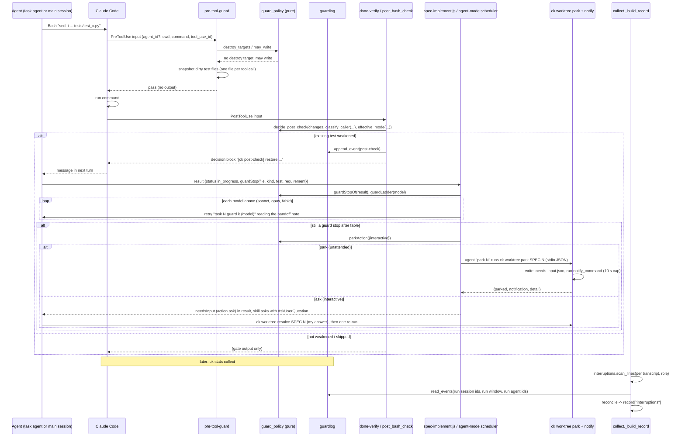

# Design: Prompt-Free Runs

## Overview

This feature changes four existing parts of ck and adds a few small modules. PLAN.md D1-D20 bind it.

1. **The pre-tool guard** (`src/claude_kiro/hooks/pre_tool_guard.py`) stops judging a shell command by its text
   (D5). Before a Bash command it blocks only deleting or moving an *existing, unowned* test file. Before any
   command that could write files, it takes a cheap snapshot of the dirty test files. A **post-check** after the
   command compares each test file the command changed with its content before the command, using the same
   `test_heuristics.weakening()` the edit path uses. The post-check is a function in a new module. It runs inside
   the existing `done-verify` PostToolUse hook process, which already starts on every Bash call, so a skipped command
   costs no extra process start (NFR "Hook overhead"). Installed hook settings and `plugin/hooks/hooks.json` do not
   change for it (only the fallback marker, when built, adds one `UserPromptSubmit` entry, D16).
2. **Who is calling** (D7). A pure classifier decides *task agent* vs *main session* from the hook input
   (`agent_id`), the environment (headless markers) and, only for calls with no `agent_id`, a ck-set fallback
   marker: a session workflow marker that the skills set around their Workflow call (3.4). Paths never decide the
   caller: my own session working inside a task worktree is still the main session (3.6). Task agents are always
   denied, never asked (D6). The main session keeps the `specs/ck.json` `guard` mode, and its edits to
   requirements.md and test-plan.md pass (D4).
3. **Run orchestration** (D6, D8, D12). `spec-implement.js` and the agent-mode scheduler instructions get the
   guard-escalation ladder (sonnet, then opus, then fable, only for guard stops) and "needs input" parking. Parking
   runs through one new CLI step, `ck worktree park`, which writes a park note next to the task worktree and sends
   one notification through a command I configure (`run.notify_command`). My answer comes back through
   `ck worktree resolve`, which stores it as a decision note that every later attempt of the task reads (7.9-7.11).
   The guard ladder rule lives once, in `agents.guard_ladder` (`ck agents --guard-ladder`); the Workflow's
   `guardLadder` is a mirror that a test keeps equal (D12). The skills `/spec:implement`,
   `/spec:create` and `/spec:review` start with a new `ck handoff` step. In a session isolated in a
   `.claude/worktrees/` worktree, it launches the run through `ck run` from the main checkout (D8, D11).
   `ck run` learns `--command create|review`.
4. **Analytics** (D3, D9, D10, D11, D12). Every guard decision is appended to a private local event log
   (`<ck data dir>/guard-events.jsonl`). `ck stats collect` (workflow, `--agents`, `--all`, auto, backfill: all of
   them build records through `collect._build_record`) scans the run's transcripts for interruptions, joins the
   guard log as a cross-check, and stores the counts in the local record. `share.build_shareable` copies counts
   only, keyed by fixed enums, into an additive `interruptions` object of `ck-run-analytics/1`. `ck stats show`
   prints one interruptions line.

Every allow, deny, park or hand-off rule is a pure function (see Decision Seams). Hooks, CLI commands and the
workflow call these functions and never repeat the rule.

**Two corrections the decisions need.** (a) Workflow and Agent-tool task agents run with the session's `cwd` (the
main checkout) and use absolute paths into `.ck/worktrees/<spec>-task-N`, never `cd` (GIT_NOTE). Today the guard
resolves every path against `cwd`. A test file in a task worktree then looks like a file that is new on the branch,
and it passes. For D6 to have any effect, the guard (edit path, Bash pre-check and post-check) resolves each target
against **its own checkout**, the git top level of the target's directory, the way `claims.checkout_of` already
does for tasks.md. That checkout supplies the config, the base ref and the owned-file set. The post-check snapshot
covers those checkouts too (Data Models, "Pre-command snapshot"), so a `sed -i` on an absolute task-worktree path is
compared like one in `cwd`. (b) The rule "deny task agents" makes
`spec-create.js` review-mode revise agents subject to the frozen-spec guard. That is D4 as decided, and D14 says what
happens to such a fix: the revise step does not apply a change to existing requirements.md / test-plan.md text of a
started spec; it returns it under `escalated`, which the workflow already turns into an open question (review.md
"Needs Your Decision"). If the agent tries the edit anyway, the guard denies it with a reason that says to report the
change as a decision (5.4).

## Components

### Existing Components to Modify

- `src/claude_kiro/hooks/pre_tool_guard.py`: gathers facts and calls the seams in `guard_policy`.
  - The Bash path parses the command into destroy targets with `cd` prefixes resolved (1.4) and checks only
    delete/move of existing, unowned test files (1.1-1.3, 1.7). The asks on `sed -i`, `perl -i` and `>` redirects
    are removed (1.2).
  - A destroy target that is a directory, or that exists on the base as a tree, is expanded to the files under it
    on the base ref (`git_utils.tree_files(checkout, base, rel)`), each judged as its own `TargetFacts`. So
    `rm -rf tests` is blocked when `tests/` holds an existing test, and `rm -rf tests/__pycache__` passes because
    the base tree holds no test file there (1.1, 1.3). An expansion error gives one target with
    `exists_on_base = None` (1.7).
  - When `guard_policy.may_write(command)` holds, it writes a pre-command snapshot for the post-check (2.1, 2.6),
    through `post_bash_check.take_snapshot`.
  - It classifies the caller when a block is about to be returned, and before a snapshot (to choose its checkouts)
    (3.x). It turns the block into a denial for task agents (4.1).
  - Only when the fallback marker is built (the recorded Workflow-agent input lacks `agent_id`, Task 2's capture
    summary): it reads the session workflow marker (`run_marker.active`) only for calls with no `agent_id` (3.4).
    For a Bash call from such a caller whose command is exactly `ck guard workflow-begin <spec>` or
    `ck guard workflow-end`, it writes or removes the marker for the hook's `session_id` and passes (the CLI
    commands themselves only print `ok`). `workflow-begin` always writes a fresh marker, replacing a stale one (skill
    start). A call that reads the marker as active refreshes it (`run_marker.refresh`, at most once a minute), in the
    pre-tool guard and in the post-check, so it stays active while Workflow agents work and expires 15 minutes after
    the last such call (3.4, D16).
  - Frozen-spec edits from the main session pass (5.1). Every ask or deny goes to the guard log (9.1).
  - Paths resolve against the target's own checkout (Overview, correction a).
  - Every reason starts with the fixed marker `[ck guard]`, so collect can recognise it in transcripts.
- `src/claude_kiro/hooks/done_verify.py`: for `tool_name == "Bash"`, calls `post_bash_check.check(input_data)`
  first. A finding is merged into the hook's output: `decision: "block"` with the post-check reason, joined to any
  gate-failure reason. Behaviour for Done claims is unchanged (2.8).
- `src/claude_kiro/cli/runner.py`: `HookRegistry._hooks` adds `"post-bash-check":
  "claude_kiro.hooks.post_bash_check:hook"`, so tests and `ck --hook post-bash-check` can drive the post-check on
  its own. For the post-check `HOOK_SETTINGS` does **not** change: the installed path is `done-verify`. Only when
  the fallback marker is built (3.4), the registry adds `"marker-clear": "claude_kiro.hooks.marker_clear:hook"`, and
  `HOOK_SETTINGS` and `plugin/hooks/hooks.json` gain one `UserPromptSubmit` entry for it, which removes the session's
  marker on every prompt I submit (D16). Workflow agents never trigger `UserPromptSubmit`.
- `src/claude_kiro/hooks/_shared/git_utils.py`: adds `toplevel(path) -> Optional[Path]`,
  `status_paths(project_dir) -> Optional[List[str]]` (porcelain, untracked included),
  `head_sha(project_dir) -> Optional[str]`, `content_at(project_dir, ref, rel) -> Optional[str]` (`git show
  <ref>:<rel>`), `changed_since(project_dir, ref) -> Optional[List[str]]` (`git diff --name-only <ref>` plus
  untracked) and `tree_files(project_dir, ref, rel) -> Optional[List[str]]` (`git ls-tree -r --name-only <ref> --
  <rel>`). All read-only and timeout-bounded, like the existing helpers; None on any error.
- `src/claude_kiro/config.py`: no change to `guard_mode`. The guard keeps reading `guard.tests`,
  `guard.requirements` and `guard.test_plan`. "off" still disables a kind entirely (1.6, 4.1).
- `src/claude_kiro/agents.py`: `DEFAULTS["run"]` and `ROLE_KEYS["run"]` gain `notify_command` (str or null,
  default null), validated like `machine_label` (a non-empty string or null). Set it once per machine with
  `ck agents set run.notify_command "<command>"`. The default scope is global, `~/.config/claude-kiro/config.json`
  (7.2, 7.3). It also gains `guard_ladder(model: Optional[str]) -> List[str]` (S20), the single source of the
  guard ladder (6.1, 6.2, 6.4).
- `src/claude_kiro/cli/agents.py`: `ck agents --guard-ladder MODEL [--json]` prints `guard_ladder(MODEL)` (a JSON
  list with `--json`). The agent-mode scheduler calls it (6.5).
- `src/claude_kiro/worktrees.py`:
  - Adds `park(root, spec, num, note) -> Path`, `parked(root, spec) -> Dict[str, ParkNote]` and
    `unpark(root, spec, num)`.
  - `claim()` calls `unpark()`: a fresh attempt clears the park note (7.8). It keeps the decision note.
  - Adds `resolve(root, spec, num, answer) -> Path`: writes `<worktreeDir>/<spec>-task-<N>.decision.md` (mode
    0600, appending when one exists, each answer with its time) and calls `unpark()` (7.9). `park()` sets
    `priorDecision: true` in the note when a decision note exists (7.11). The decision note is removed with the
    worktree, like the handoff note.
  - `report()` adds a `needsInput` list. A task with a park note that is neither merged nor Done goes there instead
    of `failed`/`unstarted`/`blocked`, so each task is still in exactly one list (7.5).
- `src/claude_kiro/cli/worktree.py`: new `ck worktree park` and `ck worktree resolve` commands. `report` prints
  the `needsInput` line, with the quotes and the decision needed (7.5). When the environment has
  `CK_RUN_NOTIFY=parent` (set by `ck run` for its child), park writes the note and does not notify; it answers
  `notification: "deferred"` with the detail `ck run sends it` (7.12).
- `src/claude_kiro/cli/run.py`:
  - New option `--command implement|create|review`, default `implement`. The prompt is
    `/spec:implement <spec> all`, `/spec:create <spec>` or `/spec:review <spec>`, plus the extra args.
    implement/review need `tasks.md`. create needs only the spec directory (8.3, 8.6).
  - The checks done before launch move into `preflight(cwd, spec, command, unsandboxed) -> RunPlan`, which raises
    `RunRefused(reason)`. `ck run` and `ck handoff` both call it (8.3, 8.4).
  - The child environment always gets `CK_RUN_HEADLESS=1`. The sandbox, deny rules, budget and turn cap are
    unchanged and apply to every command (8.3).
  - Notification watcher (7.12, D15): the child env also gets `CK_RUN_NOTIFY=parent`. While the child runs, a thread
    in `ck run`'s own process (outside the sandbox) lists `<worktreeDir>/*.needs-input.json` every 2 s, and once more
    after the child exits. For each note not seen before (keyed by path and `parkedAt`), it runs `notify.send(
    run.notify_command, notify_message(spec, task), main checkout)` and writes the outcome (`sent`, `not_configured`
    with the hint, or `failed` with the reason) as a `ck run: notification ...` line to the run log. At exit it
    prints a summary line with the counts. The sandbox settings do not depend on `run.notify_command`.
- `src/claude_kiro/cli/main.py`: `cli.add_command(handoff)` (and `cli.add_command(guard)` when the fallback marker
  is built).
- `src/claude_kiro/analytics/collect.py`: `_build_record` calls `interruptions.collect_run_interruptions(...)` once
  and stores the result as `record["interruptions"]`. It appends `{"agentId": None, "what": "guard_log"}` to
  `missing` when the log is unreadable or rotated away; a log that was never created adds nothing (10.1, 10.5,
  10.8). Workflow runs and agent-mode runs go through
  this same function, so both modes get the counts (10.8, D12).
- `src/claude_kiro/analytics/roles.py`: the guard-ladder attempts get their own label forms, so the escalation
  model shows up in both modes (6.6, 10.1):
  - Workflow label `task <N> guard <k> (<model>)`: the `_IMPL` "task" form accepts `guard` beside retry/revise and
    returns `step="guard"`, `escalated_to=<model>`.
  - Agent-mode description `[ck:<run_id>] implement task <N> guard <k>`: a new `_AGENT_FORMS` entry returns
    `step="guard"`.
  - Workflow label `park <N>` (the park agent call) maps to role `orchestrator`, so it is matched, never counted
    as unknown.
- `src/claude_kiro/analytics/share.py`: new fixed sets `INTERRUPTION_ROLES`, `COMMAND_FAMILIES` and
  `INTERRUPTION_KINDS`. A new optional `interruptions` object goes into `_TREE`. `build_shareable` copies it field
  by field through `_interruptions(local)` (11.1, 11.2).
- `analytics/SCHEMA.md`: regenerated from `schema_field_paths()` (11.2).
- `src/claude_kiro/analytics/leak.py`: `build_terms(..., extra_terms: Iterable[str] = ())` adds extra confidential
  strings through the same `_candidates`/`_keep` path. `confidential_terms` passes `guardlog.leak_terms()` (9.6).
- `src/claude_kiro/analytics/export.py` (`leak_gate`) and `src/claude_kiro/cli/stats.py` (both `build_terms` call
  sites, share/export and submit): pass `extra_terms=guardlog.leak_terms()` (9.6).
- `src/claude_kiro/analytics/show.py`: `run_breakdown` adds `"interruptions": interruptions_view(record)`.
  `render_run` prints `interruptions_line(...)` right after the `tasks:` line. `run_json` includes the view
  (11.3, 11.4).
- `plugin/workflows/spec-implement.js` and `.claude/workflows/spec-implement.js`, identical (6.x, 7.x):
  - The decisions block gains `guardLadder` (a mirror of `agents.guard_ladder`, S17), `guardStopOf` and
    `parkAction`. `tests/js/load_decisions.mjs` lists them.
  - `RESULT` gains `guardStop`. New `GUARD_NOTE` prompt text goes into the task, retry and revise prompts.
  - New `READ_DECISION(n)` text ("Before anything else, read `<WT>.decision.md` if it exists: my decision on this
    task's guard conflict; follow it") goes first into the task, retry, revise and guard prompts (7.9, 7.10).
  - `runTask` gets `climbGuard()` and a `parked` map. `guardStopOf(r)` is checked after every task, retry, revise
    and guard call. A guard stop breaks out of the retry loop, the `ladderOf(n)` escalate loop and the review/revise
    loop at once, and goes to `climbGuard(attemptedModel)`, where `attemptedModel` is the model of the call that
    stopped. A guard stop never consumes a retry or an `implementer.escalate` step (6.1, 6.3). After a ladder
    attempt finishes without a guard stop, the normal flow resumes from where it broke off (gate retries, review);
    a later guard stop climbs from the model then in use.
  - Parking is an agent call labelled `park <N>` (role `orchestrator`), whose prompt runs `ck worktree park <spec>
    <N>` with the note JSON on stdin and answers `{parked, notification, detail}` (7.1-7.4).
  - The result gains `needsInput` and `notifications`. `escalated` covers `stage: 'guard'` entries. New arg
    `interactive` (boolean, default false).
- `plugin/workflows/spec-create.js` and `.claude/workflows/spec-create.js`, identical (5.4, D14): new `FROZEN_RULE`
  text in the revise prompt. When tasks.md shows any task whose Status is not Not Started (the same test as the
  guard's `_implementation_started`), a fix that changes or removes existing text in requirements.md or
  test-plan.md is not applied; it goes under `escalated` with the question, the proposed text as one option and
  "leave the spec as is" as another. Add-only fixes are applied. The existing `openQuestions` mapping (source
  `revise`) and review.md "Needs Your Decision" carry it. The without-workflow-tool.md /spec:review path gives its
  revise agent the same rule.
- `plugin/resources/spec-implement-brief.md` and `.claude/workflows/spec-implement-brief.md`: one paragraph on what
  a guard denial or post-check message means: keep the test, restore it, report `guardStop` (1.5, 2.2).
- `plugin/resources/without-workflow-tool.md` and `.claude/workflows/without-workflow-tool.md`:
  - The /spec:implement scheduler steps gain the guard ladder (models from `ck agents --guard-ladder <model>
    --json`), parking via `ck worktree park`, AskUserQuestion when interactive followed by `ck worktree resolve`
    and, when my answer is that the test or requirement is wrong, telling me to change it from my main session and
    waiting for that before the task's next attempt (7.11), the decision-note read at the start of every attempt
    (7.9, 7.10), and the report items (7.7).
  - The description table gains `[ck:<run_id>] implement task <N> guard <k>` (6.5, 7.7).
- `plugin/skills/implement/SKILL.md`, `plugin/skills/create/SKILL.md`, `plugin/skills/review/SKILL.md` and their
  vendored `.claude/commands/spec/{implement,create,review}.md`:
  - Step 0 runs `ck handoff <kind> $ARGUMENTS --json` before choosing Workflow or agent mode. On `handoff: true` or
    an error, print its fields and stop (8.1-8.6).
  - Only when the fallback marker is built (3.4): right before the Workflow call, run `ck guard workflow-begin
    <spec>`, and right after it returns, `ck guard workflow-end`.
  - implement passes `interactive` into the workflow args and reports `needsInput` and notification status
    (7.3-7.6). For each `needsInput` entry with `action: 'ask'` it asks me with AskUserQuestion quoting the test and
    the requirement, records my answer with `ck worktree resolve <spec> <N>`, tells me to change the test or
    requirement myself when that is my answer and waits until I confirm the change is made (7.11: the change comes
    before the task's next attempt), and then re-runs the workflow once for the unfinished tasks (7.9, 7.10). The final report tells me how to resolve parked tasks (`ck worktree resolve`, then re-run).
- `plugin/skills/spawn-worktree/SKILL.md` and `.claude/commands/spec/spawn-worktree.md`: the same guard-ladder and
  park text for agents it spawns (6.5, 7.7). No hand-off: out of scope.

All files under `.claude/` are protected and land by hand. They are regenerated with `ck vendor`
(`plugin.vendored()`) in the same task that edits their plugin sources, so the dogfood-copy test never sees them
out of step.

### New Components

- `src/claude_kiro/hooks/_shared/guard_policy.py` (new): every pure guard rule. These are command parsing
  (destroy targets, `cd` resolution, write pre-filter, command family), caller classification, the mode for a
  caller, the Bash, edit and post-check decisions, and the reason texts. No I/O.
- `src/claude_kiro/hooks/post_bash_check.py` (new): post-check I/O. It loads the snapshot written by the guard,
  lists the changed test files, reads their before and after content, gathers facts, calls
  `guard_policy.decide_post_check`, logs catches and returns the message. It has a 3-second internal budget, after
  which it gives up silently (2.7).
- `src/claude_kiro/analytics/guardlog.py` (new): the local guard event log. Append, rotate, read by session, run window and
  run agents, and leak terms. Private files under `store.data_dir()`.
- `src/claude_kiro/analytics/interruptions.py` (new): the transcript scan (pure over parsed lines), role mapping,
  reconciliation with the guard log, and the record builder `collect_run_interruptions`.
- `src/claude_kiro/hooks/_shared/run_marker.py` (new, only when 3.4 needs it): `mark(session_id, spec, env=None)`,
  `unmark(session_id, env=None)`, `refresh(session_id, env=None, now=None)`, `active(session_id, env=None, now=None)
  -> bool`. Private files `<data_dir>/workflow-runs/<session_id>.json` (dir 0700, file 0600) holding `spec`,
  `markedAt` and `refreshedAt`. `MARKER_IDLE_S = 900`: a marker whose `refreshedAt` is 15 minutes old or more is
  inactive (D16). 15 minutes is above the Bash tool's 10-minute limit, and the pre and post hooks of every call
  refresh it, so a running Workflow keeps it alive. Errors read as inactive.
- `src/claude_kiro/hooks/marker_clear.py` (new, only with `run_marker`): the `UserPromptSubmit` hook. It calls
  `run_marker.unmark(session_id)`, prints nothing and never fails (D16).
- `src/claude_kiro/cli/guard.py` (new, only with `run_marker`): `ck guard workflow-begin SPEC` and `ck guard
  workflow-end`. They print `ok`; the pre-tool-guard hook does the marking (above).
- `src/claude_kiro/handoff.py` (new): `decide_handoff` (pure) and `is_headless(env)` (pure).
- `src/claude_kiro/cli/handoff.py` (new): `ck handoff` CLI. It gathers git facts (both HEADs, the main checkout's
  branch and clean state, the `specs/<spec>` tree ids at both HEADs, uncommitted spec changes in the worktree, and
  any existing `<spec>-run` branch), calls `decide_handoff`, creates and switches to the run branch when the decision
  carries one (`git switch -c <spec>-run <worktree head>` in the main checkout, 8.7), runs `run.preflight` and
  launches `ck run` detached from the main checkout.
- `src/claude_kiro/notify.py` (new): `notify_message` (pure) and `send(command, message, cwd, timeout=10)`, which
  runs my configured command.

## Public Interfaces

### Hooks (stdin JSON in, JSON out; driven in tests through `claude_kiro.cli.runner.execute_hook`)

- `execute_hook("pre-tool-guard", input)`. Input keys used: `session_id`, `cwd`, `tool_name`, `tool_input`,
  `tool_use_id`, `agent_id`, `agent_type`, `permission_mode`, `transcript_path`. Missing or unknown keys are
  tolerated (3.5). Output is `None` (pass) or:
  ```json
  {"hookSpecificOutput": {"hookEventName": "PreToolUse", "permissionDecision": "ask" | "deny",
                          "permissionDecisionReason": "[ck guard] ..."}}
  ```
  Side effects: one pre-command snapshot file per tool call (Bash commands that may write; Data Models); one guard-log event per ask or deny.
- `execute_hook("post-bash-check", input)`: PostToolUse input (`tool_name == "Bash"`, `tool_input.command`,
  `tool_use_id`, `cwd`, `session_id`, `agent_id`...). Output is `None` or
  `{"decision": "block", "reason": "[ck post-check] ..."}`. Side effect: one guard-log event per catch.
- `execute_hook("done-verify", input)`: unchanged for Edit/Write. For Bash it includes the post-check finding in
  its output. With both a gate failure and a catch, there is one `block` whose reason has the gate report first and
  the post-check message second.

Reason texts (`guard_policy.block_reason` / `post_check_reason`). Each one names the file and the kind of block
(4.3).
- Task agent, pre-check or edit: `[ck guard] Denied: this <command|edit> <kind text> <rel>, an existing test that
  no In Progress test-track task owns. Keep the test. Do not work around this block (no other command, script or
  tool to get the same change). Leave the task In Progress and report the conflict in guardStop, quoting the test
  and the requirement it contradicts.` (1.5)
- Main session: today's wording, with the `[ck guard]` prefix.
- Post-check, task agent: `[ck post-check] Your last command weakened <rel>: <kinds>. Restore the test now (for
  example "command git -C <checkout> checkout -- <rel>" if it had no other changes), keep it, and report the
  conflict in guardStop quoting the test and the requirement.` (2.2)
- Post-check, main session, `guard.tests: ask`: `[ck post-check] Your last command weakened <rel>: <kinds>. Ask me
  before keeping this change.` (2.3)
- Post-check, main session, `guard.tests: deny`: `[ck post-check] Your last command weakened <rel>: <kinds>. Restore
  the test now (for example "command git -C <checkout> checkout -- <rel>" if it had no other changes).` (2.9)

Kind texts come from `weakening()` reasons: `removes N assertion(s)`, `removes N test case(s)`, `adds N
skip/xfail/only marker(s)`, `drops property P-n`, `lowers max_examples...`. Deletion gives `deletes the test file`.
A move gives `moves the test file`.

### CLI

- `ck handoff KIND [ARGS...] [--json]`. KIND is `implement`, `create` or `review`. ARGS are the skill's
  `$ARGUMENTS` as given, the spec name first.
  - Exit 0 with `{"handoff": false, "interactive": bool}` when no hand-off is needed (8.5). `interactive` is
    `not is_headless(os.environ)`.
  - Exit 0 with this object when launched (8.2):
    ```json
    {"handoff": true, "launched": true, "mainCheckout": "/abs", "log": "/abs/.claude/ck-runs/<spec>-<time>.log",
     "follow": "tail -f <log>", "report": "...", "command": "ck run <spec> --command <kind> -- <rest>",
     "runBranch": "<spec>-run" | null}
    ```
    `runBranch` is set when the spec differed between the worktree and the main checkout and ck created the run
    branch at the worktree's HEAD (8.7); null when the run uses the main checkout's current branch (8.9).
  - Exit 3 with this object when the hand-off is needed but cannot launch (8.4, 8.8). Never exits 0 in that case.
    ```json
    {"handoff": true, "launched": false, "error": "<reason>", "manualCommand": "cd <main> && ck run ..."}
    ```
    In the 8.8 cases `manualCommand` is the exact recovery: `cd <main> && git switch -c <spec>-run <worktree head
    sha> && ck run <run_args> -- <rest>`, and `error` names what to do first (commit or stash the main checkout's
    changes; commit the spec changes in the worktree; or delete or rename the existing `<spec>-run` branch).
  - It works out the main checkout itself (`worktrees.main_root`). The command text carries no path outside the
    isolated worktree, so Claude Code's isolation check lets it run.
  - It launches `ck run` with every option before `--` (`run <spec> --command <kind> --log <log> -- <rest>`), so the
    log path it prints is the one `ck run` writes, and the prompt never holds `--log`.
  - Without `--json` it prints the same fields as lines.
- `ck run SPEC [--command implement|create|review] [existing options] [-- EXTRA]`. Unchanged for implement, except that each EXTRA argument is shell-quoted in the prompt so an argument with spaces or quotes survives intact (requirement 8.6, TC-48).
  `--command create` runs `/spec:create SPEC EXTRA`. `--command review` runs `/spec:review SPEC EXTRA`. It refuses
  with exit 2 in the same cases as today (linked worktree, missing bwrap/socat without `--unsandboxed`, unknown
  spec).
- `ck worktree park SPEC N [--no-notify] [--json]`. It reads a JSON object from stdin:
  `{"file": str, "kind": str, "test": str, "requirement": str, "decision": str}`.
  - It writes the park note `<worktreeDir>/<spec>-task-<N>.needs-input.json` (mode 0600).
  - Unless `--no-notify`, it sends one notification (7.2-7.4).
  - It prints `{"parked": true, "note": "<path>", "notification": "sent" | "not_configured" | "failed" | "skipped"
    | "deferred", "detail": str}`. `deferred` means it runs inside `ck run` (`CK_RUN_NOTIFY=parent`), whose own
    process sends the notification (7.12). `detail` holds the failure reason, or the setup hint when no notification command is
    configured.
  - Exit 0 whenever the note was written, even if the notification failed. Exit 3 only when the note cannot be
    written or stdin is not valid JSON.
- `ck worktree resolve SPEC N [--json]`. It reads `{"answer": str}` from stdin, calls `worktrees.resolve`, and
  prints `{"resolved": true, "decisionNote": "<path>", "hadParkNote": bool}`. Exit 3 on bad stdin or an unwritable
  note (7.9).
- `ck agents --guard-ladder MODEL [--json]`: `agents.guard_ladder(MODEL)` (S20). Exit 0 for any model string.
- `ck worktree report SPEC [--into B] [--json]`: the JSON gains
  `"needsInput": [{"task", "file", "kind", "test", "requirement", "decision", "parkedAt"}]`. The text output gains
  a `needs input N: <task> (<decision>)` line, each with the quoted test and requirement on indented lines.
- `ck agents set run.notify_command "<command>"`. The command is run with `shell=True` in the main checkout. Its
  stdin is the JSON `{"hook_event_name": "Notification", "notification_type": "ck_needs_input", "title": "ck",
  "message": "<message>"}`, the shape Claude Code Notification hooks receive, so my existing ntfy script can serve
  as the command. Env: `CK_NOTIFY_MESSAGE=<message>`.
- `ck stats collect ...` and `ck stats show RUN [--json]`: same commands, new record content and output line
  (Data Models).

### Python functions other code calls

- `claude_kiro.hooks.post_bash_check.check(input_data: dict) -> Optional[str]`: the post-check message, or None.
  It never raises.
- `claude_kiro.hooks.post_bash_check.hook(input_data: dict) -> Optional[dict]`: wraps `check` into the PostToolUse
  output.
- `claude_kiro.analytics.guardlog.append_event(event: GuardEvent, env=None) -> bool`: never raises. False when the
  event could not be written (9.5).
- `claude_kiro.analytics.guardlog.read_events(session_ids: Collection[str], *, window: Tuple[Optional[int],
  Optional[int]] = (None, None), agent_ids: Optional[Collection[str]] = None, env=None) -> GuardLogRead`. It keeps
  events whose `sessionId` is in the set and whose time falls in the run window `[start_ms, start_ms + wall_ms]`
  (an open bound is unbounded), and, when `agent_ids` is given, whose `agentId` is one of them or absent. So another
  run in the same session never enters this run's reconciliation (10.4).
- `claude_kiro.analytics.guardlog.leak_terms(env=None) -> List[str]`: every command, path and reason text in the
  log (current and rotated file).
- `claude_kiro.analytics.guardlog.log_path(env=None) -> Path`: `<data_dir>/guard-events.jsonl`.
- `claude_kiro.analytics.interruptions.collect_run_interruptions(*, agents: Sequence[collect._Agent],
  rows: Sequence[dict], session_jsonl: Optional[Path], start_ms: Optional[int], wall_ms: Optional[int],
  session_ids: Collection[str], env=None) -> Tuple[dict, bool]`: the local `interruptions` object, and whether the
  guard log goes in `missing` (unreadable, or rotated away; a never-created log is not, 10.5). It passes the run window and the run's agent ids to `read_events`.
- `claude_kiro.analytics.show.interruptions_line(view: Optional[Mapping]) -> str`.
- `claude_kiro.notify.send(command: Optional[str], message: str, cwd: Path, timeout: float = 10.0) ->
  NotifyOutcome`.
- `claude_kiro.worktrees.park(root, spec, num, note: Mapping) -> Path`, `parked(root, spec) -> Dict[str, dict]`,
  `unpark(root, spec, num) -> None`, `resolve(root, spec, num, answer: str) -> Path`.
- `claude_kiro.agents.guard_ladder(model: Optional[str]) -> List[str]` (S20).
- `claude_kiro.cli.run.preflight(cwd: Path, spec: str, command: str, unsandboxed: bool) -> RunPlan`. It raises
  `RunRefused`.

### Workflow script interface (`spec-implement.js`)

- New arg `interactive` (boolean, default false). The skill passes the `interactive` field of `ck handoff`.
- `RESULT.guardStop` (optional object; the agent fills it only on a guard stop):
  `{file: string, kind: string, test: string (quoted), requirement: string (quoted)}`.
- Workflow labels of ladder attempts: `task <N> guard <k> (<model>)`, `task <N> [test] guard <k> (<model>)`. Park
  step label: `park <N>` (role `orchestrator` in `roles._IMPL`).
- Result additions:
  ```
  needsInput: [{ task, file, kind, test, requirement, decision, action: 'park' | 'ask', notification }]
  notifications: { sent: number, failed: [{ task, detail }], notConfigured: boolean, hint: string|null }
  tasks[].escalations[]: { stage: 'guard', model }     // beside 'retry' and 'revise'
  tasks[].parked: boolean
  escalated[]: includes tasks with guard escalations   // unchanged shape
  ```
  `needsInput` tasks are listed apart from `merged`, `failed` and `blocked` (7.5).

### Decision Seams

Each seam is pure: no I/O, no clock, no environment reads, all inputs as arguments. The owner calls it and never
re-implements the rule.

| Seam | Module (owner) | Signature | Decides |
|---|---|---|---|
| S1 `destroy_targets` | `hooks/_shared/guard_policy.py` (pre_tool_guard) | `destroy_targets(command: str, cwd: str) -> List[DestroyTarget]` | Which paths a command deletes or moves (`rm`, `mv` (source operands only), `git rm`, `git mv` (source), `unlink`, `truncate`). Each path is resolved against the cwd in force at that segment: `cd <dir> &&` / `;` / `\|\|` changes it for later segments, and `git -C <dir>` for its own arguments (1.4). Redirects and `sed`/`perl -i` produce no targets (1.2). `find ... -delete` / `-exec rm` produce no targets either: their files cannot be known from the text, and a pre-check block on them would stop `find tests -name '*.pyc' -delete` (1.3); the post-check catches a test they delete (2.10, D18; S2, S9 `deletes the test file`). 1.1's verb list is complete. Unparseable quoting falls back to whitespace split. A target may be a directory; the hook expands it (S7). |
| S2 `may_write` | guard_policy (pre_tool_guard, post_bash_check) | `may_write(command: str) -> bool` | The post-check pre-filter (2.5). False only when every segment's program (after `cd` and env-assignment prefixes, `command`, `rtk`) is in a fixed read-only set (`ls cat head tail grep rg wc echo pwd which sleep true test [ date diff stat file du jq`; `find` only with none of `-exec -execdir -ok -okdir -delete -fprint -fprint0 -fprintf -fls`; `git status\|log\|diff\|show\|rev-parse\|ls-files\|cat-file\|merge-base\|worktree list`; `git branch` only with no arguments or listing flags alone (`-a -r -v -vv --list --show-current --contains --merged --no-merged`); `ck gate\|plan\|lint\|worktree status\|worktree report\|stats show`) and no segment has a write redirect (`>`, `>>`, `tee`). Anything else is True. `-i` forms of sed and perl are True. |
| S3 `command_family` | guard_policy (guardlog, interruptions) | `command_family(command: Optional[str]) -> str` | One of `sed rm mv git python redirect other` (10.2), from the first program of the first segment after `cd`/env prefixes: `sed`, `perl -i` → sed; `rm`, `unlink`, `truncate` → rm; `mv` → mv; `git ...` (incl. `command git`) → git; `python`, `python3`, `uv run python` → python; otherwise a write redirect anywhere → redirect; else other. None or a non-shell tool → other. |
| S4 `classify_caller` | guard_policy (pre_tool_guard, post_bash_check) | `classify_caller(hook_input: Mapping, env: Mapping[str, str], workflow_marker: bool) -> Caller` | `"task_agent"` if `hook_input["agent_id"]` is a non-empty string (3.1), or `is_headless(env)` (3.2), or the input has no usable `agent_id` and `workflow_marker` is True (the ck-set fallback marker of the session, 3.4); else `"main_session"` (3.3). No path enters the decision, so the main session inside a task worktree stays `main_session` (3.6). A non-mapping input or wrong-typed fields are treated as absent (3.5). The hook computes `workflow_marker = run_marker.active(session_id)` only when `agent_id` is absent, and passes False when the marker is not built. |
| S5 `is_headless` | `handoff.py` (guard_policy, ck handoff) | `is_headless(env: Mapping[str, str]) -> bool` | True when `env["CK_RUN_HEADLESS"] == "1"` (every `ck run`) or `env["CLAUDE_CODE_ENTRYPOINT"]` starts with `sdk` (`claude -p`). |
| S6 `effective_mode` | guard_policy (pre_tool_guard, post_bash_check) | `effective_mode(caller: Caller, configured: Optional[str]) -> Optional[str]` | None when the kind is off (1.6, 4.1). `"deny"` for task agents whatever the config says (4.1). The configured `"ask"`/`"deny"` for the main session (4.2). |
| S7 `decide_bash` | guard_policy (pre_tool_guard) | `decide_bash(targets: Sequence[TargetFacts], caller: Caller, mode: Optional[str]) -> GuardDecision` | `targets` are file facts: the hook has already expanded each directory target to the base-ref files under it (`git_utils.tree_files`), one `TargetFacts` per file, with the directory's op. Block iff mode is not None and some target has `is_test and exists_on_base is True and not owned` (1.1). So `rm -rf tests`, `rm -r tests/` and `git rm -r tests` block when `tests/` holds an existing unowned test. New-on-branch, owned, or non-test targets pass (1.3): `tests/__pycache__/x.pyc` is not a test *file* (`is_test_file` requires a test file pattern or a test-dir file with a source extension), and `tests/__pycache__` expands to no test file. `exists_on_base is None` (unknown, including a failed expansion) passes (1.7). The decision carries the blocked paths (the directory as given, plus up to 3 of its test files) and per-path op (`delete`/`move`). |
| S8 `decide_edit` | guard_policy (pre_tool_guard) | `decide_edit(facts: EditFacts, caller: Caller, mode: Optional[str]) -> GuardDecision` | Test file: block iff mode, weakening reasons non-empty, not owned, `exists_on_base is not False` (today's rule). Frozen spec file: pass when `implementation_started` is False or `only_adds` (5.3); pass for `main_session` (5.1); else block (5.2). The block's mode is `effective_mode` (4.1, 4.2). |
| S9 `decide_post_check` | guard_policy (post_bash_check) | `decide_post_check(changes: Sequence[FileChange], caller: Caller, mode: Optional[str]) -> Optional[PostCheckFinding]` | None when mode is None (1.6). Considers only changes with `changed_by_command` True (2.6), `is_test`, `exists_on_base is True`, `not owned` (2.4), and `matches_incoming` False (the content after equals the base ref's or an incoming ref's, 2.1, D19). For those, reasons = `weakening(before, after)`; `after is None` (file removed) → `["deletes the test file"]`. Returns the files with non-empty reasons and the caller, or None (2.4). `exists_on_base None` → skipped (left to the gate, 2.7). |
| S10 `block_reason`, `post_check_reason` | guard_policy | `block_reason(caller, target_kind, rel, kinds: Sequence[str], tool: str) -> str`; `post_check_reason(finding: PostCheckFinding) -> str` | The reason texts above (1.5, 2.2, 2.3, 2.9, 4.3). The main-session post-check text depends on `finding.mode` (`ask` → 2.3, `deny` → 2.9). A task agent's frozen-spec denial (`target_kind` requirements or test_plan) says: `[ck guard] Denied: <rel> is the contract of a spec whose implementation has started; existing text cannot be changed or removed by an agent (adding is allowed). Do not apply this change. If you are revising the spec in /spec:review, return it under "escalated" as a decision for me, with the proposed text; otherwise report the conflict.` (5.2, 5.4). |
| S11 `decide_handoff` | `handoff.py` (cli/handoff.py) | `decide_handoff(facts: HandoffFacts) -> HandoffDecision` | `none` when the kind is not implement/create/review, or the args are a single task (`/spec:implement <spec> <N>` or `/spec:implement <N>`: a task-id token `^[0-9][0-9A-Za-z_]*$` among the first two args, not `all`), or the session is not a linked worktree, or the worktree is not under `<main_root>/.claude/worktrees/` (8.5). Otherwise: `refuse` when `main_root` is None or the spec is at neither HEAD (8.4). When `spec_same` is True → `handoff` with `run_branch` None (8.9). When it is False (missing at the main HEAD or a different tree): `refuse` with recovery commands when `main_clean` is not True, `worktree_spec_dirty` is not False, `worktree_head` is None, or `run_branch_at` is set to a commit other than `worktree_head` (8.8); else `handoff` with `run_branch = "<spec>-run"` and `start_point = worktree_head` (8.7). Every `refuse` carries `recovery`, the exact commands. It carries `run_args = [spec, "--command", kind]` and `rest`, the args after the spec, passed through unchanged (8.6). The launcher builds `run <run_args> --log <log> -- <rest>`: options always before `--`. |
| S12 `notify_message` | `notify.py` (ck worktree park) | `notify_message(spec: str, task: str) -> str` | `ck: <spec> task <task> needs a decision (parked as needs input)`. Never takes the test or requirement text, so it cannot carry them (7.2). |
| S13 `classify_result_text` | `analytics/interruptions.py` | `classify_result_text(text: str) -> Optional[str]` | Tool-result error → `auto_mode_denial` ("denied by the Claude Code auto mode classifier"), `headless_denial` ("requires approval, and this session has no approval surface"), `user_reject` ("The user doesn't want to proceed"), `isolation_refusal` (starts with "This session is isolated in the worktree" or "This agent is isolated in the worktree"), `guard_denial` (contains `[ck guard]` and "Denied"), or None. |
| S14 `scan_lines` | interruptions | `scan_lines(lines: Iterable[Any], role: str, window: Tuple[Optional[int], Optional[int]]) -> ScanResult` | Counts for one transcript (10.1-10.3, 10.6). A `hook_success` attachment from `pre-tool-guard` (or with `[ck guard]` in its stdout) with `permissionDecision` ask → prompt; deny → guard denial. A `hook_blocking_error` attachment with `hookEvent: "PostToolUse"` whose `blockingError.blockingError` text contains `[ck post-check]` anywhere (the gate report may come first) → post-check catch; the same attachment without that text (a plain gate failure) counts nothing. These are the shapes real transcripts hold; the test line builders copy them from a recorded transcript. Error tool results are classified by S13. Each is keyed by `toolUseID` and counted once. The family comes from the matching `tool_use` input (S3). Wait = timestamp of the tool_result for an asked `toolUseID` minus the ask attachment's timestamp, if positive. Lines that are not mappings, have no known shape, or fall outside the window are skipped and counted in `skipped`. |
| S15 `interruption_role` | interruptions | `interruption_role(row_role: Optional[str]) -> str` | `implementer`, `test-writer`, `reviewer`, `fixer` and `resolver` map to themselves. Everything else (plan, land, gate, cross-test, report, other, None, the session) maps to `orchestrator` (10.2). |
| S16 `reconcile` | interruptions | `reconcile(transcript: Mapping[str, int], log: Mapping[str, int]) -> Tuple[Dict[str, int], Dict[str, Dict[str, int]]]` | Returns the transcript counts unchanged, plus a differences map `{kind: {"log": n, "transcripts": m}}` for prompts, guard denials and post-check catches where they differ (10.4). |
| S17 `guardLadder` | `spec-implement.js` decisions block (mirror of S20) | `guardLadder(attemptedModel: string \| undefined) -> string[]` | The models of `['sonnet', 'opus', 'fable']` ranked above the attempted model, in that order. An inherited or unknown model gives all three. `fable` gives `[]` (6.1, 6.4). It ignores `implementer.escalate` (6.2). |
| S18 `guardStopOf` | spec-implement.js decisions block | `guardStopOf(result) -> object \| null` | `result.guardStop` when the result is not ok (not done with a passing gate) and `guardStop` is an object with a non-empty `file`; else null. A passing result is never a guard stop (6.1). |
| S19 `parkAction` | spec-implement.js decisions block | `parkAction({ interactive: boolean }) -> 'park' \| 'ask'` | `ask` for an interactive run (7.6), `park` otherwise (7.1). |
| S20 `guard_ladder` | `agents.py` (`ck agents --guard-ladder`, agent-mode scheduler) | `guard_ladder(model: Optional[str]) -> List[str]` | The single source of the ladder rule: the models of `('sonnet', 'opus', 'fable')` ranked above the model's family (aliases, full ids, a `[1m]` suffix, any case, via the existing family resolution), in that order. None, inherited or unknown gives all three; `fable` gives `[]` (6.1, 6.4). It ignores `implementer.escalate` (6.2). S17 is its mirror inside the Workflow script, which cannot import Python; P-14 checks they agree for every model alias. |

## Data Models

```python
# hooks/_shared/guard_policy.py
from dataclasses import dataclass, field
from typing import Literal, Optional, Tuple

Caller = Literal["task_agent", "main_session"]

@dataclass(frozen=True)
class DestroyTarget:
    path: str                 # absolute path, resolved against the cwd in force at its segment
    op: Literal["delete", "move"]
    program: str              # "rm" | "mv" | "git rm" | "git mv" | "unlink" | "truncate"

@dataclass(frozen=True)
class TargetFacts:
    rel: str                  # path relative to the target's own checkout
    op: Literal["delete", "move"]
    is_test: bool             # test_heuristics.is_test_file(rel, config of that checkout)
    exists_on_base: Optional[bool]   # None = could not tell (no git, no base, error)
    owned: bool               # listed by an In Progress test-track task in that checkout

@dataclass(frozen=True)
class EditFacts:
    rel: str
    target: Literal["test", "requirements", "test_plan", "other"]
    weakening: Tuple[str, ...]       # test_heuristics.weakening(old, new) reasons
    owned: bool
    exists_on_base: Optional[bool]
    implementation_started: bool     # frozen-spec files only
    only_adds: bool                  # frozen-spec files only

@dataclass(frozen=True)
class GuardDecision:
    block: bool
    mode: Optional[Literal["ask", "deny"]]   # None when block is False
    paths: Tuple[str, ...] = ()               # blocked repo-relative paths
    kinds: Tuple[str, ...] = ()               # kind texts, e.g. "deletes the test file"
    category: Optional[str] = None            # "test_delete" | "test_move" | "test_weakening" | "spec_edit"

@dataclass(frozen=True)
class FileChange:
    rel: str
    is_test: bool
    exists_on_base: Optional[bool]
    owned: bool
    changed_by_command: bool          # content hash differs from the pre-command snapshot
    before: Optional[str]             # content before the command (None: did not exist)
    after: Optional[str]              # content after (None: removed)
    matches_incoming: bool = False    # after == content on the base ref or on a ref the command merged in (D19)

@dataclass(frozen=True)
class PostCheckFinding:
    caller: Caller
    mode: Literal["ask", "deny"]                     # effective mode; always "deny" for task agents
    files: Tuple[Tuple[str, Tuple[str, ...]], ...]   # (rel, weakening kinds)
```

`test_heuristics.is_test_file(rel, config) -> bool` (new, beside `is_test_path`) is `is_test_path(rel, config)` with
extra conditions for a file reached only through a test *directory* (not through a test-file pattern): it must have
a source-code extension (a fixed set in `test_heuristics`, for example `.py`, `.js`, `.ts`, `.go`, `.rb`), must not
sit under a cache part (`git_utils._CACHE_PARTS`) and must not end in `.pyc`/`.pyo`. This matches the requirements'
"Test file" term and S7, and makes `tests/__pycache__/*` and `tests/.pytest_cache/*` "under a test directory but not
itself a test" (1.3) without changing `is_test_path` for the gate.

**Pre-command snapshot**: one file per tool call, so parallel agents of one session never share a file. Path
`<cache dir>/guardsnap-<session_id>-<key>.json`, `key` = `tool_use_id`, else sha1 of the command. It is written
atomically (a unique `tempfile.mkstemp` name in the same directory, then `os.replace`), read and deleted by the
post-check, and swept when older than 1 hour. It does not go through `CacheManager`, whose fixed `<key>.tmp` path
and delete-on-decode-error would lose entries under concurrent writers.
```python
{"createdAt": float,                          # time.time(), for expiry only (never used by a seam)
 "caller": "task_agent" | "main_session",
 "checkouts": {
     "<abs checkout>": {
         "head": "<HEAD sha or null>",
         "paths": ["<rel>", ...] | null,   # the named paths in this checkout; null = none named, all test files
         "dirty": {"<rel>": {"sha": "<sha1 of content or 'absent'>", "content": "<text>"}}
         # only candidate test files dirty (vs HEAD) at snapshot time; content capped at 512 KiB per file
     }}}
```
Checkouts and paths (the same set before and after; the post-check reads it from the snapshot). Only what the
command names is covered (2.1, D20):
- the git top level of `cwd`;
- that of every `cd <dir>` / `git -C <dir>` directory in the command;
- that of every absolute path-like substring anywhere in the command text, heredoc bodies included (tokens starting
  with `/`, cut at quotes, whitespace and `;|&<>()`), deduplicated by top level.

Claimed task worktrees the command does not name are not covered: a script that builds a path into another worktree
at run time is left to the gate at Done (2.8). Within a checkout, the candidates are the test files at the named
paths: every token of the command text (heredocs included, cut as above) that resolves, against the cwd in force at
its segment or as an absolute path, to a file or directory in that checkout, a directory standing for the test files
under it. When the command names no path in a checkout (for example a bare `python rewrite.py` in `cwd`), every test
file of that checkout is a candidate (`paths: null`). So eight parallel agents whose commands each name their own
test file never see each other's changes.

After the command, for each checkout (candidates only):
- If HEAD is unchanged, `changed_by_command` is True for a test file that is dirty now and was absent from `dirty`
  before, or whose sha changed, and for a file in `dirty` that is clean now. `before` is the snapshot content for
  files that were dirty, else `git_utils.content_at(checkout, "HEAD", rel)`.
- If HEAD moved (`git commit`, `git checkout <ref> -- <path>` after a commit, `git reset`, `git merge`, ...), the
  candidates also include the test files in `git_utils.changed_since(checkout, <old head>)`. For those, `before` is
  the dirty snapshot content when the file was dirty, else `content_at(checkout, <old head>, rel)`, and `after` is
  the working-tree content. So `sed -i ... && git commit -qam wip` is compared like a plain `sed -i`.
- Incoming content (D19): for every candidate the hook sets `matches_incoming` when `after` equals
  `content_at(checkout, ref, rel)` for the base ref, or, when HEAD moved, for an incoming ref: the new HEAD's
  parents other than the old HEAD (a merge commit), and each ref the command names after `git merge`, `git rebase`
  or `git pull` (`git pull` with no ref: the upstream, `@{u}`). S9 skips such files. So a task's required
  `git merge <into>` that brings in a legitimate test change from the target reports nothing, and a later change
  to that file is compared from the merged content.

A command with no snapshot (the pre-hook did not run or took no snapshot) is skipped (2.7). Reports are
de-duplicated by `(rel, sha of after)` in a per-agent file `guarddedup-<session_id>-<agent_id or "main">.json`
(atomic writes as above; a lost entry only risks one repeated report), so the same weakened content is never
reported twice (2.6).

**Park note** (`<worktreeDir>/<spec>-task-<N>.needs-input.json`, beside the existing `.handoff.md`, mode 0600):
```python
{"schema": "ck-park/1", "spec": str, "task": str, "file": str, "kind": str,
 "test": str, "requirement": str, "decision": str, "parkedAt": str,   # parkedAt: ISO-8601 UTC
 "priorDecision": bool}                                                # a decision note already exists (7.11)
```

**Decision note** (`<worktreeDir>/<spec>-task-<N>.decision.md`, mode 0600): Markdown, one `## <ISO time>` section
per answer with my answer verbatim, then the fixed line "If this says the test or requirement is wrong, it has
already been changed in the main checkout; do not change it yourself." Every attempt reads it first (7.9-7.11).

**Guard event** (`<data_dir>/guard-events.jsonl`, one JSON object per line; directory 0700, file 0600):
```python
@dataclass(frozen=True)
class GuardEvent:
    ts: str                      # ISO-8601 UTC
    session_id: str
    agent_id: Optional[str]
    agent_type: Optional[str]
    caller: Caller
    tool: str                    # "Bash" | "Edit" | "Write" | "MultiEdit"
    decision: Literal["ask", "deny", "post-check"]
    category: str                # GuardDecision.category, or "post_check_weakening"
    reason: str                  # the full reason text given to Claude
    path: str                    # repo-relative path (first blocked path; all paths joined by ", " in reason)
    command: Optional[str]       # Bash command text; None for file tools
    family: str                  # command_family(command)
    tool_use_id: Optional[str]
```
Serialized with camelCase keys (`sessionId`, `agentId`, `agentType`, `toolUseId`), plus `"v": 1`. **Rotation:**
before an append, if the file is at least `GUARD_LOG_LIMIT = 1_048_576` bytes, it is renamed to
`guard-events.1.jsonl` (replacing any older one). The total stays at most about 2 MiB (9.4).

```python
@dataclass(frozen=True)
class GuardLogRead:
    state: Literal["ok", "rotated", "unreadable"]
    events: Tuple[dict, ...]      # events of the requested sessions, run window and agents; bad lines skipped
    skipped: int
```
`state` (10.5, D17): `ok` when the log was read, and also when it was never created (no file: zero events);
`unreadable` when a log file exists but cannot be read; `rotated` when `guard-events.1.jsonl` exists and the oldest
retained event in both files is newer than the run start (`window[0]`; with no start, never `rotated`). Only
`unreadable` and `rotated` add `guard_log` to the record's `missing`.

**Local record**: `record["interruptions"]` is absent in records built before this feature (10.7):
```python
{
  "v": 1,
  "totals": {"prompts": int, "waitMs": int, "guardDenials": int, "postCheckCatches": int,
             "guardEscalations": int, "autoModeDenials": int, "headlessDenials": int,
             "userRejects": int, "isolationRefusals": int},
  "byRole": {"<interruption role>": {"<family>": {"<kind>": int}}},   # kinds as in totals, waitMs excluded
  "waitMsByRole": {"<interruption role>": int},
  "escalationModels": {"sonnet" | "opus" | "fable" | "other": int},   # guard-ladder attempts, by model family
  "guardLog": {"state": "ok" | "rotated" | "unreadable", "events": int,
               "differences": {"prompts" | "guardDenials" | "postCheckCatches": {"log": int, "transcripts": int}}},
  "skippedLines": int
}
```
Guard escalations come from agent rows with `step == "guard"` (both label grammars). Their family is
`share.model_family(row["escalatedTo"] or row["model"])`, counted under the row's interruption role and family
`other`.

**Shareable record**: new optional object in `ck-run-analytics/1` (11.1, 11.2):
```python
INTERRUPTION_ROLES = ("implementer", "test-writer", "reviewer", "fixer", "resolver", "orchestrator")
COMMAND_FAMILIES = ("sed", "rm", "mv", "git", "python", "redirect", "other")
INTERRUPTION_KINDS = ("prompts", "guard_denials", "post_check_catches", "guard_escalations",
                      "auto_mode_denials", "headless_denials", "user_rejects", "isolation_refusals")

"interruptions": _obj({
    **{k: _INT for k in INTERRUPTION_KINDS},
    "wait_minutes": _NUM,
    "escalation_models": _map(MODEL_FAMILIES, _INT),
    "by_role": _map(INTERRUPTION_ROLES, _map(COMMAND_FAMILIES, _obj({k: _INT for k in INTERRUPTION_KINDS}))),
    "wait_minutes_by_role": _map(INTERRUPTION_ROLES, _NUM),
})
```
`_interruptions(local)` reads only `local["interruptions"]["totals" | "byRole" | "waitMsByRole" |
"escalationModels"]`. Keys outside the fixed sets are dropped (never mapped to `other` by text). Minutes are rounded
to 2 places. The object is omitted when the local record has none. `guardLog`, `differences` and `skippedLines`
never leave the machine.

**Shared types for the hand-off and notification**:
```python
@dataclass(frozen=True)
class HandoffFacts:
    kind: str                    # "implement" | "create" | "review" | other
    args: Tuple[str, ...]        # $ARGUMENTS split shell-style
    cwd: str                     # absolute, resolved
    is_linked_worktree: bool     # git-dir != git-common-dir
    main_root: Optional[str]     # worktrees.main_root(cwd), None if unknown
    spec_in_main: bool           # specs/<spec>/ exists at the main checkout's HEAD (tasks.md for implement/review)
    spec_in_worktree: bool       # specs/<spec>/ exists at the worktree's HEAD
    worktree_head: Optional[str] # HEAD sha of the isolated worktree
    main_head: Optional[str]     # HEAD sha of the main checkout
    main_branch: Optional[str]   # the main checkout's current branch, None when detached
    main_clean: Optional[bool]   # main checkout has no uncommitted changes (None: unknown)
    spec_same: Optional[bool]    # specs/<spec> tree id equal at both HEADs (None: unknown)
    worktree_spec_dirty: Optional[bool]  # uncommitted changes under specs/<spec> in the worktree
    run_branch_at: Optional[str] # sha of an existing `<spec>-run` branch in the main checkout, else None

@dataclass(frozen=True)
class HandoffDecision:
    action: Literal["none", "handoff", "refuse"]
    reason: str
    main_checkout: Optional[str]
    run_args: Tuple[str, ...]    # options for `ck run`: (spec, "--command", kind)
    rest: Tuple[str, ...]        # the args after the spec, passed after `--` unchanged (8.6)
    run_branch: Optional[str] = None   # "<spec>-run" when the spec differs (8.7)
    start_point: Optional[str] = None  # worktree_head, where the run branch starts
    recovery: Tuple[str, ...] = ()     # exact commands to run by hand on refuse (8.4, 8.8)

@dataclass(frozen=True)
class NotifyOutcome:
    status: Literal["sent", "not_configured", "failed"]
    detail: str                  # failure text, or the setup hint for not_configured

@dataclass(frozen=True)
class RunPlan:
    # Pre-launch facts only; run() builds prompt, argv, env, log and settings from them.
    name: str; command: str; cwd: Path; spec_dir: Path; sandboxed: bool
    wt_dir: Optional[Path]; run_role: Dict[str, Any]; warnings: List[str]
```

## Data Flow



Hand-off flow: a skill's step 0 runs `ck handoff <kind> <args> --json`. The order is `decide_handoff` → when the
decision carries `run_branch`, `git -C <main_root> switch -c <run_branch> <start_point>` (or a plain switch when
`run_branch_at == start_point`); a failing switch gives exit 3 with the recovery commands, and the main checkout is
left as it was (8.7, 8.8) → `run.preflight(main_root, ...)` → `Popen([sys.executable, "-m", "claude_kiro.cli", "run", *run_args, "--log",
<log>, "--", *rest], cwd=main_root, start_new_session=True, stdin=DEVNULL, stdout/stderr → <log>.launch)` (every
option before `--`, since `ck run` takes everything after `--` as prompt text) → wait up to 3 s for an early exit →
print JSON. On `handoff: true` the skill prints the fields and ends its turn without running
anything else.

## Error Handling

- **1.6** `guard.tests` off: `effective_mode` returns None. `decide_bash` and `decide_post_check` both return no
  block, and no snapshot is written.
- **1.7** No git, no base or an unreadable repository: `exists_on_base` is None, and `decide_bash` passes. No ask
  is ever caused by uncertainty. The post-check skips such files (S9), and the gate re-checks at Done.
- **2.5** The pre-filter says read-only, or no test file changed: `post_bash_check.check` returns None before any
  git call (pre-filter), or after one `git status` and one HEAD read per checkout (no changes and HEAD unchanged). A
  checkout whose HEAD moved is still compared through `changed_since(<old head>)` even when its working tree is
  clean (Data Models, "Pre-command snapshot"), so `sed -i ... && git commit` is not skipped.
- **2.7** Post-check failure (git error, unreadable file, no snapshot, a broken cache file, more than the 3 s
  budget): `check` catches every exception, returns None and writes nothing to stderr. The enclosing `done-verify`
  goes on with its gate logic. The gate is unchanged and still re-checks at Done (2.8).
- **3.5** Missing or extra hook fields: `classify_caller` reads only `agent_id` and treats a non-string as absent.
  `pre_tool_guard.hook` already defaults `cwd`, `tool_name` and `tool_input`. The fallback-marker lookup
  (`run_marker.active`) is wrapped: any error reads as "no marker", never an exception out of the hook.
- **6.1/6.3** A guard stop inside the retry, escalate or revise loop: the loop breaks at once and `climbGuard` runs
  from the model that stopped. No retry or `implementer.escalate` step is spent on a guard stop.
- **7.3** No `run.notify_command`: `notify.send(None, ...)` returns `not_configured`, with the detail
  `no notification sent: set one with ck agents set run.notify_command "<command>"`. `ck worktree park` still
  writes the note. The workflow copies `notConfigured: true` and the hint into `notifications`. The skill and the
  agent-mode report print it.
- **7.4** The notify command exits non-zero, cannot start, or passes 10 s: the process is killed on timeout,
  `failed` comes back with `exit <code>`, `timed out after 10 s` or the OSError text, and park still exits 0. The
  workflow keeps running and lists `notifications.failed`. The final report names it.
- **7.12** Inside `ck run`, park answers `deferred`; the watcher in `ck run`'s process sends once per note and logs
  each outcome, so a failing or slow command (7.4) shows in the run log and its exit summary. A watcher error is
  logged and never stops the run. The sandbox is unchanged.
- **8.4, 8.8** Hand-off cannot launch. `decide_handoff` gives `refuse` (no main checkout; the spec at neither HEAD;
  or, when the spec differs, a dirty main checkout, uncommitted spec changes in the worktree, or a `<spec>-run`
  branch at another commit), or the run-branch switch fails. `run.preflight` raises `RunRefused` (sandbox tools missing, unknown spec, trust warning stays a
  warning). `Popen` raises, or the child exits within 3 s. In each case `ck handoff` exits 3 with `error` and
  `manualCommand` (`cd <main> && ck run <run_args> -- <rest>`, the args after the spec passed through, 8.6; in the
  8.8 cases preceded by `git switch -c <spec>-run <worktree head>`). The
  skill prints both and stops. It never runs the spec in
  the isolated session.
- **9.5** The event cannot be written (permissions, disk full, data dir under a read-only mount): `append_event`
  catches `OSError`/`ValueError` and returns False. The guard returns the decision it already computed and prints
  nothing to stderr.
- **10.5** Guard log never created: `read_events` returns state `ok` with zero events, and nothing goes in `missing`
  (the guard simply never fired, D17). Unreadable, or rotated away (a `.1` file exists and the oldest retained event
  is newer than the run start): state `unreadable`/`rotated`, the transcript counts are recorded as they are,
  `guardLog.state` says so, and `missing` gets `{"what": "guard_log"}`. That entry is local-only:
  `share._MISSING_MAP` has no entry for it.
- **10.6** A malformed or unknown transcript line: `scan_lines` skips it and increments `skippedLines`. An unreadable
  transcript file adds nothing, and the existing `missing` entries for transcripts already cover it.
- **10.7** Records from before the feature: no `interruptions` key. `interruptions_view` returns None,
  `interruptions_line(None)` prints `interruptions: not recorded` (11.4), and `_interruptions` omits the shared
  object. It never writes zeros.
- **11.5** Older ck reading new records: the local schema stays `ck-run-local/1` and the new key is additive.
  `store.load_records_counted` accepts any dict with that schema. The shared validator of an older ck rejects
  unknown paths only for *its* export, which this ck's records do not go through.

## Security, Performance, Migration

**Security and privacy.**
- The guard log holds command text and paths, so it lives only under `store.data_dir()`. It is created with the
  existing private-write helpers (dir 0700, file 0600, `store._mkdir_private` plus `os.open(..., 0o600)` in
  append mode) and is never inside a project (9.3).
- `ck run` already lists the data dir in `sandbox.credentials.files` (deny). Sandboxed commands cannot read the log.
  Hooks run as Claude Code subprocesses outside the Bash sandbox, so they can write it.
- `leak.build_terms` treats every log command, path and reason as a confidential term (9.6). Shared records get only
  enum-keyed counts (11.1).
- The notification command is mine and runs only from `ck worktree park`, or, inside `ck run`, from `ck run`'s own
  unsandboxed process (7.12); the sandbox never gets its path or host. It receives the spec name and task number,
  never the quotes (7.2).
- `ck handoff` passes ARGS through as an argv list, never through a shell.
- The fallback marker is a ck-set file, not a secret: a task agent with no `agent_id` could remove it by running
  `ck guard workflow-end`. The brief and GUARD_NOTE tell agents never to run `ck guard`, and the gate still re-checks
  at Done. While a marker is active, my own calls in that session with no `agent_id` count as task agents. That
  window is narrow (D16): the Workflow call holds the session until it returns, `workflow-end` clears the marker
  after, every prompt I submit clears it (`marker-clear` on `UserPromptSubmit`), and it expires 15 minutes after
  the last call that read it. If I submit a prompt while a background Workflow still runs, its agents count as the
  main session until the next `workflow-begin`: they are asked per `specs/ck.json`, never let through unchecked.

**Performance.**
- A Bash call the pre-filter skips adds one regex pass in the pre-hook, plus one function call inside the already
  running `done-verify` process: well under 100 ms.
- A writing command adds one `git status --porcelain` per checkout before and after, plus a read of the changed test
  files and one `git show` each. With 1,000 tracked files and 5 changed tests that is a few tens of ms (NFR).
- `classify_caller`'s fallback marker is one `stat` of a private file, read only for calls with no `agent_id`.
- A writing command adds `git status` only for the checkouts it names (D20); claimed task worktrees it does not
  name cost nothing.
- Snapshot files are per call, so parallel agents never contend on one file.
- Collect's transcript scan reads each agent transcript once more, in the same thread pool that `collect_all`
  already uses.

**Migration.**
- No settings migration for the post-check: `HOOK_SETTINGS` and `plugin/hooks/hooks.json` are unchanged by it. Only
  when the fallback marker is built, both gain the `UserPromptSubmit` `marker-clear` entry, and `ck init` /
  `ck doctor` install it like the other hooks (D16).
- Existing records stay valid. The new fields are optional (11.2, 11.5). `analytics/SCHEMA.md` is regenerated.
- Existing guard tests that assert asks on `sed -i`, redirects or the main session's frozen-spec edits are updated to
  the new rules.
- Tests that drive hooks in-process must control `CK_RUN_HEADLESS` and `CLAUDE_CODE_ENTRYPOINT`. A suite run under
  `ck run` inherits them, which would make every caller look like a task agent. The autouse fixtures in
  `tests/conftest.py` clear both, the same way they isolate the data home.
- Vendored copies under `.claude/` are regenerated with `ck vendor` in the task that edits their sources, and land
  by hand with it.

## Requirements Traceability

| Criterion | Design element |
|---|---|
| 1.1 | S1 `destroy_targets`, S7 `decide_bash` (directory targets expanded with `git_utils.tree_files`), S6 `effective_mode`; `pre_tool_guard` Bash path; per-target checkout resolution |
| 1.2 | S1 (no targets for sed/perl -i/redirects/scripts); old asks on IN_PLACE_BASH/REDIRECT removed |
| 1.3 | S7 (new-on-branch, owned, `is_test_file` false for `__pycache__`; directory expansion finds no test file under `tests/__pycache__`); S1 gives no targets for `find -delete` |
| 1.4 | S1 cwd tracking across `cd <dir> &&` / `;` and `git -C`; checkout of the resolved target |
| 1.5 | S10 `block_reason` (task-agent text); brief paragraph |
| 1.6 | S6 returns None when off; S9 returns None; no snapshot |
| 1.7 | `TargetFacts.exists_on_base = None` → pass (S7); Error Handling 1.7 |
| 2.1 | Pre-command snapshot (only the checkouts and paths the command names: cwd, `cd`/`git -C` dirs, absolute paths in the text; HEAD recorded and a moved HEAD diffed from the old one; one file per call); `FileChange.matches_incoming` (base ref and merged-in refs); `post_bash_check`; S2 (`find -exec/-delete` may write); S9 `decide_post_check` with `weakening()` |
| 2.2 | S10 `post_check_reason` (task agent); `done-verify` block output |
| 2.3 | S10 `post_check_reason` (main session, mode `ask`) |
| 2.4 | S9 filters (new, owned, no weakening → None) |
| 2.5 | S2 `may_write`; early return on no changed test files |
| 2.6 | `FileChange.changed_by_command` from snapshot hashes; per-agent `(rel, sha)` de-dup |
| 2.7 | `post_bash_check.check` never raises, 3 s budget; Error Handling 2.7 |
| 2.8 | `done-verify` gate logic unchanged |
| 2.9 | S10 `post_check_reason` (main session, mode `deny`: restore, no conflict report) |
| 2.10 | S1 gives `find` no targets; S2 (`find -delete`/`-exec` may write); S9 `after is None` → `deletes the test file`; gate unchanged |
| 3.1 | S4 `classify_caller` (`agent_id`) |
| 3.2 | S4 + S5 `is_headless` (`CK_RUN_HEADLESS`, `CLAUDE_CODE_ENTRYPOINT=sdk*`); `ck run` sets `CK_RUN_HEADLESS=1` |
| 3.3 | S4 default `main_session` |
| 3.4 | Capture of a real Workflow-agent input (Task 2, `capture-summary.json`). If it lacks `agent_id`: `run_marker` session marker, set by the implement, create and review skills with `ck guard workflow-begin/end` around the Workflow call, read by S4 only when `agent_id` is absent; refreshed by calls that read it, inactive after `MARKER_IDLE_S` (15 min), cleared by `marker-clear` on `UserPromptSubmit` and replaced by `workflow-begin` |
| 3.5 | S4 tolerant inputs; Error Handling 3.5 |
| 3.6 | S4 takes no path input; per-target checkout resolution only picks config, base and owned set |
| 4.1 | S6 (`deny` for task agents unless off); S7/S8/S9 use it |
| 4.2 | S6 (configured mode for main session) |
| 4.3 | S10 reason names file and kind |
| 5.1 | S8 frozen-spec rule passes `main_session` |
| 5.2 | S8 blocks task agents; S6 makes it a denial |
| 5.3 | S8 `only_adds` passes |
| 5.4 | `spec-create.js` `FROZEN_RULE` in the revise prompt → `escalated` → `openQuestions` / review.md "Needs Your Decision"; same rule in without-workflow-tool.md; S10 frozen-spec denial text; S4/S6 keep revise agents task agents |
| 6.1 | S20 `guard_ladder` (source), S17 `guardLadder` (mirror), S18 `guardStopOf`; `climbGuard()` in `runTask`; scheduler instructions via `ck agents --guard-ladder` |
| 6.2 | S17 ignores `escalate`; ladder attempts use `escalated(codeOpts(n), model)` (role effort kept) with `retryPrompt` + `READ_HANDOFF` |
| 6.3 | `guardStopOf` checked after every task/retry/revise/guard call; a guard stop breaks the retry, escalate and revise loops into `climbGuard`; ordinary failures keep the existing loops; `climbGuard` runs only when S18 is non-null |
| 6.4 | S17 returns `[]` for fable → straight to S19 |
| 6.5 | `spec-implement.js` (Workflow) and `without-workflow-tool.md` + spawn-worktree skill (agent mode, ladder from `ck agents --guard-ladder`); labels/templates `guard <k>` |
| 6.6 | `rec.escalations.push({stage: 'guard', model})` → `tasks[].escalations`, `escalated`; roles `step="guard"` → `escalationModels` |
| 7.1 | S19 `park`; `park <N>` agent call (role orchestrator); `parked` map excluded from scheduling and from `failed`; `onFailure: halt` not triggered by parking; dependents stay not ready |
| 7.2 | `ck worktree park` → `notify.send`; S12 `notify_message` |
| 7.3 | `NotifyOutcome.not_configured` + hint; `notifications.notConfigured`; skill report |
| 7.4 | `notify.send` 10 s timeout; `notifications.failed`; park exits 0 |
| 7.5 | Park note; `worktrees.report` `needsInput`; result `needsInput`; skill and agent-mode report |
| 7.6 | S19 `ask`; skill (Workflow) / scheduler (agent mode) uses AskUserQuestion with the quotes |
| 7.7 | Same as 6.5 for parking |
| 7.8 | `worktrees.claim` → `unpark`; parked task is not Done so `ck plan` keeps it ready; worktree reused |
| 7.9 | `ck worktree resolve` → `worktrees.resolve` (decision note, unpark); `READ_DECISION` first in every prompt; skill and scheduler record the AskUserQuestion answer with it |
| 7.10 | Decision note read by the next attempt; guard unchanged (S6) |
| 7.11 | Skill and scheduler tell me to change the test or requirement in the main session; `park()` sets `priorDecision` |
| 7.12 | `CK_RUN_NOTIFY=parent` → park answers `deferred`; `ck run` notification watcher (once per note, outside the sandbox); sandbox settings independent of `run.notify_command` |
| 8.1 | S11 `decide_handoff`; skill step 0 before mode choice; `ck handoff` launches `ck run` from main checkout |
| 8.2 | `ck handoff` JSON fields `mainCheckout`, `log`, `follow`, `report` |
| 8.3 | `ck run --command create\|review`; shared `preflight`; same sandbox/budget/turn/deny settings |
| 8.4 | S11 `refuse`; `RunRefused`; early-exit check; exit 3 with `error` + `manualCommand` |
| 8.5 | S11 `none` cases (main checkout, worktree outside `.claude/worktrees/`, single task) |
| 8.6 | S11 `rest` passed through after `--`; options (`--command`, `--log`) before it |
| 8.7 | `HandoffFacts` (heads, `spec_same`, `main_clean`); S11 `run_branch`/`start_point`; `git switch -c <spec>-run`; `runBranch` in the JSON |
| 8.8 | S11 `refuse` with `recovery`; failed switch → exit 3; both checkouts left unchanged |
| 8.9 | S11 `spec_same` → `handoff` with no run branch |
| 9.1 | `guardlog.append_event` from pre_tool_guard (ask/deny) and post_bash_check (post-check); `GuardEvent` fields |
| 9.2 | No event on pass (only block or catch paths call `append_event`) |
| 9.3 | `guardlog.log_path` under `store.data_dir()`; private dir and file modes |
| 9.4 | Rotation at `GUARD_LOG_LIMIT` to one `.1` file |
| 9.5 | `append_event` returns False, never raises; decision unchanged |
| 9.6 | `guardlog.leak_terms` → `leak.build_terms(extra_terms=...)` at export, share and submit |
| 10.1 | `interruptions.collect_run_interruptions` in `collect._build_record`; S13, S14 (guard asks/denials from `hook_success`, post-check catches from PostToolUse `hook_blocking_error`) |
| 10.2 | S15 `interruption_role`; S3 `command_family`; non-shell → `other` |
| 10.3 | S14 wait = ask attachment → tool_result timestamp, summed |
| 10.4 | `guardlog.read_events` (sessions, run window, run agent ids) + S16 `reconcile`; `guardLog.differences` |
| 10.5 | `GuardLogRead.state` (`ok` also for a never-created log; `rotated`, `unreadable`); local `missing` `guard_log` only for the latter two |
| 10.6 | S14 skips lines; `skippedLines` |
| 10.7 | No `interruptions` key → "not recorded" in show and omitted in share |
| 10.8 | Single hook point `_build_record` used by workflow, `--agents`, `--all`, auto and backfill collection |
| 11.1 | `share._interruptions`; `_TREE.interruptions` enum-keyed counts only |
| 11.2 | Schema id unchanged; new object optional; SCHEMA.md regenerated |
| 11.3 | `show.interruptions_line` (format below) |
| 11.4 | `interruptions_line(None)` → `interruptions: not recorded` |
| 11.5 | Additive local key; Error Handling 11.5 |
| NFR zero prompts / same safety | S1, S7, S9 over the listed replay cases |
| NFR hook overhead | Post-check folded into `done-verify`; S2 pre-filter |
| NFR never blocks on own failure | Error Handling 2.7, 7.4, 9.5 |
| NFR privacy / no network | guardlog private files; leak terms; only `notify.send` runs an outbound command |

`interruptions_line` format, with P prompts, W wait minutes rounded to whole minutes, D guard denials, E guard
escalations with their distinct model families in ladder order, and R isolation refusals:
`interruptions: P prompts (W min waiting) · D guard denials → E escalation(s) (m1, m2) · R refusals`.
`escalation` is singular when E is 1, and the parenthesised models are left out when E is 0. Segments
` · C post-check catches`, ` · A auto-mode denials`, ` · H headless denials` and ` · U rejections` follow only when
non-zero. For example: `interruptions: 0 prompts (0 min waiting) · 3 guard denials → 1 escalation (fable) · 0
refusals`.
