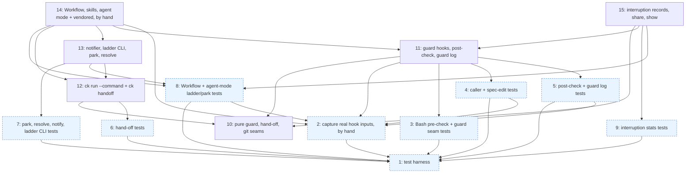

# Implementation Tasks: Prompt-Free Runs

**Status:** Not Started
**Spec:** [requirements.md](requirements.md) · [design.md](design.md) · [test-plan.md](test-plan.md) · [PLAN.md](PLAN.md)

Every name below (hooks, seams, CLI commands, record keys) is design.md's name; test-plan.md's Harness Contract uses
the same names. Harness Contract ownership: caller classification and the fallback marker -> Tasks 10, 11; Bash
parse seam `destroy_targets`, `may_write`, `command_family` -> Task 10; post-check hook and guard log -> Task 11;
`ck run --command` and `ck handoff` -> Task 12; notification, `run.notify_command`, `ck agents --guard-ladder`,
`ck worktree park`, `ck worktree resolve`, report `needsInput`, `ck plan` -> Task 13; Workflow interface and
agent-mode instructions, and the `spec-create.js` review revise rule -> Task 14; interruption records, shared object and show line -> Task 15.

Two tasks land by hand: Task 2 (it runs paid, real Claude Code sessions outside the sandbox) and Task 14 (it writes
the protected `.claude/` copies).

## Task Breakdown

### Task 1: Build the shared test harness for guard, park, hand-off and interruption tests
**Status:** Done
**Track:** test
**Requirements:** 3.2, 9.1, 10.1, 6.1, 7.1
**Description:** Build the test-owned infrastructure from test-plan.md "Test Infrastructure → Add", except the
recorded hook inputs, which Task 2 captures. It implements no TC on its own. Import project modules inside function
bodies only, so all files collect before the implementation exists.
1. `tests/conftest.py`: autouse `_not_headless` that deletes `CK_RUN_HEADLESS` and `CLAUDE_CODE_ENTRYPOINT` plus
   every variable `ck run` sets for its child (read lazily from `ck run --dry-run --json`'s `env` when that works;
   no-op otherwise).
2. `tests/guard_helpers.py`: `hook_input`, `pre`, `run_bash` (with `via="post-bash-check"|"done-verify"`),
   `post_message`, `decision`, `commit_on_base`, `new_on_branch`, `ck_json`, `big_repo`, `worktree_of`,
   `claimed_task_worktree` (real `ck worktree create` + `claim`, returns the absolute path), `fake_git`,
   `notify_script` (the `ok` script writes its stdin, env and argv to `out`), `set_notify` (runs `ck agents set
   run.notify_command`), `guard_events` (reads `guardlog.log_path(env)` and `guard-events.1.jsonl`),
   `fake_sandbox_tools`, `sleeping_fake_claude`, `parking_fake_claude` (runs the real `ck worktree park` from inside
   a `ck run` child, TC-88).
3. `tests/fixtures/hook_inputs/record_hook.py` and `tests/fixtures/hook_inputs/capture.sh`: the recorder and the
   capture script exactly as test-plan.md "Test Infrastructure → Add 3" describes (temp project, settings that
   register the recorder, the `claude -p` prompt with a one-agent Workflow and an Agent-tool call, the anonymising
   rewrite, `capture-summary.json`, and a printed reminder of the manual interactive step). The script is written
   and shell-checked here; it is run in Task 2.
4. `tests/stats_helpers.py` additions: `guard_attachment` (real `hook_success` line, `[ck guard]` reason, plain and
   plugin-shim `command`), `postcheck_attachment` (PostToolUse `hook_blocking_error` with
   `blockingError.blockingError`, optional gate text first; until Task 2 lands it uses the shape given in test-plan.md
   "Test Infrastructure → Add 4", and Task 2's recorded line must match it), `gate_block_attachment`
   (near-miss), `rtk_allow_attachment`, `denial_result(kind)` for auto/headless/reject/isolation (both "This
   session"/"This agent" variants) with the real phrasing, `quoted_result`, `tool_use`, `interruptions(target,
   events)`, `AgentSpec.extra_lines` / `ToolAgentSpec.extra_lines`, `write_guard_log(env, events)` in the design's
   camelCase `GuardEvent` format (`"v": 1`), and `interruption_strategy()`.
5. `tests/js/fake_project.mjs`: options `guardStops: {n: ceiling|'always'}`, `guardStopIn: {n: 'revise'}` and
   `parkOutcome` (`{parked, notification, detail}`); record `park <N>` steps in `state.parks`.
6. `tests/js/load_decisions.mjs`: exported `GUARD_NAMES = ['guardLadder', 'guardStopOf', 'parkAction']`, loaded
   only when asked (`loadDecisions({extra: GUARD_NAMES})`). `tests/js/bridge.mjs`: op `{op: 'ladder', model} ->
   {ok, ladder}`. `tests/landing_bridge.py`: a `ladder(model)` helper.
**Files:**
- `tests/conftest.py` - autouse `_not_headless`
- `tests/guard_helpers.py` - new hook/bash/worktree/notify/git/claude helpers
- `tests/fixtures/hook_inputs/record_hook.py` - recorder for real hook inputs
- `tests/fixtures/hook_inputs/capture.sh` - capture procedure run in Task 2
- `tests/stats_helpers.py` - interruption transcript line builders and Hypothesis strategy
- `tests/js/fake_project.mjs` - `guardStops`, `guardStopIn`, `parkOutcome`, `state.parks`
- `tests/js/load_decisions.mjs` - `GUARD_NAMES`, opt-in loading
- `tests/js/bridge.mjs` - `ladder` op
- `tests/landing_bridge.py` - `ladder` helper
**Verify:** `uv run pytest -q -n auto` `uv run pytest -q tests/test_workflow_scripts.py tests/test_landing_scheduler_properties.py` `bash -n tests/fixtures/hook_inputs/capture.sh`
**Verifies:** None
**Acceptance:**
- [x] The whole existing suite still collects and stays green.
- [x] `_not_headless` removes `CK_RUN_HEADLESS` and `CLAUDE_CODE_ENTRYPOINT` for every test; verified by a run with
      both set in the outer environment.
- [x] `capture.sh` follows the test-plan procedure step by step and needs no change to run in Task 2.
- [x] Helpers exercise real boundaries (real git, real `bash -c`, real `execute_hook`, real `ck worktree`); no
      project code is mocked.
**Dependencies:** None
**Complexity:** High
**Risk:** normal

---

### Task 2: Capture real Claude Code hook inputs (lands by hand)
**Status:** Done
**Track:** test
**Requirements:** 3.1, 3.2, 3.3, 3.4, 10.1
**Description:** I run this task myself, outside any sandbox, before the run reaches Tasks 4, 8, 11 and 14: it starts paid
`claude -p` sessions and one interactive session, which a sandboxed task agent cannot do. Run
`tests/fixtures/hook_inputs/capture.sh` (Task 1) and do its manual interactive step. Commit the outputs:
`main-session-pretooluse.json`, `agent-tool-subagent-pretooluse.json`, `workflow-agent-pretooluse.json`,
`headless-pretooluse.json`, `headless-env.json`, `postcheck-block-attachment.json` and `capture-summary.json`
(`workflowAgentHasAgentId`, `agentToolSubagentHasAgentId`, `claudeCodeVersion`, `capturedAt`). Names are invented,
ids are stable fakes, `HOME`/`PATH` are placeholders; every key Claude Code sent is kept. The summary is the
recorded answer to 3.4: Task 11 and Task 14 build the fallback marker only when `workflowAgentHasAgentId` is false.
**Files:**
- `tests/fixtures/hook_inputs/main-session-pretooluse.json`, `agent-tool-subagent-pretooluse.json`, `workflow-agent-pretooluse.json`, `headless-pretooluse.json`, `headless-env.json`, `postcheck-block-attachment.json`, `capture-summary.json` - recorded real hook inputs, headless env, PostToolUse block line, capture summary
**Verify:** `uv run python -c "import json,glob; [json.load(open(f)) for f in glob.glob('tests/fixtures/hook_inputs/*.json')]; print(json.load(open('tests/fixtures/hook_inputs/capture-summary.json')))"`
**Verifies:** None
**Acceptance:**
- [x] All seven files exist, parse as JSON and come from real Claude Code, not hand-written guesses.
- [x] `capture-summary.json` states whether the Workflow-agent input carried `agent_id`.
- [x] No real name, path, session id or secret remains.
**Dependencies:** Task 1 (runs its `capture.sh` and `record_hook.py`)
**Complexity:** Low
**Risk:** safety (runs paid claude -p sessions outside the sandbox)

---

### Task 3: Test the Bash pre-check and the guard seams, and update the existing guard tests
**Status:** Done
**Track:** test
**Requirements:** 1.1, 1.2, 1.3, 1.4, 1.5, 1.6, 1.7, 2.2, 4.1, 4.2, 4.3, 5.1, 5.2, 10.2
**Properties:** P-1, P-2, P-3, P-4, P-5, P-6, P-12, P-13, P-24
**Description:** Implements TC-1..TC-8 and TC-71 in `tests/test_guard_bash.py`, driven through
`execute_hook("pre-tool-guard", ...)` on the `project` fixture (TC-8 through `python -m claude_kiro.cli --hook
pre-tool-guard`). Task agent = `agent_id` set. TC-1 includes `rm -rf tests`, `rm -rf tests/` and `git rm -r tests`
(blocked by directory expansion); TC-3 includes `rm -rf tests/__pycache__` after a real pytest run and `find tests
-name '*.pyc' -delete` (pass). TC-5 asserts the design reason text (`[ck guard]`, the path, "deletes the test file",
"Keep the test", "Do not work around", "report the conflict ... quoting the test and the requirement"). TC-71 uses
`claimed_task_worktree` with the hook cwd at the main checkout.
Properties: `tests/test_guard_properties.py` (pure, `max_examples=200`): P-2, P-12, P-13, P-24 over
`guard_policy.destroy_targets`, `decide_bash`, `decide_edit`, `effective_mode`, `block_reason`,
`post_check_reason`, `command_family`. `tests/test_guard_properties_hook.py` (real hook and module-scoped repo,
`max_examples=40, deadline=None`): P-1 (with directory and absolute task-worktree targets), P-3 (with
`__pycache__` / `.pytest_cache` directories), P-4 (with a claimed task worktree), P-5, P-6. All
`derandomize=True, database=None`; each file declares `PROPERTIES`.
Existing tests (test-plan.md "Existing tests that change"): split `tests/test_guard.py::test_bash_deleting_tests_asks`
(rm, `cd . && rm -rf tests`, git rm keep asking; sed and redirect lines removed); turn the five main-session
frozen-spec tests (`test_requirements_frozen_once_implementation_starts`,
`test_rewording_or_removing_a_requirement_still_asks`, `test_test_plan_frozen_once_implementation_starts`,
`test_rewording_or_deleting_a_test_plan_row_asks`, `test_test_plan_guard_mode_deny_and_off`) into task-agent tests
(`agent_id` added; `deny` where they expected ask or deny, `None` where off), each with a main-session twin
expecting `None`; and change `tests/test_plugin_modes.py::test_plugin_hooks_stay_silent_outside_ck_projects` to a
real git repo with `tests/test_x.py` committed on the base. These edits remove or change assertions in existing
test files, so this task makes them while In Progress.
**Files:**
- `tests/test_guard_bash.py` - TC-1..TC-8, TC-71
- `tests/test_guard_properties.py` - P-2, P-12, P-13, P-24 and the `PROPERTIES` map
- `tests/test_guard_properties_hook.py` - P-1, P-3, P-4, P-5, P-6 and the `PROPERTIES` map
- `tests/test_guard.py` - split the Bash ask test; five frozen-spec tests become task-agent tests with main-session twins
- `tests/test_plugin_modes.py` - plugin-silence test uses a git repo with the test on the base
**Verify:** `uv run pytest -q -n auto tests/test_guard_bash.py tests/test_guard.py tests/test_guard_properties.py tests/test_guard_properties_hook.py tests/test_plugin_modes.py`
**Verifies:** Task 11 (the rewritten pre-tool guard; its pure properties also cover foundation Task 10's seams), Task 15 (P-24: `share.COMMAND_FAMILIES`)
**Acceptance:**
- [x] Every delete/move verb in TC-1, including the directory forms, asks (main, `ask`), denies (main, `deny`) and
      denies (task, `ask`); the file is untouched after each call.
- [x] Every TC-2 in-place/script/redirect form returns `None` for both callers; TC-3 near-misses (branch-only,
      owned, real `__pycache__`, `.pytest_cache`, `find -delete` of `.pyc`) return `None`.
- [x] TC-71's absolute-path deletes in a claimed task worktree are denied for a task agent.
- [x] Generators cover every form in the P-rows; settings are deterministic; `PROPERTIES` maps every P-id here.
- [x] The edited existing tests now assert the new rules (task agent deny, main session pass) and fail before the
      implementation for the right reason; no assertion is weakened beyond what test-plan.md lists.
- [x] Tests exercise the real hook and real git; no mocks of project code.
**Dependencies:** Task 1 (guard_helpers, `_not_headless`, `claimed_task_worktree`)
**Complexity:** High
**Risk:** safety (oracle for blocking irreversible deletion of existing test files)

---

### Task 4: Test caller classification, task-agent denials and main-session spec edits
**Status:** In Progress
**Track:** test
**Requirements:** 3.1, 3.2, 3.3, 3.4, 3.5, 3.6, 4.1, 4.2, 4.3, 5.1, 5.2, 5.3, 5.4
**Properties:** P-11, P-32
**Description:** Implements TC-20..TC-28, TC-72, TC-74, TC-86 and TC-89 in `tests/test_guard_callers.py`, through
`execute_hook("pre-tool-guard", ...)` with the recorded inputs of Task 2 (fields rewritten to the `project` repo).
TC-21 uses `headless-env.json` and, separately, `CK_RUN_HEADLESS=1`. TC-23 reads `capture-summary.json`: when
Workflow agents carry `agent_id`, the recorded input (absolute target in a claimed task worktree, cwd at the main
checkout) must be `deny` and the marker cases skip with that reason; otherwise the marker cases run through the
real Bash calls `ck guard workflow-begin calc` / `ck guard workflow-end` sent to the hook from the main session
(deny while active, configured mode after, never across sessions). Live variant `-k live` with `CK_LIVE_CLAUDE=1`.
TC-72: the recorded main-session input in a claimed task worktree (cwd at the main checkout and cwd = the worktree)
gets the configured mode. TC-74: a task agent's absolute-path Edit/MultiEdit/Write weakening the worktree's test is
`deny`. TC-86: a /spec:review revise agent's rewording of a started spec's requirements.md / test-plan.md is denied
in Workflow, agent and `ck run` modes with a reason that says to return it as a decision. TC-89 (skipped unless the
marker is built): refresh, the 15-minute expiry, `marker-clear` on `UserPromptSubmit`, and re-begin. P-11 in
`tests/test_caller_properties.py` (pure `guard_policy.classify_caller(input, env, workflow_marker)`,
`max_examples=200`, `derandomize=True, database=None`, recorded fixtures as `@example` seeds, the path-change
metamorphic rule) and P-32 (`run_marker` lifecycle with an injected clock, skipped unless the marker is built), with
`PROPERTIES`.
**Files:**
- `tests/test_guard_callers.py` - TC-20..TC-28, TC-72, TC-74, TC-86, TC-89, including the opt-in live capture
- `tests/test_caller_properties.py` - P-11, P-32 and the `PROPERTIES` map
**Verify:** `uv run pytest -q -n auto tests/test_guard_callers.py tests/test_caller_properties.py`
**Verifies:** Task 11 (the rewritten pre-tool guard and the marker; P-11 also covers foundation Task 10's `classify_caller`)
**Acceptance:**
- [ ] A recorded Agent-tool subagent input, a headless env and `CK_RUN_HEADLESS=1` each give `deny` under
      `guard.tests: ask`; the recorded main-session input gives `ask`/`deny` per config, also inside a task
      worktree.
- [ ] TC-23 asserts on the recorded fact in `capture-summary.json`, so the gate keeps the answer to 3.4.
- [ ] Malformed inputs never raise and never break the hook.
- [ ] Main-session spec edits pass with no ask; the same edits from a task agent are denied with a reason naming
      file and kind; a review revise agent's denial says to return the change as a decision.
- [ ] When built, the marker is cleared on a new prompt and expires 15 minutes after its last refresh.
- [ ] Tests use recorded real Claude Code input and the real hook; no mocks of project code.
**Dependencies:** Task 1 (guard_helpers), Task 2 (reads its recorded hook inputs and capture summary)
**Complexity:** Medium
**Risk:** safety (oracle for the deny/ask permission decision that gates destructive tool calls)

---

### Task 5: Test the shell post-check and the private guard event log
**Status:** Not Started
**Track:** test
**Requirements:** 1.6, 2.1, 2.2, 2.3, 2.4, 2.5, 2.6, 2.7, 2.8, 2.9, 2.10, 3.4, 9.1, 9.2, 9.3, 9.4, 9.5, 9.6
**Properties:** P-7, P-8, P-9, P-10, P-21
**Description:** Post-check: TC-9..TC-19, TC-73, TC-75, TC-76, TC-77 and TC-82 in `tests/test_guard_postcheck.py`. Each
case runs `run_bash` (`pre-tool-guard` takes the snapshot, the real command runs in `bash -c`, then
`post-bash-check` with the same `tool_use_id`); TC-9, TC-11, TC-14, TC-73 and TC-75 also run `via="done-verify"`.
TC-11 covers `ask` (2.3) and `deny` (2.9) wording. TC-15 bounds both `post-bash-check` and `done-verify` CLI runs to
5 s with the failing and sleeping git wrappers; TC-17 measures both paths. TC-19 checks `HookRegistry._hooks` and
unchanged `HOOK_SETTINGS`/`hooks.json`. TC-73 uses a claimed task worktree by absolute path from the main-checkout
cwd; TC-75 the HEAD-moving commands; TC-76 the `find` forms; TC-77 eight concurrent pre/post pairs on one
`session_id` in one checkout, plus a script-built path into another claimed worktree that only `ck gate` catches;
TC-82 a `git merge` that brings in a legitimate test change (no report) followed by a weakening (reported). TC-19
expects the `UserPromptSubmit` `marker-clear` entry only when the capture summary says the marker is built.
Red team (`tests/test_redteam_postcheck.py`): try to break 2.7 "SHALL not block or delay the run" with adversarial
inputs: PostToolUse with no snapshot; a corrupt, truncated or huge snapshot file; a megabyte command or one with
NUL/invalid UTF-8; a binary, 50 MB, symlink-loop or FIFO test file, or one deleted between pre and post; a `cd` into
a vanished directory; hundreds of changed test files; a repo mid-rebase or with an index lock; a fake `git` that
hangs or prints garbage; the post-check's own message fed back as a command. Each gives no output (or a correct
catch), exit 0, within 5 s, through both hooks, and does not change the gate outcome.
Properties (`tests/test_postcheck_properties.py`, real hooks on a module-scoped repo, `max_examples=40,
deadline=None, derandomize=True, database=None`): P-7 (including absolute task-worktree targets, `find -exec sed`
and a trailing commit), P-8, P-9 (with the `find` and `git branch` halves), P-10, P-21; `PROPERTIES` map.
Guard log: TC-50..TC-55 and the guard half of TC-70 in `tests/test_guard_log.py` (camelCase keys, `"v": 1`;
TC-53 plants a log just under `guardlog.GUARD_LOG_LIMIT`; TC-55 runs real `ck stats export` and `ck stats submit`).
**Files:**
- `tests/test_guard_postcheck.py` - TC-9..TC-19, TC-73, TC-75..TC-77, TC-82
- `tests/test_redteam_postcheck.py` - adversarial cases for 2.7
- `tests/test_postcheck_properties.py` - P-7..P-10, P-21 and the `PROPERTIES` map
- `tests/test_guard_log.py` - TC-50..TC-55, TC-70 (guard half)
**Verify:** `uv run pytest -q -n auto tests/test_guard_postcheck.py tests/test_redteam_postcheck.py tests/test_postcheck_properties.py tests/test_guard_log.py`
**Verifies:** Task 11 (the guard hooks, the post-check and the guard log)
**Acceptance:**
- [ ] A real `sed -i` deleting an assertion, a python heredoc adding a skip, a `python -c` dropping a test, the same
      in a task worktree by absolute path, and the same followed by `git commit` are each reported with file and
      kind; non-weakening, new-on-branch and owned changes are not.
- [ ] `find -exec sed` weakening and `find -delete` of an existing test are caught after the command; `find ...
      '*.pyc' -delete` is not.
- [ ] Concurrent pairs on one session each catch their own weakening exactly once; a script-built path into
      another worktree is left to the gate, which fails.
- [ ] A merge that brings in the target's test change reports nothing; a weakening after it is reported.
- [ ] Every forced failure and red-team case leaves no blocking output, exit 0, within 5 s through `done-verify`.
- [ ] One event per ask/deny/catch with every 9.1 field; none for passing calls; the log is 0600 in 0700, rotates,
      never changes a decision when unwritable, and feeds the leak check.
- [ ] Tests exercise both real hooks, real shell commands and real git; no mocks of project code.
**Dependencies:** Task 1 (run_bash, fake_git, big_repo, claimed_task_worktree, guard_events), Task 2 (TC-19 reads its capture summary)
**Complexity:** High
**Risk:** safety (oracle for catching shell-made test weakening and for keeping confidential command text local)

---

### Task 6: Test the hand-off of whole-spec runs to `ck run`
**Status:** Done
**Track:** test
**Requirements:** 3.2, 8.1, 8.2, 8.3, 8.4, 8.5, 8.6, 8.7, 8.8, 8.9
**Properties:** P-19, P-20, P-31
**Description:** Implements TC-44..TC-48 and TC-83..TC-85 in `tests/test_handoff.py`, reusing `repo`, `fake_claude` and `plan_of`
from `tests/test_run.py` and `worktree_of`, `sleeping_fake_claude` and `fake_sandbox_tools` from Task 1. TC-44 polls
the fake claude's record file (bounded wait) and asserts cwd `<root>`, prompt `/spec:implement demo all` with no
`--log`, and that the printed `log` file exists. TC-45 compares `ck run --command create|review --dry-run --json`
with `--command implement` and checks `CK_RUN_HEADLESS=1`. TC-46 covers sandbox tools missing, unknown spec, main
checkout not found, and a fake claude that exits 1 at once (exit 3, `launched: false`, `error`, `manualCommand`).
TC-47 adds the real-CLI sample of P-19 over a module-scoped repo with real worktrees. TC-48 asserts the launched argv
has `--command implement --log <log>` before `--`. `tests/test_handoff_properties.py` (pure `decide_handoff`,
`max_examples=200, derandomize=True, database=None`): P-19 over every cwd form, kind and arg list; P-20: `run_args
== (spec, "--command", kind)`, `rest` equals the args after the spec exactly, and `shlex.split(shlex.join(rest)) ==
rest`; P-31 over every spec-state combination of `HandoffFacts`. TC-83 commits a spec only on the worktree's branch
and checks the `<spec>-run` branch in the main checkout at the worktree's HEAD; TC-84 the dirty main checkout, dirty
worktree spec and taken branch refusals (both checkouts unchanged); TC-85 an identical spec (no run branch).
`PROPERTIES` map.
**Files:**
- `tests/test_handoff.py` - TC-44..TC-48, TC-83..TC-85
- `tests/test_handoff_properties.py` - P-19, P-20, P-31 and the `PROPERTIES` map
**Verify:** `uv run pytest -q -n auto tests/test_handoff.py tests/test_handoff_properties.py tests/test_run.py`
**Verifies:** Task 12 (`ck run --command`, `ck handoff`; P-19/P-20 also cover foundation Task 10's `decide_handoff`)
**Acceptance:**
- [x] A whole-spec run from `.claude/worktrees/` launches from the main checkout and prints checkout, an existing
      log path, follow command and report hint; the prompt never holds `--log`.
- [x] create/review runs get the same headless, sandboxed, prompt-free argv and refusals as implement.
- [x] Every launch failure, including an early child exit, prints the reason and the manual command and runs
      nothing in the worktree.
- [x] The child's sandbox preflight never depends on this machine's bwrap/socat.
- [x] A spec only on the worktree's branch runs on `<spec>-run` at the worktree's HEAD; a dirty main checkout or a
      taken branch refuses with the recovery commands and changes nothing; an identical spec runs as before.
- [x] Generators cover every row form; settings are deterministic; no mocks of project code.
**Dependencies:** Task 1 (worktree_of, sleeping_fake_claude, fake_sandbox_tools)
**Complexity:** Medium
**Risk:** safety (launches a paid headless claude run)

---

### Task 7: Test `ck worktree park`, `ck worktree resolve`, notification, report and the ladder CLI
**Status:** Done
**Track:** test
**Requirements:** 6.1, 6.2, 6.4, 7.1, 7.2, 7.3, 7.4, 7.5, 7.8, 7.9, 7.11, 7.12
**Properties:** P-17, P-18
**Description:** Implements TC-37..TC-41, TC-78, TC-88 and the park half of TC-70 in `tests/test_guard_park.py`, through
the real CLI on a real repo (`stats_helpers.spec_repo`). Park and resolve per design: note JSON on stdin, output
`{"parked", "note", "notification", "detail"}` and `{"resolved", "decisionNote", "hadParkNote"}`. TC-41: `ck agents
--guard-ladder <m> --json` for haiku/sonnet/`claude-sonnet-5-5`/opus/fable with several `implementer.escalate`
prefs. TC-78: resolve writes a 0600 decision note with the answer verbatim, clears the park note, appends a second
answer, and a later park writes `priorDecision: true`. TC-88: a park inside a real `ck run` (fake claude from
`parking_fake_claude`, fake sandbox tools) answers `deferred`, `ck run`'s own process sends exactly one notification
per note, and the dry-run sandbox settings are the same with and without `run.notify_command`.
Red team (`tests/test_redteam_notify.py`): try to break 7.2 "SHALL not carry the quoted test or requirement text":
quotes in the `file`, `kind` or `decision` fields; a spec name or task id that contains a quote; shell
metacharacters, `$(...)`, backticks, newlines, ANSI escapes, homoglyphs and very long text; the notify command's
stdin, `CK_NOTIFY_MESSAGE` and argv all checked; a park note re-read by `ck worktree report` and fed into a second
park. Assert no line or 12+ char substring of either quote reaches the command and no injected command ran.
Properties (`tests/test_park_properties.py`): P-17 (`notify.notify_message` plus a real park with the `ok` script),
P-18 (real park over every notify outcome); pure `max_examples=200`, CLI-backed `max_examples=40, deadline=None`,
all `derandomize=True, database=None`; `PROPERTIES` map.
**Files:**
- `tests/test_guard_park.py` - TC-37..TC-41, TC-78, TC-88, TC-70 (park half)
- `tests/test_redteam_notify.py` - adversarial cases for 7.2
- `tests/test_park_properties.py` - P-17, P-18 and the `PROPERTIES` map
**Verify:** `uv run pytest -q -n auto tests/test_guard_park.py tests/test_redteam_notify.py tests/test_park_properties.py`
**Verifies:** Task 13 (notifier, ladder CLI, park and resolve)
**Acceptance:**
- [x] Exactly one notification per park, on stdin and in `CK_NOTIFY_MESSAGE`, naming spec, task and "decision",
      with no quoted text in any channel.
- [x] Not configured / failing / slow / missing notify commands never fail the park (exit 0, within 15 s) and are
      named in the output and the report.
- [x] Parked tasks appear only in `needsInput`; resolve clears that, keeps the answer for later attempts, and a
      re-run treats the task as unfinished with its worktree reused.
- [x] The ladder CLI returns the strict-above models whatever `implementer.escalate` says.
- [x] Inside `ck run`, the notification comes once per note from `ck run`'s process; the sandbox is not widened.
- [x] Tests run the real CLI, real git and a real subprocess notify command; no mocks of project code.
**Dependencies:** Task 1 (notify_script, set_notify, parking_fake_claude, fake_sandbox_tools)
**Complexity:** Medium
**Risk:** safety (sends the user's push notification through a configured command)

---

### Task 8: Test the guard ladder, parking and resolve flow in the Workflow and in the agent-mode instructions
**Status:** Not Started
**Track:** test
**Requirements:** 5.4, 6.1, 6.2, 6.3, 6.4, 6.5, 6.6, 7.1, 7.3, 7.4, 7.5, 7.6, 7.7, 7.9, 7.10, 7.11, 8.1, 8.2, 10.1
**Properties:** P-14, P-15, P-16
**Description:** Workflow: TC-29..TC-35, TC-79, the Workflow halves of TC-36 and TC-80 in
`tests/js/guard_ladder.test.mjs`, running the real `plugin/workflows/spec-implement.js` under the stub runtime with
`guardStops`, `guardStopIn` and `parkOutcome`. Labels `task <N> guard <k> (<model>)`, `park <N>`; escalation
entries `{stage: 'guard', model}`; `needsInput[].action`. TC-79: a guard stop spends no retry or escalate step and a
revise-call guard stop reaches the ladder. TC-80: every prompt reads `<WT>.decision.md` first.
Docs: TC-42, TC-43, TC-49 and the doc halves of TC-36 and TC-80 in `tests/test_guard_agent_mode_docs.py`, as
`tests/test_stats_agents_docs.py` does (static checks on the packaged Markdown and on their
`claude_kiro.plugin.vendor_files()` renderings in memory; the on-disk copies are checked by the dogfood test in
Task 14). TC-49: implement/create/review skills run `ck handoff <kind> ... --json` as step 0 of the whole-spec path;
when `capture-summary.json` says Workflow agents lack `agent_id`, they also wrap the Workflow call in
`ck guard workflow-begin <spec>` / `ck guard workflow-end` (skipped otherwise). TC-43 parses the `guard <k>`
description and the `park <N>` label.
Review revise on a started spec: TC-87 (5.4), its Workflow half in `tests/js/spec_review_frozen.test.mjs` (real
`plugin/workflows/spec-create.js` in review mode under the stub runtime: a rewording of existing requirements.md
text comes back under `escalated` and in `openQuestions` with `source: 'revise'`, never applied; add-only fixes are
applied) and its doc half in `tests/test_guard_agent_mode_docs.py` (without-workflow-tool.md and its rendering give
the /spec:review revise agent the same rule; `.claude/workflows/spec-create.js` equals its source).
Properties (`tests/test_guard_ladder_properties.py`): P-14 (`agents.guard_ladder`, the bridge `ladder` op and `ck
agents --guard-ladder` agree), P-15 (with `guardStopIn`), P-16; bridge `max_examples=200`, CLI-backed
`max_examples=40, deadline=None`, all `derandomize=True, database=None`; `PROPERTIES` map.
**Files:**
- `tests/js/guard_ladder.test.mjs` - TC-29..TC-35, TC-79, TC-36 and TC-80 (Workflow halves)
- `tests/test_guard_agent_mode_docs.py` - TC-42, TC-43, TC-49, TC-36, TC-80 and TC-87 (doc halves)
- `tests/js/spec_review_frozen.test.mjs` - TC-87 (Workflow half)
- `tests/test_guard_ladder_properties.py` - P-14..P-16 and the `PROPERTIES` map
**Verify:** `node tests/js/guard_ladder.test.mjs` `node tests/js/spec_review_frozen.test.mjs` `uv run pytest -q -n auto tests/test_guard_agent_mode_docs.py tests/test_guard_ladder_properties.py tests/test_workflow_scripts.py tests/test_landing_scheduler_properties.py tests/test_stats_agents_docs.py`
**Verifies:** Task 13 (`ck agents --guard-ladder`), Task 14 (the Workflow script, skills and agent-mode instructions), Task 15 (the `guard` and `park` forms in roles.py)
**Acceptance:**
- [ ] Ladder sequences, effort, handoff- and decision-note prompts and escalation records match TC-29..TC-31 and
      TC-79 exactly; ordinary failures behave as before (existing `spec_implement.test.mjs` stays green).
- [ ] Parking blocks dependents only; needs-input tasks are listed apart from merged/failed/blocked; notification
      status reaches the result.
- [ ] Every required instruction is present in each packaged file and its rendering; the templates parse through
      the real parser.
- [ ] The Python ladder, the CLI and the JS mirror agree for every alias.
- [ ] A review fix to existing requirements.md / test-plan.md text of a started spec reaches `openQuestions`, not
      the files, in Workflow and agent mode.
- [ ] Tests run the real workflow script and real files; only agents and the Claude runtime are stubbed.
**Dependencies:** Task 1 (fake_project options, load_decisions GUARD_NAMES, bridge `ladder` op), Task 2 (TC-49 reads its capture summary)
**Complexity:** High
**Risk:** safety (oracle for paid model escalation up to Fable and for parking)

---

### Task 9: Test interruption counts in run records, shared records and `ck stats show`
**Status:** Done
**Track:** test
**Requirements:** 6.6, 9.6, 10.1, 10.2, 10.3, 10.4, 10.5, 10.6, 10.7, 10.8, 11.1, 11.2, 11.3, 11.4, 11.5
**Properties:** P-22, P-23, P-25, P-26, P-27, P-28, P-29, P-30
**Description:** Implements TC-56..TC-69, TC-81 and the collect half of TC-70 in `tests/test_stats_interruptions.py`,
through the real CLI as a subprocess (`ck_sub`, `stats`, `fresh_env()`) over fake Claude homes built with the Task 1
line builders, with design's record keys (Harness Contract 9). TC-56 includes a post-check catch as a PostToolUse
`hook_blocking_error` with gate text first and a gate-only near-miss. TC-81: two runs in one session.
Red team (`tests/test_redteam_shared.py`): try to break 11.1 "SHALL not include command text, paths, spec names or
reason text": a label or `[ck:<id>]` description whose model text is a path or spec name; a `tool_use` program named
like a spec; local `interruptions` keys outside the fixed sets; a guard reason inside a `byRole` key; numeric fields
holding strings; a spec named like a ck vocabulary word; mixed case, URL-encoded or split values; one run's export
fed back as the next run's transcript. Assert `validate_shareable` passes, the export and submit payloads hold no
planted value, and an export with one in the note is refused.
Properties: `tests/test_stats_properties_interruptions.py` (pure `scan_lines`/`reconcile`, `max_examples=200`;
P-28 CLI-backed): P-23, P-25, P-26, P-28, P-30. `tests/test_stats_properties_shared.py` (CLI-backed,
`max_examples=40, deadline=None`): P-22, P-27, P-29. All `derandomize=True, database=None`; `PROPERTIES` maps.
**Files:**
- `tests/test_stats_interruptions.py` - TC-56..TC-69, TC-81, TC-70 (collect half)
- `tests/test_redteam_shared.py` - adversarial cases for 11.1
- `tests/test_stats_properties_interruptions.py` - P-23, P-25, P-26, P-28, P-30 and the `PROPERTIES` map
- `tests/test_stats_properties_shared.py` - P-22, P-27, P-29 and the `PROPERTIES` map
**Verify:** `uv run pytest -q -n auto tests/test_stats_interruptions.py tests/test_redteam_shared.py tests/test_stats_properties_interruptions.py tests/test_stats_properties_shared.py` `uv run pytest -q -n auto tests/test_stats_*.py`
**Verifies:** Task 15 (interruption records, shared object and show line)
**Acceptance:**
- [x] Every interruption kind is counted from real transcript shapes, by role and family, in Workflow and agent
      mode alike; a gate-only `hook_blocking_error` counts nothing.
- [x] Wait time, log join and differences (within the run window), malformed lines and pre-feature records behave
      as specified; a never-created log is `ok` with zero events and not missing, an unreadable or rotated-away log
      is listed as missing (TC-62).
- [x] Shared records carry only enum-keyed numbers under `ck-run-analytics/1`; no planted value leaks; show prints
      one interruptions line.
- [x] Existing collect, show, export and submit tests stay green; no mocks of project code.
**Dependencies:** Task 1 (stats_helpers line builders, write_guard_log, interruption_strategy)
**Complexity:** High
**Risk:** safety (shareable records and submit leave the machine; tests guard against content leaks)

---

### Task 10: Add the pure guard, hand-off and git helper seams
**Status:** Not Started
**Track:** impl
**Requirements:** 1.1, 1.2, 1.3, 1.4, 1.5, 1.6, 1.7, 2.1, 2.2, 2.3, 2.4, 2.5, 2.6, 2.9, 2.10, 3.1, 3.2, 3.3, 3.4, 3.5, 3.6, 4.1, 4.2, 4.3, 5.1, 5.2, 5.3, 5.4, 8.1, 8.4, 8.5, 8.6, 8.7, 8.8, 8.9, 10.2
**Description:** Create the pure modules and read-only helpers the hooks and CLI call (design Decision Seams S1-S11,
Data Models). `src/claude_kiro/handoff.py`: `is_headless`, `HandoffFacts` (with the head, branch, clean-state and
spec-tree fields), `HandoffDecision` (with `run_args = (spec, "--command", kind)`, `rest`, `run_branch`,
`start_point` and `recovery`), `decide_handoff` (S11, including the 8.7-8.9 spec-state rules).
`FileChange.matches_incoming` and S9 skipping it (D19); S10's frozen-spec denial text telling a revise agent to
return the change as a decision (5.4). `src/claude_kiro/hooks/_shared/guard_policy.py`: data
classes (`Caller`, `DestroyTarget`, `TargetFacts`, `EditFacts`, `GuardDecision`, `FileChange`, `PostCheckFinding`
with `mode`) and seams `destroy_targets` (no targets for redirects, sed/perl -i or `find`; directory targets allowed),
`may_write` (the S2 read-only set, `find` only without `-exec/-execdir/-ok/-okdir/-delete/-fprint*`, `git branch`
only listing), `command_family`, `classify_caller(hook_input, env, workflow_marker)` (no path input),
`effective_mode`, `decide_bash` (over expanded file facts), `decide_edit`, `decide_post_check`, `block_reason`,
`post_check_reason` (ask → 2.3 text, deny → 2.9 text, task agent → 2.2 text). `hooks/_shared/git_utils.py`:
`toplevel`, `status_paths`, `head_sha`, `content_at`, `changed_since`, `tree_files`, all None on error and bounded by
the existing timeout. `hooks/_shared/test_heuristics.py`: `is_test_file` (`is_test_path` unchanged). No I/O in the
pure modules. Foundation task: its criteria are verified at Task 11 (Tasks 3, 4, 5 drive the seams through the real
hook, and their pure property files call the seams directly) and Task 12 (Task 6); its own Verify is an import
smoke plus the existing guard and gate suites.
**Files:**
- `src/claude_kiro/handoff.py` - new: `is_headless`, `HandoffFacts`, `HandoffDecision`, `decide_handoff`
- `src/claude_kiro/hooks/_shared/guard_policy.py` - new pure module (S1-S4, S6-S10 and data classes)
- `src/claude_kiro/hooks/_shared/git_utils.py` - add `toplevel`, `status_paths`, `head_sha`, `content_at`, `changed_since`, `tree_files`
- `src/claude_kiro/hooks/_shared/test_heuristics.py` - add `is_test_file`
**Verify:** `uv run python -c "from claude_kiro import handoff; from claude_kiro.hooks._shared import guard_policy, git_utils, test_heuristics; print(guard_policy.command_family('sed -i x f'))"` `uv run pytest -q -n auto tests/test_gate.py`
**Acceptance:**
- [ ] `destroy_targets("cd sub && rm tests/test_a.py", "/r")` yields one delete target `/r/sub/tests/test_a.py`;
      sed/perl -i, heredocs, redirects and `find` yield none.
- [ ] `may_write` is False for `find tests -name '*.py'` and `git branch`, True for any `find` with `-exec` or
      `-delete` and for `git branch -D x`.
- [ ] `classify_caller` ignores paths; a non-empty `agent_id` or headless env gives `task_agent`; the marker counts
      only without `agent_id`.
- [ ] `decide_bash` blocks only expanded file targets that are existing, unowned tests; `exists_on_base None`
      passes; `is_test_file` is False for `tests/__pycache__/*.pyc`.
- [ ] The main-session post-check reason differs by mode (ask me / restore), and neither asks to report a conflict.
- [ ] `decide_handoff` gives `handoff` only for a whole-spec run in a `.claude/worktrees/` linked worktree, `refuse`
      without a main root or spec, `none` otherwise; a differing spec gives a `<spec>-run` run branch at the
      worktree's HEAD when the main checkout is clean, else `refuse` with recovery commands.
**Dependencies:** None
**Complexity:** High
**Risk:** safety (decides which deletions of existing tests are blocked and when a paid headless run is launched)

---

### Task 11: Rewrite the pre-tool guard, add the post-check and the private guard log
**Status:** Not Started
**Track:** impl
**Requirements:** 1.1, 1.2, 1.3, 1.4, 1.5, 1.6, 1.7, 2.1, 2.2, 2.3, 2.4, 2.5, 2.6, 2.7, 2.8, 2.9, 2.10, 3.1, 3.2, 3.3, 3.4, 3.5, 3.6, 4.1, 4.2, 4.3, 5.1, 5.2, 5.3, 5.4, 9.1, 9.2, 9.3, 9.4, 9.5, 9.6
**Description:** The real hook boundary (design "Existing Components to Modify", "New Components", "Pre-command
snapshot", "Guard event").
- `analytics/guardlog.py` (new): `GuardEvent`, `log_path`, `append_event` (0700 dir, 0600 file, rotation at
  `GUARD_LOG_LIMIT` to one `.1` file, never raises), `read_events(session_ids, *, window, agent_ids, env)` (state
  `ok` also for a never-created log; `rotated` and `unreadable` per design, 10.5), `leak_terms`. `analytics/leak.py` `build_terms(extra_terms=...)` and `confidential_terms`; pass
  `guardlog.leak_terms()` in `analytics/export.py` `leak_gate` and both `build_terms` call sites in `cli/stats.py`.
- `hooks/post_bash_check.py` (new): `take_snapshot` (one atomic file per call; only what the command names:
  checkouts = cwd top level, `cd`/`git -C` dirs, top levels of absolute path-like substrings, and per checkout the
  named paths or all test files when none is named; no claimed worktrees the command does not name; HEAD sha
  recorded), `check` (pre-filter first; HEAD-moved candidates via `changed_since(<old head>)` with `before` from the
  old head; `matches_incoming` from the base ref and the refs a merge, rebase or pull brought in; per-agent de-dup
  file; deletes the snapshot; 3-s budget; never raises), `hook`. `hooks/done_verify.py`
  calls `check` for Bash and merges a finding (gate report first). `cli/runner.py` registers `post-bash-check`;
  `HOOK_SETTINGS` and `hooks.json` unchanged.
- `hooks/pre_tool_guard.py`: the Bash path calls `destroy_targets`, resolves each target's own checkout, expands
  directory targets with `git_utils.tree_files`, builds `TargetFacts` and calls `decide_bash`; snapshot via
  `take_snapshot` when `may_write` and `guard.tests` is on; the edit path calls `decide_edit` against the target's
  checkout; `classify_caller` + `effective_mode`; `block_reason` with `[ck guard]`; one guard event per ask/deny.
- Fallback marker, only when Task 2's `capture-summary.json` has `workflowAgentHasAgentId: false`: new
  `hooks/_shared/run_marker.py` and `cli/guard.py` (`ck guard workflow-begin SPEC`, `ck guard workflow-end`, printing
  `ok`), registered in `cli/main.py`; the hook marks/unmarks on those exact Bash commands from a caller with no
  `agent_id` and reads `run_marker.active` only for calls with no `agent_id`, refreshing it on each active read (pre
  hook and post-check) and treating it as inactive 15 minutes after the last refresh (`MARKER_IDLE_S = 900`);
  `workflow-begin` replaces a stale marker. New `hooks/marker_clear.py` (`UserPromptSubmit`: unmark the session),
  registered as `marker-clear` in `cli/runner.py` `HookRegistry._hooks` and `HOOK_SETTINGS` and in
  `plugin/hooks/hooks.json` (D16). Otherwise `workflow_marker` is always False and these files and entries are not
  added.
**Files:**
- `src/claude_kiro/analytics/guardlog.py` - new: event log append/rotate/read/leak terms
- `src/claude_kiro/analytics/leak.py` - `build_terms(extra_terms=...)`; `confidential_terms` includes log terms
- `src/claude_kiro/analytics/export.py` - pass guard-log terms in `leak_gate`
- `src/claude_kiro/cli/stats.py` - pass guard-log terms at both `build_terms` call sites
- `src/claude_kiro/hooks/post_bash_check.py` - new: `take_snapshot`, `check`, `hook`
- `src/claude_kiro/hooks/done_verify.py` - run the post-check for Bash and merge its finding
- `src/claude_kiro/cli/runner.py` - register `post-bash-check`; `marker-clear` and its `UserPromptSubmit` setting only with `run_marker`
- `src/claude_kiro/hooks/marker_clear.py` - new, only with `run_marker`: `UserPromptSubmit` hook that clears the session marker
- `plugin/hooks/hooks.json` - `UserPromptSubmit` `marker-clear` entry, only with `run_marker`
- `src/claude_kiro/hooks/pre_tool_guard.py` - Bash and edit paths call `guard_policy`; directory expansion; snapshot; caller; guard events
- `src/claude_kiro/hooks/_shared/run_marker.py` - new, only when the capture shows no `agent_id`: session workflow marker
- `src/claude_kiro/cli/guard.py` - new, only with `run_marker`: `ck guard workflow-begin|workflow-end`
- `src/claude_kiro/cli/main.py` - register `guard` when it exists
**Verify:** `uv run pytest -q -n auto tests/test_guard_properties.py tests/test_caller_properties.py tests/test_guard_bash.py tests/test_guard.py tests/test_guard_callers.py tests/test_guard_postcheck.py tests/test_redteam_postcheck.py tests/test_postcheck_properties.py tests/test_guard_properties_hook.py tests/test_guard_log.py tests/test_plugin_modes.py tests/test_plugin.py tests/test_stats_leak.py tests/test_stats_export.py -k "not test_p24_family_names_are_the_documented_set"`
**Verified by:** Task 4, Task 5
Run note (2026-10-30): P-24 (`test_p24_family_names_are_the_documented_set`) reads `share.COMMAND_FAMILIES`, which Task 15 adds and Task 15 depends on this task, so it runs under Task 15's Verify, not here. Task 3 is linked to Task 15 for P-24; its other tests still run in this task's Verify above.
**Acceptance:**
- [ ] As a task agent, each NFR replay case gives no output; `rm` / `rm -rf tests` of existing unowned tests is
      denied for a task agent and uses the configured mode for the main session, also through `cd` and by absolute
      path into a task worktree.
- [ ] My main session inside a task worktree keeps the configured mode.
- [ ] A weakening `sed`, script, `find -exec`, `find -delete` or `... && git commit` is caught after the command,
      in the project and in a task worktree, through `done-verify`; concurrent agents never lose a snapshot or
      see another agent's file; a merge bringing in the target's test change reports nothing.
- [ ] A main-session edit removing text from requirements.md of a started spec passes; a task agent's is denied.
- [ ] Every ask, deny and catch writes one event; a pass writes none; an unwritable log changes nothing; log terms
      refuse a leaking export or submit.
- [ ] Hook input with missing or unknown fields never fails the hook; every post-check failure is silent within 5 s.
**Dependencies:** Task 10 (calls the guard policy seams and git helpers), Task 2 (reads its capture summary to decide the marker), Task 3 (its tests are the oracle), Task 4 (its tests are the oracle), Task 5 (its tests are the oracle)
**Complexity:** High
**Risk:** safety (blocks deletion of existing tests, gates frozen spec edits and keeps confidential command text local)

---

### Task 12: Teach `ck run` create and review runs, and add `ck handoff`
**Status:** Not Started
**Track:** impl
**Requirements:** 3.2, 8.1, 8.2, 8.3, 8.4, 8.5, 8.6, 8.7, 8.8, 8.9
**Description:** In `src/claude_kiro/cli/run.py` add `--command implement|create|review` (default `implement`; prompts
`/spec:implement <spec> all`, `/spec:create <spec>`, `/spec:review <spec>`, plus the args after `--`); implement and
review need `tasks.md`, create only the spec directory. Move every pre-launch check into `preflight(cwd, spec,
command, unsandboxed) -> RunPlan` raising `RunRefused(reason)`. The child env always gets `CK_RUN_HEADLESS=1`;
sandbox, deny rules, budget and turn cap are unchanged for every command. Create `src/claude_kiro/cli/handoff.py`
(`ck handoff KIND [ARGS...] [--json]`, design CLI and "Hand-off flow"): gather `HandoffFacts` (both HEADs, the main
checkout's branch and clean state, `specs/<spec>` tree ids at both HEADs, uncommitted spec changes in the worktree,
an existing `<spec>-run` branch), call `decide_handoff`; when it carries `run_branch`, `git -C <main_root> switch -c
<spec>-run <worktree head>` (exit 3 with the recovery commands if that fails, main checkout unchanged) and print
`runBranch`; on `handoff`, `run.preflight(main_root, ...)`, then `Popen([sys.executable, "-m", "claude_kiro.cli",
"run", *run_args, "--log", <log>, "--", *rest], cwd=main_root, start_new_session=True, stdin=DEVNULL, stdout/stderr
-> <log>.launch)` (every option before `--`), wait up to 3 s for an early exit, and print the JSON per design (exit
0, or exit 3 with `error` and `manualCommand`). Args travel as an argv list, never a shell. Register it in
`cli/main.py`.
**Files:**
- `src/claude_kiro/cli/run.py` - `--command`; `preflight`/`RunPlan`/`RunRefused`; `CK_RUN_HEADLESS=1` in child env
- `src/claude_kiro/cli/handoff.py` - new `ck handoff` command
- `src/claude_kiro/cli/main.py` - `cli.add_command(handoff)`
**Verify:** `uv run pytest -q -n auto tests/test_handoff.py tests/test_handoff_properties.py tests/test_run.py`
**Verified by:** Task 6
**Acceptance:**
- [ ] `ck run myspec --command create --dry-run --json` builds `/spec:create myspec` with the same sandbox, budget
      and turn cap as implement; `--command review` without `tasks.md` refuses with exit 2.
- [ ] From a linked worktree under `.claude/worktrees/`, `ck handoff implement myspec --json` launches `ck run` from
      the main checkout with `--log` before `--`; the printed log is the file `ck run` writes.
- [ ] From the main checkout, a worktree outside `.claude/worktrees/`, or with a single task number, it prints
      `handoff: false` and launches nothing.
- [ ] Missing sandbox tools, missing spec, or a child that exits within 3 s gives exit 3 with `error` and
      `manualCommand`; nothing runs in the isolated session.
- [ ] A spec present only on the worktree's branch, with a clean main checkout, runs on a new `<spec>-run` branch at
      the worktree's HEAD; a dirty main checkout or a taken branch gives exit 3 with the recovery commands.
- [ ] Existing implement-mode `ck run` tests still pass.
**Dependencies:** Task 10 (calls `decide_handoff`, `is_headless`), Task 6 (its tests are the oracle)
**Complexity:** Medium
**Risk:** safety (launches a detached paid headless run)

---

### Task 13: Add the notifier, the guard-ladder CLI, park and resolve
**Status:** Not Started
**Track:** impl
**Requirements:** 6.1, 6.2, 6.4, 6.5, 7.1, 7.2, 7.3, 7.4, 7.5, 7.8, 7.9, 7.11, 7.12
**Description:** Create `src/claude_kiro/notify.py` (S12, `NotifyOutcome`, `send` with `shell=True` in the main
checkout, JSON on stdin and `CK_NOTIFY_MESSAGE`, 10-s kill, never raises). In `src/claude_kiro/agents.py` add
`run.notify_command` (str or null, validated like `machine_label`, global scope) and `guard_ladder(model)` (S20,
the single source of the ladder rule); in `src/claude_kiro/cli/agents.py` add `--guard-ladder MODEL [--json]`. In
`src/claude_kiro/worktrees.py` add `park` (0600 note, `priorDecision` when a decision note exists), `parked`,
`unpark`, `resolve` (0600 decision note, append, unpark); `claim()` unparks and keeps the decision note; `report()`
gains `needsInput` (each task in exactly one list); worktree removal also removes the decision note. In
`src/claude_kiro/cli/worktree.py` add `ck worktree park SPEC N [--no-notify] [--json]` and `ck worktree resolve SPEC N
[--json]` per design, and the report's `needs input` text line; park answers `deferred` without notifying when
`CK_RUN_NOTIFY=parent`. In `src/claude_kiro/cli/run.py` (after Task 12's changes) set `CK_RUN_NOTIFY=parent` in the
child env and add the notification watcher (design `cli/run.py`, 7.12): a thread in `ck run`'s own process that sends
one notification per new park note, a final sweep after the child exits, outcome lines and a summary in the run
log; the sandbox settings do not change.
**Files:**
- `src/claude_kiro/notify.py` - new: `notify_message`, `NotifyOutcome`, `send`
- `src/claude_kiro/agents.py` - `run.notify_command`; `guard_ladder`
- `src/claude_kiro/cli/agents.py` - `ck agents --guard-ladder MODEL [--json]`
- `src/claude_kiro/worktrees.py` - `park`, `parked`, `unpark`, `resolve`; `claim` unparks; `report` `needsInput`
- `src/claude_kiro/cli/worktree.py` - `ck worktree park`, `ck worktree resolve`; report prints needs-input; `deferred` under `ck run`
- `src/claude_kiro/cli/run.py` - `CK_RUN_NOTIFY=parent` in the child env; notification watcher outside the sandbox
**Verify:** `uv run pytest -q -n auto tests/test_guard_park.py tests/test_redteam_notify.py tests/test_park_properties.py tests/test_agents.py tests/test_worktree_report.py tests/test_worktree_cli.py tests/test_run.py tests/test_handoff.py`
**Verified by:** Task 7, Task 8
**Acceptance:**
- [ ] `ck agents --guard-ladder haiku --json` prints `["sonnet", "opus", "fable"]`, `opus` gives `["fable"]`,
      `fable` gives `[]`, whatever `implementer.escalate` says.
- [ ] `ck worktree park` writes a 0600 note and sends exactly one notification when configured; without a command
      it reports `not_configured` and the hint; a failing or slow command still exits 0 with `failed` and the reason.
- [ ] `ck worktree report --json` lists a parked, unmerged task only under `needsInput`.
- [ ] `ck worktree resolve` stores my answer, clears the park note, and a later park records `priorDecision`.
- [ ] Claiming the task again removes the park note and `ck plan` still treats it as unfinished.
- [ ] A park inside `ck run` gives exactly one notification, sent by `ck run`'s own process; the sandbox settings
      are the same with or without `run.notify_command`.
**Dependencies:** Task 7 (its tests are the oracle), Task 8 (its tests are the oracle), Task 12 (edits `cli/run.py` after it)
**Complexity:** Medium
**Risk:** safety (sends a push notification and writes park notes that halt dependent tasks)

---

### Task 14: Add the ladder, parking, resolve and hand-off to the Workflow, skills and agent-mode instructions, with their vendored copies (lands by hand)
**Status:** Not Started
**Track:** impl
**Requirements:** 1.5, 2.2, 3.4, 5.4, 6.1, 6.2, 6.3, 6.4, 6.5, 6.6, 7.1, 7.2, 7.3, 7.4, 7.5, 7.6, 7.7, 7.9, 7.10, 7.11, 8.1, 8.2, 8.4, 8.5, 8.6
**Description:** Edit the packaged sources, then regenerate their vendored `.claude/` copies with `ck vendor` in the
same task, so the dogfood-copy test never sees them out of step. The `.claude/` paths are protected, so this task is
landed by hand outside the sandbox.
- `plugin/workflows/spec-implement.js` (design "Workflow script interface", S17-S19): decisions `guardLadder`
  (mirror of `agents.guard_ladder`), `guardStopOf`, `parkAction`; `RESULT.guardStop`; `GUARD_NOTE` and
  `READ_DECISION` in the task, retry, revise and guard prompts; in `runTask`, `guardStopOf` after every call, a guard
  stop breaks the retry, escalate and revise loops into `climbGuard(attemptedModel)` (labels `task <N> guard <k>
  (<model>)`, `escalated(codeOpts(n), model)`, `retryPrompt` + `READ_HANDOFF`, `{stage: 'guard', model}`), then the
  normal flow resumes; parking through a `park <N>` agent that runs `ck worktree park`, a `parked` map that excludes
  the task from scheduling and `failed` and never triggers `onFailure: halt`; arg `interactive`; result
  `needsInput` (with `action`), `notifications`, `tasks[].parked`.
- `plugin/workflows/spec-create.js` (5.4, D14): `FROZEN_RULE` in the revise prompt when tasks.md shows any task not
  Not Started: a fix that changes or removes existing requirements.md / test-plan.md text is not applied and goes
  under `escalated` with the proposed text as an option; add-only fixes are applied. The existing `openQuestions`
  mapping carries it to review.md "Needs Your Decision". The /spec:review path of `without-workflow-tool.md` gives
  its revise agent the same rule.
- `plugin/resources/spec-implement-brief.md`: one paragraph on guard denials and post-check messages (keep or
  restore the test, never work around it, never run `ck guard`, report `guardStop` quoting test and requirement).
- `plugin/resources/without-workflow-tool.md`: the scheduler's guard ladder from `ck agents --guard-ladder`, parking
  via `ck worktree park`, AskUserQuestion then `ck worktree resolve` when interactive (and, when my answer is that
  the test or requirement is wrong, telling me to change it from my main session before the next attempt), the
  decision-note read at the start of every attempt, the description template `[ck:<run_id>] implement task <N> guard <k>`, and the report
  items (needs input, notification status, escalation models, how to resolve).
- `plugin/skills/{implement,create,review}/SKILL.md`: step 0 `ck handoff <kind> $ARGUMENTS --json`, stop on
  `handoff: true` or an error; when `capture-summary.json` says Workflow agents lack `agent_id`, wrap the Workflow
  call in `ck guard workflow-begin <spec>` / `ck guard workflow-end`. implement also passes `interactive`, reports
  needs-input and notification status, asks with AskUserQuestion for `action: 'ask'` entries, records each answer
  with `ck worktree resolve`, tells me to change the test or requirement myself when that is my answer and waits for
  me to confirm the change, and re-runs once. `plugin/skills/spawn-worktree/SKILL.md`: the same ladder, park and resolve text (no hand-off).
- Regenerate `.claude/workflows/spec-implement.js`, `.claude/workflows/spec-create.js`, `.claude/workflows/spec-implement-brief.md`,
  `.claude/workflows/without-workflow-tool.md`, `.claude/commands/spec/{implement,create,review,spawn-worktree}.md`
  with `ck vendor`, byte-identical to their sources. If a sandboxed agent cannot write `.claude/`, produce the
  regenerated files and the exact copy commands for me.
**Files:**
- `plugin/workflows/spec-implement.js` - ladder, guard-stop handling, decision note, parking, result fields, `interactive`
- `plugin/workflows/spec-create.js` - frozen-spec rule in the revise prompt (escalate, never apply)
- `plugin/resources/spec-implement-brief.md` - guard-denial / post-check paragraph
- `plugin/resources/without-workflow-tool.md` - ladder, parking, ask and resolve, report, description template
- `plugin/skills/implement/SKILL.md` - step 0 hand-off; marker wrap; `interactive`; ask, resolve, re-run; report
- `plugin/skills/create/SKILL.md` - step 0 hand-off; marker wrap
- `plugin/skills/review/SKILL.md` - step 0 hand-off; marker wrap
- `plugin/skills/spawn-worktree/SKILL.md` - ladder, park and resolve text
- `.claude/workflows/spec-implement.js` - vendored copy
- `.claude/workflows/spec-create.js` - vendored copy
- `.claude/workflows/spec-implement-brief.md` - vendored copy
- `.claude/workflows/without-workflow-tool.md` - vendored copy
- `.claude/commands/spec/implement.md` - vendored copy
- `.claude/commands/spec/create.md` - vendored copy
- `.claude/commands/spec/review.md` - vendored copy
- `.claude/commands/spec/spawn-worktree.md` - vendored copy
**Verify:** `node tests/js/guard_ladder.test.mjs` `node tests/js/spec_review_frozen.test.mjs` `uv run pytest -q -n auto tests/test_guard_agent_mode_docs.py tests/test_guard_ladder_properties.py tests/test_workflow_scripts.py tests/test_landing_scheduler_properties.py tests/test_stats_agents_docs.py tests/test_implement_skill_args.py tests/test_plugin.py tests/test_plugin_modes.py`
**Verified by:** Task 8
**Acceptance:**
- [ ] A guard stop climbs each higher model once, spending no retry or escalate step; a gate-red or review failure
      escalates only per `implementer.escalate`.
- [ ] Unresolved after Fable in an unattended run: parked via `ck worktree park`, independents finish, dependents do
      not start, listed under `needsInput` apart from merged, failed and blocked.
- [ ] With `interactive: true` the skill asks, records the answer with `ck worktree resolve`, waits for me to
      confirm the change when my answer is that the test or requirement is wrong (7.11), and re-runs; every
      attempt reads the decision note first.
- [ ] Each of the three skills runs `ck handoff` before the Workflow/agent-mode choice and stops on `handoff: true`
      or an error.
- [ ] In review mode on a started spec, a fix to existing requirements.md / test-plan.md text lands in
      `openQuestions`, never in the files.
- [ ] `test_dogfood_copies_in_this_repo_match_the_plugin_source` passes and `ck vendor --dry-run` reports nothing.
**Dependencies:** Task 8 (its tests are the oracle), Task 12 (the skills call `ck handoff`), Task 13 (the instructions call `ck agents --guard-ladder`, `ck worktree park` and `ck worktree resolve`), Task 11 (the skills call `ck guard workflow-begin|end` when the marker is built), Task 2 (reads its capture summary to decide the marker steps)
**Complexity:** High
**Risk:** safety (triggers push notifications and paid model escalations up to Fable)

---

### Task 15: Count interruptions in run records, share them and print them in `ck stats show`
**Status:** Not Started
**Track:** impl
**Requirements:** 6.6, 10.1, 10.2, 10.3, 10.4, 10.5, 10.6, 10.7, 10.8, 11.1, 11.2, 11.3, 11.4, 11.5
**Description:** Create `src/claude_kiro/analytics/interruptions.py` (S13-S16, Local record): `classify_result_text`,
`scan_lines` (guard asks/denials from `hook_success` attachments; post-check catches only from PostToolUse
`hook_blocking_error` attachments whose `blockingError.blockingError` contains `[ck post-check]`; error results by
S13; one count per `toolUseID`; family via `guard_policy.command_family`; waits; skipped lines),
`interruption_role`, `reconcile`, `collect_run_interruptions` (passes the run window and agent ids to
`guardlog.read_events`). In `analytics/roles.py` accept `guard <k>` in the Workflow task label (`step="guard"`,
`escalated_to=<model>`), add the agent-mode `[ck:<run_id>] implement task <N> guard <k>` form, and map the `park
<N>` label to role `orchestrator`. In `analytics/collect.py` `_build_record` stores `record["interruptions"]` and
adds `{"agentId": None, "what": "guard_log"}` to `missing` only when the log is unreadable or rotated away (a never-created log adds nothing, 10.5); earlier records
keep no key. In `analytics/share.py` add `INTERRUPTION_ROLES`, `COMMAND_FAMILIES`, `INTERRUPTION_KINDS`, the
optional `interruptions` object in `_TREE` and `_interruptions(local)` (fixed sets only, minutes to 2 places,
omitted when absent; `guardLog` and differences never leave). Regenerate `analytics/SCHEMA.md`. In
`analytics/show.py` add `interruptions_view` and `interruptions_line` (format at the end of design.md), printed after
`tasks:` and included in `run_json`.
**Files:**
- `src/claude_kiro/analytics/interruptions.py` - new: transcript scan, roles, reconcile, record builder
- `src/claude_kiro/analytics/roles.py` - `guard <k>` label forms (Workflow and agent mode); `park <N>` → orchestrator
- `src/claude_kiro/analytics/collect.py` - `_build_record` stores `interruptions` and the `guard_log` missing entry
- `src/claude_kiro/analytics/share.py` - enums, `_TREE.interruptions`, `_interruptions`
- `analytics/SCHEMA.md` - regenerated field list
- `src/claude_kiro/analytics/show.py` - `interruptions_view`, `interruptions_line`, render and JSON
**Verify:** `uv run pytest -q -n auto tests/test_stats_interruptions.py tests/test_stats_properties_interruptions.py tests/test_stats_properties_shared.py tests/test_redteam_shared.py tests/test_stats_roles.py tests/test_stats_agents_collect.py tests/test_stats_collect.py tests/test_stats_show.py tests/test_stats_export.py tests/test_stats_properties_share.py` `uv run pytest -q tests/test_guard_properties.py::test_p24_family_names_are_the_documented_set`
**Verified by:** Task 9, Task 8, Task 3
**Acceptance:**
- [ ] A workflow run and an agent-mode run with seeded interruptions get the matching totals by role and family
      (`other` for non-shell); a gate-only block counts nothing.
- [ ] Wait minutes equal the sum of ask-to-result gaps; guard-ladder rows in both grammars count as escalations
      with the model family; the `park` row is matched as orchestrator.
- [ ] A guard log that disagrees within the run window keeps transcript counts and records the difference
      locally; another run in the same session never adds a difference.
- [ ] A shareable record carries counts, roles, families, wait minutes and escalation model names only, under
      `ck-run-analytics/1`; SCHEMA.md documents every new path.
- [ ] `ck stats show` prints the exact interruptions line; a record without counts prints `interruptions: not
      recorded`; older records still load.
**Dependencies:** Task 10 (calls `command_family`), Task 11 (calls `guardlog.read_events`), Task 9 (its tests are the oracle), Task 8 (its tests are the oracle)
**Complexity:** High
**Risk:** safety (builds the record that leaves the machine on export and submit)

---

## Dependency Graph

## Schedule

There are no waves: each task starts as soon as its own Dependencies are merged, so the plan is the dependency graph above. Two lines, copied from `ck lint`:
- **Ready at start:** Tasks 1, 10
- **Critical path:** Task 1 -> Task 2 -> Task 4 -> Task 11 -> Task 15 (5 of 15 tasks; the floor on wall-clock time however many agents run. Task 2 is the capture I run by hand.)
