# Implementation Tasks: Run Analytics

**Status:** Not Started
**Spec:** [requirements.md](requirements.md) · [design.md](design.md) · [test-plan.md](test-plan.md) · [PLAN.md](PLAN.md)

Naming rule for every task: test-plan.md "Harness Contract" fixes the names, CLI flags, settings, files and JSON keys
the tests call, and design.md may add names but never rename those. Tests use the Harness Contract names
(`is_ck_workflow`, `ALLOWED_WORKFLOWS`, `parse_label -> dict`, `enum_value`, `model_family`, `valid_machine_label`,
`issue_codes`, `confidential_terms`, `leak_scan`, `is_target_repo(url)`, `pr_text`, `month_of`, `pseudonym`,
`SHAREABLE_FIELDS`; camelCase local-record keys `runId`, `wallMs`, `costs`, `byRole`...; shareable keys `id`, `month`,
`machine`, `issues`; flags `export --re-export` and `--note`; `ck agents set run.machine_label`; the salt in the
global config file; leak hits printed as `<path>: <field>: <kind>`). Impl tasks implement design.md's functions and
also expose the Harness Contract name (alias or thin wrapper), accept the design spellings as aliases (`--reexport`,
`--notes`, `ck stats label`), and write the Harness Contract key names to disk and in `--json`. Every test drives the
`ck` CLI through a subprocess (`stats_helpers.stats` / `ck_sub`), never by importing `claude_kiro.cli`, so a test's
imports reach only the analytics modules it verifies.

## Task Breakdown

### Task 1: Build the Python test infrastructure for ck stats
**Status:** Done
**Track:** test
**Requirements:** 1.1, 1.10, 2.1, 3.1, 7.9, 9.4, 10.2, 10.6
**Description:** Build the shared, test-owned harness from test-plan.md "Test Infrastructure / To add" items 1-4.
No TC is asserted here; every other Python test task depends on it.
1. `uv add --dev hypothesis` (updates `pyproject.toml` and `uv.lock`).
2. `tests/conftest.py`, autouse for every test: `_isolated_data_home` sets `XDG_DATA_HOME=<tmp>/xdg-data` and
   removes `CK_DATA_HOME`, so `ck run` auto-collect in existing suites never touches the real `~/.local/share`;
   `_no_real_claude_home` sets `CLAUDE_CONFIG_DIR=<tmp>/empty-claude-home` unless the test sets its own;
   `_isolated_git_identity` sets `GIT_CONFIG_GLOBAL=<tmp>/gitconfig` (user.name/user.email) and
   `GIT_CONFIG_NOSYSTEM=1`; also unset `CK_RUN_SANDBOXED` and `CK_STATS_DRAFTER`. Opt-in fixture `no_network`: patch
   `socket.socket.connect`, `connect_ex` and `socket.create_connection` in the pytest process to raise
   `AssertionError("network")`; add `tests/netguard/sitecustomize.py`, which patches the same calls for `AF_INET`/
   `AF_INET6` sockets (Unix sockets allowed) to append a line to `$CK_TEST_NET_LOG` and raise, and have the fixture put
   `tests/netguard` first on the child `PYTHONPATH` and set `CK_TEST_NET_LOG=<tmp>/net.log`, so every `ck` subprocess is
   guarded too; also set `GIT_ALLOW_PROTOCOL=file` and `HTTPS_PROXY=HTTP_PROXY=http://127.0.0.1:9`.
3. `tests/stats_helpers.py` with exactly the shapes in test-plan.md item 4: `FakeClaudeHome`, `FakeSession`
   (`implement_run`, `create_run`, `foreign_run`, each with the `launch` option that writes the `Workflow` tool_use and
   its run-id-naming tool_result into the session transcript), `AgentSpec` (with `split_blocks` and per-line
   `timestamp`s), `FakeRun` helpers (`drop_transcript`, `truncate_transcript`, `drop_meta`, `drop_run_file`, `set`,
   `corrupt_format`, `add_budget`, `path`, `run_id`, `session_id`), `implement_result(...)` shaped like `plugin/workflows/spec-implement.js:953-982` and per-task rec
   `:647-724` (`resolves=False` omits the field), `create_result(...)` shaped like
   `plugin/workflows/spec-create.js:797-817`, `git_project`, `kiro_checkout` (real clone,
   `origin=https://github.com/kutlayhanli/claude-kiro.git`, `url.<bare>.insteadOf` so fetch and push both reach the bare
   repo; `extra_remotes` and `unpushed_commit` options as test-plan.md item 4), `fake_gh`, `path_without_gh`,
   `fake_claude_drafter` (with `.calls()`), `fresh_env()` (per-call `TemporaryDirectory` holding its own
   `CLAUDE_CONFIG_DIR`, `XDG_DATA_HOME`, `CK_CONFIG_HOME`, `GIT_CONFIG_GLOBAL` and `HOME`; yields the env for `ck_sub`;
   every CLI-driven property uses it inside its `@given` body instead of `tmp_path`), `fake_claude_session` (a fake `claude` for `ck run` that writes a session with given ck and
   foreign runs into `$CLAUDE_CONFIG_DIR`, then exits with a given code), `fake_editor`, `run_tty` (real `pty.fork()`),
   `stats(...)` and `ck_sub(...)` (both run `python -m claude_kiro.cli` as a subprocess; the helpers module never
   imports `claude_kiro.cli`), `store_files`, `load_record`, `all_bytes`, `flatten_paths`, `CONFIDENTIAL` and
   `seeded_home(tmp)` planting every seeded string listed in test-plan.md item 4 (spec `zephyr-payroll`, titles
   `Reconcile Globex invoices`, `Initech SSN column`, paths, branch `integrate/zephyr-payroll`, remote
   `git@github.com:acme-corp/acme-ledger.git`, email `dana.scully@acme-corp.com`, identity `Dana Scully`, foreign
   names `competitor-teardown-q4`, `tax-review-2026`, ids, timestamp `2026-10-12T09:13:27Z`, preview/log/summary/reason
   texts, second project `orion-billing` at `https://gitlab.example.com/orion/billing`).
   Also `seeded_local_record(kind)`: a local record dict for `spec-implement` and `spec-create` in the Harness
   Contract local-record shape (every key listed there) with the `CONFIDENTIAL` strings planted in every free-text
   slot. Property tests of pure seams start their `local_record()` generator from it, so they run without the
   collector; Task 26 checks that its key set matches a really collected record.
4. `tests/test_stats_helpers.py`: self-checks of the harness only (no ck stats code): a `FakeRun` is found by the
   existing `bench.find_workflow_run` and priced by the existing `ck cost --run <id> --json`; `split_blocks` lines
   share a `requestId`; `kiro_checkout` fetch and push reach the bare repo with no network; `fake_gh` logs argv;
   `run_tty` drives a trivial `python -c` prompt; `no_network` raises on `socket.create_connection` in-process, and a
   child `python -c 'import socket; socket.create_connection(("1.1.1.1", 80))'` under the fixture fails and leaves one
   line in `$CK_TEST_NET_LOG` (the guard reaches children); two consecutive `fresh_env()` stores are disjoint. These
   pass today.
**Files:**
- `pyproject.toml` - add `hypothesis` to the dev group
- `uv.lock` - lock the new dev dependency
- `tests/conftest.py` - autouse isolation fixtures, `no_network` fixture
- `tests/netguard/sitecustomize.py` - socket guard imported by every Python child process under `no_network`
- `tests/stats_helpers.py` - fake Claude home, fake gh/claude/editor, kiro checkout, pty driver, subprocess CLI helpers, seeded data and seeded local records
- `tests/test_stats_helpers.py` - harness self-checks against existing `bench`/`ck cost`
**Verify:** `uv run pytest -q`
**Verifies:** None
Test infrastructure: it asserts no TC and verifies no impl task; every Python test task depends on it. The whole suite
runs in Verify because the autouse fixtures change the environment of every existing test (including the git-using
suites `test_worktree_land.py`, `test_gate.py`, `test_upgrade.py`, `test_plugin_modes.py`).

**Acceptance:**
- [x] `hypothesis` importable under `uv run`
- [x] Fake run files and transcripts use the real keys (`runId, workflowName, status, startTime, durationMs, args, result, workflowProgress[]`; agent `agentId, label, phaseTitle, model, startedAt, durationMs, attempt, tokens, state, promptPreview, resultPreview, lastToolSummary`; transcript `cwd, gitBranch, sessionId, version, requestId, timestamp`; the session transcript's `Workflow` tool_use and tool_result pair) and are readable by the existing `bench` code and `ck cost`
- [x] Harness exercises the real boundaries named in the test plan: real temp dirs, real git with a local bare remote, a real pty; only `claude`, `gh`, `$EDITOR` and the network are faked; no ck module is mocked
- [x] The whole existing suite (`uv run pytest -q`) still passes with the new autouse fixtures, and `test_run.py`, `test_cost.py`, `test_bench.py` never write outside `tmp_path`
- [x] The `no_network` guard is proven to reach child processes by a self-check
- [x] `seeded_home` and `seeded_local_record` plant every `CONFIDENTIAL` string in every free-text slot listed in test-plan.md item 4
- [x] `tests/stats_helpers.py` contains no import of `claude_kiro.cli`

**Dependencies:** None
**Complexity:** High
**Risk:** normal

---

### Task 2: Add the label-corpus and conflict-round hooks to the Node workflow harness
**Status:** Done
**Track:** test
**Requirements:** 5.3, 11.1
**Description:** Test-plan.md "To add" items 5-6. In `tests/js/load_workflow.mjs`, record every `opts.label` (with the
workflow script name and phase) passed to the stubbed `agent`; when `CK_DUMP_LABELS=<path>` is set, write
`[{workflow, label, phase}]` to that path on process exit. Add `tests/js/emit_labels.mjs`: it runs
`plugin/workflows/spec-implement.js` and `plugin/workflows/spec-create.js` through `load_workflow.mjs` in fixed
scenarios (retry, escalation, review rounds, conflict rounds, landing fix, full and final gate, re-check, cross-test,
plan retry, report, every spec-create phase) and prints the collected labels as JSON on stdout. In
`tests/js/spec_implement.test.mjs`, extend the fake `project()` with `conflictRounds: {task: k}` (the task conflicts on
its first `k` landings). No new assertions on `resolves` here (that is Task 52). Existing JS tests keep passing
unchanged.
**Files:**
- `tests/js/load_workflow.mjs` - label recording + `CK_DUMP_LABELS` dump
- `tests/js/emit_labels.mjs` - scenario runner that prints every emitted label as JSON
- `tests/js/spec_implement.test.mjs` - `project()` gains `conflictRounds`
**Verify:** `node tests/js/spec_implement.test.mjs` `uv run pytest -q tests/test_workflow_scripts.py`
**Verifies:** None
Test infrastructure for Tasks 54 and 52; it asserts no TC.

**Acceptance:**
- [x] `node tests/js/emit_labels.mjs` prints labels from both real workflow scripts, including every template family in design.md's grammar table
- [x] `CK_DUMP_LABELS` writes the corpus when the existing suites run
- [x] Every existing JS test passes unchanged
- [x] The real workflow scripts run; only `agent` is stubbed (as today)

**Dependencies:** None
**Complexity:** Medium
**Risk:** normal

---

### Task 3: Property test for the workflow allowlist seam (P-1)
**Status:** Not Started
**Track:** test
**Requirements:** 2.1
**Description:** Implements P-1 against the Harness Contract seam `is_ck_workflow(name)` and `ALLOWED_WORKFLOWS` from
`claude_kiro.analytics`: true only for exactly `spec-implement`, `spec-implement-iso`, `spec-create`; false for near
misses `spec-implement-v2`, `Spec-Implement`, ` spec-create`, `spec-create\n`, `spec_create`, `spec-plan`,
`spec-implement-iso2`, `my-spec-create`, `spec-implement.js`, the seeded foreign names, `confidential()` values and
non-strings (None, 1, list). Also assert `ALLOWED_WORKFLOWS` equals that set. Declare `PROPERTIES = {"P-1": ...}`.
Settings `@settings(derandomize=True, max_examples=200, database=None, deadline=None)`. Pure: no CLI.
**Files:**
- `tests/test_stats_properties_allowlist.py` - P-1 and the `PROPERTIES` map
**Verify:** `uv run pytest -q tests/test_stats_properties_allowlist.py`
**Properties:** P-1
**Verifies:** Task 4

**Acceptance:**
- [ ] Generators cover every surface form and negative listed in the P-1 row
- [ ] Settings are deterministic (`derandomize=True`, `database=None`)
- [ ] The test calls the decision seam `is_ck_workflow`, not the CLI
- [ ] Tests fail before the implementation exists for the right reason (missing module)
- [ ] `PROPERTIES` map names the test for P-1

**Dependencies:** Task 1 (hypothesis, `CONFIDENTIAL`)
**Complexity:** Low
**Risk:** safety (oracle for the gate on which confidential non-ck workflows are ever read)

---

### Task 4: Create the analytics package and the run-file reader (runfile.py)
**Status:** Not Started
**Track:** impl
**Requirements:** 1.10, 1.11, 1.13, 1.14, 1.15, 2.1, 2.2
**Description:** Create `src/claude_kiro/analytics/` with `__init__.py` and `runfile.py`.
`__init__.py` defines `SCHEMA_LOCAL = "ck-run-local/1"` and `SCHEMA_SHARED = "ck-run-analytics/1"` and re-exports
every Harness Contract seam name lazily through a module-level `__getattr__` driven by one fixed name -> submodule map
(`ALLOWED_WORKFLOWS`/`ALLOWLISTED_WORKFLOWS`/`is_ck_workflow` -> runfile; `ROLES`/`parse_label` -> roles;
`build_shareable`, `SHAREABLE_FIELDS`, `enum_value`, `model_family`, `MODEL_FAMILIES`, `OUTCOMES`, `VERDICTS`,
`EFFORTS`, `STACK_HINTS`, `month_of` -> share; `valid_machine_label` -> `claude_kiro.agents`; `ISSUE_CODES`, `issue_codes` -> issues;
`confidential_terms`, `leak_scan` -> leak; `is_target_repo`, `pr_text` -> submit; `pseudonym` -> collect). Write the
whole map now so later tasks never edit `__init__.py`. Owns the Harness Contract interfaces `ALLOWED_WORKFLOWS` and
`is_ck_workflow`, and the package entry point for every other seam name.
`runfile.py` implements: `ALLOWLISTED_WORKFLOWS` (frozenset of `spec-implement`, `spec-implement-iso`, `spec-create`,
also bound as `ALLOWED_WORKFLOWS`); S1 `is_allowlisted(name)` (exact string membership; alias `is_ck_workflow`); S2
`check_format(data) -> FormatCheck` (dict with `workflowName: str`, `status: str`, `startTime: int|str` and
`workflowProgress: list`; a missing or non-list `workflowProgress` fails; entries inside the list are not checked here,
because the collector skips non-dict entries and reads odd fields as a partial record (1.12); extra/optional keys
tolerated; problems never contain the workflow name); S3 `run_state(data)` (unfinished set and terminal set exactly as the design's seam table); S4
`classify_home(exists, listable, sandbox_flag)`; `find_run_file(home, run_id)` (`projects/*/*/workflows/<run_id>.json`),
`iter_run_files(home)` (sorted `wf_*.json`), `peek_workflow_name(path)` (parse once, return only `workflowName`,
whatever its value, or None when the file is not valid JSON or has no string name; keep nothing else),
`session_run_ids(home, session_id, since_ms) -> (run_ids, unreadable)` (allowlisted runs of one session, plus the
count of its run files whose workflow name cannot be read; non-allowlisted runs are skipped without keeping their names
or ids), `find_orphan_run(home, run_id) -> Optional[OrphanRun]` (no run file, but
`projects/<proj>/<sid>/subagents/workflows/<run_id>/` exists: that agent dir and the session transcript
`projects/<proj>/<sid>.jsonl` or None), `workflow_launches(session_jsonl)` (each `Workflow` tool_use input paired with
its tool_result text by `tool_use_id`, in memory only, `[]` when unreadable) and S28
`recover_workflow_name(launches, run_id)` (the launch whose tool_result text contains the run id; `input.name` minus a
leading `spec:`, else the `input.scriptPath` basename without `.js` when it is `spec-implement.js` or `spec-create.js`;
returned only when S1 accepts it, else None, the rejected name dropped at once; pure). Define the frozen dataclasses `FormatCheck` and `OrphanRun` and the `RunState`/`HomeAccess` literals here.
All seams are pure: no I/O, clock or environment reads. Stdlib only.
**Files:**
- `src/claude_kiro/analytics/__init__.py` - new: schema constants and the lazy export map
- `src/claude_kiro/analytics/runfile.py` - new: S1-S4, S28 and run-file discovery
**Verify:** `uv run pytest -q tests/test_stats_properties_allowlist.py`
**Verified by:** Task 3
The CLI-level criteria (1.10, 1.11, 1.13, 1.14, 1.15, 2.2) are verified at Task 24.

**Acceptance:**
- [ ] `is_ck_workflow` is True only for the three exact names, False for any other value
- [ ] `check_format` accepts real run files with extra keys, and a `workflowProgress` list holding non-dict entries; it rejects a run file whose `workflowProgress` is missing or an object, with problems that do not name the workflow
- [ ] `run_state` returns `unfinished` for `running`/`pending`/`queued`/`starting` and for a non-terminal status with no `durationMs`
- [ ] `classify_home` returns `sandboxed` when the home is not listable, or missing while the sandbox flag is set
- [ ] `peek_workflow_name` returns only `workflowName` (any value) and keeps no other field; callers other than `leak.non_ck_workflow_names` discard non-allowlisted names immediately
- [ ] `session_run_ids` never returns or retains a non-allowlisted run's name or id, and returns unreadable-name run files as a count only
- [ ] `recover_workflow_name` returns an allowlisted name only from the launch whose result names the run id (`spec:spec-implement`, `spec:spec-create`, or a `scriptPath` ending in `spec-implement.js` / `spec-create.js`), and None for anything else

**Dependencies:** Task 3 (its tests are the oracle)
**Complexity:** Medium
**Risk:** safety (gatekeeps which confidential non-ck workflows are ever read)

---

### Task 5: Property tests for the label grammar (P-3, P-4)
**Status:** Not Started
**Track:** test
**Requirements:** 5.1, 5.2
**Description:** Implements P-3 and P-4 against the Harness Contract seam `parse_label(label, workflow) -> dict` (keys
`role, task, attempt, round`) from `claude_kiro.analytics`. P-3: generate labels from every template of both workflows
in P-3's row (task ids from the workflow's own id rule `[0-9A-Za-z_]+`, for example `3`, `17`, `3_a`, `x`, never
dotted; attempts, rounds, fix counts, waves, models `opus`, `sonnet`, `haiku`, `claude-opus-5-5`, both `(m)` and `[m]`
forms; plus the legacy `merge N` -> `land`) and assert the exact `role`, `task`, `attempt`, `round`. P-4: near misses
(`task`, `task 3!`, `task 3 retry x`, `Task 3`, `tasks 3`, `task 3 revise`, `task 3 retry`, `review`, `reviews 3`, `land`,
`fix (x)`, `resolve`, `full gate`, `full gate @`, `plan`, `review:`, `consistency check`, `write README.md`, template
labels with leading/trailing whitespace or a suffix such as `task 3 extra`, and `confidential()`) give
`role == "other"` with `task`, `attempt`, `round` None. Declare `PROPERTIES`.
**Files:**
- `tests/test_stats_properties_roles.py` - P-3, P-4 and the `PROPERTIES` map
**Verify:** `uv run pytest -q tests/test_stats_properties_roles.py`
**Properties:** P-3, P-4
**Verifies:** Task 6

**Acceptance:**
- [ ] Generators cover every template and every near miss listed in the P-3 and P-4 rows
- [ ] Settings are deterministic (`derandomize=True`, `max_examples=200`, `database=None`, `deadline=None`)
- [ ] Tests call the decision seam `parse_label`, not the CLI
- [ ] Tests fail before the implementation exists for the right reason
- [ ] `PROPERTIES` map names the test for each P-id

**Dependencies:** Task 1 (hypothesis, `CONFIDENTIAL`)
**Complexity:** Medium
**Risk:** normal

---

### Task 6: Implement the label grammar (roles.py)
**Status:** Not Started
**Track:** impl
**Requirements:** 5.1, 5.2, 5.3
**Description:** Create `roles.py` with `ROLES` (implementer, test-writer, reviewer, fixer, resolver, plan, land, gate,
cross-test, report, other, plus any spec-create roles the design defines), the frozen dataclass `LabelMatch`, and S5
`parse_label(label, workflow)` implementing the grammar table in design.md "roles.parse_label grammar" (anchored;
`N` is `[0-9A-Za-z_]+`, the task id rule of spec-implement.js `taskId` at :473; `spec-implement-iso` uses the implement
grammar), including the legacy rows: `merge N` -> `land` (step `merge`), and path-shaped task ids (a token containing
`/` or starting with `.`) after `task`, `review`, `resolve` or `land` -> that keyword's role with task None (never copy
the path). Match the label as given: per P-4 a template
label with leading or trailing whitespace is `other`, so do not strip it. A label that matches no pattern returns
`role="other", matched=False` and never a guess. Owns the Harness Contract interfaces `ROLES` and
`parse_label(label, workflow) -> dict` (keys `role, task, attempt, round`): export the dict-returning form under the
harness name and keep `LabelMatch` (via a `match_label` function or `to_dict()`) for the collector. Before writing the
patterns, read every `label:` template in `plugin/workflows/spec-implement.js` and `plugin/workflows/spec-create.js`
(for example `resolve ${n}${resolves > 1 ? ` round ${resolves}` : ''}` at spec-implement.js:619) so every label the
scripts can emit matches, and read the legacy templates in
`git show f03d598^:src/claude_kiro/resources/templates/workflows/spec_implement.js`; the corpus check over the dumped
and legacy labels (5.3) is test-owned (Task 54).
**Files:**
- `src/claude_kiro/analytics/roles.py` - new: ROLES, LabelMatch, parse_label
**Verify:** `uv run pytest -q tests/test_stats_properties_roles.py tests/test_stats_label_corpus.py`
**Verified by:** Task 5, Task 54

**Acceptance:**
- [ ] Every row of the design grammar table parses to its role, task, attempt/round, step and escalated_to
- [ ] Every label template in both workflow scripts is matched (`matched=True`), and every label of the legacy corpus
- [ ] An unknown label, or a template label with surrounding whitespace, gives `other` with `matched=False`

**Dependencies:** Task 4 (module lives in the package whose `__init__.py` Task 4 creates), Task 5 (its tests are the oracle), Task 54 (its tests are the oracle)
**Complexity:** Medium
**Risk:** normal

---

### Task 7: Property test for issue codes (P-10)
**Status:** Not Started
**Track:** test
**Requirements:** 8.1
**Description:** Implements P-10 against the Harness Contract seam `issue_codes(local) -> list[str]` and `ISSUE_CODES`
from `claude_kiro.analytics`. The `local_record()` generator starts from `stats_helpers.seeded_local_record()` (both
kinds) and lets Hypothesis replace string leaves with `confidential()` values and enum leaves with `enum_noise()`.
Assert: the result is sorted, unique, a subset of `ISSUE_CODES`, equal across two calls, unchanged by permuting tasks,
landings or agents, and unchanged by editing free-text leaves other than `reason` (title, summary, finding text,
preview, path). `reason` is structured input to the codes: mutate it only by replacing it with another exemplar of the
same class from the P-10 reason-class table (each class at least two exemplars; non-permission exemplars never match
`bench.REFUSAL_RE`) and assert the codes are unchanged. Define `confidential()`, `enum_noise()` and
`local_record()` in this file (test-plan.md "Shared generators"). Declare `PROPERTIES`.
**Files:**
- `tests/test_stats_properties_issues.py` - P-10, its generators and the `PROPERTIES` map
**Verify:** `uv run pytest -q tests/test_stats_properties_issues.py`
**Properties:** P-10
**Verifies:** Task 8

**Acceptance:**
- [ ] Generators cover every surface form and permutation listed in the P-10 row
- [ ] Settings are deterministic (`derandomize=True`, `max_examples=200`, `database=None`, `deadline=None`)
- [ ] The test calls the decision seam `issue_codes`, not the CLI
- [ ] Tests fail before the implementation exists for the right reason
- [ ] `PROPERTIES` map names the test for P-10

**Dependencies:** Task 1 (hypothesis, `seeded_local_record`, `CONFIDENTIAL`)
**Complexity:** Medium
**Risk:** safety (oracle for the issue codes published to the public repository)

---

### Task 8: Implement issue codes, note drafting and the note decision (issues.py)
**Status:** Not Started
**Track:** impl
**Requirements:** 8.1, 8.2, 8.3, 8.4, 8.5
**Description:** Create `issues.py` with `ISSUE_CODES` exactly as listed in design.md Data Models, S15
`derive_issue_codes(local) -> Tuple[str, ...]` (sorted, de-duplicated, a pure function of the local record's result
fields using the per-code rules in the design comments), S16 `decide_note(has_note, interactive, yes, user_choice,
final_hits) -> NoteDecision` (include only when interactive, not `yes`, choice `accept`, and 0 final hits), and
`draft_note(local, codes, argv=None, timeout=120) -> NoteDraft` that runs `DRAFTER_ARGV` (`claude -p --model sonnet
--max-turns 1 --output-format text`, overridable by `$CK_STATS_DRAFTER` parsed with shlex) with a ck-level prompt on
stdin built from the record's issue codes, counts and failure reasons, and returns the stdout text or an error (missing
binary, non-zero exit, timeout) without raising. Owns the Harness Contract interfaces `ISSUE_CODES` and
`issue_codes(local) -> list[str]` (wrapper over `derive_issue_codes`). Read the local record through the Harness
Contract key names (camelCase) with `.get`, treating missing values as unknown. Do not wire any terminal prompt here;
the CLI does that (Task 42).
**Files:**
- `src/claude_kiro/analytics/issues.py` - new: ISSUE_CODES, derive_issue_codes, decide_note, draft_note
**Verify:** `uv run pytest -q tests/test_stats_properties_issues.py`
**Verified by:** Task 7
The note drafting and decision criteria (8.2-8.5) are verified at Task 42 (Task 40).

**Acceptance:**
- [ ] The same local record always yields the same codes, all members of `ISSUE_CODES`
- [ ] `decide_note` never returns `include` when non-interactive, when `yes` is set, on discard, or with final hits
- [ ] `draft_note` returns an error, not an exception, when `claude` is missing, fails or times out

**Dependencies:** Task 4 (module lives in the package whose `__init__.py` Task 4 creates), Task 7 (its tests are the oracle)
**Complexity:** Medium
**Risk:** safety (drafts the only free text that may be published to the public repo)

---

### Task 9: Property tests for the shareable record builder (P-6, P-17, P-18, P-21)
**Status:** Not Started
**Track:** test
**Requirements:** 7.1, 7.2, 7.3, 9.4
**Description:** Implements P-6, P-17, P-18, P-21 against the Harness Contract seams `build_shareable(local, *,
record_id=None, machine_label=None) -> dict` and `month_of(start)` from `claude_kiro.analytics`. The `local_record()`
generator starts from `stats_helpers.seeded_local_record()` and replaces any subset of string leaves with
`confidential()` values (every surface form in test-plan.md) and enum leaves with `enum_noise()`. P-6 (metamorphic):
changing one free-text leaf (title, summary, finding text, preview, path) leaves output equal apart from `id`; `reason`
is changed only to another reason of the same class (P-10's table) and labels are not mutated, because reasons feed
issue codes and labels decide roles. P-17: two builds give different ids and a fresh id shares no substring of length >= 6 with any run, session
or agent id in the record. P-18: for start times with `Z`, `+14:00`/`-12:00` offsets across month/year boundaries
(`2026-10-31T23:30:00-02:00` -> `2026-11`), fractional seconds and epoch ms, `month` is the UTC `yyyy-mm` and the
serialized record contains no day or time of it. P-21: two builds with the same `record_id` are identical. Define the
generators in this file. Declare `PROPERTIES`.
**Files:**
- `tests/test_stats_properties_share.py` - P-6, P-17, P-18, P-21, generators and the `PROPERTIES` map
**Verify:** `uv run pytest -q tests/test_stats_properties_share.py`
**Properties:** P-6, P-17, P-18, P-21
**Verifies:** Task 11

**Acceptance:**
- [ ] Generators cover every surface form and negative listed in the P-6, P-17, P-18, P-21 rows
- [ ] Settings are deterministic (`derandomize=True`, `max_examples=200`, `database=None`, `deadline=None`)
- [ ] Tests call the decision seams (`build_shareable`, `month_of`), not the CLI
- [ ] Tests fail before the implementation exists for the right reason
- [ ] `PROPERTIES` map names the test for each P-id

**Dependencies:** Task 1 (hypothesis, `seeded_local_record`, `CONFIDENTIAL`)
**Complexity:** High
**Risk:** safety (oracle for the builder that decides what is published to the public repository)

---

### Task 10: Property test for enum mapping (P-7)
**Status:** Not Started
**Track:** test
**Requirements:** 7.4, 7.5
**Description:** Implements P-7 against the Harness Contract seams `enum_value(field, value)`, `model_family(model)`,
`MODEL_FAMILIES`, `OUTCOMES`, `VERDICTS`, `EFFORTS`, `STACK_HINTS`, `ISSUE_CODES` and `build_shareable`. For each
field `outcome, verdict, role, model, effort, stack, issue` and any value from `enum_noise()`, `confidential()` and
the fixed sets themselves, `enum_value(field, v)` is in that field's set or `other`, and equals `v` only when `v` is in
the set. `model_family` maps canonical `claude-<family>-...` ids (`claude-opus-5-5`, `claude-sonnet-5-5[1m]`,
`claude-haiku-5-5-20261001`) and bare aliases to the family, and every provider-prefixed, `@`-suffixed,
`arn:`/`us.`/`anthropic/` or custom id (`us.anthropic.claude-opus-5-5-v1:0`, `claude-opus-5-5@20261001`,
`anthropic/claude-opus-5-5`, `my-finetune`) to `other`. Also assert, by building records from
`seeded_local_record()` with noisy enum leaves, that no noise string is ever copied into a shareable record. Define the
generators locally (do not import from Task 9's file). Declare `PROPERTIES`.
**Files:**
- `tests/test_stats_properties_enums.py` - P-7 and the `PROPERTIES` map
**Verify:** `uv run pytest -q tests/test_stats_properties_enums.py`
**Properties:** P-7
**Verifies:** Task 11

**Acceptance:**
- [ ] Generators cover every surface form and negative listed in the P-7 row
- [ ] Settings are deterministic (`derandomize=True`, `max_examples=200`, `database=None`, `deadline=None`)
- [ ] Tests call the decision seams (`enum_value`, `model_family`, `build_shareable`), not the CLI
- [ ] Tests fail before the implementation exists for the right reason
- [ ] `PROPERTIES` map names the test for P-7

**Dependencies:** Task 1 (hypothesis, `seeded_local_record`, `CONFIDENTIAL`)
**Complexity:** Medium
**Risk:** safety (oracle that no unknown string is copied into published records)

---

### Task 11: Implement the shareable-record builder and validator (share.py)
**Status:** Not Started
**Track:** impl
**Requirements:** 7.2, 7.3, 7.4, 7.5, 7.6, 7.7
**Description:** Create `share.py` with `SHAREABLE_SCHEMA` (every allowed dotted path of `ck-run-analytics/1` with its
type, enum or format, per `ShareableRecord` in design.md), the fixed enums `MODEL_FAMILIES`, `OUTCOMES`, `VERDICTS`,
`EFFORTS`, `STACK_HINTS` (and roles, workflow, variant, phase enums), S11 `to_enum`, S12 `model_alias` (an anchored
match after lower-casing: `^(?:claude-)?(haiku|sonnet|opus|fable)(?:-[0-9][0-9a-z-]*)?(?:\[1m\])?$` -> the family,
`inherit`/`inherited` -> `inherit`, else `other`; do not call `agents.model_family`, whose substring match maps
`us.anthropic.claude-opus-5-5-v1:0` to `opus`; `us.`/`arn:`/`anthropic/` prefixes, `@` suffixes and custom ids are
`other`), S14
`build_shareable(local, *, record_id=None, machine_label=None, ...)` that builds a new dict field by field from named
local-record fields (it has no input for, and never reads, the pseudonym, remote, spec name, titles, labels, paths or
ids; tasks become anonymous indices ordered by start; issue codes come from `issues.derive_issue_codes`; `record_id`
defaults to `new_record_id()` = `secrets.token_hex(8)`; the note flag is false), `validate_shareable(record) ->
List[str]`, `schema_field_paths()` and `SHAREABLE_FIELDS` (same pattern syntax as SCHEMA.md: `*` = enum-keyed segment,
`[]` = list items), and `month_of(start)` (UTC `yyyy-mm`). Version strings not matching the version regex become
`other`; `ckVersion` comes from the local record (S27) and a null value becomes `other`, never the installed version;
the run cost's `source` is copied only from the run figure, never from the session-wide `claude_total` figure. Owns the Harness Contract interfaces `build_shareable`, `SHAREABLE_FIELDS`, `enum_value(field, value)` (over
`to_enum` with the field's set), `model_family` (over `model_alias`), `MODEL_FAMILIES`, `OUTCOMES`, `VERDICTS`,
`EFFORTS`, `STACK_HINTS` and `month_of`. The `machine` field is set only when `agents.valid_machine_label` (Task 13)
accepts the label. Use the Harness Contract key names in the output
(`id`, `month`, `machine` omitted when unset, `issues` as a list of codes); keep the rest of the shape as the design's
`ShareableRecord`. Output must be byte-deterministic under `json.dumps(indent=2, sort_keys=True)` apart from the id.
**Files:**
- `src/claude_kiro/analytics/share.py` - new: schema, enum mapping, builder, validator, helpers
**Verify:** `uv run pytest -q tests/test_stats_properties_share.py tests/test_stats_properties_enums.py`
**Verified by:** Task 9, Task 10
The no-confidential-term property P-5 needs the leak term builder and is verified at Task 34 (Task 33).

**Acceptance:**
- [ ] Every value of an enumerated field outside its set is written as `other`, never the original string
- [ ] A custom or provider-specific model id becomes `other`; known families map to their alias
- [ ] `validate_shareable(build_shareable(r))` is empty for every local record, and every emitted path is in `SHAREABLE_FIELDS`
- [ ] No excluded category of 7.3 can appear: the builder has no code path that copies a free-text or id field

**Dependencies:** Task 4 (module lives in the package whose `__init__.py` Task 4 creates), Task 8 (calls derive_issue_codes), Task 13 (calls agents.valid_machine_label for the machine field), Task 9 (its tests are the oracle), Task 10 (its tests are the oracle)
**Complexity:** High
**Risk:** safety (decides every field published to the public repository)

---

### Task 12: Property tests for settings validation (P-8, P-9)
**Status:** Not Started
**Track:** test
**Requirements:** 3.6, 7.6
**Description:** Implements P-8 and P-9. P-8 pure half: for any string, `valid_machine_label(s)` from
`claude_kiro.analytics` is true iff `s` matches `^[a-z0-9-]{1,32}$`; generators: lengths 0, 1, 31, 32, 33, 64,
uppercase, spaces, tabs, newline, leading/trailing space, `_`, `.`, `/`, `@`, unicode lookalikes (`ｗork`, Cyrillic
`а`), emails, paths, and the seeded spec names (valid slugs, accepted). P-8 CLI half (`max_examples=25`):
`ck agents set run.machine_label <s>` for every rejected `s` exits non-zero and leaves the config file byte-identical
(absent stays absent). P-9 (`max_examples=25`): for any value, `ck agents set run.analytics <v>` is accepted iff
`v.lower()` is in `true, false, yes, no, on, off`; every rejected value (`1`, `0`, `y`, `n`, `enabled`, `truee`,
` true`, `true `, empty, `"true"`, numbers, random text) leaves global and project config bytes unchanged. CLI halves
run `ck` through `stats_helpers.ck_sub` (subprocess), each example inside its own `with stats_helpers.fresh_env() as
env:` in the `@given` body (never `tmp_path`), so config bytes compared in one example are never left over from
another. Declare `PROPERTIES`.
**Files:**
- `tests/test_stats_properties_settings.py` - P-8, P-9 and the `PROPERTIES` map
**Verify:** `uv run pytest -q tests/test_stats_properties_settings.py`
**Properties:** P-8, P-9
**Verifies:** Task 13

**Acceptance:**
- [ ] Generators cover every surface form and negative listed in the P-8 and P-9 rows
- [ ] Settings are deterministic (`derandomize=True`, `database=None`, `deadline=None`; 200 for the pure half, 25 for CLI halves)
- [ ] The pure half calls `valid_machine_label`; CLI halves run the real `ck agents set` against real config files
- [ ] Tests fail before the implementation exists for the right reason
- [ ] `PROPERTIES` map names the test for each P-id

**Dependencies:** Task 1 (hypothesis, isolated config home, `ck_sub`)
**Complexity:** Medium
**Risk:** safety (oracle for the settings file that also stores the secret salt)

---

### Task 13: Add run.analytics and run.machine_label settings and the salt helper to the agent config
**Status:** Not Started
**Track:** impl
**Requirements:** 1.8, 3.4, 3.5, 3.6, 7.6
**Description:** In `src/claude_kiro/agents.py`: add `"analytics": True` and `"machine_label": None` to
`DEFAULTS["run"]` and both keys to `ROLE_KEYS["run"]`. In `_coerce`, treat `analytics` as a boolean with the other
booleans and change the boolean error message to `"{role}.{key} must be true or false (also yes/no, on/off)"`. Add S13
`valid_machine_label(value) -> bool` (design name `validate_machine_label` as an alias), true exactly for strings
matching the Harness Contract regex `^[a-z0-9-]{1,32}$` (P-8 fixes it), and coerce `machine_label` through it, with exactly `default`/`none` unsetting it; handle `machine_label` before `_coerce`'s generic case-insensitive `null`/`none`/`default` -> None branch, so `null` is validated as a slug and `NONE`/`Default` are rejected (7.6, P-8); raise `AgentConfigError`
with "machine label must be 1-32 lowercase letters, digits or hyphens" otherwise. `write_setting` already validates
before writing, so a rejected value leaves the file unchanged. Add helpers `read_salt()` / `ensure_salt()` for the
pseudonym salt in the global config file at `global_config_path()` under the top-level key `stats_salt`, which is not a
role and is never shown by `ck agents` / `ck agents --json`: generate 32 bytes with `secrets.token_bytes` once, store
hex, preserve every other key, write through a temp file at 0600 plus `os.replace`, and call `os.chmod(path, 0o600)`
whenever the salt is written, so a `config.json` that `ck agents set` created earlier at 0644 is tightened;
`write_setting` keeps an existing 0600 mode when it rewrites the file. In `src/claude_kiro/cli/agents.py`, `shown()` prints `run.analytics` as `on`/`off` and `run.machine_label`
(or `(none)`); `--json` shows both under `run`. Owns the Harness Contract Settings interfaces (`run.analytics`,
`run.machine_label`, `ck agents --json` under `run`, the salt in `agents.global_config_path()` created 0600) and the
seam `valid_machine_label`, which the package map of Task 4 exports from `claude_kiro.analytics`.
**Files:**
- `src/claude_kiro/agents.py` - new run keys, `valid_machine_label`, `_coerce` branches, message, salt read/create helper
- `src/claude_kiro/cli/agents.py` - display of the two keys
**Verify:** `uv run pytest -q tests/test_stats_properties_settings.py tests/test_agents.py`
**Verified by:** Task 12
The auto-collect default and salt criteria (1.8, 3.4, 3.5) are verified at Tasks 24 (Task 26: TC-10, TC-79) and 49.

**Acceptance:**
- [ ] `valid_machine_label` accepts exactly the strings matching `^[a-z0-9-]{1,32}$`
- [ ] An unset `run.analytics` resolves to true; `ck agents set run.analytics false` turns it off
- [ ] `ck agents set run.analytics maybe` fails naming the accepted values and leaves the config file byte-identical
- [ ] `ck agents set run.machine_label Bad_Label` (and `NONE`) is rejected; a valid slug is stored; exactly `none` or `default` unsets it
- [ ] The salt is created once, kept on later calls, stored with mode 0600 (an existing 0644 `config.json` becomes 0600 and keeps its other keys; a later `ck agents set` leaves it 0600), and absent from `ck agents --json`

**Dependencies:** Task 4 (P-8 reaches valid_machine_label through the package export map Task 4 writes), Task 12 (its tests are the oracle)
**Complexity:** Medium
**Risk:** safety (creates and stores the secret pseudonym salt)

---

### Task 14: Extract per-model usage summing in bench.py into aggregate_usage
**Status:** Done
**Track:** impl
**Requirements:** 1.3
**Description:** `bench.session_spend` (src/claude_kiro/bench.py:354) sums the per-model usage of its transcript scans
inline. Move that loop into a new public function `aggregate_usage(scans: Iterable[Dict[str, Any]]) -> Dict[str,
Dict[str, int]]` (model -> `USAGE_KEYS` totals, requestId dedup already done by `scan_transcript`) and make
`session_spend` call it. Behaviour of `ck cost` and `ck bench` must not change: same numbers, same output. The
collector (Task 17) prices a run's total with `aggregate_usage` + `_price_by_model` so `ck stats` and `ck cost --run`
agree to the cent (NFR "Agreement with existing numbers").
**Files:**
- `src/claude_kiro/bench.py` - add `aggregate_usage`; `session_spend` uses it; no other change
**Verify:** `uv run pytest -q tests/test_cost.py tests/test_bench.py`
**Verified by:** None
Foundation task: its smoke check is the existing cost and bench suites; the agreement criterion (1.3) is verified at Task 24 (Tasks 26, 29).

**Acceptance:**
- [x] `aggregate_usage` returns per-model sums of input/output/cacheRead/cacheCreation over the given scans
- [x] `session_spend` output is unchanged for every existing test fixture (test_cost.py and test_bench.py pass unchanged)

**Dependencies:** None
**Complexity:** Low
**Risk:** normal

---

### Task 15: Implement the local data store (store.py)
**Status:** Not Started
**Track:** impl
**Requirements:** 1.1, 1.8, 1.9, 7.8, 10.3
**Description:** Create `store.py` per design.md "analytics/store.py": `data_dir(env)` (`$CK_DATA_HOME`, else
`$XDG_DATA_HOME/claude-kiro`, else `~/.local/share/claude-kiro`), `runs_dir`, `record_path(run_id)`,
`write_private_json(path, obj)` (temp file opened with `os.open(..., 0o600)` then `os.replace`; missing directories
created 0700), `load_records()` (accepts any `ck-run-local/<n>`; unreadable files skipped and counted),
`load_ledger`/`save_ledger` (`state.json`, shape `Ledger`), `append_collect_log(line)` (`collect.log`, 0600),
`ensure_salt()` (delegates to the agents salt helper), and `machine_label()` (reads resolved `run.machine_label`).
Writing a record for a run id that already has one replaces the file, so the store holds one record per run. Owns the
Harness Contract Files interface for the local store (`$XDG_DATA_HOME/claude-kiro/runs/<run_id>.json`, 0600, directory
0700 when created).
**Files:**
- `src/claude_kiro/analytics/store.py` - new: paths, private writes, records, ledger, collect log, salt, label
**Verify:** `uv run python -c "from claude_kiro.analytics import store; store.data_dir, store.write_private_json, store.load_records, store.load_ledger, store.ensure_salt"`
**Verified by:** None
Foundation task: smoke Verify only; its criteria are verified at Task 24 (Task 26: TC-9, TC-10, TC-79), which also lists `store.py` for fix-ups, and Task 42 (Task 39: ledger).

**Acceptance:**
- [ ] Records land under `$XDG_DATA_HOME/claude-kiro/runs/<run_id>.json` (fallback `~/.local/share/claude-kiro`) with mode 0600, directory 0700 when created
- [ ] Writing the same run twice leaves exactly one file
- [ ] `load_records` returns records of an older schema version and counts unreadable files instead of failing
- [ ] The ledger round-trips `exported` and `submitted` entries

**Dependencies:** Task 4 (module lives in the package whose `__init__.py` Task 4 creates), Task 13 (calls the salt helper and reads run.machine_label)
**Complexity:** Medium
**Risk:** safety (holds the salt and confidential local records; file modes protect them)

---

### Task 16: Property test for the project pseudonym (P-22)
**Status:** Not Started
**Track:** test
**Requirements:** 1.8, 7.3
**Description:** Implements P-22 against the Harness Contract seam `pseudonym(remote, salt) -> str` from
`claude_kiro.analytics`. For remotes in every `confidential()` remote form (`https://github.com/o/r`, `.git`,
`git@github.com:o/r.git`, `ssh://git@github.com/o/r`, `o/r`, the seeded remotes) and salts of 16-32 random bytes:
equal inputs give equal pseudonyms; different salts and different remotes give different pseudonyms (no collisions
over the generated set); the pseudonym contains no path or name segment of the remote (owner, repo, host) in any case.
Declare `PROPERTIES`. Pure: no CLI.
**Files:**
- `tests/test_stats_properties_pseudonym.py` - P-22 and the `PROPERTIES` map
**Verify:** `uv run pytest -q tests/test_stats_properties_pseudonym.py`
**Properties:** P-22
**Verifies:** Task 17

**Acceptance:**
- [ ] Generators cover every remote form and salt length listed in the P-22 row
- [ ] Settings are deterministic (`derandomize=True`, `max_examples=200`, `database=None`, `deadline=None`)
- [ ] The test calls the decision seam `pseudonym`, not the CLI
- [ ] Tests fail before the implementation exists for the right reason
- [ ] `PROPERTIES` map names the test for P-22

**Dependencies:** Task 1 (hypothesis, `CONFIDENTIAL`)
**Complexity:** Low
**Risk:** safety (oracle for the keyed pseudonym derived from the secret salt)

---

### Task 17: Implement the collector core (collect.py)
**Status:** Not Started
**Track:** impl
**Requirements:** 1.1, 1.2, 1.3, 1.4, 1.8, 1.9, 1.12, 1.15, 2.1, 2.2, 3.4, 3.5, 4.1, 4.2, 4.3, 4.4
**Description:** Create `collect.py` with `collect_run(home, run_id, *, now, pricing=None, fresh=False) ->
CollectOutcome` (`fresh` is True for `--auto`, from `ck run` or a skill, and feeds S27),
`collect_all(home, *, now, workers=8) -> CollectSummary`, `write_outcome(outcome, env=None)`, S7 `cost_label` (run
figure `priced_from_transcripts` or `estimate` only), S8 `summarize_outcomes`, S10 `auto_collect_enabled(run_role)`
(`get("analytics", True) is not False`), S27 `tie_ck_version(manifest_version, manifest_mtime_ms, installed,
run_start_ms, fresh, previous=None)` (the project's `.claude/ck-manifest.json` version when the manifest predates the
run start; else, for a fresh `--auto` collect, the manifest or installed version; else `previous`, the `ckVersion` of
the record being replaced, when an earlier collect tied one; else None with `ckVersion` in `missing`; every record
also gets `collectorVersion` = the installed version, which nothing reports or groups by), and
`pseudonym(remote, salt)` (HMAC-SHA256 of the normalised remote, first 16 hex). Owns the Harness Contract seam
`pseudonym(remote: str, salt: bytes) -> str`. `collect_run`: locate the run file (runfile), peek the name and stop at
once for non-allowlisted runs (outcome `skipped_non_ck`/`not_allowlisted`, no name or id kept beyond the typed id;
a run file whose name cannot be read, such as invalid JSON, is `unrecognised` for `--run` and counted as
`skipped_non_ck` without its id in `collect_all`),
check format and state, skip each `workflowProgress` entry that is not a dict (listed in `missing` as
`agent_entry`, 1.12), then for each agent entry read `agent-<id>.jsonl` with `bench.scan_transcript`
once and `.meta.json`, attribute it with `roles` (`LabelMatch` form), and build `AgentRow`s, the
`byModel`/`byRole`/`byPhase`/`byTask` buckets, `other_role`, the run cost via `bench.aggregate_usage` +
`_price_by_model` with `source` and `PRICING_DATE`, the session's `budget_usd` total as a separate `costs` entry with
source `claude_total` and scope `session` (never part of the run cost), `claudeCodeVersion` (most common transcript
`version`), ck version through S27,
start, wall, `project` (root, spec, branch, remote via local `git remote get-url`, pseudonym from `store.ensure_salt`)
and `terms` (confidential strings for the leak check). When the run file is gone and `runfile.find_orphan_run` finds
the agent dir (1.15): take the workflow name from S28 over `runfile.workflow_launches`; with no allowlisted name return
the not-found outcome (no name kept); otherwise build the partial record from `agent-*.jsonl` (usage, models, cost,
per-agent duration from the first and last transcript `timestamp`) and `agent-*.meta.json` (`description` = label ->
role, `workflowPhase` -> phase), with start = earliest timestamp, wall = latest minus earliest, status and outcome
None, and `runfile` and `result` in `missing`. Missing, truncated or unparseable parts go into `missing`;
agents without transcripts are priced as estimates the way `bench.collect_agents` does, the run cost becomes
`estimate`, and uncomputable numbers are `None`, never 0. `collect_all` iterates `runfile.iter_run_files` with
`ThreadPoolExecutor(max_workers=8)`, catches each run's exception as `failed` with its reason, collects results by index
and leaves writing to the caller. `write_outcome` replaces the record and reports `collected`/`unchanged`/`updated`.
Write the record with the Harness Contract key names (`schema`, `runId`, `workflow`, `outcome`, `ckVersion`,
`collectorVersion`, `claudeCodeVersion`, `startTime`, `wallMs`, `agentsConfig`, `projectPseudonym`, `costs`, `byModel`, `byRole`,
`byPhase`, `byTask`, `agents`, `missing`). Leave `agentsConfig`, the spec-implement and the spec-create metrics to
Task 18 (keep a single hook function that Task 18 fills).
**Files:**
- `src/claude_kiro/analytics/collect.py` - new: collector core, seams S7, S8, S10, S27, pseudonym, the 1.15 path
**Verify:** `uv run pytest -q tests/test_stats_properties_pseudonym.py tests/test_cost.py tests/test_bench.py`
**Verified by:** Task 16
The collection criteria reached through `ck stats collect` are verified at Task 24 (Tasks 19-23, 26, 29), which also lists `collect.py` for fix-ups.

**Acceptance:**
- [ ] Transcript-priced total equals `ck cost --run <id>` to the cent on the same fixture
- [ ] Usage is counted once per requestId; tokens and cost are present per agent, model, role, phase and task
- [ ] Every cost carries its source label and pricing date; missing transcripts make it `estimate`, never 0; the run figure is never `claude_total`, and a `budget_usd` total is a separate session-scoped figure
- [ ] A backfilled run is never credited to the installed ck version unless S27 ties it to the run; a re-collect keeps a version tied earlier; `collectorVersion` is always the installed version
- [ ] A run whose run file is gone gets a partial record only when S28 recovers an allowlisted name, else the not-found outcome
- [ ] A non-dict `workflowProgress` entry is skipped and listed in `missing`, never a reason to refuse the run
- [ ] A non-allowlisted run leaves no name or id in any record, outcome reason or summary (count only)
- [ ] `collect_all` continues past a failing run, returns counts in input order, and reports failures
- [ ] `pseudonym` is stable for equal inputs, keyed by the salt and contains no part of the remote
- [ ] A 250-agent fixture run collects in under 10 s

**Dependencies:** Task 14 (calls aggregate_usage), Task 4 (calls runfile seams), Task 6 (calls the label parser), Task 15 (calls ensure_salt and write_private_json), Task 16 (its tests are the oracle)
**Complexity:** High
**Risk:** safety (reads the secret salt to derive the project pseudonym and enforces the non-ck exclusion)

---

### Task 18: Add spec-implement and spec-create metrics to the collector
**Status:** Not Started
**Track:** impl
**Requirements:** 1.2, 1.5, 1.6, 1.7
**Description:** In `collect.py`, fill the metrics hook from Task 17. For spec-implement (result shape at
plugin/workflows/spec-implement.js:953-982, per-task rec :647): per task `attempts`, `retries` (attempts - 1 -
retry-stage escalations), `escalations`, `reviewRounds`, `verdict`, `resolves` + `resolvesInferred` via S6
`conflict_count(result_task, resolver_labels)` (use `resolves` when present, else count resolver agents for the task
and mark inferred), `fixes` (fix agents with step=landing for the task), `agentMinutes`, `toMergedMinutes`, `riskTag`,
`idleBeforeMergeMs` (mergedAt - finishedAt); per run `landings` (size, merged, red, conflict, bisected, minutes),
`fullGates`, `finalGate`, `crossTests`, `fixerEscalations`, `phases` (result.timing), stats, and `outcome` +
`outcomeInferred` via S26 `derive_outcome(result)` (`result.outcome` when present; else `refused` if `refused`,
`halted` if `halted`, `blocked` if `failed` or `notStarted` is non-empty, else `complete`, marked inferred: the rule
spec-implement.js:938-948 applies today, so pre-0.10 results get an outcome). For spec-create (result at plugin/workflows/spec-create.js:797-817):
`review: {fixed, notFixed, escalated, refuted, lensesLost}`, `consistency: {passes, fixed}`, and `phases` as each
phaseTitle's span (min start to max end) from the run file's agent timings. `agentsConfig`: role -> {model, effort}
from `result.agents` for implement, from observed agent models for create. A missing result leaves these `None` and
adds `result` to `missing`. Task titles, reasons and summaries stay local and are added to `terms`.
**Files:**
- `src/claude_kiro/analytics/collect.py` - metrics builders and S6 `conflict_count`
**Verify:** `uv run python -c "from claude_kiro.analytics.collect import conflict_count, derive_outcome"` `uv run pytest -q tests/test_cost.py tests/test_bench.py`
**Verified by:** None
Foundation task: smoke Verify only; its criteria (TC-7, TC-8, TC-9, TC-11, TC-83) are verified at Task 24 (Task 26), which also lists `collect.py` for fix-ups.

**Acceptance:**
- [ ] Every per-task and per-run field of 1.5 is recorded from a spec-implement result
- [ ] Review counts, consistency passes/fixes and phase durations of 1.6 are recorded from a spec-create run
- [ ] With `resolves` in the result the count is used as is; without it the count comes from resolver labels and `resolvesInferred` is true
- [ ] A pre-0.10 result without `outcome` gets `complete`/`blocked`/`halted`/`refused` from S26 with `outcomeInferred` true
- [ ] Absent values are null, never 0

**Dependencies:** Task 17 (edits collect.py, which Task 17 creates)
**Complexity:** High
**Risk:** normal

---

### Task 19: Integration tests for collecting only ck workflows
**Status:** Not Started
**Track:** test
**Requirements:** 2.1, 2.2, 2.3
**Description:** Implements TC-18, TC-19, TC-20. TC-18: a session holding two ck runs and foreign runs
`competitor-teardown-q4`, `spec-implement-v2`, `Spec-Create`, `spec-plan`; `ck stats collect --all` stores only the ck
runs, and no stored file, stdout or stderr contains a foreign name or a foreign run id (a skipped count of 4 may
appear). TC-19: a foreign run with malformed `workflowProgress` and chmod-000 transcripts gives exit 0 and no error
about it (proves nothing past its name was read). TC-20: `ck stats collect --run <foreign id>` for `tax-review-2026`
exits non-zero, refuses, does not print the name, writes nothing. CLI runs go through `stats_helpers.stats`
(subprocess).
**Files:**
- `tests/test_stats_allowlist.py` - TC-18..TC-20
**Verify:** `uv run pytest -q tests/test_stats_allowlist.py`
**Verifies:** Task 24

**Acceptance:**
- [ ] Tests run the real `ck stats collect` over a real fake Claude home with real file permissions
- [ ] Scans cover every file under `$XDG_DATA_HOME` plus captured stdout and stderr, using `all_bytes`
- [ ] Tests fail before the implementation exists for the right reason (missing command/allowlist), not broken fixtures
- [ ] No mocks of the project's own code

**Dependencies:** Task 1 (fake Claude home with foreign runs)
**Complexity:** Medium
**Risk:** normal

---

### Task 20: Integration tests for backfilling past runs
**Status:** Not Started
**Track:** test
**Requirements:** 4.1, 4.2, 4.3, 4.4
**Description:** Implements TC-28, TC-29, TC-30, TC-31. TC-28: two projects with completed `spec-implement`,
`spec-implement-iso` and `spec-create` runs, `ck stats collect --all` stores all. TC-29: 2 new, 1 already collected and
unchanged, 1 collected with a new transcript since, 1 running, 1 corrupt-format allowlisted, 2 foreign; assert the
summary lines `collected: 2`, `already had: 1`, `updated: 1`, `unfinished: 1`, `failed: 1` followed by
`  <run id>: <reason>` for the failed run, `skipped non-ck: 2` (count only, no names or ids). TC-30: the other runs are
stored and exit is non-zero; after removing the corrupt run `--all` exits 0. TC-31: only foreign runs, and separately
an empty home: says no ck runs were found, exit 0.
**Files:**
- `tests/test_stats_backfill.py` - TC-28..TC-31
**Verify:** `uv run pytest -q tests/test_stats_backfill.py`
**Verifies:** Task 24

**Acceptance:**
- [ ] Tests drive the real `ck stats collect --all` over real fake Claude homes across several projects
- [ ] Summary assertions match the counts and the failure line format in the Harness Contract
- [ ] Tests fail before the implementation exists for the right reason
- [ ] No mocks of the project's own code

**Dependencies:** Task 1 (fake Claude home)
**Complexity:** Medium
**Risk:** normal

---

### Task 21: Performance tests for collect
**Status:** Not Started
**Track:** test
**Requirements:** 1.1, 4.1
**Description:** Implements TC-77 and TC-78 (NFR Performance). TC-77: one fixture run with 250 agents, 3 requests
each; `ck stats collect --run` finishes in under 10 s. TC-78: 100 fixture runs (20 agents each) over 5 projects;
`ck stats collect --all` finishes in under 120 s. Build fixtures with `stats_helpers` (fixture build time excluded from
the measurement). Mark the module `slow` if the repo has such a marker, otherwise leave it in the default run.
**Files:**
- `tests/test_stats_perf.py` - TC-77, TC-78
**Verify:** `uv run pytest -q tests/test_stats_perf.py`
**Verifies:** Task 24

**Acceptance:**
- [ ] Timed through the real CLI, not by calling internals
- [ ] Bounds are exactly the NFR's (10 s, 120 s)
- [ ] Tests fail before the implementation exists for the right reason (no command), not timeouts in fixture setup
- [ ] No mocks of the project's own code

**Dependencies:** Task 1 (fake Claude home)
**Complexity:** Low
**Risk:** normal

---

### Task 22: Property test for keeping foreign workflows out of every output (P-2)
**Status:** Not Started
**Track:** test
**Requirements:** 2.2, 2.3
**Description:** Implements P-2 through the CLI (`max_examples=25`, other settings as P-1; each example builds its
home and store inside `with stats_helpers.fresh_env() as env:` in the `@given` body, never `tmp_path`): generated fake
homes with 0-2 ck runs and 1-3 foreign runs named from P-1's negatives and `confidential()`; after `ck stats collect --all` and
`ck stats collect --run <foreign id>`, no stored file contains a foreign name or id, and no stdout or stderr contains
a foreign name, nor a foreign id apart from the `--run` refusal echoing back the id typed (2.2's one exception); ck
runs are stored and foreign runs refused. Define the generators locally. Declare `PROPERTIES = {"P-2": ...}`.
**Files:**
- `tests/test_stats_properties_allowlist_cli.py` - P-2 and the `PROPERTIES` map
**Verify:** `uv run pytest -q tests/test_stats_properties_allowlist_cli.py`
**Properties:** P-2
**Verifies:** Task 24

**Acceptance:**
- [ ] Generators cover every foreign name form listed in the P-2 row
- [ ] Settings are deterministic (`derandomize=True`, `max_examples=25`, `database=None`, `deadline=None`)
- [ ] The property runs the real CLI over real temp homes
- [ ] Tests fail before the implementation exists for the right reason (missing command)
- [ ] `PROPERTIES` map names the test for P-2

**Dependencies:** Task 1 (hypothesis, fake Claude home, `CONFIDENTIAL`)
**Complexity:** Medium
**Risk:** normal

---

### Task 23: Red-team the non-ck workflow prohibition (Story 2)
**Status:** Not Started
**Track:** test
**Requirements:** 2.2, 2.3
**Description:** Try to break each SHALL NOT clause of Story 2 with adversarial inputs: unusual surface forms,
near-miss values from the real data, the system's own outputs fed back as inputs, boundary and encoding tricks. Every
way you find to break it becomes a test. Story 2 states its prohibitions as "write nothing about it, neither its name
nor its id" (2.2, whose one exception is echoing back a run id I typed in `--run`) and "refuse with a message that
does not include the workflow's name" (2.3); treat them as SHALL NOT clauses. Write from requirements.md only. Surfaces: `ck stats collect --run`, `--all` and `--auto` (the store, the
collect log, stdout and stderr); the `ck run`, `ck doctor` and export surfaces are covered by TC-21, TC-74 and
TC-46/TC-62. Ideas: a foreign run whose name is an allowlisted name with a trailing space, NUL, BOM or zero-width
character; `workflowName` as a non-string; a foreign run whose id equals an allowlisted run's id in another session; a
foreign run file containing a nested `workflowName: "spec-implement"` inside `args`; a foreign run whose transcripts'
`.meta.json` claim an allowlisted `workflowPhase`; a foreign name that is also a substring of a ck task title; a
corrupt foreign run next to a corrupt ck run in `--all`.
**Files:**
- `tests/test_stats_redteam_allowlist.py` - adversarial cases for 2.2, 2.3
**Verify:** `uv run pytest -q tests/test_stats_redteam_allowlist.py`
**Verifies:** Task 24

**Acceptance:**
- [ ] Each adversarial case is a separate named test or parametrized id describing the trick
- [ ] Cases run the real `ck stats collect` CLI over real temp homes
- [ ] Tests fail before the implementation exists for the right reason
- [ ] No mocks of the project's own code

**Dependencies:** Task 1 (fake Claude home, foreign runs)
**Complexity:** Medium
**Risk:** normal

---

### Task 24: Add the ck stats command group with collect and label
**Status:** Not Started
**Track:** impl
**Requirements:** 1.1, 1.2, 1.3, 1.4, 1.5, 1.6, 1.7, 1.8, 1.9, 1.10, 1.11, 1.12, 1.13, 1.14, 1.15, 2.2, 2.3, 3.3, 3.4, 4.1, 4.2, 4.3, 4.4, 7.6
**Description:** Create `src/claude_kiro/cli/stats.py` with the click group `stats` (`invoke_without_command=True`; the
no-subcommand behaviour is added by Task 31) and the subcommands `collect` and `label`, and register it with
`cli.add_command(stats)` in `cli/main.py`. Owns the Harness Contract CLI interface `ck stats collect (--run RUN_ID |
--all) [--auto]`. `collect (--run RUN_ID | --all) [--auto] [--json]`: validate RUN_ID against
`^wf_[A-Za-z0-9_-]{1,128}$` (exit 2), classify the Claude home with S4 using `CK_RUN_SANDBOXED`, then print and exit
exactly as in design.md CLI and Error Handling rows 1.10, 1.11, 1.13, 1.14, 1.15, 2.3, 4.4 (the not-found message names
the home searched, and is also the message for a run whose run file is gone and whose name S28 cannot recover or
rejects; a 1.15 partial record prints `✓ <run_id>: wrote <path> (partial: run file missing)`; no message ever names a non-allowlisted workflow; the only run id echoed for a run that is not known
to be allowlisted is the one I typed in `--run`; during `--all` a run file whose name cannot be read is counted under
`skipped non-ck` and never named). `--all` prints the summary lines `collected: N`,
`already had: N`, `updated: N`, `unfinished: N`, `failed: N` with `  <run id>: <reason>` lines, and
`skipped non-ck: N`, and exits 1 iff something failed. `--auto` checks S10 first (prints the auto-collect-off line and
exits 0), always exits 0, and on any exception appends to the collect log and prints the error plus
`ck stats collect --run <id>` (a run not known to be allowlisted is logged without its id, design.md File formats, 2.2). Put the `--auto` path in one function (`collect_auto(run_id, ...)`) that Task 49 calls.
`label [SLUG | --clear]` (design alias of `ck agents set run.machine_label`) stores the label through
`agents.write_setting("run", "machine_label", ...)` (exit 2 on an invalid slug) or prints the current one. Keep rules
in the analytics modules; the CLI only does I/O. This task's gate is the oracle for the whole collector (local-record
contents from Tasks 14, 15, 17 and 18), so fix-ups this gate finds in those modules belong here.
**Files:**
- `src/claude_kiro/cli/stats.py` - new: group, collect, label
- `src/claude_kiro/cli/main.py` - `cli.add_command(stats)`
- `src/claude_kiro/analytics/collect.py` - fix-ups found by this gate
- `src/claude_kiro/analytics/store.py` - fix-ups found by this gate
- `src/claude_kiro/analytics/runfile.py` - fix-ups found by this gate
**Verify:** `uv run pytest -q tests/test_stats_allowlist.py tests/test_stats_backfill.py tests/test_stats_perf.py tests/test_stats_properties_allowlist_cli.py tests/test_stats_redteam_allowlist.py tests/test_stats_collect.py tests/test_stats_properties_collect.py`
**Verified by:** Task 19, Task 20, Task 21, Task 22, Task 23, Task 26, Task 29
These suites also verify the criteria of foundation Tasks 14, 15 and 18 and the CLI-reached criteria of Task 17.

**Acceptance:**
- [ ] `collect --run` writes one record and prints its path; re-running replaces it
- [ ] Not found, unrecognised format, not allowlisted and sandboxed each exit non-zero and write nothing; unfinished exits 0 and writes nothing
- [ ] A run whose run file is gone gives a partial record when its launch names an allowlisted workflow, else the not-found message, never the unknown name
- [ ] `--all` prints every 4.2 count and continues past failures
- [ ] `--auto` exits 0 on any failure, logs it and prints the retry command, and does nothing when auto-collect is off
- [ ] `label` rejects an invalid slug with an error
- [ ] The collected record carries every 1.2-1.9 field with the Harness Contract keys, and partial runs follow 1.12 (Tasks 26, 29)

**Dependencies:** Task 17 (calls collect_run/collect_all/write_outcome), Task 18 (collect --run must write the metrics Task 18 adds to collect.py; Task 26's tests are their oracle), Task 15 (calls store), Task 13 (writes run.machine_label), Task 19 (its tests are the oracle), Task 20 (its tests are the oracle), Task 21 (its tests are the oracle), Task 22 (its tests are the oracle), Task 23 (its tests are the oracle), Task 26 (its tests are the oracle), Task 29 (its tests are the oracle)
**Complexity:** High
**Risk:** normal

---

### Task 25: Implement show breakdowns, trends and renderers (show.py)
**Status:** Not Started
**Track:** impl
**Requirements:** 6.1, 6.2, 6.3, 6.4, 6.7, 6.8
**Description:** Create `show.py` with `ShowFilters`, `COVERAGE` (the four duration coverage strings in design.md),
`list_runs(records, filters) -> ShowList` (newest first: date, workflow, outcome, wall, cost with source, task counts),
`run_breakdown(record) -> ShowRun` (per role/phase/model time and cost, top-5 slowest and costliest tasks,
retry/escalation/review-round/conflict/fix rates per task, idle before merge total/median/max, landing summary,
`other` summary, coverage, missing), `trends(records, filters)` (per workflow kind with at least two runs: cost per
merged task, wall minutes per task, role cost and time shares; filters by kind, since/until, project pseudonym), and
text renderers `render_list`/`render_run` that print `unknown` for null and state what each duration covers. Provide
JSON builders that use the Harness Contract keys (`runs[]: {runId, startTime, workflow, outcome, wallMs, cost: {usd,
source}, tasks: {total, merged, failed}}`, `trends: {<kind>: {runs: [{runId, costPerMergedTask, wallMinutesPerTask,
roleShare: {<role>: {cost, time}}}]}}`, and for one run `byRole`, `byPhase`, `byModel`, `slowestTasks`,
`costliestTasks`, `rates: {retry, escalation, reviewRound, conflict, fix}`, `idleBeforeMergeMs`, `landingSummary`,
`other: {agents, minutes, usd}`). Read records with `.get` so older schema versions show unknowns, not zeros. Pure
functions only.
**Files:**
- `src/claude_kiro/analytics/show.py` - new: list, breakdown, trends, coverage, renderers
**Verify:** `uv run python -c "from claude_kiro.analytics import show; show.list_runs, show.run_breakdown, show.trends, show.render_list, show.render_run"`
**Verified by:** None
Foundation task: smoke Verify only; its criteria are verified at Task 31 (Tasks 27, 28, 30).

**Acceptance:**
- [ ] The list is newest first with every 6.1 column
- [ ] A run breakdown has every 6.2 item and coverage notes for every printed duration
- [ ] Trends appear only for kinds with two or more filtered runs and honour all three filters
- [ ] Fields missing from an older record show `unknown` in text and `null` in JSON

**Dependencies:** Task 4 (module lives in the package whose `__init__.py` Task 4 creates)
**Complexity:** Medium
**Risk:** normal

---

### Task 26: Integration tests for collecting a run's local record
**Status:** Not Started
**Track:** test
**Requirements:** 1.1, 1.2, 1.3, 1.4, 1.5, 1.6, 1.7, 1.8, 1.9, 1.10, 1.11, 1.12, 1.13, 1.14, 1.15, 2.2
**Description:** Implements TC-1, TC-2, TC-3, TC-4, TC-5, TC-6, TC-7, TC-8, TC-9, TC-10, TC-11, TC-12, TC-13, TC-14,
TC-15, TC-16, TC-17, TC-79, TC-83 from test-plan.md. No test here runs `ck stats show`, so this suite gates the
collector at Task 24. Each test builds a fake `$CLAUDE_CONFIG_DIR` with `stats_helpers` and
runs the real `ck stats collect --run <id>` (subprocess), then reads the file at
`$XDG_DATA_HOME/claude-kiro/runs/<run_id>.json` using the Harness Contract local-record keys (`schema`, `runId`,
`workflow`, `outcome`, `outcomeInferred`, `ckVersion`, `collectorVersion`, `claudeCodeVersion`, `startTime`, `wallMs`, `agentsConfig`,
`projectPseudonym`, `costs[{usd, source, pricingDate, scope}]`, `byModel`, `byRole`, `byPhase`, `byTask`, `agents[]`, `missing[{agentId, what}]`,
spec-implement `tasks[]`, `landings`, `fullGates`, `finalGate`, `crossTests`, `fixerEscalations`, `phases`;
spec-create `review`, `consistency`, `phases`). TC-4 compares against values hand-computed from `bench.PRICING` with
each split request counted once; TC-5 compares to `ck cost --run <id> --json` `priced_usd` to the cent. TC-3: a fresh
`--auto` collect records the installed version; a backfill credits the project manifest's version only when the
manifest predates the run, else `ckVersion` is null with a `missing` entry; `collectorVersion` is always the installed
version; an `--auto`-collected run re-collected by `--all` keeps its `ckVersion`. TC-6 asserts
`source == "priced_from_transcripts"` and `pricingDate == bench.PRICING_DATE`, and with a `budget_usd` attachment the
run figure stays `priced_from_transcripts` while a separate figure has source `claude_total` and scope `session`. TC-10: the salt is stored once in `$CK_CONFIG_HOME/config.json` (mode 0600),
the pseudonym is equal across runs of one project, contains no part of the remote, differs with a fresh salt, and is
null without a remote. TC-14: missing/truncated transcripts and missing meta give a record whose affected numbers are
null (never 0), `missing` names them, and a cost source is `estimate` (how `show` prints them is TC-42, Task 28).
TC-15: a run whose run file is deleted (`drop_run_file`) and whose session transcript holds its launch
(`name: "spec:spec-implement"`, or only a `scriptPath` ending in `spec-create.js`) gets a partial record with that kind,
`missing` holding `runfile` and `result`, roles from meta descriptions, phases from `workflowPhase`, per-agent `ms` and
`wallMs` from transcript timestamps, and costs equal to `ck cost --run <id>`; with the launch named `tax-review-2026`,
no launch tied to the run id, or no session transcript, collect exits non-zero with the not-found message, writes
nothing, and never prints `tax-review-2026`. TC-16 covers an allowlisted and a foreign (`tax-review-2026`) corrupt
run file (`workflowProgress` an object, and absent), plus an invalid-JSON run file under `--run` (typed id named) and
`--all` (counted as skipped non-ck, never named); the foreign name never appears; and the 1.12 side of the line: a
`workflowProgress` list with a non-dict entry and a dict entry with odd fields, plus a string `result`, still gives a
record with the skipped entry and `result` in `missing`. TC-17 uses chmod 000 on `$CLAUDE_CONFIG_DIR/projects` (skip as root) for
`--run` and `--all`. TC-79 checks modes 0600 (records, config file) and 0700 (runs dir created by ck), including a
`config.json` that existed at 0644 before the salt was written. TC-83: backfilled pre-0.10 results (`halted`, `failed`,
`notStarted`, `refused`, no `outcome`) get `complete`/`blocked`/`halted`/`refused` with `outcomeInferred` true. Contract check: the key set of `stats_helpers.seeded_local_record()` equals the key
set of the record really collected from `seeded_home` (both kinds), so the pure property tests stay faithful.
**Files:**
- `tests/test_stats_collect.py` - TC-1..TC-17, TC-79, TC-83, seeded-local-record contract check
**Verify:** `uv run pytest -q tests/test_stats_collect.py`
**Verifies:** Task 24

**Acceptance:**
- [ ] Each TC listed above has at least one test whose name or docstring cites its TC id
- [ ] Tests exercise the real boundary named in the test plan: the real `ck` CLI over real temp `CLAUDE_CONFIG_DIR`/`XDG_DATA_HOME`/`CK_CONFIG_HOME` trees and real git repos
- [ ] Tests fail before the implementation exists for the right reason (no `ck stats` command / missing record fields), not because of broken fixtures
- [ ] No mocks of the project's own code; `bench`, the store and config are used for real
- [ ] No unknown number is accepted as 0 in any assertion (1.12)
- [ ] Every test runs under `no_network`

**Dependencies:** Task 1 (fake Claude home, store helpers, no_network)
**Complexity:** High
**Risk:** normal

---

### Task 27: Integration tests for role attribution and the label contract
**Status:** Not Started
**Track:** test
**Requirements:** 5.1, 5.2, 6.2
**Description:** Implements TC-32 and TC-33 (TC-34, the label corpus check, is Task 54). TC-32: agents labelled with every template in design.md's grammar
table (implement: `task 3`, `task 3 [test]`, `task 3 retry 1`, `task 3 retry 2 (opus)`, `task 3 revise 1`, `review 3`,
`review 3 round 2`, `resolve 3`, `resolve 3 round 2`, `fix 1 (Task 3 red on landing)`, `fix 2 (full gate) [opus]`,
`re-check 2`, `land 3 4`, `full gate @4`, `final gate`, `cross-test wave 2`, `plan 1`, `plan 2 retry`, `report`;
create: `write requirements.md`, `write design.md`, `write test-plan.md`, `write implementation track`,
`write test track`, `link tracks into tasks.md`, `review: fidelity`, `refute: fidelity`,
`snapshot spec before revision`, `revise spec + write review.md`, `consistency check: pass 1`,
`remove pre-revision snapshot`); after `ck stats collect`, `byRole` and each agent's role/task/attempt/round match the
template meaning. TC-33: labels `triage invoices` and `tasks 3` (labels no template produces) are role `other`;
`ck stats show <id>` reports 2 agents, their minutes and dollars under `other`.
**Files:**
- `tests/test_stats_roles.py` - TC-32, TC-33
**Verify:** `uv run pytest -q tests/test_stats_roles.py`
**Verifies:** Task 31

**Acceptance:**
- [ ] TC-32/33 drive the real `ck stats collect`/`show` over a fake Claude home
- [ ] Tests fail before the implementation exists for the right reason (no `roles` module / no role fields)
- [ ] No mocks of the project's own code

**Dependencies:** Task 1 (fake Claude home)
**Complexity:** Medium
**Risk:** normal

---

### Task 28: Integration tests for ck stats show breakdowns and trends
**Status:** Not Started
**Track:** test
**Requirements:** 1.12, 6.1, 6.2, 6.3, 6.4, 6.5, 6.6, 6.7, 6.8
**Description:** Implements TC-35, TC-36, TC-37, TC-38, TC-39, TC-40, TC-41, TC-42, TC-43. Records are produced by
running the real `ck stats collect` on fixtures (never by writing store files by hand, except TC-42 which rewrites a
collected record without later optional fields). Use the Harness Contract JSON shapes: without RUN_ID `{"runs":
[{runId, startTime, workflow, outcome, wallMs, cost: {usd, source}, tasks: {total, merged, failed}}], "trends":
{<kind>: {"runs": [{runId, costPerMergedTask, wallMinutesPerTask, roleShare}]}}}`; with RUN_ID the local record plus
`byRole`, `byPhase`, `byModel`, `slowestTasks`, `costliestTasks`, `rates: {retry, escalation, reviewRound, conflict,
fix}`, `idleBeforeMergeMs`, `landingSummary`, `other: {agents, minutes, usd}`. TC-37 checks hand-computed trend values
and the `--kind`, `--since 2026-10-01` and `--project <pseudonym>` filters. TC-38: one run per kind gives no trend, exit
0. TC-39: `--json` carries the same ids, costs, sources and per-role figures as the text. TC-40: empty store says so and
suggests `ck stats collect --all`, exit 0. TC-41: unknown id exits non-zero. TC-42: absent fields read `unknown` (text)
/ null (JSON), never 0, both for a record rewritten without later optional fields and for a record collected from
TC-14's partial fixture (deleted, truncated transcript, missing meta). TC-43: the wall-time line and each per-phase/per-role duration state what they cover and
exclude.
**Files:**
- `tests/test_stats_show.py` - TC-35..TC-43
**Verify:** `uv run pytest -q tests/test_stats_show.py`
**Verifies:** Task 31

**Acceptance:**
- [ ] Tests run the real `ck stats` / `ck stats show` CLI against a store filled by the real collector
- [ ] Trend numbers are compared with values computed by hand from fixture inputs
- [ ] Tests fail before the implementation exists for the right reason
- [ ] No mocks of the project's own code

**Dependencies:** Task 1 (fake Claude home, store helpers)
**Complexity:** Medium
**Risk:** normal

---

### Task 29: Property tests for collection idempotence, cost conservation and missing data (P-11, P-15, P-16)
**Status:** Not Started
**Track:** test
**Requirements:** 1.3, 1.9, 1.12, 4.1, 4.2
**Description:** Implements P-11, P-15, P-16 through the CLI (`max_examples=25`). Every example builds its fake home,
store and config inside `with stats_helpers.fresh_env() as env:` in the `@given` body and runs `ck` with that env,
never `tmp_path`, so stores never carry over between examples. No property here runs `ck stats show`, so this suite
gates the collector at Task 24. P-11: generated homes with 1-4 ck
runs over 1-2 projects mixed with running and foreign runs; k in 1..3 repeated `collect --all` interleaved with
`collect --run`: one record per completed allowlisted run, and from the second pass on every run reported as already
had. P-15: 1-12 agents over three model families, 1-4 requests each, token counts 0..2M including zeros, split and
unsplit lines, labels from P-3 templates and P-4 negatives: usd and each token kind summed over `agents`, `byModel`,
`byRole`, `byPhase` and `byTask` plus untasked agents equal the run total, which equals `ck cost --run <id> --json`
`priced_usd` within $0.005; duplicating a line with the same `requestId` changes nothing. P-16: any subset of 1-6
transcripts deleted or truncated at any byte offset of the last line: no affected number in the collected record is 0
(null plus a `missing` entry); deleting a transcript never increases the priced total. Declare `PROPERTIES`.
**Files:**
- `tests/test_stats_properties_collect.py` - P-11, P-15, P-16 and the `PROPERTIES` map
**Verify:** `uv run pytest -q tests/test_stats_properties_collect.py`
**Properties:** P-11, P-15, P-16
**Verifies:** Task 24

**Acceptance:**
- [ ] Generators cover every surface form and negative listed in the P-11, P-15, P-16 rows
- [ ] Settings are deterministic (`derandomize=True`, `database=None`, `deadline=None`, `max_examples=25`)
- [ ] The properties use the real collector over real temp homes, one `fresh_env()` per example; none mocks ck code
- [ ] Tests fail before the implementation exists for the right reason
- [ ] `PROPERTIES` map names the test for each P-id

**Dependencies:** Task 1 (hypothesis, fake Claude home, git_project)
**Complexity:** High
**Risk:** normal

---

### Task 30: Red-team the role parser's no-guess rule (Story 5)
**Status:** Not Started
**Track:** test
**Requirements:** 5.2, 6.2
**Description:** Try to break each SHALL NOT clause of Story 5 with adversarial inputs: unusual surface forms,
near-miss values from the real data, the system's own outputs fed back as inputs, boundary and encoding tricks. Every
way you find to break it becomes a test. The clause: an agent whose label matches no known pattern is `other` and the
system SHALL NOT guess a role. Write from requirements.md and design.md's grammar table only, never from the
implementation. Ideas: labels with unicode lookalikes (`tаsk 3` with Cyrillic `а`), full-width digits, zero-width
spaces, tabs or newlines inside a template, `task 3\nreview 3`, a label that is a valid template of the other workflow
(`write design.md` parsed as `spec-implement`, `review 3` as `spec-create`), truncated templates, case changes, the
role names themselves (`reviewer`, `fixer`), JSON-ish labels, an agent's `description` from `.meta.json` that differs
from the run file's `label`, a label equal to a `ck stats show` output line, very long labels. Assert through both
`parse_label` and a real `ck stats collect` + `ck stats show <id> --json` that such agents land in `other` and are
counted in its `other` summary.
**Files:**
- `tests/test_stats_redteam_roles.py` - adversarial cases for 5.2
**Verify:** `uv run pytest -q tests/test_stats_redteam_roles.py`
**Verifies:** Task 31

**Acceptance:**
- [ ] Each adversarial case is a separate named test or parametrized id describing the trick
- [ ] Cases exercise the real CLI over a fake Claude home as well as the seam
- [ ] Tests fail before the implementation exists for the right reason
- [ ] No mocks of the project's own code

**Dependencies:** Task 1 (fake Claude home)
**Complexity:** Medium
**Risk:** normal

---

### Task 31: Add ck stats show to the command group
**Status:** Not Started
**Track:** impl
**Requirements:** 6.1, 6.2, 6.3, 6.4, 6.5, 6.6, 6.7, 6.8
**Description:** In `cli/stats.py`, add `show [RUN_ID] [--kind] [--since] [--until] [--project] [--json]` and make the
bare group run `show` with no arguments. Owns the Harness Contract CLI interfaces `ck stats` and `ck stats show`. Load
records with `store.load_records`, build views with `show.py`, render text or JSON. With an empty store print
`ℹ️ no runs collected yet; run ck stats collect --all` and exit 0; an unknown RUN_ID prints
`❌ no local record for <id> (ck stats collect --run <id>)` and exits 1. Accept `--since` and `--until` as `YYYY-MM` or
`YYYY-MM-DD`.
**Files:**
- `src/claude_kiro/cli/stats.py` - `show` subcommand and default invocation
- `src/claude_kiro/analytics/show.py` - fix-ups found by this gate
**Verify:** `uv run pytest -q tests/test_stats_roles.py tests/test_stats_show.py tests/test_stats_redteam_roles.py`
**Verified by:** Task 27, Task 28, Task 30
These suites also verify the criteria of foundation Task 25 and the CLI-reached role criteria of Task 6.

**Acceptance:**
- [ ] `ck stats` and `ck stats show` list runs newest first, followed by trends when two or more runs of a kind match
- [ ] `ck stats show <id>` prints the breakdown with coverage notes; `--json` prints the Harness Contract JSON shape
- [ ] Empty store exits 0 with the suggestion; an unknown id exits non-zero

**Dependencies:** Task 24 (edits cli/stats.py, which Task 24 creates), Task 25 (calls show builders), Task 27 (its tests are the oracle), Task 28 (its tests are the oracle), Task 30 (its tests are the oracle)
**Complexity:** Low
**Risk:** normal

---

### Task 32: Property tests for the leak scanner (P-12, P-13, P-14)
**Status:** Not Started
**Track:** test
**Requirements:** 9.1, 9.2, 9.3
**Description:** Implements P-12, P-13, P-14 against the Harness Contract seams
`confidential_terms(local_records, non_ck_names=())` and `leak_scan(files, terms, identity=())` (hits
`{file, field, kind}`) from `claude_kiro.analytics`. Local records come from `stats_helpers.seeded_local_record()` for
two projects. P-12: any confidential term from any local record of any project, the git identity, or a non-ck workflow
name passed as `non_ck_names` (`competitor-teardown-q4`, `tax-review-2026`), planted in any `confidential()` surface
form into JSON string values, JSON keys and Markdown lines of 1-3 files, gives a hit naming that file and field (JSON
path or `line N`); strong terms (length >= 4) as substrings, weak terms (`ui`, `review`, `ledger`) as whole words, in
non-enum JSON string values as well as free text; digit-only and hex-only strings are not terms and are left out of the
domain (run, session and agent ids stay in); metamorphic: appending text never removes a hit. P-13: with no terms, every generic shape gives a hit: emails (display
name, plus tag, case), URLs (`http`, `https`, `ssh://`, `git@host:o/r`), keys (`sk-ant-api03-...`, `ghp_...`,
`github_pat_...`, `AKIA...`, `xoxb-...`), absolute paths (`/home/x/y`, `/Users/x`, `~/x`, `C:\\x`), UUIDs in any case
(upper-case UUIDs included), `wf_<hex>`, ISO timestamps with and without zone, `yyyy-mm-dd`. P-14: short or common
terms (`a`, `ui`, `api`, `test`, `review`, `plan`, `land`) embedded in longer words or camelCase/snake_case names
(`reviewer`, `reviewRounds`, `attempts`, `planSteps`, `landings`, `ui_kit`) never hit, and an enum member in an
enum-typed position (`reviewer` as a role) never hits, while the term standing alone between non-alphanumerics or at
text edges always hits, in free text (`.md` note, `<pr-body>`, `<commit>`) and in a non-enum JSON string value alike;
and a local record holding digit-only or hex-only path segments (`1`, `10`, `80`, `2026`, `cafe`, `beef`, `0a1b`) yields
none of them from `confidential_terms`, so a record with `claudeCodeVersion` `2.1.80`, `month` `2026-10` and a random
16-hex `id` scans clean. Declare `PROPERTIES`.
**Files:**
- `tests/test_stats_properties_leak.py` - P-12, P-13, P-14 and the `PROPERTIES` map
**Verify:** `uv run pytest -q tests/test_stats_properties_leak.py`
**Properties:** P-12, P-13, P-14
**Verifies:** Task 34

**Acceptance:**
- [ ] Generators cover every surface form and negative listed in the P-12, P-13, P-14 rows
- [ ] Settings are deterministic (`derandomize=True`, `max_examples=200`, `database=None`, `deadline=None`)
- [ ] Tests call the decision seams `confidential_terms` and `leak_scan`, not the CLI
- [ ] Tests fail before the implementation exists for the right reason
- [ ] `PROPERTIES` map names the test for each P-id

**Dependencies:** Task 1 (hypothesis, `CONFIDENTIAL`, `seeded_local_record`)
**Complexity:** High
**Risk:** safety (oracle for the scanner that blocks publishing confidential data)

---

### Task 33: Property test for a shareable record holding no confidential term (P-5)
**Status:** Not Started
**Track:** test
**Requirements:** 7.2, 7.3, 9.4, 9.3, 8.1
**Description:** Implements P-5 and P-24 against `build_shareable`, `SHAREABLE_FIELDS`, `confidential_terms` and
`leak_scan` from
`claude_kiro.analytics`. The `local_record()` generator starts from `stats_helpers.seeded_local_record()` (both kinds)
with planted `confidential()` strings in every string leaf (titles, summaries, findings, reasons, labels, previews,
logs, args, paths, branch, remote, ids, timestamps). Assert: the flattened paths of `build_shareable(record)` are a
subset of `SHAREABLE_FIELDS` (`*` enum segment, `[]` list items), and its JSON serialization contains none of
`confidential_terms([record])`, nor the planted strings, nor the salt, nor the pseudonym, nor any run/session/agent id,
nor any day-precision date. P-24: no field name of `SHAREABLE_FIELDS`, no member of any shareable enum (every
`ISSUE_CODES` member included, such as `review_contract_mismatch`) and no fixed template word
of the commit message and PR text matches any generic pattern; and `leak_scan` with no terms over a record built by
`build_shareable` with every `ISSUE_CODES` member in `issues` and a valid machine label of length 1, 31 or 32 reports no
hit. Define the generators locally. Declare `PROPERTIES`.
**Files:**
- `tests/test_stats_properties_share_leak.py` - P-5, P-24 and the `PROPERTIES` map
**Verify:** `uv run pytest -q tests/test_stats_properties_share_leak.py`
**Properties:** P-5, P-24
**Verifies:** Task 34

**Acceptance:**
- [ ] Generators cover every string leaf and surface form listed in the P-5 row, and every fixed set named in the P-24 row
- [ ] Settings are deterministic (`derandomize=True`, `max_examples=200`, `database=None`, `deadline=None`)
- [ ] Tests call the decision seams `build_shareable`, `confidential_terms` and `leak_scan`, not the CLI
- [ ] Tests fail before the implementation exists for the right reason
- [ ] `PROPERTIES` map names the test for P-5 and P-24

**Dependencies:** Task 1 (hypothesis, `seeded_local_record`, `CONFIDENTIAL`)
**Complexity:** Medium
**Risk:** safety (oracle that no confidential term reaches a record published to the public repository)

---

### Task 34: Implement the leak check (leak.py)
**Status:** Not Started
**Track:** impl
**Requirements:** 9.1, 9.2, 9.3, 9.4
**Description:** Create `leak.py` per design S17/S18 and the "leak.scan matching rule": `COMMON_WORDS` (about 300
common English and programming words), `VOCABULARY` (every schema field name and enum value from `share`, plus the
fixed template words of the commit message and PR text), `build_terms(records, identity, non_ck_names) -> TermSet`
(strong vs weak terms; paths split into segments plus the whole path; remote URL and its owner/org/name parts; ids; spec
names, titles, summaries, findings, labels, branches, lens keys from each record's `terms` and fields, and the
non-ck names; a candidate made only of decimal or hexadecimal digits is dropped, whatever its source, except run,
session and agent ids, design.md "Digit-only terms are dropped"), the generic patterns listed in design.md (email, URL, scp-style remote, absolute path, UUID, run id,
timestamp/exact date, epoch ms, key/token shapes, 32+ char runs), all compiled with `re.IGNORECASE`,
`scan(files, terms) -> List[LeakHit]` per design.md "leak.scan matching rule": free text (notes, commit, PR title and
body, branch, any file that is not a parseable `ck-run-analytics` record) is matched in full, strong terms as
case-insensitive substrings and weak terms as whole words; a shareable-record JSON file is scanned leaf by leaf with
`share.SHAREABLE_SCHEMA`: fixed tokens (schema field names and enum-keyed segments that are members of their enum, and
string values in enum or const positions that are members of their set) are skipped for terms and generic patterns;
every other key and string value, including `machine`, is matched against strong and weak terms; format-validated
values (`month`, `id`, versions, `machine`) are skipped for generic patterns only. Hits carry file, field as dotted JSON
path or `line N`, kind and rule, never the matched value. `decide(hits) -> Gate` (any hit blocks),
`non_ck_workflow_names(home)` (in memory only, `[]` when unreadable), and `git_identity(checkout) -> GitIdentity` from
local `git config user.name`/`user.email`. Owns the Harness Contract seams `confidential_terms(local_records,
non_ck_names=()) -> set[str]` and `leak_scan(files, terms, identity=()) -> list[dict]` with `kind` in `term, identity,
email, url, secret, path, id, timestamp`.
**Files:**
- `src/claude_kiro/analytics/leak.py` - new: term set, patterns, scan, gate
**Verify:** `uv run pytest -q tests/test_stats_properties_leak.py tests/test_stats_properties_share_leak.py`
**Verified by:** Task 32, Task 33
The end-to-end leak criteria are verified at Task 42 (Task 39) and Task 45 (Task 43).

**Acceptance:**
- [ ] Every seeded confidential string and the git identity are found wherever they are planted
- [ ] Short or common terms match only as whole words, in free text and in non-enum JSON string values; schema field names and enum or const members in their positions never hit
- [ ] A confidential path segment such as `analytics` or `transcripts` never blocks an export through `ck-run-analytics/1` or `priced_from_transcripts`, and no `ISSUE_CODES` member (such as `review_contract_mismatch`) trips the 32+ run pattern
- [ ] Digit-only and hex-only strings (`1`, `80`, `2026`, `cafe`) are never terms, so they never hit a version, `month` or `id`; run, session and agent ids stay terms
- [ ] A machine label that is a confidential term is still a hit; a 32-character valid machine label is not
- [ ] `record_id` (16 hex) and `month` (`yyyy-mm`) match no generic pattern
- [ ] Hits report file and field without echoing the matched text; any hit makes `decide` block

**Dependencies:** Task 4 (calls peek_workflow_name), Task 11 (reads the schema vocabulary), Task 32 (its tests are the oracle), Task 33 (its tests are the oracle)
**Complexity:** High
**Risk:** safety (last guard before confidential data is published)

---

### Task 35: Publish the shareable schema document (analytics/SCHEMA.md)
**Status:** Not Started
**Track:** impl
**Requirements:** 7.7, 9.3
**Description:** Write `analytics/SCHEMA.md` at the repository root (it ships in claude-kiro, the PR target). Owns the
Harness Contract Files interface `analytics/SCHEMA.md`: a `## Fields` section with one bulleted, backticked path per
entry of `SHAREABLE_FIELDS` (`*` = enum-keyed segment, `[]` = list items) with its type and enum; a `## Never exported`
section naming each category of 7.3; a `## Leak check` section stating the strong/weak whole-word rule, the rule that
digit-only and hex-only strings are not terms, which JSON values are fixed tokens and skipped, that the generic patterns from `leak.py` are case-insensitive, and the patterns
themselves; and the fixed enums including `ISSUE_CODES` and the stack hints. Generate the field list from
`share.schema_field_paths()` so it matches exactly (the 7.7 drift check is test-owned, TC-49).
**Files:**
- `analytics/SCHEMA.md` - new: published allowlist, exclusions, matching rule, enums
**Verify:** `uv run python -c "import pathlib,sys; t=pathlib.Path('analytics/SCHEMA.md').read_text(); sys.exit(0 if all(h in t for h in ('## Fields', '## Never exported', '## Leak check')) else 1)"`
**Verified by:** None
Foundation task: smoke Verify only; TC-49 (Task 39) verifies it at Task 42 and TC-61 (Task 43) at Task 45.

**Acceptance:**
- [ ] Every path the exporter can emit is listed, and nothing else
- [ ] Every 7.3 category is named under "Never exported"
- [ ] The leak-check matching rule and `ISSUE_CODES` are documented

**Dependencies:** Task 11 (reads the field list and enums), Task 34 (documents its matching rule and patterns), Task 8 (lists ISSUE_CODES)
**Complexity:** Low
**Risk:** normal

---

### Task 36: Property tests for the submit target and PR text (P-19, P-20)
**Status:** Not Started
**Track:** test
**Requirements:** 7.9, 9.4, 10.2, 10.9
**Description:** Implements P-19 and P-20 against the Harness Contract seams `is_target_repo(url)` and
`pr_text(records, machine_label, token=None) -> {branch, commit, title, body}` from `claude_kiro.analytics`. P-19:
`is_target_repo(url)` is true iff the URL designates GitHub `kutlayhanli/claude-kiro`. Accept
`https://github.com/kutlayhanli/claude-kiro`, with `.git`, trailing `/`, `git@github.com:kutlayhanli/claude-kiro.git`,
`ssh://git@github.com/kutlayhanli/claude-kiro.git`, owner/repo case variants. Reject `angelsen/claude-kiro`,
`kutlayhanli/claude-kiro-fork`, `kutlayhanli/claude-kiro.git.evil`, `github.com.evil.com/kutlayhanli/claude-kiro`,
`gitlab.com/kutlayhanli/claude-kiro`, `github.com/kutlayhanli/claude-kiro/../other`, a local path, empty. P-20: for
batches of 1-5 shareable records (built with `build_shareable` from a `local_record()` generator over
`stats_helpers.seeded_local_record()`) and any valid machine label or none, the branch, commit message, title and body
contain none of the strings the generator planted (computed by the test, not by `confidential_terms`), and with a
fixed `token` held they depend only on record count, kinds, months, label and that token (changing any other field
leaves them unchanged); separately, with `token=None` the branch matches `^ck-stats-batch-[0-9a-f]{8}$` and two calls
give different branches. Declare `PROPERTIES`.
**Files:**
- `tests/test_stats_properties_submit.py` - P-19, P-20 and the `PROPERTIES` map
**Verify:** `uv run pytest -q tests/test_stats_properties_submit.py`
**Properties:** P-19, P-20
**Verifies:** Task 37

**Acceptance:**
- [ ] Generators cover every accept form and every near miss listed in the P-19 and P-20 rows
- [ ] Settings are deterministic (`derandomize=True`, `max_examples=200`, `database=None`, `deadline=None`)
- [ ] Tests call the decision seams `is_target_repo` and `pr_text`, not GitHub
- [ ] Tests fail before the implementation exists for the right reason
- [ ] `PROPERTIES` map names the test for each P-id

**Dependencies:** Task 1 (hypothesis, `seeded_local_record`, `CONFIDENTIAL`)
**Complexity:** Medium
**Risk:** safety (oracle for which repository receives a pushed branch and PR, and the PR's public text)

---

### Task 37: Implement the submit flow (submit.py)
**Status:** Not Started
**Track:** impl
**Requirements:** 10.1, 10.2, 10.3, 10.4, 10.5, 10.6, 10.7, 10.8, 10.9, 10.11, 9.4
**Description:** Create `submit.py` with `TARGET_REPO = "kutlayhanli/claude-kiro"`, `remote_urls(checkout)` ((name,
configured URL) pairs read from local git config, not `git remote get-url`, so an `insteadOf` rewrite never hides the
real URL), S20 `target_remote(remotes) -> Optional[str]` (the name of the remote that normalises to the target) and
Harness Contract `is_target_repo(url: str)` for one URL (https, ssh, `git@`, optional `.git`, case-insensitive
owner/name), S21 `decide_preflight` (changes that are this machine's own exported-but-unsubmitted files do not count,
10.7; notes withheld by an earlier submit, `Ledger.submitted[].withheld`, count as own files too), S22
`select_batch(ledger, checkout_id)`, S23 `decide_confirmation(yes, interactive, has_free_text)` where `has_free_text`
means the batch holds an approved `.md` note from an earlier export (then `ask` at a TTY even with `--yes`, 10.11;
`skip_withhold_notes` without a TTY but with `--yes`: no prompt, the `.md` files left out of the commit and recorded as
withheld, 10.5, 10.11; `refuse_noninteractive` without a TTY and without `--yes`, 10.1), S24 `branch_name(token)`
(`ck-stats-batch-<hex>`), `commit_message`, `pr_title`, `pr_body` built only from `BatchSummary` (record count,
workflow-kind counts, months, machine label, read from the shareable records' fields) with the neutral template wording
of design.md S24 (commit message and title `ck-stats-batch: ...`, body lines `count:`, `kinds:`, `months:`,
`machine:`; no word such as `analytics` or `runs`), Harness Contract
`pr_text(records, machine_label, token=None) -> {branch, commit, title, body}` (token None draws
`secrets.token_hex(4)`), and `submit_batch(checkout, remote, files, summary, runner) -> SubmitResult`: gh preflight
(`shutil.which("gh")`, `gh auth status`) before any git change, then `git fetch <remote> master`,
`git switch -c <branch> <remote>/master` (the untracked batch files carry over; the checkout's own HEAD and its
unpushed commits never reach the branch), add only the batch files, commit, `git push <remote> <branch>`,
`gh pr create --draft --repo kutlayhanli/claude-kiro --base master --head <branch> --title ... --body-file ...`, switch
back to the original branch;
on any later failure roll back (`git switch <original>`, `git branch -D <new>`, files rewritten untracked, pushed remote
branch named in the error). `runner` is injectable so the CLI passes a subprocess runner; `gh` is resolved on PATH.
Owns the Harness Contract seams `is_target_repo` and `pr_text` and the submit integration point (git
fetch/branch/commit/push against the target remote, `gh pr create --draft --repo kutlayhanli/claude-kiro --base master
--head <branch>`).
**Files:**
- `src/claude_kiro/analytics/submit.py` - new: target check, preflight, batch, PR text, git/gh steps, rollback
**Verify:** `uv run pytest -q tests/test_stats_properties_submit.py`
**Verified by:** Task 36
The git/gh flow criteria are verified at Task 45 (Tasks 43, 44), which also lists `submit.py` for fix-ups.

**Acceptance:**
- [ ] Only remotes normalising to `github.com/kutlayhanli/claude-kiro` pass the target check
- [ ] Preflight refuses on uncommitted changes outside this machine's pending files or on an existing destination path
- [ ] The PR branch starts from `<target remote>/master`, is pushed to that remote only, and the PR is opened with `--base master --head <branch>`
- [ ] An approved note is committed only after interactive confirmation; without a TTY and with `--yes` it is left out of the commit and the rest is submitted
- [ ] Branch name, commit message, PR title and body contain only allowlisted values
- [ ] gh missing, not logged in or failing leaves no branch or commit, keeps the files, and reports the error
- [ ] Submitted record ids are never reselected

**Dependencies:** Task 4 (module lives in the package whose `__init__.py` Task 4 creates), Task 11 (the batch summary reads the shareable record's workflow and month fields that share defines), Task 36 (its tests are the oracle)
**Complexity:** High
**Risk:** safety (pushes a branch and opens a PR on a public repository)

---

### Task 38: Implement export planning, batch building and writing (export.py)
**Status:** Not Started
**Track:** impl
**Requirements:** 7.1, 7.8, 7.9, 7.10, 7.11, 9.1, 9.2, 10.10
**Description:** Create `export.py` with S19 `plan_export(records, ledger, reexport, checkout_id, present) ->
ExportPlan` (not yet exported, plus `restore`: records exported to this checkout, not submitted, any of whose files is
not in `present`, which get a new record id (10.10), plus explicit re-exports; `replace` lists the still-present files
of an unsubmitted earlier export of a re-exported or restored run, which are removed before the new files are written,
so one run never has two records or an orphan `.md` in the checkout (7.8, 10.10); submitted records are
never restored; `nothing_new` otherwise), `build_batch(plan, *, machine_label, notes) ->
List[PendingFile]` (calls `share.build_shareable` with a fresh `new_record_id()`, runs `validate_shareable` and raises a
schema-violation error before anything is written, serialises with `indent=2, sort_keys=True` plus a trailing newline,
places each at `analytics/runs/<yyyy-mm>/<id>.json`, adds `<id>.md` only for an approved note), a
`leak_gate(files, records, identity, non_ck_names)` helper that runs `leak.build_terms` over all local records then
`leak.scan` and `leak.decide`, and `write_batch(checkout, files)` that writes only under `<checkout>/analytics/runs/`,
refuses symlinked `analytics`/`runs` directories, and is called only after a clean gate. Provide
`record_exported(ledger, files, checkout_id)` to update the ledger. The target check reuses `submit.is_target_repo`
(Task 37) on `submit.remote_urls` output (local git config); no network call anywhere in this module. Owns the Harness Contract Files
interface for the shareable record (`<checkout>/analytics/runs/<yyyy-mm>/<id>.json`, `<id>.md` next to it).
**Files:**
- `src/claude_kiro/analytics/export.py` - new: plan, build, leak gate, write, ledger update
**Verify:** `uv run python -c "from claude_kiro.analytics import export; export.plan_export, export.build_batch, export.leak_gate, export.write_batch, export.record_exported"`
**Verified by:** None
Foundation task: smoke Verify only; its criteria are verified at Task 42 (Tasks 39, 41), which also lists `export.py` for fix-ups, and Task 45 (Tasks 43, 44).

**Acceptance:**
- [ ] One shareable file per not-yet-exported record, grouped by `yyyy-mm`, each with a new random id
- [ ] Already exported records are skipped unless re-export is requested, or their unsubmitted files are missing from the checkout (then re-exported with a new id)
- [ ] A leak hit or schema violation means nothing is written
- [ ] Re-exporting the same record gives identical bytes apart from the id

**Dependencies:** Task 11 (calls build_shareable), Task 15 (reads records and ledger), Task 34 (calls the leak scan), Task 37 (calls is_target_repo)
**Complexity:** Medium
**Risk:** safety (writes data destined for a public repository)

---

### Task 39: Integration tests for exporting shareable records and issue codes
**Status:** Not Started
**Track:** test
**Requirements:** 7.1, 7.2, 7.3, 7.4, 7.5, 7.6, 7.7, 7.8, 7.9, 7.10, 7.11, 7.12, 8.1, 9.4, 10.10
**Description:** Implements TC-44, TC-45, TC-46, TC-47, TC-48, TC-49, TC-50, TC-51, TC-52, TC-53, TC-54, TC-80, TC-81. All
runs go through real `ck stats collect` then `ck stats export --to <kiro_checkout>`. TC-44: three files at
`analytics/runs/<yyyy-mm>/<id>.json` under the right months; ids distinct and sharing no 6-char substring with any
run/session/agent id. TC-45: `schema == "ck-run-analytics/1"`, `month`, workflow, outcome, counts, durations, per-task
entries indexed 1..n, tokens and cost by model alias and role with source and pricing date, numbers equal to the local
record's. TC-46: with `seeded_home`, no exported byte contains any `CONFIDENTIAL` string, the salt, the pseudonym, any
id, any `yyyy-mm-dd` date or timestamp, and no `.md` exists. TC-47: outcome `exploded-acme`, verdict `meh`, effort
`turbo`, models `us.anthropic.claude-opus-5-5-v1:0`, `my-finetune` read `other`; `claude-opus-5-5` reads `opus`; no
original string appears. TC-48: `ck agents set run.machine_label work-laptop` then export gives
`machine: "work-laptop"`; `ck agents set run.machine_label "Work Laptop"` and a 33-char slug are rejected and the config
file is unchanged; `ck agents set run.machine_label none` clears it; with no label the field is absent; a valid
32-character slug exports without a leak-check hit. TC-49: `analytics/SCHEMA.md` exists in this repo, lists every
allowed field and every excluded category of 7.3 and documents the 9.3 matching rule; its documented paths equal
`SHAREABLE_FIELDS`; every flattened path of every record exported in TC-44/46/47 matches a documented path. TC-50:
second export writes nothing; `--re-export <run id>` writes one new file with a new id and removes that run's earlier
unsubmitted file; other runs' files are untouched. TC-51: origins
`https://github.com/angelsen/claude-kiro.git`, no remote, plain directory: exit non-zero, nothing written. TC-52:
nothing new says so, exit 0. TC-53: collect, show, export and `export --note` with stdin not a TTY, each run as a `ck`
subprocess under `no_network` with `fake_claude_drafter` on PATH, succeed; `$CK_TEST_NET_LOG` is empty or absent and
the drafter's `.calls()` is empty (7.11, 7.12). TC-54: a run with a red landing
after merge, a resolver over its round limit, an opus escalation, a blocking review finding and a no-commits task gives
the same sorted `issues` codes (including `escalated_to_opus`, `gate_red_after_merge`, `resolver_rounds_exceeded`,
`retry_no_commits`) on export and re-export (read the first record before the re-export replaces it); a clean run carries none. TC-80: two `--re-export` runs give identical
contents once `id` is removed (read the first file before the second run, which replaces it as an unsubmitted earlier
export). TC-81: delete an exported, unsubmitted record's `.json` from the checkout and export again:
that record is exported again under a new id and the ledger points at it; records whose files are present, and
submitted records, are not.
**Files:**
- `tests/test_stats_export.py` - TC-44..TC-54, TC-80, TC-81
**Verify:** `uv run pytest -q tests/test_stats_export.py`
**Verifies:** Task 42

**Acceptance:**
- [ ] Tests run the real `ck stats export` into a real git checkout whose remote is checked with real git
- [ ] TC-46 scans every byte under the checkout's `analytics/` with `all_bytes`, case-insensitively
- [ ] TC-49 parses the real `analytics/SCHEMA.md`, not a copy
- [ ] Tests fail before the implementation exists for the right reason (no export command / schema doc)
- [ ] No mocks of the project's own code; no network (`no_network` on the module)

**Dependencies:** Task 1 (seeded home, kiro checkout, no_network)
**Complexity:** High
**Risk:** safety (oracle for what gets written into the public claude-kiro repository)

---

### Task 40: Pty tests for the interactive issues note
**Status:** Not Started
**Track:** test
**Requirements:** 8.2, 8.3, 8.4, 8.5, 7.12
**Description:** Implements TC-55, TC-56, TC-57, TC-58. Use `run_tty` (real pty) with `fake_claude_drafter` on PATH and
`fake_editor` as `$EDITOR`; the export flag is `--note` (Harness Contract). TC-55: drafter returns
`Resolver needed 3 rounds on zephyr-payroll lockfile`; the draft is shown with `zephyr-payroll` marked as a leak-check
hit; choose `edit` (editor replaces with `Resolver needed 3 rounds on a lockfile conflict`), then `accept`; `<id>.md`
contains exactly that text next to its `<id>.json`; the drafter prompt went only to the fake `claude`. TC-56: edited
text still has `acme-corp`; accept -> final check reports the hit, no `.md`, the `.json` is written. TC-57: stdin not a
TTY, and again under the pty with `--yes`: no note, record and issue codes written, output says the note was withheld
for lack of interactive approval; the fake drafter was never started (`.calls()` empty) and its text never appears in
any file. TC-58: choose `discard` -> record
without `.md`.
**Files:**
- `tests/test_stats_notes.py` - TC-55..TC-58
**Verify:** `uv run pytest -q tests/test_stats_notes.py`
**Verifies:** Task 42

**Acceptance:**
- [ ] Interaction runs under a real pseudo-terminal, not a patched `isatty`
- [ ] Only `claude` and `$EDITOR` are faked; export, leak check and file writes are real
- [ ] Tests fail before the implementation exists for the right reason (no `--note` flow)
- [ ] No mocks of the project's own code

**Dependencies:** Task 1 (run_tty, fake drafter, fake editor, kiro checkout)
**Complexity:** High
**Risk:** safety (oracle for the approval gate on free text published to the public repository)

---

### Task 41: Red-team the shareable-record exclusions (Story 7)
**Status:** Not Started
**Track:** test
**Requirements:** 7.1, 7.3, 7.4, 7.5
**Description:** Try to break each SHALL NOT clause of Story 7 with adversarial inputs: unusual surface forms,
near-miss values from the real data, the system's own outputs fed back as inputs, boundary and encoding tricks. Every
way you find to break it becomes a test. The clauses: an enumerated value outside its set is written as `other` and
SHALL NOT be copied (7.4), custom or provider-specific model ids become `other` (7.5), and a shareable record contains
none of the excluded categories (7.3). Write from requirements.md only, never from the implementation. Ideas: enum
values that are confidential strings, values equal to a valid enum plus whitespace, NUL or unicode case folding (`İ`,
`ß`), non-string enum values (numbers, lists, dicts, nested objects carrying text), model ids like
`claude-opus-5-5-acme-corp`, `opus/acme-ledger`, `claude-sonnet-5-5[zephyr-payroll]`, a `ckVersion` or
`claudeCodeVersion` holding text (`2.1.80 acme-corp`), a stack hint derived from a file named after the client, a task
id that is a title, a run whose result has extra unknown keys holding secrets, a local record that is itself a
previously exported shareable record fed back into export, timestamps in epoch seconds vs ms near month boundaries.
Drive each through real `ck stats collect` + `ck stats export --to <kiro_checkout>` (7.1) and assert with `all_bytes`
that no planted string appears and every enum field is in its set or `other`.
**Files:**
- `tests/test_stats_redteam_share.py` - adversarial cases for 7.3, 7.4, 7.5
**Verify:** `uv run pytest -q tests/test_stats_redteam_share.py`
**Verifies:** Task 42

**Acceptance:**
- [ ] Each adversarial case is a separate named test or parametrized id describing the trick
- [ ] Cases run the real collector and exporter into a real git checkout
- [ ] Tests fail before the implementation exists for the right reason
- [ ] No mocks of the project's own code; no network

**Dependencies:** Task 1 (fake Claude home, kiro checkout, `CONFIDENTIAL`)
**Complexity:** Medium
**Risk:** safety (oracle that nothing confidential is published to the public repository)

---

### Task 42: Add ck stats export with the interactive issues-note flow
**Status:** Not Started
**Track:** impl
**Requirements:** 7.1, 7.8, 7.9, 7.10, 7.11, 7.12, 8.2, 8.3, 8.4, 8.5, 9.1, 9.2, 10.10
**Description:** In `cli/stats.py`, add `export [--to CHECKOUT] [--re-export RUN_ID ...] [--note] [--yes]` (also accept
the design spellings `--reexport` and `--notes`). Owns the Harness Contract CLI interface `ck stats export`, the leak
hit line format `<path>: <field>: <kind>`, and the note-drafting integration point (`claude -p` on PATH). Order:
resolve the checkout, refuse with exit 1 before any write when `submit.is_target_repo(remote_urls)` is false;
`export.plan_export` with the ledger files present in the checkout (records whose unsubmitted files are missing are
re-exported with a new id, printing `ℹ️ re-exported <n> record(s) whose files were missing`, 10.10; a re-export first
removes the run's earlier unsubmitted files); on `nothing_new` print `ℹ️ nothing new to export` and exit 0. Interactive means stdin and stdout
are TTYs and `--yes` is not given. With `--note` and interactive: per record call `issues.draft_note`, leak-scan the
draft, show it with hits marked (the matched text may be shown only here), prompt `accept`/`edit`/`discard` (or first
letter; edit uses `click.edit`, which honours `$EDITOR`), leak-scan the final text and include it only when
`issues.decide_note` returns `include`. A drafter failure prints a warning and offers hand-writing or skipping.
Non-interactive with `--note`: withhold without calling `draft_note` (no drafter subprocess starts without `--note` or
without a TTY, 7.12), print `⚠ issues note withheld: needs interactive approval`. Then
`export.build_batch`, the leak gate over every file with all local records' terms, the checkout's git identity and
in-memory non-ck names; on hits print each as `<path>: <field>: <kind>`,
`❌ leak check failed; nothing written or committed`, exit 1; else `write_batch`, update the ledger, print the files. No
network call other than the interactive drafter.
**Files:**
- `src/claude_kiro/cli/stats.py` - `export` subcommand and the note review prompt
- `src/claude_kiro/analytics/export.py` - fix-ups found by this gate
**Verify:** `uv run pytest -q tests/test_stats_export.py tests/test_stats_notes.py tests/test_stats_redteam_share.py`
**Verified by:** Task 39, Task 40, Task 41
These suites also verify the criteria of foundation Tasks 35 and 38 and the CLI-reached criteria of Tasks 8, 11 and 15.

**Acceptance:**
- [ ] Export into a non-claude-kiro checkout refuses and writes nothing
- [ ] A note is included only after interactive accept with a clean final leak scan; `--yes` or no TTY withholds it, keeps the record and starts no drafter
- [ ] Any leak hit prints file and field per hit, writes nothing and exits non-zero
- [ ] Nothing new exits 0; re-export happens only when asked, or for an unsubmitted record whose files are missing from the checkout (10.10, new id)

**Dependencies:** Task 31 (edits cli/stats.py after Task 31), Task 38 (calls export functions), Task 8 (calls draft_note/decide_note), Task 37 (calls is_target_repo/remote_urls), Task 35 (TC-49 checks exported paths against SCHEMA.md), Task 39 (its tests are the oracle), Task 40 (its tests are the oracle), Task 41 (its tests are the oracle)
**Complexity:** High
**Risk:** safety (writes publishable files and gates free-text approval)

---

### Task 43: Integration tests for the leak check blocking export and submit
**Status:** Not Started
**Track:** test
**Requirements:** 9.1, 9.2, 9.3, 9.4, 10.2
**Description:** Implements TC-59, TC-60, TC-61, TC-62. TC-59 (pty, `--note`): local records from projects A and B;
exporting A with a note naming B's spec `orion-billing`, `Dana Scully`, `dana.scully@acme-corp.com`, `sk-ant-api03-...`,
`/home/dana/x`, a UUID, or `2026-10-12T09:13:27Z` reports a hit each time and excludes the note. TC-60:
`ck agents set run.machine_label zephyr-payroll` (a valid slug that is a confidential term); export exits non-zero,
prints each hit as `<path>: <field>: <kind>` with field `machine`, writes nothing; `submit --yes` exits non-zero, no
branch locally or in the bare remote, no commit, the `fake_gh` log is empty. TC-61: spec names `ui` and `review`, path
segment `a`; a normal export has no hit; a note `the ui spec` is a hit; `analytics/SCHEMA.md` documents the whole-word
rule and the fixed-token skipping; records whose path segments include `analytics`, `transcripts` and `permission`
still export with no hit, and so does a run whose issue codes include every `ISSUE_CODES` member (such as
`review_contract_mismatch`); records with digit-only and hex-only path segments (`1`, `80`, `2026`, `cafe`) export with
no hit next to `claudeCodeVersion` `2.1.80`, `month` `2026-10` and a random `id`; and with the `analytics` path segment
records, `submit --yes` with `fake_gh` passes the leak check, pushes a branch matching `^ck-stats-batch-[0-9a-f]{8}$` to
the bare remote and calls `gh pr create`. TC-62 (main
leak test): `seeded_home` + kiro checkout, `collect --all`, `export`, `submit --yes` with `fake_gh`;
the exported files, the pushed branch name, the commit message (`git log` in the bare repo), the commit's file list and
the PR title and body (from the gh log) contain none of the seeded strings in any case.
**Files:**
- `tests/test_stats_leak.py` - TC-59..TC-62
**Verify:** `uv run pytest -q tests/test_stats_leak.py`
**Verifies:** Task 45

**Acceptance:**
- [ ] Tests run the real CLI end to end: real git with a local bare remote, fake `gh` on PATH, real pty for notes
- [ ] Every scanned artifact (files, branch, commit, PR text) is read from git or the gh log, not from ck internals
- [ ] Blocked cases assert nothing was written, committed, pushed or sent to gh
- [ ] Tests fail before the implementation exists for the right reason
- [ ] No mocks of the project's own code; no network

**Dependencies:** Task 1 (seeded home, kiro checkout, fake gh, run_tty)
**Complexity:** High
**Risk:** safety (oracle that blocks publishing confidential data in a pushed branch and PR)

---

### Task 44: End-to-end tests for submitting a batch as a draft PR
**Status:** Not Started
**Track:** test
**Requirements:** 10.1, 10.2, 10.3, 10.4, 10.5, 10.6, 10.7, 10.8, 10.9, 10.10, 10.11
**Description:** Implements TC-63, TC-64, TC-65, TC-66, TC-67, TC-68, TC-69, TC-70, TC-71, TC-82. TC-63 (pty): before the
`[y/N]` prompt the output shows each new file's full content and a passing leak-check line, and no branch exists. TC-64
(pty, confirm): a new branch in the bare remote whose parent is the bare `master` and whose single commit adds only
new `analytics/runs/...` files; `fake_gh` called with `pr create --draft --repo kutlayhanli/claude-kiro --base master
--head <branch>`; title and body mention only record count, kinds, months, machine label; the PR URL is printed and the
checkout is back on its original branch; with `kiro_checkout(unpushed_commit=True)` the unpushed commit is not an
ancestor of the PR branch; with a fork `origin` plus a target `upstream` (`extra_remotes`) the branch goes to
`upstream` only. TC-65: after one more collected run, `submit --yes` commits
only the new record; a third submit says nothing new. TC-66 (pty, decline): no new branch locally or in the bare
remote, no commit, gh not called, and a later `submit --yes` includes those records. TC-67: `submit --yes` with stdin
not a TTY: no prompt, diff and leak-check lines printed, PR opened; `submit --note --yes` without a TTY starts no
drafter, withholds the note and submits the rest. TC-68: (a) `path_without_gh`, (b) `FAKE_GH_AUTH_RC=1`, (c) `FAKE_GH_FAIL_RC=1`: exit non-zero,
error reported, exported files present in the checkout working tree, and after cleaning the checkout `submit --yes`
with a working gh still includes those records. TC-69: (a) an uncommitted change, (b) an existing destination file:
exit non-zero, refusal, `git status --porcelain`, HEAD, branch list and all file bytes unchanged; (c) only this
machine's own exported-but-unsubmitted files untracked (after a decline): `submit --yes` is not refused. TC-70: nothing
new:
says so, exit 0, no branch, gh not called. TC-71: origins `angelsen/claude-kiro`, `kutlayhanli/claude-kiro-fork`,
`gitlab.com/kutlayhanli/claude-kiro`: refusal, nothing written, gh not called. TC-82: a note approved in an earlier
interactive `export --note` is in the batch, next to one more collected run not yet exported: `submit --yes` with no
TTY exits 0 without a prompt, says the note was withheld for lack of interactive approval, and opens a PR whose single
commit holds both records and no `.md`; the `.md` stays untracked and unchanged in the checkout, and a later
`submit --yes` says nothing new rather than refusing over it (10.7); from the same start under a pty the `[y/N]` prompt
still appears with `--yes` and confirming commits the `.md` with its record; `submit` with neither `--yes` nor a TTY
exits non-zero, no branch, gh not called, files unchanged and no file added for the unexported run.
**Files:**
- `tests/test_stats_submit.py` - TC-63..TC-71, TC-82
**Verify:** `uv run pytest -q tests/test_stats_submit.py`
**Verifies:** Task 45

**Acceptance:**
- [ ] Branch, commit and push are real git into a local bare repo; only `gh` is faked; prompts run under a real pty
- [ ] Every refusal and decline asserts no branch (local and bare), no commit and an empty gh log
- [ ] Tests fail before the implementation exists for the right reason (no submit command)
- [ ] No mocks of the project's own code; no network

**Dependencies:** Task 1 (kiro checkout, fake gh, path_without_gh, run_tty)
**Complexity:** High
**Risk:** safety (oracle for pushing a branch and opening a PR on GitHub)

---

### Task 45: Add ck stats submit to the command group
**Status:** Not Started
**Track:** impl
**Requirements:** 10.1, 10.2, 10.3, 10.4, 10.5, 10.6, 10.7, 10.8, 10.9, 10.10, 10.11, 9.4
**Description:** In `cli/stats.py`, add `submit [--to CHECKOUT] [--note] [--yes]`, following the design Data Flow.
Owns the Harness Contract CLI interface `ck stats submit` (`[y/N]` confirmation). Target check (S20, which also yields
the remote to fetch from and push to) and preflight (S21, this machine's own pending files and withheld notes allowed) before anything; with no TTY and no `--yes`, refuse (S23 `refuse_noninteractive`, 10.1) before the export step, so nothing is written, restored or removed; run the export step (reuse the export command's internal function, not a copy); `select_batch`; on
empty print `ℹ️ nothing new to submit` and exit 0; build `BatchSummary`, the branch name, commit message, PR title and
body; run the leak check over the batch files plus pseudo-files `<branch>`, `<commit>`, `<pr-title>`, `<pr-body>` before
any git mutation; print a unified diff of every file; decide confirmation with S23 (`[y/N]` prompt; `--yes` skips it
only when the batch holds no approved `.md` note, and at a TTY a note is always confirmed; with a note, no TTY and
`--yes` (`skip_withhold_notes`), leave every `.md` out of the commit and untracked in the checkout, record it as
withheld in the ledger, print `⚠ issues note withheld: needs interactive approval` and submit the rest); on decline print `ℹ️ not submitted` and leave no branch, commit or
PR; on confirm call `submit.submit_batch` with a subprocess runner, then mark the records submitted in the ledger and
print the PR URL. On failure print the error, leave the files for manual commit, mark nothing and exit 1.
**Files:**
- `src/claude_kiro/cli/stats.py` - `submit` subcommand
- `src/claude_kiro/analytics/submit.py` - fix-ups found by this gate
**Verify:** `uv run pytest -q tests/test_stats_leak.py tests/test_stats_submit.py`
**Verified by:** Task 43, Task 44
These suites also verify the git/gh criteria of Task 37 and the end-to-end leak criteria of Task 34.

**Acceptance:**
- [ ] The diff and leak check run before the prompt; declining leaves no branch, commit or PR
- [ ] Confirming opens one draft PR against `kutlayhanli/claude-kiro` via `gh` and prints its URL
- [ ] A second submit does not include already submitted records; nothing new exits 0
- [ ] A dirty checkout, existing destination, wrong repo or gh failure refuses or rolls back and marks nothing submitted
- [ ] Files left by a decline or a gh failure are accepted by the next submit; deleted ones are re-exported (10.10); an approved note is confirmed at a terminal, and withheld (rest submitted, file left untracked and accepted by later submits) without one (10.5, 10.11)

**Dependencies:** Task 42 (edits cli/stats.py and calls its export step), Task 37 (calls submit functions), Task 43 (its tests are the oracle), Task 44 (its tests are the oracle)
**Complexity:** High
**Risk:** safety (pushes to a remote and opens a public pull request)

---

### Task 46: Integration tests for collection health in ck doctor
**Status:** Not Started
**Track:** test
**Requirements:** 12.1, 12.2, 12.3
**Description:** Implements TC-74, TC-75, TC-76, running the real `ck doctor` in a ck project (`project` fixture) with a
fake Claude home, through a subprocess. TC-74: the newest allowlisted run has an unrecognised format (an older one is
fine): a warning names the format problem and contains only an allowlisted workflow name. TC-75: `run.analytics false`:
doctor mentions auto-collection is off as information; exit status and issue count match the run with it on. TC-76: 3
completed allowlisted runs, 1 collected with `ck stats collect --run`: reports 2 not collected and suggests
`ck stats collect --all`; with all collected it says nothing about it.
**Files:**
- `tests/test_stats_doctor.py` - TC-74..TC-76
**Verify:** `uv run pytest -q tests/test_stats_doctor.py`
**Verifies:** Task 47

**Acceptance:**
- [ ] Tests run the real `ck doctor` CLI over real fake Claude homes and config files
- [ ] Tests fail before the implementation exists for the right reason
- [ ] No mocks of the project's own code

**Dependencies:** Task 1 (fake Claude home)
**Complexity:** Low
**Risk:** normal

---

### Task 47: Report collection health in ck doctor (health.py)
**Status:** Not Started
**Track:** impl
**Requirements:** 12.1, 12.2, 12.3
**Description:** Create `health.py` with S25 `decide(newest, auto_collect, uncollected) -> List[DoctorFinding]` and
`doctor_findings(home, auto_collect, records)`: find the newest allowlisted run (by run file `startTime`, skipping
non-allowlisted runs by name only), run `check_format` on it, count finished allowlisted runs with no local record.
Wire it into `doctor()` in `cli/main.py`: warnings go into the existing `warnings` list with the design's messages
(format not recognised, `<n> finished ck run(s) not collected - run ck stats collect --all`); auto-collect off is an
`ℹ️` line, not a warning. Doctor must not fail when the Claude home is unreadable.
**Files:**
- `src/claude_kiro/analytics/health.py` - new: findings
- `src/claude_kiro/cli/main.py` - call `doctor_findings` from `doctor()`
**Verify:** `uv run pytest -q tests/test_stats_doctor.py`
**Verified by:** Task 46

**Acceptance:**
- [ ] An unrecognised newest ck run file gives a warning naming the problem
- [ ] Auto-collect off is reported as information only
- [ ] Uncollected finished runs are counted with the `ck stats collect --all` suggestion

**Dependencies:** Task 15 (reads local records), Task 24 (both edit cli/main.py; the tests collect with `ck stats collect`), Task 46 (its tests are the oracle)
**Complexity:** Low
**Risk:** normal

---

### Task 48: End-to-end tests for automatic collection after ck run
**Status:** Not Started
**Track:** test
**Requirements:** 3.1, 3.3, 3.4, 3.5, 3.6
**Description:** Implements TC-21, TC-22, TC-23, TC-24, TC-25, TC-27, TC-84 and P-23. TC-21: a fake `claude` on PATH
(`stats_helpers.fake_claude_session`) writes a session (cwd = project) with two ck runs and one foreign run during
`ck run demo`; after exit both ck runs are stored, the `.claude/ck-runs/demo-*.log` has exactly one collect line per ck
run naming its id, and neither log nor stdout mentions the foreign run. TC-22: claude exits 0 and, separately, 7, with
`XDG_DATA_HOME` pointing at a regular file so every write fails; the failing run uses `--log <tmp>/a.log` and the
`run.analytics false` run `--log <tmp>/b.log`; `ck run` exit equals claude's, the stdouts are equal once each run's log
path is replaced by a placeholder, and `a.log` equals `b.log`, apart from the added failure lines that print
`ck stats collect --run <id>`. TC-23:
`ck agents set run.analytics false` -> nothing stored, no collect line; manual `ck stats collect --run <id>` still
stores; `--auto` exits 0, says auto-collect is off, stores nothing. TC-24: no setting anywhere -> `ck agents --json`
shows `run.analytics` true under `run`, and `ck run demo` collects. TC-25: `ck agents set run.analytics maybe` (global
and `--project`) exits non-zero, the error names the accepted values, both config files byte-identical. TC-27:
unwritable store, `ck stats collect --run <id> --auto` exits 0 and prints the failure and `ck stats collect --run <id>`.
TC-84: `ck run demo --dry-run --json` with the sandbox on lists the resolved data dir (`<XDG_DATA_HOME>/claude-kiro`)
in `settings.sandbox.credentials.files` with `mode: "deny"`. P-23 (`max_examples=25`, one `fresh_env()` per example):
for any failure from {run-file JSON truncated, `workflowProgress` an object, a transcript chmod 000, a `.meta.json` that
is not JSON, the store path a regular file, `CK_CONFIG_HOME` unwritable, the session dir deleted after claude exits}
crossed with claude exit codes {0, 7}, `ck run demo` exits with claude's code, prints no traceback, and its stdout
equals the `run.analytics false` run's (explicit `--log` per run, log paths replaced by a placeholder) apart from the
failure and retry lines; for the run-file-JSON-truncated fault, exactly the count-only line `stats: 1 run file in this
session could not be read; retry: ck stats collect --all` (no run id), also in the `ck run` log, with
`<utc iso> - unrecognised` in the collect log; and the collected line for the faults that 1.12 turns into a partial
record (a transcript chmod 000, a `.meta.json` that is not JSON). Declare `PROPERTIES = {"P-23": ...}`.
**Files:**
- `tests/test_stats_auto.py` - TC-21..TC-25, TC-27, TC-84
- `tests/test_stats_properties_auto.py` - P-23 and the `PROPERTIES` map
**Verify:** `uv run pytest -q tests/test_stats_auto.py tests/test_stats_properties_auto.py` `uv run pytest -q tests/test_run.py tests/test_cost.py tests/test_bench.py`
**Properties:** P-23
**Verifies:** Task 49

**Acceptance:**
- [ ] `ck run` is run as a real subprocess with a fake `claude` on PATH; the outer ck process is not mocked
- [ ] Exit-code equality with collection forced to fail is asserted for both a 0 and a non-zero child status
- [ ] Config files are compared byte for byte before and after rejected sets
- [ ] Tests fail before the implementation exists for the right reason (no collection after `ck run`, unknown `run.analytics` key)
- [ ] No mocks of the project's own code

**Dependencies:** Task 1 (fake claude session writer, isolation fixtures)
**Complexity:** High
**Risk:** normal

---

### Task 49: Collect automatically after ck run exits
**Status:** Not Started
**Track:** impl
**Requirements:** 3.1, 3.3, 3.4, 3.5, 1.14
**Description:** In `src/claude_kiro/cli/run.py`: (a) set `CK_RUN_SANDBOXED=1` in the child environment when the run is
sandboxed, and in `sandbox_settings` add the resolved `store.data_dir()` to `credentials.files` with `mode: "deny"`
(the `CREDENTIAL_PATHS` mechanism), so sandboxed agents cannot read any project's local records (NFR Local record
protection). (b) Add `auto_collect_after_run(cwd, session_id, started, log) -> List[str]` that never raises: resolve
`run.analytics` via S10 (off -> no collection), find the session (`--session-id`, else `bench.latest_session(home, cwd,
since=started - 5)`), list its runs with `runfile.session_run_ids(home, sid, since_ms=started*1000 - 5000)`, and for
each call the `ck stats collect --auto` function from Task 24 (the same code path, as the Harness Contract integration
point requires), returning one log line per run: `stats: <id> collected -> <path>` or `stats: <id> not collected
(<reason>); retry: ck stats collect --run <id>`; when `session_run_ids` counts unreadable-name run files, add one
count-only line `stats: <n> run file(s) in this session could not be read; retry: ck stats collect --all` (singular
`1 run file` for one) to stdout and the log, with no run id, and append `<utc iso> - unrecognised` to the collect log
per file (3.3, 2.2). Wrap everything like `spend_report` (`except Exception` -> one log
line plus the retry command). Call it after `spend_report` (:397) and write its lines to the `ck run` log;
`sys.exit(code)` stays the `claude` exit code. Owns the Harness Contract integration point "`ck run` collects through
the same code path as `ck stats collect --auto`".
**Files:**
- `src/claude_kiro/cli/run.py` - sandbox flag, `auto_collect_after_run`, call site
**Verify:** `uv run pytest -q tests/test_stats_auto.py tests/test_run.py tests/test_cost.py tests/test_bench.py`
**Verified by:** Task 48

**Acceptance:**
- [ ] Every allowlisted run the session started is collected and logged with one line each; non-ck runs are not mentioned
- [ ] Run files of the session whose workflow name cannot be read are reported by one count-only line naming `ck stats collect --all` and no run id
- [ ] With collection forced to fail, the exit status and report equal those with collection off, and the retry command is logged
- [ ] With `run.analytics` false nothing is collected
- [ ] The sandbox settings deny the data dir; any failure in discovery, parsing or writing (P-23) leaves the exit code and report unchanged

**Dependencies:** Task 24 (calls the `ck stats collect --auto` code path in cli/stats.py), Task 17 (calls auto_collect_enabled and the runfile session lookup), Task 48 (its tests are the oracle)
**Complexity:** Medium
**Risk:** normal

---

### Task 50: Static contract test for the skills' end-of-run collect step
**Status:** In Progress
**Track:** test
**Requirements:** 3.2, 3.3, 3.4
**Description:** Implements TC-26. `plugin/skills/implement/SKILL.md` step 9, `plugin/skills/create/SKILL.md` "Close
the loop" and `plugin/skills/review/SKILL.md` step 4 tell the orchestrator to run `ck stats collect --run <run id> --auto` outside the sandbox as the last
reporting step, report where the record went, and on failure report it with the retry command without changing the
run's report; the vendored renderings from `plugin.vendor_files()` (`.claude/commands/spec/implement.md`,
`.claude/commands/spec/create.md`, `.claude/commands/spec/review.md`) carry the same text.
**Files:**
- `tests/test_stats_skills.py` - TC-26
**Verify:** `uv run pytest -q tests/test_stats_skills.py`
**Verifies:** Task 51

**Acceptance:**
- [ ] The test reads the real skill files and the real vendored renderings
- [ ] Tests fail before the implementation exists for the right reason (skill text missing)
- [ ] No mocks of the project's own code

**Dependencies:** Task 1 (isolation fixtures)
**Complexity:** Low
**Risk:** normal

---

### Task 51: Add the end-of-run collect step to the implement, create and review skills
**Status:** Not Started
**Track:** impl
**Requirements:** 3.2, 3.3, 3.4
**Description:** In `plugin/skills/implement/SKILL.md` step 9 (:79-89) add a final bullet after the spend bullet: "run
`ck stats collect --run <the run's wf_ id> --auto` outside the sandbox and quote the line it prints (where the record
went, or why it was skipped). Never let its result change what you report about the run." In
`plugin/skills/create/SKILL.md` "Close the loop" (:80-98) add the same step as the last line of item 2, before open
questions. In `plugin/skills/review/SKILL.md` step 4 (the report step) add the same step as its last reporting line,
before the open questions (`/spec:review` runs spec-create in review mode). Use the project's we/you/me framing. Run
`uv run ck vendor` and commit only the regenerated `.claude/commands/spec/implement.md`,
`.claude/commands/spec/create.md` and `.claude/commands/spec/review.md`.
**Files:**
- `plugin/skills/implement/SKILL.md` - collect step in step 9
- `plugin/skills/create/SKILL.md` - collect step in Close the loop
- `plugin/skills/review/SKILL.md` - collect step in step 4
- `.claude/commands/spec/implement.md` - regenerated vendored copy
- `.claude/commands/spec/create.md` - regenerated vendored copy
- `.claude/commands/spec/review.md` - regenerated vendored copy
**Verify:** `uv run pytest -q tests/test_stats_skills.py tests/test_plugin.py`
**Verified by:** Task 50

**Acceptance:**
- [ ] All three skills run `ck stats collect --run <id> --auto` outside the sandbox as the last reporting step and quote its line
- [ ] All three skills say the collect result never changes the run's report or outcome
- [ ] Vendored copies match the plugin source

**Dependencies:** Task 24 (the skills invoke `ck stats collect --auto`, which Task 24 creates), Task 50 (its tests are the oracle)
**Complexity:** Low
**Risk:** normal

---

### Task 52: Workflow tests for the per-task conflict-resolution count
**Status:** Done
**Track:** test
**Requirements:** 11.1, 11.2
**Description:** Implements TC-72 and TC-73 in the existing stubbed-agent suite. TC-72: with the stubbed project having
no conflicts, one conflict on task 2, `conflictRounds: {3: 2}`, and a task over `MAX_RESOLVES`, every
`result.tasks[i].resolves` is an integer 0, 1, 2 and the limit respectively, including on failed tasks. TC-73: every
existing test in `spec_implement.test.mjs` passes unchanged; for one full scenario the result's key set (recursive over
`tasks[]`) equals a pinned snapshot of today's keys plus `tasks[].resolves` (pin the snapshot from the current script
before any implementation change); and the existing
`tests/test_plugin.py::test_dogfood_copies_in_this_repo_match_the_plugin_source` still passes (vendored
`.claude/workflows/spec-implement.js` equals `plugin/`). Do not edit `test_plugin.py`.
**Files:**
- `tests/js/spec_implement.test.mjs` - TC-72 cases, TC-73 key-set snapshot
**Verify:** `node tests/js/spec_implement.test.mjs` `uv run pytest -q tests/test_workflow_scripts.py tests/test_plugin.py`
**Verifies:** Task 53

**Acceptance:**
- [x] Tests run the real `plugin/workflows/spec-implement.js` with only `agent` stubbed
- [x] The key-set snapshot is taken from today's script, so any other result change fails
- [x] TC-72 tests fail before the implementation exists because `resolves` is absent, not because of harness errors
- [x] No mocks of the project's own code

**Dependencies:** Task 2 (`conflictRounds` in the fake project; both edit tests/js/spec_implement.test.mjs)
**Complexity:** Medium
**Risk:** normal

---

### Task 53: Return the per-task conflict-resolution count from spec-implement
**Status:** Not Started
**Track:** impl
**Requirements:** 11.1, 11.2
**Description:** In `plugin/workflows/spec-implement.js`: in `runTask` (:646) initialise `rec.resolves = 0`; in
`landTask` (:604-619) set `rec.resolves = resolves` each time `resolves` is incremented; in the `taskReport` map (:830)
add `resolves: r.resolves || 0`, so records built in `launch`/`applyLint` report 0. Change nothing else: no other
field, log line or control flow. Owns the Harness Contract integration point "every entry of `result.tasks` has integer
`resolves`". Then run `uv run ck vendor` and commit only the regenerated `.claude/workflows/spec-implement.js`, which
must be byte-identical to the plugin copy.
**Files:**
- `plugin/workflows/spec-implement.js` - `resolves` per task
- `.claude/workflows/spec-implement.js` - regenerated vendored copy
**Verify:** `node tests/js/spec_implement.test.mjs` `uv run pytest -q tests/test_workflow_scripts.py tests/test_plugin.py`
**Verified by:** Task 52

**Acceptance:**
- [ ] Every `result.tasks` entry has an integer `resolves`, 0 when no conflict
- [ ] All existing workflow tests pass unchanged; the vendored copy matches the plugin source

**Dependencies:** Task 52 (its tests are the oracle)
**Complexity:** Low
**Risk:** normal

---

### Task 54: Label corpus check for the role parser (TC-34)
**Status:** Not Started
**Track:** test
**Requirements:** 5.1, 5.3
**Description:** Implements TC-34 against the Harness Contract seam `parse_label(label, workflow)` from
`claude_kiro.analytics`, with no `ck` CLI involved. Run `node tests/js/emit_labels.mjs` (and/or the existing suites with
`CK_DUMP_LABELS`) to get every label both real workflow scripts emit; feed each to `parse_label(label, workflow)`: every
one has a role other than `other`, and every role in `ROLES` (minus `other`) appears at least once. Add the pinned
legacy corpus `tests/fixtures/legacy_labels.json`: the label templates of the pre-batch-landing script, read from
`git show f03d598^:src/claude_kiro/resources/templates/workflows/spec_implement.js` (`merge N`, `resolve N`, `plan K`,
`task N retry K (m)`, `fix K (what) [m]`, `full gate @K`, ...) with concrete values, plus labels whose task id is
path-shaped (`task .ck/worktrees/demo-task-17`, `review .ck/worktrees/demo-task-17`,
`land .ck/worktrees/demo-task-17`); every legacy label parses (`merge N` -> `land`, path-shaped ids -> the keyword's
role with task None). The same check over the corpus plus one unknown label fails naming it. Skip the node half when
`node` is absent, like `test_workflow_scripts.py`; the legacy half always runs.
**Files:**
- `tests/test_stats_label_corpus.py` - TC-34 (current and legacy corpus)
- `tests/fixtures/legacy_labels.json` - pinned labels of pre-batch-landing scripts and path-shaped task ids
**Verify:** `uv run pytest -q tests/test_stats_label_corpus.py`
**Verifies:** Task 6

**Acceptance:**
- [ ] The current corpus comes from the real workflow scripts under node, not from a hand-written list
- [ ] The legacy corpus is taken from the pre-batch-landing script's templates and covers `merge N` and path-shaped ids
- [ ] Tests fail before the implementation exists for the right reason (no `roles` module)
- [ ] No mocks of the project's own code

**Dependencies:** Task 1 (isolation fixtures), Task 2 (label emitter)
**Complexity:** Low
**Risk:** normal

---

## Dependency Graph

```mermaid
graph TD
    T1[1: Python test infra]:::test
    T2[2: JS label harness]:::test
    T3[3: P-1 allowlist seam]:::test --> T1
    T4[4: analytics package + runfile] --> T3
    T5[5: P-3/P-4 label grammar]:::test --> T1
    T6[6: roles.py] --> T4
    T6 --> T5
    T6 --> T54
    T7[7: P-10 issue codes]:::test --> T1
    T8[8: issues.py] --> T4
    T8 --> T7
    T9[9: P-6/17/18/21 share]:::test --> T1
    T10[10: P-7 enums]:::test --> T1
    T11[11: share.py] --> T4
    T11 --> T8
    T11 --> T9
    T11 --> T10
    T11 --> T13
    T12[12: P-8/P-9 settings]:::test --> T1
    T13[13: run settings + salt] --> T4
    T13 --> T12
    T14[14: bench aggregate_usage]
    T15[15: store.py] --> T4
    T15 --> T13
    T16[16: P-22 pseudonym]:::test --> T1
    T17[17: collector core] --> T14
    T17 --> T4
    T17 --> T6
    T17 --> T15
    T17 --> T16
    T18[18: collector metrics] --> T17
    T19[19: allowlist TCs]:::test --> T1
    T20[20: backfill TCs]:::test --> T1
    T21[21: perf TCs]:::test --> T1
    T22[22: P-2 allowlist CLI]:::test --> T1
    T23[23: red-team allowlist]:::test --> T1
    T24[24: ck stats collect + label] --> T17
    T24 --> T18
    T24 --> T15
    T24 --> T13
    T24 --> T19
    T24 --> T20
    T24 --> T21
    T24 --> T22
    T24 --> T23
    T24 --> T26
    T24 --> T29
    T25[25: show.py] --> T4
    T26[26: collect TCs]:::test --> T1
    T27[27: roles TCs]:::test --> T1
    T28[28: show TCs]:::test --> T1
    T29[29: P-11/15/16 collect]:::test --> T1
    T30[30: red-team roles]:::test --> T1
    T31[31: ck stats show] --> T24
    T31 --> T25
    T31 --> T27
    T31 --> T28
    T31 --> T30
    T32[32: P-12/13/14 leak]:::test --> T1
    T33[33: P-5 share leak]:::test --> T1
    T34[34: leak.py] --> T4
    T34 --> T11
    T34 --> T32
    T34 --> T33
    T35[35: analytics/SCHEMA.md] --> T11
    T35 --> T34
    T35 --> T8
    T36[36: P-19/P-20 submit]:::test --> T1
    T37[37: submit.py] --> T4
    T37 --> T11
    T37 --> T36
    T38[38: export.py] --> T11
    T38 --> T15
    T38 --> T34
    T38 --> T37
    T39[39: export TCs]:::test --> T1
    T40[40: notes pty TCs]:::test --> T1
    T41[41: red-team share]:::test --> T1
    T42[42: ck stats export] --> T31
    T42 --> T38
    T42 --> T8
    T42 --> T37
    T42 --> T35
    T42 --> T39
    T42 --> T40
    T42 --> T41
    T43[43: leak TCs]:::test --> T1
    T44[44: submit TCs]:::test --> T1
    T45[45: ck stats submit] --> T42
    T45 --> T37
    T45 --> T43
    T45 --> T44
    T46[46: doctor TCs]:::test --> T1
    T47[47: ck doctor health] --> T15
    T47 --> T24
    T47 --> T46
    T48[48: auto-collect TCs]:::test --> T1
    T49[49: ck run auto-collect] --> T24
    T49 --> T17
    T49 --> T48
    T50[50: skills contract TC]:::test --> T1
    T51[51: skills collect step] --> T24
    T51 --> T50
    T52[52: resolves workflow TCs]:::test --> T2
    T53[53: spec-implement resolves] --> T52
    T54[54: label corpus TC]:::test --> T1
    T54 --> T2
    classDef test fill:#e8f4ea,stroke:#2e7d32,stroke-dasharray: 4 2
```

Arrows point from a task to the task it depends on.

## Schedule

There are no waves: each task starts as soon as its own Dependencies are merged, so the plan is the dependency graph
above.
- **Ready at start:** Tasks 1, 2, 14
- **Critical path:** Task 1 -> Task 3 -> Task 4 -> Task 13 -> Task 15 -> Task 17 -> Task 18 -> Task 24 -> Task 31 -> Task 42 -> Task 45 (11 of 54 tasks; the floor on wall-clock time however many agents run)
