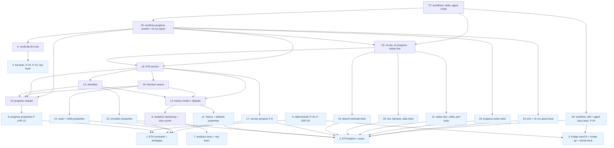

# Implementation Tasks: Run Follow-ups

**Status:** Not Started
**Spec:** [requirements.md](requirements.md) · [design.md](design.md) · [test-plan.md](test-plan.md) · [PLAN.md](PLAN.md)

**Precondition (check before any task starts).** This spec builds on specs/prompt-free-runs, which is not on this
branch yet. Before the run launches, the branch must be rebased onto master with prompt-free-runs merged, so that
`tests/guard_helpers.py` (`notify_script`, `set_notify`), `claude_kiro.notify.send`, `ck worktree park|resolve`
and `ck run --command` all exist. The orchestrator runs these checks first and does not launch if any fails:
`test -f tests/guard_helpers.py` `uv run python -c "import claude_kiro.notify"` `uv run ck worktree park --help`
`uv run ck run --help | grep -q -- --command`. Every "today's code" baseline below means this post-rebase tree.

Naming rule for every task: design.md's names (Public Interfaces, Decision Seams, Data Models) win over the names
test-plan.md's Harness Contract proposed. Each such name is spelled once, as a constant: event kinds, schemas and
other model names in `tests/eta_strategies.py` (Task 1), command and environment names in `tests/eta_helpers.py`
(Task 2), so a rename is a one-line change. The mapping:

- `ck progress start` (H-4) is `ck progress begin SPEC --kind implement|create [--mode workflow|agents] --json`,
  printing `{run, file, etaLine, estimate}`. Other events go through `ck progress event SPEC KIND ...` and the end
  through `ck progress end SPEC --outcome O`.
- Task events come from `ck worktree claim SPEC N --progress-run KEY --progress-event
  task-start|retry|escalation|revision|landfix|resolve --progress-model M --attempt K` (only on a `CLAIMED`
  outcome), landings and merges from `ck worktree land SPEC N... --progress-run KEY` (its JSON gains `eta`),
  failures from `ck plan --failed IDS`. The bridge's execCk mode records the claim and land events through the
  test hook `CK_PROGRESS_TEST_KINDS=1` on `ck progress event` (design CLI, Task 22).
- The ETA log line comes from `etaLine` (begin), the land JSON's `eta` and `ck progress event ... step-end --json`'s
  `eta`. There is no `ck eta --line`.
- `ck statusline` (H-6) is `ck status-line` and the `ck-status-line` entry point. The maintainer commands are the
  hidden `ck stats eta-defaults --out PATH [--min-runs N]` and `ck stats eta-backtest [--json]`, defined in
  `cli/eta.py` and attached to the `stats` group. `ck eta SPEC` is a plain command with no subcommands.
- `--json` keys follow `EtaView` (`ck-eta/1`), including `basis.widestMatch` (`track+model+risk`, `track+risk`,
  `track`, `all`, `bundled`, `none`), `cached`, `progressFile`, `runnableDone`, `cost.p50`, `staleSince` and
  `ended.next`. Lint entries carry `"kind": "verify-file"`.
- Test hooks the design leaves unnamed are fixed here: `CK_NOW` (clock override, Task 10), `CK_ETA_DEFAULTS`
  (bundled-defaults path override, Task 12), `CK_ETA_LINE_TIMEOUT_S` (ETA-line time budget, Task 18),
  `CK_ETA_RECHECK_S` (interval of the time-only slip check in `ck eta --watch`, Task 22, and in `ck run`'s
  watcher, Task 25; default 60).
- Review decisions D11-D18 (PLAN.md) are applied in the tasks below. D11 keeps this breakdown as it is: no task is
  merged or deferred only for size.
- Every new `tests/test_eta_*.py` and `tests/test_lint_verify_*.py` file sets
  `pytestmark = pytest.mark.usefixtures("no_network")` (also exported as `eta_strategies.NO_NETWORK`). TC-89 checks
  this statically, so each test task that creates such a file carries it as an acceptance line.

## Task Breakdown

### Task 1: Write the ETA event constants and Hypothesis strategies
**Status:** Done
**Track:** test
**Requirements:** 3.6, 5.1, 12.4
**Description:** Create `tests/eta_strategies.py`, the small test-owned module the property tasks and the P-10 task need first (test-plan Test Infrastructure item 1). It imports no project code at module level.
- **Event and model constants.** Each is spelled in exactly one place: `PROGRESS_SCHEMA = "ck-progress/1"`, `ETA_SCHEMA_RE = r"^ck-eta/\d+$"`, `DEFAULTS_SCHEMA = "ck-eta-defaults/1"`, `SIZE_KEYS = ("filesCount", "criteriaCount")`, `STALE_MIN = 120`, `MATCH_STEPS` (design order), `BUNDLED_PARTS`, `CLAIM_EVENTS` (`task-start`, `retry`, `escalation`, `revision`, `landfix`, `resolve`), `IMPLEMENT_EVENTS`, `CREATE_EVENTS` (the design's `ck-progress/1` kinds), `CREATE_PHASES` (read from `plugin/workflows/spec-create.js` `meta.phases`, not copied) and `NO_NETWORK = pytest.mark.usefixtures("no_network")`. Command and environment names live in `tests/eta_helpers.py` (Task 2), so the two harness tasks can run in parallel.
- **Strategies.** `graphs()` (reusing `landing_bridge.dags()`, extended with track, model, risk and size, plus injected back edges, self-loops, duplicated deps and dangling multi-digit ids), `events()` (progress-event sequences consistent with a graph, including parks, `hand-landing`, approval waits and `task-failed`), `times()` (minute offsets in [0, 600]) and `malformed_lines()`.
- **Small helpers.** `progress_lines(path)`, the test's own JSON-lines reader (it does not use `progress.read_events`), and `busy(n)`, which starts n CPU-bound child processes and kills them on exit.
- `tests/test_eta_strategies.py`: a smoke test that the module imports no `claude_kiro` module at import time, `CREATE_PHASES` has seven titles, and each strategy draws examples.
**Files:**
- `tests/eta_strategies.py` - name constants, Hypothesis strategies, `progress_lines`, `busy`, `NO_NETWORK`
- `tests/test_eta_strategies.py` - smoke test of the module
**Verify:** `uv run pytest -q -n auto tests/test_eta_strategies.py`
**Verifies:** None
**Acceptance:**
- [x] Every event, schema and model name appears exactly once, as a constant
- [x] Importing the module imports no `claude_kiro` module
- [x] The smoke test passes against today's code
- [x] `tests/test_eta_strategies.py` sets `pytestmark` with `no_network`
**Dependencies:** None
**Complexity:** Low
**Risk:** normal

---

### Task 2: Build the ETA CLI helpers, spec builder and collected history pools
**Status:** Done
**Track:** test
**Requirements:** 1.1, 1.2, 2.1, 3.1, 6.1, 7.1
**Description:** Create `tests/eta_helpers.py`, the harness every ETA CLI test imports (test-plan Test Infrastructure item 1). It must never import `claude_kiro.cli`. The only project modules it may import are `claude_kiro.progress` (to append setup events in tests whose boundary is the reader) and the pure seams, and only inside functions. It does not import `tests/eta_strategies.py`, so this task does not wait for Task 1.
- **Command and environment names**, each spelled once: `PROGRESS_BEGIN = ("progress", "begin")`, `PROGRESS_EVENT = ("progress", "event")`, `PROGRESS_END = ("progress", "end")`, `STATUSLINE_CMD = ("status-line",)`, `STATUSLINE_BIN = "ck-status-line"`, `DEFAULTS_CMD = ("stats", "eta-defaults")`, `BACKTEST_CMD = ("stats", "eta-backtest")`, `SLIP_KEY = "run.eta_slip_minutes"`, `PROGRESS_DIR_ENV = "CK_PROGRESS_DIR"`, `TEST_KINDS_ENV = "CK_PROGRESS_TEST_KINDS"`, `NOW_ENV = "CK_NOW"`, `DEFAULTS_ENV = "CK_ETA_DEFAULTS"`, `LINE_TIMEOUT_ENV = "CK_ETA_LINE_TIMEOUT_S"`, `RECHECK_ENV = "CK_ETA_RECHECK_S"`, `NOTIFY_TYPE_ENV = "CK_NOTIFY_TYPE"`.
- **Command wrappers.** All run the real CLI through `stats_helpers.ck_sub` with `TZ=UTC`: `eta(env, cwd, spec, *args, now=None)` and `eta_json(...)`; `begin(env, cwd, spec, kind, now=None)`, returning the parsed `{run, file, etaLine, estimate}`; `event(env, cwd, spec, kind, now=None, **flags)`; `end(env, cwd, spec, outcome, now=None)`; `claim_event(...)` and `land_event(...)`, which drive `ck worktree claim` / `ck worktree land` with `--progress-run` in a `stats_helpers.spec_repo`; `status_line(env, stdin_json)`, which runs the `ck-status-line` entry point.
- **Readers and setup.** `append_events(env, key, events)` writes setup events through `claude_kiro.progress.append`, for tests whose boundary is the reader (`ck eta`, the status line). Also `progress_file_of(env, spec)` (from `ck eta --json` `progressFile`); `notify_messages(out)`, over prompt-free-runs' `guard_helpers.notify_script(..., "ok", out)`; `typed_notify_script(bin_dir, out)`, a test-owned notify command that appends `{"message", "type"}` per call with the `CK_NOTIFY_TYPE` it ran with, and `typed_notices(out)` (TC-97, TC-101); `baseline_startup_s()`, the median of 5 timings of `ck --version`; `bare_startup_s()`, the median of 5 timings of `python -I -c "import claude_kiro"` (for the status-line timing, TC-86).
- **Spec builder.** `eta_spec(root, tasks, *, done=())` writes a real git repo whose `specs/<spec>/tasks.md` is built from `TaskDef(id, track, model, risk, files, criteria, deps, verifies, verify)`. Files and criteria go in as real `**Files:**` bullets and `**Requirements:**` ids, so `ck plan --json` and the size count read the same file. Invented names only (`demo`, `ledger`, `orbit`).
- **History pools.** Each pool is built by the real collector (`FakeClaudeHome`, `FakeSession.implement_run` / `create_run`, then `ck stats collect --all`) once per xdist worker in a session-scoped fixture, and copied into each test's `XDG_DATA_HOME` with `copytree`. `POOL_IMPL`: 48 runs, durations rising with size, about 15% of tasks with retries and 5% with escalations, half the runs with review/landing waits, each project with a matching tasks.md. `POOL_IMPL_NOWAIT`: a copy holding only the `POOL_IMPL` runs with no waits (TC-2). `POOL_CREATE`: 10 runs over the seven real phases, totalling 58-96 min, 3 with a second consistency pass and 2 with untimed agents. `POOL_COSTLESS`: 10 runs with no usage. `POOL_SIZED_FEW`: 4 sized runs plus 40 runs whose tasks.md was deleted before collecting. `history_records(pool)` returns the stored `runs/*.json` as dicts, for the property seams.
- Also add `tests/test_eta_helpers.py`, a smoke test of the harness itself: each pool's record count and shape; `POOL_IMPL` agent minutes rising with size (Spearman > 0.5); `POOL_IMPL_NOWAIT` holding no wait; `eta_spec` output parsing under the existing `ck plan --json`; and the helpers module importing no `claude_kiro.cli`.
**Files:**
- `tests/eta_helpers.py` - CLI wrappers, setup appender, spec builder, collected history pools, timing helpers, typed notify script
- `tests/test_eta_helpers.py` - smoke tests of the harness (pools, spec builder, import hygiene)
**Verify:** `uv run pytest -q -n auto tests/test_eta_helpers.py`
**Verifies:** None
**Acceptance:**
- [x] Every command and environment name appears exactly once, as a constant
- [x] The pools are produced by running the real `ck stats collect --all` over fake Claude homes. No record JSON is hand-written
- [x] Pools are built once per xdist worker and copied per test. `-n auto` gives the same pool bytes on every worker
- [x] The harness smoke test passes against today's code (the post-rebase tree of the Precondition). It exercises only the existing collector and `ck plan`
- [x] No mocks or monkeypatching of `claude_kiro` code
- [x] Only invented spec/task/project names are used, and confidential seeds come from `stats_helpers.CONFIDENTIAL`
- [x] `tests/test_eta_helpers.py` sets `pytestmark` with `no_network`
**Dependencies:** None
**Complexity:** High
**Risk:** normal

---

### Task 3: Extend the Node test harness: execCk agents, a create op and a virtual clock
**Status:** Done
**Track:** test
**Requirements:** 3.4, 8.1, 8.2, 12.1, 12.3
**Description:** Build the test-only JS harness the Workflow tests and the deterministic P-10 need (test-plan Test Infrastructure item 2, Harness Contract H-15). The virtual clock is test infrastructure: nothing in `plugin/` or `.claude/` changes (12.3).
- **execCk** (`tests/js/fake_project.mjs`, option `execCk: {cmd, env}`), exactly as test-plan Test Infrastructure item 2 describes. The fake agent never runs the prompt's claim or land command as written (they point at `ROOT`/`WT(n)` paths the fake project never creates, and land carries `--gate --install --release`). Instead it finds the `ck ... worktree claim <spec> <n>` command in a task, retry, revise, landfix or resolve prompt (bare line or double-quoted), parses `--progress-run`, `--progress-event`, `--progress-model` and `--attempt`, and records that event with `ck progress event <spec> <kind> --run <key> --task <n> --model <m> --attempt <k>` under `CK_PROGRESS_TEST_KINDS=1`. For a land prompt it parses `--progress-run` and the task ids, and records `landing` with `merged`/`red`/`conflict`/`protected` taken from the fake project's own scripted result for that landing, plus one `merge` or `hand-landing` per task, then puts the printed `eta` into the answer. It runs `ck ... plan ... --failed` and `ck ... progress event ...` commands as written. Option `etaAnswer: 'null'|'number'|'missing'` overrides the answer's `eta`.
- **Create op.** `tests/js/fake_create.mjs` holds the `stub()` moved out of `spec_create.test.mjs` (the only change to that file is the import). `tests/js/bridge.mjs` gains `{op:'create', args, overrides, execCk}` returning `{result, logs, trace, prompts}`.
- **Virtual clock.** `tests/js/virtual_clock.mjs` exports `VirtualClock` with `now()`, `sleep(ms)` and `drive(promise)`. Pending timers sit in a heap ordered by `(due time, creation sequence)`; `drive` advances virtual time only after every pending microtask has drained and fires the earliest timer, so timer order depends only on simulated times. No real `setTimeout` is used for virtual sleeps. Wire it in: `tests/js/load_workflow.mjs` `runWorkflow(script, {agent, args, slots, clock})` (trace `t` is `clock.now()` with a clock; real timers exactly as today without one); `tests/js/fake_project.mjs` `project({..., sleep})` (default the real sleep); `tests/js/bridge.mjs` `{op:'run', ..., clock:'virtual'|'real', execCk}`.
- `tests/landing_bridge.py`: `Bridge.run(project, args, slots, clock=None, exec_ck=None)` and `Bridge.create(args, overrides=None, exec_ck=None)`.
- `tests/test_bridge_harness.py` holds the harness self-tests: execCk in a dry mode returns the `ck progress event` argv it would run for a sample claim prompt (bare and quoted forms, with and without progress flags) and a land prompt, with the landing sets from the scripted result; execCk runs a backticked `ck --version` for real; the create op runs spec-create.js to completion; `sleep(5)` then `sleep(2)` resolve in due-time order, two timers due together fire in creation order, and `now()` advances exactly.
**Files:**
- `tests/js/fake_project.mjs` - `execCk` (flag parsing and event recording), `etaAnswer`, injected `sleep`
- `tests/js/fake_create.mjs` - shared spec-create stub agent
- `tests/js/spec_create.test.mjs` - import the stub from `fake_create.mjs` (import-only change)
- `tests/js/virtual_clock.mjs` - new: `VirtualClock` (test harness helper named in design.md)
- `tests/js/load_workflow.mjs` - optional `clock` option
- `tests/js/bridge.mjs` - `execCk`, `clock`, `create` op
- `tests/landing_bridge.py` - `clock` and `exec_ck` parameters, `create()`
- `tests/test_bridge_harness.py` - harness self-tests
**Verify:** `uv run pytest -q tests/test_bridge_harness.py` `node tests/js/spec_create.test.mjs` `node tests/js/spec_implement.test.mjs` `node tests/js/landing_speed.test.mjs` `node tests/js/finish_first.test.mjs`
**Verifies:** None
**Acceptance:**
- [x] The existing JS suites and `tests/test_landing_scheduler_properties.py` pass unchanged
- [x] No file under `plugin/workflows/` or `.claude/workflows/` is touched
- [x] `execCk` runs the real CLI as a subprocess, and the landing sets it records come from the fake project's own result. Agents are the only fakes
- [x] `sleep(ms)` resolves exactly at `now() + ms` virtual time, in (due, creation) order, and virtual time advances only after pending microtasks drain
- [x] Without a `clock`, the bridge and the JS suites run on real timers exactly as today
- [x] Harness self-tests pass against today's workflow scripts
**Dependencies:** None
**Complexity:** Medium
**Risk:** normal

---

### Task 4: Test the Verify-file cycle lint (CLI cases, properties, red-team)
**Status:** Not Started
**Track:** test
**Requirements:** 13.1, 13.2, 13.3, 13.4, 13.5, 13.6, 13.7, 13.8, 13.9, 13.10
**Description:** Implement TC-77 through TC-84, TC-99 and TC-100, properties P-20 through P-23 and P-27, and red-team cases for the SHALL NOT clauses 13.4 and 13.5. Reuse `ck`, `block` and `write_spec` from `tests/test_lint.py`.
- **TC-77.** X=8 impl with Verify `uv run pytest -q tests/test_perf.py`, T=9 test owning `tests/test_perf.py` and verifying 13, and 13 depending on 8. `ck lint sim` exits 1 and names 8, the file, 9, 13, the chain `13 -> 8` and the narrowing suggestion. Repeat via Y's `**Verified by:**`, and with chain `13 -> 11 -> 8`. The file need not exist.
- **TC-78 (CLI and bridge part).** `ck plan sim --json` `verifyCycles` holds `kind: "verify-file", task: "8"`, and 8 is not in `ready`. The existing bridge `run` op with `verifyCyclesFromStart` and the entry from `ck plan` logs `Refusing to launch` and starts no task agent. The skill and agent-mode document text for 13.3 (including the single-task refusal) is checked in Task 26.
- **TC-79.** Negatives. **TC-80.** X Done. **TC-81.** The surface-form table, with the narrowed forms (`F::test_a`, `F::C::test_b`, `-k slow`, `-kslow`) giving no entry unless another command names F bare (D12 changed these rows from "matched"). **TC-82.** Cycles and an unknown task: no traceback, and every error is still reported.
- **TC-83.** JSON keys `kind, task, file, testTask, needs, chain, message`. The `market` fixture's import entry stays exactly `{task, verifiedBy, needs, module, message}`.
- **TC-84 (rewritten for D12).** Copy every real `specs/*/tasks.md` into a temp project with the same paths, reset every `**Status:**` to `Not Started`, and assert no `verify-file` entry for any copy, naming landing-speed tasks 9 and 17 in the assertion. Add the fixture `tests/fixtures/lint/agent-mode-analytics-pre-fix/tasks.md`, a byte copy of `git show 74b7a7d^:specs/agent-mode-analytics/tasks.md`. With statuses reset it is the only copy that fails: every entry has X=8, Y=13, F=`tests/test_stats_perf.py`, T in {9, 10}, and there is exactly one distinct (X, Y) pair (requirements NFR Lint precision).
- **TC-99.** The exemptions: T also verifies X (via T's Verifies, and via X's Verified by) gives no entry while a second owner verifying only Y still gives one; a Verify narrowed by `::` or `-k` gives no entry, and an extra bare command naming F brings it back; the task 8 shape (X Verified by: None, bare F) still fails.
- **TC-100.** The prompt-free-runs 11/3/15 import-plus-ownership shape with invented names: with T's test file absent, `ck lint` exits 0 with no entry (the documented launch gap); with the file present and importing Y's module through an unowned helper, exactly one import-based entry (11 needs 15), no `verify-file` entry, exit 1, and `ck plan --json` keeps 11 out of `ready`.
- **Properties (separate file).** Generators write real tasks.md files in a temp dir, and the tests call `claude_kiro.lint.lint_spec(spec_dir, project_dir)` and filter `kind == "verify-file"`: P-20 (brute-force oracle, with the 13.9/13.10 exemptions), P-21 (surface forms, narrowed forms and negatives), P-22 (marking X Done removes exactly X's entries), P-23 (cycles, self-loops and dangling ids never raise), P-27 (adding T-verifies-X or narrowing F removes exactly the matching entries; a bare command restores them).
- **Red-team 13.4 / 13.5 (separate file).** Try to break each clause with adversarial inputs; every break becomes a test. Starting ideas: F in a test task's Files with different case, a trailing space or backticks; F named in X's Description but not its Verify; F inside a quoted `-k "tests/test_perf.py"` expression; `tests/test_perf.py.orig`; a Status of `Done (merged)`, `done` or `Done ✓`; Y depending on X only through a Done task; X in this repository's real Done tasks. Each case that needs the new rule to be meaningful pairs with a positive control.
**Files:**
- `tests/test_lint_verify_files.py` - TC-77..TC-84, TC-99, TC-100
- `tests/test_lint_verify_properties.py` - P-20..P-23, P-27, with a `PROPERTIES` map
- `tests/test_lint_verify_redteam.py` - adversarial cases for 13.4, 13.5
- `tests/fixtures/lint/agent-mode-analytics-pre-fix/tasks.md` - byte copy of the pre-fix tasks.md
**Verify:** `uv run pytest -q -n auto tests/test_lint_verify_files.py tests/test_lint_verify_properties.py tests/test_lint_verify_redteam.py tests/test_lint.py`
**Properties:** P-20, P-21, P-22, P-23, P-27
**Verifies:** Task 5 (the verify-file lint rule and its CLI output)
**Acceptance:**
- [ ] Tests exercise the real `ck lint` / `ck plan` click entry points over real tasks.md files and this repository's real specs
- [ ] Before implementation the positive cases fail because no `verify-file` entry is reported, not because of fixture errors. `tests/test_lint.py` stays green, and the red-team false-positive guards pass before and after. TC-100 passes before and after (a regression guard for the existing import check)
- [ ] No mocks of project code
- [ ] P-20..P-23 and P-27 generators cover every surface form, narrowed form, exemption and near-miss negative in the rows. Settings are `derandomize=True, max_examples=200, database=None, deadline=None`
- [ ] Each of 13.4 and 13.5 has at least three red-team cases
- [ ] Every new `test_lint_verify_*.py` file sets `pytestmark` with `no_network`
**Dependencies:** None
**Complexity:** Medium
**Risk:** normal

---

### Task 5: Add the Verify-file cycle check to `ck lint`
**Status:** Not Started
**Track:** impl
**Requirements:** 13.1, 13.2, 13.3, 13.4, 13.5, 13.6, 13.7, 13.8, 13.9, 13.10
**Description:** Add two pure functions to `src/claude_kiro/lint.py` (design seams S13 and S14). This task owns Harness Contract H-10's `lint_spec` entries. `verify_paths(command, config)` tokenises one Verify command with `shlex.split` (falling back to `str.split` on a parse error), cuts any `::selector`, strips a leading `./`, and keeps a token only when `is_test_path(token, config)` holds, it has no glob character (`*?[`) and it does not end in `/`. It returns `(path, narrowed)` pairs: `narrowed` is True when the token carried a `::` selector or the command holds a `-k` option (`-k EXPR`, `-kEXPR`, `-k=EXPR`) (13.10, D12). `verify_file_cycles(tasks, config)` loops over impl tasks X that are not Done, each path F from `verify_paths` over X's `verify` commands that has at least one un-narrowed occurrence (13.10), each test task T whose `files` contain F and that does not also verify X (skip when `X in T.verifies` or `T in X.verified_by`, 13.9), and each impl task Y that T verifies (`Y in T.verifies` or `T in Y.verified_by`). It reports an entry when Y != X and X is an ancestor of Y. The chain is the shortest dependency path Y -> ... -> X (BFS over `dependencies`, with a seen-set, skipping unknown ids), so cycles never raise. Each entry is `{"kind": "verify-file", "task": X, "file": F, "testTask": T, "needs": Y, "chain": [Y, ..., X], "message": ...}`, with the message text from the design's Lint entry section, including the suggestion to narrow X's Verify. In `lint_spec`, append these entries to `verifyCycles` after the import-based entries. Run the new check even when the graph has a dependency cycle; the import-based check stays skipped in that case, as today. Existing import-based entries keep their exact keys and get no `kind`. In `cli/worktree.py` `lint`, print the new entries as `✗ verify-file cycle: <message>` and change the success line to `✓ no verify-order cycles found (checked Python imports of existing test files and Verify test files owned by test tasks)`. `--json` keeps its shape. Exit 1 follows from a non-empty `verifyCycles`, and `ck plan` already puts `verifyCycles` tasks in `blocked`, so the workflow's start refusal needs no new wiring. The skill text for 13.3 is in Task 27.
**Files:**
- `src/claude_kiro/lint.py` - add `verify_paths`, `verify_file_cycles`; append their entries in `lint_spec`, also when cycles exist
- `src/claude_kiro/cli/worktree.py` - `lint` text output for `verify-file` entries and the new success line
**Verify:** `uv run pytest -q -n auto tests/test_lint_verify_files.py tests/test_lint_verify_properties.py tests/test_lint_verify_redteam.py tests/test_lint.py`
**Verified by:** Task 4 (TC-77..TC-84, TC-99, TC-100, P-20..P-23, P-27, red-team 13.4, 13.5)
**Acceptance:**
- [ ] An impl task X whose Verify names F, where F is in the Files of test task T, T verifies Y, and Y depends on X (directly or transitively), gives one `verify-file` entry naming X, F, T, Y and the chain Y -> ... -> X, and `ck lint` exits 1
- [ ] T verifies Y via either T's `**Verifies:**` or Y's `**Verified by:**`
- [ ] No entry when F is in no test task's Files, when no Y verified by T depends on X, or when X is Done
- [ ] No entry for a T that also verifies X (either form), and none when every occurrence of F in X's Verify is narrowed by `::` or `-k`; a bare occurrence in any command still reports it
- [ ] F matches when written as `./F` or inside a longer command with flags and several files; globs and directory arguments are not matched
- [ ] A tasks.md with a dependency cycle or an unknown task id reports the existing cycle/unknown errors and does not crash
- [ ] `ck lint --json` lists the new entries in `verifyCycles` beside unchanged import-based entries (no `kind` on those)
- [ ] On copies of every spec in this repository with statuses reset to Not Started, `ck lint` reports no new verify-file entry (landing-speed tasks 9 and 17 included); the pre-fix agent-mode-analytics tasks.md reports exactly one (X, Y) pair (task 8, needs 13)
**Dependencies:** Task 4 (its tests are the oracle)
**Complexity:** Medium
**Risk:** normal

---

### Task 6: Make P-10 deterministic on the virtual clock
**Status:** Not Started
**Track:** test
**Requirements:** 12.1, 12.2, 12.3, 12.4
**Description:** Story 12 is a test-only change: the fix is this rewrite, on the virtual clock Task 3 adds to the harness. Implement TC-73 through TC-76, properties P-25 and P-26, and red-team cases for 12.3.
- **TC-73.** `bridge.run(..., clock="virtual")` for one task (duration 5, review 0, merge 2) gives `end.t - start.t == 5` exactly. Two runs give identical traces including `t`.
- **TC-74 / P-26.** Rewrite `test_p10_finish_first_changes_nothing_when_nothing_queues` in `tests/test_landing_scheduler_properties.py`. It runs once on and once off per configuration (agentSlots in {1000, None}, no runtime slots) on the virtual clock, and asserts `events(on) == events(off)` and `on.result == off.result` exactly. Then switch the file's other bridge properties to `clock="virtual"`; add `"P-26": "test_p10_finish_first_changes_nothing_when_nothing_queues"` to that file's existing `PROPERTIES` map, keeping the landing-speed `P-10` key; add a source check (`inspect.getsource`): exactly two `run(` calls and no loop.
- **TC-75.** Neither `plugin/workflows/*.js` nor `.claude/workflows/*.js` contains the code tokens `VirtualClock`, `clock.now(`, `clock:`, `setTimeout(` or `performance.now(`. Prose already in the scripts ("no clock and no I/O", "clocks, randomness") is allowed. The real-timer JS suites pass unchanged.
- **TC-76.** Under `busy(os.cpu_count())`, 20 scenarios on the virtual clock give traces identical to the idle recording. The opt-in stress `CK_STRESS_P10=1` runs 50 suite runs, all green.
- **P-25.** For any `scenarios()`, two virtual-clock runs give identical traces, and each agent's `end.t - start.t` equals its scripted duration. It lives in `tests/test_scheduler_virtual_clock.py` with its own `PROPERTIES` map.
- **Red-team 12.3.** Try to show the clock option leaking into real runs: run real-timer scenarios through the bridge with `clock` absent and with `clock: undefined` and check timing order equals today's; check the shipped scripts' exported behaviour is identical with and without the harness loaded. At least three cases.
**Files:**
- `tests/test_scheduler_virtual_clock.py` - TC-73, TC-75 (static part), TC-76, P-25 with `PROPERTIES = {"P-25": ...}`
- `tests/test_landing_scheduler_properties.py` - P-10 rewritten (TC-74), virtual clock for the bridge properties, `"P-26"` added to `PROPERTIES`
- `tests/test_scheduler_clock_redteam.py` - adversarial cases for 12.3
**Verify:** `uv run pytest -q -n auto tests/test_landing_scheduler_properties.py tests/test_scheduler_virtual_clock.py tests/test_scheduler_clock_redteam.py` `uv run pytest -q tests/test_workflow_scripts.py`
**Properties:** P-25, P-26
**Verifies:** None
**Acceptance:**
- [ ] Tests exercise the real `plugin/workflows/spec-implement.js` through the bridge. Only the clock and agents are test doubles, and both are test-owned
- [ ] The rewritten P-10 is at least as strong as today's (exact equality of events and result) and has no re-run loop
- [ ] The P-25/P-26 generators are the existing `scenarios()` with `SETTINGS` (deterministic)
- [ ] TC-75 passes on today's scripts and fails if a clock code token leaks into them
- [ ] TC-76's default part runs in seconds. The 50-run stress is opt-in
**Dependencies:** Task 1 (`busy`), Task 3 (the virtual clock in the bridge)
**Complexity:** Medium
**Risk:** normal

---

### Task 7: Test agent-mode analytics hardening (backfill guard, outcome entry, collect errors, sweep failure, red-team)
**Status:** Done
**Track:** test
**Requirements:** 9.1, 9.2, 9.3, 9.4, 10.1, 10.2, 10.3, 11.1, 11.2, 11.3, 11.4
**Description:** Implement TC-62 through TC-72 and red-team cases for 9.1, 9.3 and 10.1, with the existing `stats_helpers` and the helpers of `test_stats_agents_backfill.py` / `test_stats_agents_collect.py`: `backfill_home`, `unreadable`, `needs_user`, `begin`, `backdate_manifest`.
- **TC-62.** An unreadable store (`runs/` chmod 000, `runs` as a regular file, or the data directory itself chmod 000 so `runs/` cannot be stat'ed) makes `ck stats collect --agents-backfill` exit 1 with `cannot check backfill overlaps: record store <path> unreadable`. Store bytes are identical afterwards.
- **TC-63.** `--dry-run` (text and `--json`) lists the groups and gives `overlaps not checked` / `"overlapCheck": "unavailable"`, exit 1.
- **TC-64.** One malformed record (invalid JSON, a list, wrong schema, empty, truncated) makes backfill exit 1 naming the file (`malformed record <file>`, JSON `malformedRecords`), with store bytes unchanged; `--dry-run` lists the groups with `overlaps not checked`, exit 1. The same scenario without the malformed file exits 0 as today.
- **TC-65.** A missing or chmod-000 session transcript gives `outcome: null` and `{"agentId": null, "what": "outcome"}` in `missing`.
- **TC-66.** `collect --agents <id> --json` in a sandbox (`projects/` chmod 000) prints exactly one JSON line, `{"run_id", "result": "failed", "error" containing "sandbox"}`, exit 1.
- **TC-67.** `--auto` with `bogus` and with unknown `ag_0a1b2c3d` appends exactly one collect.log line naming the id and reason, prints the retry hint, exit 0. Add an id with newlines and 200 characters: the log line is a single line with the id cut to 64 characters.
- **TC-68.** A malformed id without `--auto` exits 1, as text and as JSON.
- **TC-69.** `runs-open` unlistable during `--all`: `open-manifests` appears in the text and in `failures`, `failed >= 1`, `collected == 1`, exit 1.
- **TC-70.** Regression guard: by-source writer.
- **TC-71.** Create `tests/openaudit/sitecustomize.py`: an audit hook that logs `open` of `agent-*.jsonl` when `CK_TEST_OPEN_LOG` is set. Each transcript's open count under `ck stats collect --agents <id>` equals its count in the equivalent workflow collect. This fails today.
- **TC-72.** Byte-identical records across fresh stores, `unchanged` on re-collect, and the existing stats/doctor suites unchanged.
- **Red-team 9.1, 9.3, 10.1 (separate file).** Starting ideas: `runs/` readable but not executable (chmod 0400); `runs/` a dangling symlink, or a symlink to a file; `XDG_DATA_HOME` itself unreadable; a record file that is a directory, a FIFO (with a test-level timeout) or unreadable; a store that becomes unreadable between plan and write; `CK_DATA_HOME` pointing at `/dev/null`; `--json` combined with `--dry-run`, with `--auto`, or with a malformed id; a sandbox where only one agent transcript is unreadable; stdout must parse as exactly one JSON object. Store bytes are compared before and after every case.
**Files:**
- `tests/test_stats_followups.py` - TC-62..TC-72
- `tests/test_stats_followups_redteam.py` - adversarial cases for 9.1, 9.3, 10.1
- `tests/openaudit/sitecustomize.py` - open-event audit hook (test-only)
**Verify:** `uv run pytest -q -n auto tests/test_stats_followups.py tests/test_stats_followups_redteam.py` `uv run pytest -q -n auto tests/test_stats_*.py tests/test_stats_doctor.py tests/test_doctor_xdist.py`
**Verifies:** Task 8 (analytics hardening)
**Acceptance:**
- [x] Tests exercise the real `ck stats collect` subprocess, real permissions, a real store and real collect.log bytes
- [x] Before the fix, TC-62, TC-63, TC-64, TC-65, TC-66, TC-67 (log line), TC-69 and TC-71 fail for the missing behaviour. TC-70 and TC-72 pass before and after, as regression guards
- [x] No mocks or monkeypatching of project code. The audit hook only observes
- [x] Each red-team clause has at least three cases. Permission cases skip as root
**Dependencies:** None
**Complexity:** Medium
**Risk:** normal

**Implementation notes:** TC-68 asserts a non-zero exit (1 or 2) for a malformed id without `--auto`: requirement 10.3 says exit 1 "as today", but today the exit is 2 and `test_stats_agents_collect.py::test_tc23` pins 2 for the text form. TC-67 for the unknown id `ag_0a1b2c3d` already passes today (a log line exists); the bogus-id and 200-character cases fail first. The FIFO red-team case fails today by hanging (30 s timeout).

---

### Task 8: Harden agent-mode analytics and store task size counts in local records
**Status:** Not Started
**Track:** impl
**Requirements:** 6.1, 6.2, 9.1, 9.2, 9.3, 9.4, 10.1, 10.2, 10.3, 11.1, 11.2, 11.3, 11.4
**Description:** The D7 fixes from the agent-mode-analytics review plus the D4 size inputs, in one change set because they share `analytics/collect.py`, `agentcollect.py` and `cli/stats.py`. This task owns Harness Contract H-12.
(a) `hooks/_shared/spec_parser.py`: add `requirements: List[str]` to `SpecTask`, filled from the task's `**Requirements:**` line: the criterion ids (for example `1.2`, `13.6`), deduplicated in order; `[]` when absent.
(b) `analytics/collect.py` `_build_record`: for implement records (workflow and agent mode), read `<root>/specs/<spec>/tasks.md` once when it is readable (through `parse_tasks`) and add `filesCount = len(task.files)` and `criteriaCount = len(task.requirements)` to each `tasks[]` entry, or `null` for both when the task is not in tasks.md or tasks.md is unreadable. These are local fields only: check that `share.build_shareable` copies task fields one by one and does not pick them up, and do not edit share.py. tasks.md counts as an input (11.4): records collected before this change become `updated` on re-collect once. `_Agent` gains `span: Optional[Tuple[Optional[int], Optional[int]]] = None`; `_build_agent` uses it when set instead of calling `_timestamps` again. Add pure `writer_for(record) -> "agents" | "workflow"` (S16).
(c) `analytics/store.py`: add `StoreRead(records, malformed, error)` and `load_records_checked(env=None)`. It first calls `os.stat(runs_dir)`: `FileNotFoundError` means an empty store with no error; any other `OSError` sets `error`. It never uses `Path.is_dir()`. It then lists `runs/` with `os.scandir`, so a listing failure also becomes `error = "<path>: <OSError text>"`. Unreadable, non-object or schema-less record files go into `malformed` (file names). Existing `load_records*` stay unchanged.
(d) `analytics/backfill.py`: add `GuardDecision(write, exit_code, note)` and pure `overlap_guard(store_error, malformed, dry_run)` (S15). No error and no malformed file: write allowed, exit unchanged. Otherwise, without dry run: no write, exit 1, message `cannot check backfill overlaps: <cause>; nothing written`, where the cause is the store error or `malformed record <file>`. With dry run: list groups, exit 1, note `overlaps not checked: <cause>`.
(e) `analytics/agentcollect.py`: `_existing_backfill(env)` returns `ExistingBackfill(pairs, malformed, error)` built on `load_records_checked`; it never returns `[]` on a read failure. `plan_backfill` stores `overlap_check` (`"ok" | "unavailable"`), `store_error` and `malformed_records` on `BackfillPlan`; a store error or any malformed file gives `"unavailable"`, keeping every group and checking no overlaps. `_collect_group` appends `{"agentId": None, "what": "outcome"}` to `missing` when the group's session transcript is missing or unreadable and no `outcome` entry exists yet. `collect_agent_run` reads `collect._timestamps` once per transcript into a dict, sorts agents by the first timestamp, and passes the pair as `_Agent.span`.
(f) `analytics/agentrun.py`: add pure `auto_id_log_line(raw_id, reason, now_iso)` (S17): `<now_iso> <id> invalid_id: <reason>`, with the id cut to 64 characters and characters outside `[A-Za-z0-9_.:-]` replaced by `?`.
(g) `cli/stats.py`: `collect --agents <id> --json` inside the sandbox prints exactly one line `{"run_id": id, "result": "failed", "error": "sandboxed: ck stats collect must run outside the sandbox: <home> is not readable here"}` and exits 1. With `--auto`, an id refused by `decide_collect_args` (exit 0 path) appends `auto_id_log_line(...)` to collect.log before printing the existing retry hint, exit 0. The non-auto malformed id path is unchanged. `_collect_backfill` applies `overlap_guard`: on refusal print `❌ cannot check backfill overlaps: <cause>; nothing written` (JSON: `{"error": ..., "results": [], "collected": 0, "malformedRecords": [...], ...}`), exit 1. Dry run with an unreadable store or malformed file lists the groups, then `⚠ overlaps not checked: <cause>`, JSON `"overlapCheck": "unavailable"`, exit 1. Backfill JSON always carries `overlapCheck`. `_collect_all` wraps `collect_open_manifests`: an exception becomes the failure `("open-manifests", "open-manifest sweep failed: <Type>: <msg>")`, counted as failed (exit 1), and workflow-run outcomes are still reported. Pick the writer with `collect.writer_for(o.record)`, not `run_id.startswith("ag_")`.
Every other `collect`, `--all`, `--agents`, backfill and doctor output stays the same, and records stay byte-identical for the same inputs (tasks.md included). The size counts' CLI-visible effect (present locally, absent from exports) is also checked through `ck eta` in Task 19 (TC-12, TC-13, red-team 6.2).
**Files:**
- `src/claude_kiro/hooks/_shared/spec_parser.py` - `SpecTask.requirements` from `**Requirements:**`
- `src/claude_kiro/analytics/collect.py` - `filesCount` / `criteriaCount` on implement task entries, `_Agent.span`, `_build_agent` uses it, `writer_for`
- `src/claude_kiro/analytics/store.py` - `StoreRead`, `load_records_checked` (stat, then scandir)
- `src/claude_kiro/analytics/backfill.py` - `GuardDecision`, `overlap_guard`
- `src/claude_kiro/analytics/agentcollect.py` - `ExistingBackfill`, `_existing_backfill`, `plan_backfill` overlap fields, `_collect_group` outcome missing entry, one timestamp read per transcript
- `src/claude_kiro/analytics/agentrun.py` - `auto_id_log_line`
- `src/claude_kiro/cli/stats.py` - sandbox JSON failure, `--auto` invalid-id log line, `_collect_backfill` guard, `_collect_all` sweep failure and writer by source
**Verify:** `uv run python -c "from claude_kiro.hooks._shared.spec_parser import SpecTask; assert SpecTask('1','t').requirements == []"` `uv run pytest -q -n auto tests/test_stats_followups.py tests/test_stats_followups_redteam.py` `uv run pytest -q -n auto tests/test_stats_*.py tests/test_stats_doctor.py tests/test_doctor_xdist.py`
**Verified by:** Task 7 (TC-62..TC-72, red-team 9.1, 9.3, 10.1)
**Acceptance:**
- [ ] `SpecTask.requirements` holds the criterion ids from `**Requirements:**`, deduplicated, in order
- [ ] A local implement record collected from a run whose spec has tasks.md carries `filesCount` and `criteriaCount` per task; a task missing from tasks.md, or an unreadable tasks.md, gives `null` for both; shareable records contain neither field
- [ ] Backfill against an unreadable store (including an untraversable data directory) writes no record, names the store and the error, exits non-zero
- [ ] Backfill with a malformed record file writes no record, names the file, exits non-zero; `--dry-run` lists the groups with `overlaps not checked`, exits non-zero
- [ ] A backfill group with a missing or unreadable session transcript is written with `outcome: null` and an `outcome` entry in `missing`
- [ ] `collect --agents <id> --json` in the sandbox prints one JSON object with `run_id`, `result: "failed"` and a sandbox error, exit 1, no plain text
- [ ] `collect --agents <bad id> --auto` appends one collect.log line naming the id and reason, prints the retry hint, exits 0; without `--auto` it errors with exit 1 as today
- [ ] `collect --all` with a failing open-manifest sweep reports the failure, counts it, exits 1, and still reports every workflow-run outcome; it chooses the writer from the record's `source`
- [ ] Each agent transcript is opened as often in agent-mode collection as in workflow collection
- [ ] Existing stats, backfill and doctor tests pass unchanged and records are byte-identical for unchanged inputs
**Dependencies:** Task 7 (its tests are the oracle)
**Complexity:** High
**Risk:** safety (adds record fields that must never reach exported or shared records sent off the machine)

---

### Task 9: Write the progress-file properties (reader and line builder)
**Status:** Done
**Track:** test
**Requirements:** 3.6, 3.8
**Description:** Write properties P-14 and P-15 over the pure progress seams, so they run as soon as `claude_kiro.progress` exists.
- **P-14.** `claude_kiro.progress.read_events(path)` returns exactly the valid known events in file order, for valid events (from `eta_strategies.events()`) interleaved with malformed lines (`eta_strategies.malformed_lines()`: every truncation cut point, non-object JSON, unknown kinds, missing kind, NUL/invalid UTF-8, empty, CRLF, very long). The skipped count equals the number of malformed lines.
- **P-15.** For any design event kind and an event mapping mixing allowed fields with extra keys (`prompt`, `transcript`, `contents`, `diff`, random keys) holding `CONFIDENTIAL` values, paths or multi-line text, the line `progress.append` writes (in a temp `CK_PROGRESS_DIR`) holds none of the extra values and only that kind's typed fields.

Settings `derandomize=True, max_examples=200, database=None, deadline=None`. Declare `PROPERTIES = {"P-14": ..., "P-15": ...}`.
**Files:**
- `tests/test_eta_progress_properties.py` - P-14, P-15, with a `PROPERTIES` map
**Verify:** `uv run pytest -q -n auto tests/test_eta_progress_properties.py`
**Properties:** P-14, P-15
**Verifies:** Task 10 (`read_events`, `append`)
**Acceptance:**
- [x] Generators cover every malformed-line form and every extra-key form listed in the test-plan rows
- [x] Settings are deterministic, and the tests call `read_events` / `append` directly, not a CLI or server
- [x] Before implementation they fail at import of `claude_kiro.progress` (missing behaviour)
- [x] No mocks of project code
- [x] The file sets `pytestmark` with `no_network`
**Dependencies:** Task 1 (event and malformed-line strategies, kind constants)
**Complexity:** Medium
**Risk:** normal

---

### Task 10: Add the run progress file module
**Status:** Done
**Track:** impl
**Requirements:** 3.5, 3.6, 3.7, 3.8, 3.9, 3.10, 5.4
**Description:** Create `src/claude_kiro/progress.py`, the single owner of the `ck-progress/1` file (design Data Models). This task owns Harness Contract H-1's clock override and H-10's `read_events` / `append` seams. Functions: `progress_dir(env)` (`CK_PROGRESS_DIR` when set, else `store.data_dir()/"progress"`, created with `store._mkdir_private`, mode 0700); `clock_now(env)`, which returns `CK_NOW` parsed as ISO-8601 UTC when set, else the current UTC time, and is the one place every ETA command, the worktree progress hooks and the status line read "now"; `new_run_key(spec, now, token=None)` -> `"<spec>--20261030T150205Z-3f9a1c"`; `run_file(key, env)` -> `<progress_dir>/<key>.jsonl`; `append(key, event, env)`. `append` keeps only the typed fields of the event's kind, adds `schema` and `at` when missing, serialises one line of at most 4 KiB, opens with `O_APPEND|O_CREAT` and mode 0o600 (then `chmod`), takes `fcntl.flock(LOCK_EX)` and writes with one `os.write`. It never raises: on `OSError`/`ValueError` it returns the error text and best-effort appends `<iso> <kind> <error class>: <message <= 200>` to `<key>.errors`. Also add: `read_events(path) -> (events, skipped)`; the frozen dataclasses `TaskProgress` and `RunState` exactly as in the design (including `waits` and `last_event_min`); pure `fold(events) -> RunState`, which tracks task status (pending/running/merged/failed/parked/hand), the last claim step, model and attempt, first/last start minutes, phases done/running, approval waits (an `approval-start`/`approval-end` pair, or a `hand-landing` that opens wait `hand-<task>` closed by that task's `merge` or by `end`, 5.4), `waited_min` with overlapping waits merged, `last_event`, `cause`, `ended`, `sent` notices (from both `notified` and `notify-pending` events, so a queued notice is never queued twice) and `skipped`; the `start` event's typed fields include `spool: bool` (D14); pure `effective_min(waits, t)` (wall minute minus wait minutes before it, for S12 and the simulator); pure `is_stale(last_event_at, now)` (no end and last event more than `STALE_MIN = 120` minutes ago, 3.10); `active_run(spec, root, env, *, now)`, the newest run of the spec with no `end` event; `runs_for_project(root, env, *, now)`, start event `root` equal to root, no end, not stale; `mergeable(line, seen_hashes)` (S20); `notice_lock(key, env)`, a context manager holding `flock(LOCK_EX)` on `<progress_dir>/<key>.lock` (0600) for the fold-decide-send-append sequence (D14); and `mirror(spool, target, *, send)`. `mirror` appends spool lines not yet mirrored (keyed by line hash) to the real progress file (0600), copies `<key>.model.json` and the latest `<key>.eta.json` sidecars when their bytes changed, sends each `notify-pending` exactly once through `send(message, notification_type)` with the type mapped from its `notice` (`slip` -> `ck_eta_slip`, `blocked` -> `ck_eta_blocked`, `done` -> `ck_run_done`, 8.11) and appends a `notified` event with the outcome, and returns the count. A new key per run means a second run of a spec gets a new file and the old one stays; nothing deletes progress files outside the spool. Stdlib only, and no click import, so the status line can use it.
**Files:**
- `src/claude_kiro/progress.py` - new: paths, clock override, run keys, locked append, error sidecar, tolerant reader, `fold`, `effective_min`, `is_stale`, `active_run`, `runs_for_project`, `mergeable`, `notice_lock`, `mirror`
**Verify:** `uv run pytest -q -n auto tests/test_eta_progress_properties.py` `uv run python -c "from claude_kiro import progress; s = progress.fold([]); assert s.tasks == {} and s.skipped == 0 and progress.effective_min((), 5.0) == 5.0"`
**Verified by:** Task 9 (P-14, P-15)
**Acceptance:**
- [x] Concurrent appends from several processes leave every line whole and none lost
- [x] `read_events` skips malformed and unknown lines, counts them, and returns the rest
- [x] `append` returns an error string (and never raises) when the directory is unwritable, and records the failure in `<key>.errors`
- [x] `append` writes only the typed fields of the event's kind
- [x] The progress directory is 0700 and files are 0600 when ck creates them; the default location is under ck's data dir, outside the repository
- [x] `fold` gives the task, phase, approval-wait (questions and hand landings) and ended state for a sequence of the design's event kinds; overlapping waits are counted once in `waited_min`
- [x] `is_stale` is true only after 120 minutes with no event and no end; `runs_for_project` leaves stale and ended runs out
- [x] `mirror` copies each spool line once, copies the model and cache sidecars, and sends each pending notice exactly once, with its notification type
- [x] `fold` counts `notify-pending` as well as `notified` events in `sent`
- [x] `clock_now` returns `CK_NOW` when set
**Dependencies:** Task 9 (its tests are the oracle)
**Complexity:** Medium
**Risk:** safety (`mirror` sends deferred notifications through the user's notify command exactly once)

---

### Task 11: Write the history and bundled-defaults properties
**Status:** Done
**Track:** test
**Requirements:** 1.3, 6.5, 6.6, 7.2, 7.3, 7.5
**Description:** Write properties P-9, P-11 and P-19 over the pure seams of `claude_kiro.eta.history`, so they run as soon as the history module exists.
- **P-9.** For any history where durations rise with size (subsets of `history_records(POOL_IMPL)` with at least the minimum sized tasks) and any two task sizes a < b with equal track/model/risk: `size_factor(fit, a, ...) <= size_factor(fit, b, ...)` for the `fit_size` result of `fit_model`, and a task with size 0 gets a factor > 0. Size pairs include (0,0), (0,1), (1,20) and equal sizes.
- **P-11.** Metamorphic: for nested subsets H' ⊂ H of `POOL_IMPL` records, `match_pool(fit_model(H', defaults), ...)` never names a narrower step than `match_pool(fit_model(H, defaults), ...)`, and `bundledParts` only grows. Include records with `riskTag: null`, track `unknown` and list-valued `escalations` (the real shapes design.md's Model snapshot maps).
- **P-19.** Over subsets of a `seeded_local_record` store, `build_defaults(records, min_runs=...)` output (JSON-dumped) holds none of the `CONFIDENTIAL` seeds and passes `defaults_shape_ok`. Below `min_runs` it refuses. Subset sizes 0..60 including below the minimum.

History inputs are `st.sets` of indices into records the real collector wrote, never hand-shaped records. Settings `derandomize=True, max_examples=200, database=None, deadline=None`. Each file declares a `PROPERTIES` map.
**Files:**
- `tests/test_eta_history_properties.py` - P-9, P-11, with a `PROPERTIES` map
- `tests/test_eta_defaults_properties.py` - P-19, with `PROPERTIES = {"P-19": ...}`
**Verify:** `uv run pytest -q -n auto tests/test_eta_history_properties.py tests/test_eta_defaults_properties.py`
**Properties:** P-9, P-11, P-19
**Verifies:** Task 12 (`fit_model`, `fit_size`, `size_factor`, `match_pool`, `build_defaults`, `defaults_shape_ok`)
**Acceptance:**
- [x] Properties call the pure history seams directly with history the real collector wrote, not a CLI or server
- [x] P-19's generators cover ids, names, paths, timestamps and titles from `CONFIDENTIAL`
- [x] Settings are deterministic (`derandomize=True`, `database=None`)
- [x] Before implementation they fail at import of `claude_kiro.eta.history` (missing behaviour)
- [x] No mocks of project code
- [x] Both files set `pytestmark` with `no_network`
**Dependencies:** Task 2 (history pools, `history_records`)
**Complexity:** Medium
**Implementation notes:** Sizes come from a pure `tasks_md_reader` built from the harness `impl_plan` (pool records carry no file/criteria counts). `build_defaults` returns `DefaultsResult(payload, runs)` and raises `ValueError` below `min_runs` (design.md; every record counts as one run). Model size is rebuilt as `SizeFit` from `model_to_json(m)["size"]`, bundled parts via `model_to_json(m)["bundledParts"]`.
**Risk:** safety (guards the bundled defaults shipped in the published package against record-level data)

---

### Task 12: Build the ETA history model, size fit and bundled defaults
**Status:** Not Started
**Track:** impl
**Requirements:** 1.2, 1.3, 2.1, 2.2, 2.5, 6.1, 6.3, 6.4, 6.5, 6.6, 7.1, 7.2, 7.3, 7.5
**Description:** Create the `src/claude_kiro/eta/` package. This task owns Harness Contract H-8 (bundled defaults and the `CK_ETA_DEFAULTS` override) and H-10's `build_defaults` seam. `eta/__init__.py` is the package marker; it exports `estimate`, `after_event` and `render` lazily (module `__getattr__`), so importing `claude_kiro.eta.decide` stays cheap. `eta/history.py` turns records into a numbers-only model snapshot (`ck-eta-model/1`, design Data Models). Define the frozen types `Model`, `Graph` (exact fields as in the design's Estimator types, so `decide` and `simulate` share it), `PoolMatch` and `SizeFit`, and the constants `MIN_MATCH = 8`, `MIN_SIZED = 30`, `MIN_DEFAULT_RUNS = 20`, `N_IMPLEMENT = 1000`, `N_CREATE = 4000`, and `CREATE_PHASES` (the seven `meta.phases` titles of `plugin/workflows/spec-create.js`, in order).
`fit_model(records, defaults, *, tasks_md_reader)` builds task tuples `[agentMin, retries, escalations, reviewWaitMin, landingWaitMin, usd, size]` keyed `"<track>|<model family>|<risk>"`, from `tasks[]` of implement records with `ok` true, applying design.md's mapping: `riskTag` null or not `safety` → `normal`; track `unknown` (or not `impl|test`) → key `unknown|<model>|<risk>`, used only at the `all` step; `escalations = len(list)`, a non-list → 0; `retries = attempts - 1` for an int `attempts` ≥ 1, else 0. The model is the family of the task's first implementer/test-writer agent. `usd` is the sum of that task's agent `usd`, or None if any row is unpriced. `size` is `filesCount + criteriaCount`, else a count from `tasks_md_reader(root, spec)` (6.3, which uses `SpecTask.requirements`), else None. It also builds the create phase samples (`presence`, `minutes`, `usd` per phase) from records' non-null `phases`, puts the `wallMs` of records with no phase timing into `createTotals` only (2.5), computes retry/escalation rates, and fills `basis`, `bundledParts` (7.3) and `phaseSource`.
Seams: `match_pool` (S1); `size_factor` (S2); `fit_size` (S3); `start_model` (S19); `defaults_shape_ok` (S18). Also add `model_to_json` / `model_from_json` with a sha256 `digest` of the canonical JSON; `load_defaults(env=None)`, which reads the file named by `CK_ETA_DEFAULTS` when that is set, else the packaged file through `importlib.resources`, returns the parts present, and returns None when the file is missing, unreadable or malformed; and `build_defaults(records, *, min_runs)` -> `DefaultsResult`, which builds `ck-eta-defaults/1` from 21-point quantiles, refuses below `min_runs`, and returns only payloads that pass S18. Generate `src/claude_kiro/resources/eta_defaults.json` once with `build_defaults` over this machine's local history (`store.load_records()`), and check that it passes `defaults_shape_ok` and holds no ids, names, paths or timestamps. History is the pure part; only `load_defaults` does I/O.
**Files:**
- `src/claude_kiro/eta/__init__.py` - new: package marker with lazy exports
- `src/claude_kiro/eta/history.py` - new: model types, `Graph`, `fit_model` with the record-value mapping, S1, S2, S3, S18, S19, defaults load (with `CK_ETA_DEFAULTS`) and build, model JSON
- `src/claude_kiro/resources/eta_defaults.json` - new, generated: bundled aggregate defaults `ck-eta-defaults/1`
**Verify:** `uv run pytest -q -n auto tests/test_eta_history_properties.py tests/test_eta_defaults_properties.py` `uv run python -c "from claude_kiro.eta import history as h; d = h.load_defaults(); assert d and h.defaults_shape_ok(d)[0]; m = h.fit_model([], d); assert h.match_pool(m, 'impl', 'sonnet', 'normal').step == 'bundled'"`
**Verified by:** Task 11 (P-9, P-11, P-19)
**Acceptance:**
- [ ] With >= 8 matching samples the pool uses `track+model+risk`; with fewer it widens step by step and names the widest step used; with no local samples it uses bundled
- [ ] Records with `riskTag: null` count as `normal`, track `unknown` is used only at the `all` step, and list-valued `escalations` count by length
- [ ] A history where larger tasks run longer gives an exponent > 0 and a larger factor for a larger task; zero Files and criteria scale as the smallest fitted size, never 0
- [ ] Fewer than 30 sized samples gives the bundled fit; no local and no bundled fit gives factor 1 and source `none`
- [ ] Past tasks without counts use the spec's tasks.md when it is readable, and stay in the pools unsized otherwise
- [ ] Create phases carry their observed presence rate; records without phase timing go only into `createTotals`
- [ ] The packaged defaults file passes `defaults_shape_ok` and contains no record ids, run ids, session ids, spec names, task titles, paths or timestamps
- [ ] `build_defaults` refuses a history with fewer than `min_runs` runs; `CK_ETA_DEFAULTS` pointing at a missing or malformed file gives no bundled defaults
**Dependencies:** Task 8 (calls `SpecTask.requirements` and reads the `filesCount`/`criteriaCount` record fields it adds), Task 11 (its tests are the oracle)
**Complexity:** High
**Risk:** safety (ships aggregate history in the published package; record-level data must never leak into it)

---

### Task 13: Write the simulator properties over collected history
**Status:** Done
**Track:** test
**Requirements:** 1.1, 1.5, 1.9, 2.1, 2.2, 2.4, 2.5, 4.3, 4.5
**Description:** Write properties P-1, P-2, P-3, P-4, P-10, P-12 and P-13 in `tests/test_eta_estimate_properties.py`, calling `claude_kiro.eta.simulate.simulate_implement(graph, model, state, now_min=, n=, seed=)` / `simulate_create(...)` and `simulate.conditional_sample`, with the model from `claude_kiro.eta.history.fit_model(records, defaults)`, the state from `claude_kiro.progress.fold(events)` and `Graph` built from its documented fields.
- **Inputs.** History inputs are `st.sets` of indices into `history_records(POOL_IMPL / POOL_COSTLESS / POOL_CREATE)`, never hand-shaped records. Graphs come from `eta_strategies.graphs()` (acyclic ones for these properties), events from `events()`, times from `times()`.
- **Properties.** P-1: determinism and invariance under history permutation. P-2: quantile ordering and positive cost. P-3: no finish before now; `conditional_sample` is never below `elapsed`, including e far above p90. P-4: Done tasks are absent and every open task appears once. P-10: cost null iff unpriced (`POOL_COSTLESS` mixed with 0..k `POOL_IMPL` records). P-12: phase inclusion rate within ±0.1 at n >= 500, presence 0 and 1 exact. P-13: untimed create records leave phase medians unchanged, and no phase median is 0.
- **Settings and map.** `derandomize=True, database=None, deadline=None`, `max_examples=50` where the simulator runs and 200 otherwise, a fixed seed on every seam call. Declare `PROPERTIES = {"P-1": ..., ...}`. Test names carry an `eta_` prefix so they cannot be confused with the landing-speed P-ids.
**Files:**
- `tests/test_eta_estimate_properties.py` - P-1, P-2, P-3, P-4, P-10, P-12, P-13, with a `PROPERTIES` map
**Verify:** `uv run pytest -q -n auto tests/test_eta_estimate_properties.py`
**Properties:** P-1, P-2, P-3, P-4, P-10, P-12, P-13
**Verifies:** Task 14 (`simulate_implement`, `simulate_create`, `conditional_sample`)
**Acceptance:**
- [x] Properties call the pure seams directly with history the real collector wrote, not a server or CLI
- [x] Generators cover the P-rows' surface forms: duplicated deps, e far above p90, presence 0 and 1, nested and permuted subsets
- [x] Settings are deterministic, and every simulator call has a fixed seed
- [x] Before implementation they fail at import of `claude_kiro.eta.simulate` (missing behaviour)
- [x] No mocks of project code
- [x] The file sets `pytestmark` with `no_network`
**Dependencies:** Task 2 (history pools), Task 1 (strategies)
**Complexity:** High
**Risk:** normal

---

### Task 14: Implement the seeded Monte Carlo simulator
**Status:** Not Started
**Track:** impl
**Requirements:** 1.1, 1.2, 1.5, 1.9, 2.1, 2.2, 2.4, 4.3, 5.1, 5.5
**Description:** Create pure `src/claude_kiro/eta/simulate.py` with `SimResult` (fields as in the design), `conditional_sample(values, elapsed, u)` (S4: uniform among values > elapsed, else elapsed + the pool's p10, never below elapsed), `simulate_implement(graph, model, state, *, now_min, n, seed, exclude=frozenset())` and `simulate_create(model, state, *, now_min, n, seed)`. Use one `random.Random(seed)` per call and no clock. The simulation runs in effective minutes (design Simulation): `now_min` is the caller's effective now, and every start time in `state` is converted with `progress.effective_min(state.waits, t)`, so waits shift nothing in effective time. For implement, each pass draws one joint tuple per open task not in `exclude` through `history.match_pool` (start model from `history.start_model`); parked and held tasks are simulated too, so the caller gets the remaining work once unblocked, and passes `exclude=held` for the runnable-only pass (5.1, 5.2). The slot time is agentMin × `size_factor`; review and landing waits follow and hold no slot. A tuple with no wait draws from the pool's own waits, else the bundled waits. Running tasks (from `RunState`) draw through S4 with `elapsed = now_eff - first_start_eff`; merged tasks are skipped. An event heap of plain tuples starts ready tasks in `ck plan` order (chain desc, then id) while running < `min(slots, maxConcurrent)`. Cost is tuple `usd × factor`, or minutes × a `usdPerAgentMinute` draw for bundled tuples. `usd` in the result is None when any open task's pool is unpriced and there is no bundled rate (1.9); the result carries cost p10/p50/p90. Return the finish p10/p50/p90 (effective minutes from launch), remaining p10/p50/p90, per-task median, critical-path median and the widest match step. For create, sum S4 draws for the running phase and plain draws for the pending phases, each included with probability `presence`, and fill `phase_median_min`. Equal inputs and seed give an identical `SimResult`. Meet the speed target: 1000 passes over 50 tasks in about 0.4 s, 4000 create passes in under 0.1 s.
**Files:**
- `src/claude_kiro/eta/simulate.py` - new: `SimResult`, S4, `simulate_implement` (with `exclude`), `simulate_create`, effective-time start conversion
**Verify:** `uv run pytest -q -n auto tests/test_eta_estimate_properties.py`
**Verified by:** Task 13 (P-1, P-2, P-3, P-4, P-10, P-12, P-13)
**Acceptance:**
- [ ] The same graph, model, state and seed give an identical result
- [ ] Fewer slots never give an earlier quantile than more slots for the same graph and seed
- [ ] No simulated finish of a running task or phase is earlier than now
- [ ] Cost is None (not 0) when the matched pools have no priced sample and no bundled rate exists
- [ ] A phase with presence p appears in about a fraction p of create passes
- [ ] Inserting a closed wait before every start leaves the effective-minute result unchanged
- [ ] A 50-task graph with 14 slots and 500 history tasks simulates in under 1 s; a create estimate in under 0.5 s
**Dependencies:** Task 10 (reads `RunState`, `effective_min`), Task 12 (calls `match_pool`, `size_factor`, `start_model`, uses `Model`/`Graph`), Task 13 (its tests are the oracle)
**Complexity:** High
**Risk:** normal

---

### Task 15: Write the run-state and notification decision properties
**Status:** Done
**Track:** test
**Requirements:** 1.7, 3.10, 5.1, 5.2, 5.3, 5.4, 8.5, 8.6, 8.7, 8.9, 8.10, 8.11
**Description:** Write properties over the pure decision seams of `claude_kiro.eta.decide`, with run state from `claude_kiro.progress.fold(events)` and `Graph` from `claude_kiro.eta.history`.
- **State (`tests/test_eta_state_properties.py`).** P-5: `classify_hold` gives `blocked` iff a structural block exists (cycles, self-loops, dangling multi-digit ids, duplicated deps from `eta_strategies.graphs()`), the reason names every task on one cycle or the unknown id and its dependent, and a `hand-landing` never gives `blocked`. P-6: any needs-input park gives `blocked` with reason `task N parked (needs input)`, `held` exactly the parked task and its dependents, and `whole_run` True iff no open task outside `held` can still run (chains, fans, diamonds, singletons). P-7: with an open wait (approval-start or hand-landing) begun at w, `effective_now` gives the same `now_eff` at any t1 < t2 after w, and the waited minutes equal t - w (floored).
- **Notifications (`tests/test_eta_notify_properties.py`).** Over generated timelines (views plus waited minutes), call `notify_decision(view, sent, threshold_min)` and `notice_text(n)`: P-16, the exact slip crossing set; P-17, done at most once from the last view whatever the outcome (`superseded` included), blocked once per `reason_key`, never a blocked notice for a park hold whether `whole_run` or not (D15 changed this from "only when `whole_run`"), nothing slip or blocked while `waiting` (hand landings included) or `stale`, a pending notice counted as sent, and each notice's type matching its kind (`ck_eta_slip`, `ck_eta_blocked`, `ck_run_done`); P-18, messages hold no paths (`/a/b.py`, `C:\x`), no `test_x`, no requirement text and no `CONFIDENTIAL` values, only the spec name and task numbers.

Settings `derandomize=True, max_examples=200, database=None, deadline=None`. Each file declares a `PROPERTIES` map.
**Files:**
- `tests/test_eta_state_properties.py` - P-5, P-6, P-7, with a `PROPERTIES` map
- `tests/test_eta_notify_properties.py` - P-16, P-17, P-18, with a `PROPERTIES` map
**Verify:** `uv run pytest -q -n auto tests/test_eta_state_properties.py tests/test_eta_notify_properties.py`
**Properties:** P-5, P-6, P-7, P-16, P-17, P-18
**Verifies:** Task 16 (`classify_hold`, `effective_now`, `notify_decision`, `notice_text`)
**Acceptance:**
- [x] Properties call the pure decision seams directly, not a server or CLI
- [x] P-16..P-18 generators cover p50 moves in [-60, +120], waits 0..120, thresholds 1..60, every hold kind (whole-run and branch parks), stale and waiting views (questions and hand landings), completed and superseded ends, pending and sent notices, repeated states, and the seeded path/test/requirement strings
- [x] Settings are deterministic (`derandomize=True`, `database=None`)
- [x] Before implementation they fail at import of `claude_kiro.eta.decide` (missing behaviour)
- [x] No mocks of project code
- [x] Both files set `pytestmark` with `no_network`
**Implementation notes (task 15):** the tests propose these input shapes for Task 16: `NotifyInput(spec, state, p50_finish_min, waited_min, launch_p90_min, hold, cause, outcome, merged, total, wall_min, usd, now_hhmm)`, `SentNotice(kind, key, level)`, `Notice` with `kind`, `level`, `key`, `type`; a park hold is told apart by non-empty `Hold.waiting_on_you`; `Graph` is built with the design fields. Documented at the top of `tests/test_eta_notify_properties.py`.
**Dependencies:** Task 1 (graph and event strategies)
**Complexity:** Medium
**Risk:** safety (guards which slip, blocked and done notifications go to the user's notify command and what they contain)

---

### Task 16: Implement the ETA decision seams (holds, state, notifications, line formats, cache, effective time)
**Status:** Not Started
**Track:** impl
**Requirements:** 1.7, 3.10, 4.6, 5.1, 5.2, 5.3, 5.4, 5.5, 5.6, 5.7, 8.1, 8.3, 8.5, 8.6, 8.7, 8.9, 8.10, 8.11
**Description:** Create pure `src/claude_kiro/eta/decide.py` (no I/O, no clock, no click). It owns Harness Contract H-10's notification seams. It must be importable without click so `statusline.py` can use it. It holds `Hold` (design fields, including `whole_run`) and these seams. S5 `classify_hold(graph, state)`: `blocked` whenever any task is parked as needs-input (reason `task N parked (needs input)` with the tasks waiting on it, `held` = parked tasks and dependents, `whole_run` True only when no open task outside `held` can still run), or whenever the graph has a dependency cycle or an unknown dependency (1.7; `held` is the cycle or the unknown id's dependent plus their dependents), or when a failed task holds every remaining task; a `hand-landing` task is never a hold; otherwise `none`. `reason_key` is a stable key of the sorted cause and tasks. S6 `decide_state(...)` gives done / stale / blocked / not-started / waiting / slipping (`p50 - waited > launch_p90`) / on-track, in that order (a launch estimate over a cyclic graph is `blocked`, 1.7; a run silent for over 120 minutes is `stale` even with a wait, hand landing or park open, D16). S7 `notify_decision(view, sent, threshold_min)`: a slip notice at each new level k >= 1, where k is the largest whole number with `p50 - waited - launch_p90 > k × threshold` (strictly more than, 8.5: a slip of exactly one threshold sends nothing), the same whether called after an event or as a time-only check (D14); blocked once per `reason_key` for a failed-task or dependency hold, never for a park hold (8.9, D15); done once on end, whatever the outcome, `superseded` included (D18); no slip or blocked notice while waiting (hand landings included, D17) or stale. Each `Notice` carries its type from `NOTICE_TYPES = {"slip": "ck_eta_slip", "blocked": "ck_eta_blocked", "done": "ck_run_done"}` (8.11). S8 `notice_text(n)` builds the three message forms from spec name, task ids, enum causes, times and numbers only; a done notice whose outcome is not `completed` names the outcome in place of `done` (`ck: demo superseded 15:40: 2/6 merged, 40 min`), and a time-only slip's cause is `task N running`. S9 `status_lines(runs)` gives `ck <spec> <merged>/<total> ETA <HH:MM> ~$<cost p50>` (the ` ~$…` part left out when the cached `cost.p50` is null) and `ck <spec> create <phase> ETA <HH:MM>`, with `blocked` / `waiting on you N min` replacing the ETA and `ETA ?` when there is no cache. S10 `eta_log_line(what, view, prev_p50)`. S11 `cache_fresh(cache, digest, model_digest)`. S12 `effective_now(state, now_min) -> (now_eff, waited_min)` over `progress.effective_min`: while a wait is open, `now_eff` is the effective time at which it began, so the estimate is frozen by construction (5.4); after it closes the waited minutes are added back to the finish (5.5). Define the small typed inputs these take (`NotifyInput`, `SentNotice`, `Notice`, `StatusInput`, `EventsDigest`).
**Files:**
- `src/claude_kiro/eta/decide.py` - new: `Hold`, S5-S12 and their input types
**Verify:** `uv run pytest -q -n auto tests/test_eta_state_properties.py tests/test_eta_notify_properties.py` `uv run python -c "import sys; from claude_kiro.eta import decide; assert 'click' not in sys.modules"`
**Verified by:** Task 15 (P-5, P-6, P-7, P-16, P-17, P-18)
**Acceptance:**
- [ ] Any needs-input park gives `blocked` naming the parked task and the tasks waiting on it, with `whole_run` telling whether other work can still run
- [ ] A failed task with unfinished dependents holding the rest gives `blocked`, and any dependency cycle or unknown dependency gives `blocked` even when other tasks could still run, each naming the cause; a hand landing never does
- [ ] An open wait gives `waiting`; a run with no event for over 120 minutes gives `stale`, also while a wait, hand landing or park is open; waited minutes never count toward `slipping`
- [ ] Slip notices fire once per new threshold level; blocked once per reason, never for a park; done once, including a `superseded` end; nothing while waiting (hand landings included) or stale; each notice carries its `NOTICE_TYPES` type
- [ ] Notice text contains no file paths (a `/` inside `<merged>/<total> merged` is required by design S8), no test or requirement text and no prompt text
- [ ] Status and log lines match the formats in the design; the cache check reuses only on identical digests; `effective_now` is constant while a wait is open
**Dependencies:** Task 10 (reads `RunState`, `effective_min`), Task 12 (uses `Graph`), Task 15 (its tests are the oracle)
**Complexity:** Medium
**Risk:** safety (decides which slip, blocked and done notifications are sent to the user's notify command)

---

### Task 17: Write the approval-wait shift property over the ETA service
**Status:** Not Started
**Track:** test
**Requirements:** 5.5, 5.7, 8.5
**Description:** Write property P-8 in `tests/test_eta_service_properties.py`. Metamorphic: inserting a closed approval wait of W minutes (an `approval-start` and a matching `approval-end`) at an insertion point, with every later event and `now` shifted by W, shifts finish p10/p50/p90 by exactly W, never moves the state from `on-track` to `slipping`, and adds no slip notification. Build a temp project with `eta_helpers.eta_spec`, copy a `POOL_IMPL` store, write the two event sequences with `eta_helpers.append_events` into separate temp `CK_PROGRESS_DIR`s, and call `claude_kiro.eta.service.estimate(project_dir, spec, now=..., seed=..., env=...)` in-process on each with the same explicit seed, comparing the views; feed the views to `decide.notify_decision` for the slip check. Domain: `events()` x W in 1..240 x insertion point, with `now` within 120 minutes of the last event so neither run is stale (a stale run has no finish to shift, 3.10). Settings `derandomize=True, max_examples=50, database=None, deadline=None`. Declare `PROPERTIES = {"P-8": ...}`.
**Files:**
- `tests/test_eta_service_properties.py` - P-8, with a `PROPERTIES` map
**Verify:** `uv run pytest -q -n auto tests/test_eta_service_properties.py`
**Properties:** P-8
**Verifies:** Task 18 (`estimate` with approval waits)
**Acceptance:**
- [ ] The property calls `service.estimate` in-process over a real tasks.md, a store the real collector wrote and real progress files, not the CLI
- [ ] Settings are deterministic and every call has the same explicit seed
- [ ] Before implementation it fails at import of `claude_kiro.eta.service` (missing behaviour)
- [ ] No mocks of project code
- [ ] The file sets `pytestmark` with `no_network`
**Dependencies:** Task 2 (pools, spec builder, `append_events`), Task 1 (strategies)
**Complexity:** Medium
**Risk:** safety (asserts no spurious slip notification reaches the user's notify command)

---

### Task 18: Build the ETA service (estimate, after-event recompute, cache, notifications, spool preparation)
**Status:** Not Started
**Track:** impl
**Requirements:** 1.1, 1.4, 1.6, 1.7, 1.8, 2.3, 2.6, 3.8, 3.9, 3.10, 4.1, 4.2, 4.5, 4.6, 4.7, 4.8, 5.1, 5.2, 5.4, 5.5, 5.6, 7.1, 7.3, 7.4, 8.2, 8.5, 8.6, 8.7, 8.8, 8.9, 8.11
**Description:** Create `src/claude_kiro/eta/service.py`, the I/O layer that wires history, simulate and decide. It never re-implements a rule. This task owns Harness Contract H-3 (the `EtaView` object), H-7 (slip threshold), H-13 (notification dispatch), H-10's `estimate` seam and the `CK_ETA_LINE_TIMEOUT_S` line budget. `estimate(project_dir, spec, kind=None, *, now, seed=None, env=None) -> EtaView` (`ck-eta/1`, design Data Models). It resolves the kind (`specs/<spec>/` with tasks.md -> implement, without -> create; an explicit kind wins; neither the directory nor a progress run -> unknown spec). It picks the form: no progress file -> launch estimate + `not-started` (4.1), or `blocked` when the graph has a cycle or an unknown dependency (1.7, TC-8); latest run ended -> `done` with `ended` (and `ended.next`, the launch estimate of the remaining open tasks, or `nothingLeft`) (4.8); last event older than `STALE_MIN` -> `stale` with `staleSince` and no simulation (3.10); else live. It builds `Graph` from `cli.worktree._plan` plus `parse_tasks` sizes. It takes slots from `agents.runtime_info()["agentSlots"]` and `run.max_concurrent`; on `AgentConfigError` it uses `runtime_agent_slots(...)` with `slotsSource: "default"` and the note `slot cap unreadable: using the default <n>`. It loads the model snapshot: `<key>.model.json` for a run; else, when `CK_PROGRESS_DIR` is set and `<spec>.prepared-model.json` exists there with a valid digest, that file (no record store read); else it fits from `store.load_records()` + `load_defaults(env)`. It folds the run's progress file, applies `classify_hold`, `effective_now` and `decide_state`, simulates at `now_eff` with the default seed `int(sha256(spec, model digest, events digest)[:8], 16)` (or the given seed), and converts back to wall time (effective finish + waited minutes, design Simulation). When blocked it reports `finish: null`, `remainingMinutes` over every open task, and `runnableDone` from an `exclude=held` pass when `whole_run` is False. It fills every `EtaView` field, including `cached`, `progressFile`, `cost.p50`, per-task `medianMinutes`, slowest two, safety count, rates, basis, `bundledParts`, size signal, per-task/per-phase states, `deltaVsLaunchMinutes` and notes. Raise typed errors the CLI maps to exit codes: unknown spec (exit 2), no tasks.md / no tasks (exit 1). Return a `nothing left to run` view when every task is Done. With no history and no defaults, return `confidence: "none"` with the graph only.
`after_event(key, *, now, budget_s=None, env)` uses `CK_ETA_LINE_TIMEOUT_S` (float seconds) when set, a test hook that overrides every budget including `begin`'s (TC-54), else `budget_s`, else 3.0 (`begin` passes 4.0). It folds, does nothing for a stale or ended run, reuses `<key>.eta.json` when `cache_fresh`, else simulates in batches of 100 passes, checks a monotonic deadline between batches, and returns None past the deadline or on any exception. It writes the cache (0600; the digest excludes `now`, `cached`, `progressFile`), runs `notify_decision` with `run.eta_slip_minutes`, and returns the `eta_log_line`. The same call is the time-only slip check that `ck eta --watch` (Task 22) and `ck run`'s watcher (Task 25) make about once a minute with no new event (D14); the fold, decision, send and `notified`/`notify-pending` append happen under `progress.notice_lock(key)`, so concurrent callers never send a notice twice. Due notices are sent through prompt-free-runs' `notify.send(command, message, cwd, timeout=10, notification_type=NOTICE_TYPES[kind])` and recorded as `notified`. Under `CK_RUN_NOTIFY=parent` they are appended as `notify-pending` for `ck run` to send. An unset command is recorded as `not_configured`. In `src/claude_kiro/notify.py` (prompt-free-runs), add the optional keyword `notification_type: str = "ck_needs_input"` to `send`, which sets `CK_NOTIFY_TYPE` in the command's env; existing callers pass nothing, so the park page keeps `ck_needs_input`, and the message, stdin JSON, cap and outcome are unchanged (8.11, D13). Its docstring says a quieter route for done or slip notices needs the user's command to branch on `CK_NOTIFY_TYPE`. Add `send_done_for_superseded(key, now, env)`, used by `prepare_spool` here and by `ck progress begin` (Task 22): after the `superseded` `end` is appended, it dispatches that run's done notice (8.7, D18), stale runs included. `prepare_spool(main_root, spec, env)` first closes any unfinished data-dir run of the spec with `end` outcome `superseded` and sends its done notice directly (3.9: the child's `begin` cannot see the data dir), then creates `<worktreeDir>/.ck-progress/` (0700) with a `.gitignore` holding `*`, writes `<spec>.prepared-model.json` (0600, with digest) fitted from the record store, and returns the path. Also add a `render(view) -> str` text renderer for the implement, create, not-started, blocked (with `runnable work done ~HH:MM` only as an extra line), stale and ended forms in the design's CLI section, and add `DEFAULTS["run"]["eta_slip_minutes"] = 15` plus the `ROLE_KEYS["run"]` entry (a whole number >= 1) in `agents.py`.
This task's CLI-visible criteria are also verified through `ck eta` in Tasks 19-21, which exercise it via Task 22's commands.
**Files:**
- `src/claude_kiro/eta/service.py` - new: `estimate`, `after_event`, `prepare_spool`, `send_done_for_superseded`, `render`, cache and time budget, notification dispatch under `notice_lock`
- `src/claude_kiro/agents.py` - `run.eta_slip_minutes` default 15 and validation
- `src/claude_kiro/notify.py` - optional `notification_type` keyword on `send`, `CK_NOTIFY_TYPE` in the command env, docstring on quiet routes
**Verify:** `uv run pytest -q -n auto tests/test_eta_service_properties.py tests/test_agents.py tests/test_guard_park.py tests/test_redteam_notify.py`
**Verified by:** Task 17 (P-8)
**Acceptance:**
- [ ] `estimate` for an implement spec returns the finish range, cost range (null when unknown), critical path with median, slowest two, safety count, rates and basis; for create it lists phases with medians and done/running marks
- [ ] Equal inputs and seed give an identical view
- [ ] A cycle or unknown dependency gives `state: "blocked"` with a reason and no finish time; any needs-input park gives `blocked`, `finish: null`, remaining work over every open task, and `runnableDone` only as a separate field
- [ ] No progress file gives `not-started`; an ended run gives `done` with the remaining launch estimate or `nothingLeft`; a run silent for over 120 minutes gives `stale` and is not simulated
- [ ] An unreadable slot cap uses the default and says so; an unreadable progress file falls back to the launch estimate with a note
- [ ] No history uses bundled defaults with `confidence: "low"` and `basis.source: "bundled"`; partial history names the bundled parts; no defaults and no history gives the graph with no estimate
- [ ] While a wait is open the remaining work stays frozen; after a wait of W minutes ends, the finish range is W minutes later (same seed) and the state is not `slipping`
- [ ] `after_event` returns None past its budget (or `CK_ETA_LINE_TIMEOUT_S`) or on any error, and reuses the cache when nothing changed
- [ ] Slip, blocked and done notices are sent once each through `run.notify_command`, with `CK_NOTIFY_TYPE` `ck_eta_slip` / `ck_eta_blocked` / `ck_run_done`; nothing is sent when it is unset; failures are recorded, not raised; two concurrent `after_event` calls on one run send a due notice once
- [ ] `notify.send` without the keyword behaves exactly as before (`ck_needs_input`), and prompt-free-runs' tests (`tests/test_guard_park.py`, `tests/test_redteam_notify.py`) pass unchanged
- [ ] `after_event` with no new event sends a slip that comes from time alone during a running task
- [ ] `prepare_spool` closes an unfinished data-dir run of the spec as `superseded` and sends its done notice once, writes a git-ignored 0700 spool holding the prepared snapshot, and `estimate` under `CK_PROGRESS_DIR` uses it without reading the record store
**Dependencies:** Task 10 (calls `fold`, `append`, `read_events`), Task 12 (calls `fit_model`, `load_defaults`), Task 14 (calls `simulate_*`), Task 16 (calls the decision seams), Task 17 (its tests are the oracle)
**Complexity:** High
**Risk:** safety (sends slip, blocked and done notifications through the user's notify command)

---

### Task 19: Test the launch estimates (implement, size signal, create, cold start) through `ck eta`
**Status:** Not Started
**Track:** test
**Requirements:** 1.1, 1.2, 1.3, 1.4, 1.5, 1.6, 1.7, 1.8, 1.9, 2.1, 2.2, 2.3, 2.4, 2.5, 2.6, 4.1, 6.1, 6.2, 6.3, 6.4, 6.5, 6.6, 7.1, 7.2, 7.3, 7.4, 7.5
**Description:** Implement TC-1 through TC-20 and TC-46 through TC-50 as CLI integration tests, plus red-team cases for 6.2 and 7.2. Each test runs the real `ck eta` subprocess against an `eta_spec` repo and a copied pool, with `CK_NOW=2026-10-30T15:00:00Z`, `TZ=UTC` and `CK_AGENT_SLOTS` set.
- **Implement (TC-1..TC-10).** Text assertions follow the design mockup (`slowest:`, `safety-tagged:`, `retry rate`, `escalation rate`, `basis: N past tasks, M runs`, `not started`). JSON assertions use `EtaView` keys. TC-2 uses `POOL_IMPL_NOWAIT`: quantile dominance of 1 slot over 8 slots, and the 1-slot p50 at least 0.8 x the sum of the eight `tasks[].medianMinutes`. TC-5 parametrizes the ladder over the design's `widestMatch` values. TC-7 expects exit 1 for no tasks.md / no task blocks and exit 0 with `nothing left to run`. TC-8 checks `blocked.reason` / `blocked.held` and exit 0. TC-9 checks `slotsSource: "default"` against `ck agents --json` `runtime.agentSlots` and the note `slot cap unreadable`. TC-10 checks `cost` p10/p50/p90 null and no `$0`. For one fixture, also compare `ck eta --json` field by field with in-process `claude_kiro.eta.service.estimate(...)` (excluding `now`, `cached`, `progressFile`).
- **Size (TC-11..TC-15).** TC-12 runs the real `ck stats collect` and `ck stats export --to <kiro_checkout>`, checking `filesCount` / `criteriaCount` present locally and absent from the export at every path (`flatten_paths`). TC-13 deletes the two keys from stored records to simulate pre-spec records. TC-14 uses `POOL_SIZED_FEW` and `DEFAULTS_ENV`.
- **Create (TC-16..TC-20).** `POOL_CREATE` and `specs/orbit/` with only PLAN.md. TC-18 seeds phase events through `ck progress begin orbit --kind create` and `ck progress event orbit phase-start/step-end`. TC-17 builds pool variants with the second consistency pass in 0/8, 3/8 and 8/8 runs. TC-20 covers kind selection: `specs/orbit/` without tasks.md -> create, with tasks.md -> implement, `--kind` overriding both.
- **Cold start (TC-46..TC-50).** Empty store -> `confidence: "low"`, `basis.source: "bundled"`, the note `low confidence: no local history`. Static check of the packaged defaults (families only, numbers only, no id patterns, no ISO timestamps, no `/`, none of this repository's `specs/*` names or task titles). Bundled wait families only, for a store with no waits. `DEFAULTS_ENV` missing or `{bad` -> `confidence: "none"`, critical path, task count, `no estimate: no history and no bundled defaults`, exit 0. `ck stats eta-defaults --out D` writes aggregates only and loads back as `bundled`; below `--min-runs` it exits 1 and writes no file.
- **Red-team 6.2 and 7.2 (separate file).** Starting ideas: `ck stats export` / `ck stats share` output after a re-collect, and after tasks.md edits; `ck stats eta-defaults` over records whose numeric fields hold epoch timestamps or hex-like ids, or whose task titles look like numbers.
**Files:**
- `tests/test_eta_implement.py` - TC-1..TC-10
- `tests/test_eta_size.py` - TC-11..TC-15
- `tests/test_eta_create.py` - TC-16..TC-20
- `tests/test_eta_coldstart.py` - TC-46..TC-50
- `tests/test_eta_redteam_records.py` - adversarial cases for 6.2, 7.2
**Verify:** `uv run pytest -q -n auto tests/test_eta_implement.py tests/test_eta_size.py tests/test_eta_create.py tests/test_eta_coldstart.py tests/test_eta_redteam_records.py`
**Verifies:** Task 22 (`ck eta` launch estimates over the service, history, size counts and bundled defaults; `ck stats eta-defaults`)
**Acceptance:**
- [ ] Tests exercise the real boundary: the `ck eta`, `ck progress` and `ck stats eta-defaults` subprocesses, real tasks.md, real `ck plan`, the packaged resource, and a store written by the real collector
- [ ] Before implementation they fail because `ck eta`, the commands, the resource and the `filesCount`/`criteriaCount` fields do not exist, not because of fixture errors
- [ ] No mocks of project code. Time is pinned only through `NOW_ENV`, randomness only through `--seed`, and slots only through `CK_AGENT_SLOTS`
- [ ] TC-6 asserts byte-identical seeded output, and at most 1 min drift per quantile without a seed
- [ ] TC-12 and the 6.2 red-team cases assert the size keys never reach shareable output; the defaults check reads this repository's real spec names as near-miss negatives
- [ ] Every new `test_eta_*.py` file sets `pytestmark` with `no_network`
**Dependencies:** Task 2 (helpers, pools, spec builder)
**Complexity:** High
**Risk:** safety (verifies a safety task, and asserts size counts and record-level data never reach exported records or the bundled defaults)

---

### Task 20: Test live, blocked, waiting-on-me and stale estimates through `ck eta`
**Status:** Done
**Track:** test
**Requirements:** 1.9, 2.5, 3.10, 4.1, 4.2, 4.3, 4.4, 4.5, 4.6, 4.7, 4.8, 5.1, 5.2, 5.3, 5.4, 5.5, 5.6, 5.7
**Description:** Implement TC-32 through TC-45, TC-94 and TC-102, plus red-team cases for 1.9, 2.5, 5.2 and 5.5.
- **Setup.** Each test begins a run with `ck progress begin` at T0 and seeds later events with `eta_helpers.append_events` (or `ck progress event` where a case says so) at pinned times. The boundary under test is the `ck eta` reader; writing through the real worktree writers is covered by Task 23. It then runs `ck eta demo [--json]` at a pinned `NOW_ENV`.
- **Live (TC-32..TC-38).** TC-32 checks the full live block. TC-33 checks conditioning past p90. TC-34 checks `--watch` in real time: a redraw within 5 s of an append, exit 0 within 10 s of `end`, exit 0 on SIGINT. TC-35 parametrizes every state including `stale` and checks the `EtaView` schema keys. TC-36 checks the cache: `cached` false then true on an unchanged file, false again after an append. TC-37: an unknown spec (no `specs/ghost/`, no run) exits 2 naming `ghost`; a chmod-000 progress file gives the launch estimate, the note `live progress unavailable` and exit 0. TC-38 checks the ended block with `ended.vsLaunch`, no `not started` line, `ended.nothingLeft` when every task is Done, and `ended.next` for two open tasks.
- **Stale (TC-94).** Not stale at 119 minutes after the last event; at 121 minutes `state: "stale"`, `finish: null`, `staleSince`, the text `stale: no progress since 15:05`, no status-line line, and nothing at a notify script; a new event ends it.
- **Stale wins (TC-102, D16).** An open approval, an open hand landing and a park, each with no later event: `waiting` / `waiting` / `blocked` at 119 minutes of silence, `stale` at 121 (no finish, no waiting minutes, no blocked reason, no status-line line); `approval-end` or `unpark` ends it.
- **Blocked and waiting (TC-39..TC-45).** TC-39: a whole-run park gives `blocked: task 1 parked (needs input)`, `finish` null, `runnableDone` null and `remainingMinutes` non-null. TC-40: a branch park gives `blocked`, `finish` null, `waitingOnYou` [3, 4], `remainingMinutes` counting every open task, and `runnableDone` equal to the same-seed finish p50 of a spec without 3 and 4, shown only as `runnable work done ~HH:MM`. TC-41: a `task-failed` with dependents and nothing else runnable gives `blocked`; a `hand-landing` gives `waiting` (not blocked) and a later `merge` closes it; a failed leaf is not blocked. TC-42: an open approval gives `waiting on you 7 min` / `20 min` with identical `remainingMinutes` (`--seed 4`), both with the approval written through `ck progress event ... approval-start --reason question` (cache present) and through `append_events` (no cache). TC-43: approval-end shifts the finish by 20 min against the same events without the wait (later events and `CK_NOW` 20 min earlier, same seed), and the state is not `slipping`. TC-44: unpark or a fixed merge returns to normal estimating. TC-45: slipping vs on-track wording.
- **Red-team 1.9, 2.5, 5.2, 5.5 (separate file).** Clauses: cost never `$0` when unknown; untimed create records never zero-length phases; a parked run never shows a finish range (the runnable-work time never appears as `finish`); waited minutes never count toward slipping. Starting ideas: records priced at exactly `0.0`, at `-0`, or with `usd` null on one agent of a task; phases with `minutes: 0`, null and missing; a park on a diamond; a park and an approval open at the same time; two overlapping approvals; an approval-end with no start, or a non-matching id; a hand landing and a question open together; an `EtaView` from `ck eta --json` fed back as a progress line. At least three cases per clause.
**Files:**
- `tests/test_eta_live.py` - TC-32..TC-38, TC-94, TC-102
- `tests/test_eta_blocked.py` - TC-39..TC-45
- `tests/test_eta_redteam_estimate.py` - adversarial cases for 1.9, 2.5, 5.2, 5.5
**Verify:** `uv run pytest -q -n auto tests/test_eta_live.py tests/test_eta_blocked.py tests/test_eta_redteam_estimate.py`
**Verifies:** Task 22 (`ck eta` live, blocked, waiting, stale and ended views, `--watch`)
**Acceptance:**
- [x] Tests exercise the real `ck eta` subprocess over real progress files and a real collected store. TC-34 uses real time and a real signal
- [x] Before implementation they fail because `ck eta`/`ck progress` are missing
- [x] No mocks of project code. Time comes only from `NOW_ENV`, except in TC-34
- [x] Each blocked case names the cause and the held tasks, and asserts no finish range
- [x] Every new `test_eta_*.py` file sets `pytestmark` with `no_network`
**Dependencies:** Task 2 (helpers, pools, progress append wrapper)
**Complexity:** High
**Risk:** safety (verifies a safety task that sends notifications)

---

### Task 21: Test the status line, progress-driven notifications and the performance NFRs
**Status:** Not Started
**Track:** test
**Requirements:** 3.9, 3.10, 4.4, 8.1, 8.2, 8.3, 8.4, 8.5, 8.7, 8.8, 8.10, 8.11
**Description:** Implement the cases whose entry points are `ck progress`, `ck eta --watch`'s time-only check, `ck-status-line` and the maintainer commands: TC-53(a), TC-54 (CLI part), TC-55, TC-56, TC-57, TC-59, TC-60 (CLI part), TC-61, TC-85, TC-86, TC-89, TC-90 and TC-101, plus red-team cases for 8.3 and 8.4. P-16, P-17 and P-18 live in Task 15.
- **TC-53(a), TC-54.** `ck progress begin --json` `etaLine` matches the start form; `ck progress event orbit step-end --phase <title> --json` `eta` matches `<what> · ETA HH:MM`. `LINE_TIMEOUT_ENV` tiny, or an unreadable model snapshot, gives `eta: null` / `etaLine: null`, exit 0.
- **TC-55/TC-56, status line.** `ck-status-line` reads Claude Code's status JSON on stdin. It prints exactly one line per active run of project A, in the S9 forms: implement (`~$X` from the cached `cost.p50`, no `~$` part when unknown), create phase, `blocked`, `waiting on you 7 min`. It ignores project B, ended runs and a stale run. Its output is unchanged with `runs/` chmod 000 and `DEFAULTS_ENV` missing. With no run it prints empty stdout. An unreadable progress file drops only that run. Garbage stdin exits 0, with no `error`/`Traceback`/`❌` and empty stderr.
- **TC-57, TC-59..TC-61, TC-101, notifications.** These use prompt-free-runs' `set_notify(notify_script(...))` (or `typed_notify_script` for TC-101) and drive `ck progress begin|event|end` and `ck eta --watch` only. TC-57(a): slip at P+16, P+31 and P+47 only; with `ck agents set run.eta_slip_minutes 5`, the first comes at P+6; no slip from approval minutes. TC-57(b), rewritten for D14: a task running since T0+2 with no later event; plain `ck eta` at P+16 sends nothing; `ck eta demo --watch` with `NOW_ENV=P+16` and `RECHECK_ENV=1` sends exactly one slip (cause `task 1 running`) within 5 s and no second one after 3 more rechecks; none with an approval open; without a watcher the next event sends it. TC-59: done messages (`6/6`, `$`, `spec written`), and (D18) a second `ck progress begin` over an unfinished run sends exactly one `superseded` done message for the first run (also when it was stale). TC-101 (D13): slip, failed-task block and done arrive with `CK_NOTIFY_TYPE` `ck_eta_slip`, `ck_eta_blocked`, `ck_run_done`; the park message from `ck worktree park` keeps `ck_needs_input`; stdin JSON keys are the same for every type. TC-60: no command sends nothing; a `fail` script makes `ck progress end` print `⚠ notification failed`, exit 0; a `slow` script returns within 13 s. TC-61: with seeded titles, park events (`ck progress event ... park`) and test names, no message has `/`, `test_` or a seeded value.
- **TC-85, TC-86, TC-89, TC-90.** TC-85: a 50-task graph with 14 slots and 500 history tasks; `eta.service.estimate` median of 3 under 1.0 s, create under 0.5 s, `ck eta --json` minus `baseline_startup_s()` under 1.5 s. TC-86: 3 runs x 1,000 events; `ck-status-line` median minus `bare_startup_s()` under 100 ms with an empty net log, and `python -X importtime` on the entry point's module shows no `click` and no `claude_kiro.cli` import. TC-89: a static check that every `test_eta_*.py` and `test_lint_verify_*.py` file sets `pytestmark` with `no_network`. TC-90: `ck stats eta-backtest --json` gives `{runs, inside, rate}` with 0 <= rate <= 1; opt-in `CK_ETA_BACKTEST=1` asserts rate >= 0.60 over the real local history. Timings run outside `-n auto`. TC-91 (backward compatibility) is covered by the full gate; record it in `tests/test_eta_perf.py`'s module docstring and add no test for it.
- **Red-team 8.3, 8.4 (separate file).** Starting ideas: a status-line stdin with a 1 MB payload, non-UTF-8 bytes, or `workspace.current_dir` pointing at a file or a symlink loop; a progress file replaced by a FIFO (test-level timeout) or a directory; a cache file that is truncated or holds a different schema.
**Files:**
- `tests/test_eta_surfaces.py` - TC-53(a), TC-54 (CLI), TC-55, TC-56
- `tests/test_eta_notify.py` - TC-57, TC-59, TC-60 (CLI), TC-61, TC-101
- `tests/test_eta_perf.py` - TC-85, TC-86, TC-89 (static), TC-90
- `tests/test_eta_redteam_surfaces.py` - adversarial cases for 8.3, 8.4
**Verify:** `uv run pytest -q -n auto tests/test_eta_surfaces.py tests/test_eta_notify.py tests/test_eta_redteam_surfaces.py` `uv run pytest -q tests/test_eta_perf.py`
**Verifies:** Task 22 (`ck progress` log lines and notifications, the status line, the backtest command)
**Acceptance:**
- [ ] Tests exercise the real `ck-status-line` entry point with stdin JSON, real `ck progress` and `ck eta --watch` subprocesses, a real notify subprocess and real config. TC-57(b) uses a real-time watcher with `RECHECK_ENV=1` and a test-level timeout
- [ ] Before implementation they fail because the status line and the progress commands are missing
- [ ] No mocks of project code. The notify command is a real script. Message counts are exact (no "at least")
- [ ] Timing thresholds match the NFRs exactly, with the right baseline for each; the calibration figure is opt-in
- [ ] Each red-team clause has at least two cases; a FIFO case times out at the test level rather than hanging the suite
- [ ] Every new `test_eta_*.py` file sets `pytestmark` with `no_network`
**Dependencies:** Task 2 (helpers, notify wrappers, pools, baselines)
**Complexity:** High
**Risk:** safety (exercises notifications sent through the user's `run.notify_command`)

---

### Task 22: Add `ck eta`, `ck progress`, the maintainer commands and the status line
**Status:** Not Started
**Track:** impl
**Requirements:** 1.4, 1.6, 1.7, 2.3, 2.6, 3.1, 3.2, 3.7, 3.9, 3.10, 4.1, 4.2, 4.4, 4.5, 4.7, 4.8, 5.4, 7.4, 7.5, 8.1, 8.2, 8.3, 8.4, 8.5, 8.7, 8.8, 8.11, 11.4
**Description:** Create `src/claude_kiro/cli/eta.py`. This task owns Harness Contract H-2 (`ck eta`, `--seed`), the CLI side of H-4 (`ck progress`), H-6 (status line) and H-9 (maintainer commands). Every command reads "now" through `progress.clock_now(env)`, so `CK_NOW` pins it. `ck eta SPEC [--kind implement|create] [--watch] [--json] [--seed N]` is a plain command (no subcommands); it calls `service.estimate` and prints `service.render` (or one `EtaView` with `--json`). Exit codes: 0 for an estimate, not started, nothing left to run, blocked, waiting, stale, done, the unreadable-progress fallback and the no-estimate case; 2 for an unknown spec (`❌ no spec named <spec> (looked in specs/ and .claude/specs/)`); 1 for `❌ no implement estimate for <spec>: <tasks.md missing | tasks.md has no tasks>`. `--watch` polls the progress file's size/mtime every 1 s, redraws on change and at least every 60 s, and exits 0 after the final block once an `end` exists or on Ctrl-C. While it runs it also calls `service.after_event(key, now=...)` about once a minute (every `CK_ETA_RECHECK_S` seconds when set, default 60), the time-only slip check (8.5, D14), unless the run's `start` has `spool: true` (then `ck run`'s watcher, Task 25, does it). The `ck progress` group has three commands. `begin SPEC --kind ... [--mode workflow|agents] [--json]` closes an unfinished run of the spec with `end` outcome `superseded` and calls `service.send_done_for_superseded` for it (8.7, D18; stale runs included), writes the model snapshot (from `<CK_PROGRESS_DIR>/<spec>.prepared-model.json` when present, else fitted), simulates the launch estimate within 4 s, creates the file and appends `start` with every field in the design (`spool: true` when `CK_PROGRESS_DIR` is set). It prints `{"run", "file", "etaLine", "estimate"}` and always exits 0 (`run: null`, `"progress": "failed: <reason>"` on write failure). `event SPEC KIND [--run] [--task] [--model] [--attempt] [--phase] [--reason] [--json]` handles `task-failed`, `approval-start`/`approval-end` (8-hex id), `phase-start` (idempotent, closes the open phase with `phase-end`), `step-end`, `park` and `unpark`; under `CK_PROGRESS_TEST_KINDS=1` it also accepts the claim and landing kinds (design CLI test hook), and refuses them with `ok: false` otherwise. It runs `after_event` and prints `{"ok", "eta", "error"}`, always exit 0. `end SPEC [--run] --outcome ... [--record RUN_ID] [--json]` appends `end`, runs the done notification, prints the final block and the one-line warnings `⚠ progress: N event(s) not written (<first reason>)` / `⚠ notification failed: <detail>`, always exit 0. The hidden `ck stats eta-defaults --out PATH [--min-runs 20]` calls `build_defaults`, refuses with `❌ refusing to write defaults: <n> runs in history, need <min>` (exit 1, nothing written), and writes only payloads that pass S18. The hidden `ck stats eta-backtest [--json]` re-estimates each past implement and create run from the records before it, counts how often the actual wall time fell inside the launch p10-p90, prints `{runs, inside, rate}` and exits 0. Both are defined in `cli/eta.py` and attached to the existing `stats` group from `cli/main.py` (`stats.add_command`), so `cli/stats.py` is not edited. `ck status-line` delegates to the stdlib-only `src/claude_kiro/statusline.py`, whose `main()` reads Claude Code's status-line JSON on stdin (`workspace.current_dir`, else `cwd`, else the process cwd), finds runs with `progress.runs_for_project(..., now=...)` by path prefix (no git subprocess; ended and stale runs left out), reads the start line, the last 8 KiB and `<key>.eta.json`, prints `decide.status_lines(...)`, never simulates, never imports click, wraps everything in `try/except BaseException`, and always exits 0 with nothing on stderr. Register the `ck-status-line = "claude_kiro.statusline:main"` entry point in `pyproject.toml`. In `cli/main.py`, register `eta`, `progress` and `status-line`, attach the two maintainer commands to `stats`, and replace `__import__("time")` in `doctor` with a module-level `import time`.
**Files:**
- `src/claude_kiro/cli/eta.py` - new: `ck eta`, `ck progress begin|event|end` (with the test-kinds hook), the hidden maintainer commands, `ck status-line`
- `src/claude_kiro/statusline.py` - new: stdlib-only status-line entry point
- `src/claude_kiro/cli/main.py` - register the new commands, attach the maintainer commands to `stats`; top-level `import time` in `doctor`
- `pyproject.toml` - `ck-status-line` script entry
**Verify:** `uv run pytest -q -n auto tests/test_eta_implement.py tests/test_eta_size.py tests/test_eta_create.py tests/test_eta_coldstart.py tests/test_eta_redteam_records.py tests/test_eta_live.py tests/test_eta_blocked.py tests/test_eta_redteam_estimate.py tests/test_eta_surfaces.py tests/test_eta_notify.py tests/test_eta_redteam_surfaces.py` `uv run pytest -q tests/test_eta_perf.py`
**Verified by:** Task 19 (TC-1..TC-20, TC-46..TC-50, red-team 6.2, 7.2), Task 20 (TC-32..TC-45, TC-94, TC-102, red-team 1.9, 2.5, 5.2, 5.5), Task 21 (TC-53(a), TC-54, TC-55..TC-57, TC-59..TC-61, TC-85, TC-86, TC-89, TC-90, TC-101, red-team 8.3, 8.4)
**Acceptance:**
- [ ] `ck eta <spec>` with no progress file prints the launch estimate and `not started`; during a run it prints the live block; for a stale run it prints `stale: no progress since HH:MM` (also while a wait or park is open); after the end it prints outcome, finish, wall minutes, merged, cost, position vs the launch range, and the remaining launch estimate or `nothing left to run`
- [ ] `--json` prints one `ck-eta/1` object with every field in the design
- [ ] `--watch` redraws on change and exits 0 at the end or on interrupt; while open it sends a time-only slip once, within one recheck interval, for a run that is not spooled
- [ ] Unknown spec exits 2 naming it; missing or unparsable tasks.md exits 1; every task Done prints `nothing left to run` and exits 0
- [ ] `ck progress begin` starts a new file per run, closes an unfinished earlier run as `superseded` and sends its done notice once, keeps the old file, and uses a prepared snapshot when one is in `CK_PROGRESS_DIR`
- [ ] Progress commands always exit 0 and `ck progress end` names write and notification failures once
- [ ] The status-line command prints one line per active, non-stale run of the project, nothing when there is none, skips unreadable files, always exits 0, imports no click, and finishes in under 100 ms with 3 runs × 1000 events
- [ ] `ck stats eta-defaults` refuses below the minimum run count and writes aggregates only; `ck stats eta-backtest --json` prints `{runs, inside, rate}` with 0 <= rate <= 1
**Dependencies:** Task 18 (calls `estimate`, `after_event`, `render`), Task 19 (its tests are the oracle), Task 20 (its tests are the oracle), Task 21 (its tests are the oracle)
**Complexity:** High
**Risk:** safety (`ck progress end` and `event` send notifications through the user's notify command)

---

### Task 23: Test the run progress file through the real writers (claim, land, plan, park, concurrency, privacy)
**Status:** Not Started
**Track:** test
**Requirements:** 3.1, 3.2, 3.3, 3.5, 3.6, 3.7, 3.8, 3.9, 4.2, 5.4, 8.1, 8.5, 8.6, 8.9, 8.10
**Description:** Implement TC-21, TC-22, TC-23, TC-24, TC-27, TC-28, TC-29(a), TC-30, TC-31, TC-88, TC-53(b), TC-58 and TC-103, plus red-team cases for 3.5, 3.8, 8.6, 8.9 and 8.10. P-14 and P-15 live in Task 9.
- **TC-21, TC-88.** `ck progress begin demo --kind implement --json` prints `run` and `file`. The file is under `$XDG_DATA_HOME/claude-kiro/.../progress`, not the repo. Mode 0600 / directory 0700, and the same for the `.model.json`/`.eta.json` sidecars. The first line is `start` with `runKind`, `spec`, `at` == now, `slots` and a launch summary.
- **TC-22.** Events written through the real writers in a `spec_repo`: task-start, retry and escalation (with model) through `ck worktree claim --progress-run`; a claim that reports MISSING appends nothing, and the create-then-claim-again path gives exactly one start event; landing and merge through `ck worktree land --progress-run`; a PROTECTED landing appends `hand-landing`, after which `ck eta --json` shows `waiting` (an approval wait), not `blocked`; `ck worktree park` (prompt-free-runs); approval-start/end through `ck progress event`; task-failed through `ck plan --progress-run --failed`; `ck progress end --outcome completed`. Check order and fields with the test's own `progress_lines`.
- **TC-23.** A create run: phase-start/step-end per phase, then end.
- **TC-24.** `ck worktree park demo 3` appends `park`, and `ck worktree report --json` still lists 3 in `needsInput`. `ck worktree resolve`, or a fresh claim, appends `unpark`.
- **TC-27.** N in {2, 8} concurrent `ck progress event` writers, 50 events each, plus a concurrent park. Every line is a whole object and every (writer, sequence) pair appears exactly once.
- **TC-28.** Garbage lines leave `ck eta --json` unchanged. **TC-29(a).** A progress dir chmod 0500, or `CK_PROGRESS_DIR` pointing at a file: `ck progress event demo approval-start --reason question --json` (a kind accepted without the test hook, so `ok: false` comes from the write failure) exits 0 with `ok: false`; `ck progress end` prints `⚠ progress: N event(s) not written` exactly once; claim and land with `--progress-run` keep their output and exit code. **TC-30.** Extra fields with `CONFIDENTIAL` values never reach the file bytes. **TC-31.** Begin, end, begin: two files, the first byte-identical; begin while a run is unfinished appends `end` outcome `superseded` to the old file.
- **TC-53(b).** A landing through `ck worktree land --progress-run --json` returns `eta` like `landed 4,9 · ETA HH:MM (+3)`, with no parenthesis when the median did not move.
- **TC-58.** With a notify script: one blocked message per failed-task reason; a whole-run park through `ck worktree park` gives the park message only (1; D15 changed this from park + blocked); a branch park gives the park message only (1).
- **TC-103 (D17).** A PROTECTED landing of task 2 opens a hand-landing wait; later landings of 3 and 4 through `ck worktree land --progress-run --json` return `eta` `landed N · waiting on you M min`, `ck eta --json --seed 4` stays `waiting` with identical `remainingMinutes`, and no slip message arrives even past launch p90 + threshold; `ck progress end` closes the wait and sends one done message.
- **Red-team (separate file).** Clauses 3.5 (no event interleaved or lost), 3.8 (no prompt, transcript or file content), 8.6 (no second blocked notice for the same reason), 8.9 (no blocked notice for any park, branch or whole-run), 8.10 (no paths or test/requirement/prompt text in notices). Starting ideas: events near and across the 4 KiB line cap; 16 writers plus park plus resolve at once; `--phase`, `--reason` and `--model` values carrying paths, newlines, ANSI escapes, JSON fragments and `CONFIDENTIAL` seeds; task ids like `1/../2` or `7 retry 1`; a spec name containing `/`, `test_` or a seed; the same blocked reason with tasks in a different order; park, unpark, park of the same task; a branch park that becomes whole-run when the other branch merges. At least two cases per clause.

Skip the permission cases as root (`needs_user`).
**Files:**
- `tests/test_eta_progress.py` - TC-21..TC-24, TC-27..TC-31 (CLI part of TC-29), TC-88
- `tests/test_eta_writers.py` - TC-53(b), TC-58, TC-103
- `tests/test_eta_redteam_writers.py` - adversarial cases for 3.5, 3.8, 8.6, 8.9, 8.10
**Verify:** `uv run pytest -q -n auto tests/test_eta_progress.py tests/test_eta_writers.py tests/test_eta_redteam_writers.py`
**Verifies:** Task 25 (progress events from `ck worktree claim`, `land`, `plan`, `park`, `resolve`)
**Acceptance:**
- [ ] Tests exercise real `ck progress`, `ck worktree claim/land/park/resolve/report` and `ck plan` subprocesses, real concurrent processes, a real notify script, real file modes and real file bytes
- [ ] Before implementation they fail because `ck progress`, the `--progress-run` flags and `claude_kiro.progress` are missing
- [ ] No mocks of project code. Message counts are exact
- [ ] TC-27 runs real parallel subprocesses and checks for lost or interleaved lines
- [ ] Every new `test_eta_*.py` file sets `pytestmark` with `no_network`
**Dependencies:** Task 2 (helpers, spec builder, notify wrappers)
**Complexity:** High
**Risk:** safety (verifies a safety task whose land and park events trigger notifications)

---

### Task 24: Test the end-to-end paths and progress spooling under `ck run`
**Status:** Not Started
**Track:** test
**Requirements:** 1.1, 2.1, 3.1, 3.5, 3.7, 3.8, 3.9, 4.2, 5.1, 5.4, 7.1, 8.3, 8.5, 8.6, 8.7, 8.8, 8.9, 8.11
**Description:** Implement TC-92, TC-93 and TC-95 through TC-97.
- **TC-92.** A real-CLI chain in a `spec_repo` with a notify script: (1) launch estimate; (2) `ck progress begin`; (3) claims; (4) `ck worktree land --progress-run`; (5) `ck worktree park` of the only path; (6) resolve; (7) approval-start/end; (8) `ck progress end`. At each step, `ck eta --json` `state` (not-started, on-track, blocked, on-track, waiting, done), the `ck-status-line` line and the notify messages agree. Expect prompt-free-runs' park message, exactly 1 done message and no blocked message (D15 changed this from 1 blocked + 1 done).
- **TC-93.** The create chain, ending in `spec written`.
- **TC-95..TC-97, `ck run` spool.** Drive `ck run demo --command implement --unsandboxed` (prompt-free-runs' explicit unsandboxed mode, following `tests/test_run.py`'s `fake_home` pattern) in a real git repo built by `eta_helpers.eta_spec`, with a test-owned fake `claude` executable first on PATH that runs the real `ck progress begin|event|end` commands with the env it inherits and exits with a scripted code. TC-95: the child's `CK_PROGRESS_DIR` is `<worktreeDir>/.ck-progress` (0700, files 0600); `git check-ignore` reports it ignored and `git status --porcelain` lists nothing under it; every spool line appears exactly once in the data-dir progress file within 5 s of being written (polled while the child sleeps), compared with the test's own `progress_lines`; the spool file and sidecars are gone after `ck run` returns. TC-96: with `POOL_IMPL` in the store and the child's `CK_DATA_HOME` pointed at an unreadable directory, the child's `begin --json` gives `estimate.basis.source` `local`, and the data-dir progress directory afterwards holds `<key>.model.json` and `<key>.eta.json`; an unfinished data-dir run of the spec begun before `ck run` gains exactly one `end` event with outcome `superseded` (3.9), and the parent sends exactly one done message for it naming `superseded` (D18). TC-97, with `typed_notify_script`: a failed task holding every remaining task in the child gives exactly one blocked message sent by the parent with `ck_eta_blocked` and recorded as `notified`, and one done message with `ck_run_done`; a whole-run park in the child gives no blocked message (D15 changed this from one); time-only slip through the watcher (D14): the fake child runs `begin` and `task-start 1` with its own `CK_NOW=T0` and then sleeps, while `ck run` runs with `NOW_ENV=P+16` and `RECHECK_ENV=1`, and exactly one slip message (`ck_eta_slip`) arrives within 5 s, with no second one from the child's later event; a `fail` notify script, or a spool made unreadable mid-run, leaves `ck run`'s exit code and outcome equal to a run without progress, with the failure recorded in the progress file or `.errors`; mirrored lines hold no `CONFIDENTIAL` value passed in the child's flags.

Skip permission cases as root.
**Files:**
- `tests/test_eta_e2e.py` - TC-92, TC-93
- `tests/test_eta_run_spool.py` - TC-95..TC-97
**Verify:** `uv run pytest -q tests/test_eta_e2e.py tests/test_eta_run_spool.py`
**Verifies:** Task 25 (the claim, land, park and resolve chain end to end; spool and mirror under `ck run`)
**Acceptance:**
- [ ] Tests exercise real CLI chains, the real `ck run` command, a real child process, real progress files and a real notify script. Only `claude` is a fake, and it is test-owned
- [ ] Before implementation they fail because the commands are missing and `ck run` sets no spool and mirrors nothing
- [ ] No mocks or monkeypatching of project code. Message counts are exact
- [ ] Every new `test_eta_*.py` file sets `pytestmark` with `no_network`
**Dependencies:** Task 2 (helpers, spec builder, notify wrappers)
**Complexity:** Medium
**Risk:** safety (asserts deferred notifications sent through the user's notify command and the spool deletion)

---

### Task 25: Record progress events from the worktree commands and spool them under `ck run`
**Status:** Not Started
**Track:** impl
**Requirements:** 3.2, 3.3, 3.5, 3.7, 3.8, 3.9, 5.3, 5.4, 5.6, 8.1, 8.2, 8.5, 8.6, 8.7, 8.8, 8.9, 8.11
**Description:** Wire the existing worktree commands and `ck run` to the progress file. This task owns Harness Contract H-5 (park integration). A progress failure never changes a command's output (apart from an optional `"progress": "failed: ..."` key) or exit code. "Now" comes from `progress.clock_now(env)`.
(a) `cli/worktree.py`: `claim` gains `--progress-run KEY`, `--progress-event {task-start,retry,escalation,revision,landfix,resolve}`, `--progress-model MODEL` and `--attempt N`, and appends one event (`task`, `attempt`, `model`) only when the claim outcome state is `CLAIMED`; BUSY, ERROR and MISSING append nothing. `land` gains `--progress-run KEY`. After landing it appends one `landing` event (`tasks`, `merged`, `red`, `conflict`, `protected`, `green`), plus `merge` per MERGED task and `hand-landing` per PROTECTED task (which opens an approval wait, 5.4; RED/CONFLICT add nothing). It then runs `service.after_event` within its budget and adds `"eta": "<log line>" | null` to its JSON. `plan` gains `--progress-run KEY` and `--failed IDS`, appends `task-failed` for each listed task not yet recorded as failed, and runs `after_event`; the plan JSON gains nothing else. `park` and `resolve` (from prompt-free-runs) append `park` (`task`, `parkKind`, `parkedAt`) / `unpark` when `progress.active_run` finds a run of the spec, then run `after_event`. The park note and `needsInput` in `ck worktree report` stay unchanged, and prompt-free-runs' own park notification is the only one for a park: S7 never sends a blocked notice for it (8.9, D15). A PROTECTED task's hand-landing wait stays open while later landings run, so their `eta` reads `landed N · waiting on you M min` (D17). In `worktrees.py`, `claim`'s implicit unpark also appends `unpark` when it removes a park note.
(b) `cli/run.py` (as extended by prompt-free-runs): before spawning the child for `--command implement|create`, call `service.prepare_spool(main_root, spec)` (which also sends the done notice of a run it supersedes, D18); when it returns a path, set `CK_PROGRESS_DIR=<spool>` in the child env. On each tick of prompt-free-runs' existing watcher thread (every 2 s), and once after the child exits, call `progress.mirror(spool, store_progress_dir, send=...)`, with `send(message, notification_type)` wrapping `notify.send` with the 10 s cap and the type (8.11). Every 30th tick (about once a minute; `CK_ETA_RECHECK_S` seconds when set), for each spool run with a `start` and no `end`, call `service.after_event(key, now=progress.clock_now(env), env=<parent env with CK_PROGRESS_DIR=spool>)`: the time-only slip check (8.5, D14). It sends due notices directly (the parent is outside the sandbox and has no `CK_RUN_NOTIFY=parent`) and appends `notified` to the spool file under `notice_lock`, so the child never sends the same notice again. After a full mirror post-exit, delete each mirrored spool file and its sidecars. A mirror or notify failure is recorded and never changes the child's exit code or `ck run`'s outcome.
**Files:**
- `src/claude_kiro/cli/worktree.py` - progress flags on `claim` (CLAIMED only), `land`, `plan`; park/unpark events from `park`/`resolve`; `eta` key in land JSON
- `src/claude_kiro/worktrees.py` - implicit unpark on claim appends `unpark`
- `src/claude_kiro/cli/run.py` - spool preparation, `CK_PROGRESS_DIR` child env, mirror on watcher tick and after exit (typed sends), time-only slip check about once a minute, spool clean-up
**Verify:** `uv run pytest -q -n auto tests/test_eta_progress.py tests/test_eta_writers.py tests/test_eta_redteam_writers.py` `uv run pytest -q tests/test_eta_e2e.py tests/test_eta_run_spool.py tests/test_run.py` `uv run pytest -q -n auto tests/test_worktree_cli.py tests/test_worktree_land.py tests/test_landing_worktree_cli.py`
**Verified by:** Task 23 (TC-21..TC-31, TC-53(b), TC-58, TC-88, TC-103, red-team 3.5, 3.8, 8.6, 8.9, 8.10), Task 24 (TC-92, TC-93, TC-95..TC-97)
**Acceptance:**
- [ ] Claim with progress flags appends task-start / retry / escalation (with model) / revision / landfix / resolve events only on CLAIMED; BUSY, ERROR and MISSING append nothing
- [ ] Land appends a landing event with merged/red/conflict/protected and per-task merge or hand-landing events, and its JSON carries `eta` (a log line, or null past the budget); while a hand landing is open later landings show `waiting on you N min`
- [ ] `plan --failed` records each failed task once
- [ ] Park and resolve append park/unpark to the active run; `ck worktree report` still shows the park as needs-input; no blocked notice is sent for a park
- [ ] Under `ck run` the child writes to a git-ignored spool, every line reaches the data-dir progress file once within 5 s, the model and cache sidecars are copied, each pending notice is sent once with its type, and the spool is removed after the final mirror
- [ ] Under `ck run` a slip that comes from time alone is sent once by the watcher within one recheck interval, and a run superseded by `prepare_spool` gets one done notice
- [ ] With an unwritable progress directory or a failing notify command, every command's output, exit code and `ck run`'s outcome match a run without progress
**Dependencies:** Task 5 (edits `cli/worktree.py` after it), Task 10 (calls `mirror`, `append`), Task 18 (calls `after_event`, `prepare_spool`), Task 22 (its tests drive `ck progress begin|event|end` beside the worktree flags), Task 23 (its tests are the oracle), Task 24 (its tests are the oracle)
**Complexity:** High
**Risk:** safety (land and park trigger blocked/slip notifications, and `ck run` sends deferred notifications and deletes spool files)

---

### Task 26: Test both Workflow scripts, the skills and the agent-mode documents writing the same events
**Status:** Not Started
**Track:** test
**Requirements:** 3.1, 3.2, 3.4, 3.7, 5.4, 8.1, 8.2, 8.7, 8.8, 13.3
**Description:** Implement TC-25, TC-26, TC-29(b), TC-51, TC-52, TC-54 (bridge part), TC-60 (bridge part), TC-87, TC-98 and the document part of TC-78, plus property P-24.
- **Setup.** Use `Bridge.run(..., exec_ck=...)` and `Bridge.create(..., exec_ck=...)` from Task 3, with the execCk contract of test-plan Test Infrastructure item 2: the fake agents parse the progress flags from the claim and land commands in their prompts and record them through `ck progress event` under `CK_PROGRESS_TEST_KINDS=1`, with the landing's merged/red sets from the fake project's own result; `ck plan --failed` and `ck progress event` commands run as written. The test itself runs `ck progress begin ... --mode workflow --json` before the bridge run (passing `run` as `progressRun` and `etaLine`) and `ck progress end` after it, as the skill would.
- **TC-25.** The real progress file has: the test's start; a task-start per first attempt; retry/escalation with model; one landing per land agent, with exactly its tasks and the fake project's red/merged sets; merges equal to the result's `merged`; the test's end. The create op gives phase-start/step-end per phase actually run.
- **TC-26, TC-52.** The packaged `plugin/resources/without-workflow-tool.md` and the vendored `.claude/workflows/without-workflow-tool.md` hold backticked templates for `ck progress begin ... --mode agents`, the claim flags, the land flag, `ck plan --progress-run --failed`, each `ck progress event` kind and `ck progress end`. The set of (event kind, flag names) equals the set the Workflow prompts carried in TC-25. The documents say to show `etaLine` at start, the land JSON's `eta` after each landing and `step-end --json`'s `eta` after each phase end, or `ETA unavailable`.
- **TC-98.** The packaged implement and create SKILL.md files and their vendored renderings (`claude_kiro.plugin.vendor_files()`) hold a backticked `ck progress begin <spec> --kind implement|create --mode workflow --json` before the Workflow call, `progressRun` and `etaLine` in the workflow args, `approval-start --reason question` / `approval-end` around the AskUserQuestion step, and `ck progress end <spec> --outcome` after `ck stats collect` with the instruction to quote its warning line.
- **TC-78 (document part).** The packaged and vendored implement skill and both copies of `without-workflow-tool.md` name the verify-file lint error, tell the orchestrator to stop on a lint cycle, and tell a single-task run `/spec:implement <spec> X` to refuse when a `verify-file` entry has `task` X.
- **TC-51.** The start log line equals `etaLine` and appears before any task agent ends. Exactly one line equal to the land answer's `eta` follows each landing, and a create run has one ETA line per phase end.
- **TC-54b.** `etaAnswer` `null`, `number` or `missing` gives `ETA unavailable` lines with events, merges and results unchanged.
- **TC-29b, TC-60b, TC-87.** An unwritable progress dir and a failing notify command leave `events(out)`, `merged`, landings and outcome unchanged, and the failure is named exactly once, by the warning line of the test's own `ck progress end` (the skill's step, 3.7, 8.8); the workflow result carries no progress or notification failure field.
- **P-24.** Over `scenarios()` x slots 1..6 x finish-first on/off with `progressRun` set, by prompt inspection only (no execCk) on the virtual clock: every task, retry, revise, landfix and resolve prompt's claim command carries `--progress-run <key>`, `--attempt k`, `--progress-event task-start` on a first attempt and `escalation` exactly when the attempt's model comes from the role's ladder, and the attempt's model in `--progress-model`; every land prompt's command carries `--progress-run <key>` and names exactly that landing's tasks; no retry/escalation precedes its task-start. Without `progressRun` no prompt carries `--progress-run`.
**Files:**
- `tests/test_eta_workflow.py` - TC-25, TC-29b, TC-51, TC-54b, TC-60b, TC-87, and P-24 with `PROPERTIES = {"P-24": ...}`
- `tests/test_eta_agent_docs.py` - TC-26, TC-52, TC-78 (document part), TC-98
**Verify:** `uv run pytest -q tests/test_eta_workflow.py tests/test_eta_agent_docs.py`
**Properties:** P-24
**Verifies:** Task 27 (workflow scripts, skills and agent-mode documents)
**Acceptance:**
- [ ] Tests exercise the real `plugin/workflows/spec-implement.js` and `spec-create.js` under the stub runtime, real `ck` subprocesses and real progress files. Agents are the only fakes, and landing results come from the fake project, not from running `land --gate`
- [ ] Before implementation they fail because the scripts embed no `--progress-run` flags, log no ETA lines, and the skills hold no progress commands
- [ ] No mocks of project code
- [ ] P-24 uses the existing `SETTINGS` (deterministic), covers finish-first on and off and slots 1..6, and inspects the prompts the script builds
- [ ] The agent-mode and skill checks read both packaged and vendored copies; the agent-mode set is cross-checked against the Workflow prompts
- [ ] Every new `test_eta_*.py` file sets `pytestmark` with `no_network`
**Dependencies:** Task 2 (helpers), Task 3 (bridge `execCk`, `create` op, virtual clock)
**Complexity:** High
**Risk:** safety (exercises a failing notification command during a run)

---

### Task 27: Thread progress and ETA lines through both workflows, the skills and agent mode (vendored copies landed by hand)
**Status:** Not Started
**Track:** impl
**Requirements:** 3.1, 3.2, 3.4, 5.4, 5.5, 8.1, 8.2, 8.7, 12.3, 13.3
**Description:** One task for every protected-path edit, so the hand landing happens once. This task owns Harness Contract H-11 (workflow scripts) and H-14 (agent-mode documents). Edit the plugin sources, then copy them byte for byte (scripts) or through `claude_kiro.plugin.vendor_files()` rendering (markdown) into the vendored copies. `plugin/workflows/spec-implement.js` gets new args `progressRun` and `etaLine` (string or null). At start it logs `etaLine || 'ETA unavailable'` right after the `N task(s) remaining` line. When `progressRun` is set, `taskPrompt`, `retryPrompt`, `revisePrompt`, `landFixPrompt` and `resolvePrompt` append `--progress-run <key> --progress-event <kind> --progress-model <model or inherit> --attempt <k>` to their claim command (`escalation` when the attempt runs on a ladder model, else `retry`). `landPrompt` appends `--progress-run <key>`, `LAND` gains `eta: {type: 'string'}` ("the `eta` field from the JSON, copied as is"), and after each landing the script logs `res.eta || 'ETA unavailable'`. `planPrompt` appends `--progress-run <key> --failed <ids>` when tasks have failed. The scheduler, decisions block, labels and other prompts are unchanged; without `progressRun` the script behaves exactly as today; add no clock or timer code (12.3). `plugin/workflows/spec-create.js` gets the same two args. With `progressRun`, each phase's agent prompts gain a first step `ck -C <root> progress event <feature> phase-start --phase "<title>" --run <key>` and a last step `... step-end --phase "<title>" --run <key> --json`, whose `eta` is copied into `WRITE_RESULT`/`FINDINGS`/`VERDICTS` (new optional `eta` string). The script logs `etaLine` at start and `eta || 'ETA unavailable'` when a phase's last agent returns. `plugin/skills/implement/SKILL.md` and `plugin/skills/create/SKILL.md` run `ck progress begin <spec> --kind ... --mode workflow --json` before launching and pass `progressRun`/`etaLine`. They wrap each prompt-free-runs AskUserQuestion in `approval-start --reason question` / `approval-end`. After the run and `ck stats collect`, they run `ck progress end <spec> --outcome <outcome> [--record <id>] --json` and quote its line and warnings. The implement skill's step 3 names the new verify-file lint error and its fix, and refuses to start on it; its single-task path (`/spec:implement <spec> X`) runs `ck lint <spec> --json` and refuses to start when a `verify-file` entry has `task == X`, quoting the entry's message (13.3). `plugin/resources/without-workflow-tool.md` tells agent mode to run the same commands itself, with the same events and fields: `progress begin --mode agents`, the same claim/land/plan flags, the `eta` line after each landing, `task-failed` on a failure, approval waits, `progress end`, `phase-start`/`step-end` at each create phase boundary, and to stop on a verify-file lint error (including the single-task refusal).
**Files:**
- `plugin/workflows/spec-implement.js` - `progressRun`/`etaLine` args, progress flags on claim/land/plan prompts, ETA log lines
- `.claude/workflows/spec-implement.js` - vendored copy (protected path, landed by hand)
- `plugin/workflows/spec-create.js` - `progressRun`/`etaLine` args, phase-start/step-end steps, `eta` in result schemas, ETA log lines
- `.claude/workflows/spec-create.js` - vendored copy (protected path, landed by hand)
- `plugin/skills/implement/SKILL.md` - progress begin/end, approval waits, lint step 3 text, single-task refusal
- `plugin/skills/create/SKILL.md` - progress begin/end, approval waits
- `.claude/commands/spec/implement.md` - vendored rendering
- `.claude/commands/spec/create.md` - vendored rendering
- `plugin/resources/without-workflow-tool.md` - agent-mode progress and ETA steps, verify-file lint stop
- `.claude/workflows/without-workflow-tool.md` - vendored rendering (protected path, landed by hand)
**Verify:** `uv run pytest -q tests/test_eta_workflow.py tests/test_eta_agent_docs.py` `uv run pytest -q tests/test_scheduler_virtual_clock.py tests/test_workflow_scripts.py` `uv run pytest -q -n auto tests/test_plugin.py tests/test_plugin_modes.py` `node tests/js/spec_implement.test.mjs` `node tests/js/spec_create.test.mjs` `node tests/js/landing_speed.test.mjs` `node tests/js/finish_first.test.mjs`
**Verified by:** Task 26 (TC-25, TC-26, TC-29b, TC-51, TC-52, TC-54b, TC-60b, TC-78 documents, TC-87, TC-98, P-24)
**Acceptance:**
- [ ] With `progressRun`, an implement run's prompts carry the claim, land and plan progress flags, and the run logs one start ETA line plus one ETA line per landing
- [ ] With `progressRun`, a create run writes phase-start/phase-end per phase and logs an ETA line per phase end
- [ ] A null, missing or non-string `eta` logs `ETA unavailable` and the run's merges and outcome are unchanged
- [ ] Without `progressRun`, both scripts emit the same prompts and results as before
- [ ] The skills run `ck progress begin` before and `ck progress end` after the Workflow call, and wrap each question in approval-start/end
- [ ] The agent-mode guide names the same commands, events and fields as the Workflow prompts
- [ ] Shipped scripts contain no clock or timer code; packaged and vendored copies are identical
- [ ] The implement skill and the agent-mode guide name the verify-file lint error and refuse to start on it, including a single-task run of the offending task
**Dependencies:** Task 22 (prompts run `ck progress begin|event|end`), Task 25 (prompts pass the new claim/land/plan flags), Task 26 (its tests are the oracle)
**Complexity:** High
**Risk:** safety (its prompts and skills run the progress commands that send notifications through the user's notify command)

---

## Dependency Graph

## Schedule

There are no waves: each task starts as soon as its own Dependencies are merged, so the plan is the dependency graph above. Two lines, copied from `ck lint`:
- **Ready at start:** Tasks 1, 2, 3, 4, 7
- **Critical path:** Task 1 -> Task 9 -> Task 10 -> Task 14 -> Task 18 -> Task 22 -> Task 25 -> Task 27 (8 of 27 tasks; the floor on wall-clock time however many agents run)
