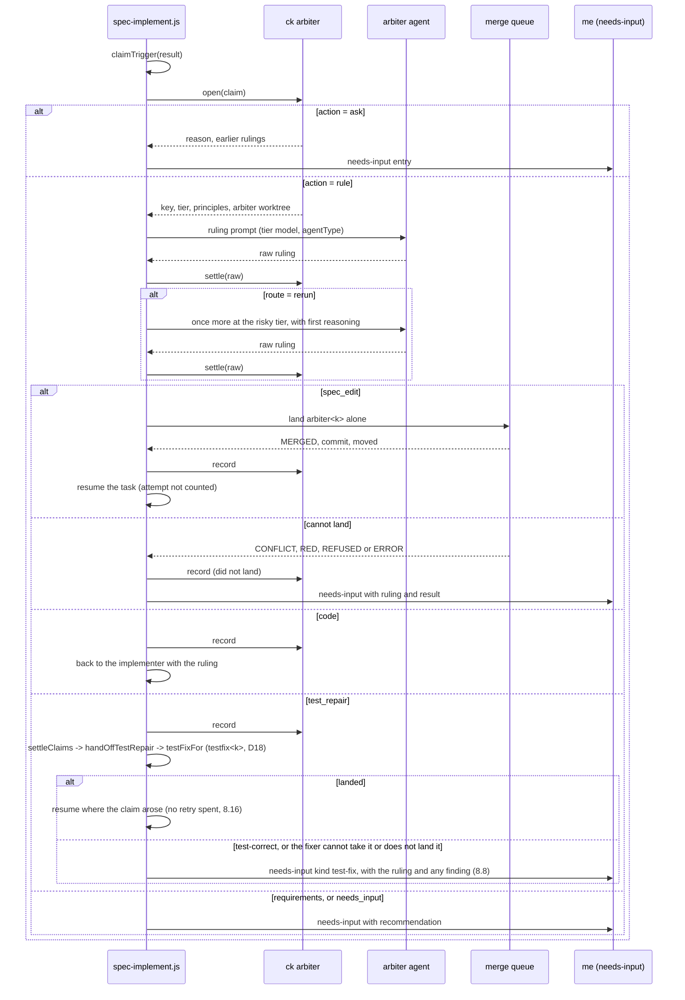
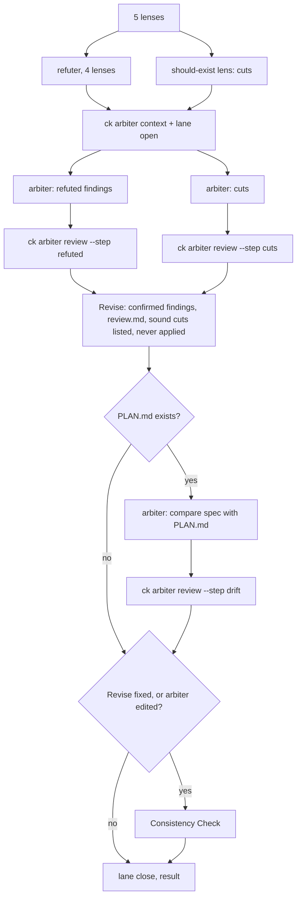

# Design: Principles and Arbiter for Spec Runs

## Overview

Today a task that hits a spec-level mismatch either climbs a model ladder or stops for me. This design adds one judgment role, the **arbiter**, at the places in `/spec:implement` and `/spec:create` where those stops happen, gives it something to uphold (principles), and adds two checks that catch known-bad gates before a run spends attempts.

The feature follows the shape the code already has:

- **Rules are pure and live in one place.** `hooks/_shared/guard_policy.py` is the model: hooks gather facts, a pure function decides. Every arbiter rule sits in a pure function in Python (`arbiter_policy.py`, `principles.py`, `justifications.py`, `lint_scope.py`, `guard_policy.py`), or in the pure decisions block of `plugin/workflows/spec-implement.js` for scheduling rules.
- **The workflow script has no filesystem or clock.** It reaches durable state through `ck` calls, as it does for `ck plan` and `ck worktree land`. Three new `ck arbiter` calls wrap each ruling: `open` (may we call it, at which tier), `settle` (is the answer valid, where does it go), `record` (write it down).
- **Spec edits use the merge queue that exists.** An arbiter branch is `arbiter<k>`, in the same worktree and branch naming as `fix<k>`.

PLAN.md decisions that shape it:

| Decision | Effect on the design |
|---|---|
| D1, D18 | The arbiter never edits tests. A test-repair ruling goes through one function, `handOffTestRepair`, which maps it to conflict entries and calls the built test-fixer (`testFixFor`), as D18 says once unattended-correctness Tasks 57 and 86 land (they have). A needs-input entry comes only when the fixer cannot take the repair or does not land it, and a `test-correct` verdict is a fix not landed (8.8, D27). A landed fix resumes the task with no retry spent (8.16). |
| D2, D11, D15 | The guard gives the arbiter its own lane, which `guard_policy.decide_arbiter_edit` defines. Requirements are never in the lane during a run. |
| D5 | Two layers, parsed by `principles.py`. The project file is plain text in the repository, so changing defaults does not change `ck`. |
| D6, D7 | `justifications.py` for lint, a fifth review lens, and skill text at planning. Cuts are only ever proposals. |
| D8, D29 | `claimTrigger` sends spec claims straight to the arbiter, a command cycle among them (`command-cycle`). `confirmConflictPrompt`, `climbGuard` (all three of its call sites) and the revise ladder are removed. |
| D9 | The `arbiter` role in `agents.py`, with tier chosen by `decide_claim`. |
| D10 | A per-spec ledger in the git common directory, so limits survive resume. |
| D12 | `specs/<spec>/decisions.md`, written only by `ck arbiter record`. |
| D14 | Three arbiter steps in `spec-create.js`. |
| D16, D30 | `lint_scope.py` simulates each gate and reports unfiltered shared suites only; a test calling a later task's command is left to live command edges. An `auditor` agent reads the tests. |
| D17 | Built on `integrate/run-principles`, now branched from `master`, which holds unattended-correctness since a4ac212. See "Existing code this relies on". |
| D23 | ck's git hook records each refused `integrate/*` update; `land` and `merge` restore a managed integration checkout only against such a record, with the tokened reset to its own head. |
| D24 | `land_group` gates every half and never infers RED; a batch whose failure no task reproduces is `unreproduced`, and the workflow sends it to the attributed full gate and fixer. |
| D27, D31-D33 | One claim loop, `settleClaims`, settles every trigger's claims, and its `handOffTestRepair` call is the one point a test-repair ruling goes through. |
| D28 | Cross-test findings keep their direct route to the test-fixer; the audit skips a task whose verifying test tasks a cross-test check already passed. |

### Existing code this relies on (on master since a4ac212)

unattended-correctness has landed on `master`, so `integrate/run-principles` branches from `master` and nothing is merged in between runs. This design relies on:

- `src/claude_kiro/graph.py` (`build_graph`, `invoked_commands`, `provides` and `invokes` edges) and `src/claude_kiro/cli/graph.py`.
- `SpecTask.provides` in `hooks/_shared/spec_parser.py`, and `ck plan --json`'s `provides` and `testVerifies` keys.
- `ck gate --json` `failures[]` with `missingCommand`, and the three-value `GateFn` in `worktrees.py`.
- `lint_spec`'s `commandEdges` and related keys.
- In `spec-implement.js`: `thinCk` and the generic `CK_CALL` envelope (every `ck` call returns `{exitCode, json, error}` with an untyped `json`), `RUNNER_AGENT`, `agentType` on agent calls, `testConflictsOf`, `liveEdgeDecision` with `liveOf`, `liveConflicts` and `recordLiveWait` (live command edges, UC Task 93), `writeSetHold` (UC Task 94), `heldByCrossTest` and the cross-test blocking route (UC Task 87), and the test-fix loop: `testFixFor`, `runTestFix`, `parkTestFix`, `conflictEntry`, `testFixPrompt`, `afterFixNote` and the `budgetBase` reset in `runTask` (UC Tasks 57 and 86).
- `src/claude_kiro/testfix.py` and `ck testfix check` / `prove` (the test-fix ledger, one fix per test).
- `ck worktree approve` (landing protected files from a real terminal), `ck worktree start`, the run-start hooks, and `plugin/agents/runner.md` with the `None` role in `plugin.AGENT_ROLES`.

## Components

### Existing Components to Modify

- `src/claude_kiro/agents.py` - add the `arbiter` role to `DEFAULTS` and `ROLE_KEYS`; allow `inherit` for `arbiter.risky_model` in `_coerce`; in `resolve`, fill each unset `arbiter.*` value from `reviewer.risky_model` or `reviewer.risky_effort` and name that source (5.1, 5.2).
- `src/claude_kiro/plugin.py` - add `"arbiter": "arbiter"` and `"auditor": "reviewer"` to `AGENT_ROLES`, so `ck-arbiter.md` and `ck-auditor.md` are generated for vendored projects and `spec:arbiter` references are rewritten (D11, 13.4).
- `src/claude_kiro/analytics/roles.py` - add both agent types to `SPEC_AGENT_TYPES` and its role map, and labels `arbiter task <n>`, `arbiter task <n> risky`, `arbiter <step>` and `audit task <n>`. Master already uses a bare `audit` label (the run-end audit), so these carry `task`. Also the pattern `full gate @N (unreproduced landing)`, mapped to the `full` role (Story 15).
- `src/claude_kiro/analytics/collect.py` and `src/claude_kiro/analytics/show.py` - read `rulings` from the workflow result and report counts by trigger, outcome and tier (10.8).
- `src/claude_kiro/hooks/_shared/guard_policy.py` - add `ArbiterEditFacts`, `is_arbiter_caller`, `decide_arbiter_edit`, `decide_arbiter_bash` and `arbiter_block_reason`. `classify_caller`, `Caller` and every existing decision stay unchanged, so existing property P-11 keeps holding (9.5-9.8).
- `src/claude_kiro/hooks/pre_tool_guard.py` - in `_hook`, check `is_arbiter_caller` first and send that caller only through the lane. An exception on that path denies, where other callers fail open (9.1-9.4, 9.8).
- `src/claude_kiro/lint.py` - `lint_spec` adds `justifications`, `verifyScope`, `notChecked` and `warnings`, and removes duplicates against existing keys (3.6, 12.10).
- `src/claude_kiro/cli/worktree.py` - `lint` prints and exits by `lint_verdict`, and gains `--simulate` (with `--task`); `_plan` adds `verifiedBy`; `land_cmd` routes an `arbiter<k>` number to `worktrees.land_spec_edit`; `merge` prints a restored checkout's discarded paths (14.2); `_gate_fn` takes `whole` and passes it to `run_gate` as `escalate_complete` (15.1, 15.2).
- `src/claude_kiro/gate.py` - `suite_due` moves to `lint_scope.suite_due` and `_run_gate` calls it, so the gate and its simulation cannot disagree (12.1). `run_gate` gains `escalate_complete: bool = True`; when it is false, `spec_complete` is taken as false, so the gate stays task-scoped (green-only) however complete the spec is (15.1, 15.2). Every existing caller keeps the default.
- `src/claude_kiro/worktrees.py` - add `land_spec_edit`, the `REFUSED` state, `commit` and `moved` fields on `Landed`, and a `wait_s` option on `land_lock` (8.1, 8.4-8.7, 10.5). Add `RecoveryFacts`, `decide_recovery` and `recover_target`, called by `land` and `merge` in place of their dirty-target refusal, and at the start of `land_spec_edit` under its `land_lock` (Story 14). `GateFn` gains a keyword `whole: bool = True`. In `land`, `land_group` gates every half with `whole=False`, only the batch gate with `whole=True`, and the result gains `unreproduced` (Story 15).
- `src/claude_kiro/protect.py` - add `Refusal`, `record_refusal`, `refusal_for` and `clear_refusal`, kept in `<git common dir>/ck/refusals.json` (14.1, 14.5).
- `src/claude_kiro/cli/githooks.py` - `reference-transaction` and `pre-merge-commit` call `protect.record_refusal` for each `integrate/*` update they refuse (14.1).
- `src/claude_kiro/cli/main.py` - register the `arbiter` and `principles` groups.
- `plugin/workflows/spec-implement.js` - the run integration described under "Data Flow": new args, the `RULING` and `AUDIT` agent schemas, validity checks for the `ck arbiter` and `ck plan` fields read from `out.json`, prompts, decisions-block functions, removal of `confirmConflictPrompt`, `climbGuard`, `guardLadder` and the revise escalation loop; the confirmed-conflict block of `runTask` (today ~2303-2346) rewired so a test conflict goes to the arbiter and a test-repair ruling to `testFixFor` through `handOffTestRepair`; `conflictEntry` keeps an optional `ruling`; arbiter landing in the queue; launch handling; audit; `rulings` and `proposedCuts` in the result. The landing step keeps `recovered` on its landing entry and sends an `unreproduced` landing to the attributed full gate and fixer (Stories 14, 15).
- `plugin/workflows/spec-create.js` - `**Without it:**` in the requirements template; a `should-exist` lens that the refute loop skips; a `thinCk` helper; the new args; three arbiter steps started with plain `agent`; an `apply-cuts` mode that branches only on the `cut` field of `ck arbiter context --approved-cut`; `review.proposedCuts` and `review.arbiter` in the result; the not-Ready rule (Stories 2, 4, 11).
- `plugin/skills/plan/SKILL.md` - create the principles file, ask for principles and overrides, ask what breaks without each In-scope item and offer the cut, add `## Principles` and `*Without it:*` to the PLAN.md template, record each override with its reason as `**Reason:** <text>`, and run `ck principles check` before Status `Decided` (1.1-1.5, 2.1, 2.2).
- `plugin/skills/create/SKILL.md` - run `ck principles init` and tell me when it created the file; run `ck agents --json` and pass `arbiterAgent`, `runnerAgent` and `agents.arbiter`; report proposed cuts and launch the `apply-cuts` mode for the ones I approve; say the frozen message it returns after implementation has started (1.1, 4.2, 4.4, 4.5, 11.9).
- `plugin/skills/implement/SKILL.md` - after step 5, run `ck -C <targetDir> principles init --commit --json` and tell me when it created the file; pass `arbiterAgent`, `auditorAgent`, `verifiedBy` and `agents.arbiter`; a `verify-scope` finding launches the workflow on a whole-spec run, and refuses a single-task run whose task it names (12.12), as a `verify-file` entry does; report rulings and proposed cuts (1.1, 10.7, 12.5, 12.6).
- `plugin/skills/review/SKILL.md` - run `ck principles init`, and report proposed cuts as `/spec:create` does; run `ck agents --json` and pass the same args (1.1, 4.2, 11.9).
- `plugin/resources/spec-implement-brief.md` and `plugin/resources/without-workflow-tool.md` - a guard stop or test conflict now goes to the arbiter. A single-task run and the manual path run the read-only audit before the first attempt (13.1) but have no `ck arbiter` loop, so each claim there, including an audit problem, is a needs-input entry, with no guard ladder and no confirmation agent (6.12); a manual launch with a `verify-scope` finding stops and shows me the findings (12.5).

### New Components

- `plugin/agents/arbiter.md` (new) - the arbiter's role prompt. Tools: Read, Grep, Glob, Edit, Write, Bash.
- `plugin/agents/auditor.md` (new) - the audit agent's role prompt. Tools: Read, Grep, Glob. With no write or shell tool, it cannot change a file (13.4). Its model and effort follow the `reviewer` role.
- `src/claude_kiro/principles.py` (new) - starter text, parsing of both layers, effective principles, the Decided check (Story 1).
- `src/claude_kiro/justifications.py` (new) - story parsing and the justification rule (Story 3).
- `src/claude_kiro/lint_scope.py` (new) - gate simulation and Verify-scope findings (Story 12).
- `src/claude_kiro/arbiter_policy.py` (new) - pure rules for claims, rulings, spec edits, records and cuts (Stories 5, 7, 8, 10, 11).
- `src/claude_kiro/arbiter.py` (new) - the stateful side: ledger, worktree, decisions file, lane tickets.
- `src/claude_kiro/cli/arbiter.py` (new) - the `ck arbiter` and `ck principles` groups. `ck arbiter record` calls `worktrees.recover_target` on the `INTO` checkout under `land_lock`, before it commits `decisions.md`, when `INTO` is an `integrate/*` branch; a `/spec:create` record never calls it (14.1, 10.2).
- `specs/PRINCIPLES.md` (new, per project) - the project layer, created by `ck principles init`.
- `specs/<spec>/decisions.md` (new, per spec) - the record of rulings, created by the first ruling.

## Public Interfaces

### CLI

All `ck arbiter` commands print one JSON object with `--json`. A non-zero exit means no decision was made, and the workflow treats that as "the arbiter cannot be called" (6.10).

```
ck principles init [--commit]                      # creates specs/PRINCIPLES.md if missing. {"created": bool, "path": str, "commit": str | null}
                                                   # --commit also commits that file alone on the checkout's branch, when it created it
ck principles check SPEC --json                    # {"ok": bool, "reason": str}. exit 1 when the plan may not be Decided

ck arbiter open SPEC --task N --into BRANCH --json       # stdin: {"claim": Claim, "task": TaskMeta}. stdout: OpenResult
ck arbiter settle SPEC KEY --tier normal|risky --json    # stdin: the arbiter's raw output. stdout: SettleResult
ck arbiter record SPEC --into BRANCH [--lock-wait S] --json   # stdin: RulingRecord. stdout: {"number": int, "commit": str}, plus "recovered" when it restored INTO (14.2)
ck arbiter context SPEC [--approved-cut] --json          # /spec:create: {"principles": [...], "planLayer": str, "implementationStarted": bool,
                                                         #   "missing": str | null, "cut": "apply" | "hold" | "frozen"}
ck arbiter review SPEC --step refuted|cuts|drift --tier normal|risky --json
                                                         # /spec:create: stdin: {"subjects": [...], "output": raw, "lostSteps": [step]}. stdout: ReviewResult
ck arbiter lane open|close SPEC --json                   # opens or closes the /spec:create lane ticket

ck lint SPEC [--json]                                    # new keys below; exit by lint_verdict
ck lint SPEC --simulate --task N --json                  # {"task": N, "suites": [SuiteSim], "selected": [{"file": str, "tests": [str] | null}]}
ck plan SPEC --json                                      # adds "verifyScope", "justifications", "verifiedBy": {task: [test tasks]}
ck worktree land SPEC arbiter<k> --into BRANCH --gate --json   # one entry, state MERGED|CONFLICT|RED|REFUSED|ERROR, with commit and moved, and "recovered" when it restored (14.2)
ck worktree land SPEC N... --json                        # adds "recovered" (14.2) and "unreproduced" (15.3), each only when it applies
ck worktree merge SPEC N...                              # prints "restored <checkout> to <head>: discarded <paths>" first when it restored, ending "; a merge was in progress" when one was (14.2)
```

New `ck lint --json` keys (existing keys keep their names and meaning):

| Key | Shape |
|---|---|
| `justifications` | `[{"story": "4", "title": "...", "message": "..."}]` |
| `verifyScope` | `[ScopeFinding]` |
| `notChecked` | `[{"task": str, "command": str, "reason": str}]` |
| `warnings` | `[{"kind": "principles", "plan": str, "message": str}]` |

`ck lint` text output prints one line per finding, naming the task and the suite (12.8).

### Agent types and the role setting

`arbiter.model`, `arbiter.effort`, `arbiter.risky_model` and `arbiter.risky_effort` are ordinary role settings for `ck agents set` and `ck agents --json`. The two agent types are `spec:arbiter` and `spec:auditor` under the plugin, `ck-arbiter` and `ck-auditor` when vendored.

### Workflow args and result

`spec-implement` gains these args: `arbiterAgent` and `auditorAgent` (agent type names), `verifiedBy` (`{task: [test tasks]}`), and `agents.arbiter`. An absent `arbiterAgent` means the arbiter cannot be called (6.10). `verifiedBy` from the args is used only until the first plan; after that the workflow reads the current plan's `verifiedBy`.

`spec-create` gains these args: `arbiterAgent` and `runnerAgent` (agent type names), and `agents.arbiter` (the resolved `arbiter` role). The create and review skills run `ck agents --json` and pass them. An absent `arbiterAgent` means the arbiter cannot be called, which is 11.12 for each step with subjects: the check did not run and the result is not Ready. A step with no subjects makes no call and is not lost (11.11). Without an agent type the arbiter is not `is_arbiter_caller`, so the lane rules would not apply. `spec-create.js` gains a `thinCk` helper in the shape of `spec-implement.js`'s (one `CK_CALL` agent per command, with `agentType: runnerAgent` when present, else a low-effort default agent). It runs every `ck arbiter context`, `lane open`, `review` and `lane close` step.

Arbiter steps in `spec-create.js` use plain `agent`, not `pagent`, so their prompts hold no `ck progress` command that `decide_arbiter_bash` would deny. The workflow keeps their time in the ETA with its own `thinCk` calls to `ck progress event ... phase-start` and `step-end`, phase `Arbiter`, around them.

The `spec-implement` result gains `rulings: [RunRuling]` (this run only), `proposedCuts: [{task, file, issue}]` and `missedAudits: [task]`. When launch is refused for Verify scope, it carries `verifyScope` and `proposals`. Needs-input entries keep their existing fields and add `kind` values `arbiter`, `requirements`, `missing-requirement`, with `ruling` (the number or null). A test repair the fixer does not land uses the existing kind `test-fix`, with `ruling` (the number) and `testRepair` (the ruling's `{file, test, change, why}`) added, because `parkTestFix`'s `fixes` are empty when the ledger refuses and 8.8 needs the exact change and why on the entry. When the fixer answered `test-correct`, the entry also carries its `finding` (`{file, test, issue}`) (D27). A claim that returns after its fix landed adds the new report as `evidence` (7.4).

The `spec-create` result gains `review.proposedCuts: [Cut]` and `review.arbiter: {ran: [step], lost: [step], rulings: [number], missing: string | null}`, where `missing` names an unusable principles file (1.12).

### File formats

`specs/PRINCIPLES.md`, starter text from `ck principles init`:

```markdown
# Project Principles

Defaults every spec run upholds. A plan's `## Principles` section may add to these or override one with a reason.

- **priority-order:** requirements > design > test plan > task wiring.
- **test-intent:** a test keeps its intent; only selection and setup may move.
- **fail-closed:** fail closed on security.
- **remove-first:** remove before you optimize.
```

A principle is a top-level `-` bullet, with its continuation lines. Its id is `project:<slug>` when the bullet starts with a `**slug:**` label, else `project:<position>`. Plan bullets get `plan:<slug>` or `plan:<position>` the same way.

`## Principles` of a PLAN.md may hold these forms besides plain bullets:

```markdown
- **Overrides fail-closed:** a read-only probe may fail open. **Reason:** it touches no data.
- **Reserves design.md:** interface changes are mine to approve.
- **Nothing to add:** the project defaults apply.
```

`Reserves` scopes are `tasks.md`, `design.md`, `test-plan.md`, `code` and `test repairs`. An `Overrides <slug>:` bullet with no `**Reason:**` text is not citable and does not displace the default (1.6).

`specs/<spec>/decisions.md`:

```markdown
# Rulings: <spec>

## Ruling 3: Task 19 (test-conflict)

- **At:** 2026-11-09T17:02:57Z
- **Trigger:** test-conflict
- **Claim:** `19|test:tests/test_x.py::test_a` - the claim text
- **Tier:** normal
- **Ruling:** spec_edit - the reasoning
- **Principle cited:** project:test-intent - the principle's text
- **Plan layer:** present | absent
- **What changed:** tasks.md: Task 19 Verify narrowed. Moved out of Verify: tests/test_x.py::test_b (Task 19)
- **Commit:** abc1234 | none
- **Landed:** yes | no: <why>
```

### Decision Seams

Every seam is pure: no I/O, clock or network, and all inputs are arguments.

**`src/claude_kiro/hooks/_shared/guard_policy.py`** (owner: guard)

| Seam | Input -> output | Criteria |
|---|---|---|
| `is_arbiter_caller(hook_input)` | `Any -> bool`. True only when `agent_id` is a non-empty string and `agent_type` is exactly `spec:arbiter` or `ck-arbiter`. Environment, tool arguments and prompt text are not inputs. | 9.5, 9.6, 9.7 |
| `decide_arbiter_edit(facts)` | `ArbiterEditFacts -> GuardDecision`. Lists the only paths allowed; everything else is denied. | 9.1, 9.2, 9.3, 11.5 (guard side), 11.7, 11.10 |
| `decide_arbiter_bash(command, cwd)` | `str, str -> GuardDecision`. First denies any command holding `$(`, a backtick, `<(` or `>(` outside single quotes (an unterminated quote is denied too), because `_segment_read_only` was written as a pre-filter and treats substitution as read-only. Then allows read-only commands (existing `_segment_read_only`), and `git add` of lane files or `git commit -m` in an arbiter worktree. Any `git -c`, `--amend` or `--no-verify` is denied. A commit message is a plain `-m '...'` in single quotes, and the arbiter's prompt says so: `git commit -m "$(cat <<'EOF' ...)"` is denied, and `-F` would need a file outside the lane. | 9.4 |
| `arbiter_block_reason(rel)` | `str -> str` | 9.8 |

`decide_arbiter_edit` allows exactly:

- in a worktree named `<spec>-task-arbiter<k>`: `specs/<spec>/tasks.md`, `design.md` and `test-plan.md`;
- with a lane ticket open for `<spec>`, in a checkout that is not an arbiter worktree: those three, and `specs/<spec>/requirements.md` only while `implementation_started` is false.

**`src/claude_kiro/principles.py`** (owner: principles)

| Seam | Input -> output | Criteria |
|---|---|---|
| `parse_principles(text, layer)` | `str, "project"\|"plan" -> List[Principle]` | 1.6 |
| `plan_section(plan_text)` | `Optional[str] -> Optional[str]` (body of `## Principles`; `None` when absent or empty) | 1.4, 1.10, 1.11 |
| `effective_principles(project, plan)` | `Sequence[Principle], Optional[Sequence[Principle]] -> EffectivePrinciples` | 1.6, 1.8, 1.10 |
| `plan_may_be_decided(plan_text)` | `str -> Tuple[bool, str]` | 1.4 |

**`src/claude_kiro/justifications.py`** (owner: lint)

| Seam | Input -> output | Criteria |
|---|---|---|
| `justification_findings(text)` | `Optional[str] -> List[JustificationFinding]` | 2.5, 3.1, 3.2, 3.3, 3.4, 3.5 |

**`src/claude_kiro/lint_scope.py`** (owner: lint)

| Seam | Input -> output | Criteria |
|---|---|---|
| `suite_due(test_task, tasks, assumed_done)` | `SpecTask, Mapping, Set[str] -> bool` | 12.1 (and the gate itself) |
| `done_at_gate(tasks, num)` | `Mapping, str -> Set[str]` (Done tasks, the task, its transitive dependencies) | 12.1 |
| `scope_findings(sim)` | `SimInput -> ScopeResult` | 12.1, 12.2, 12.3, 12.4, 12.9 |
| `dedupe_scope(result, existing)` | `ScopeResult, Mapping -> Tuple[ScopeResult, List[dict]]` | 12.10 |
| `lint_verdict(result)` | `Mapping -> LintVerdict` | 1.11, 3.1, 3.7, 12.5, 12.9 |

**`src/claude_kiro/arbiter_policy.py`** (owner: arbiter)

| Seam | Input -> output | Criteria |
|---|---|---|
| `claim_key(claim)` | `Claim -> str` | 7.3 |
| `claim_facts(claim, ledger, principles_read, task)` | `Claim, Mapping, PrinciplesRead, TaskMeta -> ClaimFacts`. Derives `safety` from the task's risk, counts rulings and calls for this task only, finds `prior` by key, whatever the ledger's order. | 1.9, 5.3, 5.4, 5.5, 7.5, 7.6, 7.8 |
| `decide_claim(facts)` | `ClaimFacts -> ClaimDecision` | 1.9, 5.3, 5.4, 5.5, 7.4, 7.5, 7.6, 7.8, Bounded arbiter cost |
| `validate_ruling(raw, key, citable, mode)` | `Any, str, Mapping[str, Principle], "run"\|"create" -> RulingCheck` | 7.1, 7.2, 11.9 |
| `route_ruling(check, tier, effective)` | `RulingCheck, Tier, EffectivePrinciples -> RulingRoute`. A reservation of `code` or `test repairs` is matched by outcome; a file scope is enforced at `decide_spec_edit`, because `reservedBy` is the arbiter's own report. | 1.7, 1.8, 5.6, 5.7, 7.7, 8.1, 8.8, 8.11, 8.13, 8.14 |
| `decide_spec_edit(facts)` | `SpecEditFacts -> SpecEditDecision` | 1.7 (file scopes), 8.4, 8.5, 8.6, and a second check of 9.1-9.3 |
| `spec_text_changes(before, after)` | `str, str -> SpecTextChanges` (Status and acceptance-mark changes by task) | 8.6 |
| `moved_out_of_verify(before, after)` | `Selections, Selections -> List[MovedTest]` | 8.7 |
| `gate_scope_of_edit(before, after, done)` | `Mapping, Mapping, Set[str] -> List[str]` (Done tasks whose Verify, Verified by or Verifies changed) | 8.4 |
| `append_entry(existing, entry, number)` | `Optional[str], RulingRecord, int -> str` (output always starts with `existing`) | 10.1, 10.2, 10.3, 10.4, 10.6 |
| `next_number(existing, ledger_last)` | `Optional[str], int -> int` | 10.4 |
| `route_create_ruling(check, step, started)` | `RulingCheck, Step, bool -> CreateRoute` | 11.2, 11.4, 11.5, 11.6, 11.7, 11.10 |
| `decide_cut(approved, started)` | `bool, bool -> "apply"\|"hold"\|"frozen"` | 4.3, 4.4, 4.5 |
| `rulings_summary(rulings)` | `Sequence[Mapping] -> Mapping` | 10.8 |

**`plugin/workflows/spec-implement.js`, decisions block** (owner: workflow; loaded by `tests/js/load_decisions.mjs`)

| Seam | Input -> output | Criteria |
|---|---|---|
| `claimTrigger({ result, guardStop, testConflict, live, worktreeKind, retryNo, maxRetries, rungsLeft, reviewDeadlock })` | `-> 'test-conflict' \| 'guard-stop' \| 'review-deadlock' \| 'command-cycle' \| 'gate-failure' \| null`. `live` is `liveEdgeDecision`'s result for the attempt (`action` and `refused`). A `blocked` action, or any non-empty `refused`, is a `command-cycle` (D29); a `wait` with nothing refused returns null, so today's `recordLiveWait` runs and spends no retry; `conflict` is a `test-conflict` (its invoking tests have joined `testConflicts` through `liveConflicts`) | 6.1, 6.2, 6.3, 6.4, 6.5, 6.6, 6.7, 6.11, 6.13, Compatibility |
| `testRepairEntries(rulings)` | `[{ claim, ruling }] -> ConflictEntry[]`, one per `test_repair` ruling: `{ file, test, criterion, reason, fix, ruling }` with `file` and `test` from `ruling.testRepair` (else the claim's), `criterion` from the claim, `reason` = `ruling.testRepair.why`, `fix` = `ruling.testRepair.change`, and `ruling` the settled ruling object, unchanged, with its `decisions.md` number | 8.9, 8.10 |
| `scopeClaims(findings)` | `ScopeFinding[] -> [{ task, rule, subject, tests, messages }]`, one entry per (task, kind, suite), the identity `claim_key` uses; `tests` lists the `testTask` of each grouped finding | 12.6, 12.11 |
| `settleFindings(review, settled)` | `(Review, string[]) -> Review` | 8.12 |
| `normalizeReview(review)` | `Review -> Review` (a `noRequirement` finding is minor; a review left with no blocking finding is `approve`) | 4.8 |
| `nextLandingBatch(queue, window)` | `(Entry[], number) -> Entry[]` (a spec edit lands alone) | 8.1 |
| `crossPassedOf({ checks, testVerifies })` | `-> Set<string>`: the test tasks a cross-test check in this run passed. A check that returned a result passes the test tasks it covered, less those that `testVerifies` maps from a file a blocking finding names; a check that returned nothing, or a finding naming a file `testVerifies` lacks, passes none of that check's tasks | 13.9 |
| `auditDue({ track, verifiedBy, done, audited, crossPassed })` | `-> boolean`. `verifiedBy` is the current plan's entry. False when every test task in it is in `crossPassed` | 8.3, 13.1, 13.6, 13.7, 13.9 |
| `auditAction(audit)` | `-> { start: boolean, problems: [], missed: boolean }` | 13.2, 13.3, 13.5 |

Existing `flaggedOf` and `parkAction` stay, and receive normalized reviews and arbiter entries.

## Data Models

### Python

```python
Tier = Literal["normal", "risky"]
Trigger = Literal["test-conflict", "guard-stop", "review-deadlock", "command-cycle", "gate-failure", "audit", "lint"]
Outcome = Literal["spec_edit", "test_repair", "code", "requirements"]
Step = Literal["refuted", "cuts", "drift"]

@dataclass(frozen=True)
class ArbiterEditFacts:            # guard_policy
    rel: str                       # path relative to its checkout, symlinks and ".." resolved
    arbiter_worktree_spec: Optional[str]  # the <spec> of a checkout named <spec>-task-arbiter<k>, else None
    lane_specs: Tuple[str, ...]    # specs with an open lane ticket in this checkout
    implementation_started: bool   # for the spec named by rel: any task In Progress or Done

@dataclass(frozen=True)
class Principle:                   # principles
    id: str                        # "project:test-intent", "plan:2"
    layer: Literal["project", "plan"]
    text: str                      # the bullet with its continuation lines, whitespace collapsed
    overrides: Optional[str]       # slug of the project default it overrides
    reason: Optional[str]          # the text after **Reason:**
    reserves: Tuple[str, ...]      # scopes from a Reserves bullet

@dataclass(frozen=True)
class EffectivePrinciples:         # principles
    citable: Tuple[Principle, ...] # what a ruling may cite
    ignored: Tuple[Principle, ...] # overrides with no reason
    reserved: Tuple[str, ...]      # union of the reserves scopes
    plan_layer: Literal["present", "absent"]

@dataclass(frozen=True)
class JustificationFinding:        # justifications
    story: str
    title: str

@dataclass(frozen=True)
class SimTest:                     # lint_scope: one test function as source text sees it
    name: str
    cls: str
    source: str                    # the function's text, for scanning command calls

@dataclass(frozen=True)
class SimInput:                    # lint_scope; built by load_sim_input from tasks.md and test files
    tasks: Mapping[str, SpecTask]
    runs: Mapping[str, Mapping[str, Optional[Selector]]]   # task -> file -> selector (None = whole file)
    unresolved: Mapping[str, Sequence[Tuple[str, str]]]    # task -> [(command, reason)]
    tests: Mapping[str, Sequence[SimTest]]                 # file -> tests
    module_source: Mapping[str, str]                       # file -> code outside test functions
    programs: Sequence[str]

@dataclass(frozen=True)
class ScopeFinding:                # lint_scope. Sorted by (int task, kind, suite, testTask)
    kind: Literal["unfiltered-shared-suite"]   # the only kind (D30)
    task: str                      # the task whose gate is simulated
    suite: str                     # the test file
    testTask: str                  # the test task that makes the suite shared
    message: str

@dataclass(frozen=True)
class ScopeResult:
    findings: Tuple[ScopeFinding, ...]
    not_checked: Tuple[Tuple[str, str, str], ...]    # (task, command, reason)

@dataclass(frozen=True)
class LintVerdict:
    exit_nonzero: bool             # cycles, verify cycles, verify scope, justifications
    launch_blockers: Tuple[Mapping, ...]  # verify-scope findings only; justifications never block a launch

@dataclass(frozen=True)
class Claim:                       # arbiter_policy; built from the workflow's JSON
    task: str
    trigger: Trigger
    text: str                      # the claim as reported
    file: str = ""
    test: str = ""
    criterion: str = ""
    findings: Tuple[Tuple[str, str], ...] = ()   # review-deadlock: (file, issue) of each blocking finding
    failing: Tuple[str, ...] = ()         # gate-failure: failing test ids, else the failing commands
    rule: str = ""                        # lint: the ScopeFinding kind
    subject: str = ""                     # lint: the suite
    tests: Tuple[str, ...] = ()           # lint: the test task of each grouped finding; not part of the key
    command: str = ""                     # command-cycle: the command the gate failed on
    provider: str = ""                    # command-cycle: the provider whose edge would close the cycle (first of `refused`)
    cycle: Tuple[str, ...] = ()           # command-cycle: the cycle, as `liveEdgeDecision` names it; not part of the key
    models_tried: Tuple[str, ...] = ()
    evidence: str = ""

@dataclass(frozen=True)
class PriorClaim:
    status: Literal["open", "failed", "exhausted", "ruled"]
    calls: int
    ruling: Optional[int]          # entry number

PrinciplesRead = Literal["ok", "missing", "directory", "denied", "decode-error"]

@dataclass(frozen=True)
class TaskMeta:
    risk: Literal["safety", "normal"]  # ck plan's risk map: a Risk tag or a risk_paths match
    complexity: str                    # carried, never read (5.5)

@dataclass(frozen=True)
class ClaimFacts:
    key: str
    trigger: Trigger
    safety: bool
    principles_readable: bool
    prior: Optional[PriorClaim]    # same key, from the ledger
    task_rulings: int
    task_calls: int

@dataclass(frozen=True)
class ClaimDecision:
    action: Literal["rule", "ask"]
    tier: Optional[Tier]
    reason: str  # "" | "principles-missing" | "repeat-after-ruling" | "exhausted" | "claim-call-limit"
                 #    | "task-ruling-limit" | "task-call-limit"

@dataclass(frozen=True)
class RulingCheck:
    valid: bool
    stronger_look: bool
    outcome: Optional[Outcome]
    principle: Optional[str]
    reserved_by: Optional[str]
    problems: Tuple[str, ...]
    raw: Any                       # kept for the needs-input entry (7.2)

@dataclass(frozen=True)
class RulingRoute:
    route: Literal["spec_edit", "test_repair", "code", "needs_input", "rerun"]
    reason: str  # "" | "invalid-ruling" | "exhausted" | "reserved" | "requirements" | "missing-requirement"
    record: bool                   # whether this answer becomes a numbered ruling

@dataclass(frozen=True)
class SpecEditFacts:
    spec: str
    changed: Tuple[str, ...]       # repo-relative paths the branch changes
    status_changes: Tuple[str, ...]
    mark_changes: Tuple[str, ...]
    new_cycles: Tuple[str, ...]
    new_blocking: Tuple[str, ...]  # new lint findings with exit_nonzero that are not justifications
    reserved: Tuple[str, ...]      # EffectivePrinciples.reserved from the target's plan layer (1.7)

@dataclass(frozen=True)
class SpecEditDecision:
    land: bool
    reasons: Tuple[str, ...]

@dataclass(frozen=True)
class CreateRoute:
    action: Literal["confirm", "keep-refuted", "show-cut", "reject-cut", "apply", "report", "unchecked"]
    reason: str

@dataclass(frozen=True)
class RulingRecord:
    trigger: str
    claim_key: str
    claim_text: str
    task: Optional[str]            # None during /spec:create
    tier: Tier
    outcome: Outcome
    reasoning: str
    principle_id: str
    principle_text: str
    plan_layer: str
    changed: str                   # what changed, or "nothing"
    moved: Tuple[Mapping, ...]     # MovedTest as dicts
    commit: Optional[str]          # None renders as "none"
    landed: Optional[Tuple[bool, str]]   # None when no landing applies

@dataclass(frozen=True)
class MovedTest:
    task: str
    file: str
    test: Optional[str]            # None when the selection could not be resolved to names
    command: str
```

`Landed` in `worktrees.py` gains `commit: str = ""` and `moved: List[Dict] = field(default_factory=list)`, and its `state` comment gains `REFUSED`.

Claim identity (the design's answer to 7.3), produced by `claim_key`. The key is the task number, `|`, and a subject, whatever the trigger, so an audit problem and a later test conflict on one test are the same claim:

| Claim | Subject |
|---|---|
| review deadlock | `review:<sorted identities of the findings never ruled on>` |
| gate failure | `gate:<sorted failing ids>` |
| lint finding | `lint:<rule>:<subject>` |
| command cycle | `command:<provider>:<command>` |
| names a test | `test:<file>::<test>` |
| names a file only | `file:<file>:<criterion>` |

A finding identity is `<file>#<issue>`, with the issue lowercased and whitespace collapsed, the match `settleFindings` uses. Identity is per finding (7.4). `ck arbiter open` splits a deadlock: a finding already covered by an applied ruling goes to me as a needs-input entry with that ruling (reason `repeat-after-ruling`), and only the findings never ruled on reach the arbiter, as one claim, whose ruling the ledger records under each of their identities. So a different finding on the same file is a new claim, and an unsettled finding raised again is never ruled again, even when the set of blocking findings around it has changed. Paths drop a leading `./`. A test keeps only what follows the last `::`, drops any `[...]` parameters, collapses whitespace and is lowercased.

Ledger, `<git common dir>/ck/<spec>/arbiter-ledger.json`, the same location pattern as unattended-correctness's test-fix ledger, written under a per-spec file lock:

```json
{
  "schema": "ck-arbiter-ledger/1",
  "nextWorktree": 4,
  "lastEntry": 3,
  "claims": {
    "19|test:tests/test_x.py::test_a": { "task": "19", "status": "ruled", "calls": 2, "ruling": 3, "base": "abc1234" }
  }
}
```

Lane ticket: `<checkout>/.ck/arbiter-lane/<spec>.json`, `{"spec": str, "openedAt": str}`.

Landing recovery and bisection (Stories 14, 15):

```python
# protect.py
@dataclass(frozen=True)
class Refusal:
    ref: str          # "refs/heads/integrate/<x>"
    head: str         # the ref's value when the update was refused
    checkout: str     # realpath of the worktree the refused command ran in
    at: str           # ISO-8601, UTC

def record_refusal(root: Path, refusal: Refusal) -> None    # latest per ref wins; file lock; never raises
def refusal_for(root: Path, ref: str) -> Optional[Refusal]  # None when absent or unreadable
def clear_refusal(root: Path, ref: str, head: str) -> None  # removes it only while it still names `head`

# worktrees.py
@dataclass(frozen=True)
class RecoveryFacts:
    into: str
    target: str                  # realpath of the checkout of `into`
    managed: bool                # `into` is integrate/*, the target is under configured_dir (or the legacy dir), and is not the main checkout
    dirty: Tuple[str, ...]       # dirty_files(target, tracked_only=True) plus unmerged paths, sorted
    merge_in_progress: bool      # MERGE_HEAD exists in the target
    head: str
    refusal: Optional[Refusal]

def decide_recovery(facts: RecoveryFacts) -> Tuple[str, str]:
    """("clean" | "recover" | "refuse", reason). Pure.
    clean   - nothing dirty and no merge in progress
    refuse  - not managed (reason: today's message), or no refusal whose ref is refs/heads/<into>, whose head is `head`
              and whose checkout is `target` (reason adds "no refused ref update is recorded at this head; ck will not
              discard it")
    recover - otherwise"""

def recover_target(root: Path, target: Path, into: str) -> Optional[Dict]:
    """Gather RecoveryFacts, apply decide_recovery. "clean": None. "refuse": WorktreeError(reason).
    "recover": _git_reset(root, target, into, head), then check that HEAD is still `head`, MERGE_HEAD is gone and no
    tracked file is dirty, else WorktreeError; clear_refusal; return {"paths": [...], "mergeInProgress": bool, "head": head}."""
```

`ck worktree land --json` additions:

| Key | Shape | When |
|---|---|---|
| `recovered` | `{"paths": [str], "mergeInProgress": bool, "head": str}` | the target was restored before this landing |
| `unreproduced` | `{"tasks": [str], "tail": str, "failures": [GateFailure]}` | the batch gate was red and no task ended RED |

A RED task's `checkTail` and `failures` come from the gate in `gates` whose `tasks` is exactly that task (15.2).

### Workflow schemas (JavaScript)

`spec-implement.js` has no per-command schema for `ck` output: every `ck` call goes through `thinCk` with the generic `CK_CALL` envelope (`{exitCode, json, error}`, `json` an untyped object), and a per-command schema cannot be passed through it. So `OpenResult`, `SettleResult`, the arbiter landing entry and the new plan fields below are shapes the workflow reads from `out.json`, each guarded by a small JS validity check in the decisions block (`openResultOf`, `settleResultOf`, `landEntryOf`), the way `heldByCrossTest` reads `current.testVerifies`. A missing or wrong-typed required field makes that call a failed `ck arbiter` call (6.10), never a guessed default. `RULING` and `AUDIT` are agent schemas, passed as `schema` on the agent call as `RESULT` and `REVIEW_SCHEMA` are today.

```js
// OpenResult (ck arbiter open, read from out.json)
{ action: 'rule' | 'ask', key: string, tier: 'normal' | 'risky' | null, reason: string,
  principles: [{ id, layer, text }], planLayer: 'present' | 'absent',
  worktree: string | null, branch: string | null, number: string | null,   // arbiter<k>
  earlier: [{ ruling, claim, outcome, reasoning }], missing: string | null }

// The arbiter's answer (agent schema). outcome is an unconstrained string so that a malformed answer
// reaches validate_ruling and my needs-input entry instead of failing in the agent tool (7.2).
const RULING = { type: 'object', properties: {
  claim: { type: 'string', description: 'the claim key you were given, copied' },
  status: { type: 'string', description: 'ruled | needs_stronger_look' },
  outcome: { description: 'spec_edit | test_repair | code | requirements' },
  reasoning: { type: 'string' },
  principle: { type: 'string', description: 'the id of the principle you upheld' },
  reservedBy: { type: 'string' },
  established: { type: 'string', description: 'with needs_stronger_look: what you did establish' },
  changed: { type: 'string', description: 'spec_edit: what you changed' },
  commits: { type: 'string' },
  testRepair: { type: 'object', properties: { file: {type:'string'}, test: {type:'string'}, change: {type:'string'}, why: {type:'string'} } },
  code: { type: 'string', description: 'code: what the implementer must do' },
  requirement: { type: 'object', properties: { kind: {type:'string'}, wording: {type:'string'}, reason: {type:'string'} } },
  settles: { type: 'array', items: { type: 'string' }, description: 'review deadlock: the findings this ruling settles' },
  verdict: { type: 'string', description: '/spec:create only' },
}, required: ['status', 'reasoning'] }

// SettleResult (ck arbiter settle, read from out.json)
{ route: 'spec_edit' | 'test_repair' | 'code' | 'needs_input' | 'rerun', reason: string,
  record: boolean, principle: { id, text } | null, problems: [string] }

// Arbiter landing entry (ck worktree land SPEC arbiter<k> --json, read from out.json): today's land entry fields plus
{ state: 'MERGED' | 'CONFLICT' | 'RED' | 'REFUSED' | 'ERROR', commit: string | null,
  moved: [{ task, test }], recovered?: { paths, mergeInProgress, head } }
// Task landings gain `recovered` and `unreproduced` (see "Landing recovery and bisection"), read the same way.

// Plan fields (ck plan --json, read from out.json): `verifyScope: [ScopeFinding]` and `verifiedBy: {task: [test tasks]}`.
// applyPlanView gains `verifyScope` and `verifiedBy` keys beside order, deps, done, cycles, verifyCycles and overlaps;
// a missing key reads as [] / {}. `ck plan` already outputs `testVerifies` (test file -> test tasks), which the
// cross-test hold uses; `verifiedBy` is still needed because auditDue asks, per impl task, which test tasks verify it
// (Verified by and Verifies), which a file-keyed map cannot answer when a test file is shared or not yet on disk.

// RunRuling (one per entry in the workflow's rulings)
{ number: number | null, task: string, trigger: string, outcome: string, tier: 'normal' | 'risky',
  principle: string, commit: string | null, landed: boolean | null }

// Cut (/spec:create)
{ id: string, story: string, title: string, weakness: string,
  saves: { criteria: number, tasks: number, testCases: number },
  status: 'sound' | 'unchecked', ruling: number | null }

// AUDIT (the auditor's answer, agent schema)
{ problems: [{ file: string, test: string, criterion: string, reason: string, needs: string }], summary: string }

// ReviewResult (ck arbiter review, read from out.json)
{ results: [{ id: string, action: string, reason: string, stronger: boolean, ruling: number | null }], lost: boolean }
```

`REVIEW_SCHEMA` findings gain `noRequirement` (boolean) and `settledBy` (number). `conflictEntry` keeps an optional `ruling` field unchanged, so the test-fixer's prompt and its review carry the ruling (8.9); `testFixPrompt` says the `fix` of an entry with a `ruling` is the arbiter's ruled change, not a first agent's proposal.

## Data Flow



Details the diagram leaves out:

**The task loop.** `runTask` keeps today's retry and escalation loops (`ladder()`) for plain failures, and today's live-edge handling after them: `liveOf(r)` is computed first, and a `wait` with nothing refused goes to `recordLiveWait`, which spends no retry and never calls the arbiter (`claimTrigger` returns null). A `blocked` action, or a refused provider beside a safe one, no longer ends the task: it is a `command-cycle` claim on the task, keyed `<task>|command:<provider>:<command>`, carrying the command, the refused provider and the cycle, and no live edge is recorded for it (6.13, D29). The ladder's loops already stop on any live action, so the claim spends no retry. A live `conflict` joins its invoking tests to `testConflicts` through `liveConflicts`, as today, so it reaches the arbiter as a `test-conflict` claim. The attempt's claims then go to `settleClaims` (below). `arbitrate(n, rec, claim)` opens, rules, settles and records one claim, and lands a spec edit; it returns `{ exit: rec }` when the claim went to me, else `{ route, ruling }` for a landed `spec_edit`, a `code` or a `test_repair` ruling. A resumed attempt uses a prompt that merges `INTO` first and carries the rulings, and adds to `arbiterK`, which `retryNo()` subtracts, so it spends no retry or escalation (8.2). The task stays in `running` while a ruling is pending, so dependents wait and independent tasks continue (6.9). The slot is released first, and `'arbiter'` joins `UNBLOCKER_KINDS`.

**One claim loop (D31-D33).** `settleClaims(n, rec, claims, next)` is the one place claims are settled, whatever raised them: an attempt's claims after each `ladder()` pass (`next` `retry`), a guard stop in `revised()` (`revise`), the Story 13 audit's problems (`start`), a review deadlock (`re-review`), and `lint` claims at launch and after it (`replan`; `n` is the task the finding names, not yet started, and its park holds it, 6.9). It calls `arbitrate` for each claim in order. A `spec_edit` lands as it settles and a `code` ruling's text is kept; `test_repair` rulings are gathered. The first `exit` stops it raising the claims after it. Then, whether or not a claim exited, the gathered `test_repair` rulings go to `handOffTestRepair`, whose one call site is here (8.9), so a recorded ruling always reaches the fixer or me (D32, D33). Only when every claim has settled, none exited and the hand-off sent nothing to me does the caller go on, once, carrying every ruling's text (and `afterFixNote` when a fix landed), with no retry or escalation spent (8.2, 8.16):

- `retry`: the task retries (through `arbiterK`, or `budgetBase = retryNo()` after a landed fix, as today), then `ladder()` runs again and its result comes back to `settleClaims`;
- `revise`: the same revision runs again, and the review continues (D31);
- `start`: the task's first attempt starts, its prompt carrying the rulings (13.3);
- `re-review`: the task is reviewed again, with the ruling (8.12);
- `replan`: the workflow re-plans and drops findings that have gone (12.6, 12.11).

The retry, with its budget reset, applies only where there was an attempt. When a claim exited, or the hand-off sent an entry to me, the task waits on those needs-input entries and does not go on; a fix that landed stays landed.

**Guard stops, wherever they occur.** `climbGuard` has three callers today: the first-attempt `ladder()` pass, the `ladder()` pass that runs again after a landed test fix, and `revised()` in `reviewLoop`. All three go. `ladder()` leaves its loops on a guard stop (`stop` set) and returns, and the claims that follow each `ladder()` pass, a `guard-stop` claim among them, go to `settleClaims` (6.2). In `revised()`, a guard stop does not call `climbGuard`: `revised()` returns the `guard-stop` claim, `reviewLoop` returns it to `runTask` as `{ claim }`, and `runTask` sends it to `settleClaims` with `next` `revise`, so a `test_repair` ruling on it goes through the same single `handOffTestRepair` call site (D31). A `code` ruling, a landed `spec_edit` or a landed test fix re-runs the same revision after merging `INTO`, with the ruling text in its prompt (no attempt counted, through `arbiterK`), and the review then continues with the next re-review; any other outcome waits on its needs-input entry, never `needInput()`'s empty `escalatedTo`. The old `needInput()` closure goes with `climbGuard`.

**Spec claims on integration.** `testConflictsOf` can return several conflicts. Each is its own claim, and `settleClaims` takes them in order, as above: a later claim's `exit` does not drop a `test_repair` ruling gathered from an earlier one, which still goes to the fixer, with no task retry, since the task waits on my entry; and the task goes on only once every claim has settled (D32). Handing the gathered rulings off together means one `testFixFor` call plans one test-fixer per file, as today.

**A test-repair ruling (D18, D27, 8.8-8.10, 8.16).** `handOffTestRepair(n, rec, rulings)` is the single point a test-repair ruling goes through, with one call site, in `settleClaims`. It takes the gathered `test_repair` rulings, builds conflict entries with the pure `testRepairEntries(rulings)` (file and test from `ruling.testRepair`, `criterion` from the claim, `reason` = `testRepair.why`, `fix` = `testRepair.change`, and the settled ruling attached unchanged as `ruling`), and calls `testFixFor(n, entries)`. The ruling is the confirmation the fixer starts on (8.10); no second agent confirms. Today's post-fix code from the confirmed-conflict branch of `runTask` (~2318-2346) moves under it and under `settleClaims`'s `retry`:

- a landed fix: `rec.testConflictFixed` is set and the caller goes on as `next` says, spending no retry (8.16). For `retry` this is today's code: `budgetBase = retryNo()`, the slot is re-acquired, and the task retries with `retryPrompt` plus `afterFixNote(fixed.fixed, [])`; then `ladder()` runs again, and its result goes through `settleClaims` again (a guard stop there is a `guard-stop` claim, above);
- a `test-correct` verdict on a ruled test: the fixer disagrees with the ruling. The task does not retry and the arbiter is not called again: `parkTestFix` makes one needs-input entry of kind `test-fix` carrying the ruling (`ruling`, `testRepair`) and the fixer's `finding`, for me to settle (8.8: the fixer did not land the fix; D27). This replaces the old retry with the finding in `afterFixNote`;
- `toMe` (the ledger already lists the test, the ledger cannot be read, or the fix did not prove or was not approved): `parkTestFix(n, rec, fixed.toMe, fixed.records)`, needs-input kind `test-fix`, with the ruling's number as the entry's `ruling` field and its exact change and why as `testRepair` (8.8). There is no separate `test-repair` kind;
- the same conflict reported again after its fix landed: today's park `the task still reports a test that can never pass after its test fix` (kind `test-fix`, with `ruling`, `testRepair` and the new report as `evidence`, 7.4). It goes straight to `parkTestFix`, not through `claimTrigger`, so it makes no second arbiter call and no second fixer, and I get one entry (7.4, P-18's `repeat-after-ruling` holds in the ledger too).

A `testfix<k>` landing goes through the existing `runTestFix` route under `withLandingLock`, not through `landQueue`.

**Cross-test findings (D28).** `routeCrossFindings` is unchanged. A blocking cross-test finding names tests, not a claim on a task, and goes straight to `testFixFor(null, ...)` as unattended-correctness 4.1 built it. The arbiter does not rule on it, so it never reaches `settleClaims` or `handOffTestRepair` (8.9 is about rulings), and its `test-correct` verdict and needs-input entries keep today's handling. What the check read feeds the audit instead: `crossPassedOf` turns this run's checks into the test tasks they passed, and `auditDue` skips an impl task whose verifying test tasks are all among them (13.9). The cross-test window already holds the wave's dependents until the check returns, so the set is known when `auditDue` runs.

**Review deadlock.** `reviewLoop` keeps its configured revision rounds and drops the model ladder. When blocking findings remain, it returns the deadlock claim to `runTask`, which sends it to `settleClaims` with `next` `re-review`; a `test_repair` ruling goes to the fixer, and a landed fix re-reviews too (D33). The claim carries each blocking finding's file and issue. On resume, the re-review prompt carries the ruling, and `settleFindings` removes findings that the ruling settled: those whose file and issue text match, and those the reviewer marks `settledBy` (8.12). A guard stop during a revision is handled as above.

**A spec edit in the queue.** `nextLandingBatch` takes an arbiter entry alone. `landBatch` skips review and task-list bookkeeping for it and calls `ck worktree land SPEC arbiter<k>`. `worktrees.land_spec_edit`, under `land_lock`:

1. refuses a conflict found by `git merge-tree`;
2. takes a lint result and test selections on the target;
3. merges the branch, and takes them again;
4. calls `decide_spec_edit` on the difference;
5. gates only the Done tasks from `gate_scope_of_edit`;
6. resets the target to its earlier commit on any refusal or red gate.

`decide_spec_edit` refuses a changed path that matches a reserved file scope, whatever the ruling's `reservedBy` says, so a reserved file reaches me by the 8.4 path (1.7). The workflow then requests a plan, which applies new wiring to tasks not yet started (8.3). `land_spec_edit` calls `land_lock` with a bounded wait, 120 seconds.

The arbiter's worktree comes from `ck arbiter open`, which records its starting commit in the ledger entry (`base`). `settle` removes the worktree and branch on `test_repair`, `code` and `needs_input`. It keeps them on `spec_edit`, for the landing. On `rerun` it keeps them and resets the branch to `base` before the risky call, so the re-run starts clean with no partial commit from the first attempt. The re-run makes no second `open`.

**Records.** `ck arbiter record` runs inside the workflow's `withLandingLock`, as relink does, and takes `land_lock` with a bounded wait (120 seconds, or `--lock-wait`), so concurrent records serialize. If the wait runs out it exits non-zero and writes nothing, which is the 10.9 path. `land_lock` gains `wait_s` for this, defaulting to 0, so task landings refuse rather than wait, as today: inside one run `withLandingLock` is what serializes them with arbiter landings. It appends and commits `decisions.md` on `INTO` alone, so a landing's clean-target check still passes. A spec edit records after landing, so the entry can carry the commit and result. Other outcomes record before acting.

**Launch (D16).** If the start plan has `verifyScope` findings, `scopeClaims` groups them by claim identity, and each group goes through `settleClaims` (`next` `replan`) as one `lint` claim that lists every test task it covers. Groups go one at a time. A `test_repair` ruling goes to the fixer like any other (D33). After each landed fix, spec edit or test fix, the workflow re-plans, drops findings that have gone, and rules only on what remains, so a fix that clears several findings costs one ruling and no needs-input entry (12.6). Any remaining finding refuses the launch with the remaining findings and the arbiter's proposed fixes (12.7). Cycles refuse as today.

**Findings after launch (D16, 12.11).** In a test-first run the test files exist only once test tasks merge, so a selection that could not be resolved at launch (12.9) can first give a finding after it. `applyLint` on a non-start plan sends a `verifyScope` finding for a task not yet started to `settleClaims` (`next` `replan`) as a `lint` claim, grouped the same way, and holds that task until the claim settles (6.9). `claim_key` and the ledger rule a finding once, and `lintClaimed` keeps the next plan from reopening a key this run already sent. A finding for a task already started is left to that task's gate.

**Audit (13).** At the start of `runTask`, if `auditDue`, a thin call gets `ck lint --simulate --task N --json`, then one `spec:auditor` agent reads the selected tests against the spec. `auditDue` is false when a cross-test check in this run passed every test task that verifies the task (`crossPassedOf`, 13.9, D28). Each problem is an `audit` claim, settled through `settleClaims` with `next` `start`. A failure of either step notes a missed audit and the task starts. So does an arbiter call on an `audit` claim that failed or returned nothing usable, or `ask` with reason `principles-missing` (13.8). A malformed ruling on an `audit` claim is a needs-input entry with the arbiter's output (7.2), and the task does not start. A `code` ruling goes into the first attempt's prompt. A `test_repair` ruling goes to the fixer, and once the fix lands the task starts its first attempt, with no retry spent; a fix not landed is a `test-fix` entry and the task does not start (8.8, D33). `auditDue` reads the current plan's `verifiedBy`, so a landed spec edit that rewires Verified by also changes the audit decision (8.3).

**`/spec:create`.**



The arbiter runs once per step and returns one ruling per finding. This shares the cost of reading the spec, which matters when a refuter has rejected many findings. Each entry is validated on its own, so one malformed entry loses only that finding. Entries that ask for a stronger look go to one re-run at the risky tier (11.9). The two calls before Revise run in parallel. A step with no subjects makes no call (11.11). The `should-exist` lens's cuts go to the arbiter without the refuter, so the refute loop skips that lens. When `ck arbiter context` returns `missing`, no arbiter step runs: the steps with subjects are lost, and the report and review.md name the file and `ck principles init` (1.12). The Revise prompt names any lost step, so review.md's Result is `Needs work` (11.12).

`/spec:create` uses the same four outcomes as a run. A ruling that changes nothing (a refutation that stands, a rejected cut) is a `spec_edit` with nothing changed, and its entry records the commit as none (10.2). `verdict` says which way it went. A correction to draft wording is `spec_edit` naming `requirements.md`. Anything that adds, removes or changes what PLAN.md decided is `requirements`, and is reported to me (11.6). `ck arbiter review --step drift` appends the drift rows to `review.md`, since that file is outside the arbiter's lane. It adds each `requirements` item to Needs Your Decision and sets the `**Result:**` line: `Needs work` when this or an earlier step was lost, `Ready after decisions` when Needs Your Decision has a row. A lost drift step still makes this call, with `output` null, so review.md never says Ready when the workflow does not (11.12).

### Landing recovery and bisection (Stories 14, 15)

**Recording a refusal.** When `ck git-hook reference-transaction` refuses an update of `refs/heads/integrate/*` (a protected change without a token, or an update it cannot verify), it calls `protect.record_refusal` with the ref, the update's old value and the hook's working directory before it exits non-zero. `pre-merge-commit` does the same with `HEAD`. A failure to write the record is ignored: the refusal still stands, and a later landing then refuses as today (14.5), which is the safe direction. `git merge --no-verify` skips `pre-merge-commit` but not `reference-transaction`, so both the fast-forward and the merge-commit forms are recorded.

**Restoring before a landing.** `land` and `merge` call `recover_target` where they now refuse a dirty target: `land` inside `land_lock`, and `merge` inside a `land_lock` taken for that step, so a recovery never races a landing. The reset is `_git_reset(root, target, into, head)`: the old and new values are the same commit, so the reference-transaction hook allows it with the minted token and the ref does not move (14.4). `git reset --hard` clears the index, the tracked files, MERGE_HEAD, MERGE_MSG and AUTO_MERGE, and leaves untracked files alone (14.3). A merge into the main checkout or any branch outside `integrate/*` is never managed, so it refuses as today (14.3). The result's `recovered` is printed by `ck worktree merge` and carried by `ck worktree land --json` (14.2). Every other path that writes to an integration checkout restores it the same way first, so "the next landing or merge into it" (14.1) has no exception: `land_spec_edit` (an arbiter spec edit, `ck worktree land SPEC arbiter<k>`) calls `recover_target` at its start under its `land_lock` and its entry carries `recovered`, and `ck arbiter record` calls it on `INTO` under the `land_lock` it already takes, before it commits `decisions.md`, when `INTO` is an `integrate/*` branch, and its output carries `recovered` when it restored (14.2). A record on any other branch, such as a `/spec:create` ruling recorded through `ck arbiter review` (10.2) while the draft spec files are uncommitted, does not call it and records as before, committing `decisions.md` alone (14.3). A `refuse` there is the same `WorktreeError` (14.5): the spec edit is `ERROR`, which cannot land and is handled as 8.4 (target unchanged, needs-input with the ruling and the landing result), and the record leaves the checkout unchanged and commits `decisions.md` alone, as before (10.1, 14.5, D26). The record takes the 10.9 path only when git cannot make that commit, for example while a merge is in progress.

**Bisection.** `land_group` loses its `known_red` shortcut:

```
land_group(group, whole):
    start = head(); merged = merge_all(group)
    ok, tail, failures = check(merged, whole and len(merged) > 1)   # a gate on exactly `merged`, on the current head
    if ok: mark MERGED; return
    reset to start
    if len(merged) == 1: RED with this gate's tail and failures   # 15.2
    else: land_group(left half, False); land_group(right half, False)   # each half gated itself (15.1)

land_group(batch, True)
```

**Gate scope below the batch.** `gate.py` widens a gate to the full suite (`verify`) when the tasks Done in the target's `tasks.md` plus the gated tasks cover the whole spec (`spec_complete`). Task branches commit their own `**Status:** Done`, so once a left half is MERGED its tasks are Done on the target, and a gate on the last remaining half or single task would see the spec complete, run the full suite, fail on an earlier task's regression, and blame the last task by its own red gate: the TC-176 misblame by another path. So only the batch gate (`whole=True`) may widen. Every gate below it is called with `whole=False`, which `_gate_fn` passes to `run_gate(..., escalate_complete=False)`, and runs task-scoped and green-only, as for a task in a spec that is not yet complete, whatever is Done on the target (15.1, 15.2). A failure that only the full suite sees can then never end in a RED task; it ends as `unreproduced` and goes to the attributed full gate, which finds the task it belongs to (15.3). `land` calls the batch gate as `gate(target, group)` and every gate below it as `gate(target, group, whole=False)`, so an existing two-argument gate function still works for a batch that is not bisected. A batch in which only one task merges is gated with `whole=False` too (D25): a single task is never gated with the full suite at landing, so it can never be RED on a failure only the full suite sees. The run's final full gate, which follows the last task, runs the full suite and its attributed fixer.

Each node of the bisection tree runs one gate, so a batch of n runs at most 2n-1 (NFR). The right half is gated on top of whatever the left half landed, so a failure that needs both shows in the right half's gates and is blamed on the first task whose own task-scoped gate fails with it. After `land_group(batch, True)`, when the batch gate was red and no task ended RED, the result carries `unreproduced` with the batch gate's tail and failures (15.3). The tasks whose own gates passed are MERGED (15.3), so the target now holds the failure the batch gate saw.

**The run's side.** In `spec-implement.js` the landing step logs `recovered` and keeps it on the landing entry. When the result has `unreproduced`, it sets `unreproduced: true` on the landing entry, logs `Landing <tasks>: red as a batch, no task reproduces it alone; running the full gate`, and calls the periodic path's code, factored into `fullGateAndFix(kind, label)`, with kind `unreproduced` and label `full gate @<merges> (unreproduced landing)`: `attributedGate`, then `fixAndRecheck` when it is red, then `redTarget` and `stopLaunching` when the recheck is still red. A periodic gate due on the same landing step is not run again. No task goes to the landing fixer, since none is RED. A flaky batch gate gives a green full gate and no fix.

## Error Handling

| Criterion | Behaviour |
|---|---|
| 1.9 | `claim_facts` carries the read result and `decide_claim` returns `ask`, reason `principles-missing`. `OpenResult.missing` names `specs/PRINCIPLES.md` and the needs-input entry repeats it. No arbiter call and no worktree. An `audit` claim follows 13.8. |
| 1.10 | `effective_principles` gives `plan_layer: "absent"`. The ruling proceeds on the project layer, and the entry says the plan layer was absent. An empty section counts as absent. |
| 1.11 | `warnings` entry naming the plan. `lint_verdict` ignores warnings. |
| 1.12 | `ck arbiter context` returns `missing`. No arbiter step runs, the steps with subjects are in `review.arbiter.lost`, and review.md and the report name the file and `ck principles init`. |
| 3.2 | Text after the label, through its paragraph, with `*_\`~#>:-` and whitespace removed. Empty counts as missing. |
| 3.5 | `justification_findings(None)`, and text with no stories, return `[]`. Lint continues. |
| 4.7 | The lens returns null from the pipeline and is counted in `lensesLost`, as for other lenses. |
| 5.4 | A prior claim with status `open` or `failed` starts at the risky tier. |
| 5.7 | `route_ruling` returns `needs_input`, reason `exhausted`. The ledger status becomes `exhausted`, so later runs also ask. The entry carries `established`. |
| 6.7 | `claimTrigger` returns null when the worktree outcome is busy or error. |
| 6.11 | After the retry and escalation loops, `claimTrigger` returns `gate-failure` and `arbitrate` takes the failure as a claim. |
| 6.13 | `claimTrigger` returns `command-cycle` for a `blocked` live decision or a non-empty `refused`; no live edge is recorded and no retry is spent. An `ask` or failed arbiter call is a needs-input entry (6.10), as for any spec claim. |
| 6.12 | A single-task run and the manual path never call `ck arbiter`. Each claim, including an audit problem, is a needs-input entry, with no ladder and no confirmation agent. Both still run the read-only audit before the first attempt (13.1). |
| 6.10 | No `arbiterAgent`, a thrown or empty agent call, or a failed `ck arbiter` call: needs-input with the claim. Ledger status `failed`. No ladder and no confirmation agent. |
| 7.2 | `validate_ruling` reports each problem. `route_ruling` returns `needs_input`, `record: false`. The entry includes the raw output. |
| 7.4 | `ask`, reason `repeat-after-ruling`. The entry has the ruling and the new evidence. |
| 7.6 | `ask`, reason `task-ruling-limit`. The entry lists the three earlier rulings. |
| 7.9 | `ask`, reason `task-call-limit`, once the task has 6 arbiter calls, however many produced rulings. |
| 1.7 | A file scope reserved and changed: `decide_spec_edit` refuses with state `REFUSED`, handled as 8.4. `code` and `test repairs`: `route_ruling` returns `needs_input`, reason `reserved`. |
| 8.4 | Target reset. Workflow records `landed: false`, and sends needs-input with the ruling and the landing result. No new ruling. |
| 8.8 | `testFixFor` returns `toMe` (the test-fix ledger refuses a second fix to the test, cannot be read, or the fix did not prove or was not approved), or the fixer answers `test-correct` on a ruled test: `parkTestFix`, needs-input kind `test-fix` carrying the ruling's number as `ruling`, its exact change and why as `testRepair`, and for `test-correct` the fixer's `finding`. No task retry, no second ruling, and no further agent edits the test (D27). |
| 8.5 | `decide_spec_edit` refuses on a new cycle or blocking finding. State `REFUSED`, handled as 8.4. |
| 8.6 | `spec_text_changes` feeds `decide_spec_edit`. A removed task that was not Not Started counts as a Status change. State `REFUSED`. |
| 9.2, 9.3, 9.4 | `decide_arbiter_edit` or `decide_arbiter_bash` denies. An exception on the arbiter path denies. |
| 9.6 | `is_arbiter_caller` is false, so `classify_caller` applies the existing rules. |
| 9.8 | `arbiter_block_reason`: `[ck guard] Denied: <file> is outside the arbiter's lane...`. |
| 10.2 | `commit: None` renders as `none`. |
| 10.3 | `landed: (False, why)` renders as `no: <why>`. |
| 10.9 | A failed `record`: logged in the run report, and the claim goes to needs-input, saying whether the edit landed. |
| 11.12 | The findings or cuts stay as they stood, the step is named in `review.arbiter.lost`, `result` becomes `Needs work`, and review.md's `**Result:**` line says the same. An absent `arbiterAgent` counts. |
| 12.7 | Launch stays refused, with remaining findings and proposed fixes. |
| 12.9 | `not_checked` entry. No exit effect. A bare `pytest`, a directory, a glob, a shell variable, an unreadable `-k`, or a selected file not yet on disk is unresolved. |
| 12.11 | The claim goes through `arbitrate` and holds the task. A failed or `ask` result is a needs-input entry, as 6.10 and Story 7 say. |
| 13.5 | `auditAction` returns `{ start: true, missed: true }`. `missedAudits` lists the task. |
| 13.8 | An arbiter call on an `audit` claim that failed or returned nothing usable, or `ask` with reason `principles-missing`: the task starts and `missedAudits` lists it. No needs-input entry. A malformed ruling on an `audit` claim follows 7.2. |
| 14.1 | The reset fails or git refuses it (an `index.lock`, a hook refusal): `WorktreeError` naming the target, the git error and the dirty paths; the landing does not start and the refusal record is kept. |
| 14.5 | `decide_recovery` returns `refuse`: `WorktreeError` with today's message and "no refused ref update is recorded at this head; ck will not discard it". Nothing is changed. |
| 15.3 | The attributed full gate errors: logged, and the run goes on, as for a periodic gate. A red recheck stops launching, as for a periodic gate. |

## Security, Performance, Migration

### Security

- **The lane is an allowlist, in two layers.** The guard denies at edit time. `decide_spec_edit` checks the same paths again at landing, so an arbiter that got past the hook still cannot land a change to requirements, tests or code.
- **Identity comes from the harness.** `agent_type` is set by Claude Code, and the check takes no environment, argument or prompt input (9.5). A main session could still start an agent of type `spec:arbiter`. That gives the agent only the lane, and only in an arbiter worktree or under a ticket.
- **Fail closed for this caller.** `pre_tool_guard.hook` fails open for others, by design. The arbiter path denies on any exception, and its configured guard modes do not apply: the lane holds even when `guard` is switched off in `specs/ck.json`.
- **The audit is read-only by its tool list.**
- **Shell substitution is denied first.** `decide_arbiter_bash` refuses `$(`, backticks and process substitution before any allowlist check, so an inner command cannot run inside a read-only one.
- **Lint imports no project code.** `lint_scope.py` uses `ast` and text only (NFR).
- **Recovery cannot move a ref.** `recover_target` resets only to the checkout's current head, and its token is bound to that old value, tree and parents, so it cannot be used to land anything. A forged or stale refusal record can at worst discard tracked changes in a managed integration checkout, which `ck worktree land` would refuse to land into anyway.

### Performance

`ck lint` and `ck plan` parse each test file once per run of the command, with results shared across tasks, to stay within 10 seconds on a 108-task spec. A spec edit gates only Done tasks whose verification changed, so most spec edits land without running tests.

Gating every bisection half adds at most one gate per level against today's shortcut, bounded by 2n-1 per batch of n. A red batch already halves the landing window, so later batches stay small.

### Migration

- Specs written before this feature fail `ck lint` on justifications but still launch (3.7). Adding justifications to them is out of scope.
- A project gets `specs/PRINCIPLES.md` from whichever of `/spec:plan`, `/spec:create`, `/spec:review` or a whole-spec launch runs first there (1.1). A launch creates and commits it on the target checkout, since the arbiter reads it there. If that fails, each claim becomes a needs-input entry (1.9). This repository also commits the file on `integrate/run-principles` (Task 49).
- Vendored copies are protected files: ck's reference-transaction hook refuses an untokened update of `integrate/*` that changes `.claude/**`. After the plugin files change, Task 92 regenerates `.claude/workflows/spec-implement.js`, `spec-create.js`, `spec-implement-brief.md` and `without-workflow-tool.md`, `.claude/commands/spec/plan.md`, `create.md`, `implement.md` and `review.md`, the new `.claude/agents/ck-arbiter.md` and `ck-auditor.md`, and `.claude/ck-manifest.json`, with `CK_CONFIG_HOME=$(mktemp -d) uv run ck vendor` and `ck agents sync` (so no personal role setting leaks into the agent files), commits them in its own worktree and lands them with `ck worktree approve`.
- Tests that assert the replaced behaviour need test-track changes: `tests/js/guard_ladder.test.mjs`, `tests/test_guard_ladder_properties.py`, the issue #8 confirmation cases in `tests/js/spec_implement.test.mjs` (which now assert the confirmation followed by `testfix`), and `tests/js/spec_create.test.mjs`, `tests/js/spec_review_frozen.test.mjs` and `tests/js/spec_create_provides.test.mjs`, whose `fake_create` stub throws on the new arbiter steps (Tasks 50, 51, 90).
- The unattended-correctness test-fixer suites start from a confirmed conflict and must move to the ruling: `tests/js/test_fix.test.mjs` (every case runs the report and the confirmation first), `tests/js/command_deps.test.mjs` (TC-116: a missing command no task provides becomes a conflict through confirmation, then the fixer), `tests/js/attributed_gates.test.mjs` (TC-34: `testConflicts` reach the confirmation agent) (Task 102), and `tests/test_unattended_smoke.py` (TC-177 and TC-43b on `tc177_run`, whose scripted agent answers the conflict only on a confirm prompt and has no answer for `audit task <n>` or `arbiter task <n>`) (Task 100). Each confirmation step becomes the arbiter's `test_repair` ruling; the fixer-side assertions stay.
- The confirmed-conflict block of `runTask` (~2303-2346: `confirmConflictPrompt`, then `testFixFor`, `parkTestFix`, the `budgetBase` reset, the post-fix retry and `ladder()` re-run, and the "still reports a test that can never pass" park) is rewired, not just `handOffTestRepair`: Task 65 removes the confirmation and sends the conflict to the arbiter, and Task 66 moves the post-fix code under `handOffTestRepair` and `settleClaims`, unchanged except that a `test-correct` verdict on a ruled test now parks instead of retrying (8.8-8.10, 8.16, D27).
- `tests/test_worktree_land.py::test_red_batch_bisects_to_the_culprit` asserts fewer than 5 gates because the right half is not re-gated. It moves to the 2n-1 bound and asserts the right half's own gate (Task 96).
- TC-178's scripted agent in `tests/test_unattended_smoke.py` keeps its cleanup on the shared `tc176_run` fixture, so the existing TC-176 and TC-178 tests stay green throughout. TC-169 runs on its own `tc169_run` fixture, the same scenario with the raw merge and no cleanup, so the run exercises the recovery (Task 100).

## Requirements Traceability

| Criterion | Design element |
|---|---|
| 1.1 | `ck principles init`, `--commit`; `plugin/skills/plan/SKILL.md`, `create`, `review`, `implement` |
| 1.2 | `ck principles init` leaves an existing file unchanged |
| 1.3 | `plugin/skills/plan/SKILL.md` |
| 1.4 | `plan_may_be_decided`; `ck principles check`; skill |
| 1.5 | `plugin/skills/plan/SKILL.md` |
| 1.6 | `parse_principles`, `effective_principles`, `ck arbiter open` |
| 1.7 | `route_ruling` (`reserved`, by outcome); `decide_spec_edit` (`reserved`, by changed path) |
| 1.8 | `route_ruling`; `decide_arbiter_edit` (neither takes a grant as input) |
| 1.9 | `claim_facts`, `decide_claim`, `OpenResult.missing` |
| 1.10 | `plan_section`, `effective_principles`, `RulingRecord.plan_layer` |
| 1.11 | `lint_spec` `warnings`, `lint_verdict` |
| 1.12 | `ck arbiter context` `missing`, `spec-create.js`, `review.arbiter.lost` |
| 2.1 | `plugin/skills/plan/SKILL.md` |
| 2.2 | `plugin/skills/plan/SKILL.md` |
| 2.3 | `spec-create.js` requirements prompt |
| 2.4 | `spec-create.js` requirements prompt |
| 2.5 | `justification_findings` (per story only) |
| 3.1 | `justification_findings`, `lint_verdict` |
| 3.2 | `justification_findings` |
| 3.3 | `justification_findings` |
| 3.4 | `justification_findings` |
| 3.5 | `justification_findings` |
| 3.6 | `ck lint --json` `justifications` |
| 3.7 | `lint_verdict.launch_blockers` |
| 4.1 | `should-exist` lens in `LENSES` |
| 4.2 | `Cut`, `review.proposedCuts`, Revise prompt, create and review skills |
| 4.3 | `decide_cut`; cuts kept out of `toFix` |
| 4.4 | `decide_cut`; `plugin/skills/create/SKILL.md` |
| 4.5 | `decide_cut`; `plugin/skills/create/SKILL.md` |
| 4.6 | Revise prompt |
| 4.7 | `lensesLost` |
| 4.8 | `normalizeReview`, `noRequirement`, `proposedCuts` |
| 5.1 | `agents.py` `DEFAULTS`, `ROLE_KEYS`, `_coerce` |
| 5.2 | `agents.resolve` |
| 5.3 | `claim_facts`, `decide_claim` |
| 5.4 | `claim_facts`, `decide_claim` |
| 5.5 | `claim_facts`, `decide_claim` (Complexity is not read) |
| 5.6 | `route_ruling` (`rerun`); workflow |
| 5.7 | `route_ruling`; ledger `exhausted` |
| 6.1 | `claimTrigger`; `confirmConflictPrompt` removed |
| 6.2 | `claimTrigger`; `climbGuard` removed from `ladder()`, the post-fix `ladder()` pass and `revised()`, each guard stop going to `settleClaims` |
| 6.3 | `claimTrigger`; revise ladder removed |
| 6.4 | `claimTrigger` (a `live` `wait` with nothing refused returns null, so a live wait spends no attempt and never reaches the arbiter) |
| 6.5 | `claimTrigger` (`rungsLeft` 0) |
| 6.6 | `claimTrigger` |
| 6.7 | `claimTrigger` |
| 6.8 | `Claim`, `OpenResult`, ruling prompt, arbiter worktree |
| 6.9 | `running` map; `arbitrate` |
| 6.10 | `arbitrate` failure path |
| 6.11 | `claimTrigger` (`gate-failure`), `arbitrate` |
| 6.12 | `plugin/skills/implement/SKILL.md`, `plugin/resources/without-workflow-tool.md` |
| 6.13 | `claimTrigger` (`command-cycle`), `Claim.command` and `provider`, `claim_key` (`command:<provider>:<command>`), `settleClaims` |
| 7.1 | `validate_ruling` |
| 7.2 | `validate_ruling`, `route_ruling` |
| 7.3 | `claim_key`, `Claim.findings`, ledger |
| 7.4 | `decide_claim` |
| 7.5 | `decide_claim` |
| 7.6 | `decide_claim` |
| 7.7 | `route_ruling`; ledger counts one ruling per claim |
| 7.8 | Ledger in the git common directory |
| 7.9 | `claim_facts`, `decide_claim` |
| 8.1 | `ck arbiter open` worktree, `decide_arbiter_bash`, `nextLandingBatch`, `land_spec_edit` |
| 8.2 | `arbiterK`, resume prompt |
| 8.3 | `requestPlan('landing')` after landing |
| 8.4 | `land_spec_edit`, `gate_scope_of_edit`, `arbitrate` |
| 8.5 | `decide_spec_edit` |
| 8.6 | `spec_text_changes`, `decide_spec_edit` |
| 8.7 | `moved_out_of_verify`, `Landed.moved`, `RulingRecord.moved` |
| 8.8 | `handOffTestRepair`, `testFixFor`'s `toMe` and a `test-correct` verdict, `parkTestFix` (kind `test-fix`, `ruling`, `testRepair`, `finding`) |
| 8.9 | `handOffTestRepair` (one call site, in `settleClaims`, for every trigger), `testRepairEntries`, `conflictEntry` keeping `ruling` |
| 8.10 | `handOffTestRepair` calls `testFixFor` on the ruling; `confirmConflictPrompt` removed |
| 8.11 | `route_ruling`, resume prompt |
| 8.12 | `settleFindings`, review prompt, `settledBy` |
| 8.13 | `route_ruling` |
| 8.14 | `route_ruling`, `requirement` field, needs-input kind `missing-requirement` |
| 8.15 | `arbitrate` uses `parkAction` and the park path |
| 8.16 | `settleClaims`'s `next` after a landed fix (`budgetBase` reset for `retry`; `revise`, `start`, `re-review`, `replan` spend no attempt) |
| 9.1 | `decide_arbiter_edit` |
| 9.2 | `decide_arbiter_edit` |
| 9.3 | `decide_arbiter_edit`, `decide_spec_edit` |
| 9.4 | `decide_arbiter_bash` |
| 9.5 | `is_arbiter_caller` |
| 9.6 | `is_arbiter_caller`, `classify_caller` (the unclaimed classification) |
| 9.7 | Existing decisions unchanged |
| 9.8 | `arbiter_block_reason` |
| 10.1 | `append_entry`, `ck arbiter record` |
| 10.2 | `append_entry` |
| 10.3 | `append_entry` |
| 10.4 | `append_entry`, `next_number` |
| 10.5 | `withLandingLock`, `land_lock`, ledger lock |
| 10.6 | `append_entry` (`existing` None), `ck arbiter record` |
| 10.7 | `rulings` in the result, skill report |
| 10.8 | `RunRuling`, `collect.py`, `show.py`, `rulings_summary` |
| 10.9 | `arbitrate` record failure path |
| 11.1 | `--step refuted` |
| 11.2 | `route_create_ruling` |
| 11.3 | `--step drift` |
| 11.4 | `--step cuts`, `route_create_ruling` |
| 11.5 | `decide_arbiter_edit`, `route_create_ruling` |
| 11.6 | `route_create_ruling`, review.md rows, result |
| 11.7 | `decide_arbiter_edit`, existing `FROZEN_RULE` |
| 11.8 | Consistency check condition in `spec-create.js` |
| 11.9 | `validate_ruling` (`create` mode), re-run, `ck arbiter review`, `arbiterAgent` and `agents.arbiter` args of `spec-create` |
| 11.10 | `decide_arbiter_edit` (PLAN.md not in the lane) |
| 11.11 | `spec-create.js` skips empty steps |
| 11.12 | `review.arbiter.lost`, result rule, `ck arbiter review --step drift` Result line |
| 12.1 | `done_at_gate`, `suite_due`, `scope_findings` |
| 12.2 | `scope_findings` |
| 12.3 | `scope_findings` (no command kind; `ScopeFinding.kind` is only `unfiltered-shared-suite`) |
| 12.4 | `scope_findings` |
| 12.5 | `lint_verdict`, workflow start |
| 12.6 | Workflow start, `scopeClaims`, `lint` claim, re-plan after each landing |
| 12.7 | Workflow start |
| 12.8 | `ck lint` output naming task and suite; lint never calls the arbiter |
| 12.9 | `scope_findings` `not_checked` |
| 12.10 | `dedupe_scope` |
| 12.11 | `applyLint` on non-start plans, `scopeClaims`, `claim_key` |
| 12.12 | `plugin/skills/implement/SKILL.md` |
| 13.1 | `auditDue`, `spec:auditor`; `plugin/skills/implement/SKILL.md` and `plugin/resources/without-workflow-tool.md` for single-task and manual runs |
| 13.2 | `auditAction` |
| 13.3 | `auditAction`, `audit` claim |
| 13.4 | `plugin/agents/auditor.md` tool list |
| 13.5 | `auditAction`, `missedAudits` |
| 13.6 | `auditDue` (`audited`) |
| 13.7 | `auditDue` |
| 13.8 | `arbitrate` on an `audit` claim, `auditAction`, `missedAudits` |
| 13.9 | `crossPassedOf`, `auditDue` (`crossPassed`) |
| Bounded arbiter cost | `decide_claim` limits |
| Runtime compatibility | No clock or randomness in new workflow code; timestamps come from `ck` |
| Lint performance and safety | `lint_scope.py`, shared parsing |
| Compatibility | Claims, findings and the Story 13 audit steps are the only new paths; live waits keep today's route, and a command cycle is a claim (6.13) |
| 14.1 | `record_refusal` in `githooks.py`, `recover_target` in `land_spec_edit` and `ck arbiter record`; `recover_target` in `land` and `merge` |
| 14.2 | `recover_target` result, `ck worktree land --json` `recovered` (task and `arbiter<k>` landings), `ck arbiter record` output `recovered`, `ck worktree merge` output |
| 14.3 | `decide_recovery` (`managed`), `git reset --hard` leaves untracked files |
| 14.4 | `_git_reset` to the current head; post-reset check that HEAD is unchanged |
| 14.5 | `decide_recovery` (`refusal` must match ref, head and checkout) |
| 15.1 | `land_group` gates every half with `whole=False`; `_gate_fn` and `run_gate(escalate_complete=False)` |
| 15.2 | `land_group`: RED only from a task-scoped gate (`whole=False`) on exactly that task, with that gate's tail and failures; a batch of one merged task is gated with `whole=False` (D25) |
| 15.3 | `unreproduced` in the landing result, the green tasks MERGED; `fullGateAndFix('unreproduced')` in `spec-implement.js` |
| Determinism | `ScopeFinding` sort order; `justification_findings` in document order |
| Bounded landing cost | One gate per bisection node, at most 2n-1 |
