# Implementation Tasks: Principles and Arbiter for Spec Runs

**Status:** Not Started
**Spec:** [requirements.md](requirements.md) · [design.md](design.md) · [test-plan.md](test-plan.md) · [PLAN.md](PLAN.md)

## Before launch

D17 built this on `integrate/run-principles`, branched from `integrate/unattended-correctness`. That spec has since landed on `master` (a4ac212), so the base is now `master`, which holds `graph.py`, `thinCk`, `provides`, `failures[]`, the test-fixer, cross-test blocking, write-set holds, live command edges, run start and audit, `ck worktree approve` and the `ck-runner` agent. I do these once, by hand, before the first `/spec:implement run-principles`:

1. Commit this spec on its own branch. `specs/run-principles` lives on `worktree-run-principles-plan`, and the integration branch does not have it.
2. Create the integration worktree from master: `ck worktree integration run-principles --base master`.
3. Bring the spec onto it: in that worktree, `git checkout <spec branch> -- specs/run-principles`, then commit.
4. Check the arbiter's identity before Tasks 1 and 33-36 build on it (paid, outside any sandbox). Extend `tests/fixtures/hook_inputs/capture.sh` with a one-agent Workflow whose agent is started with `agentType` set to the shipped runner (`spec:runner` with the plugin installed, and `ck-runner` with `.claude/agents/ck-runner.md` copied into the temp project), run it, and look at the recorded `agent_type`. If it carries the runner's type, design.md's `is_arbiter_caller` stands. If it shows `workflow-subagent` or anything else, change `is_arbiter_caller` in design.md, and Task 1's `arbiter_caller`, before launch. Task 91 later repeats the capture with the real arbiter agent.
5. Run `ck lint run-principles --json` on the integration worktree and check that `commandEdges` lists no edge the Dependencies below lack.

Task 91 (paid hook capture) and Task 92 (protected `.claude/` copies, through `ck worktree approve`) land by hand.

## Task Breakdown

### Task 1: Build the Python harness for the arbiter tests
**Status:** Done
**Track:** test
**Requirements:** 1.6, 7.1, 9.5, 9.6, 10.1
**Description:** Build the Python side of the test infrastructure (test-plan "What must be added", items 1 and 6). Create `tests/arbiter_helpers.py`, test-owned, with project modules imported inside function bodies so every test file collects before the feature exists:
- `arbiter_project(tmp_path, *, tasks=None, principles=DEFAULT, plan=DEFAULT, requirements=DEFAULT) -> ArbiterProject`: a real git repo on `main` with `integrate/demo` checked out at `.ck/worktrees/demo-integration`, `specs/PRINCIPLES.md`, `specs/ck.json`, and `specs/demo/{PLAN,requirements,design,test-plan,tasks}.md`. Attributes `root`, `target`, `spec_dir`, `exec_ck` (`{"cmd": [sys.executable, "-m", "claude_kiro.cli"], "cwd": str(root)}`), `run_args` (`root`, `into`, `targetDir`).
- `arbiter_caller(project, spec="demo", phase="run", monkeypatch=None, checkout=None) -> dict`: the hook-input keyword arguments and checkout set-up that make the real hook see the real arbiter. Identity per design.md: a non-empty `agent_id` and `agent_type` exactly `spec:arbiter` or `ck-arbiter`. For `phase="run"` the checkout is a worktree named `demo-task-arbiter1`, or `checkout` when given (TC-156 passes the worktree `ck arbiter open` returned). For `phase="create"` it opens a lane ticket with `ck arbiter lane open demo --json`. This is the only place the suite depends on how the arbiter is identified.
- `decisions_entries(project) -> list[dict]`: the only reader of `specs/demo/decisions.md`. It parses the entry format design.md documents (`## Ruling <n>: ...` and its `- **Field:**` lines) in this one function, and no test uses its own regex.
- Hypothesis strategies: `claims()`, `rulings(principles)`, `histories()`, `spec_paths(spec)`, `justification_lines()`, `requirements_docs()`, `arbiter_failures()` (throw, null, `{}`, a number, a string, an array, a schema-invalid object).
- The interface map, in one place so a Link-time reconciliation changes only this file. The test plan's Harness Contract was written before design.md; tests call these names through helpers here:
  - `arbiter.claim_id` -> `arbiter_policy.claim_key`; `arbiter.decide_call` -> `arbiter_policy.claim_facts` then `decide_claim` (no test rebuilds what `claim_facts` derives); `arbiter.validate_ruling` -> `arbiter_policy.validate_ruling(raw, key, citable, mode)`; `arbiter.route_ruling` -> `arbiter_policy.route_ruling(check, tier, effective)`; `arbiter.spec_edit_refusals` -> `arbiter_policy.spec_text_changes` plus `decide_spec_edit`; `arbiter.effective_principles` -> `principles.effective_principles` over `principles.parse_principles`.
  - `guard_policy.arbiter_may_edit` -> `guard_policy.decide_arbiter_edit(ArbiterEditFacts)`, with `is_arbiter_caller`, `decide_arbiter_bash`, `arbiter_block_reason`.
  - `lint.justification_findings` -> `justifications.justification_findings`; `lint.verify_scope` -> `lint_scope.scope_findings`, `lint_scope.dedupe_scope`, `lint_scope.lint_verdict`.
  - CLI: `ck arbiter decide` -> `ck arbiter open SPEC --task N --into BRANCH --json`; `ck arbiter route` -> `ck arbiter settle SPEC KEY --tier ... --json`; `ck arbiter record` -> `ck arbiter record SPEC --into BRANCH --json`; `ck arbiter land` -> `ck worktree land SPEC arbiter<k> --into BRANCH --gate --json`.
  - `ck lint --json`: `planPrinciples` -> `warnings` entries of kind `principles`; `verifyScope.notChecked` -> top-level `notChecked`; `verifyScope.checked` -> `ck lint SPEC --simulate --task N --json`.

Create `tests/fixtures/hook_inputs/arbiter-agent-pretooluse.json`. `tests/fixtures/hook_inputs/capture.sh` starts paid `claude -p` sessions and needs the arbiter agent to exist, so do not run it here: derive the file from `workflow-agent-pretooluse.json` with `agent_type` set to `spec:arbiter`, and record in a `_derivedFrom` key that Task 91 replaces it with a real capture once the agent ships. Add `tests/test_arbiter_helpers.py`, which checks each helper against today's `ck` and git (repo shape, `exec_ck` runs, strategies generate their listed forms, `arbiter_caller` keys match the fixture's).
**Files:**
- `tests/arbiter_helpers.py` - project fixture, arbiter caller, record reader, strategies, interface map
- `tests/fixtures/hook_inputs/arbiter-agent-pretooluse.json` - derived arbiter hook input
- `tests/test_arbiter_helpers.py` - self-checks of the helpers
**Verify:** `uv run pytest -q tests/test_arbiter_helpers.py`
**Verifies:** Task 36 (its identity fixture), Task 37 (its project fixture and strategies), Task 38 (its strategies), Task 42 (its record reader)

**Acceptance:**
- [x] `arbiter_project` builds a real git repo with a real integration worktree and `exec_ck` runs the real CLI in it
- [x] `arbiter_caller` is the only identity knowledge in the suite and matches design.md's `is_arbiter_caller` inputs
- [x] `decisions_entries` is the only parser of `decisions.md`, and the interface map is the only place the Harness Contract and design names meet
- [x] Each strategy generates every form its test-plan row lists
- [x] Tests exercise the real boundary named in the test plan (real git, real `ck` subprocess)
- [x] Tests fail before the implementation exists for the right reason (the helpers that need `ck arbiter` report the missing command, not a broken helper)
- [x] No mocks of the project's own code in integration tests

**Dependencies:** None
**Complexity:** High
**Risk:** safety (defines the caller identity the guard's authorization tests rely on)

---

### Task 2: Extend the JS fake runtime and bridge for rulings
**Status:** Done
**Track:** test
**Requirements:** 6.8, 7.1, 8.1, 8.9, 13.1
**Description:** Build the workflow side of the test infrastructure (test-plan "What must be added", items 2-5), on `integrate/run-principles`: the fake project must follow the workflow's `thinCk`, `CK_CALL` and `agentType` handling as on master. All options default to absent so existing suites behave as before.
- `tests/js/fake_project.mjs`: `rulings: {n: [answer, ...]}` (answers of `arbiter task <n>` and `arbiter task <n> risky`, in order; `null`, `'throw'` or any object); `auditFindings: {n: answer}` (answer of `audit task <n>`; default no problems); `arbiterEdits: {n: {files: {path: text}}}` (what the fake arbiter really writes and commits, with real git, in the checkout its prompt names); `arbiterStepFailures: {record: true}` (the named `arbiter-` thin step reports a failed command, after any real landing has run, so TC-155 can test a failed record); `reviews` entries may carry `{finding: 'serves-no-requirement'}`; `ledgerFail: true` (the `testfix ledger <k>` step returns exit 1 with `{error}`, for TC-71's unreadable ledger). Labels starting `arbiter-` (thin steps for `open`, `settle`, `record`) run the one `ck ... arbiter ...` line in their prompt, with the prompt's one fenced JSON block as stdin, through `execCkRun`, and return its parsed JSON; they throw if `execCk` is absent, so a scenario cannot silently skip the real CLI.
- `tests/js/bridge.mjs` and `tests/landing_bridge.py`: `{op:'call', name, args}`, calling a named function of the decisions block of `spec-implement.js` (`testRepairEntries`, `claimTrigger`); `throwingDate: true` on `run` and `create`, passing a `Date` and `Math.random` that throw.
- `tests/js/fake_create.mjs`: `review: should-exist`, `arbiter refuted`, `arbiter cuts`, `arbiter drift` (design.md's one call per step, each answering with one ruling per subject, with an optional ` risky` suffix) and `apply-cuts`, through `overrides`.
- `tests/js/emit_labels.mjs`: emit every new label (design.md's `arbiter task <n>`, `arbiter task <n> risky`, `arbiter <step>`, `audit task <n>`, and the `arbiter-` thin steps) so TC-137 sees them.
- `tests/test_arbiter_harness.py`: self-checks that the new options answer as specified and that the existing `tests/js/*.test.mjs` suites still pass with the extended fake.
**Files:**
- `tests/js/fake_project.mjs` - `rulings`, `auditFindings`, `arbiterEdits`, the `arbiter-` steps (additive)
- `tests/js/bridge.mjs` - `call` op and `throwingDate`
- `tests/landing_bridge.py` - Python side of the new bridge ops
- `tests/js/fake_create.mjs` - new create answers (additive)
- `tests/js/emit_labels.mjs` - new labels
- `tests/test_arbiter_harness.py` - self-checks of the fake runtime additions
**Verify:** `uv run pytest -q tests/test_arbiter_harness.py` `uv run pytest -q tests/test_workflow_scripts.py -k "not spec_create and not spec_review_frozen"`
**Verifies:** Task 65 (the fake runtime it runs under), Task 66 (the bridge `call` op for `testRepairEntries`), Task 67 (`arbiterEdits`, the real landing), Task 74 (`auditFindings`)

**Acceptance:**
- [x] Every existing `tests/js/*.test.mjs` suite still passes unchanged with the extended fake project (the create-side suites migrate in Task 90, which verifies them, so this Verify filters them out: `-k "not spec_create"` is a substring match, so it also drops `spec_create_provides.test.mjs`, which Task 90 runs)
- [x] An `arbiter-` label with no `execCk` throws, so a scenario cannot skip the real CLI
- [x] `arbiterEdits` commits with real git, so a landing in a scenario is a real landing
- [x] `throwingDate: true` makes both `Date` and `Math.random` throw when workflow code uses them
- [x] Tests exercise the real boundary named in the test plan (the real workflow scripts under the fake runtime)
- [x] Tests fail before the implementation exists for the right reason (self-checks of workflow options name the missing label, not a broken harness)
- [x] No mocks of the project's own code in integration tests

**Dependencies:** None
**Implementation notes:** `throwingGlobals` lives in `tests/js/load_workflow.mjs` (new `scriptMath` option of `runWorkflow`); the bridge `call` op already existed. `arbiter-` steps find the arbiter checkout as the prompt's path ending `-task-arbiter<k>`. `arbiter-` steps read the command line and stdin in thinCk's shape (shellWord quoting, `<<'CK_PARK'` here-document; a fenced JSON block is the fallback), checked against the template read from `spec-implement.js`. `emit_labels.mjs` answers thin steps in the CK_CALL envelope (they had stopped its implement scenarios at `plan`), and its run-principles scenarios raise each claim trigger, make the audit due through `verifiedBy`, and answer OpenResult, SettleResult (`rerun` first), RULING and AUDIT as design.md shapes them.
**Complexity:** High
**Risk:** safety (the harness that proves the needs-input notifications and landings on the integration branch)

---

### Task 3: Test the arbiter's role settings
**Status:** Done
**Track:** test
**Requirements:** 5.1, 5.2
**Description:** Implement TC-35 and TC-36 in `tests/test_arbiter_agents.py`, named `test_tc<N>_...`, reusing `home`, `ck`, `roles` from `tests/test_agents.py`. TC-35: `ck agents set arbiter.model fable` and each of the four keys show in `ck agents --json`, and an invalid value gets the same message as `reviewer.model`. TC-36: with the four unset, resolved values equal `reviewer.risky_model` and `reviewer.risky_effort`, including after those change.
**Files:**
- `tests/test_arbiter_agents.py` - TC-35, 36
**Verify:** `uv run pytest tests/test_arbiter_agents.py -q -k "test_tc35_ or test_tc36_"`
**Verifies:** Task 5 (TC-35, TC-36)

**Acceptance:**
- [x] Each case goes through the real CLI against real config files
- [x] Tests exercise the real boundary named in the test plan (CLI, real config)
- [x] Tests fail before the implementation exists for the right reason (`arbiter` is an unknown role)
- [x] No mocks of the project's own code in integration tests

**Dependencies:** None
**Complexity:** Low
**Risk:** normal

---

### Task 4: Property test for the arbiter's role settings
**Status:** Done
**Track:** test
**Requirements:** 5.1, 5.2
**Description:** Implement P-9 with Hypothesis in `tests/test_arbiter_agents.py`, named `test_p9_...`: for any subset of the four settings across global, project and override layers, an unset one follows `reviewer.risky_*`, a set one wins by layer, and an invalid value exits with the reviewer's message. Generators: valid and invalid models and efforts, `inherit`, aliases, an unset reviewer. Settings `@settings(derandomize=True, max_examples=200, database=None, deadline=None)`. The file declares `PROPERTIES = {"P-9": ...}`.
**Files:**
- `tests/test_arbiter_agents.py` - P-9 and the `PROPERTIES` map
**Verify:** `uv run pytest tests/test_arbiter_agents.py -q -k test_p9_`
**Properties:** P-9
**Verifies:** Task 5 (P-9 at `agents.resolve`)

**Acceptance:**
- [x] The generators cover every surface form and negative listed in the P-9 row
- [x] Settings are deterministic (derandomized, no database)
- [x] The tests call the decision seam (`agents.resolve`), not a server
- [x] Tests exercise the real boundary named in the test plan (the seam)
- [x] Tests fail before the implementation exists for the right reason (`arbiter` is an unknown role)
- [x] No mocks of the project's own code in integration tests

**Dependencies:** Task 3 (same test file)
**Complexity:** Medium
**Risk:** normal

---

### Task 5: Add the arbiter role to the agents settings
**Status:** Done
**Track:** impl
**Requirements:** 5.1, 5.2
**Description:** In `src/claude_kiro/agents.py`, add an `arbiter` role to `DEFAULTS` and `ROLE_KEYS` with the four keys `model`, `effort`, `risky_model`, `risky_effort`. Allow `inherit` for `arbiter.risky_model` in `_coerce`. In `resolve`, fill each unset `arbiter.*` value from `reviewer.risky_model` or `reviewer.risky_effort` and name that source in the resolved output, so `ck agents --json` shows where the value came from. An invalid value must get the same error as other roles.
**Files:**
- `src/claude_kiro/agents.py` - `arbiter` role in `DEFAULTS` and `ROLE_KEYS`, `_coerce`, fallback in `resolve`
**Verify:** `uv run pytest tests/test_arbiter_agents.py -q`
**Verified by:** Task 3 (TC-35, TC-36), Task 4 (P-9 at `agents.resolve`)

**Acceptance:**
- [x] `ck agents set arbiter.model`, `arbiter.effort`, `arbiter.risky_model` and `arbiter.risky_effort` store a value, and `ck agents --json` shows it
- [x] An invalid value is rejected with the same message as for `reviewer.model`
- [x] Each unset value resolves to the matching `reviewer.risky_model` or `reviewer.risky_effort`, and changes when those change

**Dependencies:** Task 3 (its tests are the oracle), Task 4 (its tests are the oracle)
**Complexity:** Low
**Risk:** normal

---

### Task 6: Add the arbiter and auditor role prompts and register them
**Status:** Done
**Track:** impl
**Requirements:** 6.8, 7.1, 8.1, 13.4
**Description:** Create `plugin/agents/arbiter.md` (tools: Read, Grep, Glob, Edit, Write, Bash). It says what the arbiter receives (stop type, claim, evidence, task, models tried, both principle layers, spec documents), that it must answer with exactly one outcome (`spec_edit`, `test_repair`, `code`, `requirements`) or status `needs_stronger_look`, citing a principle id, and that a spec edit is committed on its own branch in the worktree it is given, with a plain `git commit -m '...'` in single quotes, because the guard denies `$(...)` and backticks in a command. Its lane is `tasks.md`, `design.md` and `test-plan.md`; it may only suggest requirements. Create `plugin/agents/auditor.md` (tools: Read, Grep, Glob only, so it cannot change a file), which reads a task's selected tests against the spec and reports problems in the `AUDIT` shape from design.md. Add `"arbiter": "arbiter"` and `"auditor": "reviewer"` to `AGENT_ROLES` in `src/claude_kiro/plugin.py`, so `ck-arbiter.md` and `ck-auditor.md` are generated and `spec:arbiter` references are rewritten when vendored. Harness Contract owner: the `ck-arbiter` agent source. Task 88 adds both agents to `tests/test_plugin.py`, and this task's Verify leaves out the tests only later work can pass: the dogfood and vendored-copy tests need the protected `.claude/` copies Task 92 regenerates, and `test_skills_use_the_plugin_root_and_namespaced_workflows` needs Task 76's guide text. 6.8 is verified at Task 65 by Task 55 (TC-50), and 13.4 at Task 74 by Task 71 (TC-123). 7.1 and 8.1 are carried by the schema and landing tasks that use this prompt.
**Files:**
- `plugin/agents/arbiter.md` - new role prompt
- `plugin/agents/auditor.md` - new read-only role prompt
- `src/claude_kiro/plugin.py` - two `AGENT_ROLES` entries
**Verify:** `uv run pytest tests/test_plugin.py -q -k "not dogfood and not vendored_workflow and not skills_use_the_plugin_root and not generated_agent_types_take_their_prompts"`
**Note:** `test_generated_agent_types_take_their_prompts_from_the_plugin_agents` compares the generated agent files with `AGENTS`, which only Task 88 extends (after Task 76), so it is red on the integration branch from this task until Task 88 lands (run of 2026-11-11).
**Verified by:** none (Task 88 extends `tests/test_plugin.py` once this task has landed)

**Acceptance:**
- [x] Both agent files exist, and the auditor's tool list has no write or shell tool
- [x] `AGENT_ROLES` holds both, with `auditor` following the `reviewer` role
- [x] The arbiter prompt requires one outcome, the claim key and a cited principle id, and limits edits to the three lane files

**Dependencies:** Task 5 (`agent_type_files` reads the arbiter role)
**Complexity:** Medium
**Risk:** normal

---

### Task 7: Test the principles file and the two layers through the CLI
**Status:** Done
**Track:** test
**Requirements:** 1.1, 1.2, 1.6, 1.8, 1.9
**Description:** Implement TC-1, TC-3, TC-8, TC-10, TC-140 and TC-153 in `tests/test_principles.py`, each named `test_tc<N>_...`. TC-1: `ck principles init --json` creates `specs/PRINCIPLES.md` with all four defaults and `created: true`. TC-3: with an edited file, bytes and mtime stay and `created: false`. TC-8: with a plan override that has a reason and one that has none, `ck arbiter open` returns the plan's principle for the first and the project default for the second. TC-10: with a plan that grants the arbiter requirements changes, `ck arbiter settle` on an outcome-requirements ruling routes to `needs_input`. TC-140: `ck principles init --commit --json` in a checkout with no file commits it alone on that branch and reports `commit`; with the file present, no commit and `commit` null. TC-153: with `specs/PRINCIPLES.md` missing, a directory, a broken symlink, mode 000 or non-UTF-8, `ck arbiter open` returns `ask`, `missing` names the file and no worktree is made; a readable or empty file may rule.
**Files:**
- `tests/test_principles.py` - TC-1, 3, 8, 10, 140, 153
**Verify:** `uv run pytest tests/test_principles.py -q -k "test_tc1_ or test_tc3_ or test_tc8_ or test_tc10_ or test_tc140_ or test_tc153_"`
**Verifies:** Task 31 (TC-1, TC-3, TC-140), Task 37 (TC-8, TC-153), Task 38 (TC-10)

**Acceptance:**
- [x] Each case asserts the JSON and the file on disk, through a real CLI subprocess in a real temp directory
- [x] Tests exercise the real boundary named in the test plan (CLI, filesystem)
- [x] Tests fail before the implementation exists for the right reason (no `ck principles` or `ck arbiter` command)
- [x] No mocks of the project's own code in integration tests

**Dependencies:** Task 1 (uses `arbiter_project`)
**Complexity:** Low
**Risk:** safety (exercises `ck arbiter settle`, which removes the arbiter worktree and branch)

---

### Task 8: Property tests for principles layers
**Status:** Done
**Track:** test
**Requirements:** 1.6, 1.7, 1.8, 1.9, 1.4
**Description:** Implement P-1, P-2, P-3, P-4 and P-40 with Hypothesis in `tests/test_principles.py`, named `test_p<N>_...`. P-1: a reasoned override takes precedence, a reasonless one never does, over the listed reason forms and override targets (`principles.effective_principles` over `parse_principles`). Only `**Reason:** <text>` is a stated reason; `Why: x`, plain prose and `Reason: x` with no bold label are negatives that do not displace the default. P-2: a ruling with outcome requirements never reaches a spec-edit lane, whatever grant the plan text holds (`arbiter_policy.route_ruling`). P-3 at `route_ruling`: metamorphic, adding a reservation only moves a ruling from applied to needs-input, near-miss reservations change nothing. Reservation scopes tested here are `code` and `test repairs` (by outcome) and any scope the ruling reports in `reservedBy`; file scopes the ruling does not report are P-38 at `decide_spec_edit` (Task 40). P-4 at `claim_facts` and `decide_claim`: the read results `missing`, `directory`, `denied` and `decode-error` give action `ask` with reason `principles-missing`, and `ok` may rule. The real file forms and naming the file are TC-153 at `ck arbiter open`. P-40 at `principles.plan_may_be_decided`: true exactly when a real `## Principles` section holds a bullet, over the listed forms. Settings `@settings(derandomize=True, max_examples=200, database=None, deadline=None)`. The file declares `PROPERTIES = {"P-1": ..., "P-2": ..., "P-3": ..., "P-4": ..., "P-40": ...}`.
**Files:**
- `tests/test_principles.py` - P-1 to P-4, P-40 and the `PROPERTIES` map
**Verify:** `uv run pytest tests/test_principles.py -q -k "test_p1_ or test_p2_ or test_p3_ or test_p4_ or test_p40_"`
**Properties:** P-1, P-2, P-3, P-4, P-40
**Verifies:** Task 11 (P-1 at `effective_principles`, P-40 at `plan_may_be_decided`), Task 29 (P-4 at `claim_facts` and `decide_claim`), Task 30 (P-2, P-3 at `route_ruling`)

**Acceptance:**
- [x] The generators cover every surface form and negative listed in the P-1 to P-4 and P-40 rows
- [x] Settings are deterministic (derandomized, no database)
- [x] The tests call the decision seams, not a server
- [x] Tests exercise the real boundary named in the test plan (the pure seams, via `tests/arbiter_helpers.py`)
- [x] Tests fail before the implementation exists for the right reason (the seams do not exist)
- [x] No mocks of the project's own code in integration tests

**Dependencies:** Task 1 (strategies and interface map), Task 7 (same test file)
**Complexity:** Medium
**Risk:** normal

---

### Task 9: Contract tests over the plan skill's text
**Status:** Done
**Track:** test
**Requirements:** 1.1, 1.3, 1.4, 1.5, 2.1, 2.2
**Description:** Implement TC-2, TC-4, TC-5, TC-6, TC-14 and TC-15 in `tests/test_skill_contracts.py`, over the shipped `plugin/skills/plan/SKILL.md` only, never the vendored `.claude/commands/spec/*.md`. TC-2: the skill runs `ck principles init` before recording decisions and tells me when it created the file. TC-4: it asks directly for tie-breakers, overrides and what may change without asking, and its PLAN.md template has `## Principles`. TC-5: the step that sets Status to Decided comes after, and depends on, a non-empty `## Principles`, and a plan with nothing to add says so. TC-6: it asks for a reason before recording an override, and records it as `**Reason:** <text>`. TC-14: it asks what breaks without each In-scope item and the template has `*Without it:*`. TC-15: it offers the cut when nothing concrete breaks and removes the item only on acceptance.
**Files:**
- `tests/test_skill_contracts.py` - TC-2, 4, 5, 6, 14, 15
**Verify:** `uv run pytest tests/test_skill_contracts.py -q`
**Verifies:** Task 48 (TC-2, 4, 5, 6, 14, 15 over the shipped skill)

**Acceptance:**
- [x] Each case reads the real shipped skill text and asserts instruction order or conditions, not just keyword presence, where the criterion is about order
- [x] No case reads a vendored `.claude/` copy
- [x] Tests exercise the real boundary named in the test plan (the shipped `SKILL.md`)
- [x] Tests fail before the implementation exists for the right reason (the skill does not yet say these things)
- [x] No mocks of the project's own code in integration tests

**Dependencies:** None
**Complexity:** Low
**Risk:** normal

---

### Task 10: Red-team the prohibitions of Story 1
**Status:** Done
**Track:** test
**Requirements:** 1.4, 1.6, 1.9, 1.11
**Description:** Try to break each SHALL NOT clause of Story 1 with adversarial inputs: unusual surface forms, near-miss values from the real data, the system's own outputs fed back as inputs, boundary and encoding tricks. Every way you find to break it becomes a test. Target `ck principles check` and `principles.plan_may_be_decided` for 1.4 (a `## Principles` heading in a fence, one holding only comments), `effective_principles` for 1.6 (a reason that is only markup), `ck arbiter open` for 1.9 (the file replaced between checks, non-UTF-8 bytes), and `ck lint` for 1.11 (a warning that changes the exit code). Written from the requirements only, never from the implementation.
**Files:**
- `tests/test_arbiter_redteam_story1.py` - adversarial cases for 1.4, 1.6, 1.9, 1.11
**Verify:** `uv run pytest -q tests/test_arbiter_redteam_story1.py`
**Verifies:** Task 23 (red team of 1.11 through `ck lint`), Task 31 (red team of 1.4 through `ck principles check`), Task 37 (red team of 1.6, 1.9 through `ck arbiter open`)

**Acceptance:**
- [x] Each SHALL NOT clause has at least one adversarial test per listed input class that applies to it
- [x] Tests exercise the real boundary named in the test plan (CLI, real files, the seams)
- [x] Tests fail before the implementation exists for the right reason (missing commands and seams)
- [x] No mocks of the project's own code in integration tests

**Dependencies:** Task 1 (uses `arbiter_project` and strategies)
**Complexity:** Medium
**Risk:** normal

---

### Task 11: Parse the two principle layers
**Status:** Done
**Track:** impl
**Requirements:** 1.4, 1.6, 1.8, 1.10
**Description:** Create `src/claude_kiro/principles.py` with the starter text from design.md and the pure seams `parse_principles`, `plan_section`, `effective_principles` and `plan_may_be_decided`, plus the `Principle` and `EffectivePrinciples` dataclasses. A principle is a top-level `-` bullet with its continuation lines; its id is `<layer>:<slug>` or `<layer>:<position>`. Handle `**Overrides <slug>:**`, `**Reason:**`, `**Reserves <scope>:**` and `**Nothing to add:**`. An override with no reason text is not citable and does not displace the default. A plan text that claims to grant requirements changes has no effect, because nothing here takes a grant as input. Harness Contract owner: `arbiter.effective_principles`, which is `principles.effective_principles` over `parse_principles`.
**Files:**
- `src/claude_kiro/principles.py` - new module
**Verify:** `uv run python -c "from claude_kiro.principles import parse_principles, plan_section, effective_principles, plan_may_be_decided"`
**Note:** a foundation task (smoke Verify) since the run of 2026-11-11: `ck lint` counts the `arbiter_policy` imports of `tests/test_principles.py` helpers against any selection of that file, so a `-k "p1_ or p40_"` Verify reads as a verify-order cycle through Task 30. P-1 and P-40 still check this task through Task 8's suite, which runs once Task 30 is Done.
**Verified by:** Task 8 (P-1 at `effective_principles`, P-40 at `plan_may_be_decided`)

**Acceptance:**
- [x] A reasoned override displaces its default in `effective_principles`, and a reasonless one lands in `ignored` and does not
- [x] `plan_section` returns `None` for an absent or empty section, and `plan_layer` is `absent` for both
- [x] `plan_may_be_decided` refuses a missing or empty section and accepts one saying there is nothing to add
- [x] Reserves scopes are unioned into `reserved`

**Dependencies:** Task 8 (its tests are the oracle)
**Complexity:** Medium
**Risk:** normal

---

### Task 12: Test justification lint through the CLI and at launch
**Status:** Done
**Track:** test
**Requirements:** 1.11, 2.5, 3.1, 3.2, 3.3, 3.4, 3.5, 3.6, 3.7
**Description:** Implement TC-13 and TC-18 to TC-25 in `tests/test_justification_lint.py`, named `test_tc<N>_...`. TC-13: an empty `## Principles` gives a `warnings` entry of kind `principles` naming the plan, exit 0, and a clean spec has none. TC-18: lines per story and none per criterion give no finding. TC-19: Story 2 with no line exits non-zero and names "Story 2" and its title. TC-20: whitespace, `**`, `_ _` count as missing. TC-21: "n/a" and "nice to have" give no finding. TC-22: a line above the first story, under another heading or in a fence counts for no story. TC-23: no requirements.md and one with no stories give no finding, and the other lint keys remain. TC-24: JSON lists `justifications[]` with `story` and `title`, and every key of today's output is present and equal to the same spec's output with requirements.md removed. TC-25: through the real workflow with `ck plan`, a spec with only justification findings is not refused and tasks start.
**Files:**
- `tests/test_justification_lint.py` - TC-13, 18-25
**Verify:** `uv run pytest tests/test_justification_lint.py -q -k "test_tc13_ or test_tc18_ or test_tc19_ or test_tc20_ or test_tc21_ or test_tc22_ or test_tc23_ or test_tc24_ or test_tc25_"`
**Verifies:** Task 23 (TC-13, TC-18 to TC-24), Task 70 (TC-25 through the real workflow)

**Acceptance:**
- [x] Each case asserts the real exit code and output of `ck lint`; TC-25 runs the real workflow against real `ck plan`
- [x] Tests exercise the real boundary named in the test plan (CLI, real files, workflow)
- [x] Tests fail before the implementation exists for the right reason (no `justifications` key or finding)
- [x] No mocks of the project's own code in integration tests

**Dependencies:** Task 1 (project fixture), Task 2 (workflow runs through the bridge)
**Complexity:** Medium
**Risk:** normal

---

### Task 13: Property tests for justification lint and the launch block
**Status:** Done
**Track:** test
**Requirements:** 2.5, 3.1, 3.2, 3.3, 3.4, 3.5, 3.6, 3.7, 12.5, 1.11, 12.9
**Description:** Implement P-5, P-6, P-7, P-8 and P-41 with Hypothesis in `tests/test_justification_lint.py`, named `test_p<N>_...`. P-5: a story is reported exactly when it has no valid line in its own section outside a fence, against a brute-force oracle over the generated structure, including all near-miss marker forms and fence forms the row lists (`justifications.justification_findings`). P-6: any non-empty content gives no finding and no criterion needs a line. P-7: metamorphic, every other lint key is equal with requirements.md removed. P-8 (G, real `ck plan --json`, `max_examples=30`): `verifyScope` is non-empty exactly when a Story 12 finding exists, and a justification finding never adds to it. P-41 at `lint_scope.lint_verdict`: metamorphic, adding `warnings` or `notChecked` entries to any result never changes `exit_nonzero` or `launch_blockers`. Settings `@settings(derandomize=True, max_examples=200, database=None, deadline=None)` except P-8. The file declares `PROPERTIES = {"P-5": ..., "P-6": ..., "P-7": ..., "P-8": ..., "P-41": ...}`.
**Files:**
- `tests/test_justification_lint.py` - P-5 to P-8, P-41 and the `PROPERTIES` map
**Verify:** `uv run pytest tests/test_justification_lint.py -q -k "test_p5_ or test_p6_ or test_p7_ or test_p8_ or test_p41_"`
**Properties:** P-5, P-6, P-7, P-8, P-41
**Verifies:** Task 16 (P-5, P-6 at `justification_findings`), Task 23 (P-7 through the CLI, P-41 at `lint_verdict`), Task 24 (P-8 through real `ck plan`)

**Acceptance:**
- [x] The generators cover every surface form and negative listed in the P-5 to P-8 and P-41 rows, including fences with ``` and ~~~, indented, unclosed, and a story heading inside a fence
- [x] Settings are deterministic (derandomized, no database)
- [x] The tests call the decision seam, not a server (P-7 and P-8 alone run the real CLI; P-41 calls `lint_verdict`)
- [x] Tests exercise the real boundary named in the test plan (seam, and real CLI for P-7 and P-8)
- [x] Tests fail before the implementation exists for the right reason (the seam and keys do not exist)
- [x] No mocks of the project's own code in integration tests

**Dependencies:** Task 1 (strategies), Task 12 (same test file)
**Complexity:** Medium
**Risk:** normal

---

### Task 14: Red-team the prohibition of Story 2
**Status:** Done
**Track:** test
**Requirements:** 2.5
**Description:** Try to break each SHALL NOT clause of Story 2 with adversarial inputs: unusual surface forms, near-miss values from the real data, the system's own outputs fed back as inputs, boundary and encoding tricks. Every way you find to break it becomes a test. Target `ck lint` and `justification_findings`: a criterion-looking line inside a story that has a `**Without it:**` line, criteria carrying their own partial markers, criteria numbered oddly, and a real story block from this spec's requirements fed back in. Written from the requirements only, never from the implementation.
**Files:**
- `tests/test_arbiter_redteam_story2.py` - adversarial cases for 2.5
**Verify:** `uv run pytest -q tests/test_arbiter_redteam_story2.py`
**Verifies:** Task 23 (red team of 2.5 through `ck lint`)

**Acceptance:**
- [x] 2.5's SHALL NOT clause has at least one adversarial test per listed input class that applies to it
- [x] Tests exercise the real boundary named in the test plan (CLI)
- [x] Tests fail before the implementation exists for the right reason (no justification check)
- [x] No mocks of the project's own code in integration tests

**Dependencies:** Task 1 (project fixture)
**Complexity:** Low
**Risk:** normal

---

### Task 15: Red-team the prohibitions of Story 3
**Status:** Done
**Track:** test
**Requirements:** 3.4, 3.7
**Description:** Try to break each SHALL NOT clause of Story 3 with adversarial inputs: unusual surface forms, near-miss values from the real data, the system's own outputs fed back as inputs, boundary and encoding tricks. Every way you find to break it becomes a test. For 3.4: a marker inside nested fences, a fence opened with a longer run than it is closed with, a marker in an HTML comment, a `### Story` heading inside a fence that would capture a later marker, CRLF line endings. For 3.7: launch through the real workflow with many justification findings and with the justification findings mixed into text output. Written from the requirements only, never from the implementation.
**Files:**
- `tests/test_arbiter_redteam_story3.py` - adversarial cases for 3.4, 3.7
**Verify:** `uv run pytest -q tests/test_arbiter_redteam_story3.py`
**Verifies:** Task 23 (red team of 3.4 through `ck lint`), Task 70 (red team of 3.7 at launch)

**Acceptance:**
- [x] Each SHALL NOT clause has at least one adversarial test per listed input class that applies to it
- [x] Tests exercise the real boundary named in the test plan (CLI, real workflow start)
- [x] Tests fail before the implementation exists for the right reason (no justification check)
- [x] No mocks of the project's own code in integration tests

**Dependencies:** Task 1 (project fixture), Task 2 (workflow through the bridge)
**Complexity:** Medium
**Risk:** normal

---

### Task 16: Find stories with no justification
**Status:** Done
**Track:** impl
**Requirements:** 2.5, 3.1, 3.2, 3.3, 3.4, 3.5
**Description:** Create `src/claude_kiro/justifications.py` with `JustificationFinding` and the pure `justification_findings(text)`. Walk the requirements text per story section, outside fenced code. A line counts only inside its own story's section. Content is the text after `**Without it:**` through its paragraph, with `*_\`~#>:-` and whitespace removed; empty counts as missing. Any non-empty content passes. `None` or text with no stories returns `[]`. Findings come out in document order. Harness Contract owner: `lint.justification_findings`, which is `justifications.justification_findings`.
**Files:**
- `src/claude_kiro/justifications.py` - new module
**Verify:** `uv run pytest tests/test_justification_lint.py -q -k "p5_"`
**Verified by:** Task 13 (P-5, P-6 at `justification_findings`)

**Acceptance:**
- [x] A story with no line, or a line with only whitespace or markup, is reported with number and title
- [x] A line outside the story's section or in a fence counts for no story
- [x] Criteria are never required to carry a line, and `None` returns no finding

**Dependencies:** Task 13 (its tests are the oracle)
**Complexity:** Medium
**Risk:** normal

---

### Task 17: Move suite_due into lint_scope and add the lint verdict
**Status:** Done
**Track:** impl
**Requirements:** 1.11, 3.1, 3.7, 12.1, 12.5
**Description:** Create `src/claude_kiro/lint_scope.py` holding `suite_due(test_task, tasks, assumed_done)` (the `suite_due` closure in `_run_gate` in `src/claude_kiro/gate.py`, ~line 1000, which closes over `tasks` and `assumed_done` at ~998; the moved function takes both as parameters), `done_at_gate(tasks, num)`, and `lint_verdict(result)` with `LintVerdict`. `gate.py` calls the moved `suite_due`, so the gate and its simulation cannot disagree. `lint_verdict` sets `exit_nonzero` for cycles, verify cycles, verify scope and justifications, ignores warnings, and lists only verify-scope findings as `launch_blockers`. Harness Contract owner: `lint_scope.lint_verdict`, the exit rule behind `lint.verify_scope`. Foundation task: its Verify is a smoke check (the existing gate suites). `lint_verdict` and `done_at_gate` are verified at Task 23 by Task 12 and Task 13 (P-41), and at Task 24 by Task 18.
**Files:**
- `src/claude_kiro/lint_scope.py` - new module with `suite_due`, `done_at_gate`, `lint_verdict`
- `src/claude_kiro/gate.py` - call `lint_scope.suite_due`
**Verify:** `uv run pytest tests/test_gate.py tests/test_gate_properties.py -q`

**Acceptance:**
- [x] The gate's behaviour is unchanged, shown by the existing gate suites
- [x] `done_at_gate` returns Done tasks, the task and its transitive dependencies
- [x] `lint_verdict` never lists a justification finding or warning in `launch_blockers`, and warnings alone do not set `exit_nonzero`

**Dependencies:** None
**Complexity:** Medium
**Risk:** normal

---

### Task 18: Test Verify-scope lint through the CLI
**Status:** Done
**Track:** test
**Requirements:** 12.1, 12.2, 12.3, 12.4, 12.5, 12.8, 12.9, 12.10
**Description:** Implement TC-109 to TC-113, TC-117, TC-118, TC-119, TC-136 and TC-145 in `tests/test_verify_scope_lint.py`, named `test_tc<N>_...`. TC-109, TC-111 and TC-112 use `ck graph`/`**Provides:**`/`commandEdges` as on master. TC-109: `ck lint demo --simulate --task N --json` lists each not-Done task's due suites and selections, Done tasks absent. TC-110: two test tasks share a file and the first's Verify has no filter while the second's task is not Done: a finding names the task and suite. TC-111: a selected test invokes a command a later task's `**Provides:**` names: `verifyScope` has no finding for it and `commandEdges` still lists the edge (D30). TC-112: not due, filtered out, a direct dependency and a transitive dependency: no finding. TC-113: a finding makes `ck lint` exit non-zero and appears in `ck plan --json` `verifyScope`. TC-117: running `ck lint` directly starts no agent, and text and JSON each name the task and the suite. TC-118: a Verify using `$(...)` or a script: top-level `notChecked` names the task and exit is 0. TC-119: a problem already in `verifyCycles` appears once. TC-136: `ck lint` and `justifications.justification_findings` / `lint_scope.scope_findings` agree on one failing fixture each. TC-145: a Verify selecting a test file not yet on disk: `notChecked` names the task and exit is 0.
**Files:**
- `tests/test_verify_scope_lint.py` - TC-109 to 113, 117, 118, 119, 136, 145
**Verify:** `uv run pytest tests/test_verify_scope_lint.py -q -k "test_tc109_ or test_tc110_ or test_tc111_ or test_tc112_ or test_tc113_ or test_tc117_ or test_tc118_ or test_tc119_ or test_tc136_ or test_tc145_"`
**Verifies:** Task 24 (TC-109 to 113, 117 to 119, 136, 145)

**Acceptance:**
- [x] Each case uses real generated test files and real tasks.md through `ck lint`
- [x] Tests exercise the real boundary named in the test plan (CLI, real parse)
- [x] Tests fail before the implementation exists for the right reason (no `verifyScope` key)
- [x] No mocks of the project's own code in integration tests

**Dependencies:** Task 1 (project fixture)
**Complexity:** High
**Risk:** normal

---

### Task 19: Test a launch blocked by Verify-scope findings
**Status:** Done
**Track:** test
**Requirements:** 12.5, 12.6, 12.7, 12.11, 8.9
**Description:** Implement TC-114, TC-115, TC-116, TC-143, TC-144 and TC-209 in `tests/test_verify_scope_lint.py`, named `test_tc<N>_...`, through the real workflow with real `ck plan` and real lint. TC-114: a plan with `verifyScope` refuses launch and no task agent runs. TC-115: the launch block sends one `lint` claim per distinct problem to the arbiter, and a wiring edit lands under Stories 7, 8 and 10 (real git). TC-116: after a fix lint re-runs; a remaining finding keeps the launch blocked and is shown with the proposed fix. TC-143: one task's unfiltered shared suite selects the tests of two test tasks not yet Done; one claim lists both test tasks, one landed fix (a filter on that Verify) clears both findings, and no needs-input entry appears; a finding the fix cleared on another task gets no ruling. TC-144: a finding first appears after a test task merges; it goes to the arbiter as a `lint` claim before the task it names starts, the task is held until it settles, and a later plan does not rule on it again. TC-209: a launch `lint` claim ruled `test_repair` goes to the test-fixer (fake_project `testFix`), and once the fix lands the workflow re-plans and launches when no finding remains (D33).
**Files:**
- `tests/test_verify_scope_lint.py` - TC-114, 115, 116, 143, 144, 209
**Verify:** `uv run pytest tests/test_verify_scope_lint.py -q -k "test_tc114_ or test_tc115_ or test_tc116_ or test_tc143_ or test_tc144_ or test_tc209_"`
**Verifies:** Task 70 (TC-114 to 116, 143, 144, 209)

**Acceptance:**
- [x] TC-115 lands a real commit from the fake arbiter (`arbiterEdits`) and re-reads real lint
- [x] Tests exercise the real boundary named in the test plan (workflow, real git, real lint)
- [x] Tests fail before the implementation exists for the right reason (no launch handling for `verifyScope`)
- [x] No mocks of the project's own code in integration tests

**Dependencies:** Task 2 (fake runtime, `arbiterEdits`), Task 18 (same test file)
**Complexity:** High
**Risk:** normal

---

### Task 20: Property tests for Verify-scope lint
**Status:** Done
**Track:** test
**Requirements:** 12.1, 12.2, 12.3, 12.4, 12.10
**Description:** Implement P-31, P-32, P-33 and P-34 with Hypothesis in `tests/test_verify_scope_lint.py`, named `test_p<N>_...`, at `lint_scope.scope_findings` and `dedupe_scope`. P-31: findings equal a brute-force oracle over generated task graphs and Verify forms (`uv run pytest`, `python -m pytest`, `pytest`, with `-q`, `-x`, `-n auto`, `-k x`, `-kx`, `-k=x`, node ids), shared and unshared files, suites not due, dependency chains, Done tasks, in both directions. P-32: metamorphic, adding calls to a later task's commands in selected tests (`["ck", "x"]`, `"ck x"`, `invoke(cli, ["x"])`, flags) never changes `verifyScope` (D30). P-33: each (task, suite) occurs once across keys. P-34: two `ck lint --json` runs are byte-identical, and findings are sorted independent of task block order. Settings `@settings(derandomize=True, max_examples=200, database=None, deadline=None)`. The file declares `PROPERTIES = {"P-31": ..., "P-32": ..., "P-33": ..., "P-34": ...}`.
**Files:**
- `tests/test_verify_scope_lint.py` - P-31 to P-34 and the `PROPERTIES` map
**Verify:** `uv run pytest tests/test_verify_scope_lint.py -q -k "test_p31_ or test_p32_ or test_p33_ or test_p34_"`
**Properties:** P-31, P-32, P-33, P-34
**Verifies:** Task 22 (P-31, P-32, P-33 at `scope_findings` and `dedupe_scope`), Task 24 (P-34 through the CLI)

**Acceptance:**
- [x] The generators cover every surface form and negative listed in the P-31 to P-34 rows
- [x] Settings are deterministic (derandomized, no database)
- [x] The tests call the decision seams, not a server (P-34 alone runs the real CLI)
- [x] Tests exercise the real boundary named in the test plan (the seams; the CLI for P-34)
- [x] Tests fail before the implementation exists for the right reason (the seams do not exist)
- [x] No mocks of the project's own code in integration tests

**Dependencies:** Task 1 (strategies), Task 19 (same test file)
**Complexity:** High
**Risk:** normal

---

### Task 21: Red-team the prohibitions of Story 12
**Status:** Done
**Track:** test
**Requirements:** 12.9, 12.10
**Description:** Try to break each SHALL NOT clause of Story 12 with adversarial inputs: unusual surface forms, near-miss values from the real data, the system's own outputs fed back as inputs, boundary and encoding tricks. Every way you find to break it becomes a test. For 12.9: a Verify with shell variables, globs, `$(...)`, an unreadable `-k`, a directory, or quoting that looks resolvable and is not. For 12.10: the same problem described in different words by an existing rule, a problem found through both `verifyCycles` and Story 12, and this spec's own tasks.md fed back in. Written from the requirements only, never from the implementation.
**Files:**
- `tests/test_arbiter_redteam_story12.py` - adversarial cases for 12.9, 12.10
**Verify:** `uv run pytest -q tests/test_arbiter_redteam_story12.py`
**Verifies:** Task 24 (red team of 12.9, 12.10 through `ck lint`)

**Acceptance:**
- [x] Each SHALL NOT clause has at least one adversarial test per listed input class that applies to it
- [x] Tests exercise the real boundary named in the test plan (`ck lint` through the CLI)
- [x] Tests fail before the implementation exists for the right reason (no `notChecked` handling or dedupe)
- [x] No mocks of the project's own code in integration tests

**Dependencies:** Task 1 (project fixture)
**Complexity:** Medium
**Risk:** normal

---

### Task 22: Simulate each task's gate and report Verify-scope findings
**Status:** Done
**Track:** impl
**Requirements:** 12.1, 12.2, 12.3, 12.4, 12.9, 12.10
**Description:** In `src/claude_kiro/lint_scope.py`, add `SimTest`, `SimInput`, `ScopeFinding`, `ScopeResult`, `load_sim_input` (from tasks.md and test files, with `ast` and text only, parsing each test file once), `scope_findings(sim)` and `dedupe_scope(result, existing)`. For each not-Done task, simulate which suites are due and what they select. Report `unfiltered-shared-suite` findings, the only kind: a selected test that calls a later task's command gives no finding, since live command edges handle it at run time (D30, 12.3). Report nothing when a suite is not due, its filter excludes the tests, or the task depends directly or transitively on the tasks those tests are for. A bare `pytest`, a directory, a glob, a shell variable, an unreadable `-k` or a selected file not yet on disk (`not on disk yet`) goes to `not_checked`. Sort findings by (int task, kind, suite, testTask). Import no project code and use no network. Harness Contract owner: `lint.verify_scope`, which is `lint_scope.scope_findings` and `dedupe_scope`.
**Files:**
- `src/claude_kiro/lint_scope.py` - simulation, findings, dedupe
**Verify:** `uv run pytest tests/test_verify_scope_lint.py -q -k "p31_ or p32_ or p33_"`
**Verified by:** Task 20 (P-31, P-32, P-33 at `scope_findings` and `dedupe_scope`)

**Acceptance:**
- [x] An unfiltered shared suite due while another of its test tasks' tasks is not Done gives a finding naming the task and suite
- [x] A selected test calling a command only a later task provides gives no finding
- [x] Not due, filtered out, and direct or transitive dependency each give no finding
- [x] An unresolvable Verify selection is `not_checked` and has no exit effect
- [x] A problem already in an existing lint key is not reported again, and order is stable

**Dependencies:** Task 17 (extends `lint_scope.py` and calls `suite_due` and `done_at_gate`), Task 20 (its tests are the oracle)
**Complexity:** High
**Risk:** normal

---

### Task 23: Report justifications and plan-principle warnings from ck lint
**Status:** Done
**Track:** impl
**Requirements:** 1.11, 3.1, 3.6, 3.7
**Description:** `lint_spec` in `src/claude_kiro/lint.py` adds `justifications` (story, title, message) and `warnings` (`{"kind": "principles", "plan", "message"}` when PLAN.md exists with a missing or empty `## Principles`), keeping every existing key unchanged. The `lint` command in `src/claude_kiro/cli/worktree.py` prints one line per finding and exits by `lint_verdict`. Harness Contract owner: `ck lint --json` `justifications` and `warnings` of kind `principles` (the contract's `planPrinciples`).
**Files:**
- `src/claude_kiro/lint.py` - `justifications` and `warnings` keys
- `src/claude_kiro/cli/worktree.py` - `lint` prints findings and exits by `lint_verdict`
**Verify:** `uv run pytest tests/test_justification_lint.py -q -k "not tc25_ and not p8_"`
**Verified by:** Task 10 (red team of 1.11 through `ck lint`), Task 12 (TC-13, TC-18 to TC-24), Task 13 (P-7 through the CLI, P-41 at `lint_verdict`), Task 14 (red team of 2.5 through `ck lint`), Task 15 (red team of 3.4 through `ck lint`)

**Acceptance:**
- [x] `ck lint` exits non-zero and names the story number and title for a missing justification
- [x] JSON output keeps every existing key with the same value, and lists findings under `justifications`
- [x] An empty `## Principles` gives a warning naming the plan, and exit 0 when nothing else is wrong

**Dependencies:** Task 10 (its tests are the oracle), Task 11 (calls `plan_section`), Task 12 (its tests are the oracle), Task 13 (its tests are the oracle), Task 14 (its tests are the oracle), Task 15 (its tests are the oracle), Task 16 (calls `justification_findings`), Task 17 (calls `lint_verdict`)
**Complexity:** Medium
**Risk:** normal

---

### Task 24: Report Verify scope from ck lint and ck plan
**Status:** Done
**Track:** impl
**Requirements:** 12.1, 12.5, 12.8, 12.9, 12.10
**Description:** `lint_spec` adds `verifyScope` and `notChecked`, built through `load_sim_input`, `scope_findings` and `dedupe_scope`. In `src/claude_kiro/cli/worktree.py`, `ck lint` text output prints one line per finding, naming the task and the suite; `lint` gains `--simulate --task N --json`, returning `{"task", "suites", "selected"}`; `_plan` adds `verifyScope`, `justifications` and `verifiedBy`. `ck lint` never calls the arbiter. Keep `ck lint` under 10 seconds on a 108-task spec by parsing each test file once per command. Harness Contract owner: `ck lint --json` `verifyScope` and `notChecked`, `ck lint --simulate` (the contract's `verifyScope.checked`), and `ck plan --json` `verifyScope`.
**Files:**
- `src/claude_kiro/lint.py` - `verifyScope`, `notChecked`
- `src/claude_kiro/cli/worktree.py` - text output, `--simulate`, `_plan` keys
**Verify:** `uv run pytest tests/test_verify_scope_lint.py -q -k "not tc114_ and not tc115_ and not tc116_ and not tc143_ and not tc144_ and not tc209_"` `uv run pytest tests/test_justification_lint.py -q -k "p8_"` `uv run pytest tests/test_arbiter_nfr.py -q -m "not serial" -k "tc129_ or tc132_"` `uv run pytest tests/test_arbiter_nfr.py -q -m serial -k "tc130_"`
**Provides:** `ck lint --simulate`
**Verified by:** Task 13 (P-8 through real `ck plan`), Task 18 (TC-109 to 113, 117 to 119, 136, 145), Task 20 (P-34 through the CLI), Task 21 (red team of 12.9, 12.10 through `ck lint`), Task 87 (TC-129, 130, 132)

**Acceptance:**
- [x] A finding makes `ck lint` exit non-zero and appears in `ck plan --json` `verifyScope`
- [x] Text and JSON each name the task and the suite
- [x] `ck lint --simulate --task N --json` returns due suites and selections for that task
- [x] Two runs on the same tree give byte-identical output, and lint imports no project code and opens no connection
- [x] A generated 108-task spec lints in under 10 seconds

**Dependencies:** Task 13 (its tests are the oracle), Task 18 (its tests are the oracle), Task 20 (its tests are the oracle), Task 21 (its tests are the oracle), Task 22 (calls `scope_findings` and `load_sim_input`), Task 23 (edits the same code in `lint.py` and `cli/worktree.py`), Task 87 (its tests are the oracle)
**Complexity:** High
**Risk:** normal

---

### Task 25: Test the ck arbiter CLI and the record of rulings
**Status:** Done
**Track:** test
**Requirements:** 5.3, 7.1, 7.2, 8.8, 10.1, 10.2, 10.4, 10.5, 10.6, 5.6, 7.5, 7.6, 10.9
**Description:** Implement TC-53, TC-88, TC-89, TC-91, TC-92, TC-93, TC-133, TC-135, TC-150, TC-152 and TC-154 in `tests/test_arbiter_cli.py`, named `test_tc<N>_...`. TC-53: a ruling with each outcome, and one asking for a stronger look, pass `ck arbiter settle`; each lacking claim, reasoning or principle fails. TC-88: `ck arbiter record` appends one numbered entry with trigger, claim, ruling, principle, what changed and commit (read through `decisions_entries`). TC-89: with no file changed and with a `/spec:create` ruling, commit is none. TC-91: earlier entries stay byte-identical and numbers keep rising in a second process. TC-92: 16 concurrent `ck arbiter record` processes wait on the landing lock and give 16 entries and 16 distinct numbers. TC-93: no file before the first ruling, and a workflow run with no rulings leaves none. TC-133: `ck arbiter open` equals `arbiter_policy.decide_claim` on one fixture where only a recorded history changes the answer. TC-135: `ck arbiter settle` equals `validate_ruling` plus `route_ruling` for one valid and one invalid ruling. TC-150: on route `rerun`, `ck arbiter settle` keeps the worktree and resets its branch to the starting commit, removing a partial commit; on `test_repair`, `code` and `needs_input` it removes the worktree and branch; on `spec_edit` it keeps them. TC-152: with the landing lock held past `--lock-wait`, `ck arbiter record` exits non-zero and writes nothing. TC-154: with 3 rulings on a task in a seeded ledger, `ck arbiter open` asks with `earlier` listing the 3; 3 rulings on another task do not count.
**Files:**
- `tests/test_arbiter_cli.py` - TC-53, 88, 89, 91, 92, 93, 133, 135, 150, 152, 154
**Verify:** `uv run pytest tests/test_arbiter_cli.py -q -n auto -k "test_tc53_ or test_tc88_ or test_tc89_ or test_tc91_ or test_tc92_ or test_tc93_ or test_tc133_ or test_tc135_ or test_tc150_ or test_tc152_ or test_tc154_"`
**Verifies:** Task 37 (TC-133, TC-154), Task 38 (TC-53, TC-135, TC-150), Task 42 (TC-88, 89, 91, 92, 93, 152)

**Acceptance:**
- [x] TC-92 starts 16 real subprocesses at once and counts entries and numbers from the real file
- [x] TC-133 and TC-135 compare the real CLI with the real seam on the same input
- [x] Tests exercise the real boundary named in the test plan (CLI, real files, real subprocesses)
- [x] Tests fail before the implementation exists for the right reason (no `ck arbiter` command)
- [x] No mocks of the project's own code in integration tests

**Dependencies:** Task 1 (project fixture, record reader), Task 2 (TC-93's workflow run)
**Complexity:** High
**Risk:** safety (exercises `ck arbiter settle`, which removes the arbiter worktree and branch)

---

### Task 26: Property tests for claim decisions
**Status:** Done
**Track:** test
**Requirements:** 5.3, 5.4, 5.5, 7.3, 7.4, 7.5, 7.6, 7.7, 7.8
**Description:** Implement P-10, P-18 and P-19 with Hypothesis at the seams `arbiter_policy.claim_facts` and `decide_claim` (with `claim_key`), in `tests/test_arbiter_cli.py`, named `test_p<N>_...`. P-10: when the action is `rule`, tier is risky exactly when the task is safety, the stop is a guard stop, or the claim repeats an unruled one; a ledger with a recorded ruling on the same key is `ask` with tier None; metamorphic, changing Complexity never changes the tier. P-18: a claim that returns after its applied ruling is never ruled again, a review finding covered by an applied ruling is never ruled again even when the set of blocking findings changes, changing only evidence never changes identity, changing file, test, criterion or a review finding's file or issue does, and reordering the ledger's entries does not change what `claim_facts` builds or the decision. P-19: the arbiter is called for a new claim exactly when the task has fewer than 3 rulings and fewer than 6 arbiter calls; rulings and calls on other tasks never count (`claim_facts` counts per task); a 4th claim gives `ask` with reason `task-ruling-limit`, and a claim on a task at 6 calls gives `ask` with reason `task-call-limit`, whatever the ruling count. Listing the 3 is TC-154 at `ck arbiter open`. Settings `@settings(derandomize=True, max_examples=200, database=None, deadline=None)`. Start the module-level `PROPERTIES` map with `P-10`, `P-18`, `P-19`.
**Files:**
- `tests/test_arbiter_cli.py` - P-10, 18, 19 and the `PROPERTIES` map
**Verify:** `uv run pytest tests/test_arbiter_cli.py -q -n auto -k "test_p10_ or test_p18_ or test_p19_"`
**Properties:** P-10, P-18, P-19
**Verifies:** Task 29 (P-10, P-18, P-19 at `claim_facts` and `decide_claim`)

**Acceptance:**
- [x] The generators cover every surface form and negative listed in the P-10, P-18 and P-19 rows
- [x] Settings are deterministic (derandomized, no database)
- [x] The tests call the decision seam, not a server
- [x] Tests exercise the real boundary named in the test plan (the seam)
- [x] Tests fail before the implementation exists for the right reason (the seam does not exist)
- [x] No mocks of the project's own code in integration tests

**Dependencies:** Task 1 (strategies), Task 25 (same test file)
**Complexity:** High
**Risk:** normal

---

### Task 27: Property tests for ruling validity and routing
**Status:** Done
**Track:** test
**Requirements:** 7.1, 7.2, 8.8, 8.9, 8.11, 8.13
**Description:** Implement P-17 and P-37 with Hypothesis at `arbiter_policy.validate_ruling` and `route_ruling`, in `tests/test_arbiter_cli.py`, named `test_p<N>_...`. P-17: `valid` is true exactly for the well-formed set; negatives come from real data (a principle id from another spec's plan, a D-n decision id, a reasonless override's id, a truncated id, a case variant, a principle's text in place of its id, two outcomes, unknown outcome, missing fields, wrong types). P-37: each of the 4 outcomes, with and without `needs_stronger_look`, over valid and invalid rulings, goes to exactly one lane: a valid ruling with no stronger-look status goes spec edit to `spec_edit`, code to `code`, requirements to `needs_input`, test repair to `test_repair` (the test-fixer); a stronger look goes to `rerun` at the normal tier and `needs_input` (`exhausted`) at the risky tier; an invalid ruling goes to `needs_input` with `record: false`; only a valid spec edit reaches `spec_edit`. What the fixer does with it (lands, or a `test-fix` entry) is TC-71, TC-72 and TC-199 at Task 60. Settings `@settings(derandomize=True, max_examples=200, database=None, deadline=None)`. Add both to the file's `PROPERTIES` map.
**Files:**
- `tests/test_arbiter_cli.py` - P-17, 37 and their `PROPERTIES` entries
**Verify:** `uv run pytest tests/test_arbiter_cli.py -q -n auto -k "test_p17_ or test_p37_"`
**Properties:** P-17, P-37
**Verifies:** Task 30 (P-17, P-37 at `validate_ruling` and `route_ruling`)

**Acceptance:**
- [x] The generators cover every surface form and negative listed in the P-17 and P-37 rows
- [x] Settings are deterministic (derandomized, no database)
- [x] The tests call the decision seams, not a server
- [x] Tests exercise the real boundary named in the test plan (the seams)
- [x] Tests fail before the implementation exists for the right reason (the seams do not exist)
- [x] No mocks of the project's own code in integration tests

**Dependencies:** Task 1 (strategies), Task 26 (same test file)
**Complexity:** Medium
**Risk:** normal

---

### Task 28: Property test for the append-only record
**Status:** Done
**Track:** test
**Requirements:** 10.4, 10.5, 10.6
**Description:** Implement P-26 with Hypothesis in `tests/test_arbiter_cli.py`, named `test_p26_...`. Any sequence of records keeps each earlier prefix byte-identical, numbers strictly increase, and there is no file before the first record, with entry text holding `## 3`, `---`, fences, CRLF, unicode and very long lines, and runs split across real processes (G, through `ck arbiter record` and `arbiter_policy.append_entry`, `next_number`). Settings `@settings(derandomize=True, max_examples=30, database=None, deadline=None)`. Add it to the file's `PROPERTIES` map.
**Files:**
- `tests/test_arbiter_cli.py` - P-26 and its `PROPERTIES` entry
**Verify:** `uv run pytest tests/test_arbiter_cli.py -q -n auto -k test_p26_`
**Properties:** P-26
**Verifies:** Task 42 (P-26 at `append_entry` and `ck arbiter record`)

**Acceptance:**
- [x] The generators cover every surface form and negative listed in the P-26 row
- [x] Settings are deterministic (derandomized, no database)
- [x] The tests call the decision seams, plus real subprocesses for the row's process split, not a server
- [x] Tests exercise the real boundary named in the test plan (real files, real subprocesses)
- [x] Tests fail before the implementation exists for the right reason (no record command or seam)
- [x] No mocks of the project's own code in integration tests

**Dependencies:** Task 1 (strategies), Task 27 (same test file)
**Complexity:** Medium
**Risk:** normal

---

### Task 29: Decide whether a claim may be ruled on, and at which tier
**Status:** Done
**Track:** impl
**Requirements:** 1.9, 5.3, 5.4, 5.5, 7.3, 7.4, 7.5, 7.6, 7.8, 7.9
**Description:** Create `src/claude_kiro/arbiter_policy.py` with `Tier`, `Trigger`, `Outcome`, `Step`, `Claim`, `PriorClaim`, `TaskMeta`, `PrinciplesRead`, `ClaimFacts`, `ClaimDecision`, and the pure `claim_key`, `claim_facts` and `decide_claim`. `claim_key` follows the identity table in design.md (task, `|`, subject; test names normalized; evidence and claim text ignored; a review deadlock's key is the sorted identities of its findings never ruled on, so a different finding on the same file is a different claim, and a finding already covered by an applied ruling is `ask` with reason `repeat-after-ruling`; a `command-cycle` claim's subject is `command:<provider>:<command>`, D29). `claim_facts` builds `ClaimFacts`: `safety` from `TaskMeta.risk`, `principles_readable` from the read result, `prior` by key, and rulings and calls counted for this task only, whatever the ledger's order. `decide_claim` returns `ask` with the reasons `principles-missing`, `repeat-after-ruling`, `exhausted`, `claim-call-limit`, `task-ruling-limit` or `task-call-limit`, and otherwise `rule` with a tier: risky for a safety task, a guard stop or a prior claim with status `open` or `failed`, else normal. `claim_facts` never reads Complexity. Enforce the non-functional bound: at most 6 calls per task and 2 per claim. Harness Contract owner: `arbiter.claim_id` and `arbiter.decide_call`, which are `arbiter_policy.claim_key` and `decide_claim`.
**Files:**
- `src/claude_kiro/arbiter_policy.py` - new module, claim rules
**Verify:** `uv run pytest tests/test_arbiter_cli.py -q -n auto -k "p10_ or p18_ or p19_"` `uv run pytest tests/test_principles.py -q -k "p4_"`
**Verified by:** Task 8 (P-4 at `claim_facts` and `decide_claim`), Task 26 (P-10, P-18, P-19 at `claim_facts` and `decide_claim`)

**Acceptance:**
- [x] The same claim on another attempt has the same key; changing file, test or criterion changes it; changing evidence does not
- [x] A claim that returns after a ruling, the 4th ruling on a task, and an unreadable principles file each give `ask` with the right reason
- [x] Tier is risky exactly for a safety task, a guard stop or an unruled repeat, whatever the Complexity
- [x] No sequence yields more than 2 calls per claim or 6 per task

**Dependencies:** Task 8 (its tests are the oracle), Task 26 (its tests are the oracle)
**Complexity:** Medium
**Risk:** normal

---

### Task 30: Validate rulings and route them to a lane
**Status:** Done
**Track:** impl
**Requirements:** 1.7, 1.8, 5.6, 5.7, 7.1, 7.2, 7.7, 8.1, 8.8, 8.11, 8.13, 8.14
**Description:** In `src/claude_kiro/arbiter_policy.py`, add `RulingCheck`, `RulingRoute`, `validate_ruling(raw, key, citable, mode)` and `route_ruling(check, tier, effective)`. A ruling is valid only with exactly one known outcome, or status `needs_stronger_look`, plus the claim, reasoning and a principle id that is citable. `route_ruling` returns `spec_edit`, `test_repair`, `code`, `needs_input` or `rerun`: `rerun` for a stronger look at the normal tier (counted as one ruling), `needs_input` with reason `exhausted` at the risky tier, `reserved` when the plan layer reserves `code` or `test repairs` and the outcome is that one, or when the ruling itself names a reservation in `reservedBy` (a reserved file the ruling does not report is refused at `decide_spec_edit`, Task 41), `requirements` for that outcome, `missing-requirement` for a found gap, and `invalid-ruling` with `record: false` for anything malformed. A plan's claimed grant over requirements is not an input. Harness Contract owner: `arbiter.validate_ruling` and `arbiter.route_ruling`, in `arbiter_policy`.
**Files:**
- `src/claude_kiro/arbiter_policy.py` - validation and routing
**Verify:** `uv run pytest tests/test_arbiter_cli.py -q -n auto -k "p17_ or p37_"` `uv run pytest tests/test_principles.py -q -k "p2_ or p3_"`
**Verified by:** Task 8 (P-2, P-3 at `route_ruling`), Task 27 (P-17, P-37 at `validate_ruling` and `route_ruling`)

**Acceptance:**
- [x] Each invalid form (no principle, uncited principle, unknown or several outcomes, malformed) is invalid with a named problem and `record: false`
- [x] Each outcome goes to exactly one lane
- [x] A stronger-look answer reruns once at the normal tier and goes to `needs_input` at the risky tier
- [x] A reservation only moves a ruling toward `needs_input`, and a requirements ruling is never a spec edit

**Dependencies:** Task 8 (its tests are the oracle), Task 11 (reads `EffectivePrinciples`), Task 27 (its tests are the oracle), Task 29 (extends `arbiter_policy.py`)
**Complexity:** Medium
**Risk:** normal

---

### Task 31: Add ck principles init and check
**Status:** Done
**Track:** impl
**Requirements:** 1.1, 1.2, 1.4
**Description:** Create `src/claude_kiro/cli/arbiter.py` with the `principles` group: `ck principles init [--commit]` (creates `specs/PRINCIPLES.md` from the starter text if missing, leaves an existing file untouched, prints `{"created", "path", "commit"}`; `--commit` also commits that file alone on the checkout's branch when it created it, so a launch gets it onto the target checkout) and `ck principles check SPEC --json` (`{"ok", "reason"}`, exit 1 when the plan may not be Decided). Create an empty `arbiter` group in the same file. Register both in `src/claude_kiro/cli/main.py`. Harness Contract owner: `ck principles init`.
**Files:**
- `src/claude_kiro/cli/arbiter.py` - new module, `principles` and `arbiter` groups
- `src/claude_kiro/cli/main.py` - register the groups
**Verify:** `uv run pytest tests/test_principles.py -q -k "tc1_ or tc3_ or tc140_"`
**Provides:** `ck principles init`, `ck principles check`
**Verified by:** Task 7 (TC-1, TC-3, TC-140), Task 10 (red team of 1.4 through `ck principles check`)

**Acceptance:**
- [x] `init` creates the file with all four defaults and reports `created: true`
- [x] `init` on an existing file leaves bytes and mtime unchanged and reports `created: false`
- [x] `check` exits 1 for a plan with a missing or empty section

**Dependencies:** Task 7 (its tests are the oracle), Task 10 (its tests are the oracle), Task 11 (calls the starter text and `plan_may_be_decided`)
**Complexity:** Low
**Risk:** normal

---

### Task 32: Add lane tickets for /spec:create
**Status:** Done
**Track:** impl
**Requirements:** 11.5, 11.7
**Description:** Create `src/claude_kiro/arbiter.py` with lane ticket helpers: open and close write and remove `<checkout>/.ck/arbiter-lane/<spec>.json` (`{"spec", "openedAt"}`). Add `ck arbiter lane open|close SPEC --json` to the `arbiter` group in `src/claude_kiro/cli/arbiter.py`. Foundation task: its Verify is a smoke check. Lane tickets are verified at Task 36 by Task 33 (TC-101, TC-103).
**Files:**
- `src/claude_kiro/arbiter.py` - new module, lane tickets
- `src/claude_kiro/cli/arbiter.py` - `ck arbiter lane`
**Verify:** `uv run ck arbiter lane open --help`
**Provides:** `ck arbiter lane`

**Acceptance:**
- [x] `ck arbiter lane open` writes the ticket and `close` removes it
- [x] Closing a lane with no ticket succeeds without error

**Dependencies:** Task 31 (adds to the `arbiter` group in `cli/arbiter.py`)
**Complexity:** Low
**Risk:** safety (writes the lane ticket the guard reads as authority to edit requirements)

---

### Task 33: Test the arbiter's lane through the real guard hook
**Status:** Done
**Track:** test
**Requirements:** 9.1, 9.2, 9.3, 9.4, 9.5, 9.6, 9.7, 9.8, 11.5, 11.7, 11.10
**Description:** Implement TC-79 to TC-87, TC-101, TC-103, TC-106 and TC-134 in `tests/test_arbiter_guard.py`, named `test_tc<N>_...`, through real `execute_hook("pre-tool-guard", ...)` and real `bash -c`, with the caller coming only from `arbiter_caller`. TC-79: tasks.md, design.md and test-plan.md edits allowed, changing existing text, with a task In Progress. TC-80: requirements.md denied by edit and by add-only append, under each task-status mix. TC-81: a test, a source file, PLAN.md, PRINCIPLES.md, `specs/ck.json`, another spec's tasks.md, `.claude/x`, `/etc/x`: denied. TC-82: `rm`, `mv`, `>`, `tee`, `sed -i`, `python -c`, `cp` onto requirements.md and a test: denied, and each command-substitution form (`echo "$(rm tests/x.py)"`, a backtick form of `cat`, `git commit -m "$(rm x)"`, `<(...)`, `>(...)`) denied, while `git commit -m 'text $(x)'` in single quotes is not. TC-83: a task agent with `CK_ARBITER=1`, a `ck-arbiter` argument or prompt text claiming the lane is decided as without the claim. TC-84: an input claiming the arbiter type with no agent id, or a malformed type, gets the same decision as the unclaimed input. TC-85: a task agent and a main session on requirements.md and test-plan.md, before and after implementation started: today's decisions. TC-86: a denial names the file and says it is outside the arbiter's lane. TC-87: the arbiter's `git add`, `git commit` and `ck lint` in its checkout are not denied and the commit touches only allowed files. TC-101: with a lane ticket and every task Not Started, requirements wording correction is allowed. TC-103: with a started task the create-phase arbiter is denied requirements.md and `spec_review_frozen` still governs the reviser. TC-106: PLAN.md is denied in create and in run. TC-134: the real hook and `guard_policy.decide_arbiter_edit` agree on one allowed and one denied path.
**Files:**
- `tests/test_arbiter_guard.py` - TC-79 to 87, 101, 103, 106, 134
**Verify:** `uv run pytest tests/test_arbiter_guard.py -q -n auto -k "test_tc79_ or test_tc80_ or test_tc81_ or test_tc82_ or test_tc83_ or test_tc84_ or test_tc85_ or test_tc86_ or test_tc87_ or test_tc101_ or test_tc103_ or test_tc106_ or test_tc134_"`
**Verifies:** Task 36 (TC-79 to 87, 101, 103, 106, 134 through the real hook)

**Acceptance:**
- [x] Every decision comes from the real hook, and shell forms run under real `bash -c`
- [x] Denied cases assert the file on disk is unchanged where the case writes
- [x] No test states the arbiter's identity except through `arbiter_caller`
- [x] Tests exercise the real boundary named in the test plan (real hook, real files, real git)
- [x] Tests fail before the implementation exists for the right reason (no arbiter lane in the guard)
- [x] No mocks of the project's own code in integration tests

**Dependencies:** Task 1 (`arbiter_project`, `arbiter_caller`, derived fixture)
**Complexity:** High
**Risk:** safety (authorization: the lane that keeps the arbiter out of requirements, tests and code)

---

### Task 34: Property tests for the arbiter's lane and caller identity
**Status:** Done
**Track:** test
**Requirements:** 9.1, 9.2, 9.3, 9.4, 9.5, 9.6, 9.7, 9.8, 11.10, 11.5, 11.7
**Description:** Implement P-22, P-23, P-24, P-25, P-39 and P-45 with Hypothesis in `tests/test_arbiter_guard.py`, named `test_p<N>_...`. P-22 (`decide_arbiter_edit`, `arbiter_block_reason`): in an arbiter worktree with no lane ticket (the ticket case is P-45), over resolved `rel` values, allowed exactly for the three canonical paths of the ruling's spec, over case variants, suffix near-misses, `specs/demo/sub/tasks.md`, another spec, requirements, PLAN, PRINCIPLES, tests, source, `.claude/`; every denial names the file and the lane. P-23 (G, `decide_arbiter_bash` through real `bash -c`, `max_examples=30`): every shell form listed over denied paths is denied, chained with `&&` and `;`, in a `cd` compound, and over command substitution in `$(...)`, backticks, `<(...)` and `>(...)`, unquoted or double-quoted. A shell write to a lane file is denied too, since the arbiter edits those with Edit or Write; reads, `git add` of lane files and `git commit -m '...'` are allowed. P-24 (`is_arbiter_caller`): any input not establishing the arbiter classifies as the unclaimed input, over env names, arguments, prompt text, tool fields and near-miss agent types. P-25: any non-arbiter caller's decisions equal an oracle restating today's `decide_edit` over `EditFacts`. P-39 (G, through the real hook with real files, `max_examples=30`): relative, absolute, `./`, `..` that re-enters or escapes, and symlinks in and out get the same decision as the resolved path. P-45 (`decide_arbiter_edit`): `requirements.md` is allowed exactly with a ticket for its own spec, not started and not in an arbiter worktree, and `PLAN.md` never. Settings `@settings(derandomize=True, max_examples=200, database=None, deadline=None)` except P-23 and P-39. The file declares `PROPERTIES = {"P-22": ..., "P-23": ..., "P-24": ..., "P-25": ..., "P-39": ..., "P-45": ...}`.
**Files:**
- `tests/test_arbiter_guard.py` - P-22 to P-25, P-39, P-45 and the `PROPERTIES` map
**Verify:** `uv run pytest tests/test_arbiter_guard.py -q -n auto -k "test_p22_ or test_p23_ or test_p24_ or test_p25_ or test_p39_ or test_p45_"`
**Properties:** P-22, P-23, P-24, P-25, P-39, P-45
**Verifies:** Task 35 (P-22, P-24, P-25, P-45 at the lane seams), Task 36 (P-23 under real `bash -c`, P-39 through the real hook)

**Acceptance:**
- [x] The generators cover every surface form and negative listed in the P-22 to P-25, P-39 and P-45 rows
- [x] Settings are deterministic (derandomized, no database)
- [x] The tests call the decision seams, not a server
- [x] Tests exercise the real boundary named in the test plan (seams, real `bash -c` for P-23)
- [x] Tests fail before the implementation exists for the right reason (the seams do not exist)
- [x] No mocks of the project's own code in integration tests

**Dependencies:** Task 1 (strategies, `arbiter_caller`), Task 33 (same test file)
**Complexity:** High
**Risk:** safety (authorization: the oracle for the arbiter's lane and caller identity)

---

### Task 35: Add the arbiter's lane to the guard policy
**Status:** Done
**Track:** impl
**Requirements:** 9.1, 9.2, 9.3, 9.4, 9.5, 9.6, 9.8, 11.5, 11.7, 11.10
**Description:** In `src/claude_kiro/hooks/_shared/guard_policy.py`, add `ArbiterEditFacts`, `is_arbiter_caller`, `decide_arbiter_edit`, `decide_arbiter_bash` and `arbiter_block_reason`. `is_arbiter_caller` is true only when `agent_id` is a non-empty string and `agent_type` is exactly `spec:arbiter` or `ck-arbiter`; environment, arguments and prompt text are not inputs. `decide_arbiter_edit` allows only the paths listed in design.md: in a `<spec>-task-arbiter<k>` worktree, that spec's `tasks.md`, `design.md` and `test-plan.md`; with a lane ticket in a non-arbiter checkout, those three and `requirements.md` only while implementation has not started. `decide_arbiter_bash` first denies any command holding `$(`, a backtick, `<(` or `>(` outside single quotes (an unterminated quote is denied too), then allows read-only commands, `git add` of lane files and `git commit -m` in an arbiter worktree, and denies any `git -c`, `--amend` or `--no-verify`. The arbiter's commit message is a plain `-m '...'`. `classify_caller`, `Caller` and every existing decision stay unchanged. Harness Contract owner: `guard_policy.arbiter_may_edit`, which is `decide_arbiter_edit`. The contract's `Caller` value `arbiter` is replaced by `is_arbiter_caller`, so `Caller` stays as it is.
**Files:**
- `src/claude_kiro/hooks/_shared/guard_policy.py` - lane seams
**Verify:** `uv run pytest tests/test_arbiter_guard.py -q -n auto -k "p22_ or p24_ or p25_ or p45 or tc211_"`
**Verified by:** Task 34 (P-22, P-24, P-25, P-45 at the lane seams)

**Acceptance:**
- [x] Any `$` outside single quotes is denied (parameter expansion as well as `$(`), so `git diff ${X}--output=tests/t.py`, `rg ${X}--pre=rm`, `file ${X}-C` and `git commit -m x${IFS}--amend` are all blocked (review of the 2026-11-11 run)
- [x] Only the three canonical paths of the ruling's spec are allowed in a run, and every denial names the file and the lane
- [x] `requirements.md` is allowed only under a lane ticket with implementation not started, and PLAN.md never
- [x] A claim by environment, argument or prompt text, a near-miss type, or a missing agent id is not the arbiter
- [x] Every non-arbiter decision is unchanged

**Dependencies:** Task 34 (its tests are the oracle)
**Complexity:** High
**Risk:** safety (decides which files an agent with authority may change; a hole reaches requirements or tests)

---

### Task 36: Enforce the arbiter's lane in the guard hook
**Status:** Done
**Track:** impl
**Requirements:** 9.1, 9.2, 9.3, 9.4, 9.7, 9.8, 11.7, 11.10
**Description:** In `_hook` of `src/claude_kiro/hooks/pre_tool_guard.py`, check `is_arbiter_caller` first and send that caller only through the lane: gather `ArbiterEditFacts` (resolved path, arbiter worktree name, open lane tickets, whether any task of the spec is In Progress or Done) for Edit, Write and NotebookEdit, and `decide_arbiter_bash` for Bash. An exception on this path denies, and `guard` modes in `specs/ck.json` do not apply to it. Every other caller keeps today's path, including fail-open.
**Files:**
- `src/claude_kiro/hooks/pre_tool_guard.py` - arbiter path in `_hook`
**Verify:** `uv run pytest tests/test_arbiter_guard.py -q -n auto`
**Verified by:** Task 1 (its identity fixture), Task 33 (TC-79 to 87, 101, 103, 106, 134 through the real hook), Task 34 (P-23 under real `bash -c`, P-39 through the real hook), Task 82 (red team of 11.7, 11.10 through the hook)

**Acceptance:**
- [x] The arbiter edits the three lane files, including changes to existing text after implementation started
- [x] The arbiter is denied requirements.md in a run, any test, source, plan, principles or config path, and each shell form of those
- [x] An exception on the arbiter path denies
- [x] A task agent and a main session get today's decisions

**Dependencies:** Task 1 (its tests are the oracle), Task 32 (reads the lane tickets it writes), Task 33 (its tests are the oracle), Task 34 (its tests are the oracle), Task 35 (calls the lane seams), Task 82 (its tests are the oracle), Task 37 (provides `cmd:ck arbiter open`), Task 38 (provides `cmd:ck arbiter settle`), Task 42 (provides `cmd:ck arbiter record`)
**Complexity:** High
**Risk:** safety (enforces the lane at edit time; a hole lets a wrong ruling change requirements, tests or code)

---

### Task 37: Add ck arbiter open with the claim ledger and worktree
**Status:** Done
**Track:** impl
**Requirements:** 1.6, 1.9, 1.10, 5.3, 5.4, 6.8, 7.3, 7.8, 8.1, 7.5, 7.6
**Description:** `ck arbiter open` splits a review deadlock per finding: findings already covered by an applied ruling become a needs-input entry with that ruling, only findings never ruled on reach the arbiter as one claim, and the ledger records the ruling under each of their identities (7.4). In `src/claude_kiro/arbiter.py`, add the per-spec ledger at `<git common dir>/ck/<spec>/arbiter-ledger.json` (`ck-arbiter-ledger/1`, written under a per-spec file lock) and the `arbiter<k>` worktree created from the integration branch, in the same naming as `fix<k>`. Add `ck arbiter open SPEC --task N --into BRANCH --json` (stdin: `{"claim": Claim, "task": TaskMeta}`, stdout: `OpenResult`), which reads both principle layers (turning each file form into a `PrinciplesRead` result), calls `claim_key`, `claim_facts` and `decide_claim`, updates the ledger, and returns `OpenResult.earlier` (the task's rulings) and `OpenResult.missing` (the unusable file) for `ask`. It records the worktree's starting commit as `base` in the ledger entry. A non-zero exit means no decision was made. Harness Contract owner: `ck arbiter decide`, which is `ck arbiter open`.
**Files:**
- `src/claude_kiro/arbiter.py` - ledger, worktree, open
- `src/claude_kiro/cli/arbiter.py` - `ck arbiter open`
**Verify:** `uv run pytest tests/test_arbiter_cli.py -q -n auto -k "tc133_ or tc154_"` `uv run pytest tests/test_principles.py -q -k "tc8_ or tc153_"`
**Provides:** `ck arbiter open`
**Verified by:** Task 1 (its project fixture and strategies), Task 7 (TC-8, TC-153), Task 10 (red team of 1.6, 1.9 through `ck arbiter open`), Task 25 (TC-133, TC-154)

**Acceptance:**
- [x] A rule decision returns tier, key, both principle layers, the plan-layer state, worktree, branch and number
- [x] A missing or unreadable `specs/PRINCIPLES.md` returns `ask` naming the file, and no worktree is made
- [x] Ledger counts persist across processes and across runs of the spec

**Dependencies:** Task 1 (its tests are the oracle), Task 7 (its tests are the oracle), Task 10 (its tests are the oracle), Task 25 (its tests are the oracle), Task 29 (calls `decide_claim`), Task 32 (edits `arbiter.py` and `cli/arbiter.py`)
**Complexity:** High
**Risk:** normal

---

### Task 38: Add ck arbiter settle
**Status:** Done
**Track:** impl
**Requirements:** 1.7, 5.6, 5.7, 7.1, 7.2, 7.7
**Description:** Add `ck arbiter settle SPEC KEY --tier normal|risky --json` (stdin: the arbiter's raw output, stdout: `SettleResult`). It calls `validate_ruling` and `route_ruling`, updates the ledger (status `exhausted` after a risky stronger-look; `failed` for nothing valid), counts a re-run and its first call as one ruling, and handles the worktree by route: it removes the worktree and branch on `test_repair`, `code` and `needs_input`, keeps them on `spec_edit` for the landing, and on `rerun` keeps them and resets the branch to the ledger's `base` so the risky re-run starts clean. Harness Contract owner: `ck arbiter route`, which is `ck arbiter settle`.
**Files:**
- `src/claude_kiro/arbiter.py` - settle
- `src/claude_kiro/cli/arbiter.py` - `ck arbiter settle`
**Verify:** `uv run pytest tests/test_arbiter_cli.py -q -n auto -k "tc53_ or tc135_ or tc150_"` `uv run pytest tests/test_principles.py -q -k "tc10_"`
**Provides:** `ck arbiter settle`
**Verified by:** Task 1 (its strategies), Task 7 (TC-10), Task 25 (TC-53, TC-135, TC-150)

**Acceptance:**
- [x] A valid ruling and each stronger-look status settle to the route `route_ruling` gives
- [x] An invalid ruling leaves no record flag and carries its problems
- [x] The ledger marks `exhausted` so later runs ask
- [x] The arbiter worktree is removed on `test_repair`, `code` and `needs_input`, and on `rerun` it stays with its branch reset to the starting commit

**Dependencies:** Task 1 (its tests are the oracle), Task 7 (its tests are the oracle), Task 25 (its tests are the oracle), Task 30 (calls `validate_ruling` and `route_ruling`), Task 37 (uses the ledger and worktree)
**Complexity:** Medium
**Risk:** safety (removes the arbiter's worktree and branch)

---

### Task 39: Test landing a spec edit through the merge queue
**Status:** Done
**Track:** test
**Requirements:** 1.7, 8.1, 8.4, 8.5, 8.6, 8.7, 9.1, 9.2
**Description:** Implement TC-61, TC-64 to TC-70, TC-138, TC-149 and TC-156 in `tests/test_arbiter_land.py`, named `test_tc<N>_...`, with real git and the real `ck worktree land demo arbiter<k> --into BRANCH --gate --json`. TC-61: a spec-edit ruling commits on a new branch made from the integration branch and lands under the merge-queue lock. TC-64: a conflicting edit gives CONFLICT, target HEAD unchanged, no re-ruling. TC-65: a red gate gives RED, HEAD unchanged. TC-66: a branch touching a refused path gives REFUSED, HEAD unchanged. TC-67: an edit creating a dependency cycle is not landed. TC-68: an edit creating a new blocking lint finding is not landed; one that leaves an existing finding as it was may land. TC-69: an edit changing a Status field, then an acceptance mark, is not landed. TC-70: an edit moving `tc3_` out of a task's Verify names that test under what changed (the `moved` field and the entry). TC-138: the task landing's gate command creates a `holding` file and then blocks reading a FIFO the test controls; once `holding` exists the test starts the arbiter landing, checks it has not finished and that `land_lock` is held, then writes to the FIFO and asserts both merged with the arbiter commit after the task commit. No sleep orders the two landings. TC-149: a branch changing a design.md the plan reserves, with a ruling that leaves `reservedBy` empty: REFUSED, HEAD unchanged. TC-156: real `ck arbiter open` returns a worktree; `arbiter_caller(checkout=that worktree)` sends an Edit of its `specs/demo/tasks.md` through the real hook (allowed) and of `requirements.md` (denied); real `git add` and `git commit` run; `ck worktree land demo arbiter<k>` merges.
**Files:**
- `tests/test_arbiter_land.py` - TC-61, 64-70, 138, 149, 156
**Verify:** `uv run pytest tests/test_arbiter_land.py -q -k "test_tc61_ or test_tc64_ or test_tc65_ or test_tc66_ or test_tc67_ or test_tc68_ or test_tc69_ or test_tc70_ or test_tc138_ or test_tc149_ or test_tc156_"`
**Verifies:** Task 44 (TC-61, 64 to 70, 138, 149, 156)

**Acceptance:**
- [x] Every refusal case compares the target's HEAD before and after with real git
- [x] TC-138 runs two real landing processes against one integration branch, with the arbiter landing waiting on the lock the task landing holds
- [x] Tests exercise the real boundary named in the test plan (real git, real lint, real merge queue)
- [x] Tests fail before the implementation exists for the right reason (no `arbiter<k>` landing route)
- [x] No mocks of the project's own code in integration tests

**Dependencies:** Task 1 (project fixture)
**Complexity:** High
**Risk:** safety (merges and resets the integration branch)

---

### Task 40: Property tests for spec-edit refusals and refused landings
**Status:** Done
**Track:** test
**Requirements:** 8.4, 8.5, 8.6, 1.7
**Description:** Implement P-21, P-36 and P-38 with Hypothesis in `tests/test_arbiter_land.py`, named `test_p<N>_...`. P-21: `arbiter_policy.spec_text_changes` lists a change exactly when a Status field or an acceptance mark changed, over Status forms (`**Status:** Done`, `In Progress`, added spaces, a moved line) and marks (`- [x]`, `- [X]`, `* [x]`, `- [ ]`, on any criterion), with negatives (Verify, Dependencies, description, a Status word inside prose); `max_examples=200`. P-36 (G, real git, `max_examples=30`): for conflict, red gate, refused path, cycle and new blocking finding, the target HEAD is equal before and after and there is no second ruling. P-38 at `decide_spec_edit`: a changed path matching a reserved file scope (`tasks.md`, `design.md`, `test-plan.md`) is refused with the ruling's `reservedBy` absent; reservations of `code` and `test repairs` are P-3 at `route_ruling` (Task 8), and do not affect this seam. Settings otherwise `derandomize=True, database=None, deadline=None`. The file declares `PROPERTIES = {"P-21": ..., "P-36": ..., "P-38": ...}`.
**Files:**
- `tests/test_arbiter_land.py` - P-21, 36, 38 and the `PROPERTIES` map
**Verify:** `uv run pytest tests/test_arbiter_land.py -q -k "test_p21_ or test_p36_ or test_p38_"`
**Properties:** P-21, P-36, P-38
**Verifies:** Task 41 (P-21 at `spec_text_changes`, P-38 at `decide_spec_edit`), Task 44 (P-36 through real landings)

**Acceptance:**
- [x] The generators cover every surface form and negative listed in the P-21, P-36 and P-38 rows
- [x] Settings are deterministic (derandomized, no database)
- [x] The tests call the decision seam, and real git for P-36, not a server
- [x] Tests exercise the real boundary named in the test plan (seam, real git)
- [x] Tests fail before the implementation exists for the right reason (the seam and landing route do not exist)
- [x] No mocks of the project's own code in integration tests

**Dependencies:** Task 1 (strategies, project fixture), Task 39 (same test file)
**Complexity:** High
**Risk:** safety (asserts the integration branch cannot move on a refused landing)

---

### Task 41: Decide whether a spec edit may land
**Status:** Done
**Track:** impl
**Requirements:** 8.4, 8.5, 8.6, 8.7, 9.1, 9.2, 9.3, 1.7
**Description:** In `src/claude_kiro/arbiter_policy.py`, add `SpecEditFacts`, `SpecEditDecision`, `MovedTest`, and the pure `spec_text_changes(before, after)`, `moved_out_of_verify(before, after)`, `gate_scope_of_edit(before, after, done)` and `decide_spec_edit(facts)`. `decide_spec_edit` refuses any changed path outside `specs/<spec>/tasks.md`, `design.md` and `test-plan.md`, any Status or acceptance-mark change (a removed task that was not Not Started counts as a Status change), a new cycle, a new blocking lint finding other than justifications, and any changed path matching a scope in `SpecEditFacts.reserved` (1.7), whatever the ruling reported, which sends the claim down the 8.4 path. This is the second layer behind the guard. Harness Contract owner: `arbiter.spec_edit_refusals`, which is `spec_text_changes` plus `decide_spec_edit`.
**Files:**
- `src/claude_kiro/arbiter_policy.py` - spec-edit rules
**Verify:** `uv run pytest tests/test_arbiter_land.py -q -k "p21_ or p38_"`
**Verified by:** Task 40 (P-21 at `spec_text_changes`, P-38 at `decide_spec_edit`)

**Acceptance:**
- [x] Any Status field or acceptance-mark change is refused; a Verify, Dependencies or description change is not
- [x] A changed path outside the three lane files is refused, and so is a changed lane file the plan reserves, with no `reservedBy` from the ruling
- [x] A new cycle or new blocking finding is refused, and an existing finding left as it was is not
- [x] `moved_out_of_verify` names each test moved out of a task's selection, and `gate_scope_of_edit` lists only Done tasks whose verification changed

**Dependencies:** Task 30 (extends `arbiter_policy.py`), Task 40 (its tests are the oracle)
**Complexity:** Medium
**Risk:** safety (refusing here is the last check before an arbiter edit changes the integration branch)

---

### Task 42: Record rulings in decisions.md
**Status:** Done
**Track:** impl
**Requirements:** 10.1, 10.2, 10.3, 10.4, 10.5, 10.6, 10.8, 10.9
**Description:** In `src/claude_kiro/arbiter_policy.py`, add `RulingRecord`, `append_entry(existing, entry, number)` (output always starts with `existing`), `next_number(existing, ledger_last)` and `rulings_summary(rulings)`. Add `ck arbiter record SPEC --into BRANCH --json` (stdin: RulingRecord, stdout: `{"number", "commit"}`, option `--lock-wait`). It takes `land_lock` with a bounded wait of 120 seconds (`land_lock` gains `wait_s` for this, default 0, so concurrent records serialize instead of refusing), appends `specs/<spec>/decisions.md` in the format from design.md, and commits that file alone on the integration branch, so a landing's clean-target check still passes. The first ruling creates the file. A failed write, or a lock not acquired before the wait ends, exits non-zero and writes nothing. Harness Contract owner: `ck arbiter record`. The contract's `ck arbiter log` is not built: tests read `decisions.md` through `decisions_entries` in `tests/arbiter_helpers.py`, against the format this task writes.
**Files:**
- `src/claude_kiro/arbiter_policy.py` - record rules and summary
- `src/claude_kiro/arbiter.py` - decisions file, lock, commit
- `src/claude_kiro/cli/arbiter.py` - `ck arbiter record`
- `src/claude_kiro/worktrees.py` - `land_lock` gains `wait_s`
**Verify:** `uv run pytest tests/test_arbiter_cli.py -q -n auto -k "tc88_ or tc89_ or tc91_ or tc92_ or tc93_ or tc152_ or p26_"`
**Provides:** `ck arbiter record`
**Verified by:** Task 1 (its record reader), Task 25 (TC-88, 89, 91, 92, 93, 152), Task 28 (P-26 at `append_entry` and `ck arbiter record`)

**Acceptance:**
- [x] One entry is appended with trigger, claim, ruling, principle, what changed and commit, and earlier bytes are unchanged
- [x] Numbers increase and never repeat across processes, and 16 concurrent records give 16 entries with 16 numbers
- [x] A ruling with no commit renders as `none`, and a failed landing renders as not landed with why
- [x] A spec with no rulings has no file

**Dependencies:** Task 1 (its tests are the oracle), Task 25 (its tests are the oracle), Task 28 (its tests are the oracle), Task 38 (edits `arbiter.py` and `cli/arbiter.py`), Task 41 (edits `arbiter_policy.py`)
**Complexity:** High
**Risk:** normal

---

### Task 43: Add the /spec:create arbiter commands
**Status:** Not Started
**Track:** impl
**Requirements:** 4.3, 4.4, 4.5, 11.2, 11.4, 11.5, 11.6, 11.7, 11.9, 11.10, 11.12, 1.12
**Description:** In `src/claude_kiro/arbiter_policy.py`, add `CreateRoute`, `route_create_ruling(check, step, started)` and `decide_cut(approved, started)`. Add `ck arbiter context SPEC [--approved-cut] --json` (principles, plan layer, implementation started, `missing` naming an unusable principles file, and `cut`, the result of `decide_cut` with `approved` from the flag) and `ck arbiter review SPEC --step refuted|cuts|drift --tier normal|risky --json` (stdin: `{"subjects", "output", "lostSteps"}`, stdout: `ReviewResult`). Validate each entry on its own, so one malformed entry loses only that finding; report entries needing a stronger look; record each ruling through the same path as Task 42 with the commit as none; and for `--step drift` append the drift rows to `review.md`, add each `requirements` item to Needs Your Decision, and set its `**Result:**` line (`Needs work` when this or a step in `lostSteps` was lost, including when `output` is null; else `Ready after decisions` when Needs Your Decision has a row). Anything that adds, removes or changes what PLAN.md decided routes to `report`. Foundation task: its Verify is a smoke check. Its commands and rules are verified at Task 84 by Task 78 and Task 79, and `decide_cut` at Task 86 by Task 80 (P-42) and by Task 78, where `apply-cuts` branches on the `cut` field.
**Files:**
- `src/claude_kiro/arbiter_policy.py` - create rules, `decide_cut`
- `src/claude_kiro/arbiter.py` - review handling
- `src/claude_kiro/cli/arbiter.py` - `ck arbiter context`, `ck arbiter review`
**Verify:** `uv run ck arbiter review --help` `uv run ck arbiter context --help`
**Provides:** `ck arbiter context`, `ck arbiter review`

**Acceptance:**
- [ ] `decide_cut` returns `apply` only when approved and not started, `frozen` when approved and started, else `hold`
- [ ] A malformed entry returns `lost` for that entry and leaves the others settled
- [ ] A plan-changing ruling routes to `report`, and a wording correction is allowed only while implementation has not started

**Dependencies:** Task 42 (edits `arbiter_policy.py`, `arbiter.py` and `cli/arbiter.py`, and calls the record path)
**Complexity:** High
**Risk:** safety (`decide_cut` gates removal of a story from four spec documents)

---

### Task 44: Land an arbiter spec edit through the merge queue
**Status:** Not Started
**Track:** impl
**Requirements:** 8.1, 8.4, 8.5, 8.6, 8.7, 1.7
**Description:** In `src/claude_kiro/worktrees.py`, add the `REFUSED` state, `commit` and `moved` on `Landed`, and `land_spec_edit` under `land_lock` with a bounded wait of 120 seconds (a task landing keeps `wait_s=0` and refuses as today; the workflow's `withLandingLock` is what serializes the two inside a run): refuse a conflict found by `git merge-tree`; take a lint result and test selections on the target; merge the branch and take them again; call `decide_spec_edit` on the difference, passing the reservations in the target's effective principles as `reserved`; gate only the Done tasks from `gate_scope_of_edit`; reset the target to its earlier commit on any refusal or red gate. In `src/claude_kiro/cli/worktree.py`, `land_cmd` routes an `arbiter<k>` number to `land_spec_edit`, returning one entry with state, commit and moved. Harness Contract owner: `ck arbiter land`, which is `ck worktree land SPEC arbiter<k> --into BRANCH --gate --json`.
**Files:**
- `src/claude_kiro/worktrees.py` - `land_spec_edit`, `REFUSED`, `Landed` fields
- `src/claude_kiro/cli/worktree.py` - route `arbiter<k>` in `land_cmd`
**Verify:** `uv run pytest tests/test_arbiter_land.py -q`
**Verified by:** Task 39 (TC-61, 64 to 70, 138, 149, 156), Task 40 (P-36 through real landings)

**Acceptance:**
- [ ] An edit on an arbiter branch lands with state MERGED, a commit and any moved tests
- [ ] A conflict, a red gate, a refused path, a new cycle, a new blocking finding, and a Status or mark change each leave the target HEAD unchanged
- [ ] An arbiter landing waits for a task landing that holds the lock, and both merge
- [ ] A reserved file changed by a ruling that does not report it is refused

**Dependencies:** Task 24 (edits `cli/worktree.py` and reads its lint result), Task 36 (TC-156 goes through the real hook), Task 37 (TC-156 starts at `ck arbiter open`), Task 39 (its tests are the oracle), Task 40 (its tests are the oracle), Task 41 (calls `decide_spec_edit`), Task 42 (adds `land_lock`'s `wait_s`, in the same file)
**Complexity:** High
**Risk:** safety (merges into and resets the integration branch)

---

### Task 45: Test rulings in ck stats and the label corpus
**Status:** Done
**Track:** test
**Requirements:** 10.8
**Description:** Implement TC-95 in `tests/test_arbiter_stats.py`: a workflow result's `rulings` reach `ck stats show --json` as `rulings: {byTrigger, byOutcome, byTier}`, over a real run file, using `tests/stats_helpers.py`. Implement TC-137 as `test_tc137_...` in `tests/test_stats_label_corpus.py`: every label the workflows emit, including `arbiter task <n>`, `arbiter task <n> risky`, `arbiter <step>`, `audit task <n>`, the `arbiter-` steps and `full gate @<n> (unreproduced landing)`, parses to a known role through the real `parse_label`.
**Files:**
- `tests/test_arbiter_stats.py` - TC-95
- `tests/test_stats_label_corpus.py` - TC-137
**Verify:** `uv run pytest tests/test_arbiter_stats.py -q -k test_tc95_` `uv run pytest tests/test_stats_label_corpus.py -q -k test_tc137_`
**Verifies:** Task 46 (TC-137, the role map), Task 47 (TC-95), Task 74 (TC-137, the audit and arbiter labels of `spec-implement.js`), Task 84 (TC-137, the arbiter step labels of `spec-create.js`), Task 99 (TC-137, the `full gate @<n> (unreproduced landing)` label)

**Acceptance:**
- [x] TC-95 runs the real `ck stats` over a real run file and asserts the counts
- [x] TC-137 uses the real scripts through `emit_labels.mjs` and the real `parse_label`
- [x] Tests exercise the real boundary named in the test plan (real stats, real scripts)
- [x] Tests fail before the implementation exists for the right reason (no `rulings` key; unknown labels)
- [x] No mocks of the project's own code in integration tests

**Dependencies:** Task 2 (`emit_labels.mjs`)
**Complexity:** Medium
**Risk:** normal

---

### Task 46: Teach the analytics roles about the arbiter and auditor
**Status:** Done
**Track:** impl
**Requirements:** 10.8
**Description:** In `src/claude_kiro/analytics/roles.py`, add `spec:arbiter`, `ck-arbiter`, `spec:auditor` and `ck-auditor` to `SPEC_AGENT_TYPES` and the type-to-role map, and add the label forms `arbiter task <n>`, `arbiter task <n> risky`, `arbiter <step>` and `audit task <n>` to the label grammar. These carry the word `task` because master already uses a bare `audit` label (the run-end audit).
**Files:**
- `src/claude_kiro/analytics/roles.py` - agent types, role map, label forms
**Verify:** `uv run pytest tests/test_stats_label_corpus.py -q -k "not tc137_"`
**Verified by:** Task 45 (TC-137, the role map)

**Acceptance:**
- [x] The four agent types are in `SPEC_AGENT_TYPES` and map to a role
- [x] Each new label form parses to a real role through `parse_label`
- [x] Every existing label still parses to the role it had

**Dependencies:** Task 45 (its tests are the oracle)
**Complexity:** Low
**Risk:** normal

---

### Task 47: Show rulings in ck stats
**Status:** Done
**Track:** impl
**Requirements:** 10.8
**Description:** In `src/claude_kiro/analytics/collect.py`, read `rulings` from the workflow result; in `src/claude_kiro/analytics/show.py`, report counts by trigger, outcome and tier through `rulings_summary`. Harness Contract owner: `ck stats show --json` `rulings: {byTrigger, byOutcome, byTier}`.
**Files:**
- `src/claude_kiro/analytics/collect.py` - read `rulings`
- `src/claude_kiro/analytics/show.py` - counts by trigger, outcome and tier
**Verify:** `uv run pytest tests/test_arbiter_stats.py -q`
**Verified by:** Task 45 (TC-95)

**Acceptance:**
- [x] `ck stats show --json` reports the counts by trigger, outcome and tier for a run with rulings
- [x] A run with no rulings reports no counts

**Dependencies:** Task 42 (calls `rulings_summary`), Task 45 (its tests are the oracle)
**Complexity:** Low
**Risk:** normal

---

### Task 48: Ask for principles and justifications in /spec:plan
**Status:** Done
**Track:** impl
**Requirements:** 1.1, 1.3, 1.4, 1.5, 2.1, 2.2
**Description:** In `plugin/skills/plan/SKILL.md`, using we/you/me framing: run `ck principles init` and tell me when it created the file; ask me directly for tie-breaking values, overrides and what may change without asking, and write them to a `## Principles` section of the PLAN.md template; ask for the reason before recording an override, and record it as `**Reason:** <text>`, the only form `principles.py` reads; ask what breaks without each In-scope item and record a `*Without it:*` note; offer to cut an item when nothing concrete breaks, removing it only if I accept; and run `ck principles check` before setting Status to Decided, with a plan that has nothing to add saying so.
**Files:**
- `plugin/skills/plan/SKILL.md` - principles and justification steps, template
**Verify:** `uv run pytest tests/test_skill_contracts.py -q`
**Verified by:** Task 9 (TC-2, 4, 5, 6, 14, 15 over the shipped skill)

**Acceptance:**
- [x] The skill runs `ck principles init` before recording decisions and tells me when it created the file
- [x] The template holds `## Principles` and the `*Without it:*` note
- [x] Setting Status to Decided is conditional on `ck principles check`
- [x] An override is recorded only with a reason, and an item is removed only on my acceptance

**Dependencies:** Task 9 (its tests are the oracle), Task 31 (provides `cmd:ck principles init`)
**Complexity:** Medium
**Risk:** normal

---

### Task 49: Commit this repository's principles file
**Status:** Done
**Track:** impl
**Requirements:** 1.9
**Description:** Create `specs/PRINCIPLES.md` at the repository root with the starter text from `ck principles init`. It must be committed on `integrate/run-principles`, because the arbiter reads it from the target checkout and each claim otherwise becomes a needs-input entry. Foundation task: its Verify is a smoke check. It is the data file 1.9 reads, and the missing-file path is verified at Task 65 by Task 56 (TC-11).
**Files:**
- `specs/PRINCIPLES.md` - new, starter text
**Verify:** `test -f specs/PRINCIPLES.md`

**Acceptance:**
- [x] `specs/PRINCIPLES.md` holds the four defaults and is committed

**Dependencies:** Task 31 (uses the starter text from `ck principles init`)
**Complexity:** Low
**Risk:** normal

---

### Task 50: Migrate the guard-ladder tests to the arbiter
**Status:** Done
**Track:** test
**Requirements:** 6.2, 6.10
**Description:** Triage and migrate the existing tests that encode the guard ladder the requirements' **Supersedes** list replaces: `tests/js/guard_ladder.test.mjs`, `tests/test_guard_ladder_properties.py` (including its existing P-15 cases), `tests/test_guard_park.py` and `tests/test_guard_agent_mode_docs.py`. Each assertion that a guard stop climbs the ladder is rewritten to assert the arbiter route (6.2) and needs-input fallback (6.10), keeping the assertion's intent. Tests that only use the ladder's labels are updated to the new labels. Do not delete a test to get a pass. Note the test plan keeps `bridge.ladder` and `agents.guard_ladder` as seams while design.md removes `guardLadder` from the decisions block: `tests/js/load_decisions.mjs` (`GUARD_NAMES`), `tests/js/bridge.mjs` and `tests/landing_bridge.py` follow the Link decision, in this task: design.md's removal stands, so the `guardLadder` entry and the `ladder` bridge op retire with the workflow code. The test plan's note that those seams stay valid is superseded; the `agents.guard_ladder` function and its own tests stay.
**Files:**
- `tests/js/guard_ladder.test.mjs` - guard stop goes to the arbiter
- `tests/test_guard_ladder_properties.py` - properties restated for the arbiter route
- `tests/test_guard_park.py` - triage: ladder labels and routes
- `tests/test_guard_agent_mode_docs.py` - triage: shipped text about the ladder
- `tests/js/load_decisions.mjs` - `GUARD_NAMES` after the ladder seam decision
- `tests/js/bridge.mjs` - `ladder` op after the seam decision
- `tests/landing_bridge.py` - `bridge.ladder` after the seam decision
**Verify:** `uv run pytest -q tests/test_guard_ladder_properties.py tests/test_guard_park.py tests/test_guard_agent_mode_docs.py` `node tests/js/guard_ladder.test.mjs`
**Verifies:** Task 65 (the guard-ladder routing these tests encode is replaced there)

**Acceptance:**
- [x] Every assertion about the replaced behaviour is migrated, none deleted to get a pass
- [x] Assertions unrelated to the ladder are unchanged
- [x] Tests exercise the real boundary named in the test plan (real workflow, real hook)
- [x] Tests fail before the implementation exists for the right reason (the ladder still runs, the arbiter step does not)
- [x] No mocks of the project's own code in integration tests

**Implementation notes:** `tests/js/guard_ladder.test.mjs` now builds a real git project per scenario (specs/PRINCIPLES.md, the spec, an integration checkout made by the real `ck`) and runs the arbiter steps through the real CLI; every guard stop is scripted with `rulings` (a valid `code` ruling, or each failed-call form for the 6.10 cases). Migrations: TC-29, TC-30, TC-31 and TC-79 assert the arbiter runs right after the stop, no `guard <k>` label, no retry or escalation spent, and a revise-call stop re-runs the revision with the ruling text; TC-33 to TC-36 assert the needs-input fallback (6.10) with the park, notification and interactive `ask` assertions unchanged; TC-32 is unchanged apart from asserting the arbiter is not called (6.6); TC-80 asserts the decision note on task, retry, revise and the attempt resumed after a ruling. `test_guard_ladder_properties.py`: P-14 keeps the `agents.guard_ladder` and CLI halves and asserts the workflow's `guardLadder` is gone; P-15 and P-16 are restated for the arbiter route. `test_guard_agent_mode_docs.py`: the manual path (`without-workflow-tool`) asserts the needs-input route with no ladder (6.12); `spawn-worktree` is not changed by this spec, so its ladder cases stay. `GUARD_NAMES` drops `guardLadder`; the bridge `ladder` op and `Bridge.ladder` retire. `test_guard_park.py` only gains a docstring (its cases are the needs-input route and `agents --guard-ladder`, both staying).
**Dependencies:** Task 2 (`rulings` answers in the fake runtime)
**Complexity:** Medium
**Risk:** safety (exercises the needs-input notification route)

---

### Task 51: Migrate the test-conflict confirmation tests to the arbiter
**Status:** Done
**Track:** test
**Requirements:** 6.1, 6.3, 8.10
**Description:** Triage and migrate the existing tests that encode the second-agent confirmation and the review-deadlock model ladder: the issue #8 confirmation cases of `tests/js/spec_implement.test.mjs` (around lines 101-127), and the ladder and confirmation labels used in `tests/test_stats_interruptions.py` and `tests/test_stats_submit.py`. The cases at lines 101-127 now assert the confirmation followed by `testfix`: the confirmation step becomes the arbiter's `test_repair` ruling (a fake `rulings` answer), and the fixer assertions stay (6.1, 8.10). A review deadlock no longer escalates the revision (6.3). The other unattended-correctness suites that start from a confirmed conflict migrate in Task 102 and Task 100; grep `tests/` for `Check that claim yourself|confirm` when triaging and leave those files to their owners. Task 2's fake throws on an `arbiter-` thin step when `execCk` is absent, so a migrated case that reaches the arbiter passes `execCk` and a run root pointing at a temporary git project holding `specs/PRINCIPLES.md` and the scenario's spec. Keep label-only uses meaning what they did, as labels that exist in the corpus. Do not delete a test to get a pass. `spec_implement.test.mjs` runs whole, so it must also keep every other case in that file green with the extended fake project.
**Files:**
- `tests/js/spec_implement.test.mjs` - the confirmation step becomes the arbiter ruling; the fixer assertions stay
- `tests/test_stats_interruptions.py` - triage: ladder labels
- `tests/test_stats_submit.py` - triage: ladder labels
**Verify:** `node tests/js/spec_implement.test.mjs` `uv run pytest -q tests/test_stats_interruptions.py tests/test_stats_submit.py`
**Verifies:** Task 69 (confirmation and revise-ladder routing; `spec_implement.test.mjs` runs whole, so it needs every replaced path gone)

**Acceptance:**
- [x] Every assertion about the replaced behaviour is migrated, none deleted to get a pass
- [x] Assertions unrelated to confirmation or the ladder are unchanged
- [x] Tests exercise the real boundary named in the test plan (real workflow script, real stats)
- [x] Tests fail before the implementation exists for the right reason (the confirmation label still runs)
- [x] No mocks of the project's own code in integration tests

**Implementation notes:** The two issue #8 cases now run the arbiter: a real temp git project (PRINCIPLES.md, the spec, `ck worktree integration`) with `execCk`, and a `test_repair` ruling in `rulings`. `tests/test_stats_interruptions.py` and `tests/test_stats_submit.py` hold only label-only uses (a guard-ladder agent label, a PR-confirm test), so they are unchanged. Other confirmation suites (`attributed_gates`, `command_deps`, `test_fix`) belong to Tasks 100 and 102.

**Dependencies:** Task 2 (`rulings` answers in the fake runtime)
**Complexity:** Medium
**Risk:** normal

---

### Task 52: Red-team the prohibition of Story 5
**Status:** Done
**Track:** test
**Requirements:** 5.7
**Description:** Try to break each SHALL NOT clause of Story 5 with adversarial inputs: unusual surface forms, near-miss values from the real data, the system's own outputs fed back as inputs, boundary and encoding tricks. Every way you find to break it becomes a test. Target the risky-tier stop: a "needs a stronger look" status spelled by case or whitespace variants, a risky answer that asks for a stronger look and also carries an outcome, a repeat of the claim after the exhausted state, and a resume after exhaustion. Written from the requirements only, never from the implementation.
**Files:**
- `tests/test_arbiter_redteam_story5.py` - adversarial cases for 5.7
**Verify:** `uv run pytest -q tests/test_arbiter_redteam_story5.py`
**Verifies:** Task 65 (red team of 5.7 in a run)

**Acceptance:**
- [x] 5.7's SHALL NOT clause has at least one adversarial test per listed input class that applies to it
- [x] Tests exercise the real boundary named in the test plan (workflow under the fake runtime with real `ck`)
- [x] Tests fail before the implementation exists for the right reason (no arbiter step)
- [x] No mocks of the project's own code in integration tests

**Dependencies:** Task 1 (project fixture), Task 2 (fake runtime answers)
**Implementation notes:** Cases use `bridge.run` with real `ck` (`execCk`) over `arbiter_project`; the risky answer varies by status spelling, outcome fields, `established` values; the exhausted claim is repeated in a second and later runs (several spellings of the test id). Each fails now because no `arbiter task` call is made.
**Complexity:** Medium
**Risk:** safety (exercises the needs-input notification route)

---

### Task 53: Red-team the prohibitions of Story 7
**Status:** Done
**Track:** test
**Requirements:** 7.2, 7.4, 7.6
**Description:** Try to break each SHALL NOT clause of Story 7 with adversarial inputs: unusual surface forms, near-miss values from the real data, the system's own outputs fed back as inputs, boundary and encoding tricks. Every way you find to break it becomes a test. For 7.2: a ruling that cites a principle quoted inside its reasoning, an id with trailing whitespace, the arbiter's earlier ruling fed back as this answer. For 7.4: the same claim returned under a reformatted test id (parameters, `./` prefix, whitespace, case). For 7.6: a 4th claim arriving by a resumed run, and by parallel tasks each near the limit. Written from the requirements only, never from the implementation.
**Files:**
- `tests/test_arbiter_redteam_story7.py` - adversarial cases for 7.2, 7.4, 7.6
**Verify:** `uv run pytest -q tests/test_arbiter_redteam_story7.py`
**Verifies:** Task 66 (red team of 7.2, 7.4, 7.6 in a run; needs the recording path too)

**Acceptance:**
- [x] Each SHALL NOT clause has at least one adversarial test per listed input class that applies to it
- [x] Tests exercise the real boundary named in the test plan (workflow with real `ck`, real files)
- [x] Tests fail before the implementation exists for the right reason (no ruling validation)
- [x] No mocks of the project's own code in integration tests

**Dependencies:** Task 1 (project fixture), Task 2 (fake runtime answers)
**Implementation notes:** Runs the workflow through the bridge with the real `ck` behind the `arbiter-` steps. Rulings carry `claim` as `<task>|test:<file>::<test>`.
**Complexity:** High
**Risk:** safety (exercises the needs-input notification route)

---

### Task 54: Red-team the prohibitions of Story 8
**Status:** Done
**Track:** test
**Requirements:** 8.2, 8.4, 8.5, 8.6, 8.12
**Description:** Try to break each SHALL NOT clause of Story 8 with adversarial inputs: unusual surface forms, near-miss values from the real data, the system's own outputs fed back as inputs, boundary and encoding tricks. Every way you find to break it becomes a test. For 8.2: a ruling on the last attempt and on an escalated attempt. For 8.4 and 8.5: a branch that conflicts only after the target moves, an edit introducing a cycle by a task-number change. For 8.6: a Status change hidden in a renamed or reordered block, a removed task that was started, a mark flipped by whitespace or `X` case. For 8.12: a settled finding raised again in other words on the same file. Written from the requirements only, never from the implementation.
**Files:**
- `tests/test_arbiter_redteam_story8.py` - adversarial cases for 8.2, 8.4, 8.5, 8.6, 8.12
**Verify:** `uv run pytest -q tests/test_arbiter_redteam_story8.py`
**Verifies:** Task 69 (red team of 8.2, 8.4 to 8.6, 8.12; the first task with landing, resume and re-review together)

**Acceptance:**
- [x] Each SHALL NOT clause has at least one adversarial test per listed input class that applies to it
- [x] Tests exercise the real boundary named in the test plan (real git, real workflow, real files)
- [x] Tests fail before the implementation exists for the right reason (no spec-edit landing)
- [x] No mocks of the project's own code in integration tests

**Dependencies:** Task 1 (project fixture), Task 2 (fake runtime, `arbiterEdits`)
**Complexity:** High
**Risk:** safety (asserts a landing refusal cannot move or reset the integration branch wrongly)

---

### Task 55: Test which stops go to the arbiter
**Status:** Done
**Track:** test
**Requirements:** 6.1, 6.2, 6.3, 6.4, 6.5, 6.6, 6.7, 6.8, 6.9, 6.10, 6.11, 6.13, 8.8, 8.9, 8.11, 8.16
**Description:** Implement TC-42 to TC-52, TC-200 to TC-204, TC-206 and TC-207 in `tests/test_arbiter_run.py`, named `test_tc<N>_...`, under the real `spec-implement.js` with real `ck` through `exec_ck`. TC-42: a test conflict on the first attempt: `task 1` is followed by the arbiter, with no retry, escalation or confirmation label. TC-43: a guard stop: the arbiter runs and no `guard <k>` label does. TC-44: blocking findings after the configured rounds on an individually reviewed task: the arbiter runs and no `revise (model)` label. TC-45: same for a task flagged by a landing batch's review. TC-46: a plain gate failure with retries and an escalate list keeps today's labels in today's order and the arbiter runs only after the top model failed. TC-47: with no escalate list the arbiter follows the last retry. TC-48: a retry or escalation that passes means no arbiter label. TC-49: BUSY and ERROR worktree outcomes: no arbiter label. TC-50: the arbiter prompt holds the stop type, claim text, evidence, task, models tried, both layers and the spec paths. TC-51: with a slow arbiter on task 1, its dependent has not started when independent task 3 finishes (virtual clock). TC-52: for each `arbiter_failures()` form, on a test conflict and on a gate-failure claim, a needs-input entry appears and no guard or confirmation label runs. TC-200: a guard stop on review revision round 1 reaches the arbiter with no `guard <k>` label; a `code` ruling re-runs that revision with the ruling text and no attempt spent, and the review continues; a `requirements` ruling gives one needs-input entry with the ruling. TC-201: a guard stop on the retry after a landed test fix (fake_project `testFix`) reaches the arbiter with no `guard <k>` label. TC-202: a gate failing on a missing command an unfinished task provides (fake_project `missingCommand` and `provides`), with no escalate list: a live edge is recorded, no retry is spent, and no `arbiter` label runs. TC-203: a missing command no task provides: the arbiter runs on a test-conflict claim naming the invoking test, with no confirmation label. TC-204: a missing command whose only provider depends on the task (a command cycle): the arbiter runs on a `command-cycle` claim keyed `<task>|command:<provider>:<command>`, no live edge is recorded, no retry is spent, and a landed spec edit rewiring tasks.md resumes the task (D29). TC-206: one attempt reports two conflicts, ruled `test_repair` then `requirements`: the second's entry appears, the first still reaches `testfix ledger <k>` and `testfix <k> (Task n)`, and no task retry label follows; ruled `test_repair` then `code`, the task retries once, after both claims are recorded, with the code ruling's text and `afterFixNote` (D32). TC-207: a guard stop on review revision round 1 ruled `test_repair`: `testfix ledger <k>` and `testfix <k> (Task n)` run, the shipped script still has one `handOffTestRepair(` call site, and the same revision runs again with no attempt spent and the review continues (D31).
**Files:**
- `tests/test_arbiter_run.py` - TC-42 to 52, TC-200 to 204, 206, 207
**Verify:** `uv run pytest tests/test_arbiter_run.py -q -n auto -k "test_tc42_ or test_tc43_ or test_tc44_ or test_tc45_ or test_tc46_ or test_tc47_ or test_tc48_ or test_tc49_ or test_tc50_ or test_tc51_ or test_tc52_ or test_tc200_ or test_tc201_ or test_tc202_ or test_tc203_ or test_tc204_ or test_tc206_ or test_tc207_"`
**Verifies:** Task 65 (TC-42, 43, 49 to 52, 203, 204), Task 66 (TC-201), Task 68 (TC-46 to 48, 202, 206), Task 69 (TC-44, TC-45, TC-200, TC-207)

**Acceptance:**
- [x] Event-order cases assert the actual label sequence of the workflow, not just presence
- [x] Tests exercise the real boundary named in the test plan (real workflow script, real `ck`, real temp repo)
- [x] Tests fail before the implementation exists for the right reason (no arbiter label; today's ladder runs)
- [x] No mocks of the project's own code in integration tests

**Implementation notes:** `tests/test_arbiter_run.py` drives the shipped script through `bridge.run` with real `ck` (`exec_ck`). TC-201 uses a small node runner (the fake's `guardStops` would also stop the first attempt, so the runner makes only the retry after a landed fix guard-stop). TC-51 uses a node runner that wraps the fake agent so `arbiter task 1` sleeps 200 virtual ms before answering: independent tasks 3 and 4 (task 4 needs the slot task 1 released) run and task 3 ends while the ruling is pending, and dependent task 2 never starts.

**Dependencies:** Task 1 (`arbiter_project`, strategies), Task 2 (fake runtime)
**Complexity:** High
**Risk:** safety (exercises the needs-input notification route)

---

### Task 56: Test that a ruling gets the principle layers
**Status:** Done
**Track:** test
**Requirements:** 1.6, 1.7, 1.9, 1.10
**Description:** Implement TC-7, TC-9, TC-11 and TC-12 in `tests/test_arbiter_run.py`, named `test_tc<N>_...`. TC-7: with both layers on disk, the `arbiter task 1` prompt holds the text of both. TC-9: with a plan principle reserving design edits, a ruling needing a design edit and naming the reservation in `reservedBy` makes a needs-input entry and no landing runs (a ruling that leaves it out is refused at the landing, TC-149). TC-11: with `specs/PRINCIPLES.md` missing, then a directory, then unreadable (mode 000), no `arbiter` label runs and the entry names the file. TC-12: with no PLAN.md, then a PLAN.md with no section, the arbiter rules and the entry records the plan layer as absent.
**Files:**
- `tests/test_arbiter_run.py` - TC-7, 9, 11, 12
**Verify:** `uv run pytest tests/test_arbiter_run.py -q -n auto -k "test_tc7_ or test_tc9_ or test_tc11_ or test_tc12_"`
**Verifies:** Task 65 (TC-7, 9, 11), Task 66 (TC-12, the entry records the layer)

**Acceptance:**
- [x] TC-11 and TC-12 use real files and real `decisions.md`
- [x] Tests exercise the real boundary named in the test plan (workflow, real `ck arbiter`, real files)
- [x] Tests fail before the implementation exists for the right reason (no arbiter step)
- [x] No mocks of the project's own code in integration tests

**Dependencies:** Task 55 (same test file)
**Complexity:** Medium
**Risk:** safety (exercises the needs-input notification route)

---

### Task 57: Test the arbiter's tier choice in a run
**Status:** Done
**Track:** test
**Requirements:** 5.3, 5.4, 5.5, 5.6, 5.7
**Description:** Implement TC-37 to TC-41 and TC-157 in `tests/test_arbiter_run.py`, named `test_tc<N>_...`. TC-37: a safety task, a guard stop and a repeat claim each start at the risky model; a plain conflict on a normal task starts at the normal model. TC-38: when an earlier arbiter call on the same claim failed, the claim returning runs at the risky tier, across a resume. TC-39: a High Complexity task with no other signal gets the normal tier. TC-40: "needs a stronger look" at the normal tier runs `arbiter task 1 risky` once and its prompt holds the first reasoning. TC-41: "needs a stronger look" at the risky tier means no further call and the entry holds what was established. TC-157: a task matching `risk_paths` with no Risk tag starts at the risky tier (5.3, through `ck plan`'s `risk` map), and a High and a Low Complexity task with no other signal get the same tier.
**Files:**
- `tests/test_arbiter_run.py` - TC-37 to 41, 157
**Verify:** `uv run pytest tests/test_arbiter_run.py -q -n auto -k "test_tc37_ or test_tc38_ or test_tc39_ or test_tc40_ or test_tc41_ or test_tc157_"`
**Verifies:** Task 65 (TC-37 to 41, 157)

**Acceptance:**
- [x] Each case asserts the model and effort the fake runtime actually received on the agent call
- [x] Tests exercise the real boundary named in the test plan (workflow, agent options, real `ck`)
- [x] Tests fail before the implementation exists for the right reason (no arbiter step)
- [x] No mocks of the project's own code in integration tests

**Dependencies:** Task 56 (same test file)
**Complexity:** Medium
**Risk:** safety (exercises the needs-input notification route)

---

### Task 58: Test ruling validity, claim identity and limits in a run
**Status:** Done
**Track:** test
**Requirements:** 7.2, 7.3, 7.4, 7.5, 7.6, 7.7, 7.8
**Description:** Implement TC-54 to TC-60 in `tests/test_arbiter_run.py`, named `test_tc<N>_...`. TC-54: for each invalid form, no landing runs, `decisions.md` is absent and the entry carries the arbiter's output. TC-55: the same claim on attempt 2 and in a second run on the same repo is the same; a different test is not. TC-56: a claim returning after its ruling was applied gets no arbiter call and the entry holds the ruling and new evidence. TC-57: a second, different claim on a task with one ruling gets its own ruling. TC-58: with 3 rulings a 4th claim makes no call and the entry lists the 3. TC-59: a normal call plus a risky re-run counts one ruling. TC-60: rulings from an earlier run on disk count toward the limits in a new run.
**Files:**
- `tests/test_arbiter_run.py` - TC-54 to 60
**Verify:** `uv run pytest tests/test_arbiter_run.py -q -n auto -k "test_tc54_ or test_tc55_ or test_tc56_ or test_tc57_ or test_tc58_ or test_tc59_ or test_tc60_"`
**Verifies:** Task 65 (TC-54), Task 66 (TC-55 to 60)

**Acceptance:**
- [x] Cross-run cases use a real ledger and real `decisions.md` in the same repo
- [x] Tests exercise the real boundary named in the test plan (workflow, real `ck arbiter`, real files)
- [x] Tests fail before the implementation exists for the right reason (no arbiter step)
- [x] No mocks of the project's own code in integration tests

**Dependencies:** Task 57 (same test file)
**Complexity:** High
**Risk:** safety (exercises the needs-input notification route)

---

### Task 59: Test how spec-edit, code and review rulings are applied
**Status:** Done
**Track:** test
**Requirements:** 8.2, 8.3, 8.11, 8.12, 7.3, 7.4, 7.5, 6.3, 8.9
**Description:** Implement TC-62, TC-63, TC-74, TC-75, TC-146 and TC-210 in `tests/test_arbiter_run.py`, named `test_tc<N>_...`. TC-62: after a spec edit lands the task resumes and `attempts` and escalations are as before the ruling. TC-63: a landed edit that adds a dependency on a not-started task changes the next plan's schedule (real `ck plan`). TC-74: a code ruling: the retry prompt holds the ruling text and a failing gate after it leaves the task unfinished. TC-75: the re-review prompt holds the ruling and the settled finding raised again does not block. TC-146: after a ruling on a review deadlock, a different blocking finding on the same file gets its own ruling, and the same finding raised again unsettled makes no call and is an entry with the ruling; a deadlock mixing a ruled finding and a new one sends the ruled finding to me with its ruling and only the new one to the arbiter. TC-210: a review deadlock ruled `test_repair` goes to the test-fixer (fake_project `testFix`), and once the fix lands the task is reviewed again, the re-review prompt carrying the ruling, with no revision or attempt spent (D33).
**Files:**
- `tests/test_arbiter_run.py` - TC-62, 63, 74, 75, 146, 210
**Verify:** `uv run pytest tests/test_arbiter_run.py -q -n auto -k "test_tc62_ or test_tc63_ or test_tc74_ or test_tc75_ or test_tc146_ or test_tc210_"`
**Verifies:** Task 66 (TC-74), Task 67 (TC-62, TC-63), Task 69 (TC-75, TC-146, TC-210)

**Acceptance:**
- [x] TC-62 and TC-63 use a real landing of the fake arbiter's real commit (`arbiterEdits`) and real `ck plan`
- [x] Tests exercise the real boundary named in the test plan (workflow, real git, real `ck`)
- [x] Tests fail before the implementation exists for the right reason (no spec-edit landing or resume)
- [x] No mocks of the project's own code in integration tests

**Dependencies:** Task 58 (same test file)
**Complexity:** High
**Risk:** safety (exercises landings on the integration branch)

---

### Task 60: Test test-repair rulings and rulings that end with me
**Status:** Done
**Track:** test
**Requirements:** 7.4, 8.8, 8.9, 8.10, 8.13, 8.14, 8.15, 8.16
**Description:** Implement TC-71, TC-72, TC-73, TC-76, TC-77, TC-78, TC-199 and TC-205 in `tests/test_arbiter_run.py`, named `test_tc<N>_...`. The test-fixer is built, so the test-repair cases drive the real fixer route in `spec-implement.js` through fake_project's existing `testFix` and `priorFixes` options, which answer the `testfix ledger <k>` and `testfix prove <k>` steps (the real `ck testfix check` and `prove` run in Task 100's `tc177_run` smoke). TC-71: a test-repair ruling the fixer cannot take (`priorFixes` lists the test, then `ledgerFail`): one needs-input entry of kind `test-fix` carries `ruling` (the number) and `testRepair` with the exact change and why, no `testfix <k> (Task n)` label runs, and the test file is byte-identical. TC-72: a test-repair ruling leads to `testfix ledger <k>`, then `testfix <k> (Task n)`, whose prompt's conflict entry has `fix` = the ruling's `testRepair.change`, `reason` = its `why` and `ruling` deep-equal to the settled ruling; then the proof, the fix's land and a task retry that spends no retry budget; the shipped script has one `handOffTestRepair(` call site, and `testRepairEntries` through the bridge's `call` op gives that entry. TC-73: a test-repair ruling on a conflict runs no confirmation label, and the step after the ruling's record is `testfix ledger <k>`. TC-199: the same conflict reported again after its ruled fix landed gives one `test-fix` entry with `ruling`, `testRepair` and the new report as `evidence`, and no second arbiter or `testfix <k>` label. TC-205: a test-repair ruling the fixer answers `test-correct` (fake_project `testFix` verdict `test-correct` with a `finding`) gives one `test-fix` entry carrying `ruling`, `testRepair` and the fixer's `finding`, no task retry label after the fixer, and no second `arbiter task <n>` label (D27). TC-76: a requirements ruling makes an entry with the recommendation and requirements.md stays byte-identical. TC-77: a missing-requirement finding makes an entry with wording and reason; the task and dependents wait and independents continue. TC-78: a ruling's entry is in `needsInput`, not `failed`, does not halt on failure, and notifies through a real local `notify_command` when set.
**Files:**
- `tests/test_arbiter_run.py` - TC-71, 72, 73, 76, 77, 78, 199, 205
**Verify:** `uv run pytest tests/test_arbiter_run.py -q -n auto -k "test_tc71_ or test_tc72_ or test_tc73_ or test_tc76_ or test_tc77_ or test_tc78_ or test_tc199_ or test_tc205_"`
**Verifies:** Task 66 (TC-71 to 73, 76 to 78, 199, 205)

**Acceptance:**
- [x] Byte-identity checks read the real files before and after
- [x] TC-72 drives the shipped fixer route (`testfix ledger <k>`, `testfix <k> (Task n)`, `testfix prove <k>`) through fake_project's `testFix`; no case sets a `testFixerAvailable` arg (there is none)
- [x] TC-78 runs a real `notify_command` and asserts it fired
- [x] Tests exercise the real boundary named in the test plan (workflow, real files, real notify command)
- [x] Tests fail before the implementation exists for the right reason (no ruling routes)
- [x] No mocks of the project's own code in integration tests

**Dependencies:** Task 59 (same test file)
**Complexity:** High
**Risk:** safety (sends the user's needs-input notification)

---

### Task 61: Test the run's record and report of rulings
**Status:** Done
**Track:** test
**Requirements:** 4.8, 10.3, 10.7, 10.9
**Description:** Implement TC-34, TC-90, TC-94, TC-96 and TC-155 in `tests/test_arbiter_run.py`, named `test_tc<N>_...`. TC-34: a reviewer's serves-no-requirement finding: the task lands, the code stays, and `proposedCuts` in the result names it. TC-90: a ruling whose edit did not land records that and why. TC-94: with rulings from an earlier run, the report lists only this run's. TC-96: with `specs/demo` made read-only, the report says the entry was not written and a needs-input entry appears. TC-155: a spec edit lands and its record then fails (`arbiterStepFailures: {record: true}`): the task does not resume, and a needs-input entry says the edit landed.
**Files:**
- `tests/test_arbiter_run.py` - TC-34, 90, 94, 96, 155
**Verify:** `uv run pytest tests/test_arbiter_run.py -q -n auto -k "test_tc34_ or test_tc90_ or test_tc94_ or test_tc96_ or test_tc155_"`
**Verifies:** Task 66 (TC-94, TC-96), Task 67 (TC-90, TC-155), Task 69 (TC-34)

**Acceptance:**
- [x] TC-34 uses a real landing; TC-96 really removes write permission and restores it after
- [x] Tests exercise the real boundary named in the test plan (workflow, real files, real landing)
- [x] Tests fail before the implementation exists for the right reason (no record or `proposedCuts`)
- [x] No mocks of the project's own code in integration tests

**Dependencies:** Task 60 (same test file)
**Complexity:** Medium
**Risk:** safety (exercises landings on the integration branch and the needs-input notification route)

---

### Task 62: Property tests for routing a stop to the arbiter
**Status:** Done
**Track:** test
**Requirements:** 6.1, 6.2, 6.3, 6.4, 6.5, 6.6, 6.7, 6.10, 4.8, 8.12
**Description:** Implement P-12, P-13, P-14, P-16, P-43 and P-44 with Hypothesis in `tests/test_arbiter_run.py`, named `test_p<N>_...`, all (W) through the bridge. P-12: for any spec claim, across stop type, attempt, `escalate` lists, review rounds, individual or batched review, the event immediately after the report that stops is the arbiter step, with no `guard`, confirmation or `revise (model)` label. P-13: for any `failUntil`, retries and `escalate` of length 0-3, the arbiter runs exactly when every configured attempt failed. P-14: BUSY and ERROR on any task and DAG never call the arbiter. P-16: for each `arbiter_failures()` form, a needs-input entry and no fallback. P-43 at `normalizeReview` (decisions block through the bridge, `max_examples=200`): a `noRequirement` finding, even one marked blocking, is minor, and the review is `approve` exactly when no other blocking finding remains. P-44 at `settleFindings` (`max_examples=200`): a finding matching a settled one by file and issue, with case and whitespace variants, or a reworded one marked `settledBy`, is removed, and a different issue on the same file stays. Settings `@settings(derandomize=True, max_examples=30, database=None, deadline=None)`. Start the file's `PROPERTIES` map with these six.
**Files:**
- `tests/test_arbiter_run.py` - P-12, 13, 14, 16, 43, 44 and the `PROPERTIES` map
**Verify:** `uv run pytest tests/test_arbiter_run.py -q -n auto -k "test_p12_ or test_p13_ or test_p14_ or test_p16_ or test_p43_ or test_p44_"`
**Properties:** P-12, P-13, P-14, P-16, P-43, P-44
**Verifies:** Task 65 (P-14, P-16), Task 68 (P-13), Task 69 (P-12, P-43, P-44)

**Acceptance:**
- [x] The generators cover every surface form and negative listed in the P-12, P-13, P-14, P-16, P-43 and P-44 rows
- [x] Settings are deterministic (derandomized, no database)
- [x] The tests call the workflow's decisions through the bridge, not a server
- [x] Tests exercise the real boundary named in the test plan (real workflow under the fake runtime, real `ck`)
- [x] Tests fail before the implementation exists for the right reason (no arbiter step)
- [x] No mocks of the project's own code in integration tests

**Dependencies:** Task 1 (strategies), Task 61 (same test file)
**Complexity:** High
**Risk:** safety (exercises the needs-input notification route)

---

### Task 63: Property tests for a ruling's lifecycle in a run
**Status:** Done
**Track:** test
**Requirements:** 5.6, 5.7, 6.9, 8.2, 8.14, 8.15, 10.7
**Description:** Implement P-11, P-15, P-20 and P-27 with Hypothesis in `tests/test_arbiter_run.py`, named `test_p<N>_...`, all (W). P-11: for any answer sequence, a claim makes at most 2 calls, normal then at most one risky, and a risky needs-a-stronger-look ends in needs-input. P-15: for any `dags()` DAG and a claim on any task with a slow arbiter, exactly its transitive dependents are held and the entry is in `needsInput`. P-20: metamorphic, attempts and `escalations` equal the same run without the ruling, at any attempt number and retry budget. P-27: for any partition of rulings across earlier and current runs, the report's rulings equal this run's set. Settings `@settings(derandomize=True, max_examples=30, database=None, deadline=None)`. Add them to the file's `PROPERTIES` map.
**Files:**
- `tests/test_arbiter_run.py` - P-11, 15, 20, 27 and their `PROPERTIES` entries
**Verify:** `uv run pytest tests/test_arbiter_run.py -q -n auto -k "test_p11_ or test_p15_ or test_p20_ or test_p27_"`
**Properties:** P-11, P-15, P-20, P-27
**Verifies:** Task 65 (P-11), Task 66 (P-15, P-27), Task 67 (P-20)

**Acceptance:**
- [x] The generators cover every surface form and negative listed in the P-11, P-15, P-20 and P-27 rows
- [x] Settings are deterministic (derandomized, no database)
- [x] The tests call the workflow's decisions through the bridge, not a server
- [x] Tests exercise the real boundary named in the test plan (real workflow under the fake runtime, real `ck`)
- [x] Tests fail before the implementation exists for the right reason (no arbiter step)
- [x] No mocks of the project's own code in integration tests

**Dependencies:** Task 1 (strategies), Task 62 (same test file)
**Complexity:** High
**Risk:** safety (exercises the needs-input notification route and landings)

---

### Task 64: Red-team the prohibitions of Story 6
**Status:** Done
**Track:** test
**Requirements:** 6.2, 6.3, 6.4, 6.6, 6.7, 6.10
**Description:** Try to break each SHALL NOT clause of Story 6 with adversarial inputs: unusual surface forms, near-miss values from the real data, the system's own outputs fed back as inputs, boundary and encoding tricks. Every way you find to break it becomes a test. Target near-miss stop reports (a guard-stop word inside a plain failure's text, a test-conflict claim that appears only in a retry's output), a pass on the last possible rung, a worktree that is busy on one attempt and fine on the next, and every failure form of the arbiter call combined with a prior guard stop. Written from the requirements only, never from the implementation.
**Files:**
- `tests/test_arbiter_redteam_story6.py` - adversarial cases for 6.2, 6.3, 6.4, 6.6, 6.7, 6.10
**Verify:** `uv run pytest -q tests/test_arbiter_redteam_story6.py`
**Verifies:** Task 69 (red team of 6.2, 6.3, 6.4, 6.6, 6.7, 6.10; the first task with every stop routed)

**Acceptance:**
- [x] Each SHALL NOT clause has at least one adversarial test per listed input class that applies to it
- [x] Tests exercise the real boundary named in the test plan (real workflow, real `ck`)
- [x] Tests fail before the implementation exists for the right reason (no arbiter routing; today's ladder runs)
- [x] No mocks of the project's own code in integration tests

**Dependencies:** Task 1 (project fixture), Task 2 (fake runtime)
**Complexity:** High
**Risk:** normal

---

### Task 65: Send test conflicts and guard stops to the arbiter
**Status:** Not Started
**Track:** impl
**Requirements:** 1.6, 1.7, 1.9, 5.3, 5.4, 5.5, 5.6, 5.7, 6.1, 6.2, 6.7, 6.8, 6.9, 6.10, 6.13, 7.1, 7.2
**Description:** In `plugin/workflows/spec-implement.js`, add the `arbiterAgent` and `agents.arbiter` args, the `RULING` agent schema, the `openResultOf` and `settleResultOf` validity checks over `out.json` (every `ck` call goes through `thinCk` with the generic `CK_CALL` envelope, so `OpenResult` and `SettleResult` are shapes read from `out.json`, and a missing or wrong-typed field is a failed `ck arbiter` call, 6.10; design.md "Workflow schemas"), `claimTrigger` in the decisions block (with the `live` input, `liveEdgeDecision`'s result: a `wait` with nothing refused returns null so `recordLiveWait` runs as today; a `blocked` action or a non-empty `refused` is a `command-cycle` claim, keyed `command:<provider>:<command>`, sent to `arbitrate` in place of today's `blocked: command cycle` exit, with no live edge recorded and no retry spent (6.13, D29); `conflict` is a `test-conflict`), and `arbitrate(n, rec, claim)`, which calls `ck arbiter open`, runs the arbiter agent at the returned tier, calls `ck arbiter settle`, and re-runs once at the risky tier on `rerun` with the first reasoning. The ruling prompt carries the stop type, claim, evidence, task, models tried, both layers and the spec paths. `ask`, no `arbiterAgent`, a thrown or empty agent call and a failed `ck arbiter` call all give a needs-input entry, except that on an `audit` claim no `arbiterAgent`, a failed call or one returning nothing usable, and `ask` with reason `principles-missing` let the task start (13.8, Task 74); a malformed ruling and any other `ask` on an audit claim are still entries (7.2). Pass `TaskMeta` on `ck arbiter open`'s stdin, with `risk` from `ck plan`'s `risk` map, so a `risk_paths` match counts as safety. Remove `confirmConflictPrompt`, `climbGuard`, `needInput` and `guardLadder`. In the confirmed-conflict block of `runTask` (~2303-2346), the confirmation attempt goes and the (live-merged) test conflict goes straight to `arbitrate`; keep its post-fix code (`testFixFor`, `parkTestFix`, the `budgetBase` reset, the retry with `afterFixNote`, the `ladder()` re-run and the "still reports a test that can never pass" park) intact for Task 66 to move under `handOffTestRepair`; do not delete it. A guard stop in the first `ladder()` pass, in the `ladder()` pass after a landed test fix, and in `revised()` goes to `arbitrate` with trigger `guard-stop` in place of `climbGuard` (design.md "Guard stops, wherever they occur"). A worktree that is busy or could not be created does not. The test-fixer suites (`test_fix.test.mjs`, `command_deps.test.mjs`, `attributed_gates.test.mjs`, TC-177) go red here and turn green again at Task 66 through Task 102's migration. The task stays in `running` while a ruling is pending, its slot is released first, and `'arbiter'` joins `UNBLOCKER_KINDS`. Use no `Date.now`, `new Date` or `Math.random`. Harness Contract owner: labels `arbiter task <n>`, `arbiter task <n> risky` and the `arbiter-` thin steps (their prompts hold one `ck` line and at most one fenced JSON block), the agent options from `args.agents.arbiter` (`model`, `effort`, `schema`), and the design names replacing the contract's `arbiter-decide` and `arbiter-route`. The ruling prompt states the claim on its own line, `Claim key: <key>`, with the `key` from `ck arbiter open`, so the arbiter can copy it into the ruling's `claim` (design.md, RULING).
**Files:**
- `plugin/workflows/spec-implement.js` - schemas, `claimTrigger`, `arbitrate`, removal of the confirmation and guard ladder
**Verify:** `uv run pytest tests/test_arbiter_run.py -q -n auto -k "tc7_ or tc9_ or tc11_ or tc37_ or tc38_ or tc39_ or tc40_ or tc41_ or tc42_ or tc43_ or tc49_ or tc50_ or tc51_ or tc52_ or tc54_ or tc157_ or tc203_ or tc204_ or p11_ or p14_ or p16_"`
**Verified by:** Task 2 (the fake runtime it runs under), Task 50 (the guard-ladder routing these tests encode is replaced there), Task 52 (red team of 5.7 in a run), Task 55 (TC-42, 43, 49 to 52, 203, 204), Task 56 (TC-7, 9, 11), Task 57 (TC-37 to 41, 157), Task 58 (TC-54), Task 62 (P-14, P-16), Task 63 (P-11)

**Acceptance:**
- [ ] A test conflict is followed by the arbiter, with no retry, escalation or confirmation label
- [ ] A guard stop reaches the arbiter, and no `guard <k>` label runs, from every former `climbGuard` call site
- [ ] A live wait never calls the arbiter; a command cycle reaches it as a `command-cycle` claim with no retry spent and no live edge recorded; a live conflict reaches it as a test conflict
- [ ] The test-fix post-fix code is still in `runTask` for Task 66 to move
- [ ] Busy or failed worktrees never call the arbiter
- [ ] Every failure form of the arbiter call gives a needs-input entry and no fallback runs
- [ ] Dependents wait and independent tasks continue while a ruling is pending

**Dependencies:** Task 2 (its tests are the oracle), Task 6 (runs the `spec:arbiter` agent), Task 38 (calls `ck arbiter open` and `settle`), Task 50 (its tests are the oracle), Task 52 (its tests are the oracle), Task 55 (its tests are the oracle), Task 56 (its tests are the oracle), Task 57 (its tests are the oracle), Task 58 (its tests are the oracle), Task 62 (its tests are the oracle), Task 63 (its tests are the oracle), Task 43 (provides `cmd:ck arbiter context`)
**Complexity:** High
**Risk:** safety (parks tasks and can notify me through the needs-input route)

---

### Task 66: Carry out code, test-repair and requirements rulings and record them
**Status:** Not Started
**Track:** impl
**Requirements:** 7.3, 7.4, 7.5, 7.6, 7.7, 7.8, 8.8, 8.9, 8.10, 8.11, 8.13, 8.14, 8.15, 8.16, 10.7, 10.8, 10.9
**Description:** In `plugin/workflows/spec-implement.js`, add the pure `testRepairEntries(rulings)` to the decisions block, `settleClaims(n, rec, claims, next)`, the one claim loop (design.md "One claim loop"), here with `next` `retry` for an attempt's claims, and `handOffTestRepair(n, rec, rulings)` as the single point a test-repair ruling goes through, with its one call site in `settleClaims` (D18, 8.9). The test-fixer is built (unattended-correctness Tasks 57 and 86), so `handOffTestRepair` takes the `test_repair` rulings `settleClaims` gathered, maps each to a conflict entry (`file` and `test` from `ruling.testRepair`, else the claim's; `criterion` from the claim; `reason` = `testRepair.why`; `fix` = `testRepair.change`; `ruling` = the settled ruling, unchanged) and calls `testFixFor(n, entries)`; `conflictEntry` keeps the optional `ruling`, and `testFixPrompt` says such a `fix` is the arbiter's ruled change. Move today's post-fix code out of the old confirmed-conflict branch: a landed fix resets `budgetBase`, retries with `afterFixNote` and runs `ladder()` again, whose result goes through `settleClaims` again, with no retry spent (8.16); a `test-correct` verdict on a ruled test no longer retries: it goes to `parkTestFix` as one `test-fix` entry carrying the ruling (`ruling`, `testRepair`) and the fixer's `finding`, with no second ruling (8.8, D27); `toMe` goes to `parkTestFix` (kind `test-fix`, with `ruling`, the number, and `testRepair`, the ruling's exact change and why, added, since the fixer's records carry no fix when the ledger refuses); a conflict reported again after the fix landed is today's "still reports a test that can never pass" park, with the new report as `evidence` and no second arbiter call (8.8, 8.10, 7.4). A `code` ruling returns the task to the implementer with the ruling text in its prompt and still needs a passing gate. A `requirements` ruling or a missing requirement creates a needs-input entry, using `parkAction` and the park path, with the kinds `requirements`, `missing-requirement` and `arbiter`, plus the existing `test-fix` from `parkTestFix`, and the `ruling` field. Run `ck arbiter record` inside `withLandingLock` for these outcomes, before acting; a failed record is logged in the run report and the claim goes to needs-input. Add `rulings` (this run only) to the result, and list them in the run report. Harness Contract owner: `testRepairEntries` in the decisions block (reached through the bridge `call` op), and the `rulings` result key with `ruling` on needs-input entries. There is no `testFixerAvailable` arg.
**Files:**
- `plugin/workflows/spec-implement.js` - `testRepairEntries`, `settleClaims`, `handOffTestRepair` and the moved post-fix code, `conflictEntry` keeping `ruling`, outcome handling, record calls, `rulings` in the result
**Verify:** `uv run pytest tests/test_arbiter_run.py -q -n auto -k "tc12_ or tc55_ or tc56_ or tc57_ or tc58_ or tc59_ or tc60_ or tc71_ or tc72_ or tc73_ or tc74_ or tc76_ or tc77_ or tc78_ or tc94_ or tc96_ or tc199_ or tc201_ or tc205_ or p15_ or p27_"` `node tests/js/test_fix.test.mjs` `node tests/js/command_deps.test.mjs` `node tests/js/attributed_gates.test.mjs` `uv run pytest tests/test_unattended_smoke.py -q -k "tc177_ or tc43b_"`
**Verified by:** Task 2 (the bridge `call` op), Task 53 (red team of 7.2, 7.4, 7.6 in a run; needs the recording path too), Task 55 (TC-201), Task 56 (TC-12, the entry records the layer), Task 58 (TC-55 to 60), Task 59 (TC-74), Task 60 (TC-71 to 73, 76 to 78, 199, 205), Task 61 (TC-94, TC-96), Task 63 (P-15, P-27), Task 102 (the migrated test-fixer suites), Task 100 (TC-177 and TC-43b, in a full run)

**Acceptance:**
- [ ] A test-repair ruling starts the test-fixer with no confirmation, its conflict entry carries the ruling unchanged, and a landed fix retries the task without spending a retry
- [ ] A repair the fixer cannot take or does not land yields one `test-fix` entry carrying the ruling, and the test file is byte-identical
- [ ] A `test-correct` verdict on a ruled test yields one `test-fix` entry carrying the ruling and the fixer's finding, with no task retry and no second ruling
- [ ] `handOffTestRepair` has a single call site, in `settleClaims`
- [ ] A code ruling's text reaches the retry prompt, and a failing gate after it leaves the task unfinished
- [ ] A requirements or missing-requirement ruling creates an entry and leaves requirements.md unchanged
- [ ] The result's `rulings` holds this run's rulings only, and entries are in `needsInput`, not `failed`

**Dependencies:** Task 2 (its tests are the oracle), Task 42 (calls `ck arbiter record`), Task 53 (its tests are the oracle), Task 55 (its tests are the oracle), Task 56 (its tests are the oracle), Task 58 (its tests are the oracle), Task 59 (its tests are the oracle), Task 60 (its tests are the oracle), Task 61 (its tests are the oracle), Task 63 (its tests are the oracle), Task 65 (calls `arbitrate`), Task 100 (its tests are the oracle), Task 102 (its tests are the oracle), Task 43 (provides `cmd:ck arbiter context`)
**Complexity:** High
**Risk:** safety (sends needs-input notifications and starts the test-fixer, which lands test changes on the integration branch)

---

### Task 67: Land spec-edit rulings and resume the task
**Status:** Not Started
**Track:** impl
**Requirements:** 8.1, 8.2, 8.3, 8.4, 8.5, 8.6, 8.7, 10.3, 10.9
**Description:** In `plugin/workflows/spec-implement.js`, add `nextLandingBatch` to the decisions block so an arbiter entry lands alone, teach `landBatch` to skip review and task-list bookkeeping for it, and call `ck worktree land SPEC arbiter<k>`. Read its entry from `out.json` through the `landEntryOf` validity check (state `MERGED`, `CONFLICT`, `RED`, `REFUSED` or `ERROR`, `commit`, `moved`, `recovered`); there is no `LAND` schema to extend, and an entry that fails the check is a failed landing (8.4). On MERGED, call `ck arbiter record` with the commit, request a plan to apply new wiring to tasks not yet started, and resume the task with a prompt that merges `INTO` first and carries the ruling, adding to `arbiterK`, which `retryNo()` subtracts, so no retry or escalation is spent. A failed record after MERGED does not resume the task: it creates a needs-input entry saying the edit landed (10.9). On CONFLICT, RED or REFUSED, record it as not landed and send a needs-input entry with the ruling and result, with no new ruling.
**Files:**
- `plugin/workflows/spec-implement.js` - `nextLandingBatch`, `landBatch`, `landEntryOf`, `arbiterK`, resume and failure paths
**Verify:** `uv run pytest tests/test_arbiter_run.py -q -n auto -k "tc62_ or tc63_ or tc90_ or tc155_ or p20_"`
**Verified by:** Task 2 (`arbiterEdits`, the real landing), Task 59 (TC-62, TC-63), Task 61 (TC-90, TC-155), Task 63 (P-20)

**Acceptance:**
- [ ] A landed edit resumes the task, with attempts and escalations unchanged
- [ ] A landed edit that adds a dependency on a not-started task changes the next plan's schedule
- [ ] A failed landing is recorded as not landed, with why, and creates a needs-input entry
- [ ] A failed record after a landing leaves the task unresumed and creates a needs-input entry saying the edit landed

**Dependencies:** Task 2 (its tests are the oracle), Task 44 (calls `ck worktree land SPEC arbiter<k>`), Task 59 (its tests are the oracle), Task 61 (its tests are the oracle), Task 63 (its tests are the oracle), Task 66 (extends the arbiter paths), Task 43 (provides `cmd:ck arbiter context`)
**Complexity:** High
**Risk:** safety (lands changes on the integration branch)

---

### Task 68: Send exhausted gate failures to the arbiter
**Status:** Not Started
**Track:** impl
**Requirements:** 6.4, 6.5, 6.6, 6.11, 8.8, 8.9
**Description:** In `plugin/workflows/spec-implement.js`, keep today's retry and escalation loops for a plain failing gate. After them, `claimTrigger` returns `gate-failure` only when the top model has failed (the last model when no escalation is configured); a pass at any point means no arbiter call. A live `wait` is not a gate failure for this: `claimTrigger`'s `live` input returns null for it, so `recordLiveWait` runs as today and spends no attempt (6.4, 6.5, Compatibility); a command cycle is Task 65's `command-cycle` claim. `testConflictsOf` can return several conflicts (live `conflict` tests included, through `liveConflicts`): `settleClaims` takes each as its own claim, in order. The first `exit` stops it raising the claims after it, but the `test_repair` rulings gathered from earlier claims still go to `handOffTestRepair`, with no task retry, since the task waits on my entry; and the task retries only once every claim has settled (D32).
**Files:**
- `plugin/workflows/spec-implement.js` - gate-failure trigger in `runTask`, conflict claims
**Verify:** `uv run pytest tests/test_arbiter_run.py -q -n auto -k "tc46_ or tc47_ or tc48_ or tc202_ or tc206_ or p13_"`
**Verified by:** Task 55 (TC-46 to 48, 202, 206), Task 62 (P-13)

**Acceptance:**
- [ ] A plain failure runs today's labels in today's order, and the arbiter runs only after the top model failed
- [ ] With no escalation list, the arbiter follows the last retry
- [ ] A retry or escalation that passes means no arbiter call
- [ ] A live wait with no escalation configured records the edge, spends no retry and never calls the arbiter
- [ ] With several conflicts in one attempt, a later claim's exit still sends the earlier `test_repair` rulings to the fixer with no task retry, and no retry starts before every claim has settled

**Dependencies:** Task 55 (its tests are the oracle), Task 62 (its tests are the oracle), Task 67 (edits the same `runTask` loop)
**Complexity:** Medium
**Risk:** normal

---

### Task 69: Send review deadlocks to the arbiter and flag code that serves no requirement
**Status:** Not Started
**Track:** impl
**Requirements:** 4.8, 6.2, 6.3, 8.9, 8.11, 8.12, 8.16, 7.3, 7.5
**Description:** In `plugin/workflows/spec-implement.js`, drop the revise escalation ladder from `reviewLoop`, keeping the configured rounds. A guard stop in `revised()` (Task 65 replaced `climbGuard` there) is handed back as a `guard-stop` claim: `reviewLoop` returns `{ claim }` to `runTask`, which sends it to `settleClaims` with `next` `revise`, so a `test_repair` ruling goes through the single `handOffTestRepair` call site (D31). A `code` ruling, a landed `spec_edit` or a landed test fix re-runs that revision with the ruling text and no attempt counted, after merging `INTO`, and the review then continues; any other outcome waits on its needs-input entry. When blocking findings remain, send the deadlock to `settleClaims` with `next` `re-review` (a `test_repair` ruling goes to the fixer, and a landed fix re-reviews, D33), on tasks reviewed alone or in a landing batch, with the claim's `findings` holding each blocking finding's file and issue, so `ck arbiter open` can split a deadlock per finding (a finding already covered by an applied ruling goes to me with that ruling, and only findings never ruled on reach the arbiter). Add `noRequirement` and `settledBy` to the review schema. Add `normalizeReview` (a `noRequirement` finding is minor; a review left with no blocking finding is `approve`) and `settleFindings` (removes findings a ruling settled, by file and issue text or by `settledBy`) to the decisions block. The reviewer prompt asks reviewers to flag code that serves no requirement. The re-review prompt carries the ruling. Add `proposedCuts` to the result. Harness Contract owner: the `proposedCuts` result key.
**Files:**
- `plugin/workflows/spec-implement.js` - `reviewLoop`, schema, `normalizeReview`, `settleFindings`, `proposedCuts`
**Verify:** `uv run pytest tests/test_arbiter_run.py -q -n auto -k "tc34_ or tc44_ or tc45_ or tc75_ or tc146_ or tc200_ or tc207_ or tc210_ or p12_ or p43_ or p44_"`
**Verified by:** Task 51 (confirmation and revise-ladder routing; `spec_implement.test.mjs` runs whole, so it needs every replaced path gone), Task 54 (red team of 8.2, 8.4 to 8.6, 8.12; the first task with landing, resume and re-review together), Task 55 (TC-44, TC-45, TC-200, TC-207), Task 59 (TC-75, TC-146, TC-210), Task 61 (TC-34), Task 62 (P-12, P-43, P-44), Task 64 (red team of 6.2, 6.3, 6.4, 6.6, 6.7, 6.10; the first task with every stop routed), Task 81 (red team of 4.8)

**Acceptance:**
- [ ] A deadlock on an individually reviewed or batched task calls the arbiter, and no `revise (model)` label runs
- [ ] A guard stop during a revision reaches the arbiter, and a `code` ruling or a landed test fix re-runs the revision and the review goes on; `handOffTestRepair` keeps one call site
- [ ] A `test_repair` ruling on a review deadlock goes to the fixer, and a landed fix re-reviews the task
- [ ] A serves-no-requirement finding does not block landing, the code stays, and `proposedCuts` names it
- [ ] The re-review prompt holds the ruling, and a settled finding raised again does not block

**Dependencies:** Task 51 (its tests are the oracle), Task 54 (its tests are the oracle), Task 55 (its tests are the oracle), Task 59 (its tests are the oracle), Task 61 (its tests are the oracle), Task 62 (its tests are the oracle), Task 64 (its tests are the oracle), Task 68 (edits the same workflow; calls `arbitrate`), Task 81 (its tests are the oracle)
**Complexity:** High
**Risk:** normal

---

### Task 70: Block a launch on Verify-scope findings and let the arbiter fix them
**Status:** Not Started
**Track:** impl
**Requirements:** 3.7, 8.9, 12.5, 12.6, 12.7, 12.11
**Description:** In `plugin/workflows/spec-implement.js`, `applyPlanView` gains `verifyScope` and `verifiedBy` keys, read from `ck plan`'s `out.json` (there is no `PLAN` schema: plans come through `thinCk`'s `CK_CALL` envelope), with a missing key read as `[]` or `{}` and a wrong-typed one treated as a failed plan call. Add `scopeClaims` to the decisions block. At workflow start, if the plan has `verifyScope` findings, group them with `scopeClaims` and send each group through `settleClaims` (`next` `replan`) as one `lint` claim listing every test task it covers, one at a time. A `test_repair` ruling goes to the test-fixer like any other (D33). After each landed fix, spec edit or test fix, re-plan and drop findings that have gone before the next ruling. Any remaining finding refuses the launch, with `verifyScope` and `proposals` in the result. Cycles refuse as today. A justification finding alone never refuses. Extend `applyLint` so that, on a non-start plan, a `verifyScope` finding for a task not yet started goes to `settleClaims` (`next` `replan`) as a `lint` claim, grouped the same way, and holds that task until the claim settles; `claim_key` and the ledger rule it once, and `lintClaimed` keeps a later plan from reopening a key this run already sent.
**Files:**
- `plugin/workflows/spec-implement.js` - `applyPlanView`'s `verifyScope` and `verifiedBy`, launch handling
**Verify:** `uv run pytest tests/test_verify_scope_lint.py -q -k "tc114_ or tc115_ or tc116_ or tc143_ or tc144_ or tc209_"` `uv run pytest tests/test_justification_lint.py -q -k "tc25_"`
**Verified by:** Task 12 (TC-25 through the real workflow), Task 15 (red team of 3.7 at launch), Task 19 (TC-114 to 116, 143, 144, 209)

**Acceptance:**
- [ ] A plan with `verifyScope` refuses launch, and no task agent runs
- [ ] Each distinct problem reaches the arbiter as one claim listing every test it covers, and a wiring edit lands under the ruling rules
- [ ] A fix that clears several findings costs one ruling and leaves no needs-input entry
- [ ] A finding that first appears after launch holds its task until it is settled, and is ruled once
- [ ] A remaining finding after a fix keeps the launch blocked and shows the proposed fix
- [ ] A spec with only justification findings launches
- [ ] A `test_repair` ruling on a `lint` claim goes to the fixer, and a landed fix re-plans

**Dependencies:** Task 12 (its tests are the oracle), Task 15 (its tests are the oracle), Task 19 (its tests are the oracle), Task 24 (reads `verifyScope` from `ck plan`), Task 69 (edits the same workflow; calls `arbitrate`)
**Complexity:** Medium
**Risk:** normal

---

### Task 71: Test the reading audit before an impl task
**Status:** Done
**Track:** test
**Requirements:** 7.2, 13.1, 13.2, 13.3, 13.4, 13.5, 13.6, 13.7, 13.8, 13.9, 8.3, 8.9, 8.16
**Description:** Implement TC-120 to TC-126, TC-142, TC-151, TC-161 and TC-208 in `tests/test_arbiter_audit.py`, named `test_tc<N>_...`, under the real `spec-implement.js` with real `ck` (audit label `audit task <n>`). TC-120: the audit runs after the last verifying test task merged and before the impl task's first attempt, and reads the selected tests. TC-121: no problem: the task starts and no arbiter label runs. TC-122: a problem: the arbiter runs before any `task N` label and the ruling is recorded. TC-123: the shipped `plugin/agents/auditor.md` frontmatter lists exactly `Read, Grep, Glob`, the generated `ck-auditor.md` keeps it (generated into a temp directory, never read from `.claude/`), and the workflow starts the audit with `agentType` from `args.auditorAgent`. TC-124: the audit throws: the task starts and the report notes the missed audit (`missedAudits`). TC-125: a retried and an escalated task has one audit. TC-126: no verifying tests, a test-track task, and an impl task whose verifying test tasks a cross-test check in the run read with no blocking finding on their tests (fake_project `crossTest` and `testVerifies`): no audit; the same task with one of those test files named by a blocking finding: one audit (13.9). TC-142: an audit problem whose arbiter call throws, returns nothing usable, or asks because the principles file is missing: the task starts, `missedAudits` lists it and no needs-input entry appears. TC-161: an audit problem whose arbiter returns a malformed ruling (no principle, or an unknown outcome): no ruling is applied or recorded, the task does not start, a needs-input entry carries the arbiter's output, and the task is not in `missedAudits`. TC-151: a landed spec edit that gives a not-started impl task its first verifying test makes it audited; one that removes its last does not. TC-208: an audit problem ruled `test_repair` goes to the test-fixer before any `task N` label; once its fix lands the task's first attempt starts with no retry spent, and a fix the fixer does not land gives a `test-fix` entry and no `task N` label (D33).
**Files:**
- `tests/test_arbiter_audit.py` - TC-120 to 126, 142, 151, 161, 208
**Verify:** `uv run pytest tests/test_arbiter_audit.py -q -n auto -k "test_tc120_ or test_tc121_ or test_tc122_ or test_tc123_ or test_tc124_ or test_tc125_ or test_tc126_ or test_tc142_ or test_tc151_ or test_tc161_ or test_tc208_"`
**Verifies:** Task 74 (TC-120 to 126, 142, 151, 161, 208)

**Acceptance:**
- [x] Event-order cases assert the real label sequence
- [x] Tests exercise the real boundary named in the test plan (workflow, real `ck`, real files)
- [x] Tests fail before the implementation exists for the right reason (no audit step)
- [x] No mocks of the project's own code in integration tests

**Dependencies:** Task 1 (project fixture), Task 2 (`auditFindings`)
**Complexity:** Medium
**Risk:** normal

---

### Task 72: Property test for when the audit runs
**Status:** Done
**Track:** test
**Requirements:** 13.1, 13.2, 13.6, 13.7, 13.9
**Description:** Implement P-35 with Hypothesis in `tests/test_arbiter_audit.py`, named `test_p35_...` (W): over `dags()`, tracks, tasks with and without Verified by, retries and escalations, and cross-test answers with and without blocking findings, the audit runs exactly once before the first attempt for impl tasks with verifying tests that no cross-test check in the run passed in full, and never for others; the workflow's `auditDue` seam is reached through the bridge. Settings `@settings(derandomize=True, max_examples=30, database=None, deadline=None)`. The file declares `PROPERTIES = {"P-35": ...}`.
**Files:**
- `tests/test_arbiter_audit.py` - P-35 and the `PROPERTIES` map
**Verify:** `uv run pytest tests/test_arbiter_audit.py -q -n auto -k test_p35_`
**Properties:** P-35
**Verifies:** Task 74 (P-35 at `auditDue`)

**Acceptance:**
- [x] The generators cover every surface form and negative listed in the P-35 row
- [x] Settings are deterministic (derandomized, no database)
- [x] The tests call the workflow through the bridge, not a server
- [x] Tests exercise the real boundary named in the test plan (real workflow under the fake runtime, real `ck`)
- [x] Tests fail before the implementation exists for the right reason (no audit step)
- [x] No mocks of the project's own code in integration tests

**Dependencies:** Task 1 (strategies), Task 71 (same test file)
**Complexity:** Medium
**Risk:** normal

---

### Task 73: Red-team the prohibitions of Story 13
**Status:** Done
**Track:** test
**Requirements:** 13.6, 13.7
**Description:** Try to break each SHALL NOT clause of Story 13 with adversarial inputs: unusual surface forms, near-miss values from the real data, the system's own outputs fed back as inputs, boundary and encoding tricks. Every way you find to break it becomes a test. Target a retry, an escalation and a resumed attempt after a ruling (none may re-audit), a test-track task that names a verified impl task, an impl task whose only Verified by entry names no task in the spec, and a resumed run for a task audited by an earlier run. Written from the requirements only, never from the implementation.
**Files:**
- `tests/test_arbiter_redteam_story13.py` - adversarial cases for 13.6, 13.7
**Verify:** `uv run pytest -q tests/test_arbiter_redteam_story13.py`
**Verifies:** Task 74 (red team of 13.6, 13.7)

**Acceptance:**
- [x] Each SHALL NOT clause has at least one adversarial test per listed input class that applies to it
- [x] Tests exercise the real boundary named in the test plan (real workflow, real `ck`)
- [x] Tests fail before the implementation exists for the right reason (no audit step)
- [x] No mocks of the project's own code in integration tests

**Dependencies:** Task 1 (project fixture), Task 2 (`auditFindings`)
**Complexity:** Medium
**Risk:** normal

---

### Task 74: Audit a task's selected tests before its first attempt
**Status:** Not Started
**Track:** impl
**Requirements:** 7.2, 8.3, 8.9, 8.16, 13.1, 13.2, 13.3, 13.4, 13.5, 13.6, 13.7, 13.8, 13.9
**Description:** In `plugin/workflows/spec-implement.js`, add the `auditorAgent` and `verifiedBy` args (the arg only until the first plan; `auditDue` then reads the current plan's `verifiedBy`, so a landed spec edit that rewires Verified by changes the audit decision), the `AUDIT` schema, and `crossPassedOf`, `auditDue` and `auditAction` to the decisions block. `auditDue` takes `crossPassed`, from `crossPassedOf` over this run's cross-test checks and the plan's `testVerifies` (test file -> the impl tasks it verifies), and is false when every test task verifying the task is in `crossPassed.tests` and the task is not in `crossPassed.held` (13.9, D28; design.md's `crossPassedOf` row). At the start of `runTask`, if `auditDue`, a thin call gets `ck lint --simulate --task N --json`, then one auditor agent, started with `agentType` from `auditorAgent` (`spec:auditor` under the plugin, `ck-auditor` when vendored), reads the selected tests against the spec. Each problem goes to `settleClaims` (`next` `start`) as an `audit` claim before any attempt. A `code` ruling goes into the first attempt's prompt. A `test_repair` ruling goes to the test-fixer; once the fix lands the task starts its first attempt with no retry spent, and a fix not landed is a `test-fix` entry and the task does not start (D33). A failure of either step, an arbiter call on an audit claim that failed or returned nothing usable, or `ask` with reason `principles-missing`, notes the task in `missedAudits` and the task starts, with no needs-input entry (13.8). A malformed ruling on an audit claim is a needs-input entry with the arbiter's output and the task does not start (7.2). No audit for a retry, an escalation, a test-track task, a task with no verifying tests, or a task whose verifying test tasks a cross-test check in this run passed. Harness Contract owner: the `audit task <n>` label and `missedAudits`.
**Files:**
- `plugin/workflows/spec-implement.js` - `crossPassedOf`, `auditDue`, `auditAction`, audit step, `missedAudits`
**Verify:** `uv run pytest tests/test_arbiter_audit.py -q -n auto` `uv run pytest tests/test_arbiter_nfr.py -q -m "not serial" -k "tc127_ or tc131_"`
**Verified by:** Task 2 (`auditFindings`), Task 45 (TC-137, the audit and arbiter labels of `spec-implement.js`), Task 71 (TC-120 to 126, 142, 151, 161, 208), Task 72 (P-35 at `auditDue`), Task 73 (red team of 13.6, 13.7), Task 87 (TC-127, TC-131, and the implement half of TC-128)

**Acceptance:**
- [ ] The audit runs once after the last verifying test task merged and before the first attempt
- [ ] A problem reaches the arbiter before any `task N` label
- [ ] A failed audit lets the task start, and the report names it
- [ ] Retries and escalations run no second audit, and test-track tasks, tasks with no verifying tests, and tasks whose verifying test tasks a cross-test check passed run none
- [ ] A `test_repair` ruling on an audit problem goes to the fixer, and a landed fix starts the task's first attempt
- [ ] Repeated claims across runs stay within 6 calls per task and 2 per claim, and a clean spec runs today's labels in today's order, with only the audit steps added
- [ ] An arbiter call on an audit problem that failed or returned nothing usable lets the task start and notes the missed audit
- [ ] A malformed ruling on an audit problem is a needs-input entry and the task does not start

**Dependencies:** Task 2 (its tests are the oracle), Task 6 (runs the `spec:auditor` agent), Task 24 (calls `ck lint --simulate`), Task 45 (its tests are the oracle), Task 70 (edits the same workflow; calls `arbitrate`), Task 71 (its tests are the oracle), Task 72 (its tests are the oracle), Task 73 (its tests are the oracle), Task 87 (its tests are the oracle), Task 43 (provides `cmd:ck arbiter context`)
**Complexity:** High
**Risk:** normal

---

### Task 75: Contract tests over the implement, create and review skill text
**Status:** Done
**Track:** test
**Requirements:** 4.2, 4.4, 4.5, 10.7, 12.5, 12.6, 1.1, 6.12, 11.9, 12.12
**Description:** Added at Link, because the test plan has no row for this skill text and the impl tasks that write it would have no oracle; it follows the test plan's "Contract only" level for skill text. In `tests/test_arbiter_skill_contracts.py`, over the shipped `plugin/skills/implement/SKILL.md`, `plugin/skills/create/SKILL.md` and `plugin/skills/review/SKILL.md` only, never the vendored `.claude/commands/spec/*.md`. Name cases `test_implement_skill_...`, `test_create_skill_...` and `test_review_skill_...`, with the case id inside the name where one applies, so each impl task's Verify selects its own. Implement: the implement skill passes `arbiterAgent`, `auditorAgent`, `verifiedBy` and `agents.arbiter`; a `verify-scope` finding launches the workflow on a whole-spec run and refuses a single-task run whose task it names; it reports this run's rulings and proposed cuts. Create and review: each reports `review.proposedCuts` with the story, the weakness and what the cut saves. Create: an approved cut with no task started goes through `apply-cuts` and reports any new `ck lint` failure, and an approved cut after a task started tells me the requirements are frozen and the change is mine. TC-139: the create, review and implement skills run `ck principles init` (implement on the target checkout with `--commit`) and tell me when it created the file. TC-147: the implement skill and `without-workflow-tool.md` run the read-only audit before the first attempt of a single-task or no-Workflow run, and say a claim there, including an audit problem, is a needs-input entry with no guard ladder and no confirmation agent, and a single-task run refuses when a `verify-scope` entry names its task. TC-159: the create and review skills run `ck agents --json` and pass `arbiterAgent`, `runnerAgent` and `agents.arbiter`. Use we/you/me framing in any expected text.
**Files:**
- `tests/test_arbiter_skill_contracts.py` - contract cases over the three shipped skills and the manual-path resource, including TC-139, 147, 159
**Verify:** `uv run pytest tests/test_arbiter_skill_contracts.py -q`
**Verifies:** Task 76 (the implement skill text), Task 86 (the create and review skill text)

**Acceptance:**
- [x] Each case reads the real shipped skill text and asserts instruction order or conditions where the criterion is about order
- [x] No case reads a vendored `.claude/` copy
- [x] Tests exercise the real boundary named in the test plan (the shipped `SKILL.md` files)
- [x] Tests fail before the implementation exists for the right reason (the skills do not yet say these things)
- [x] No mocks of the project's own code in integration tests

**Dependencies:** None
**Complexity:** Low
**Risk:** safety (covers the removal of a story from four spec documents on my approval)

---

### Task 76: Pass the new arguments and report rulings in /spec:implement
**Status:** Not Started
**Track:** impl
**Requirements:** 10.7, 12.5, 12.6, 1.1, 6.12, 12.12, 13.1
**Description:** In `plugin/skills/implement/SKILL.md` and `plugin/resources/without-workflow-tool.md`, a single-task run and the no-Workflow path run the read-only audit (the `spec:auditor` agent, or `ck-auditor` when vendored) before the first attempt, and an audit problem is a needs-input entry (13.1, 6.12). In `plugin/skills/implement/SKILL.md`, after the merge target is chosen, run `ck -C <targetDir> principles init --commit --json` and tell me when it created the file; pass `arbiterAgent`, `auditorAgent`, `verifiedBy` and `agents.arbiter`; a `verify-scope` finding launches the workflow on a whole-spec run, and refuses a single-task run whose task it names, quoting the finding as a `verify-file` entry does; report rulings and proposed cuts. In `plugin/resources/spec-implement-brief.md` and `plugin/resources/without-workflow-tool.md`, say a guard stop or test conflict now goes to the arbiter, and that a single-task run and the manual path give claims to me as needs-input entries with no guard ladder and no confirmation agent, since they have no `ck arbiter` loop; a manual launch with a `verify-scope` finding stops and shows me the findings. Use we/you/me framing.
**Files:**
- `plugin/skills/implement/SKILL.md` - new args, launch handling, reporting
- `plugin/resources/spec-implement-brief.md` - arbiter route
- `plugin/resources/without-workflow-tool.md` - manual path
**Verify:** `uv run pytest tests/test_implement_skill_args.py -q` `uv run pytest tests/test_arbiter_skill_contracts.py -q -k "implement_skill"`
**Verified by:** Task 75 (the implement skill text)

**Acceptance:**
- [ ] The skill passes all four new args
- [ ] A whole-spec run launches through a `verify-scope` finding and a single-task run refuses when the finding names its task
- [ ] The report lists this run's rulings and proposed cuts
- [ ] A single-task run and the no-Workflow path run the read-only audit before the first attempt, and an audit problem there is a needs-input entry

**Dependencies:** Task 5 (reads the arbiter role settings), Task 70 (passes the args and reports the results that workflow uses), Task 75 (its tests are the oracle)
**Complexity:** Low
**Risk:** normal

---

### Task 77: Test the requirements prompt and the should-this-exist lens
**Status:** Done
**Track:** test
**Requirements:** 2.3, 2.4, 4.1, 4.6, 4.7
**Description:** Implement TC-16, TC-17, TC-26, TC-32 and TC-33 in `tests/test_arbiter_create.py`, named `test_tc<N>_...`, under the real `spec-create.js`. TC-16: in create mode the Requirements prompt tells the writer to put a `**Without it:**` line on every story, carrying the plan item's reason. TC-17: it tells the writer a story no plan item covers gets its own line. TC-26: in create and review modes `review: should-exist` runs and its prompt attacks each story's justification. TC-32: when the lens finds nothing, review.md says so. TC-33: when the lens throws, `lensesLost` is counted and the log says coverage is partial.
**Files:**
- `tests/test_arbiter_create.py` - TC-16, 17, 26, 32, 33
**Verify:** `uv run pytest tests/test_arbiter_create.py -q -n auto -k "test_tc16_ or test_tc17_ or test_tc26_ or test_tc32_ or test_tc33_"`
**Verifies:** Task 83 (TC-16, 17, 26, 32, 33)

**Acceptance:**
- [x] Prompt cases read the real prompts the workflow sends
- [x] Tests exercise the real boundary named in the test plan (real `spec-create.js`, real files)
- [x] Tests fail before the implementation exists for the right reason (no lens or prompt text)
- [x] No mocks of the project's own code in integration tests

**Dependencies:** Task 1 (project fixture), Task 2 (`fake_create` answers)
**Complexity:** Medium
**Risk:** normal

---

### Task 78: Test proposed cuts in /spec:create
**Status:** Done
**Track:** test
**Requirements:** 4.2, 4.3, 4.4, 4.5
**Description:** Implement TC-27 to TC-31 in `tests/test_arbiter_create.py`, named `test_tc<N>_...`. TC-27: a surviving cut appears in review.md and in the result's `review.proposedCuts` with the story, the weakness and criteria, tasks and test-case counts. TC-28: no revise prompt lists it and the result says it was not applied. TC-29: an approved cut with every task Not Started: when `apply-cuts` runs and the fake agent really removes the story from all four documents, real `ck lint` reports no new failure. TC-30: when the removal leaves a new lint failure, the run does not report the cut as applied and shows the finding. TC-31: with a started task, no `apply-cuts` runs and the message says requirements are frozen and the change is mine.
**Files:**
- `tests/test_arbiter_create.py` - TC-27 to 31
**Verify:** `uv run pytest tests/test_arbiter_create.py -q -n auto -k "test_tc27_ or test_tc28_ or test_tc29_ or test_tc30_ or test_tc31_"`
**Verifies:** Task 84 (TC-27, TC-28), Task 86 (TC-29 to TC-31)

**Acceptance:**
- [x] TC-29 and TC-30 run real `ck lint` on the real edited files
- [x] Tests exercise the real boundary named in the test plan (workflow, real files, real lint)
- [x] Tests fail before the implementation exists for the right reason (no cut handling)
- [x] No mocks of the project's own code in integration tests

**Dependencies:** Task 77 (same test file)
**Complexity:** High
**Risk:** safety (removes a story from the spec documents)

---

### Task 79: Test the arbiter's steps in /spec:create
**Status:** Done
**Track:** test
**Requirements:** 11.1, 11.2, 11.3, 11.4, 11.6, 11.8, 11.9, 11.11, 11.12, 1.12
**Description:** Implement TC-97, TC-98, TC-99, TC-100, TC-102, TC-104, TC-105, TC-107, TC-108, TC-141, TC-148 and TC-158 in `tests/test_arbiter_create.py`, named `test_tc<N>_...`. TC-97: each refuted finding gets exactly one ruling in the `arbiter refuted` answer and is neither dropped nor majority-voted. TC-98: a finding ruled standing is in the revise prompt; one ruled refuted stays listed as refuted with the ruling. TC-99: with PLAN.md, `arbiter drift` runs after Revise, with fixes and with none; with no PLAN.md it does not. TC-100: each cut gets a ruling in `arbiter cuts`; a rejected cut is absent from the report and present in `decisions.md`. TC-102: a drift ruling that would change a decision is not applied and appears in review.md and the result. TC-104: an arbiter change with Revise applying no fixes still runs the consistency check. TC-105: rulings start normal, re-run once at risky, get one ruling per finding, fail validity on the same forms as TC-54, and reach `decisions.md` with commit none. TC-107: with no refuted findings and no cuts, no refuted or cuts step runs. TC-108: when the arbiter throws or returns junk, findings stay as they stood, `review.arbiter.lost` names the step and the result is not Ready. TC-141: with `specs/PRINCIPLES.md` unusable, no arbiter label runs, the findings stand as they were, review.md and the report name the file and `ck principles init`, and the result is not Ready. TC-148: each arbiter step is started with `agentType` from `args.arbiterAgent` and tier model and effort from `args.agents.arbiter`, by plain `agent` (its prompt holds no `ck progress` line), its `ck arbiter` steps run through `runnerAgent`, and with no `arbiterAgent` the steps with subjects are lost and the result is not Ready. TC-158: a drift ruling with a `requirements` item lands in Needs Your Decision and review.md's Result is `Ready after decisions`; a lost drift step sets it to `Needs work`.
**Files:**
- `tests/test_arbiter_create.py` - TC-97 to 100, 102, 104, 105, 107, 108, 141, 148, 158
**Verify:** `uv run pytest tests/test_arbiter_create.py -q -n auto -k "test_tc97_ or test_tc98_ or test_tc99_ or test_tc100_ or test_tc102_ or test_tc104_ or test_tc105_ or test_tc107_ or test_tc108_ or test_tc141_ or test_tc148_ or test_tc158_"`
**Verifies:** Task 84 (TC-97, 98, 100, 105, 107, 108, 141, 148), Task 85 (TC-99, 102, 104, 158)

**Acceptance:**
- [x] Each case asserts rulings per finding from the real validation (`ck arbiter review`), not from the fake's answer alone
- [x] Tests exercise the real boundary named in the test plan (real `spec-create.js`, real `ck`, real files)
- [x] Tests fail before the implementation exists for the right reason (no arbiter steps in create)
- [x] No mocks of the project's own code in integration tests

**Implementation notes:** The cases extend the TC-27 driver in `tests/test_arbiter_create.py` (it now also records each agent call's options, applies `arbiter_edits` for a step, and throws on an override `{"__throw": true}`). They pin these names the design leaves open: step labels `arbiter refuted|cuts|drift` with a ` risky` suffix, one call per step answering one ruling per `claim`; result keys `review.arbiter.{ran,lost,rulings,missing}`, `review.proposedCuts`, `review.refutedCount`, `review.result`; a drift ruling's `claim` is an arbiter-given id (`D1`); a rejected cut has `verdict` other than `sound`. Answers are wrapped as `{"rulings": [...]}`; `args.agents.arbiter` may carry `risky_model` and `risky_effort` for the ` risky` steps.

**Dependencies:** Task 78 (same test file)
**Complexity:** High
**Risk:** normal

---

### Task 80: Property tests for rulings during /spec:create
**Status:** Done
**Track:** test
**Requirements:** 4.3, 11.1, 11.2, 11.4, 11.6, 11.9, 11.12, 4.4, 4.5, 11.11
**Description:** Implement P-28, P-29, P-30, P-42 and P-46 with Hypothesis in `tests/test_arbiter_create.py`, named `test_p<N>_...`, (W except P-42). P-28: any mix of findings, refutations and verdicts across lenses: every refuted finding gets exactly one ruling, confirmed plus refuted equals all findings. P-29: no proposed cut and no plan-changing ruling reaches a revise prompt, and normal fixes still do. P-30: each cut gets one ruling; for any `arbiter_failures()` on any subset, a failed one is unchanged and the result is not Ready; shown cuts equal the soundly reasoned ones. P-42 at `arbiter_policy.decide_cut`, over all approved and started pairs, with `max_examples=200`. P-46: with no refuted findings and no cuts, alone or mixed with confirmed findings, in create and review modes, no `arbiter refuted` or `arbiter cuts` label runs and neither step is in `review.arbiter.ran` or `lost`. Settings `@settings(derandomize=True, max_examples=30, database=None, deadline=None)`. The file declares `PROPERTIES = {"P-28": ..., "P-29": ..., "P-30": ..., "P-42": ..., "P-46": ...}`.
**Files:**
- `tests/test_arbiter_create.py` - P-28, 29, 30, 42, 46 and the `PROPERTIES` map
**Verify:** `uv run pytest tests/test_arbiter_create.py -q -n auto -k "test_p28_ or test_p29_ or test_p30_ or test_p42_ or test_p46_"`
**Properties:** P-28, P-29, P-30, P-42, P-46
**Verifies:** Task 84 (P-28, P-30, P-46), Task 85 (P-29), Task 86 (P-42 at `decide_cut`)

**Acceptance:**
- [x] The generators cover every surface form and negative listed in the P-28, P-29, P-30, P-42 and P-46 rows
- [x] Settings are deterministic (derandomized, no database)
- [x] The tests call the workflow through the bridge, not a server
- [x] Tests exercise the real boundary named in the test plan (real workflow under the fake runtime, real `ck`)
- [x] Tests fail before the implementation exists for the right reason (no arbiter steps in create)
- [x] No mocks of the project's own code in integration tests

**Dependencies:** Task 1 (strategies), Task 79 (same test file)
**Complexity:** High
**Risk:** normal

---

### Task 81: Red-team the prohibitions of Story 4
**Status:** Done
**Track:** test
**Requirements:** 4.3, 4.5, 4.8
**Description:** Try to break each SHALL NOT clause of Story 4 with adversarial inputs: unusual surface forms, near-miss values from the real data, the system's own outputs fed back as inputs, boundary and encoding tricks. Every way you find to break it becomes a test. For 4.3: a cut whose text reads like a fix, a cut id that collides with a finding id, a cut carried through Revise by a confirmed finding on the same story. For 4.5: an approval when only one task is In Progress, or only one is Done. For 4.8: a serves-no-requirement finding marked blocking by the reviewer, or arriving alongside a real minor finding. Written from the requirements only, never from the implementation.
**Files:**
- `tests/test_arbiter_redteam_story4.py` - adversarial cases for 4.3, 4.5, 4.8
**Verify:** `uv run pytest -q tests/test_arbiter_redteam_story4.py`
**Verifies:** Task 69 (red team of 4.8), Task 84 (red team of 4.3), Task 86 (red team of 4.5)

**Acceptance:**
- [x] Each SHALL NOT clause has at least one adversarial test per listed input class that applies to it
- [x] Tests exercise the real boundary named in the test plan (real workflows, real files)
- [x] Tests fail before the implementation exists for the right reason (no cut handling)
- [x] No mocks of the project's own code in integration tests

**Dependencies:** Task 1 (project fixture), Task 2 (fake runtime answers)
**Complexity:** High
**Risk:** safety (asserts a story cannot be deleted from the spec without my approval)

---

### Task 82: Red-team the prohibitions of Story 11
**Status:** Done
**Track:** test
**Requirements:** 11.6, 11.7, 11.10, 11.11, 11.12
**Description:** Try to break each SHALL NOT clause of Story 11 with adversarial inputs: unusual surface forms, near-miss values from the real data, the system's own outputs fed back as inputs, boundary and encoding tricks. Every way you find to break it becomes a test. For 11.6: a drift ruling framed as a wording fix that changes a decision. For 11.7 and 11.10: the requirements and PLAN.md reached through a stale lane ticket, a symlink, or a task that started between the lane opening and the edit. For 11.11: a review whose findings are all confirmed but with an empty refutation record. For 11.12: an arbiter result valid in shape with one malformed entry among good ones, and the arbiter's own earlier output fed back. Written from the requirements only, never from the implementation.
**Files:**
- `tests/test_arbiter_redteam_story11.py` - adversarial cases for 11.6, 11.7, 11.10, 11.11, 11.12
**Verify:** `uv run pytest -q tests/test_arbiter_redteam_story11.py`
**Verifies:** Task 36 (red team of 11.7, 11.10 through the hook), Task 85 (red team of 11.6, 11.11, 11.12; the last `/spec:create` arbiter step)

**Acceptance:**
- [x] Each SHALL NOT clause has at least one adversarial test per listed input class that applies to it
- [x] Tests exercise the real boundary named in the test plan (real hook, real workflow, real files)
- [x] Tests fail before the implementation exists for the right reason (no arbiter steps or lane)
- [x] No mocks of the project's own code in integration tests

**Dependencies:** Task 1 (`arbiter_caller`, project fixture), Task 2 (`fake_create` answers)
**Implementation notes:** Hook cases (11.7, 11.10) use the real pre-tool-guard hook with the create-phase arbiter identity; workflow cases (11.6, 11.11, 11.12) run the real spec-create.js through `bridge.create`. The thin `ck arbiter` step labels are not in the `fake_create` stub yet (Task 90 migrates it), so workflow cases may need the stub extended when Task 85 lands.
**Complexity:** High
**Risk:** safety (authorization: requirements and PLAN.md stay out of the arbiter's reach)

---

### Task 83: Require justifications in drafts and add the should-exist lens
**Status:** Not Started
**Track:** impl
**Requirements:** 2.3, 2.4, 4.1, 4.2, 4.6, 4.7
**Description:** In `plugin/workflows/spec-create.js`, add a `**Without it:**` line to the requirements template: every story carries the reason from its plan item, and a story with no plan item gets its own. Add a `should-exist` entry to `LENSES`, which attacks each story's justification and proposes cuts in the `Cut` shape (story, title, weakness, saves counts). A lens that fails is counted in `lensesLost` like the others. The refute loop skips `should-exist`: its cuts go to the arbiter directly (Task 84). The Revise prompt tells the reviser to say so in review.md when the lens found nothing to cut. Harness Contract owner: the `review: should-exist` label.
**Files:**
- `plugin/workflows/spec-create.js` - requirements template, `should-exist` lens, Revise prompt text
**Verify:** `uv run pytest tests/test_arbiter_create.py -q -n auto -k "tc16_ or tc17_ or tc26_ or tc32_ or tc33_"`
**Verified by:** Task 77 (TC-16, 17, 26, 32, 33), Task 90 (the migrated create-side suites)

**Acceptance:**
- [ ] The Requirements prompt requires the line on every story and covers a story with no plan item
- [ ] `review: should-exist` runs in create and review modes and attacks each justification
- [ ] A lens that throws counts in `lensesLost`
- [ ] review.md says so when no cut is proposed

**Dependencies:** Task 77 (its tests are the oracle), Task 90 (its tests are the oracle), Task 31 (provides `cmd:ck principles init`), Task 43 (provides `cmd:ck arbiter context`)
**Complexity:** Medium
**Risk:** normal

---

### Task 84: Have the arbiter rule on refuted findings and proposed cuts
**Status:** Not Started
**Track:** impl
**Requirements:** 4.2, 4.3, 11.1, 11.2, 11.4, 11.9, 11.11, 11.12, 1.12
**Description:** In `plugin/workflows/spec-create.js`, add the `arbiterAgent`, `runnerAgent` and `agents.arbiter` args and a `thinCk` helper in the shape of `spec-implement.js`'s, which runs every `ck arbiter` step through `runnerAgent`. An absent `arbiterAgent` is 11.12: the steps with subjects are lost and the result is `Needs work`. Arbiter steps use plain `agent`, with `agentType` from `arbiterAgent` and the tier's model and effort from `agents.arbiter`, not `pagent`, whose `ck progress` lines the arbiter's lane denies; `thinCk` calls to `ck progress event ... phase-start` and `step-end`, phase `Arbiter`, keep their time in the ETA. After the refuter, call `ck arbiter context` and `ck arbiter lane open`. When `context` returns `missing`, make no arbiter call, leave the findings and cuts as they stood, and name the file and `ck principles init` in review.md and the report (1.12). Otherwise run one arbiter call each for refuted findings and for cuts, in parallel, with `ck arbiter review --step refuted|cuts` validating each entry. A step with no subjects makes no call. Entries asking for a stronger look go to one re-run at the risky tier. Findings ruled standing join the confirmed set. Cuts stay out of `toFix`, and only cuts the arbiter finds sound reach the report. A lost step leaves its findings or cuts as they stood, is named in `review.arbiter.lost`, and sets the result to `Needs work`, and the Revise prompt names any lost step so review.md's Result says the same. Add `review.proposedCuts` and `review.arbiter` to the result. Harness Contract owner: the `arbiter refuted` and `arbiter cuts` steps with their ` risky` suffix, `review.proposedCuts`, and `review.arbiter` (the contract's `arbiterChecks`).
**Files:**
- `plugin/workflows/spec-create.js` - arbiter steps, `review.proposedCuts`, `review.arbiter`, not-Ready rule
**Verify:** `uv run pytest tests/test_arbiter_create.py -q -n auto -k "tc27_ or tc28_ or tc97_ or tc98_ or tc100_ or tc105_ or tc107_ or tc108_ or tc141_ or tc148_ or p28_ or p30_ or p46_"`
**Verified by:** Task 45 (TC-137, the arbiter step labels of `spec-create.js`), Task 78 (TC-27, TC-28), Task 79 (TC-97, 98, 100, 105, 107, 108, 141, 148), Task 80 (P-28, P-30, P-46), Task 81 (red team of 4.3), Task 90 (the migrated create-side suites)

**Acceptance:**
- [ ] A refuted finding gets one ruling and is neither dropped nor majority-voted
- [ ] A finding ruled standing is in the revise prompt, and one ruled refuted stays listed with the ruling
- [ ] No proposed cut reaches a revise prompt, and a rejected cut stays in the record of rulings only
- [ ] With no refuted findings and no cuts, no arbiter call runs
- [ ] A failed call leaves its subjects as they stood and the result is not Ready

**Dependencies:** Task 6 (runs the `spec:arbiter` agent), Task 90 (its tests are the oracle), Task 43 (calls `ck arbiter context` and `review`), Task 45 (its tests are the oracle), Task 78 (its tests are the oracle), Task 79 (its tests are the oracle), Task 80 (its tests are the oracle), Task 81 (its tests are the oracle), Task 83 (edits `spec-create.js` and reads the lens's cuts)
**Complexity:** High
**Risk:** normal

---

### Task 85: Have the arbiter check the revised spec against the plan
**Status:** Not Started
**Track:** impl
**Requirements:** 11.3, 11.5, 11.6, 11.7, 11.8, 11.10, 11.12
**Description:** In `plugin/workflows/spec-create.js`, after Revise, when a PLAN.md exists, run one arbiter call to compare the spec with its decisions and principles and validate it with `ck arbiter review --step drift`, which also updates review.md's Needs Your Decision and `**Result:**` line. A lost drift step still makes that call, with `output` null and `lostSteps`, so review.md matches the workflow's `result`. Corrections to draft wording are allowed only while every task is Not Started. Anything that adds, removes or changes what PLAN.md decided is reported in review.md and the result, and never applied. The Consistency Check runs when Revise fixed something or the arbiter edited a spec document. `ck arbiter lane close` ends the step. Harness Contract owner: the `arbiter drift` step.
**Files:**
- `plugin/workflows/spec-create.js` - drift step, Consistency Check condition, lane close
**Verify:** `uv run pytest tests/test_arbiter_create.py -q -n auto -k "tc99_ or tc102_ or tc104_ or tc158_ or p29_"`
**Verified by:** Task 79 (TC-99, 102, 104, 158), Task 80 (P-29), Task 82 (red team of 11.6, 11.11, 11.12; the last `/spec:create` arbiter step), Task 87 (the create half of TC-128), Task 90 (the migrated create-side suites)

**Acceptance:**
- [ ] With a PLAN.md, the drift step runs after Revise whether or not Revise applied fixes, and with none it does not
- [ ] A ruling that would change a decision is not applied and appears in review.md and the result
- [ ] An arbiter change with no Revise fixes still runs the Consistency Check

**Dependencies:** Task 90 (its tests are the oracle), Task 79 (its tests are the oracle), Task 80 (its tests are the oracle), Task 82 (its tests are the oracle), Task 84 (edits `spec-create.js`, uses its context and lane), Task 87 (its tests are the oracle), Task 24 (provides `cmd:ck lint --simulate`)
**Complexity:** Medium
**Risk:** normal

---

### Task 86: Report proposed cuts in /spec:create and /spec:review, and apply approved ones
**Status:** Not Started
**Track:** impl
**Requirements:** 4.2, 4.4, 4.5, 1.1, 11.9
**Description:** In `plugin/skills/create/SKILL.md` and `plugin/skills/review/SKILL.md`, using we/you/me framing, run `ck principles init` and tell me when it created the file, run `ck agents --json` and pass `arbiterAgent`, `runnerAgent` and `agents.arbiter` to the workflow, and report `review.proposedCuts` with the story, the weakness and what each saves. `spec-create.js` gains an `apply-cuts` mode that the create skill launches when I approve a cut: it runs `ck arbiter context --approved-cut --json` through `thinCk` and branches only on its `cut` field: `apply` runs one `apply-cuts` agent that removes the story from the four documents, then runs `ck lint` and reports any new failure, and `frozen` runs no agent and returns the frozen message. In the create skill: when I approve a cut, launch that mode and report what it returns: the story removed from requirements, design, test plan and task list consistently, with any new `ck lint` failure, or, when a task has started, that the requirements are frozen and the change is mine to make. The skill does not remove the story itself. Harness Contract owner: the `apply-cuts` label.
**Files:**
- `plugin/skills/create/SKILL.md` - report cuts, apply approved cuts, frozen message
- `plugin/skills/review/SKILL.md` - report cuts
- `plugin/workflows/spec-create.js` - `apply-cuts` mode
**Verify:** `uv run pytest tests/test_arbiter_create.py -q -n auto -k "test_tc29_ or test_tc30_ or test_tc31_ or test_p42_"` `uv run pytest tests/test_arbiter_skill_contracts.py -q -k "create_skill or review_skill"`
**Verified by:** Task 75 (the create and review skill text), Task 78 (TC-29 to TC-31), Task 80 (P-42 at `decide_cut`), Task 81 (red team of 4.5)

**Acceptance:**
- [ ] Both skills report each cut with story, weakness and savings
- [ ] An approved cut with no task started removes the story from all four documents, and `ck lint` reports no new failure
- [ ] An approved cut after implementation started is not applied, and the message says so

**Dependencies:** Task 75 (its tests are the oracle), Task 78 (its tests are the oracle), Task 80 (its tests are the oracle), Task 81 (its tests are the oracle), Task 84 (reads `review.proposedCuts`), Task 85 (edits `spec-create.js` after it)
**Complexity:** Medium
**Risk:** safety (removes a story from four spec documents on my approval)

---

### Task 87: Test the non-functional requirements
**Status:** Done
**Track:** test
**Requirements:** 5.7, 7.6, 12.8, NFR Bounded arbiter cost, NFR Runtime compatibility, NFR Lint performance and safety, NFR Compatibility, NFR Determinism
**Description:** Implement TC-127 to TC-132 in `tests/test_arbiter_nfr.py`, named `test_tc<N>_...`. TC-127: repeated claims across 3 runs make at most 6 calls on a task and 2 on a claim. TC-128: both workflows run scenarios with the arbiter, audit and create rulings under a throwing `Date` and `Math.random` (`throwingDate: true`). TC-129: with a canary module raising on import, under `no_network`, `ck lint` imports nothing and connects to nothing. TC-130: a generated 108-task spec lints in under 10 s, marked `serial`. TC-131: a spec with verifying tests, no claims and no findings runs today's labels in today's order, with `audit task <n>` and its thin `ck` step inserted before each verified impl task's first attempt, no other new label, no `arbiter` label and no `decisions.md`. TC-132: two `ck lint --json` runs on a tree with findings are byte-identical.
**Files:**
- `tests/test_arbiter_nfr.py` - TC-127 to 132
**Verify:** `uv run pytest tests/test_arbiter_nfr.py -q -m "not serial"` `uv run pytest tests/test_arbiter_nfr.py -q -m serial`
**Verifies:** Task 24 (TC-129, 130, 132), Task 74 (TC-127, TC-131, and the implement half of TC-128), Task 85 (the create half of TC-128)

**Acceptance:**
- [x] TC-127 drives real `ck` and real files across runs in one repo
- [x] TC-130 measures a real `ck lint` subprocess on a generated spec and is marked `serial`
- [x] Tests exercise the real boundary named in the test plan (workflows under the fake runtime, the real CLI)
- [x] Tests fail before the implementation exists for the right reason (no arbiter steps, no Story 12 keys)
- [x] No mocks of the project's own code in integration tests

**Dependencies:** Task 1 (project fixture, canary helpers), Task 2 (`throwingDate`, fake runtime)
**Complexity:** High
**Risk:** normal

---

### Task 88: Extend the plugin tests to the arbiter and auditor agents
**Status:** Not Started
**Track:** test
**Requirements:** 6.8, 13.4
**Description:** In `tests/test_plugin.py`, add `arbiter` and `auditor` to `AGENTS` (`"arbiter": "arbiter"`, `"auditor": "reviewer"`), so the existing checks cover the two new agent files, their generated `ck-` copies, and the guide. Adding them also makes the guide assertion require `spec:arbiter` and `spec:auditor` in `plugin/resources/without-workflow-tool.md`, which Task 76 writes, so this suite verifies Task 76 as well as Task 6. Its Verify leaves out only the dogfood and vendored-copy tests, which need Task 92's protected `.claude/` copies.
**Files:**
- `tests/test_plugin.py` - `AGENTS` gains `arbiter` and `auditor`
**Verify:** `uv run pytest tests/test_plugin.py -q -k "not dogfood and not vendored_workflow"`
**Verifies:** none: it runs after Tasks 6 and 76 (its `AGENTS` entries fail until their files exist, and `tests/test_plugin.py` is an existing suite that must stay green), and checks their files once they have landed

**Acceptance:**
- [ ] `AGENTS` holds both new agents with their roles
- [ ] No assertion is loosened: the dogfood and vendored-copy tests still run on the full suite
- [ ] Tests exercise the real boundary named in the test plan (the shipped plugin files)
- [ ] Tests fail before the implementation exists for the right reason (the agent files do not exist)
- [ ] No mocks of the project's own code in integration tests

**Dependencies:** Task 6 (creates the agent files the new `AGENTS` entries read), Task 76 (adds `spec:arbiter` and `spec:auditor` to the guide)
**Complexity:** Low
**Risk:** normal

---

### Task 90: Migrate the /spec:create workflow suites to the arbiter steps
**Status:** Done
**Track:** test
**Requirements:** 4.1, 11.1, 11.9, 11.12
**Description:** Migrate `tests/js/spec_create.test.mjs`, `tests/js/spec_review_frozen.test.mjs` and `tests/js/spec_create_provides.test.mjs`, which run the real `spec-create.js` through `fake_create.mjs`. Its stub throws on any unknown label, and its default run has a refuted finding (R3), so Task 84's new steps would throw or lose the check. Give `fake_create.mjs` default answers for `ck arbiter context`, `ck arbiter lane open` and `close`, `arbiter refuted`, `arbiter cuts`, `arbiter drift` and the `should-exist` lens, kept out of what Task 2's `overrides` scenarios assert. Migrate the assertions on refuted findings to the arbiter route (a refuted finding gets a ruling and the result stays Ready or Ready after decisions, as those suites expect). Keep each assertion's intent, and do not delete one to get a pass.
**Files:**
- `tests/js/spec_create.test.mjs` - refuted findings go through the arbiter
- `tests/js/spec_review_frozen.test.mjs` - the frozen rule with the arbiter steps present
- `tests/js/spec_create_provides.test.mjs` - triage: it imports the `fake_create` stub, so it needs the same defaults
- `tests/js/fake_create.mjs` - default answers for the arbiter steps
**Verify:** `node tests/js/spec_create.test.mjs` `node tests/js/spec_review_frozen.test.mjs` `node tests/js/spec_create_provides.test.mjs`
**Verifies:** Task 83 (the lens in both suites), Task 84 (the refuted and cuts steps), Task 85 (the drift step)

**Acceptance:**
- [x] Every assertion about the replaced behaviour is migrated, none deleted to get a pass
- [x] Assertions unrelated to the arbiter are unchanged
- [x] Tests exercise the real boundary named in the test plan (the real `spec-create.js` under the fake runtime)
- [x] Tests fail before the implementation exists for the right reason (the arbiter steps do not run)
- [x] No mocks of the project's own code in integration tests

**Dependencies:** Task 2 (`fake_create` options)
**Complexity:** Medium
**Risk:** normal

---

### Task 91: Capture the arbiter's real hook input (lands by hand)
**Status:** Not Started
**Track:** impl
**Requirements:** 9.5, 9.6
**Description:** I run this task myself, outside any sandbox: it starts paid `claude -p` sessions, which a sandboxed task agent cannot do. Extend `tests/fixtures/hook_inputs/capture.sh` with a Workflow agent started with `agentType` `spec:arbiter`, and a variant with the vendored `ck-arbiter`. Run it, replace `arbiter-agent-pretooluse.json` with the real capture (removing `_derivedFrom`), and add `tests/test_arbiter_capture.py` (TC-160). capture.sh starts its own Workflow agent, so this needs only the agent file, not the lane or the run. Before launch, step 4 already checked the same question with the shipped `spec:runner` and `ck-runner` agent types; this capture confirms it for the arbiter itself. If the capture shows anything other than `spec:arbiter` or `ck-arbiter`, `is_arbiter_caller` in design.md must change before the rest of this feature ships, because every guard test takes its identity from `arbiter_caller` and would stay green.
**Files:**
- `tests/fixtures/hook_inputs/capture.sh` - the arbiter agent capture
- `tests/fixtures/hook_inputs/arbiter-agent-pretooluse.json` - the real capture
- `tests/test_arbiter_capture.py` - TC-160
**Verify:** `uv run pytest tests/test_arbiter_capture.py -q`

**Acceptance:**
- [ ] The fixture has no `_derivedFrom` key and `is_arbiter_caller` is true on it
- [ ] The vendored `ck-arbiter` variant is captured and also passes

**Dependencies:** Task 6 (the agent must exist to start it)
**Complexity:** Low
**Risk:** safety (the identity the guard's authorization rests on; a wrong assumption stays green in every other test)

---

### Task 92: Regenerate the vendored copies (lands by hand)
**Status:** Not Started
**Track:** impl
**Requirements:** Constraints (vendored copies under .claude/)
**Description:** I run this task myself, because `.claude/` is protected: ck's reference-transaction hook refuses any untokened update of `integrate/*` that changes `.claude/**`, so a plain hand commit on the integration branch is refused and leaves the dirty checkout Story 14 exists for. In the task's own worktree (`ck worktree create run-principles 92 --base integrate/run-principles`), run `CK_CONFIG_HOME=$(mktemp -d) uv run ck vendor`, then `CK_CONFIG_HOME=$(mktemp -d) uv run ck agents sync`, so the generated `ck-*.md` agent types carry the project defaults and not my machine's role settings (global config sets the implementer, reviewer and, per D9, arbiter models here; commit adb81a6 needed the same). Update `.claude/ck-manifest.json`, commit in that worktree, then land it from a real terminal with `ck worktree approve run-principles 92`. Run the Verify with `CK_CONFIG_HOME` pointing at an empty directory too, as `tests/conftest.py` does. Until it is done, the final whole-suite gate is expected to fail only on `test_dogfood_copies_in_this_repo_match_the_plugin_source` and `test_claude_vendored_workflow_matches_plugin_source`. Any other failure is a real one.
**Files:**
- `.claude/workflows/spec-implement.js` - copy of the plugin source
- `.claude/workflows/spec-create.js` - copy of the plugin source
- `.claude/workflows/spec-implement-brief.md` - copy of `plugin/resources/spec-implement-brief.md`
- `.claude/workflows/without-workflow-tool.md` - copy of `plugin/resources/without-workflow-tool.md`
- `.claude/commands/spec/plan.md` - vendored from `plugin/skills/plan/SKILL.md`
- `.claude/commands/spec/create.md` - vendored from `plugin/skills/create/SKILL.md`
- `.claude/commands/spec/implement.md` - vendored from `plugin/skills/implement/SKILL.md`
- `.claude/commands/spec/review.md` - vendored from `plugin/skills/review/SKILL.md`
- `.claude/agents/ck-arbiter.md` - new, generated by `ck agents sync`
- `.claude/agents/ck-auditor.md` - new, generated by `ck agents sync`
- `.claude/ck-manifest.json` - updated hashes
**Verify:** `CK_CONFIG_HOME=$(mktemp -d) uv run pytest tests/test_plugin.py -q`

**Acceptance:**
- [ ] `tests/test_plugin.py` passes in full, including the dogfood and vendored-copy tests
- [ ] The generated `.claude/agents/ck-arbiter.md` and `ck-auditor.md` carry the `DEFAULTS` model and effort from `agents.py`, and no model or effort comes from personal config
- [ ] The commit landed through `ck worktree approve`, and the integration checkout is clean afterwards

**Dependencies:** Task 6 (plugin source this copies), Task 48 (plugin source this copies), Task 65 (plugin source this copies), Task 66 (plugin source this copies), Task 67 (plugin source this copies), Task 68 (plugin source this copies), Task 69 (plugin source this copies), Task 70 (plugin source this copies), Task 74 (plugin source this copies), Task 76 (plugin source this copies), Task 83 (plugin source this copies), Task 84 (plugin source this copies), Task 85 (plugin source this copies), Task 86 (plugin source this copies), Task 99 (plugin source this copies)
**Complexity:** Low
**Risk:** normal

---

### Task 93: Test the integration checkout recovery
**Status:** Done
**Track:** test
**Requirements:** 14.1, 14.2, 14.3, 14.4, 14.5
**Description:** Create `tests/test_land_recovery.py` with TC-162 to TC-168, TC-196, TC-197 and P-47 (test-plan.md). Keep TC-168 to the hook side (no `tc168_` test depends on the recovery: none runs `ck worktree merge` or `ck worktree land` after a refused merge; its tokened landing is a `ck worktree land` of a clean task into a clean checkout), since it is Task 94's whole Verify; the merge restore and the cleared record are TC-196. TC-197 makes its spec edit with `ck arbiter open` and lands it with `ck worktree land demo arbiter<k>`, and records with `ck arbiter record`. Build each case on a real repository with ck's git hooks installed and a real integration worktree, using `tests/unattended_helpers.py` (`init_repo`, `commit_all`, `hooks_repo`, `integration_worktree`). Define this file's own `protected_branch` (a branch off `integrate/demo` whose only change adds `.claude/CLAUDE.md`) in `tests/test_land_recovery.py`; do not import it from `tests/test_unattended_smoke.py`, which Task 100 edits and whose module fixtures start full runs. Make the refused merge with a real `git merge --no-verify`, so the residue is exactly what git leaves. Read the refusal record only through `protect.refusal_for`, and the landing result only through `ck worktree land --json`. P-47 drives the pure `worktrees.decide_recovery` with Hypothesis (`derandomize=True, max_examples=200, database=None, deadline=None`) and carries a `PROPERTIES` map. Import project modules inside test bodies.
**Files:**
- `tests/test_land_recovery.py` - TC-162 to TC-168, TC-196, TC-197, P-47
**Verify:** `uv run pytest tests/test_land_recovery.py -q`
**Verifies:** Task 94 (TC-168's refusal record), Task 95 (the recovery in `land`, `merge`, `land_spec_edit` and `ck arbiter record`: TC-162 to TC-167, TC-196, TC-197, P-47)

**Acceptance:**
- [x] Each refused merge is a real `git merge --no-verify` refused by the real installed hook
- [x] TC-166 covers no record, a record at an older head, and a record from another checkout
- [x] No `tc168_` test depends on the recovery itself (Task 95)
- [x] P-47 generates every combination its row lists
- [x] Tests exercise the real boundary named in the test plan (real git, real hooks, the `ck` CLI)
- [x] Tests fail before the implementation exists for the right reason (the landing refuses the dirty checkout; no refusal record exists; for TC-197, the arbiter landing or record does not restore the checkout, or `ck arbiter` does not exist yet)
- [x] No mocks of the project's own code in integration tests

**Dependencies:** None
**Complexity:** Medium
**Risk:** safety (the tests that keep the recovery from becoming a bypass of the protected-file hooks)

---

### Task 94: Record refused integration updates in ck's git hooks
**Status:** Done
**Track:** impl
**Requirements:** 14.1, 14.5
**Description:** In `src/claude_kiro/protect.py`, add the `Refusal` dataclass and `record_refusal`, `refusal_for` and `clear_refusal` (design.md, "Landing recovery and bisection" under Data Models), keeping the latest refusal per ref in `<git common dir>/ck/refusals.json` under a file lock. `record_refusal` never raises. In `src/claude_kiro/cli/githooks.py`, `reference_transaction` records each `refs/heads/integrate/*` update it refuses (protected change without a token, or an update it cannot verify) with the update's old value and the realpath of the working directory, and `pre_merge_commit` does the same with `HEAD` when it refuses. A failed write leaves the refusal itself unchanged.
**Files:**
- `src/claude_kiro/protect.py` - `Refusal`, `record_refusal`, `refusal_for`, `clear_refusal`
- `src/claude_kiro/cli/githooks.py` - record each refusal
**Verify:** `uv run pytest tests/test_land_recovery.py -q -k "tc168_"`
**Verified by:** Task 93 (TC-168)

**Acceptance:**
- [x] A refused raw merge, fast-forward or not, leaves a record naming the ref, its head and the checkout
- [x] An allowed or tokened update leaves no record
- [x] A record that cannot be written changes nothing about the refusal

**Dependencies:** Task 93 (its tests are the oracle), Task 31 (provides `cmd:ck principles init`), Task 37 (provides `cmd:ck arbiter open`), Task 42 (provides `cmd:ck arbiter record`)
**Complexity:** Low
**Risk:** safety (edits the hooks that refuse protected changes)

---

### Task 95: Restore a refused integration checkout before landing
**Status:** Not Started
**Track:** impl
**Requirements:** 14.1, 14.2, 14.3, 14.4, 14.5
**Description:** In `src/claude_kiro/worktrees.py`, add `RecoveryFacts`, the pure `decide_recovery` and `recover_target` (design.md, "Landing recovery and bisection"). Replace the dirty-target refusals in `land` (inside `land_lock`) and `merge` (inside a `land_lock` taken for that step) with `recover_target`. It restores only with `_git_reset(root, target, into, head)` to the checkout's current head, then checks that HEAD is unchanged, MERGE_HEAD is gone and no tracked file is dirty, and clears the refusal. `land`'s result gains `recovered` when it restored. In `src/claude_kiro/cli/worktree.py`, `merge` prints `restored <checkout> to <head>: discarded <paths>` first when it restored, ending `; a merge was in progress` when one was (14.2). Call `recover_target` too at the start of `land_spec_edit` under its `land_lock` (its entry carries `recovered`), and in `ck arbiter record` on the `INTO` checkout under the `land_lock` it takes, before it commits `decisions.md`, when `INTO` is an `integrate/*` branch (its output carries `recovered` when it restored, 14.2), so no write into the integration checkout skips the restore (14.1). A record on any other branch, such as a `/spec:create` ruling through `ck arbiter review`, never calls it and still commits `decisions.md` alone (10.2, 14.3). When `recover_target` refuses (a dirty integration checkout with no matching refusal, 14.5), the record leaves the checkout unchanged and still commits `decisions.md` alone; it takes the 10.9 path only when git cannot make that commit, such as while a merge is in progress (10.1, D26).
**Files:**
- `src/claude_kiro/worktrees.py` - `RecoveryFacts`, `decide_recovery`, `recover_target`, used by `land`, `merge` and `land_spec_edit`
- `src/claude_kiro/cli/worktree.py` - `merge` prints the restore
- `src/claude_kiro/cli/arbiter.py` - `ck arbiter record` restores `INTO` before it commits
**Verify:** `uv run pytest tests/test_land_recovery.py -q` `uv run pytest tests/test_land_recovery_redteam.py -q`
**Verified by:** Task 93 (TC-162 to TC-167, TC-196, TC-197, P-47), Task 101 (red team of 14.3, 14.4, 14.5), Task 100 (TC-169, in a full run)

**Acceptance:**
- [ ] A managed integration checkout with a matching refusal is restored and the landing goes on; any other dirty checkout is refused as today
- [ ] The ref never moves, and untracked files are untouched
- [ ] A failed reset refuses the landing and keeps the refusal record
- [ ] An arbiter spec-edit landing and `ck arbiter record` restore the checkout the same way

**Dependencies:** Task 93 (its tests are the oracle), Task 100 (its tests are the oracle), Task 101 (its tests are the oracle), Task 94 (the refusal record), Task 44 (edits the same `worktrees.py` and `cli/worktree.py`; adds `land_spec_edit`), Task 42 (adds `ck arbiter record` in `cli/arbiter.py`), Task 43 (edits the same `cli/arbiter.py`)
**Complexity:** Medium
**Risk:** safety (resets a checkout that protected-file hooks guard)

---

### Task 96: Test that bisection blames only a task whose own gate fails
**Status:** Done
**Track:** test
**Requirements:** 15.1, 15.2, 15.3
**Description:** Create `tests/test_land_bisect.py` with TC-170, TC-171, TC-172, TC-175, TC-198 and P-48 (test-plan.md). TC-170 to TC-172 and TC-175 run the real `ck worktree land --gate --json` on a real repository with a spec whose task branches each commit their own files and their own `**Status:** Done` in `tasks.md`, as real implementers do, so a gate after an earlier half has MERGED sees those tasks Done on the target; TC-171's `specs/ck.json` `verify` runs a test file no task's Verify selects, and it asserts that the gate on the last single task, which sees the spec complete, ran task-scoped. P-48 calls `worktrees.land` with an in-process gate function over real task branches, at `max_examples=30`, and carries a `PROPERTIES` map; its gate function models `gate.py`'s scope rule (full suite when called with `whole` true and the tasks Done on the target plus its group cover the spec), so it fails on a design that lets a sub-batch gate widen. Migrate `tests/test_worktree_land.py::test_red_batch_bisects_to_the_culprit`: its `len(data["gates"]) < 5` and the comment "a green left half proves the right half red without re-gating it" encode the behaviour 15.1 replaces; assert the 2n-1 bound and the right half's own gate instead, keeping its other assertions.
**Files:**
- `tests/test_land_bisect.py` - TC-170, TC-171, TC-172, TC-175, P-48
- `tests/test_worktree_land.py` - the bisection gate count moves to the 2n-1 bound
**Verify:** `uv run pytest tests/test_land_bisect.py -q` `uv run pytest tests/test_worktree_land.py -q`
**Verifies:** Task 97 (bisection without inference and `unreproduced`)

**Acceptance:**
- [x] TC-171 reproduces the observed case: a spec-completing batch red only under the full suite, with task branches that mark themselves Done, and the last task is not RED
- [x] The migrated test keeps every assertion not about the gate count
- [x] P-48 generates every combination its row lists
- [x] Tests exercise the real boundary named in the test plan (real git, real `ck gate`, the `ck` CLI)
- [x] Tests fail before the implementation exists for the right reason (the right half is inferred red and a task is blamed by elimination)
- [x] No mocks of the project's own code in integration tests

**Dependencies:** None
**Complexity:** Medium
**Risk:** normal

---

### Task 97: Gate every bisection half and report an unreproduced batch
**Status:** Not Started
**Track:** impl
**Requirements:** 15.1, 15.2, 15.3
**Description:** In `src/claude_kiro/worktrees.py`, rewrite `land_group` inside `land` as design.md's "Bisection" shows: drop `known_red`, gate every group it merges, report RED only for a single task whose own gate failed, with that gate's tail and failures, and recurse into both halves otherwise. Each `gates` entry gains `checkTail` and `failures`, that gate's failing output and failure entries (`""` and `[]` when green), so a RED task's `checkTail` and `failures` equal those of its own gate entry (design.md, `ck worktree land --json` keys; 15.2). Only the batch gate may widen to the full suite: `GateFn` gains a keyword `whole: bool = True`, `land` calls every gate below the batch gate with `whole=False`, `_gate_fn` in `src/claude_kiro/cli/worktree.py` passes it to `run_gate` as `escalate_complete`, and `run_gate` in `src/claude_kiro/gate.py` gains `escalate_complete: bool = True`, which when false takes `spec_complete` as false (design.md, "Gate scope below the batch"; 15.1, 15.2). After `land_group(batch)`, when the batch gate was red and no task is RED, add `unreproduced: {tasks, tail, failures}` from the batch gate to the result; the tasks whose own gates passed stay MERGED (15.3). A batch in which only one task merges is gated with `whole=False` too, so a lone task is never gated with the full suite at landing (D25, TC-198).
**Files:**
- `src/claude_kiro/worktrees.py` - `land_group`, `GateFn`'s `whole`, the `unreproduced` key, and `checkTail` and `failures` on `gates` entries
- `src/claude_kiro/gate.py` - `run_gate(..., escalate_complete=True)`
- `src/claude_kiro/cli/worktree.py` - `_gate_fn` passes `whole` as `escalate_complete`
**Verify:** `uv run pytest tests/test_land_bisect.py -q` `uv run pytest tests/test_worktree_land.py -q`
**Verified by:** Task 96 (TC-170 to TC-172, TC-175, P-48), Task 100 (TC-174, in a full run)

**Acceptance:**
- [ ] No RED task without a red gate on exactly that task
- [ ] No gate below the batch gate runs the full suite, however complete the spec is on the target
- [ ] A batch-only failure gives `unreproduced` and no RED task
- [ ] At most 2n-1 gates for a batch of n

**Dependencies:** Task 96 (its tests are the oracle), Task 100 (its tests are the oracle), Task 95 (edits the same `worktrees.py`)
**Complexity:** Medium
**Risk:** safety (resets the protected integration branch with landing tokens and lands tasks from a batch whose gate was red)

---

### Task 98: Test the run's route for an unreproduced landing
**Status:** Done
**Track:** test
**Requirements:** 14.2, 15.3
**Description:** Add the fake-project landing option `unreproduced: {batch: [n...]}` to `tests/js/fake_project.mjs` (additive, absent by default), which answers that landing with every task MERGED and an `unreproduced` key, and emit the label `full gate @<n> (unreproduced landing)` from `tests/js/emit_labels.mjs`. Create `tests/test_land_unreproduced_workflow.py` with TC-173: the real `spec-implement.js` under the fake runtime through the bridge, with the attributed gate run by the real `ck gate --attribute` (`exec_ck`), red in one case and green in the other. It also checks that a landing answer carrying `recovered` keeps it on the landing entry.
**Files:**
- `tests/js/fake_project.mjs` - the `unreproduced` landing option
- `tests/js/emit_labels.mjs` - the new full gate label
- `tests/test_land_unreproduced_workflow.py` - TC-173
**Verify:** `uv run pytest tests/test_land_unreproduced_workflow.py -q`
**Verifies:** Task 99 (the run's route)

**Acceptance:**
- [x] Existing `tests/js/*.test.mjs` suites still pass with the option absent
- [x] TC-173 covers a red and a green attributed gate
- [x] Tests exercise the real boundary named in the test plan (the real workflow under the fake runtime, real `ck`)
- [x] Tests fail before the implementation exists for the right reason (the run logs "no culprit (flaky?)" and runs no full gate)
- [x] No mocks of the project's own code in integration tests

**Notes:** Also added a `landRecovered` option to `tests/js/fake_project.mjs` (a landing answer carrying `recovered`) for the keep-`recovered` check. Tests use one task, so the label is `full gate @1 (unreproduced landing)`; real `ck gate --attribute --json` output over a real project is fed as the gate answers.

**Dependencies:** Task 2 (edits the same fake runtime files)
**Complexity:** Medium
**Risk:** normal

---

### Task 99: Send an unreproduced landing to the full gate and its fixer
**Status:** Not Started
**Track:** impl
**Requirements:** 14.2, 15.3
**Description:** In `plugin/workflows/spec-implement.js`, factor the periodic gate's code into `fullGateAndFix(kind, label)` (attributed gate, `fixAndRecheck` when red, `redTarget` and `stopLaunching` when the recheck is still red). In the landing step, keep `recovered` on the landing entry and log it; when the result has `unreproduced`, set `unreproduced: true` on the landing entry, log it, and call `fullGateAndFix('unreproduced', ...)` with label `full gate @<merges> (unreproduced landing)`, skipping a periodic gate due on the same step. No new clock or randomness. In `src/claude_kiro/analytics/roles.py`, add the label pattern `full gate @N (unreproduced landing)` mapped to the same role as `full`: today's `full gate @{_NUM}` is matched with `fullmatch`, so the new label would parse to no role and Task 98's emitted label would turn the label corpus test red.
**Files:**
- `plugin/workflows/spec-implement.js` - `fullGateAndFix`, the `unreproduced` route, `recovered` on the landing entry
- `src/claude_kiro/analytics/roles.py` - the `full gate @N (unreproduced landing)` label pattern
**Verify:** `uv run pytest tests/test_land_unreproduced_workflow.py -q` `uv run pytest tests/test_stats_label_corpus.py -q`
**Verified by:** Task 45 (TC-137, the new label), Task 98 (TC-173), Task 100 (TC-174, in a full run)

**Acceptance:**
- [ ] An unreproduced landing runs the attributed full gate, and its fixer when red
- [ ] `full gate @<n> (unreproduced landing)` parses to the `full` role
- [ ] The periodic gate behaves as before

**Dependencies:** Task 45 (its tests are the oracle), Task 98 (its tests are the oracle), Task 100 (its tests are the oracle), Task 97 (the `unreproduced` key), Task 74 (edits the same workflow), Task 46 (shared file `roles.py`)
**Complexity:** Medium
**Risk:** normal

---

### Task 100: Migrate the unattended smoke scenarios to the recovery and the unreproduced route
**Status:** Done
**Track:** test
**Requirements:** 8.9, 8.10, 14.1, 14.2, 15.2, 15.3
**Description:** In `tests/test_unattended_smoke.py`, leave the shared `tc176_run` fixture and its cleanup unchanged, so the existing TC-176 and TC-178 tests stay green throughout. Add a `tc169_run` fixture running the same scenario with TC-178's raw merge and no cleanup step (from commit a64c0aa), keeping the merge's exit code and heads, and TC-169 on it: a later landing entry carries `recovered` naming `.claude/CLAUDE.md`, and the run-end audit is clean. Add a `tc174_run` fixture running the TC-176 scenario without `landOrder`, and TC-174's tests on it (test-plan.md). The existing TC-176 and TC-178 tests keep their assertions. Migrate TC-177 and TC-43b to the arbiter's test-repair ruling, since Task 65 removes the confirmation they rely on: the scripted agent gives `audit task <n>` a no-problem answer (`{problems: [], summary}`), answers `arbiter task 2` with a `test_repair` ruling citing a principle in the demo project's `specs/PRINCIPLES.md` (added to `demo_project`), adds `arbiter` to the commands its thin steps run through the real `ck`, and the run's args carry `arbiterAgent`; Task 2's conflict is reported on its first attempt with no confirm prompt. `test_tc177_conflict_confirmation_then_the_real_testfix_check_and_prove` becomes a test that the arbiter ruled on Task 2's conflict (an `arbiter task 2` label, no confirmation agent) before the real `ck testfix check` and `prove`; its other assertions, and TC-43b's, stay. Give the scripted agent the same `audit task` and `arbiter-` answers for every scenario, so no junk answer decides TC-176, TC-178 or TC-179.
**Files:**
- `tests/test_unattended_smoke.py` - `tc169_run` (raw merge, no cleanup) with TC-169, `tc174_run` with TC-174, and TC-177 and TC-43b moved to the arbiter ruling
**Verify:** `uv run pytest tests/test_unattended_smoke.py -q -k "tc169_ or tc174_ or tc177_ or tc43b_"`
**Verifies:** Task 66 (TC-177 and TC-43b: a test-repair ruling reaches the real test-fixer), Task 95 (TC-169), Task 97 (TC-174's landing), Task 99 (TC-174's route)

**Acceptance:**
- [x] `tc176_run`, its cleanup, and the TC-176 and TC-178 tests are unchanged; only `tc169_run`'s agent skips the cleanup
- [x] TC-174 runs the observed scenario with no `landOrder`
- [x] TC-177 asserts the arbiter ruling in place of the confirmation agent, and keeps its fixer, proof and landing assertions
- [x] Tests exercise the real boundary named in the test plan (the real workflow under the fake runtime, real `ck`, real hooks)
- [x] Tests fail before the implementation exists for the right reason (the landing after the refused merge refuses the dirty checkout; Task 7 is blamed)
- [x] No mocks of the project's own code in integration tests

**Dependencies:** None
**Complexity:** Medium
**Risk:** normal

---

### Task 101: Red-team the prohibitions of Story 14
**Status:** Done
**Track:** test
**Requirements:** 14.3, 14.4, 14.5
**Description:** Try to break each SHALL NOT clause of Story 14 and its refusal rule with adversarial inputs: unusual surface forms, near-miss values from the real data, the system's own outputs fed back as inputs, boundary and encoding tricks. Every way you find to break it becomes a test. Target a refusal record for a branch whose name is a prefix of the target's, a checkout path reached through a symlink, a main checkout that has an `integrate/*` branch checked out, a record written by hand pointing at a protected commit, untracked files with names git would stage, a dirty submodule, and a landing that runs while the hook is writing a record. Build repositories with `tests/unattended_helpers.py` (`init_repo`, `commit_all`, `hooks_repo`, `integration_worktree`) and a `protected_branch` helper defined in this file, never imported from a test module. Written from the requirements only, never from the implementation.
**Files:**
- `tests/test_land_recovery_redteam.py` - adversarial cases for 14.3, 14.4, 14.5
**Verify:** `uv run pytest tests/test_land_recovery_redteam.py -q`
**Verifies:** Task 95 (red team of 14.3, 14.4, 14.5)

**Acceptance:**
- [x] Each SHALL NOT clause has at least one adversarial test per listed input class that applies to it
- [x] No case moves `integrate/demo` or lands a protected file
- [x] Tests exercise the real boundary named in the test plan (real git, real hooks, the `ck` CLI)
- [x] Tests fail before the implementation exists for the right reason (the landing refuses every dirty checkout)
- [x] No mocks of the project's own code in integration tests

**Dependencies:** None
**Complexity:** Medium
**Risk:** safety (the recovery must not become a bypass of the protected-file hooks)


### Task 102: Migrate the test-fixer suites to the arbiter's test-repair ruling
**Status:** Done
**Track:** test
**Requirements:** 6.1, 8.9, 8.10
**Description:** Task 65 removes the second-agent confirmation, and three unattended-correctness suites still start from it: `tests/js/test_fix.test.mjs` (its `run` helper: "Task 4's first two attempts (the report and the confirmation) return `conflicts`"; every case, from `tc38_ a confirmed conflict starts one test-fixer` on), `tests/js/command_deps.test.mjs` (TC-116: a missing command no task provides "becomes a test conflict through confirmation, then the test-fixer", asserting `fixer > confirm`) and `tests/js/attributed_gates.test.mjs` (TC-34: "testConflicts reach the confirmation agent"). Rewrite each confirmation step as a fake `rulings` answer for `arbiter task <n>` with outcome `test_repair` (its `testRepair.change` and `why` taken from the conflict's `fix` and `reason`), followed by the existing `testfix <k> (Task n)` labels: the conflict is reported once, then the arbiter rules, then the fixer runs. Keep each assertion's intent: the fixer, its model, its branch, its review, its proof, its landing, the retry and every `test-fix` entry assertion stay; an assertion that the prompt carries the structured conflict entries now expects the entries `testRepairEntries` builds, carrying the ruling. TC-116 asserts the arbiter step comes before the fixer, TC-34 that `testConflicts` reach the arbiter's claim and the result. Grep `tests/` for `Check that claim yourself|confirm` and leave files other tasks own (`spec_implement.test.mjs` is Task 51's, `test_unattended_smoke.py` is Task 100's). Task 2's fake throws on an `arbiter-` thin step when `execCk` is absent, so each migrated scenario that reaches the arbiter passes `execCk` and a run root pointing at a temporary git project holding `specs/PRINCIPLES.md` and the scenario's spec, as `tests/test_arbiter_run.py` does through the bridge; `ck arbiter open`, `settle` and `record` then run for real. These files run whole, so their Verify passes only once Task 66 rewires `handOffTestRepair` to `testFixFor`. Do not delete a test to get a pass.
**Files:**
- `tests/js/test_fix.test.mjs` - the confirmation becomes the arbiter's test-repair ruling
- `tests/js/command_deps.test.mjs` - TC-116: arbiter, then the test-fixer
- `tests/js/attributed_gates.test.mjs` - TC-34: `testConflicts` reach the arbiter's claim
**Verify:** `node tests/js/test_fix.test.mjs` `node tests/js/command_deps.test.mjs` `node tests/js/attributed_gates.test.mjs`
**Verifies:** Task 66 (the hand-off of a test-repair ruling to the test-fixer)

**Acceptance:**
- [x] Every assertion about the replaced confirmation is migrated to the ruling, none deleted to get a pass
- [x] Every fixer-side assertion is unchanged
- [x] Tests exercise the real boundary named in the test plan (the real `spec-implement.js` under the fake runtime)
- [x] Tests fail before the implementation exists for the right reason (no `arbiter task <n>` label; the confirmation still runs)
- [x] No mocks of the project's own code in integration tests

**Implementation notes:** Shared helper `tests/js/arbiter_project.mjs` (a real temp git project with PRINCIPLES.md, the spec and an integration worktree, plus `repairRuling`) is outside the Files list. Deviation: `tc46_` (test-correct verdict) now asserts design 8.8/D27 (no retry, one `test-fix` entry carrying the finding and ruling) instead of the old retry with the finding. The three suites fail until Task 66 rewires `handOffTestRepair`.

**Dependencies:** Task 2 (`rulings` answers in the fake runtime)
**Complexity:** Medium
**Risk:** safety (the suites that prove a test fix lands only after its proof and review)

---

## Dependency Graph

```mermaid
graph TD
    T1["1: Build the Python harness for the arbiter tests"]:::test
    T2["2: Extend the JS fake runtime and bridge for rulings"]:::test
    T3["3: Test the arbiter's role settings"]:::test
    T4["4: Property test for the arbiter's role settings"]:::test
    T5["5: Add the arbiter role to the agents settings"]
    T6["6: Add the arbiter and auditor role prompts and regis"]
    T7["7: Test the principles file and the two layers throug"]:::test
    T8["8: Property tests for principles layers"]:::test
    T9["9: Contract tests over the plan skill's text"]:::test
    T10["10: Red-team the prohibitions of Story 1"]:::test
    T11["11: Parse the two principle layers"]
    T12["12: Test justification lint through the CLI and at lau"]:::test
    T13["13: Property tests for justification lint and the laun"]:::test
    T14["14: Red-team the prohibition of Story 2"]:::test
    T15["15: Red-team the prohibitions of Story 3"]:::test
    T16["16: Find stories with no justification"]
    T17["17: Move suite_due into lint_scope and add the lint ve"]
    T18["18: Test Verify-scope lint through the CLI"]:::test
    T19["19: Test a launch blocked by Verify-scope findings"]:::test
    T20["20: Property tests for Verify-scope lint"]:::test
    T21["21: Red-team the prohibitions of Story 12"]:::test
    T22["22: Simulate each task's gate and report Verify-scope "]
    T23["23: Report justifications and plan-principle warnings "]
    T24["24: Report Verify scope from ck lint and ck plan"]
    T25["25: Test the ck arbiter CLI and the record of rulings"]:::test
    T26["26: Property tests for claim decisions"]:::test
    T27["27: Property tests for ruling validity and routing"]:::test
    T28["28: Property test for the append-only record"]:::test
    T29["29: Decide whether a claim may be ruled on, and at whi"]
    T30["30: Validate rulings and route them to a lane"]
    T31["31: Add ck principles init and check"]
    T32["32: Add lane tickets for /spec:create"]
    T33["33: Test the arbiter's lane through the real guard hoo"]:::test
    T34["34: Property tests for the arbiter's lane and caller i"]:::test
    T35["35: Add the arbiter's lane to the guard policy"]
    T36["36: Enforce the arbiter's lane in the guard hook"]
    T37["37: Add ck arbiter open with the claim ledger and work"]
    T38["38: Add ck arbiter settle"]
    T39["39: Test landing a spec edit through the merge queue"]:::test
    T40["40: Property tests for spec-edit refusals and refused "]:::test
    T41["41: Decide whether a spec edit may land"]
    T42["42: Record rulings in decisions.md"]
    T43["43: Add the /spec:create arbiter commands"]
    T44["44: Land an arbiter spec edit through the merge queue"]
    T45["45: Test rulings in ck stats and the label corpus"]:::test
    T46["46: Teach the analytics roles about the arbiter and au"]
    T47["47: Show rulings in ck stats"]
    T48["48: Ask for principles and justifications in /spec:pla"]
    T49["49: Commit this repository's principles file"]
    T50["50: Migrate the guard-ladder tests to the arbiter"]:::test
    T51["51: Migrate the test-conflict confirmation tests to th"]:::test
    T52["52: Red-team the prohibition of Story 5"]:::test
    T53["53: Red-team the prohibitions of Story 7"]:::test
    T54["54: Red-team the prohibitions of Story 8"]:::test
    T55["55: Test which stops go to the arbiter"]:::test
    T56["56: Test that a ruling gets the principle layers"]:::test
    T57["57: Test the arbiter's tier choice in a run"]:::test
    T58["58: Test ruling validity, claim identity and limits in"]:::test
    T59["59: Test how spec-edit, code and review rulings are ap"]:::test
    T60["60: Test test-repair rulings and rulings that end with me"]:::test
    T61["61: Test the run's record and report of rulings"]:::test
    T62["62: Property tests for routing a stop to the arbiter"]:::test
    T63["63: Property tests for a ruling's lifecycle in a run"]:::test
    T64["64: Red-team the prohibitions of Story 6"]:::test
    T65["65: Send test conflicts and guard stops to the arbiter"]
    T66["66: Carry out code, test-repair and requirements rulin"]
    T67["67: Land spec-edit rulings and resume the task"]
    T68["68: Send exhausted gate failures to the arbiter"]
    T69["69: Send review deadlocks to the arbiter and flag code"]
    T70["70: Block a launch on Verify-scope findings and let th"]
    T71["71: Test the reading audit before an impl task"]:::test
    T72["72: Property test for when the audit runs"]:::test
    T73["73: Red-team the prohibitions of Story 13"]:::test
    T74["74: Audit a task's selected tests before its first att"]
    T75["75: Contract tests over the implement, create and revi"]:::test
    T76["76: Pass the new arguments and report rulings in /spec"]
    T77["77: Test the requirements prompt and the should-this-e"]:::test
    T78["78: Test proposed cuts in /spec:create"]:::test
    T79["79: Test the arbiter's steps in /spec:create"]:::test
    T80["80: Property tests for rulings during /spec:create"]:::test
    T81["81: Red-team the prohibitions of Story 4"]:::test
    T82["82: Red-team the prohibitions of Story 11"]:::test
    T83["83: Require justifications in drafts and add the shoul"]
    T84["84: Have the arbiter rule on refuted findings and prop"]
    T85["85: Have the arbiter check the revised spec against th"]
    T86["86: Report proposed cuts in /spec:create and /spec:rev"]
    T87["87: Test the non-functional requirements"]:::test
    T88["88: Extend the plugin tests to the arbiter and auditor"]:::test
    T90["90: Migrate the /spec:create workflow suites to the ar"]:::test
    T91["91: Capture the arbiter's real hook input (lands by ha"]
    T92["92: Regenerate the vendored copies (lands by hand)"]
    T93["93: Test the integration checkout recovery"]:::test
    T94["94: Record refused integration updates in ck's git hooks"]
    T95["95: Restore a refused integration checkout before landing"]
    T96["96: Test that bisection blames only a task whose own gate fails"]:::test
    T97["97: Gate every bisection half and report an unreproduced batch"]
    T98["98: Test the run's route for an unreproduced landing"]:::test
    T99["99: Send an unreproduced landing to the full gate and its fixer"]
    T100["100: Migrate the unattended smoke scenarios to the recovery and the unreproduced route"]:::test
    T102["102: Migrate the test-fixer suites to the arbiter's test-repair ruling"]:::test
    T101["101: Red-team the prohibitions of Story 14"]:::test
    T3 --> T4
    T3 --> T5
    T4 --> T5
    T5 --> T6
    T1 --> T7
    T1 --> T8
    T7 --> T8
    T1 --> T10
    T8 --> T11
    T1 --> T12
    T2 --> T12
    T1 --> T13
    T12 --> T13
    T1 --> T14
    T1 --> T15
    T2 --> T15
    T13 --> T16
    T1 --> T18
    T2 --> T19
    T18 --> T19
    T1 --> T20
    T19 --> T20
    T1 --> T21
    T17 --> T22
    T20 --> T22
    T10 --> T23
    T11 --> T23
    T12 --> T23
    T13 --> T23
    T14 --> T23
    T15 --> T23
    T16 --> T23
    T17 --> T23
    T13 --> T24
    T18 --> T24
    T20 --> T24
    T21 --> T24
    T22 --> T24
    T23 --> T24
    T87 --> T24
    T1 --> T25
    T2 --> T25
    T1 --> T26
    T25 --> T26
    T1 --> T27
    T26 --> T27
    T1 --> T28
    T27 --> T28
    T8 --> T29
    T26 --> T29
    T8 --> T30
    T11 --> T30
    T27 --> T30
    T29 --> T30
    T7 --> T31
    T10 --> T31
    T11 --> T31
    T31 --> T32
    T1 --> T33
    T1 --> T34
    T33 --> T34
    T34 --> T35
    T1 --> T36
    T32 --> T36
    T33 --> T36
    T34 --> T36
    T35 --> T36
    T82 --> T36
    T1 --> T37
    T7 --> T37
    T10 --> T37
    T25 --> T37
    T29 --> T37
    T32 --> T37
    T1 --> T38
    T7 --> T38
    T25 --> T38
    T30 --> T38
    T37 --> T38
    T1 --> T39
    T1 --> T40
    T39 --> T40
    T30 --> T41
    T40 --> T41
    T1 --> T42
    T25 --> T42
    T28 --> T42
    T38 --> T42
    T41 --> T42
    T42 --> T43
    T24 --> T44
    T36 --> T44
    T37 --> T44
    T39 --> T44
    T40 --> T44
    T41 --> T44
    T42 --> T44
    T2 --> T45
    T45 --> T46
    T42 --> T47
    T45 --> T47
    T9 --> T48
    T31 --> T49
    T2 --> T50
    T2 --> T51
    T1 --> T52
    T2 --> T52
    T1 --> T53
    T2 --> T53
    T1 --> T54
    T2 --> T54
    T1 --> T55
    T2 --> T55
    T55 --> T56
    T56 --> T57
    T57 --> T58
    T58 --> T59
    T59 --> T60
    T60 --> T61
    T1 --> T62
    T61 --> T62
    T1 --> T63
    T62 --> T63
    T1 --> T64
    T2 --> T64
    T2 --> T65
    T6 --> T65
    T38 --> T65
    T50 --> T65
    T52 --> T65
    T55 --> T65
    T56 --> T65
    T57 --> T65
    T58 --> T65
    T62 --> T65
    T63 --> T65
    T2 --> T66
    T42 --> T66
    T53 --> T66
    T56 --> T66
    T58 --> T66
    T59 --> T66
    T60 --> T66
    T61 --> T66
    T63 --> T66
    T65 --> T66
    T2 --> T67
    T44 --> T67
    T59 --> T67
    T61 --> T67
    T63 --> T67
    T66 --> T67
    T55 --> T68
    T62 --> T68
    T67 --> T68
    T51 --> T69
    T54 --> T69
    T55 --> T69
    T59 --> T69
    T61 --> T69
    T62 --> T69
    T64 --> T69
    T68 --> T69
    T81 --> T69
    T12 --> T70
    T15 --> T70
    T19 --> T70
    T24 --> T70
    T69 --> T70
    T1 --> T71
    T2 --> T71
    T1 --> T72
    T71 --> T72
    T1 --> T73
    T2 --> T73
    T2 --> T74
    T6 --> T74
    T24 --> T74
    T45 --> T74
    T70 --> T74
    T71 --> T74
    T72 --> T74
    T73 --> T74
    T87 --> T74
    T5 --> T76
    T70 --> T76
    T75 --> T76
    T1 --> T77
    T2 --> T77
    T77 --> T78
    T78 --> T79
    T1 --> T80
    T79 --> T80
    T1 --> T81
    T2 --> T81
    T1 --> T82
    T2 --> T82
    T77 --> T83
    T90 --> T83
    T6 --> T84
    T43 --> T84
    T45 --> T84
    T78 --> T84
    T79 --> T84
    T80 --> T84
    T81 --> T84
    T83 --> T84
    T90 --> T84
    T79 --> T85
    T80 --> T85
    T82 --> T85
    T84 --> T85
    T87 --> T85
    T90 --> T85
    T75 --> T86
    T78 --> T86
    T80 --> T86
    T81 --> T86
    T84 --> T86
    T85 --> T86
    T1 --> T87
    T2 --> T87
    T2 --> T90
    T6 --> T91
    T6 --> T92
    T48 --> T92
    T65 --> T92
    T66 --> T92
    T67 --> T92
    T68 --> T92
    T69 --> T92
    T70 --> T92
    T74 --> T92
    T76 --> T92
    T83 --> T92
    T84 --> T92
    T85 --> T92
    T86 --> T92
    T93 --> T94
    T93 --> T95
    T100 --> T95
    T101 --> T95
    T94 --> T95
    T44 --> T95
    T42 --> T95
    T43 --> T95
    T96 --> T97
    T100 --> T97
    T95 --> T97
    T2 --> T98
    T98 --> T99
    T100 --> T99
    T97 --> T99
    T74 --> T99
    T45 --> T99
    T46 --> T99
    T99 --> T92
    T2 --> T102
    T102 --> T66
    T100 --> T66
    T55 --> T66
    T6 --> T88
    T76 --> T88
    classDef test fill:#e8f0fe,stroke:#4a6fa5,stroke-dasharray: 4 2
```



## Schedule

There are no waves: each task starts as soon as its own Dependencies are merged, so the plan is the dependency graph above.

- **Ready at start:** Tasks 1, 2, 3, 17, 88, 100, 93, 101, 96, 9, 75
- **Critical path:** Task 1 -> Task 55 -> Task 56 -> Task 57 -> Task 58 -> Task 59 -> Task 60 -> Task 61 -> Task 62 -> Task 63 -> Task 65 -> Task 66 -> Task 67 -> Task 68 -> Task 69 -> Task 70 -> Task 74 -> Task 99 -> Task 92 (19 of 101 tasks; the floor on wall-clock time however many agents run)
- **Hand steps:** Before launch steps 1-5 (step 4 is the paid runner-identity capture), Task 91 (paid hook capture) and Task 92 (`CK_CONFIG_HOME=$(mktemp -d) uv run ck vendor` and `ck agents sync` in its own worktree, landed with `ck worktree approve`). Until Task 92 is done, the final whole-suite gate is expected to fail only on `test_dogfood_copies_in_this_repo_match_the_plugin_source` and `test_claude_vendored_workflow_matches_plugin_source`.
