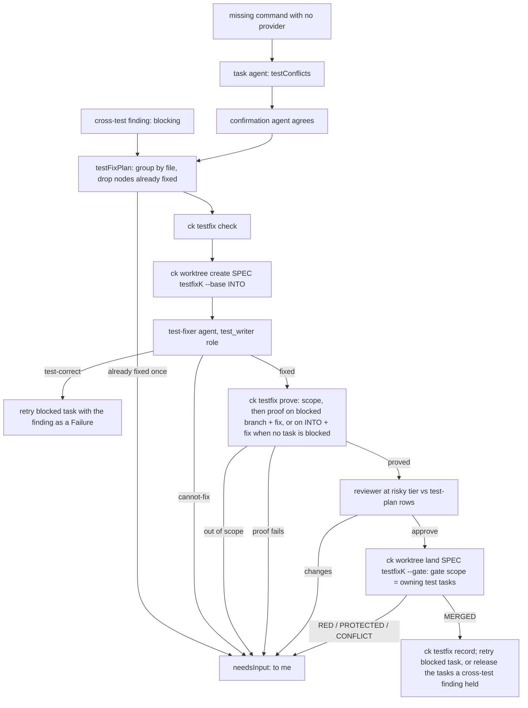

# Design: Unattended Correctness

## Overview

`/spec:implement` is one Workflow script, `plugin/workflows/spec-implement.js` (vendored verbatim to
`.claude/workflows/spec-implement.js`). Under Claude Code the Workflow runtime runs it and every mechanical step
(plan, land, gate, report) is an agent copying a ck command's JSON. Under OpenCode the runner
(`opencode/src/runner.mjs`) also provides a `ck()` global, and the script runs plan, land and relink directly
(`DIRECT_CK`, from specs/deterministic-plan). Python's `ck` owns every decision that can be made from files and
git: `gate.py` (`_run_gate`), `worktrees.py` (`land`, `merge`, claims, protected paths), `lint.py` / `relink.py`
(import-based dependency scan), `agents.py` (roles), `bench.py` + `cli/bench.py` + `cli/doctor_opencode.py`
(harness if/else).

This feature keeps that split and moves more decisions into ck: ck produces every failure list, attributes it,
checks test-track tasks, enforces protected paths at the git level, owns the spec graph, and keeps the testfix
ledger and fixture lock. The workflow only orchestrates: it calls ck (directly, or through one lean thin agent
type under Claude Code), routes structured results, and runs the agents that write code and tests.

How the PLAN.md decisions shape it:

- **D1 (per-test attribution by TC ID).** A new `attribution.py` maps each failing pytest node to its TC ID
  (`tcNNN_` in the test name), then through the spec graph's `verifies` edges to impl tasks: the edges from
  impl tasks' Verify selectors, or, only when no Verify selects the TC, the edges from its test task's
  coverage (1.1). All Done (or being
  gated as Done) means regression candidate; otherwise excused, listing the unfinished tasks. No TC ID: file
  attribution through the owning test task. Non-pytest runners: file level, else today's per-test-task rule plus
  a warning. Node IDs come from a tiny pytest report plugin ck injects through `PYTEST_ADDOPTS` (commands are never
  rewritten, the same rule `xdist.py` follows).
- **D2 (attributed periodic and final gates, run by ck).** `ck gate SPEC --attribute --json` runs the suites
  today's gate would excuse, reruns each regression candidate once (flake screen), and prints one JSON object.
  The periodic gate (every `fullGateEvery` merges, default 10), the final gate and the recheck after each fix all
  call it. OpenCode (and any host with `ck()`) runs it directly; Claude Code runs it through the lean thin agent
  (D14), which returns ck's JSON unchanged. That agent runs `ck gate ... --compact` (2.12): ck writes the full
  `ck-gate/1` JSON to a report file and prints a short `ck-gate-compact/1` object (regressions, unattributed and
  flaky in full, excused counts per task, the report path), so the Haiku agent copies little. Landing gates stay
  task-scoped.
- **D3 (one failure format).** `ck gate --json` (new; today's `ck gate` prints text only) emits `failures[]`:
  node, TC ID, attributed tasks, file, kind (`assertion`, `import`, `collection`, `timeout`, `error`) and a short
  message. The landing JSON's RED entries, the task agent's result, retries, the fixer, the recheck and the
  test-fix loop all carry the same entries. `testConflict` becomes `testConflicts[]`, with a single object read
  as a list of one.
- **D4 (automatic test fix).** A test-fixer agent in the test-writer role works on worktree `testfix<k>` (branch
  `feat/<spec>-task-testfix<k>`) created from the integration branch. `ck testfix prove` checks its proof against
  the blocked task's branch (or, for a cross-test fix with no blocked task, against the integration branch, 4.11)
  and refuses out-of-scope diffs; a reviewer at the risky tier checks the diff against the test-plan rows;
  `ck worktree land` lands it, gating the test tasks that own the files the fix changes. A per-spec ledger in git's common directory allows one automatic
  fix per test node, across runs.
- **D5 (four test-track checks).** The test-track gate runs the task's new tests and classifies each failure as
  "not built yet", bad, or unclear (right-reason check); runs `test_track.validate` from specs/ck.json; the
  cross-test review is on by default and blocking, routing to the test-fixer; and a row-fidelity script
  (`fidelity.py`, `ck lint --fidelity`) checks literal values against the test-plan row and design data models,
  passing only what it can't parse to the reviewer.
- **D6 (git hooks).** ck installs a `reference-transaction` hook and a `pre-merge-commit` hook through
  `core.hooksPath` pointing at a ck-owned directory in git's common dir, chaining to whatever hooks the repository
  already runs. The ref hook refuses an `integrate/*` update that adds protected changes not covered by
  `land.allow_paths` unless it presents a one-shot landing token ck issued. `ck worktree merge` gets `land`'s
  protected check. A run-end audit (`ck worktree audit`) compares protected files with ck's last approved state.
  My approval of a protected change is `ck worktree approve`, which needs a code typed at a real terminal.
  Creating an `integrate/*` ref is checked against ck's last approved state for that ref (9.12), so a delete
  and re-create cannot carry a protected change. The repository config and the hook scripts are read-only
  inside Claude Code's sandbox, so the unsandboxed `ck run` parent installs the hooks before it launches the
  harness, and the sandbox settings it writes deny writes to ck's hook directory and key; inside the sandbox ck
  only checks and reports the hook state (9.1, 9.10).
- **D7 (one spec graph).** A new `graph.py` builds tasks, TCs, test files, source files and CLI commands with
  depends, verifies, owns, provides, invokes and imports edges, on demand from the files (never cached across
  processes, so never stale). Attribution, lint, relink, `ck plan`'s write-set overlap map, and runtime
  missing-command edges all read it. spec-create writes `**Provides:**` on impl tasks that add or change commands.
- **D8 (per-role models under OpenCode).** `opencode.roles` in global or project ck config maps a role to
  `provider/model#variant`. The workflow tags each base (non-escalated) agent call with its role on hosts that
  provide `ck()`, and `run-child.ts` resolves the role map before the alias map. Bench arms get a `roles` map.
  Claude Code keeps its aliases (the role tag is never passed there).
- **D9 (fixture hash lock).** `fixtures.recorded` globs in specs/ck.json; ck records a sealed hash lock in git's
  common dir when a matching file first lands, reports changed locked files in the landing result and the audit,
  and accepts a change marked handcrafted with a reason in the in-tree label file.
- **D10 (claims by run ID).** A claim records the progress run key. At run start (`ck worktree start`) ck
  releases claims whose run is finished or not running, keeps live runs' claims, and falls back to the 60-minute
  rule for claims with no run ID.
- **D11 (harness registry, guarded `dsh`).** `harnesses.py` replaces the claude/opencode if/else in bench and
  doctor. The last phase verifies DeepSeek Harness's official API and either registers a `dsh` harness (a Python
  workflow host that services the runner's `agent()` / `ck()` calls) or stops with a findings report.
- **D12, D13 (success bar).** Four equity reruns, recorded by hand with run IDs. A bench config key `ck_config`
  (merged into each clone's specs/ck.json) carries the 12 pre-approved slash-command paths in
  `land.allow_paths`; `.claude/CLAUDE.md` stays protected and goes through `ck worktree approve`.
- **D14 (lean thin agents).** A new agent type `runner` (plugin `spec:runner`, vendored `ck-runner`): Bash only,
  Haiku at low effort, at most 5 turns, one shared output schema. Every thin ck call under Claude Code uses it,
  passed as the Workflow `agentType` option (see "Claude Code interfaces checked" below).
- **D15 (one spec).** One design; the `dsh` components are conditional on 18.1's verification and come last.

## Components

### Existing Components to Modify

- `src/claude_kiro/gate.py` - the gate (Stories 1-3, 5, 6, 8, 15).
  - `Check` and `GateResult` stay; `GateResult` gains `failures: List[Failure]`, `attribute: bool`,
    `warnings: List[str]`, `to_json()` (schema `ck-gate/1`) and `to_compact(report_path)` (schema
    `ck-gate-compact/1`, 2.12). `report()` (text) is unchanged (1.11): failures appear only in the JSON forms.
  - `_run` becomes `_run_command(command, project_dir, timeout, env, report_dir) -> CommandRun`: it injects the
    pytest report plugin for direct pytest invocations (detected with `xdist._segment_pytest`), keeps the 40-line
    tail for the text report, and returns the command's parsed `Failure`s (plugin report, else pytest's short
    summary lines, else file names from the output, else none).
  - `run_gate(..., attribute=False, install=None)`: without `attribute`, today's command selection and verdict
    (1.11); every failing command now also yields `failures` entries with TC ID and attributed tasks but no status.
    With `attribute`, the command set adds every test task's Verify and the full `verify` suite (see Public
    Interfaces), each failure gets an `Attribution`, regression candidates are rerun once, and the verdict comes
    from `attribution.gate_verdict` (command checks no longer decide alone).
  - Test-track tasks whose verified tasks are not all Done: their Verify now runs and `failures.right_reason_verdict`
    decides (5.1-5.5); all Done keeps today's "must pass" (5.6). Test-track gates also run the
    `test_track.validate` command (Story 6), the row-fidelity check (Story 8) and the fixture-label check feeding
    the reviewer (15.6).
- `src/claude_kiro/config.py` - `DEFAULT_CONFIG` gains `"test_track": {}` (the `validate` key is absent by default, never merged in as null) and
  `"fixtures": {"recorded": [], "labels": "specs/fixture-labels.json"}`; new validators `test_track_validate(config)
  -> List[str]` and `fixture_globs(config) -> List[str]`, both raising `ConfigError` (new) that names the key
  (6.5, 15.8). `load_config` stays tolerant; only these readers raise. A reader treats an absent key as "not
  declared" (returns []), and a key present with any other non-string, non-list-of-strings value, explicit `null`
  included, as a config error.
- `src/claude_kiro/worktrees.py` - claims, merge, land (Stories 9, 10, 15, 16).
  - `claim(..., run=None)`: the lock reason becomes `"{owner} (claim {token} at {time} run {key})"` when a run key
    is given (16.1). New `claim_info(reason) -> ClaimInfo` parses old and new formats.
  - New `release_for_run_start(root, spec, run, env, now) -> RunStartClaims` applies
    `claim_release_decision` to every claimed task worktree of the spec (16.2-16.7); commits stay (unlock only).
  - `merge()` gains the protected check (`protected_changes` against `land_allow_paths(target)`), state
    `PROTECTED` with the files (9.6), and runs its `git merge` with a landing token in the environment (9.7).
  - `land()` issues a landing token for each `git merge` and `git reset` it runs on an `integrate/*` target
    (9.7), records, after the batch, only the protected paths the landed tasks changed as approved (10.4; the rest of the state is never re-recorded at head), records new recorded-fixture locks and
    reports fixture drift per task (`Landed.fixtureDrift`), and, through `GateFn`, carries `failures` on RED
    entries (`Landed.failures`).
  - New keyword `land(..., approved: Optional[Dict[str, List[str]]] = None)`: task -> protected files I approved,
    used only by `ck worktree approve` (9.8).
  - `create_integration` calls `protect.ensure_hooks` (install only where the git metadata is writable,
    otherwise report the hook state; 9.1, 9.10) and records the baseline protected state only when no approved
    state exists for the ref (never on reuse, which would launder bypass writes; 10.1); its `Outcome.detail` names a hook problem.
    `ck worktree integration SPEC [--base] [--json]` prints `{..., hooks: HookStatus}` (`installed`, `problems`). It creates the `integrate/*` ref with a landing token, as
    every ck-made `integrate/*` update (9.7, 9.12).
  - After every install step ck runs (`create --install`, land's install, `gate --install`) and at the start of
    each `land()`, ck calls `protect.ensure_hooks`: when `core.hooksPath` no longer points at ck's directory (a
    husky `prepare` script resets it to `.husky/_`), the new value becomes the chain target, the hooks are
    reinstalled where the metadata is writable, the change is logged and the land result's `hooks` entry reports
    the re-install; otherwise that entry carries a warning (9.1, 9.9, 9.10).
  - `GateFn` becomes `Callable[[Path, List[str]], Tuple[bool, str, List[dict]]]`.
- `src/claude_kiro/cli/run.py` - `ck run` runs unsandboxed before it launches the harness, so it calls
  `protect.install_hooks(project)` first (9.1, 9.11): `core.hooksPath` lives in the repository config, which is
  read-only inside the sandbox. `sandbox_settings` gains `"denyWrite"` entries for `<git-common-dir>/ck/hooks/`
  (the scripts, `chain.json`, the recorded interpreter) and `<git-common-dir>/ck/key`, so a sandboxed process can
  run the hooks but never edit them or the key (NFR sandbox; Security). Bench arms launch `ck run`, so they get the
  same install. An install failure is printed before launch and repeated in run start's `hooks` (9.10).
- `src/claude_kiro/eta/service.py` - `prepare_spool` (unsandboxed) appends the same `superseded` end event it
  writes to data-dir copies to every spool copy (`<worktrees>/.ck-progress`) of a run it supersedes, so a pass
  whose parent was killed leaves no endless "running" record (16.2).
- `src/claude_kiro/cli/worktree.py` - CLI: `merge_cmd` treats `PROTECTED` as a bad state (exit 3); `claim_cmd`
  passes `--progress-run` to `claim(run=...)`; `_gate_fn` returns failures and maps a `testfix<k>` landing to
  `testfix.gate_scope` (4.4); `lint` gains `--fidelity`; `plan`
  gains `--compact`, and its JSON gains `overlaps`, `testVerifies`, `provides`, `graphProblems`; `relink` gains
  `--commands` (TASK becomes optional with it). New commands `worktree start`, `worktree audit`,
  `worktree approve` (below).
- `src/claude_kiro/cli/main.py` - `gate` gains `--json`, `--attribute`, `--install`; `doctor --harness` validates
  against the harness registry (17.1, 17.2) and dispatches through it; new top-level groups `graph`, `fixtures`,
  `testfix`, `git-hook` are registered.
- `src/claude_kiro/lint.py` - `lint_spec` builds the spec graph once and adds `commandEdges` (12.1),
  `unknownCommands` (12.3), `untaggedTests` (1.9), `noWriteSet` (13.4) and `graphProblems` (11.8). The existing
  `cycles`, `verifyCycles`, `reasonless`, `criticalPath`, `riskUntagged` keys and their computation are unchanged
  (12.9); `verify_order_cycles` keeps its own import scan, now reached through the graph's `imports` edges, with
  identical output.
- `src/claude_kiro/relink.py` - new `plan_command_relink(graph, tasks) -> CommandRelink` and
  `apply_command_relink(text, r)`: adds `Task P (provides \`cmd\`)` to the **Dependencies:** of each task 12.1
  names, refusing an edge that would make a cycle. `plan_relink` / `apply_relink` are unchanged (12.9).
- `src/claude_kiro/hooks/_shared/spec_parser.py` - `SpecTask.provides: List[str]` from `**Provides:** \`cmd\` ...`
  (backticked command paths).
- `src/claude_kiro/agents.py` - `DEFAULTS["reviewer"]["cross_test"]` becomes `True` (7.1); `agent_type_files`
  writes the `runner` agent with its fixed frontmatter instead of role settings.
- `src/claude_kiro/plugin.py` - `AGENT_ROLES` gains `"runner": None` (no role; fixed frontmatter); the vendor map
  already covers `.claude/agents` through `ck agents sync`.
- `src/claude_kiro/progress.py` - new `run_liveness(key, env, now) -> Liveness` ("running", "finished",
  "stale", "missing"), using `run_file`, `read_events` and `is_stale` (16.2, 16.5). It reads every copy of the run
  record it can: the spool copy under `CK_PROGRESS_DIR` when set, and the data-dir copy when readable (the sandbox
  hides it). A run with an `end` in either copy is finished; otherwise the newest event across the copies decides
  running or stale; no copy at all is missing.
- `src/claude_kiro/bench.py` - `normalize_config` accepts `ck_config` (object) and per-config `roles` (object,
  OpenCode arms); `run_arm` and `run_arm_opencode` merge `ck_config` into the clone's specs/ck.json before the
  setup commit (20.1); `run_arm_opencode` writes `opencode.roles` from the arm's `roles` (14.5) next to the
  forced aliases. New `check_arm_result(result) -> List[str]` (17.5).
- `src/claude_kiro/bench_opencode.py` - `_integration_target` calls `ck worktree start` (hooks, claim sweep)
  instead of `ck worktree integration`, keeping the same return value.
- `src/claude_kiro/cli/bench.py` - `--harness` becomes a free string validated by the registry; the
  opencode/claude branches move into the two registered `Harness` objects (17.1-17.4).
- `src/claude_kiro/cli/doctor_opencode.py` - unchanged function, registered as the `opencode` harness's doctor.
- `src/claude_kiro/analytics/roles.py` - label grammar for the new labels: `testfix <k> (Task <n>)`
  (test-writer), `testfix review <k>` (reviewer), `run start`, `audit`, `testfix ledger <k>`,
  `testfix prove <k>` (gate). Existing labels for thin calls (`plan <k>`, `land ...`, `full gate @N`,
  `final gate`, `re-check <k>`, `report`, `park <n>`, `relink <n>`) are kept.
- `plugin/workflows/spec-implement.js` and its vendored copy `.claude/workflows/spec-implement.js` - see
  "Workflow script" in Public Interfaces and Data Models. In short: a `thinCk` path for every mechanical ck call
  (direct `ck()` or the lean agent), run start and run end steps, attributed gates with structured fix and
  recheck, structured failures in results and retries, `testConflicts`, the test-fix loop, blocking cross-test
  findings, live command edges, write-set holds, and role tags. New pure functions go in the
  `// --- decisions` block.
- `plugin/workflows/spec-create.js` and `.claude/workflows/spec-create.js` - the impl-track prompt and
  `TASK_BLOCK` gain `**Provides:**` for every impl task that adds or changes a CLI command (12.4); the test-track
  prompt asks for `tcNNN_` test-name prefixes and fixture labels.
- `plugin/resources/spec-implement-brief.md` and `.claude/workflows/spec-implement-brief.md` - task agents run
  `ck gate <spec> --task N --json`, copy its `failures` into their result, report `testConflicts` (one per test),
  never report a missing subcommand of a command another task provides as a conflict, and label fixtures with
  `ck fixtures mark`.
- `plugin/resources/without-workflow-tool.md` and `.claude/workflows/without-workflow-tool.md` - the same gate
  JSON instructions for agent mode.
- `plugin/skills/implement/SKILL.md` and `.claude/commands/spec/implement.md` - pass `runnerAgent`
  (`spec:runner` in plugin mode, `ck-runner` in vendor mode); `reviewer.cross_test` described as on by default and
  blocking; report `gates`, `testFixes`, `audit`, `runStart`, `liveEdges`, `writeSetHolds`; tell me to approve a
  protected landing with `ck worktree approve` in my own terminal.
- `plugin/agents/reviewer.md`, `plugin/agents/test-writer.md` - one line each: findings name `file` and `test`;
  the test writer may be started as a test-fixer.
- `.claude/agents/ck-*.md` - regenerated by `ck agents sync` (adds `ck-runner.md`).
- `opencode/src/config.ts` - `CkConfig.roles: Record<RoleName, string>`, `"roles"` added to the known keys,
  validated at load (14.1, 14.3, 14.4); sources `roles.<role>`.
- `opencode/src/models.ts` - `ROLE_NAMES`, pure `resolveRoleRef(role, roles) -> RoleRef | null` and
  `validateRoleRef(value) -> string | null`.
- `opencode/src/run-child.ts` - `RunChildOptions.role?: string | null`; `resolveChildModel` consults
  `config.roles[role]` first, then the alias path; `ChildOutcome` gains `modelSource: "roles" | "alias" | "inherit"`.
- `opencode/src/workflow-tool.ts` - `handleAgent` reads `opts.role` and passes it to `runChild` and `AgentMeta.role`
  (14.7; `AgentRow.role` already exists in `record.ts`).
- `opencode/src/preflight.ts` - new `checkRoles(ctx)`: each role's resolved model and its source (14.8).

### New Components

- `src/claude_kiro/failures.py` - the D3 model: `Failure`, `Kind`, the pytest report reader, the short-summary
  and file-name fallbacks, `classify_kind`, `truncate_message`, `missing_command`, `classify_not_built`,
  `right_reason_verdict` (Stories 3, 5, 12.5).
- `src/claude_kiro/resources/pytest_plugin/ck_pytest_report.py` - pytest plugin loaded with
  `-p ck_pytest_report` from a directory ck prepends to `PYTHONPATH`; writes one JSON line per failed or errored
  report (controller only under xdist) to `$CK_GATE_REPORT`, with the crash line number, and, when
  `CK_GATE_COLLECT` is set, the collected node IDs (1.1, 1.6, 3.1). It removes its variables from `os.environ`
  in `pytest_configure` and writes only when `config.rootpath` equals `CK_GATE_ROOT`, so nested pytest runs never
  write to the gate's report (Public Interfaces).
- `src/claude_kiro/attribution.py` - `AttributionIndex` (from the graph), `tc_of_node`, `attribute_failure`,
  `rerun_plan`, `rerun_command`, `gate_verdict` (Stories 1, 2).
- `src/claude_kiro/graph.py` - `SpecGraph`, `build_graph`, provides inference, invokes scan, CLI-program
  discovery, `missing_command_edges`, `unknown_commands`, `write_set_overlaps`, `paths_overlap` (Stories 11-13).
- `src/claude_kiro/cli/graph.py` - `ck graph SPEC [--json]` (11.5).
- `src/claude_kiro/protect.py` - hook install and status, landing tokens, approved protected state, the audit,
  and the decisions `ref_update_decision`, `merge_commit_decision`, `audit_decision`, `approval_decision`
  (Stories 9, 10).
- `src/claude_kiro/cli/githooks.py` - hidden `ck git-hook reference-transaction STATE` and
  `ck git-hook pre-merge-commit`, called by the installed hook scripts (9.2-9.5).
- `src/claude_kiro/fixtures.py` - recorded-fixture lock (sealed, in git's common dir), label file reader,
  `lock_decision` (Story 15).
- `src/claude_kiro/cli/fixtures.py` - `ck fixtures mark PATH --handcrafted REASON` and
  `ck fixtures status SPEC [--task N] --json`.
- `src/claude_kiro/fidelity.py` - row-fidelity extraction and `check_values` (Story 8).
- `src/claude_kiro/testfix.py` - ledger (one fix per test node, per spec, across runs), `scope_decision`,
  `fix_allowed`, `prove` and `proof_decision` (Story 4).
- `src/claude_kiro/cli/testfix.py` - `ck testfix check|prove|record` (Story 4).
- `src/claude_kiro/harnesses.py` - the harness registry and the `claude` / `opencode` registrations (Story 17).
- `plugin/agents/runner.md` - the lean thin-agent type (Story 19); vendored as `.claude/agents/ck-runner.md`.
- `specs/unattended-correctness/dsh-verification.md` - 18.1's verification record, or 18.3's findings report.
- `src/claude_kiro/harness_dsh.py` - only when 18.2 applies: the `dsh` harness (`run_arm_dsh`, `doctor_dsh`,
  version check) (18.2, 18.4).
- `src/claude_kiro/workflow_host.py` and `src/claude_kiro/resources/workflow-runner.mjs` - only when 18.2
  applies: a Python parent for the runner (a byte-identical copy of `opencode/src/runner.mjs`) that services
  `agent` messages through an `AgentExecutor` (here: dsh) and lets the runner's own `ck()` run ck (18.2).

## Public Interfaces

### `ck gate` (Stories 1-3, 5, 6, 8)

```
ck gate SPEC [--task N ...] [--no-reuse] [--json [--compact]] [--attribute] [--install]
```

- `--json` prints one `ck-gate/1` object (Data Models) on stdout and nothing else; exit codes as today (0 pass,
  1 fail, 2 no tasks.md). Without `--json` the text report is printed exactly as today (1.11); the failure list
  is only in the JSON forms.
- `--compact` (with `--json`; 2.12): ck first writes the full `ck-gate/1` object to
  `<git-common-dir>/ck/<spec>/gate-reports/<UTC stamp>-<pid>.json` (the last 50 kept), then prints only a
  `ck-gate-compact/1` object (Data Models) whose `report` is that file's absolute path. Exit codes are the same as
  with `--json`. Thin gate calls under Claude Code use it; direct calls (OpenCode) read the full JSON.
  With `--attribute --json` and no `--compact`, ck writes the same report file and adds its path as `report` to
  the printed `ck-gate/1` object, so the run's results can name the full report on both paths (2.8).
- `--attribute` (whole-spec or task-scoped): runs, in this order, `verify_always`, the collection check, the
  full `verify` suite, and every task's Verify command that the full suite does not cover. Coverage is decided by
  node IDs, not by command text, so selection arguments in `verify` (`-m`, `-k`, `--ignore`, paths) cannot hide a
  task's tests: the plugin records every node each `verify` pytest command collected (`CK_GATE_COLLECT`), and each
  task's pytest Verify is collected with `--collect-only -q` under its own launcher prefix (distinct commands
  collected once per gate, up to `os.cpu_count()` at a time). A Verify whose collected nodes all ran in `verify`
  is covered and skipped; otherwise only its nodes that did not run are run, as node-ID arguments after its
  launcher prefix (`rerun_command`'s form), so no node runs twice. A Verify that fails to collect runs whole; one
  that selects no tests (pytest exit 5) or names a path that does not exist (exit 4, "file or directory not found")
  has nothing to attribute, so it is not run and is listed in `warnings`. A plain task gate still fails on it.
  Other runners' Verify commands always run. Failures are attributed (1.1-1.8),
  regression candidates are rerun once (2.4), and the gate is red iff `regressions + unattributed > 0` or a
  non-command check fails (acceptance boxes, tamper, properties as today). Excused failures never make it red
  (1.3). No `--attribute`: today's command selection (1.11).
- `--install` runs the project's install step (`install_command`) in the checkout first; a failed install is a
  failing check `install`.
- Every pytest command the gate runs gets, in its environment only: `CK_GATE_REPORT=<tmp file>`,
  `CK_GATE_ROOT=<the checkout the gate runs in>`, `PYTHONPATH=<ck plugin dir>:$PYTHONPATH`, and
  `PYTEST_ADDOPTS="-p ck_pytest_report $PYTEST_ADDOPTS"`. A command that is not a direct pytest invocation (a
  `tox`, `make` or shell script wrapper) gets nothing injected and is parsed from its output.
- Nested pytest runs never reach the gate's report: in `pytest_configure` the plugin reads its variables, then
  removes `CK_GATE_REPORT`, `CK_GATE_ROOT`, `CK_GATE_COLLECT` and its own `-p ck_pytest_report` token from
  `os.environ` (and `PYTEST_ADDOPTS`), so a test that starts pytest in a subprocess (ck's own suite does this
  often) passes nothing on; and it writes only when `config.rootpath` equals `CK_GATE_ROOT`. Under xdist the
  controller has read the variables before the workers start, and only the controller writes.

### `ck worktree` additions (Stories 9, 10, 16)

```
ck worktree start SPEC [--base BRANCH] [--run KEY] --json      # run start: integration, hooks, baseline, claim sweep
ck worktree audit SPEC [--into BRANCH] --json                   # run end: protected drift, hooks, fixture lock
ck worktree approve SPEC TASK [--into BRANCH]                   # my approval of a PROTECTED task; TTY only
ck worktree claim SPEC TASK ... --progress-run KEY              # existing flag; now also recorded as the claim's run
ck worktree merge SPEC TASKS... [--json]                        # now PROTECTED-checked, exit 3 on PROTECTED
ck worktree land SPEC TASKS... --json                            # tasks[].failures, tasks[].fixtureDrift (additive)
```

- `start` prints `ck-run-start/1`: `{integration: Outcome, hooks: HookStatus, baseline: {commit, files},
  releasedClaims: [{task, run, reason}], keptClaims: [{task, run}], warnings: [str]}`. Exit 0 even when hooks
  could not be installed (that is reported, 9.10); exit 3 when the integration worktree cannot be created.
- `audit` prints `ck-audit/1` (Data Models); exit 0 when `clean`, 1 when drift or hook problems, 3 when
  incomplete.
- `approve` refuses (exit 2, no change) unless stdin and stdout are a TTY and I type the 6-character code it
  prints; then it lands the task with `land(..., approved={task: files}, keep=True)` (the task branch and worktree stay, as the record of what I approved) and prints the landing line. It never
  takes `--json` or a code on the command line.

### `ck graph` (Story 11)

```
ck graph SPEC [--json]
```

`--json` prints `ck-graph/1`: `{spec, nodes: [Node], edges: [Edge], problems: [GraphProblem]}`, nodes sorted by
`(kind, id)` and edges by `(kind, src, dst)` (11.5, determinism NFR). Text mode prints counts and problems.

### `ck plan --json` additions (Stories 7, 12, 13, 19)

Additive keys: `overlaps: {task: [task]}` (write-set overlaps, 13.1), `testVerifies: {testFile: [implTask]}`
(7.4), `provides: {command: [task]}` (12.5), `graphProblems: [GraphProblem]`. `--compact` prints only the
scheduler keys (`done`, `remaining`, `deps`, `ready`, `cycles`, `verifyCycles`, `overlaps`, `testVerifies`,
`provides`), so a thin agent copies little.

### `ck lint` and `ck relink` additions (Stories 1, 8, 12, 13)

```
ck lint SPEC [--json]                         # + commandEdges, unknownCommands, untaggedTests, noWriteSet, graphProblems
ck lint SPEC --fidelity [--task N] --json     # row fidelity: {checked, mismatches, unparsed, unmatched}
ck relink SPEC --commands [--apply] [--commit] [--json]   # add the missing command dependency edges
ck relink SPEC TASK [--apply] ...             # unchanged
```

New lint entries are warnings: they never change lint's exit code (which stays 1 only for cycles). `--fidelity`
exits 1 when there are mismatches.

### `ck testfix` (Story 4)

```
ck testfix check SPEC --test NODE ... --json            # {allowed: [node], alreadyFixed: [{node, at, fix}]}
ck testfix prove SPEC FIXID (--blocked TASK | --held TASK ...) --test NODE ... [--into BRANCH] --json
ck testfix record SPEC FIXID --test NODE ... --outcome landed|to-me --json
```

`prove` prints `{scope: ScopeDecision, proof: ProofVerdict | null, changedTests: [node], against}`. It checks
scope first (4.5); only an in-scope fix gets a proof run. With `--blocked`, the proof checkout is the blocked
task's branch with the fix merged (4.2); with `--held` (a cross-test fix, which has no blocked task), it is the
integration branch with the fix merged, and every failure must be `not-built` (4.11). `against` names the branch
used. `record` writes the ledger entry for every node (4.8).

A test-fix lands with `ck worktree land SPEC testfix<k> --gate` (4.4). `testfix<k>` is not a task, so land's
`_gate_fn` maps it with `testfix.gate_scope(graph, changed, nodes) -> List[str]`: the test tasks that own a file
the fix changes (graph `owns` edges), plus the test tasks covering the TC IDs of the fixed nodes. The landing
gate is `run_gate(target, spec, scope)`, task-scoped as every landing gate (2.10), so the test-track checks of
Story 5 apply to the fixed tests. An empty scope is RED with "test fix testfix<k> changes no file a test task
owns". The land JSON entry for `testfix<k>` names `gateTasks`.

### `ck fixtures` (Story 15)

```
ck fixtures mark PATH --handcrafted REASON     # writes the label (sha256 of the current content + reason)
ck fixtures status SPEC [--task N] --json      # {locked: [...], drift: [...], unlabeled: [...], configError}
```

### `ck git-hook` (hidden; Story 9)

```
ck git-hook reference-transaction STATE    # stdin: "<old> <new> <ref>" lines, as git passes them
ck git-hook pre-merge-commit
```

Called only by the installed scripts. Non-zero exit refuses (git aborts the transaction in state `prepared`).

### `ck bench run` / `ck doctor` (Stories 14, 17, 18)

`--harness NAME` accepts any registered harness; an unknown name fails with
`unknown harness "x" (registered: claude, opencode[, dsh])` (17.2). Bench config gains `ck_config` (object merged
into specs/ck.json of every clone) and, for OpenCode arms, `configs[].roles` (`{role: "provider/model#variant"}`).

### OpenCode config (Story 14)

```json
{ "opencode": { "roles": { "implementer": "opencode-go/muse-spark-1.3-contributor#medium",
                           "reviewer": "opencode-go/deepseek-v4.1-flash#medium" } } }
```

Role names: `implementer`, `test_writer`, `reviewer`, `reviewer_risky`, `fixer`, `orchestrator`, `resolver`.

### Workflow script (`plugin/workflows/spec-implement.js`)

- **New args:** `runnerAgent` (string or null: `spec:runner` / `ck-runner`), `runId` (defaults to
  `progressRun`).
- **Agent options:** thin calls pass `{ agentType: RUNNER, schema: CK_CALL, label, phase }` with no model or
  effort. Thin gate calls add `--compact` to the ck command (2.12). On hosts with `ck()`, base calls carry `role`; escalated calls drop it (the alias map resolves ladders).
- **`RESULT` schema additions:** `failures: Failure[]` (copied from ck), `testConflicts: TestConflict[]`.
  `testConflict` stays accepted.
- **`REVIEW_SCHEMA` findings:** optional `test` (cross-test findings name it).
- **New schemas:** `CK_CALL` (thin agents), `TESTFIX` (test-fixer).
- **Return value additions:** `runStart`, `gates: GateRun[]`. Old readers keep their shapes:
  `analytics/collect.py`, `issues.py`, `share.py` and `bench.py` read `.green` on `fullGates[]` and `finalGate`,
  so every `GateRun` carries `green` (`state === 'green'`), `fullGates` stays as the periodic entries
  (`{afterMerges, green, ...GateRun}`), and `finalGate` stays `{green, fix, ...GateRun}` for the final gate.
  `testFixes` is superseded, not extended: its entries become `TestFixRecord`s (the old
  `{task, file, test, criterion, reason, fix}` report-only shape goes away with the report-only behaviour; no
  Python reader uses it, and `tests/js/spec_implement.test.mjs`'s report-only cases are updated by Task 86).
  Further additions: `liveEdges: LiveEdge[]`,
  `writeSetHolds: [{task, waitsOn, at}]`, `audit`, `thinAgent: {type, fallback, warning}`, and `crossTests[]`
  entries gain `blocking` and `routed`. The task report entry gains `failures` and `testConflicts`.

### Decision Seams

Every allow/refuse/hold rule is one pure function (no I/O, clock, network; all inputs as arguments). Callers
gather inputs and act on the output; they never re-implement the rule.

| Seam | Module (owner) | Input -> output | Decides |
|---|---|---|---|
| `classify_kind(exc_type, phase, message, timed_out)` | `failures.py` | `str, str, str, bool -> Kind` | 3.2: the five kinds; unknown -> `error`; `timed_out` wins, then phase `collect` maps `ImportError`/`ModuleNotFoundError` to `import` and anything else to `collection` |
| `truncate_message(text, limit=500)` | `failures.py` | `str, int -> (str, bool)` | 3.5, NFR message limit; never drops. The kept prefix is non-empty and cut on a grapheme boundary (not before a combining mark or ZWJ/VS16, not after a ZWJ, not inside CRLF or a regional-indicator pair); a marker may follow. When no boundary exists in 1..limit, a hard cut at `limit` is the fallback |
| `missing_command(text, programs)` | `failures.py` | `str, Sequence[str] -> Optional[str]` | 12.5: unknown subcommand / unrecognized arguments / invalid choice -> the command path |
| `classify_not_built(failure, ctx)` | `failures.py` | `Failure, ProjectContext -> "not-built" \| "bad" \| "unclear"` | 5.2-5.4, 5.7 |
| `assert_reaches_project(test_source, line, ctx)` | `failures.py` | `str, int, ProjectContext -> Optional[bool]` | 5.7: does the failing assert's expression reach project code (None: cannot parse) |
| `right_reason_verdict(results, all_verified_done)` | `failures.py` | `List[TestResult], bool -> RightReasonVerdict` | 5.1, 5.3-5.6: block, warn, or require pass |
| `tc_of_node(node_id)` | `attribution.py` | `str -> Optional[str]` | 1.1: `tcNNN_` -> `TC-N` |
| `param_owned_file(node_id, file_owner)` | `attribution.py` | `str, Mapping[str, str] -> Optional[str]` | 1.5 hint only: a wrapper node whose parameter ID names an owned file (never attributes or excuses) |
| `attribute_failure(failure, index, done, gated)` | `attribution.py` | `Failure, AttributionIndex, FrozenSet[str], FrozenSet[str] -> Attribution` | 1.1-1.8: tasks, by-what, candidate or excused |
| `rerun_plan(pairs)` | `attribution.py` | `List[Tuple[Failure, Attribution]] -> List[RerunItem]` (`RerunItem.key` is the failure's node, or `collect:<file>` for a file-level failure) | 2.4, 2.5, NFR: each candidate once, excused never |
| `gate_verdict(pairs, reruns, other_checks_ok)` | `attribution.py` | `List[Tuple[Failure, Attribution]], Mapping[str, bool], bool -> GateVerdict` (`reruns` maps each failure key, as above, to whether its rerun passed; `GateVerdict.statuses` is keyed the same way) | 2.4, 2.6, 2.8, 3.4: regression / flaky / excused / unattributed, red or green |
| `ref_update_decision(update, protected_changed, allow, token, approved)` | `protect.py` | `RefUpdate, List[str], List[str], Optional[TokenCheck], Optional[Mapping[str, str]] -> RefDecision` | 9.2-9.4, 9.12 |
| `token_matches(token, update, used, mac_ok)` | `protect.py` | `TokenRecord, RefUpdate, bool, bool -> bool` | 9.3: one-shot, this ref, this target |
| `merge_commit_decision(head_ref, changed, allow, token_present)` | `protect.py` | `-> RefDecision` | 9.5 |
| `approval_decision(stdin_tty, stdout_tty, typed, expected)` | `protect.py` | `bool, bool, str, str -> bool` | 9.8 |
| `audit_decision(approved, current, allow, hooks, fixtures)` | `protect.py` | `Optional[ApprovedState], Dict[str,str], List[str], HookStatus, Mapping[str, object] (a FixtureReport as dict) -> AuditReport` | 10.1-10.5, 15.5 |
| `refuse_paths(ref, changed, allow)` | `protect.py` | `str, Sequence[str], Sequence[str] -> List[str]` | 9.2: the protected-filter part of `ref_update_decision`; accepts git-quoted names (unquoted before comparing) |
| `claim_release_decision(claim, starting_run, liveness, age_s, stale_minutes)` | `worktrees.py` | `ClaimInfo, Optional[str], Optional[Liveness], float, float -> "release" \| "keep" \| "own"` | 16.2-16.5, 16.7 |
| `missing_command_edges(graph)` | `graph.py` | `SpecGraph -> List[MissingEdge]` | 12.1, 12.2 |
| `unknown_commands(graph, source_words)` | `graph.py` | `SpecGraph, FrozenSet[str] -> List[UnknownCommand]` | 12.3 |
| `paths_overlap(a, b)` / `write_set_overlaps(owns)` | `graph.py` | `str, str -> bool` / `Dict[str, List[str]] -> Dict[str, List[str]]` | 13.1 (globs matched), 13.4 |
| `scope_decision(changed, plan_before, plan_after, config)` | `testfix.py` | `List[Change], str, str, dict -> ScopeDecision` | 4.5 |
| `fix_allowed(nodes, ledger)` | `testfix.py` | `List[str], Ledger -> FixAllowance` | 4.8 |
| `proof_decision(outcomes)` | `testfix.py` | `List[ProofOutcome] -> ProofVerdict` | 4.2, 4.11 |
| `gate_scope(graph, changed, nodes)` | `testfix.py` | `SpecGraph, List[str], List[str] -> List[str]` | 4.4, 2.10: the test tasks a test-fix landing gates |
| `lock_decision(lock, changes, labels)` | `fixtures.py` | `Dict[str, LockEntry], Dict[str, Optional[str]], Dict[str, Label] -> FixtureReport` | 15.1-15.4 |
| `check_values(values, row, models)` | `fidelity.py` | `List[TestValue], Optional[RowFacts], ModelFacts -> FidelityResult` | 8.2-8.5 |
| `test_track_validate(config)` / `fixture_globs(config)` | `config.py` | `dict -> List[str]` (raises `ConfigError`) | 6.4, 6.5, 15.7, 15.8 |
| `select(name, registry)` | `harnesses.py` | `str, Mapping[str, Harness] -> Harness` (raises listing names) | 17.1, 17.2 |
| `writeSetHold({ready, active, overlaps})` | workflow decisions block | `-> {start, held: [{task, waitsOn}]}` | 13.1-13.3, 13.5, 13.6 |
| `liveEdgeDecision({task, failures, deps, done, liveDeps})` | workflow decisions block | `-> {action: 'none'\|'wait'\|'conflict'\|'blocked', edges, cycle, tests}` | 12.5-12.7 |
| `testConflictsOf(result)` | workflow decisions block | `-> TestConflict[]` | 3.7 |
| `failuresForPrompt(failures, limit = 50)` | workflow decisions block | `-> {shown, more: {file: count}, total}` | 3.8 |
| `testFixPlan({conflicts, alreadyFixed})` | workflow decisions block | `-> {groups: [{file, conflicts}], toMe: [...]}` | 4.8, 4.9 |
| `heldByCrossTest({findings, testVerifies})` | workflow decisions block | `-> Set<task>` | 7.4 |
| `gateOutcome(call)` | workflow decisions block | `CkCallResult -> {state: 'green'\|'red'\|'error', green, regressions, excusedByTask, flaky, report, reason}` (reads `ck-gate/1` or `ck-gate-compact/1`; a green needs `ok:true` and exit code 0, so `code` is cross-checked against `ok`) | 2.6, 2.8, 2.9, 2.12, 19.5 |
| `thinAgentMode({runnerAgent, unavailable, direct})` | workflow decisions block | `-> {mode: 'direct'\|'lean'\|'default', warning}` | 19.1, 19.4, 19.6 |
| `resolveRoleRef(role, roles)` / `validateRoleRef(value)` | `opencode/src/models.ts` | `-> RoleRef \| null` / `-> string \| null` (error) | 14.1-14.4, 14.6 |

The JS seams live between `// --- decisions` and `// --- end decisions`, so `tests/js/load_decisions.mjs` can cut
them out as it does today; the new names are added to its exported list.

## Data Models

### Python (dataclasses, `failures.py`, `attribution.py`)

```python
Kind = Literal["assertion", "import", "collection", "timeout", "error"]

@dataclass(frozen=True)
class Failure:
    node: Optional[str]          # pytest node id "tests/test_x.py::test_tc012_rate[a]"; None for file/command-level
    file: Optional[str]          # repo-relative test file; None when only the command is known
    kind: Kind                   # classify_kind
    message: str                 # first line of the crash message, <= 500 chars
    truncated: bool              # message was cut (3.5)
    command: str                 # the Verify/verify command that produced it
    exc_type: Optional[str]      # "AssertionError", "ModuleNotFoundError", ...
    phase: Optional[str]         # "setup" | "call" | "teardown" | "collect"
    crash_path: Optional[str]    # file of the innermost frame, repo-relative when inside the repo
    crash_line: Optional[int]    # line of the innermost frame in crash_path (the failing assert for 5.7)
    detail: str                  # longer text kept for classification (<= 4000 chars, not emitted in JSON)
    missing_command: Optional[str]  # command path from missing_command(), e.g. "mtr thesis new"

@dataclass(frozen=True)
class Attribution:
    tc_id: Optional[str]         # "TC-12" or None
    tasks: Tuple[str, ...]       # attributed impl tasks, sorted numerically
    by: Literal["tc", "file", "command", "none"]   # tc (1.1), file (1.4, 1.6, 1.7, 1.8), command (1.7 fallback), none (1.5)
    candidate: bool              # regression candidate (1.2, 1.5) vs excused (1.3)
    excused_by: Tuple[str, ...]  # unfinished attributed tasks (1.3)
    warnings: Tuple[str, ...]    # unknown TC id (1.8), attribution unavailable (1.7)
    hint: Optional[str]          # by="none" only: owning test task of the file a wrapper's parameter ID names (1.5)

@dataclass(frozen=True)
class AttributionIndex:          # built from SpecGraph once per gate
    tc_tasks: Mapping[str, Tuple[str, ...]]        # TC id -> impl tasks (1.1): its "Verify -k" verifies edges;
                                                   # only when it has none, its "Verifies" (test-task coverage) edges
    task_selectors: Mapping[str, Tuple[str, ...]]  # impl task -> its last `-k` expression per Verify command
    selected_tc_coverage: Mapping[str, Tuple[str, ...]]  # TC attributed through "Verify -k" -> its "Verifies" tasks
    file_owner: Mapping[str, str]                  # test file -> owning test task
    test_task_verifies: Mapping[str, Tuple[str, ...]]  # test task -> impl tasks it verifies
    command_owner: Mapping[str, Tuple[str, ...]]   # Verify command -> tasks that list it (1.7 fallback)

# File attribution (1.4) uses only the node's own file. A node with no TC ID whose file has no owning test
# task is unattributed (1.5, `by="none"`, candidate, never excused), even when it is a pytest wrapper that runs
# other suites, such as `tests/test_workflow_scripts.py::test_workflow_control_flow[thin_agents.test.mjs]`.
# For such a node `param_owned_file` only builds a hint: when the parameter ID (or a `/`-separated part of it)
# equals an owned file's path or its unique basename among owned files, `hint` names that file and its owning
# test task ("parameter names tests/js/thin_agents.test.mjs, owned by test Task 6"), so the fixer is pointed at
# the right task. The hint never adds tasks, never changes `by` or the status, and never excuses. The
# parameter ID is never read for TC IDs (P-3).

@dataclass(frozen=True)
class RerunItem:
    key: str                     # node id, or "collect:<file>" for a collection/import failure
    command: str                 # launcher prefix + " -q -p no:cacheprovider " + shlex.quote(node) ...

@dataclass(frozen=True)
class GateVerdict:
    red: bool
    statuses: Mapping[str, Literal["regression", "excused", "flaky", "unattributed"]]  # by failure key
    counts: Mapping[str, int]    # regressions, excused, flaky, unattributed

@dataclass(frozen=True)
class TestResult:                # one new test of a test-track task (5.x)
    node: str
    passed: bool
    failure: Optional[Failure]

@dataclass(frozen=True)
class RightReasonVerdict:
    blocking: Tuple[Failure, ...]   # class "bad" (5.3)
    unclear: Tuple[Failure, ...]    # reported in checks, not blocking (5.4)
    already_passing: Tuple[str, ...]  # warning (5.5)
    require_pass: bool              # all verified tasks Done: today's rule (5.6)

@dataclass(frozen=True)
class ProjectContext:            # classify_not_built inputs, gathered by the gate
    project_modules: FrozenSet[str]   # top-level packages/modules of the project (src/ layout aware)
    owned_paths: FrozenSet[str]       # files owned by impl tasks (graph owns edges), existing or not
    programs: FrozenSet[str]          # the project's CLI programs (graph)
    test_paths: FrozenSet[str]        # this task's test files and fixtures
    test_sources: Mapping[str, str]   # source text of this task's test files (5.7), read by the gate
```

`classify_not_built` rules, first match wins (conservative per the PLAN risk). For a test-body `AssertionError`
(PLAN D19, V2) the split is rule 5: bad, and blocking, only when the failing assert runs no project code and uses
no name imported from the project's own code; every other test-body `AssertionError` is unclear, passes, and is
reported:

1. `NotImplementedError` anywhere in the chain -> not-built. "Anywhere" means an exception line of a traceback
   (`NotImplementedError: x` at the start of a line, also in a chained traceback); a message that only quotes the
   name mid-line (`AssertionError: NotImplementedError: ...`) is not a chain.
2. `ModuleNotFoundError` / `ImportError` / `cannot import name` / `AttributeError: module 'x' has no attribute 'y'`
   naming a module in `project_modules` or a path in `owned_paths` -> not-built. Naming a third-party module ->
   unclear. Naming a test helper module (a path in `test_paths`, such as `tests/helpers.py`) -> bad: a broken
   helper is a test-side wrong reason.
3. `missing_command(detail, programs)` returns a command, or the detail holds click's `No such command`,
   argparse's `invalid choice` / `unrecognized arguments` for one of `programs` -> not-built. An
   `AssertionError` (a CLI exit code checked with `assert`) counts only when the text carries the program's usage
   banner (`usage:`): the banner stops an assertion's own message that quotes a CLI error from passing as the
   CLI's output (anti-spoof; such a message falls through to rule 5).
4. Schema/validation errors while loading data (`ValidationError`, `JSONDecodeError`, `yaml.YAMLError`,
   `UnicodeDecodeError`, `FileNotFoundError` for a path in `test_paths`), any error in phase `setup`, an
   `AssertionError` whose `crash_path` is a test helper, conftest or fixture file other than the test file itself (a
   path in `test_paths`, a conftest, or a `tests/` or `fixtures/` file that is not in `owned_paths` and not under `src/`),
   and `SyntaxError` / `NameError` in the test file -> bad.
5. An `AssertionError` whose `crash_path` is the test file (5.7): `assert_reaches_project(test_sources[file],
   crash_line, ctx)` parses the test file with `ast`, finds the `assert` statement at `crash_line` and its
   enclosing test function, and follows every name in the assert expression back through assignments (and
   `for`/`with` targets) in that function. The expression reaches project code when any value it depends on
   uses a name imported from a module in `project_modules` (or from a path in `owned_paths`), a parameter of the
   test function (a pytest fixture, which may call project code), or a call whose callee is such a name or an
   attribute of one. A call to a function defined in the same test file is followed into that function's body
   the same way, and reaches project code when its body does; a call to a name imported from any other module
   of the repository (a test helper such as `tests/helpers.py`) reaches project code, because the parse cannot
   see what it runs (5.7: "no call into project code"). Builtins, literals, the standard library (`json`, `pathlib`, `open`, `csv`, `datetime`, ...)
   and third-party data readers installed outside the repository (`packaging`, `pytest`) do not count. Four
   exceptions reach project code, since they run a program or project code: `subprocess`, `runpy`, `importlib`,
   `pty`, `multiprocessing` and `os.system` / `os.popen` / `os.exec*` / `os.spawn*` (the CLI run through a
   standard-library module); the builtins `__import__`, `eval`, `exec` and `compile`. A name that nothing in its
   scope binds and that is not a builtin (for example one a `from X import *` supplies, or a global the parse
   cannot see) reaches project code, so an ambiguity stays unclear, never bad. A `lambda`'s own parameters are
   values, not fixtures. `False` (only literals or file-loaded data, for example
   `prices = json.load(open("tests/fixtures/prices.json")); assert prices["AAPL"] == 4.15`) -> bad. `True` (for
   example `assert rate_floor(prices) == 0.04`, where a stub may return a wrong value) or `None` (the source or
   line cannot be parsed) -> unclear.
6. Everything else -> unclear (reported, not blocking).

### Python (`graph.py`)

```python
NodeKind = Literal["task", "tc", "test_file", "source_file", "command"]
EdgeKind = Literal["depends", "verifies", "owns", "provides", "invokes", "imports"]

@dataclass(frozen=True)
class Node:
    id: str        # "task:12", "tc:TC-12", "file:tests/test_x.py", "cmd:mtr thesis new"
    kind: NodeKind
    label: str     # task title, TC criterion, path or command path

@dataclass(frozen=True)
class Edge:
    kind: EdgeKind
    src: str       # depends: dependent task -> dependency; verifies: tc -> impl task; owns: task -> file;
    dst: str       # provides: task -> cmd; invokes: test file -> cmd; imports: file -> file
    source: str    # "tasks.md", "Verify -k", "Verifies", "Provides", "design", "scan", "live"

@dataclass(frozen=True)
class GraphProblem:
    source: str    # file path or "tasks.md#Task 12"
    problem: str   # e.g. "SyntaxError line 14: invalid syntax", "unparsable **Provides:** value"

@dataclass
class SpecGraph:
    spec: str
    nodes: List[Node]
    edges: List[Edge]
    problems: List[GraphProblem]
    programs: List[str]   # CLI program names: [project.scripts] keys, package.json "bin", design CLI table first words
```

How edges are filled (the API delegated by PLAN):

- **depends, owns:** `parse_tasks` (Files globs kept as written; a trailing `/` means `dir/**`).
- **verifies:** for each impl task, every `tcNNN_` term in a Verify `-k` expression not preceded by `not`; for each
  test task T, every TC found in T's test files (`def test_tcNNN_`, `test('tcNNN_ ...')`) or in test-plan rows
  whose Test file column names one of T's files, to each task in `T.verifies`. Each edge keeps its origin in
  `source` (`"Verify -k"` or `"Verifies"`). Attribution (1.1) uses a TC's `"Verify -k"` edges; it falls back to
  its `"Verifies"` edges only when the TC has no `"Verify -k"` edge, so the two are never unioned. For a failing
  node it keeps only the selecting tasks whose last `-k` expression can accept that node's id (`-k "tc3_ and tc4_"`
  names TC-3 but never runs a test carrying only `tc3_`, so it must not excuse one, 1.2); when none can, the TC's
  `"Verifies"` edges, else file attribution with a warning. The edges themselves stay TC-level. A tc node exists
  only for a TC some test file or test-plan row defines. A TC that only a Verify `-k` names keeps its verifies
  edge with no tc node: a dangling verifies source, which consumers must accept (the freshness rule of 11.7
  requires the node to vanish once no test defines the TC).
- **provides:** `**Provides:**` wins (11.3). Otherwise inferred: a design.md table row with a backticked command
  path whose row names a file the task owns; else a backticked command path, starting with a known program, in
  the task's title or description. Ambiguity (two tasks inferred) keeps both edges and adds a GraphProblem.
  Group commands (`mtr thesis`) follow the same rule: a `cmd:` node exists only when some task provides it or a
  test invokes it; a table row alone, with no owning task, adds no node.
- **invokes:** scan of each test file (Python AST string constants and list/tuple literals; regex for JS) for a
  sequence of words that starts with a known program (`["mtr", "thesis", "new"]`, `"mtr thesis new --x"`), or a
  `CliRunner().invoke(..., ["thesis", "new"])`-style list matching a known command path without the program. The
  edge goes to the longest known command path that prefixes it; an unknown path under a known program becomes a
  `cmd:` node with no provider (12.3).
- **imports:** `lint._imports` / `_module_candidates`, unchanged.
- **Freshness (11.7):** built on demand from files on every call; the only memo is in-process, keyed by each
  input's `(path, size, mtime_ns, st_ctime_ns, st_ino)`. `os.utime` can restore size and mtime_ns but not
  `st_ctime_ns` or `st_ino` (an atomic replace changes the inode), so a same-size, same-mtime rewrite within one
  second still misses the memo. If a build cannot rely on these (a filesystem with coarse ctime), hash the
  content instead of trusting stat. No on-disk cache.
- **Malformed sources (11.8):** a task block that fails to parse, a test file with a syntax error, or an
  unreadable design.md adds a `GraphProblem` and the rest is built.
- `unknown_commands` treats a path as existing when every word of it appears as a string literal in a non-test
  source file (`@group.command("new")`, `add_parser("new")`), passed in as `source_words`.

### Python (`protect.py`)

```python
@dataclass(frozen=True)
class RefUpdate:
    ref: str                 # "refs/heads/integrate/equity"
    old: str                 # 40-hex, all zeros on create
    new: str                 # 40-hex, all zeros on delete
    new_tree: Optional[str]
    new_parents: Tuple[str, ...]
    ancestor_of_old: bool    # new is an ancestor of old (rewind)
    # create: old is all zeros; delete: new is all zeros (9.12)

@dataclass(frozen=True)
class TokenRecord:           # <common>/ck/tokens/<id>.json
    id: str                  # 16 random hex
    ref: str
    old: str
    tree: str
    parents: Tuple[str, ...]
    issued_at: str
    reason: str              # "land 12 14", "approve 93", "reset after red batch", "merge fix3"
    files: Tuple[str, ...]   # protected files this update carries
    mac: str                 # HMAC-SHA256 over the fields above, key <common>/ck/key (0600)

@dataclass(frozen=True)
class RefDecision:
    allow: bool
    files: Tuple[str, ...]   # protected files not covered by allow-list
    message: str             # names the files and `ck worktree approve SPEC TASK`

@dataclass(frozen=True)
class HookStatus:
    installed: bool
    active: bool             # effective core.hooksPath (in the integration worktree) is ck's directory
    intact: bool             # scripts match the recorded sha256
    chained_to: Optional[str]
    problems: Tuple[str, ...]  # e.g. "cannot write .git/ck/hooks: Read-only file system"

@dataclass(frozen=True)
class ApprovedState:         # <common>/ck/<spec>/protected.json, sealed with a mac
    ref: str
    commit: str
    files: Mapping[str, str]                 # protected path -> approved blob oid; land() re-records only the paths its landed tasks changed, so this is not the whole tree at `commit`
    approvals: Tuple[Mapping[str, object], ...]  # {at, task, files, by: "allow-list"|"approval"|"baseline", commit}; one record per task and class
    # The hook finds the approved state of a ref through <common>/ck/refs.json (ref -> spec), written with it.
    # The state outlives a deleted ref, so a re-created ref is checked against it (9.12).

@dataclass(frozen=True)
class AuditReport:
    complete: bool           # False when the approved state is missing, unreadable or its mac fails (10.5)
    clean: bool              # complete and no drift and hooks fine and fixtures fine
    drift: Tuple[Mapping[str, str], ...]     # {file, change: added|changed|deleted}
    hooks: HookStatus
    fixtures: Mapping[str, object]           # FixtureReport as dict
    problems: Tuple[str, ...]
```

Hook layout (delegated by PLAN):

- Who installs: `ck run` (unsandboxed, before it launches the harness) and any unsandboxed ck that calls
  `protect.ensure_hooks` (`ck worktree start` from bench's OpenCode path, `ck worktree integration` in my
  terminal). Inside Claude Code's sandbox `.git/config` and `.git/hooks` are read-only, so there `ensure_hooks`
  only reads `hook_status` and reports (9.10); it never half-installs.
- Write protection: `<git-common-dir>/ck/hooks/` and `<git-common-dir>/ck/key` are in the run sandbox's
  `denyWrite` list (`cli/run.py`), so sandboxed agents and sandboxed ck can read and run them but not change them.
  `<git-common-dir>/ck/tokens/` and `<git-common-dir>/ck/<spec>/` stay writable: sandboxed `land` issues tokens,
  the hook consumes them, and landings record the approved state. The key is created by the unsandboxed install.
- `<git-common-dir>/ck/hooks/`: one POSIX `sh` script per standard git hook name. Each runs the chained hook (the
  previous effective hooks directory, recorded in `chain.json`) with the same arguments and stdin, exits with its
  status if non-zero, then, for `reference-transaction` and `pre-merge-commit` only, runs ck. The
  `reference-transaction` script reads stdin into a variable first, acts only in state `prepared`, and calls ck
  only when a line's ref starts with `refs/heads/integrate/`; otherwise it exits after the chain (hook-cost NFR).
- ck is found as `ck` on `PATH`, else the interpreter recorded at install (`<python> -m claude_kiro.cli`). If
  neither runs, an `integrate/*` update is refused with a message saying how to reinstall (fail closed); other
  refs pass.
- Install sets `core.hooksPath` (repository config) to that directory, recording the previous value, or
  `<common>/hooks` when unset, as `chain.json.previous`. Reinstall is idempotent and keeps the original chain
  target.
- The allow-list the hook applies is `land.allow_paths` from the **old** commit's `specs/ck.json` (`git show
  <old>:specs/ck.json`), so a merge cannot allow itself.
- Rule (`ref_update_decision`): non-`integrate/*` ref -> allow; delete -> allow (it lands nothing; 9.12);
  create -> compare the new commit's protected files (path -> blob oid) with the approved state of that ref
  (`approved`): equal -> allow; different, or no approved state -> allow only with a token that `token_matches`
  (9.12); otherwise compute `git diff --name-only --no-renames old new` filtered by `PROTECTED_PATHS` minus the
  allow-list; empty -> allow; non-empty -> allow only with a token that `token_matches`. A create has no old
  commit, and 9.12 compares every protected file with the approved state, so no allow-list applies to a create:
  allow-listed files that ck landed are already in the approved state (`by: "allow-list"`).
- Token: ck writes the record, then runs its own git command with `CK_LANDING_TOKEN=<id>` in that process's
  environment. The hook verifies the mac, `ref`, `old`, the new commit's tree and parents, and that it is unused,
  then renames it to `used/` (one-shot). A token is bound to `old`, so even if the rename fails it cannot match a
  later update. ck issues a token for every `integrate/*` update it makes (merge, bisect reset, approval landing,
  fixer merge), whether or not it carries protected files (9.7).

### Python (`worktrees.py`, `progress.py`)

```python
@dataclass(frozen=True)
class ClaimInfo:
    owner: str
    token: Optional[str]
    at: Optional[str]
    run: Optional[str]       # progress run key, None for older claims and hand-made locks

Liveness = Literal["running", "finished", "stale", "missing"]
# running: some copy of the run record (spool under CK_PROGRESS_DIR, data dir when readable) exists, no copy
#          has `end`, and the newest event across the copies is within progress.STALE_MIN (120 min)

@dataclass
class RunStartClaims:
    released: List[Dict[str, str]]   # {task, run, reason}
    kept: List[Dict[str, str]]       # {task, run}
```

`claim_release_decision`: `run == starting_run` -> own (16.7); `run` set and liveness `running` -> keep (16.3);
`run` set and liveness `finished` / `stale` / `missing` / None -> release (16.2, 16.5); `run` None -> release iff
`age_s > stale_minutes * 60` else keep (16.4).
`stale_minutes` is the `claim_stale_minutes` key of specs/ck.json. `claim()` treats a lock whose `ClaimInfo.run` equals `--progress-run` as the caller's own claim (16.7), so a same-run reclaim succeeds without `--takeover`.

### Python (`fixtures.py`, `testfix.py`, `fidelity.py`)

```python
@dataclass(frozen=True)
class LockEntry:            # <common>/ck/<spec>/fixture-lock.json {"entries": {path: LockEntry}, "mac": str}
    sha256: str
    task: str               # task whose landing first recorded it
    locked_at: str
    handcrafted: Optional[str]   # reason, when a change was accepted as handcrafted

@dataclass(frozen=True)
class Label:                # in-tree specs/fixture-labels.json (fixtures.labels): {path: Label}
    source: Literal["captured", "handcrafted"]
    reason: Optional[str]   # required for handcrafted (15.3, 15.4)
    sha256: Optional[str]   # content hash the handcrafted reason covers
    capture: Optional[Mapping[str, object]]   # capture metadata: tool, at, source URL/ID (free-form)

@dataclass(frozen=True)
class FixtureReport:
    new_locks: Tuple[str, ...]
    drift: Tuple[Mapping[str, str], ...]        # {file, task, change: changed|deleted}
    handcrafted: Tuple[Mapping[str, str], ...]  # {file, task, reason}
    lock_tampered: bool                          # mac mismatch or an entry changed/removed for an existing file (15.5)
    unlabeled: Tuple[str, ...]                   # no capture metadata and not handcrafted (15.6, for the reviewer)

@dataclass(frozen=True)
class Change:               # testfix.scope_decision input
    path: str
    status: Literal["A", "M", "D", "R"]

@dataclass(frozen=True)
class ScopeDecision:
    in_scope: bool
    outside: Tuple[str, ...]      # files that are not test files or fixtures (4.5)
    requirements_edited: bool
    spec_docs_edited: Tuple[str, ...]  # the spec's test-plan.md / requirements.md if changed at all (4.5, P-10)
    reason: str

# scope_decision: in scope iff every changed path is a test file or test fixture of the spec AND neither the
# spec's requirements.md nor its test-plan.md changed in any way (4.5 as amended by PLAN D19, C2.1). Adding a
# row is a change too: a test-fixer
# never needs one, and a re-tagged test with a new, looser row would slip past row fidelity and the reviewer.
# A fix that changes a test's TC token (renames `test_tc52_x` to `test_tc999_x`) is out of scope as well:
# every TC ID a changed test carried before the fix must still be carried after it.

@dataclass(frozen=True)
class ProofOutcome:
    node: str
    passed: bool
    cls: Optional[str]      # classify_not_built for a failure

@dataclass(frozen=True)
class ProofVerdict:
    proved: bool            # every node passed, or failed only "not-built" (4.2, 4.11); a skipped,
                            # xfailed, deselected or missing node never counts as passed
    against: str            # "blocked:<task>" or "integration" (4.11)
    outcomes: Tuple[ProofOutcome, ...]
    reason: str

Ledger = Mapping[str, Mapping[str, str]]   # <common>/ck/<spec>/testfix-ledger.json: node -> {fix, at, outcome}

# Node canonicalisation (4.8): `fix_allowed`, `ck testfix check` and `ck testfix record` key the ledger by a
# canonical node, so a re-spelled id names the same entry: strip surrounding whitespace, turn `\` into `/`,
# normalise the path part (collapse `//`, resolve `.` and `..`, drop a leading `./`), drop a trailing `[param]`
# id, and compare case-insensitively (the ledger is a refusal list: a false match only sends a node to me).

@dataclass(frozen=True)
class TestValue:            # fidelity
    test: str
    kind: Literal["enum", "number", "date", "string"]
    value: str
    name: Optional[str]     # field/keyword/dict key it is compared with or fed as
    role: Literal["asserted", "fed"]
    line: int

@dataclass(frozen=True)
class FidelityResult:
    checked: Tuple[TestValue, ...]
    mismatches: Tuple[Mapping[str, object], ...]   # {test, value, expected | allowed, line, rule}
    unparsed: Tuple[Mapping[str, object], ...]     # items for the reviewer only (8.3)
    unmatched: Tuple[str, ...]                     # tests with no TC id or no row (8.4)
```

`check_values` rules: an enum value compared with or fed as field `f` where design models define `f`'s allowed
set and the value is outside it -> mismatch (membership is exact; a string in another case counts as the member
only when the test's row states that member, so `"buy"` matches a row saying BUY and `"Buy"` under a row naming no
side does not); a threshold-like number (a comparison operand, or a name containing
`threshold`, `min`, `max`, `limit`, `cutoff`) when the row states exactly one threshold and the test's
threshold-like numbers do not include it (percent and fraction forms both accepted) -> mismatch; an ISO date fed
by the test when the row lists dates and the date is not among them -> mismatch. A comparison's literal is checked whatever it is compared with (`score() >= 4.50` under a row
stating 4.50 is checked, `score() >= 4.15` is a mismatch); the other operands are its subject, not values. A row
with several thresholds; a runtime expression asserted or fed as a threshold-like name (`quote.min_price >= f(y)`,
`fee_threshold = base * 1.1`), or compared with no literal beside it when it is computed from a number, enum or date
(`score() == base * 1.1`; `score()` and `obj.get("x")` state no value and are not items); an enum or date with no
name (a positional argument, `make() == Side.BUY`); or a non-Python test -> unparsed. Test files are read as UTF-8
with an optional BOM, and an escaped `\|` stays inside its test-plan cell. It never writes a file (8.6).

### JSON: `ck-gate/1`

```json
{
  "schema": "ck-gate/1", "spec": "equity", "tasks": ["12"], "ok": false, "attribute": true,
  "checks": [{"name": "`uv run pytest -q`", "ok": false, "detail": "...", "warning": false}],
  "failures": [{
    "node": "tests/test_rates.py::test_tc012_rate_floor", "tcId": "TC-12", "tasks": ["31", "40"],
    "attributedBy": "tc", "file": "tests/test_rates.py", "kind": "assertion",
    "message": "assert 0.05 == 0.04", "truncated": false, "command": "uv run pytest -q",
    "status": "regression", "excusedBy": [], "rerun": "failed",
    "class": null, "check": null, "missingCommand": null
  }],
  "summary": {"regressions": 1, "excused": 3, "flaky": 0, "unattributed": 0},
  "warnings": ["attribution unavailable for `npm test`: no failing nodes or files in its output"],
  "durationS": 612
}
```

- `failures` is always present under `--json` (empty on pass, 3.3) and is never truncated (NFR).
- With `--attribute`, the object also carries `report`: the absolute path of the report file holding this same
  object (`<git-common-dir>/ck/<spec>/gate-reports/...`, 2.8), or null when it could not be written (with a warning).
- `hint` (string or absent) only with `--attribute`, on an `unattributed` entry whose wrapper parameter ID names
  an owned file: it names that file and its owning test task (1.5). It never changes the status.
- `status`, `excusedBy`, `rerun` only with `--attribute` (3.4). `rerun`: `failed`, `passed` (-> `flaky`),
  `unavailable` (non-pytest file-level failure: counted on the first result), or absent (excused, never rerun).
- `class` is set by the right-reason check (`not-built`, `bad`, `unclear`); `check` is `right-reason`,
  `row-fidelity`, `validate` or null; `missingCommand` is `{command, providers}` when 12.5 applies.
- Additive over every structure ck prints today (3.10): `GateResult`'s check fields keep their names; the land
  JSON keeps every field and adds `tasks[].failures` and `tasks[].fixtureDrift`.

### JSON: `ck-gate-compact/1` (2.12)

```json
{
  "schema": "ck-gate-compact/1", "spec": "equity", "tasks": [], "ok": false, "attribute": true,
  "failedChecks": [{"name": "Tamper", "ok": false, "detail": "...", "warning": false}],
  "regressions": [{"node": "tests/test_rates.py::test_tc012_rate_floor", "tcId": "TC-12", "tasks": ["31", "40"],
                   "attributedBy": "tc", "file": "tests/test_rates.py", "kind": "assertion",
                   "message": "assert 0.05 == 0.04", "truncated": false, "command": "uv run pytest -q",
                   "status": "regression", "excusedBy": [], "rerun": "failed",
                   "class": null, "check": null, "missingCommand": null}],
  "unattributed": [], "flaky": [],
  "excusedByTask": {"71": 12, "88": 3},
  "summary": {"regressions": 1, "excused": 15, "flaky": 0, "unattributed": 0},
  "warnings": [], "report": "/repo/.git/ck/equity/gate-reports/20261107T101500Z-4242.json", "durationS": 612
}
```

- Entries in `regressions`, `unattributed` and `flaky` are full `ck-gate/1` failure entries. `excusedByTask`
  counts each excused failure once under each unfinished task in its `excusedBy`. `failedChecks` lists only the
  failing non-command checks (acceptance boxes, tamper, properties, config). `ok` and the exit code equal the
  full gate's.
- The report file holds the full `ck-gate/1` object (never truncated, NFR) and is written before the compact
  object is printed; if it cannot be written, the gate prints the full `ck-gate/1` object instead and adds a
  warning, so the caller never loses failures.

### JSON: `ck-audit/1`

```json
{"schema": "ck-audit/1", "spec": "equity", "into": "integrate/equity", "head": "<sha>",
 "complete": true, "clean": false,
 "drift": [{"file": ".claude/CLAUDE.md", "change": "changed"}],
 "hooks": {"installed": true, "active": false, "intact": true, "chainedTo": ".git/hooks", "problems": ["core.hooksPath was changed to .husky/_"]},
 "fixtures": {"drift": [], "lockTampered": false, "handcrafted": []},
 "problems": []}
```

### Workflow script (JavaScript)

```js
// Failure: the ck-gate/1 failure entry, copied verbatim.
// TestConflict: { file, test, criterion, reason, fix }            (3.7)
// CK_CALL schema (thin agents, 19.3):
const CK_CALL = { type: 'object', properties: {
  exitCode: { type: 'integer', description: 'the exit code of the ck command' },
  json: { type: ['object', 'null'], description: 'the JSON object ck printed, copied exactly, every field' },
  error: { type: 'string', description: 'only when ck printed no JSON: what happened' } },
  required: ['exitCode', 'json'] }
// CkCallResult (both paths normalize to it): { code, json, stderr, via: 'direct' | 'lean' | 'default' }
// GateRun: { kind: 'periodic'|'final'|'recheck', afterMerges, state: 'green'|'red'|'error', green: boolean,
//            regressions: Failure[], excusedByTask: {task: count}, flaky: Failure[], report: string|null,
//            error: string|null, fix: {...}|null }   // green === (state === 'green'); report: full ck-gate/1 file
// TestFixRecord: { fix: 'testfix3', blocked: '71' | null, held: [task] (cross-test: the tasks 7.4 holds),
//                  source: 'conflict'|'cross-test'|'missing-command',
//                  tests: [node], outcome: 'landed'|'to-me'|'test-correct', proof: ProofVerdict|null,
//                  scope: ScopeDecision|null, review: { verdict, findings }|null, reason }
//   The workflow does not trust `in_scope` alone (4.5): a ScopeDecision with a non-empty `outside` or
//   `spec_docs_edited`, or with `requirements_edited` true, is out of scope whatever `in_scope` says.
//   A review counts as approved only for verdict 'approve' with no finding of severity 'blocking' (4.6):
//   an approve verdict that lists a blocking finding, or any other or missing verdict, is rejected.
// LiveEdge: { task, dependsOn, command, at }
// TESTFIX schema (test-fixer agent):
//   { verdict: 'fixed'|'test-correct'|'cannot-fix', changedTests: [{file, test}], commits: string,
//     finding: {file, test, issue} (test-correct: what the blocked task's code gets wrong), summary }
```

Script state additions: `liveDeps` (task -> Set of extra dependencies, merged into `view.deps` in
`applyPlanView`'s callers), `waiting` (task -> providers it waits on), `crossHeld` (Set), `testFixLedger` (nodes
fixed this run), `gates` (GateRun[]), `thin` (`thinAgentMode` result).

### Settings and config (specs/ck.json and agents)

| Key | Type | Default | Meaning |
|---|---|---|---|
| `test_track.validate` | string or list of strings | absent (an explicit `null` is a config error) | command(s) run on every test-track gate (Story 6) |
| `fixtures.recorded` | list of glob strings | [] | recorded-fixture globs to hash-lock (Story 15) |
| `fixtures.labels` | string | `specs/fixture-labels.json` | the label file (captured / handcrafted) |
| `agents.reviewer.cross_test` | bool | **true** (was false) | blocking cross-test check (7.1, 7.3) |
| `opencode.roles.<role>` | `provider/model[#variant]` | unset | per-role OpenCode model (Story 14) |
| bench `ck_config` | object | {} | merged into each clone's specs/ck.json (20.1) |
| bench `configs[].roles` | object | {} | OpenCode arm role map (14.5) |

The workflow's `fullGateEvery` (default 10) is today's N (2.1).

## Data Flow

### Periodic and final attributed gates (Stories 1-3, 19)

```mermaid
sequenceDiagram
    participant W as spec-implement.js
    participant H as host (OpenCode ck() / Claude lean ck-runner agent)
    participant G as ck gate --attribute --json
    participant P as pytest + ck_pytest_report
    participant F as fixer agent
    W->>W: landBatch merged; mergedCount crosses a multiple of fullGateEvery (or run end)
    W->>H: thinCk('gate', [-C TARGET, gate, SPEC, --attribute, --install, --json] + [--compact] on every thin-agent call, lean runner or 19.4 fallback)
    H->>G: run
    G->>G: build SpecGraph, AttributionIndex
    G->>P: verify_always, collect, verify, uncovered task Verify (CK_GATE_REPORT per command)
    P-->>G: failed/errored reports (node, phase, exc type, crash path, message)
    G->>G: attribute_failure each; rerun_plan; rerun candidates once
    G->>G: gate_verdict -> regression / excused / flaky / unattributed
    G-->>H: ck-gate/1 JSON, or ck-gate-compact/1 with the full report written to a file (exit 0/1)
    H-->>W: CkCallResult
    W->>W: gateOutcome: green / red / error
    alt red
        W->>F: fixPrompt(regressions as Failure list)
        F-->>W: VERIFY result
        W->>H: thinCk('gate', ... --attribute) as the recheck
        Note over W: escalation ladder as today; still red -> redTarget, stopLaunching
    else error (no JSON, crash, timeout, schema mismatch)
        W->>W: GateRun state 'error' (never green), reason in results
    else green
        W->>W: record excusedByTask counts, flaky and the report path in gates[] (2.8)
    end
```

### Test conflict to landed test fix (Stories 4, 7, 12.6)



### Protected change refused at git level (Story 9)

```mermaid
sequenceDiagram
    participant A as agent shell
    participant Git as git
    participant Hk as ck/hooks/reference-transaction
    participant CK as ck git-hook
    A->>Git: git merge --no-verify feat/x (in integration worktree)
    Git->>Hk: prepared: "<old> <new> refs/heads/integrate/spec"
    Hk->>Hk: run chained hook; ref is integrate/*
    Hk->>CK: reference-transaction prepared
    CK->>Git: git diff --name-only old new; git show old:specs/ck.json
    CK->>CK: ref_update_decision (no CK_LANDING_TOKEN)
    CK-->>Hk: exit 1, names .claude/CLAUDE.md and "ck worktree approve spec 93"
    Hk-->>Git: non-zero: transaction aborted, ref unchanged
```

## Error Handling

Entries for the criteria that state an error, refusal or fallback.

- **1.5** A failing test with no TC ID and no owning test task: `Attribution(by="none", candidate=True)`, status
  `unattributed` after a failed rerun; it makes the gate red.
- **1.6** Import or collection error: the plugin's collect report (or pytest's `ERROR collecting <file>` summary)
  gives a file-level `Failure` with kind `import` (ImportError family) or `collection` (anything else), attributed
  by file.
- **1.7** Non-pytest command: failing files are read from output lines that name test files the graph knows;
  none found -> one command-level `Failure` attributed by `command_owner` with today's per-test-task rule, plus
  the warning "attribution unavailable for `<command>`".
- **1.8** Unknown TC ID: falls back to file attribution, warning `unknown TC id TC-77 in <node>`.
- **2.7** Fixer ladder ends red: unchanged path; `redTarget = true`, `stopLaunching = true`, the GateRun keeps the
  remaining regressions.
- **2.9** No parseable JSON (ck missing, crash, timeout, thin-agent error or schema mismatch): `gateOutcome`
  returns `error`; the gate is not green and `GateRun.error` holds `ckError(out)`. The call is retried once; a
  second error is recorded and sends nothing to the fixer (there is no failure list). A periodic gate error lets
  the run continue (the next periodic or final gate checks again); a final gate error makes the outcome `halted`
  with reason "final gate could not run", never `complete`.
- **2.12** The compact report file cannot be written: the full `ck-gate/1` object is printed instead, with a
  warning; `gateOutcome` reads either shape.
- **3.5** Message over 500 chars: truncated, `truncated: true`, entry kept.
- **4.5** Out-of-scope test fix: `ck testfix prove` returns `scope.in_scope = false` before any proof run; the
  workflow parks the blocked task as needs-input (`kind: "test-fix"`, the files and reason) and records
  `TestFixRecord.outcome = "to-me"`.
- **4.6** Proof fails or review rejects: same needs-input path, with the `ProofVerdict` or the review findings.
- **4.11** A cross-test fix has no blocked task: `prove --held` runs on INTO + fix; a failure that is not
  `not-built` is a failed proof (4.6 path); the record carries `blocked: null` and `held`.
- **4.4** A test-fix landing whose gate scope is empty: RED, "test fix testfix<k> changes no file a test task owns";
  it goes to me like any RED test-fix landing.
- **4.8** Second conflict on an already-fixed node: `testFixPlan` routes it to me without starting a test-fixer.
- **5.3** A `bad` failure: the gate check "Task N tests fail for the right reason" fails with the failures marked
  `class: "bad"`; the task agent's retry gets them as structured failures.
- **5.4** Unclear failure: passing check with `warning: true`, failures marked `class: "unclear"`.
- **6.2** Validation command non-zero: failing check named `` `<command>` (test_track.validate)`` with the command
  and its 40-line tail; failure entry `check: "validate"`, kind `error`.
- **6.3** Validation timeout: failing check "timed out after Ns", kind `timeout`.
- **6.5** Bad `test_track.validate` type: `ConfigError("specs/ck.json: test_track.validate must be a string or a
  list of strings")` becomes a failing check "Config" on every test-track gate; the gate does not run as if the key
  were absent.
- **9.12** An `integrate/*` ref created (or re-created after `update-ref -d`) at a commit whose protected files
  differ from the ref's approved state, without a token: refused, naming the files and `ck worktree approve`.
- **9.10** Hooks cannot be installed: `HookStatus.installed = false` with the OS error in `problems`; `ck worktree
  start` exits 0 and reports it; the workflow logs it, keeps it in `runStart`, and the audit reports hooks inactive.
- **10.5** Approved state missing, unreadable or its mac fails: `AuditReport.complete = false`, `clean = false`,
  problem "approved state unreadable: <reason>"; exit 3.
  A validly sealed record whose `ref` is not the audited `into` branch counts as missing (same result), so
  another spec's or ref's record, or `--into` a branch with no record of its own, is never clean.
- **11.8** Malformed source: a `GraphProblem` naming the source and problem; the rest is built; `ck lint` prints
  it as a warning.
- **12.6** Missing command with no provider: `liveEdgeDecision` returns `conflict` with the tests that invoke it
  (graph `invokes` edges, carried in `ck plan`'s `provides` / the failure's `missingCommand.providers = []`); it
  enters the test-conflict path (confirmation, then D4).
- **12.7** Live edge would close a cycle: `blocked` with the cycle; the task fails with reason
  `blocked: command cycle Task 12 -> Task 71 -> Task 12`.
- **14.4** Unknown role or malformed reference: `ConfigError` at config load (`loadConfig`), naming
  `opencode.roles.<role>` and the value; the workflow tool refuses to start, so no agent starts.
- **15.4** Handcrafted label without a reason (or a hash that does not match the new content): treated as drift.
- **15.8** A non-string glob: `ConfigError` naming `fixtures.recorded`; landing and audit report it as a config
  error and keep no lock for that run.
- **16.5** No run record: liveness `missing`, the claim is released.
- **17.2** Unknown harness: `HarnessError` with the registered names; exit 2.
- **18.3** dsh cannot host: the phase stops; `dsh-verification.md` records the version, what was checked and what
  is missing; no `dsh` harness is registered.
- **18.4** dsh missing or unsupported version: `harness.available()` returns the reason; doctor prints it and
  bench refuses the arm before cloning.
- **19.4** Lean agent type unavailable: `runnerAgent` absent, or the first thin `agent()` call throws on the agent
  type; `thinAgentMode` switches to `default` for the rest of the run with the warning
  "lean thin agent type <type> unavailable; thin ck calls ran as default subagents" in `thinAgent.warning`, and
  that first call is retried once on the default type.
- **19.5** Thin output not matching `CK_CALL` (or `json` null / not an object): the call failed; for gates as in
  2.9, for land as today's `ckError` path.
- **20.7** A rerun that fails the bar: recorded by hand in `specs/unattended-correctness/reruns.md` (written in
  the E2E task) with the failed criterion and the run ID.

## Security, Performance, Migration

### Security

- **What the hooks stop and what they don't.** The `reference-transaction` hook runs on every ref update git makes
  through a ref transaction, so `git merge --no-verify`, `git update-ref` and `git reset` into `integrate/*` are all
  checked. Two plain git commands are outside it (seen on git 2.43): `git symbolic-ref`, and the new name of
  `git branch -m` / `-c`, where the hook sees only the delete of the old name. After a delete, either can re-create
  an `integrate/*` ref with protected changes and no token, against 9.2 and 9.12. The hook cannot close this; the
  run-end audit reports the result as drift against the sealed approved state. An agent with a
  shell can still remove the hooks, reset `core.hooksPath`, or read ck's key and forge a token; these are
  deliberate circumventions, not plain git, and the run-end audit reports them (hooks inactive or altered, drift
  against the sealed approved state). PLAN D6 accepts that boundary.
- **The approved state is only as safe as its directory.** `<common>/ck/<spec>/` stays writable in the sandbox. ck
  never reseals a `protected.json` that exists and fails to verify (the audit stays incomplete; a create is refused
  and names the manual step), but it does record a baseline when the file is absent (10.4). So deleting the file
  and running `ck worktree integration` resets the baseline, and the audit does not see that. It is also the manual
  recovery the refusal names, for me, from my own terminal. PLAN D6 accepts it as a deliberate circumvention.
- **Approval needs me.** `approval_decision` requires a TTY on stdin and stdout and the typed code. An agent's
  Bash tool has no TTY; a pseudo-terminal wrapper could fake one, which is again a deliberate circumvention the
  audit sees (an approval record with no matching park note is listed).
- **Hooks run code.** The hook scripts live in git's common dir (not tracked, not landable), only call `ck`, and
  are recorded by sha256 so the audit notices edits. They never source repository files. Hooks run outside the
  sandbox whenever I use git, so a sandboxed process must never be able to plant or edit one: `core.hooksPath`
  is in the repository config (read-only in the sandbox), and `ck run`'s sandbox settings deny writes to
  `<common>/ck/hooks/` (scripts, `chain.json`, interpreter record) and `<common>/ck/key` (TC-190). Only tokens and
  per-spec state stay writable. Under OpenCode there is no sandbox, as today.
- **No network** anywhere in gates, attribution, the graph, lint, relink, hooks, audit, fixture lock and testfix
  (NFR). The pytest plugin only writes the report file.

### Performance

- **Attribution** (NFR < 2 s for 2,000 tests / 200 failures / 100 tasks): the graph is built once per gate; the
  index is dicts; each failure is O(1) lookups plus a regex on the node name.
- **Reruns** are batched into one pytest invocation per launcher prefix (node IDs as arguments, chunked to stay
  under the argument limit); each candidate runs at most once.
- **Hook cost:** non-`integrate/*` updates cost one `sh` process reading stdin (< 50 ms); `integrate/*` updates
  cost one ck process, one `git diff --name-only` and one `git show` (< 1 s on the equity repo).
- **Graph build:** regex/AST scans of test files, no imports executed; 100 tasks / 200 test files < 3 s.
- **Gate cost:** the attributed gate runs only every `fullGateEvery` merges and at the end; landing gates stay
  scoped. The test-track gate now runs the task's own (small) Verify instead of skipping it.
- **Lean thin agents:** Bash only, Haiku low, no project CLAUDE.md where Claude Code supports it (19.2), at most 5 turns; `ck plan --compact` and
  `ck gate --json --compact` keep the copied JSON small (a mid-spec periodic gate with hundreds of excused failures
  copies only counts per task).
- **Covered Verify commands:** distinct task Verify commands are collected once per attributed gate, in parallel
  up to the CPU count; collection is seconds per command, small next to the full suite the gate already runs. A gate longer than the agent's polling budget (about 45 minutes with 5 turns of
  10-minute waits) ends as a gate error (2.9), not a pass.

### Migration

- `ck gate` without `--json` / `--attribute` behaves as today (1.11). Land JSON is additive (3.10).
- `reviewer.cross_test` defaults to true; a project that set it false keeps it off (7.3). Existing tests that pin
  "off by default" and "report only" are updated in the task that changes the default.
- Claims made by older ck have no run ID and keep the 60-minute rule (16.4).
- Hook install changes `core.hooksPath`. A husky `prepare` script that resets it during an install step is
  caught by `ensure_hooks` after that step and at each land (chain retargeted, hooks reinstalled where
  writable, otherwise reported). A repository using husky or pre-commit keeps working through the chain;
  `pre-commit install` refuses while `core.hooksPath` is set (its own rule), so the doctor tells me to run it
  before ck installs, or to point it at the chained directory.
- Vendored files (`.claude/workflows/*`, `.claude/commands/spec/implement.md`, `.claude/agents/ck-*.md`) are
  protected: agents cannot land them. The tasks that change the workflow, brief, skill and agents are grouped so
  the vendored copies are updated by hand in as few landings as possible, and a test asserts the copies are
  byte-identical to `plugin/`.
- The OpenCode vendor copies (`opencode/vendor/`) are refreshed with `npm run sync-vendor`.
- The `dsh` components are added only if 18.1's verification allows; otherwise nothing outside
  `dsh-verification.md` changes (18.5).

## Claude Code interfaces checked

- **Workflow `agent()` option `agentType`.** Checked on 2026-11-07 against the Workflow tool reference shipped
  with Claude Code (the `workflow-authoring` reference): `opts.agentType` "uses a custom subagent type ...
  resolved from the same registry as the Agent tool; composes with schema". So `{agentType: 'spec:runner'}` (plugin
  mode) or `'ck-runner'` (vendor mode) selects the runner, and an unknown type fails when it is resolved, which is
  the 19.4 fallback trigger.
- **Custom agent frontmatter `tools`, `model`, `effort`, `maxTurns`.** Already used by ck's own agent files
  (`agent_type_files`), except `maxTurns`, which Task 66 checks against Claude Code's sub-agent documentation.
- **`omitClaudeMd`.** Not confirmed: the same reference says only that some built-in agent types (Explore, Plan)
  omit CLAUDE.md. Task 66 checks Claude Code's sub-agent documentation for a frontmatter key that omits CLAUDE.md
  and records the answer, with the source, in `specs/unattended-correctness/claude-code-agent-keys.md`. 19.2
  asks for no CLAUDE.md only where Claude Code supports it (PLAN D19, C1.10). When the key is documented,
  `runner.md` sets it. When no such key exists, `runner.md` leaves it out, the file records the gap (no
  documented key, the source checked, 19.2's CLAUDE.md part not available), and the NFR thin-agent context figure
  (TC-167) measures what the lean agent still saves; this meets 19.2 and is reported to me, not hidden. TC-160
  accepts either state and nothing else: the documented key set in the frontmatter, or the recorded gap with no
  CLAUDE.md key in the frontmatter. `agent_type_files` writes `maxTurns` (and the key when it exists) into the vendored `ck-runner.md`.

## Requirements Traceability

| Criterion | Design element |
|---|---|
| 1.1 | `gate.run_gate(attribute=True)` command set, covered-by-node-ID rule (`CK_GATE_COLLECT`, `--collect-only`); `ck_pytest_report` (env removed for nested runs, `CK_GATE_ROOT`); `attribution.tc_of_node`, `attribute_failure`; graph `verifies` edges (`AttributionIndex.tc_tasks`: Verify-selecting tasks, test-task coverage only as fallback) |
| 1.2 | `attribute_failure` (done ∪ gated) -> candidate; `gate_verdict` |
| 1.3 | `attribute_failure` excused with `excused_by`; `gate_verdict` never red for excused |
| 1.4 | `attribute_failure` file fallback via `AttributionIndex.file_owner` / `test_task_verifies`, `by="file"` (the node's own file only) |
| 1.5 | `attribute_failure` `by="none"`, candidate; status `unattributed`; `param_owned_file` adds only a `hint` naming the owning test task when a wrapper's parameter ID names an owned file |
| 1.6 | plugin collect reports / summary `ERROR collecting`; `classify_kind` -> `import`/`collection`; file attribution |
| 1.7 | `failures` output fallbacks; `command_owner` per-test-task rule; warning in `ck-gate/1.warnings` |
| 1.8 | `attribute_failure` unknown TC -> file fallback + warning |
| 1.9 | `lint_spec.untaggedTests` from graph test-file scan (owner test task named) |
| 1.10 | `attribute_failure` pure; failures sorted by (command order, node); graph sorted |
| 1.11 | `run_gate(attribute=False)` keeps today's selection and verdict; `report()` text unchanged (failures only in JSON) |
| 2.1 | workflow `landBatch` periodic gate and final gate call `thinCk('gate', [... '--attribute', '--json'])` |
| 2.2 | `thinCk` direct path (`DIRECT_CK`) |
| 2.3 | `thinCk` lean path (`agentType: runnerAgent`, `CK_CALL`) |
| 2.4 | `rerun_plan`, `rerun_command`, `gate_verdict` (flaky) |
| 2.5 | `rerun_plan` skips excused |
| 2.6 | `gateOutcome` red -> `fixAndRecheck` with regressions; recheck via `thinCk` attributed gate |
| 2.7 | `fixAndRecheck` ladder unchanged; `redTarget`, `gates[].regressions` |
| 2.8 | `GateRun` green with `excusedByTask`, `flaky` and `report` (the full ck-gate/1 file) in results |
| 2.9 | `gateOutcome` -> `error`; `GateRun.error`; never green |
| 2.10 | `land --gate` keeps `run_gate(target, spec, nums)` task-scoped |
| 2.11 | final gate after the last merge when all tasks Done; `attribute_failure` excuses nothing then |
| 2.12 | `ck gate --json --compact`, `GateResult.to_compact`, `ck-gate-compact/1`, report file in `<common>/ck/<spec>/gate-reports/`; thin gate calls add `--compact` |
| 2.13 | protected park note names `ck worktree approve` and the resume (`/spec:implement SPEC` with the same `runId`); the next pass reads the approved task as Done from `ck plan`, its claims as own (16.7), starts dependents and runs the final gate |
| 3.1 | `ck-gate/1.failures`, `Failure` fields |
| 3.2 | `classify_kind` |
| 3.3 | `GateResult.to_json` always emits `failures` |
| 3.4 | `--attribute` adds `status` (regression, excused, flaky, unattributed) |
| 3.5 | `truncate_message`, `truncated` |
| 3.6 | brief: run `ck gate --task N --json`, copy `failures`; `RESULT.failures` |
| 3.7 | `RESULT.testConflicts`; `testConflictsOf` reads a single `testConflict` as a list of one |
| 3.8 | `retryPrompt` uses `failuresForPrompt` (first 50 + per-file counts) |
| 3.9 | `Failure` in task gates, `Landed.failures`, `ck-gate/1`, retries, `fixPrompt`, recheck, `TESTFIX` prompt |
| 3.10 | additive `ck-gate/1` (check fields unchanged) and land JSON |
| 4.1 | workflow test-fix loop; `TEST` opts + role `test_writer`; `ck worktree create SPEC testfix<k> --base INTO`; conflicts passed as `TestConflict[]` |
| 4.2 | `ck testfix prove --blocked`, `testfix.prove`, `proof_decision` |
| 4.3 | reviewer call with `RISKY_REVIEW` and test-plan rows; prompt checks no weakening / no requirement or test-plan edits |
| 4.4 | `thinCk('land', ... testfix<k> --gate)` with `testfix.gate_scope` mapping the landing gate to the owning test tasks; retry blocked task; dependents released when it merges |
| 4.5 | `scope_decision`; needs-input path |
| 4.6 | needs-input with `ProofVerdict` / review findings |
| 4.7 | `TESTFIX.verdict = 'test-correct'` -> retry with `finding` as a `Failure` |
| 4.8 | testfix ledger, `fix_allowed`, `ck testfix check/record`, `testFixPlan` |
| 4.9 | `testFixPlan` groups conflicts by file |
| 4.10 | `TestFixRecord` in `testFixes` |
| 4.11 | `ck testfix prove --held` (proof on INTO + fix, `against: "integration"`); `TestFixRecord.blocked = null`, `held`; held tasks released after the land |
| 5.1 | `run_gate` runs a not-due test task's Verify in its worktree / landing target |
| 5.2 | `classify_not_built` rules 1-3 |
| 5.3 | `right_reason_verdict.blocking`; failing check; failures `class: "bad"` |
| 5.4 | `classify_not_built` rules 5 (project-reaching assert) and 6; warning check |
| 5.5 | `right_reason_verdict.already_passing` warning |
| 5.6 | `right_reason_verdict.require_pass` (today's rule) |
| 5.7 | `classify_not_built` rule 5, `assert_reaches_project`, `Failure.crash_line`, `ProjectContext.test_sources` |
| 6.1 | `run_gate` runs `test_track_validate(config)` commands on test-track gates in the gate's checkout |
| 6.2 | failing check with command and tail; `check: "validate"` |
| 6.3 | `_run_command` timeout -> kind `timeout` |
| 6.4 | `test_track_validate` returns [] -> no check |
| 6.5 | `ConfigError` -> failing "Config" check naming the key |
| 6.6 | validation only for `track == "test"` selected tasks |
| 7.1 | `agents.DEFAULTS.reviewer.cross_test = True`; workflow `CROSS_TEST = REVIEWER.cross_test !== false` |
| 7.2 | cross-test findings with `blocking` -> `TestConflict` -> test-fix loop |
| 7.3 | config false -> `CROSS_TEST` off |
| 7.4 | `heldByCrossTest` with `ck plan.testVerifies`; `crossHeld` excluded from ready |
| 7.5 | approve with no findings -> no hold, no routing |
| 8.1 | `fidelity.extract_test_values`, `parse_row`, `parse_models`; `ck lint --fidelity`; test-track gate check |
| 8.2 | `check_values` mismatches -> failing check + failures `check: "row-fidelity"` |
| 8.3 | `FidelityResult.unparsed` -> test-task review prompt (reviewer runs `ck lint --fidelity --task N --json`) |
| 8.4 | `FidelityResult.unmatched` -> reviewer |
| 8.5 | empty `unparsed`/`unmatched` -> reviewer told there is nothing to check |
| 8.6 | `fidelity` reads only |
| 9.1 | `protect.install_hooks` from the unsandboxed `ck run` before launch (`cli/run.py`); `protect.ensure_hooks` from `create_integration`, `ck worktree start`, after install steps and at each land |
| 9.2 | `reference-transaction` script + `ck git-hook`; `ref_update_decision`; allow-list from old commit |
| 9.3 | `TokenRecord` bound to ref/old/tree/parents; `token_matches`; `used/` rename |
| 9.4 | script exits after the chain for non-`integrate/*` refs |
| 9.5 | `pre-merge-commit` + `merge_commit_decision` message with files and approve command |
| 9.6 | `worktrees.merge` protected check, state `PROTECTED`, CLI exit 3 |
| 9.7 | `land`/`merge`/`approve` issue tokens for their own updates (`CK_LANDING_TOKEN`) |
| 9.8 | park `kind: "protected"` with the approve command; `ck worktree approve`; `approval_decision` |
| 9.9 | `chain.json.previous`; chained hook's refusal refuses |
| 9.10 | `HookStatus.problems`; `runStart.hooks`; audit reports |
| 9.11 | hooks installed before launch by `ck run`; hooks in git's common dir under `denyWrite`, ck found on PATH inside the sandbox; serial test with a raw `git merge` under the ck run sandbox |
| 9.12 | `ref_update_decision` create/delete rule with `approved` (from `refs.json` + `ApprovedState`); ck's own creations carry tokens |
| 10.1 | `ck worktree audit` at run end (every outcome, including refused); `audit_decision` drift |
| 10.2 | `HookStatus.active/intact` in the audit |
| 10.3 | `clean: true` reported in results |
| 10.4 | `ApprovedState` updated after every ck landing, merge and approval |
| 10.5 | `complete: false` on missing/unreadable/mac-failed state |
| 11.1 | `graph.Node` kinds |
| 11.2 | `graph.Edge` kinds and how each is filled |
| 11.3 | provides inference; `**Provides:**` precedence; `SpecTask.provides` |
| 11.4 | invokes scan |
| 11.5 | `ck graph --json`, sorted |
| 11.6 | `AttributionIndex` built from the graph; lint/relink/plan read the same graph |
| 11.7 | on-demand build, in-process memo keyed by size/mtime/ctime/inode |
| 11.8 | `GraphProblem` |
| 12.1 | `missing_command_edges`; `lint_spec.commandEdges` |
| 12.2 | `ck relink --commands`, `plan_command_relink` |
| 12.3 | `unknown_commands`; `lint_spec.unknownCommands` |
| 12.4 | spec-create `TASK_BLOCK` / impl prompt `**Provides:**` |
| 12.5 | `missing_command` -> `Failure.missingCommand` with providers; `liveEdgeDecision` wait; `waiting` map; no retry spent |
| 12.6 | `liveEdgeDecision` `conflict` -> test-conflict path |
| 12.7 | `liveEdgeDecision` `blocked` with cycle |
| 12.8 | `log()` + `liveEdges` in results; written back with `ck relink --commands` |
| 12.9 | existing `cycles`, `verifyCycles`, `plan_relink` unchanged |
| 13.1 | `write_set_overlaps`, `paths_overlap`; `ck plan.overlaps`; `writeSetHold` |
| 13.2 | `writeSetHold` keeps ready order (scheduler priority) |
| 13.3 | `writeSetHold` fills with non-overlapping tasks; held tasks logged with `waitsOn` |
| 13.4 | no Files -> no overlaps entry; `lint_spec.noWriteSet` |
| 13.5 | holds re-evaluated on every `schedule()` after a task finishes or merges |
| 13.6 | holds are script state only; tasks.md untouched |
| 14.1 | `opencode.roles`; `resolveRoleRef`; `run-child` role resolution; workflow `role` tag |
| 14.2 | no role entry -> alias path |
| 14.3 | config layering: project over global |
| 14.4 | `validateRoleRef`, `ConfigError` at load |
| 14.5 | bench `configs[].roles` -> clone `opencode.roles` |
| 14.6 | workflow passes `role` only on `ck()` hosts; Claude Code `roleOpts` unchanged |
| 14.7 | `AgentMeta.role` set; `AgentRow.resolved`/`variant`, `modelSource` |
| 14.8 | `preflight.checkRoles` |
| 15.1 | `fixtures.lock_decision.new_locks`; lock written by `land` |
| 15.2 | `Landed.fixtureDrift`; audit `fixtures.drift` |
| 15.3 | `Label.handcrafted` reason + sha -> `handcrafted` record |
| 15.4 | no reason -> drift |
| 15.5 | sealed lock (`mac`); `lock_tampered` in audit |
| 15.6 | `FixtureReport.unlabeled` in `ck fixtures status`; test-task review prompt blocks on it |
| 15.7 | `fixture_globs` [] -> no lock, nothing reported |
| 15.8 | `fixture_globs` `ConfigError` |
| 16.1 | `claim(run=...)`, lock reason `run <key>`; `--progress-run` |
| 16.2 | `ck worktree start` -> `release_for_run_start`; unlock only; `run_liveness` reads spool and data-dir copies; `prepare_spool` ends superseded spool copies |
| 16.3 | `claim_release_decision` keep |
| 16.4 | time rule for `run is None` |
| 16.5 | liveness `missing` -> release |
| 16.6 | `releasedClaims` with task and run |
| 16.7 | `own` when the run is the starting run |
| 17.1 | `harnesses.registered()`; bench and doctor dispatch through it |
| 17.2 | `select` error lists names |
| 17.3 | `register()` plus `CK_HARNESS_MODULES` / entry points; fake harness test |
| 17.4 | `claude` and `opencode` registrations wrap today's code and options |
| 17.5 | `check_arm_result` |
| 18.1 | `dsh-verification.md` |
| 18.2 | `harness_dsh.py`, `workflow_host.py`, `workflow-runner.mjs` |
| 18.3 | findings report, no adapter |
| 18.4 | `Harness.available()` in doctor and bench |
| 18.5 | `dsh` code is separate modules registered only when built |
| 19.1 | `thinCk` lean path with `agentType` |
| 19.2 | `plugin/agents/runner.md` frontmatter (Bash, haiku, low, maxTurns 5, and the documented no-CLAUDE.md key where Claude Code has one); keys checked and any gap recorded in `claude-code-agent-keys.md` per "Claude Code interfaces checked" |
| 19.3 | `CK_CALL` |
| 19.4 | `thinAgentMode` fallback + warning |
| 19.5 | schema mismatch -> failed call (`gateOutcome` error) |
| 19.6 | `thinAgentMode` `direct` when `ck()` exists |
| 20.1 | bench `ck_config` with `land.allow_paths` = the 12 paths listed in 20.1; `.claude/CLAUDE.md` stays protected |
| 20.2 | bench arms on `opencode`, `claude`, `dsh` harnesses; final attributed gate |
| 20.3 | `ck worktree approve` is the product's approval path; a resumed pass with the same run ID (2.13) is recorded under the same arm |
| 20.4 | OpenCode arms without `roles` |
| 20.5 | `ck stats` comparison recorded in `reruns.md` |
| 20.6 | 18.2 / 18.3 outcome |
| 20.7 | `reruns.md` with failed criterion and run ID |
| NFR attribution cost | `AttributionIndex` dict lookups, one graph build |
| NFR flake reruns bounded | `rerun_plan` |
| NFR message limit | `truncate_message`; `failures` never truncated |
| NFR hook cost | `sh` fast path; one ck process for `integrate/*` |
| NFR graph build time | scan-only build |
| NFR determinism | sorted outputs; pure seams |
| NFR thin-agent context | `runner` agent type, `ck plan --compact` |
| NFR run cost and speed | scoped landing gates; attributed gate every N; lean thin agents |
| NFR no network | no network in any listed component |
| NFR sandbox | hooks installed by unsandboxed `ck run`; hooks and key `denyWrite`, tokens and state writable in git's common dir; 9.10 reporting; 9.11 test |
| NFR backward compatibility | additive JSON; `--attribute` opt-in; superseded-behaviour tests updated in their task |
