# Implementation Tasks: Unattended Correctness

**Status:** Not Started
**Spec:** [requirements.md](requirements.md) · [design.md](design.md) · [test-plan.md](test-plan.md) · [PLAN.md](PLAN.md)

Test-track conventions (every test task below):

- Test names carry their TC ID: Python `test_tc<N>_<slug>`, property tests `test_tc<N>_p<k>_<slug>` (TC-173, TC-174, TC-175 or TC-180, the property-suite row), JS/TS cases `tc<N>_ ...` in the `test(...)` name. Red-team tests use the TC ID of the criterion row they attack: `test_tc<N>_redteam_<slug>`.
- Names follow design.md where it differs from the test plan's Harness Contract (the test plan says the tests follow the design). The main mappings: failure entry `tcId`, `attributedBy`, `class` (`not-built`/`bad`/`unclear`), `check`, `missingCommand: {command, providers}`, gate `summary` counts (`ck-gate/1`); `ck lint SPEC --fidelity` (not `ck fidelity`); `ck testfix check|prove|record`; `ck worktree start SPEC --run KEY` (claim sweep, hooks; not `ck worktree sweep`); `ck worktree audit` (`ck-audit/1`); `ck worktree approve SPEC TASK`; `ck fixtures mark PATH --handcrafted REASON`; `ck relink SPEC --commands --apply`; graph kinds `test_file`/`source_file`, ids `task:`, `tc:TC-n`, `file:`, `cmd:`, edges `{kind, src, dst, source}`; thin schema `CK_CALL` `{exitCode, json, error?}`; lean agent `plugin/agents/runner.md` (vendored `.claude/agents/ck-runner.md`), workflow arg `runnerAgent`, opts `agentType`; JS seams `gateOutcome`, `thinAgentMode`, `failuresForPrompt`, `testConflictsOf`, `testFixPlan`, `heldByCrossTest`, `liveEdgeDecision`, `writeSetHold`.
- No test mocks a `claude_kiro` module, git, the filesystem or a test runner. Only the Workflow runtime and its agents, OpenCode's server, the `opencode`/`claude`/`dsh` binaries and the clock are faked.
- Every new Python test is xdist-safe (own `tmp_path` repo, conftest isolation); only TC-169, TC-170 and TC-109 are `@pytest.mark.serial`.
- Selectors in impl Verify lines (`-k`, `--test-name-pattern`, and the `ongate`, `tc36_gate_json`, `tc162_plugin` style name parts) pick only the cases whose code exists once that task and its dependencies have merged. Test tasks must keep those names.
- Foundation tasks (Tasks 11, 63 and 79) have a smoke Verify; their criteria are verified at the later task named in their Description.

## Task Breakdown

### Task 1: Build the shared Python harness and captured baselines
**Status:** Done
**Track:** test
**Requirements:** 1.11, 3.9, 3.10
**Description:** Build the Python test infrastructure every other Python task uses (test-plan "To add" items 1 and 2). Create `tests/unattended_helpers.py` with: Harness Contract items 1 and 2 are pinned here by `failure.schema.json` and the baselines.
- `ck_json(cwd, *args, env=None, input=None) -> (code, obj, stderr)`: runs `python -m claude_kiro.cli` as a subprocess and parses stdout as JSON (`obj=None` when it does not parse).
- `attr_project(tmp_path, *, statuses, tests, extra_tasks="", config=None) -> Path`: git repo on `main`, then `integrate/demo` via `ck worktree integration demo`; `calc.py`; `specs/demo/{requirements.md, test-plan.md, design.md, tasks.md}`; `specs/ck.json` with `verify: ["python -m pytest -q -p no:cacheprovider tests"]`. tasks.md: test task 1 (owns `tests/test_calc_tc.py`, Verifies 2 and 3, Verify `python -m pytest -q tests/test_calc_tc.py`), impl task 2 (Verify `-k "tc1_ or tc2_"`), impl task 3 (Verify `-k "tc3_"`), test task 6 (owns `tests/test_more.py`, Verifies 7 and 8, Verify `-k "tc5_"`), impl tasks 7 and 8 (no Verify). `tests` maps a test name to `pass`, `fail`, `flaky` (fails first run, passes next, via a counter file under `$CK_TEST_COUNTERS`), `import-error`, `syntax-error`, `setup-error`, `sleep:<s>` or `assert-msg:<n>` (n characters, multibyte included). Every generated test appends one line per run to its counter file.
- `pytest_body(name, outcome)` and `node_test_file(failing: bool)`.
- `hooks_repo(tmp_path) -> Path`: integration worktree from `ck worktree integration demo`; branches `feat/demo-task-1` (adds `.claude/CLAUDE.md`), task 2 (adds `.claude/commands/x.md`), task 3 (changes only `src/a.py`), task 4 (adds `.claude/commands/ä.md`), task 5 (deletes `.claude/settings.json`, seeded on `main`). Helpers `ref(root, name)`, `raw(cwd, *git_args)` (plain git, never ck), `snapshot_ck_state(root)` / `restore_ck_state(root, snap)` over every file under `git rev-parse --git-common-dir`, the ck data dir and the spec's worktree dir.
- `readonly_git_metadata(root)` context manager (`chmod a-w` on `.git/worktrees/*`, the hooks location and `.git/config`; restores afterwards).
- `sandboxed(argv, project, worktree_dir)`: real `bwrap` with binds derived from `claude_kiro.cli.run.sandbox_settings(project, [], worktree_dir)["sandbox"]["filesystem"]`; `pytest.skip(reason)` only when `bwrap --ro-bind / / true` fails.
- `progress_run(spec, key, *, ended, last_event_age_min)` through real `ck progress begin/event/end` and `CK_NOW`.
- `spec_graph_project(tmp_path, *, tasks, design_cli, tests, sources)`: design.md CLI table (`| Command | File |`), tasks.md via `tests/test_lint.py::block`, test files using P-20's invocation forms, a runnable click CLI `src/mtr/cli.py` (with `mtr version` defined) and an argparse CLI `src/mtr2/cli.py`.
- `fake_claude(tmp_path)`: a `claude` executable for `PATH` that records its argv, the `--settings` JSON and `git config core.hooksPath` at launch, then exits 0 (TC-189).
- `equity_sized_repo(tmp_path, files=3000, commits=500)`.

Create `tests/fixtures/unattended/`: `land-json-keys.json` (every key path of today's `ck worktree land --json`), `gate-text-baseline/*.txt` (today's `ck gate demo` text report and exit code for each `attr_project` scenario used by TC-13), `failure.schema.json` (JSON Schema of the design's `ck-gate/1` failure entry: `node`, `tcId`, `tasks`, `attributedBy`, `file`, `kind` in the 5 kinds, `message` maxLength 500, `truncated`, `command`, optional `status`/`excusedBy`/`rerun`/`hint`/`class`/`check`/`missingCommand`), and `README.md` naming the commit the baselines were captured from. Add `tests/test_unattended_helpers.py`, which checks each helper against today's ck (repo shapes, counter files, snapshot round-trip, bwrap skip reason) and regenerates nothing.
**Files:**
- `tests/unattended_helpers.py` - shared helpers listed above
- `tests/test_unattended_helpers.py` - self-checks of the helpers
- `tests/fixtures/unattended/land-json-keys.json` - captured land JSON key paths
- `tests/fixtures/unattended/gate-text-baseline/green-all-done.txt` - captured text gate report
- `tests/fixtures/unattended/gate-text-baseline/regression-done-tasks.txt` - captured text gate report
- `tests/fixtures/unattended/gate-text-baseline/excused-unfinished.txt` - captured text gate report
- `tests/fixtures/unattended/gate-text-baseline/collection-error.txt` - captured text gate report
- `tests/fixtures/unattended/gate-text-baseline/setup-error-task-scoped.txt` - captured text gate report
- `tests/fixtures/unattended/failure.schema.json` - D3 failure schema
- `tests/fixtures/unattended/README.md` - capture commit and regeneration notes
**Verify:** `uv run pytest -q tests/test_unattended_helpers.py`
**Deviation:** the Files entry `gate-text-baseline/` (a directory) is listed per baseline file, because the gate's test-files check requires every listed test-path entry to be a file.
**Verifies:** Task 19 (captures `failure.schema.json` and the text-gate baselines its output is checked against), Task 37 (captures `land-json-keys.json`, the land JSON it must keep)

**Acceptance:**
- [x] Every helper drives real git or the real ck CLI; nothing mocks a `claude_kiro` module
- [x] `land-json-keys.json` and `gate-text-baseline/*.txt` are captured from the unchanged base commit (named in README.md), before any impl task of this spec merges
- [x] `failure.schema.json` validates the design's `ck-gate/1` example failure and rejects a `kind` outside the 5 kinds and a `message` over 500 characters
- [x] `sandboxed` skips only on a bwrap startup failure, with the bwrap error as the reason
- [x] The helper self-checks pass today (they test the harness, not the feature) and are xdist-safe

**Dependencies:** None
**Complexity:** High
**Risk:** normal

---

### Task 2: Extend the JS workflow harness and bridge
**Status:** Done
**Track:** test
**Requirements:** 2.2, 2.3, 3.6, 19.3
**Description:** Build the workflow-side infrastructure (test-plan "To add" items 3-6). In `tests/js/fake_project.mjs` add, leaving existing options unchanged: `gateAnswers` (`[json | {code, stdout} | 'throw' | 'hang']`, consumed in order through `directCk` `gate` argv or the thin labels `full gate @k`, `re-check k`, `final gate`), `taskFailures`, `testConflictsList`, `testFix` (`{file: {verdict: 'fixed'|'test-correct'|'cannot-fix', proof, scope, review, finding}}`), `priorFixes` (answers `ck testfix check`'s `alreadyFixed`), `crossTest`, `fidelity`, `fixtureStatus`, `owns`/`overlaps`/`testVerifies`/`provides` (in plan answers), `missingCommand`, `audit` (json or `'throw'`) and `runStart` (the `ck worktree start` answer). `directCk` must answer `gate`, `graph`, `worktree start`, `worktree audit`, `testfix check|prove|record` and `fixtures status` argv, and the thin labels `run start`, `audit`, `testfix ledger <k>`, `testfix prove <k>` with `CK_CALL` envelopes `{exitCode, json}`. For the existing thin labels (`plan <k>`, `land ...`, `report`, `park <n>`, `relink <n>`, `full gate @k`, `re-check k`, `final gate`), whenever the agent call carries `schema: CK_CALL` or an `agentType`, wrap today's answer in the envelope `{exitCode: 0, json: <today's answer>}` (gate labels: `json` is the `gateAnswers` entry, or today's `{green}` answer turned into a `ck-gate/1` object); calls without them get today's answers unchanged, so the wrap is invisible before Task 78 and the existing suites keep passing after it. `gateAnswers` entries may also be `ck-gate-compact/1` objects (2.12). In `tests/js/load_decisions.mjs` add `UNATTENDED_NAMES = ['gateOutcome', 'thinAgentMode', 'failuresForPrompt', 'testConflictsOf', 'testFixPlan', 'heldByCrossTest', 'liveEdgeDecision', 'writeSetHold']`, loaded only through `extra`. In `tests/js/bridge.mjs` add `{op:'call', name, args}` and `{op:'run', ..., realCk:{cmd, cwd, env}}`, and mirror both in `tests/landing_bridge.py`. Create `tests/js/real_agents.mjs` (scripted agents: claim with the prompt's command, write `scenario.files[n]`, commit, run the prompt's gate command through real ck, return the RESULT built from ck's JSON; no LLM). Add `tests/js/harness_self.test.mjs`, which checks that the existing suites' options still behave and that the new options answer as specified. Harness Contract item 13 (the bridge) is test infrastructure owned here.
**Files:**
- `tests/js/fake_project.mjs` - new answer options (additive)
- `tests/js/load_decisions.mjs` - `UNATTENDED_NAMES` via `extra`
- `tests/js/bridge.mjs` - `call` op and `realCk` on `run`
- `tests/landing_bridge.py` - Python side of the two new bridge ops
- `tests/js/real_agents.mjs` - scripted agents for the smoke tests
- `tests/js/harness_self.test.mjs` - self-checks of the fake runtime additions
**Verify:** `node tests/js/harness_self.test.mjs` `uv run pytest -q tests/test_workflow_scripts.py`
**Verifies:** Task 78 (the fake runtime, bridge and `CK_CALL` envelopes its thin routing runs under)

**Acceptance:**
- [x] Every existing `tests/js/*.test.mjs` suite still passes unchanged with the extended fake project
- [x] `loadDecisions()` without `extra` still loads only today's names, so existing suites stay green before the workflow gains the new seams
- [x] Existing thin labels are answered in a `CK_CALL` envelope exactly when the call carries `schema: CK_CALL` or an `agentType`; `harness_self.test.mjs` checks both forms
- [x] `realCk` routes direct `ck()` calls to the real CLI subprocess with the given cwd and env
- [x] The fakes stand in only for the Workflow runtime and agents; no project code is mocked

**Dependencies:** None
**Complexity:** High
**Risk:** normal

---

### Task 3: Property tests for attribution, failure format and reruns
**Status:** Done
**Track:** test
**Requirements:** 1.1, 1.2, 1.3, 1.4, 1.5, 1.8, 1.10, 2.4, 2.5, 3.2, 3.5
**Description:** Implement TC-173 (P-1 to P-6) with Hypothesis at the decision seams `claude_kiro.attribution` (`AttributionIndex`, `tc_of_node`, `attribute_failure`, `rerun_plan`, `gate_verdict`) and `claude_kiro.failures` (`truncate_message`, `classify_kind`). P-1: statuses partition the failures, `excusedBy` is exactly the unfinished attributed tasks; P-1a: a TC selected by some Verify gets exactly the selecting tasks (never the covering test task's extra Verifies), and a TC no Verify selects gets the covering test task's Verifies; P-1b: a wrapper `hint` never changes tasks, status or `excusedBy`. P-2: Done monotonicity. P-3: TC tokens equal `tc<digits>_` in the function name only (case-insensitive, padded numbers normalised, near-misses rejected), and Verify selection agrees with pytest's own `_pytest.mark.expression.Expression` as oracle over every selector form listed. P-4: determinism under input permutation. P-5a: truncation bound, prefix, flag, no split surrogate or grapheme; P-5b: through the real CLI on generated failing tests, every `kind` in the 5 and counts equal (`max_examples=25`). P-6: rerun targets are exactly the candidates, each once; red iff a regression or unattributed remains. Settings `@settings(derandomize=True, max_examples=200, database=None, deadline=None)` (P-5b 25). The file declares `PROPERTIES = {"P-1": ..., ..., "P-6": ...}` mapping each P-id to its test name(s), named `test_tc173_p<k>_<slug>`. P-5 tests are named `test_tc173_p5a_<slug>` (truncation and kind seams) and `test_tc173_p5b_<slug>` (real CLI).
**Files:**
- `tests/test_gate_attribution_properties.py` - P-1 to P-6
**Verify:** `uv run pytest -q tests/test_gate_attribution_properties.py`
**Properties:** P-1, P-2, P-3, P-4, P-5, P-6
**Verifies:** Task 6 (P-5a at the truncation and kind seams), Task 18 (P-1 to P-4, P-6 at the attribution seams), Task 19 (P-5b through the real CLI)

**Acceptance:**
- [x] Generators cover every surface form and negative listed in the P-1 to P-6 rows (node forms, selector forms, text lengths 0/1/499/500/501/5000, exception classes, phases)
- [x] Settings are deterministic (derandomized, no database)
- [x] Tests call the decision seams (P-5b alone runs the real CLI), not a server
- [x] They fail before the implementation because the seams do not exist
- [x] No mocks of the project's own code

**Dependencies:** Task 1 (attr_project for P-5b)
**Complexity:** High
**Risk:** normal

---

### Task 4: Red-team the failure list's completeness (Story 3)
**Status:** Not Started
**Track:** test
**Requirements:** 3.3, 3.5
**Description:** Try to break each SHALL NOT clause of Story 3 with adversarial inputs: unusual surface forms, near-miss values from the real data, the system's own outputs fed back as inputs, boundary and encoding tricks. Every way you find to break it becomes a test. Clauses: `failures` SHALL never be omitted under `--json` (3.3); an over-long message SHALL never drop its entry (3.5). Starting points through `ck gate --json`: messages of exactly 500 and 501 characters made of emoji, combining marks, CJK and NUL; messages that are pure ANSI escapes or empty; assertion messages containing text that looks like pytest's own summary lines or a JSON `failures` array; 1,000 failing nodes; a test whose name or message contains a newline; a verify command that prints nothing and exits 1; a gate whose only failing check is a config error. Tests named `test_tc30_redteam_<slug>` and `test_tc32_redteam_<slug>`.
**Files:**
- `tests/test_gate_failures_redteam.py` - adversarial 3.3, 3.5 cases
**Verify:** `uv run pytest -q tests/test_gate_failures_redteam.py`
**Verifies:** Task 19 (red team of 3.3, 3.5 through `ck gate --json`)

**Acceptance:**
- [ ] Written from the requirements only, never from the implementation
- [ ] Tests run the real gate on real pytest output and validate against `failure.schema.json`
- [ ] Each test fails before the implementation for the right reason
- [ ] No mocks of the project's own code

**Dependencies:** Task 1 (attr_project, failure.schema.json)
**Complexity:** Medium
**Risk:** normal

---

### Task 5: Test the structured failure format in gate and land JSON
**Status:** Done
**Track:** test
**Requirements:** 3.1, 3.2, 3.3, 3.4, 3.5, 3.9, 3.10
**Description:** Implement TC-28, TC-29, TC-30, TC-31, TC-32, TC-36 (CLI sources: `ck gate --json`, `ck gate --attribute --json`, `ck worktree land --gate --json` `tasks[].failures`) and TC-37 (land JSON still has every key path in `land-json-keys.json`). TC-29 is a table over real pytest outcomes (bare assert, `AssertionError` subclass, `MyAssertionError(Exception)`, module-level `ImportError`/`ModuleNotFoundError`, `SyntaxError`, setup error, teardown error, `RuntimeError`, verify timeout, `pytest.fail`). TC-183: `ck gate demo --attribute --json --compact` prints `ck-gate-compact/1` (full regression and flaky entries, `excusedByTask` counts, `report` path) and the report file equals a `--json` run's object (timing excluded). TC-191: a passing gated test that runs a nested failing pytest with `os.environ` copied leaves `failures` empty, with and without `-n 2`. Every failure object is validated against `tests/fixtures/unattended/failure.schema.json`. TC-36's CLI sources are separate tests named `test_tc36_gate_json_<slug>`, `test_tc36_gate_attribute_<slug>` and `test_tc36_land_<slug>`, so each runs at the task that adds its source.
**Files:**
- `tests/test_gate_failures.py` - TC-28 to TC-32, TC-36 (CLI), TC-37, TC-183, TC-191
**Verify:** `uv run pytest -q tests/test_gate_failures.py`
**Verifies:** Task 19 (TC-28 to TC-30, TC-32, TC-191 and TC-36's `ck gate --json` source), Task 20 (TC-31, TC-183 and TC-36's `--attribute` source), Task 37 (TC-36's land source and TC-37)

**Acceptance:**
- [x] Tests run the real gate and real land on real repos with real pytest
- [x] They fail before the implementation because `failures` is missing or `--json` is unknown, not because of test bugs; TC-37 passes before and after
- [x] TC-32 checks the 500-character bound on multibyte text and that 120 failing tests give 120 entries
- [x] No mocks of the project's own code

**Dependencies:** Task 1 (attr_project, failure.schema.json, land-json-keys.json)
**Complexity:** Medium
**Risk:** normal

---

### Task 6: Add the D3 failure model and the pytest report plugin
**Status:** Done
**Track:** impl
**Requirements:** 1.6, 3.1, 3.2, 3.5, 12.5
**Description:** Create `src/claude_kiro/failures.py` with the D3 model from design "Data Models / Python (failures.py)": the `Kind` literal (`assertion`, `import`, `collection`, `timeout`, `error`) and the frozen `Failure` dataclass (node, file, kind, message, truncated, command, exc_type, phase, crash_path, detail, missing_command) with an `as_json()` that emits the `ck-gate/1` failure keys (`node`, `tcId`, `tasks`, `attributedBy`, `file`, `kind`, `message`, `truncated`, `command`, `missingCommand`; `detail` is never emitted). Add the pure seams `classify_kind(exc_type, phase, message, timed_out) -> Kind` (AssertionError and subclasses by name -> assertion; ImportError/ModuleNotFoundError at collect -> import; other collect errors incl. SyntaxError -> collection; timed_out -> timeout; everything else, including a class merely named `MyAssertionError`, -> error), `truncate_message(text, limit=500) -> (str, bool)` (counts characters, safe for multibyte text, never drops the entry) and `missing_command(text, programs) -> Optional[str]` (click `No such command 'x'`, argparse `invalid choice: 'x'` and `unrecognized arguments`, returning the command path such as `mtr thesis new`). Add the readers the gate will use: `read_report(path, command)` for the JSON-lines report the plugin writes, `parse_short_summary(output, command)` for pytest's `FAILED`/`ERROR collecting` summary lines, and `failing_files(output, known_files, command)` for non-pytest runners (file-level entries). Create `src/claude_kiro/resources/pytest_plugin/ck_pytest_report.py`: a pytest plugin loaded with `-p ck_pytest_report` that appends one JSON line per failed or errored report (node id, phase, exception type, innermost crash path and line, first line of the crash message, longer detail up to 4000 chars) to `$CK_GATE_REPORT`, and, when `CK_GATE_COLLECT` is set, one line per collected node ID; under xdist only the controller writes; it does nothing when the variable is unset and never touches the network. In `pytest_configure` it reads `CK_GATE_REPORT`, `CK_GATE_ROOT` and `CK_GATE_COLLECT`, then removes them and its own `-p ck_pytest_report` token from `os.environ` (including `PYTEST_ADDOPTS`), so a nested pytest started by a test inherits nothing, and it writes only when `config.rootpath` equals `CK_GATE_ROOT` (design Public Interfaces). `Failure` gains `crash_line` (5.7). Make sure the plugin directory ships with the package. Harness Contract owner: item 2 (the failure entry, with design's keys) and item 3's `failures.KINDS`, `failures.MESSAGE_LIMIT` and `failures.truncate` (design: `Kind`, the 500-character limit and `truncate_message`).
**Files:**
- `src/claude_kiro/failures.py` - new: `Kind`, `Failure`, `classify_kind`, `truncate_message`, `missing_command`, report/summary/file readers
- `src/claude_kiro/resources/pytest_plugin/ck_pytest_report.py` - new: pytest report plugin writing `$CK_GATE_REPORT`
- `pyproject.toml` - only if needed so the plugin directory is included in the package data
**Verify:** `uv run pytest -q tests/test_gate_attribution_properties.py -k "tc173_p5a"`
**Verified by:** Task 3 (P-5a at the truncation and kind seams)

**Acceptance:**
- [x] `classify_kind` returns exactly one of the five kinds, and `error` for anything it cannot classify (3.2)
- [x] `truncate_message` returns at most 500 characters with `truncated` true iff the input was longer, and never drops an entry (3.5, NFR message limit)
- [x] An import or syntax error during collection yields a file-level failure with kind `import` or `collection` (1.6)
- [x] `missing_command` returns the command path for click `No such command`, argparse `invalid choice` and `unrecognized arguments` (12.5)
- [x] The plugin writes one JSON line per failing node only when `CK_GATE_REPORT` is set, once per node under xdist

**Dependencies:** Task 3 (its tests are the oracle)
**Complexity:** Medium
**Risk:** normal

---

### Task 7: Test `ck graph` nodes, edges, freshness and problems
**Status:** Done
**Track:** test
**Requirements:** 1.1, 11.1, 11.2, 11.3, 11.4, 11.5, 11.6, 11.7, 11.8
**Description:** Implement TC-102, TC-103, TC-104, TC-105, TC-14, TC-107 and TC-108 on `spec_graph_project` with `ck graph demo --json` (`ck-graph/1`). TC-102 compares node kinds (`task`, `tc`, `test_file`, `source_file`, `command`) and edge kinds (`depends`, `verifies`, `owns`, `provides`, `invokes`, `imports`) with exact expected sets. TC-103: design-table inference and `**Provides:**` precedence. TC-104: every P-20 invocation form and near-miss in one file. TC-105: byte-identical output sorted by (kind, id). TC-14: moving `tc3_` from Task 3's Verify to Task 8's changes the verifies edge and `ck gate --attribute --json`'s `tasks` together. TC-107: edits with `os.utime` restoring mtimes are reflected. TC-108: malformed task blocks and a syntax-error test file appear in `problems`, the rest equals the clean subset's graph.
**Files:**
- `tests/test_spec_graph.py` - TC-102 to TC-105, TC-14, TC-107, TC-108
**Verify:** `uv run pytest -q tests/test_spec_graph.py`
**Verifies:** Task 12 (TC-105, TC-107, TC-108), Task 13 (TC-102 to TC-104), Task 20 (TC-14 through `ck gate --attribute`)

**Acceptance:**
- [x] Tests run the real CLI on real files
- [x] They fail before the implementation because `ck graph` does not exist
- [x] TC-14 checks graph and gate change in the same step (one mapping)
- [x] No mocks of the project's own code

**Dependencies:** Task 1 (spec_graph_project, attr_project)
**Complexity:** High
**Risk:** normal

---

### Task 8: Property tests for the spec graph, command lint and write-set overlap
**Status:** Done
**Track:** test
**Requirements:** 11.2, 11.4, 11.5, 11.7, 11.8, 12.1, 12.2, 13.1
**Description:** Implement the TC-175 rows P-20, P-21, P-22, P-23 and P-26 at `claude_kiro.graph` (`build_graph`, the invokes scan, `missing_command_edges`, `paths_overlap`, `write_set_overlaps`) and `claude_kiro.relink` (`plan_command_relink`, `apply_command_relink`). P-20: invokes edges equal the longest table command prefixing the invoked argument list, over every listed form (`run_cli`, `main`, `CliRunner().invoke`, `subprocess.run` list and shell string, `shlex.split`, constant-prefix f-strings, leading global options) and near-misses (`newer`, `thesis-new`, an option value equal to a subcommand, assert-message text, comments, another program). P-21: two builds equal; incremental build after edits with mtimes restored equals a fresh copy's build. P-22: malformed sources leave the well-formed subset's graph and name each bad source once. P-23: lint reports exactly the missing (V, P) pairs; after apply none remain except cycle-making ones; a second apply is a no-op. P-26: overlap by witness in a 40-path universe, disjoint literals never overlap, symmetry, with `./`, backticks, ` - description` suffixes, trailing `/`, `*`, `**`, `?`. Settings 200 examples, derandomized, no database. `PROPERTIES = {"P-20": ..., ..., "P-26": ...}`, tests `test_tc175_p<k>_<slug>`.
**Files:**
- `tests/test_spec_graph_properties.py` - P-20 to P-23, P-26
**Verify:** `uv run pytest -q tests/test_spec_graph_properties.py`
**Properties:** P-20, P-21, P-22, P-23, P-26
**Verifies:** Task 12 (P-21, P-22, P-26), Task 13 (P-20 at the invokes scan), Task 33 (P-23 at `plan_command_relink`)

**Acceptance:**
- [x] Generators cover every surface form and negative listed in the rows
- [x] Settings are deterministic
- [x] Tests call the decision seams on files in `tmp_path`, not a server
- [x] They fail before the implementation because `claude_kiro.graph` does not exist
- [x] No mocks of the project's own code

**Dependencies:** Task 1 (spec_graph_project)
**Complexity:** High
**Risk:** normal

---

### Task 9: Test the attribution, hook and graph performance budgets
**Status:** Done
**Track:** test
**Requirements:** 1.1, 9.4, 11.1
**Description:** Implement TC-169, TC-170 and TC-109, all `@pytest.mark.serial`. TC-169: a parsed result of 2,000 tests and 200 failures over a generated 100-task spec (graph and `AttributionIndex` built before the clock starts); `attribute_failure` over all failures plus `rerun_plan` and `gate_verdict` take under 2 s; and `ck gate --attribute --json` with a stub verify command printing pre-recorded pytest output, minus the stub's own time, is under 2 s. TC-170: on `equity_sized_repo`, median of 20 `git update-ref refs/heads/x` with hooks minus without is under 50 ms; for `integrate/demo` (allowed change) under 1 s. TC-109: 100 tasks and 200 test files, `ck graph demo --json` wall time minus `ck --version` under 3 s.
**Files:**
- `tests/test_unattended_perf.py` - TC-169, TC-170, TC-109
**Verify:** `uv run pytest -q -m serial tests/test_unattended_perf.py`
**Verifies:** Task 12 (TC-109), Task 20 (TC-169), Task 45 (TC-170)

**Acceptance:**
- [x] Timings run the real seams, real CLI and real git hooks
- [x] They fail before the implementation because the seams, hooks and `ck graph` do not exist
- [x] Inputs are generated deterministically (fixed seeds)
- [x] No mocks of the project's own code

**Dependencies:** Task 1 (equity_sized_repo, spec_graph_project)
**Complexity:** Medium
**Risk:** safety (TC-170 times the git hooks that gate protected-file landings)

---

### Task 10: Red-team graph freshness and the single mapping (Story 11)
**Status:** Done
**Track:** test
**Requirements:** 11.6, 11.7
**Description:** Try to break each SHALL NOT clause of Story 11 with adversarial inputs: unusual surface forms, near-miss values from the real data, the system's own outputs fed back as inputs, boundary and encoding tricks. Every way you find to break it becomes a test. Clauses: attribution and dependency detection SHALL not use separate mappings (11.6); ck SHALL never serve a graph older than its files (11.7). Starting points: edits that keep size and mtime (`os.utime` with nanosecond precision, same-length replacements); edits through a symlink; a file replaced by rename (new inode, old mtime); edits within the same second across two in-process calls; a test-plan row change that moves a TC's verifies edge while tasks.md is untouched; a Verify selector change that `ck graph`, `ck lint`, `ck plan` and `ck gate --attribute` must all reflect in one step. Tests named `test_tc14_redteam_<slug>` and `test_tc107_redteam_<slug>`.
**Files:**
- `tests/test_spec_graph_redteam.py` - adversarial 11.6, 11.7 cases
**Verify:** `uv run pytest -q tests/test_spec_graph_redteam.py`
**Verifies:** Task 12 (11.7 freshness cases (`tc107_redteam`)), Task 53 (11.6 single-mapping cases across graph, lint, plan and gate (`tc14_redteam`))

**Acceptance:**
- [x] Written from the requirements only, never from the implementation
- [x] Tests run the real CLIs on real files and compare graph, lint, plan and gate outputs
- [x] Each test fails before the implementation for the right reason
- [x] No mocks of the project's own code

**Dependencies:** Task 1 (spec_graph_project, attr_project)
**Complexity:** Medium
**Risk:** normal

---

### Task 11: Parse the `**Provides:**` field on tasks
**Status:** Done
**Track:** impl
**Requirements:** 11.3
**Description:** In `src/claude_kiro/hooks/_shared/spec_parser.py`, add `SpecTask.provides: List[str]` (default empty), filled from a `**Provides:**` line holding one or more backticked command paths (`**Provides:** \`mtr thesis new\`, \`mtr thesis list\``). Whitespace inside each path is normalized to single spaces; a Provides line with no backticked value yields an empty list and leaves the rest of the task parsed (the graph reports it as a problem in Task 13). Nothing else in the parser changes; existing callers keep working. Foundation task: its Verify is a smoke check (the existing lint and relink suites); 11.3 is verified at Task 13 by Tasks 7 and 17, whose tests need the graph's provides edges.
**Files:**
- `src/claude_kiro/hooks/_shared/spec_parser.py` - `SpecTask.provides` parsed from `**Provides:**`
**Verify:** `uv run pytest -q tests/test_lint.py tests/test_relink.py`

**Acceptance:**
- [x] A task with `**Provides:** \`mtr thesis new\`` parses to `provides == ["mtr thesis new"]` (11.3)
- [x] Tasks without the field parse exactly as before (`provides == []`)

**Dependencies:** None
**Complexity:** Low
**Risk:** normal

---

### Task 12: Build the spec graph core and `ck graph`
**Status:** Not Started
**Track:** impl
**Requirements:** 11.1, 11.2, 11.5, 11.6, 11.7, 11.8, 13.1, 13.4
**Description:** Create `src/claude_kiro/graph.py` with `Node`, `Edge`, `GraphProblem` and `SpecGraph` from design "Data Models / Python (graph.py)" and `build_graph(project_dir, spec_dir) -> SpecGraph`. This task fills task, tc, test_file and source_file nodes and the depends, owns, verifies and imports edges: depends and owns from `parse_tasks` (Files globs kept as written, a trailing `/` means `dir/**`); verifies from every `tcNNN_` term in an impl task's Verify `-k` expression not preceded by `not` (TC ids normalised, `tc012_` -> `TC-12`), and, for each test task T, every TC found in T's test files (`def test_tcNNN_`, JS `test('tcNNN_ ...')`) or in test-plan rows whose Test file column names one of T's files, to each task in `T.verifies`; each verifies edge records its origin in `Edge.source` (`"Verify -k"` or `"Verifies"`) so attribution can prefer the Verify-selecting tasks (1.1); imports from `lint._imports` / `_module_candidates`, unchanged. A malformed task block, a test file with a syntax error or an unreadable design.md adds a `GraphProblem` naming the source and the problem, and the rest is built (11.8). Freshness: build on demand on every call, with only an in-process memo keyed by each input's `(path, size, mtime_ns)`; no on-disk cache (11.7). Add `SpecGraph.to_json()` printing `ck-graph/1` with nodes sorted by `(kind, id)` and edges by `(kind, src, dst)` (11.5). Add the write-set seams `paths_overlap(a, b)` (glob-aware, `src/*.py` overlaps `src/a.py`, `src/**` overlaps `src/x/y.py`, `src/a.py` does not overlap `src/ab.py`) and `write_set_overlaps(owns) -> Dict[str, List[str]]` (tasks with no Files get no entry, 13.4). Create `src/claude_kiro/cli/graph.py` with `ck graph SPEC [--json]` (text mode prints counts and problems) and register it in `cli/main.py`. No network, no imports of project code (scan only). Harness Contract owner: item 3's `graph.build_graph` / `SpecGraph.to_json` and `graph.write_overlaps` (design: `write_set_overlaps`), and item 4's `ck graph SPEC --json`.
**Files:**
- `src/claude_kiro/graph.py` - new: graph model, `build_graph` (tasks, tcs, files, depends/owns/verifies/imports), memo, problems, `to_json`, `paths_overlap`, `write_set_overlaps`
- `src/claude_kiro/cli/graph.py` - new: `ck graph SPEC [--json]`
- `src/claude_kiro/cli/main.py` - register the `graph` command
**Verify:** `uv run pytest -q tests/test_spec_graph.py -k "(tc105_ or tc107_ or tc108_) and not tc107_edits_with_restored_mtimes"` `uv run pytest -q tests/test_spec_graph_properties.py -k "tc175_p21 or tc175_p22 or tc175_p26"` `uv run pytest -q tests/test_spec_graph_redteam.py -k "tc107_redteam and not source_file_same_size_same_mtime"` `uv run pytest -q -m serial tests/test_unattended_perf.py -k "tc109_"`
**Verified by:** Task 7 (TC-105, TC-107, TC-108), Task 8 (P-21, P-22, P-26), Task 9 (TC-109), Task 10 (11.7 freshness cases (`tc107_redteam`))

**Acceptance:**
- [ ] The graph has task, tc, test_file and source_file nodes and depends, verifies, owns and imports edges (11.1, 11.2)
- [ ] `ck graph SPEC --json` is byte-identical across two runs, sorted by kind and id (11.5, NFR determinism)
- [ ] An edit to tasks.md, a test file or a source file between two builds shows in the second build, even with mtimes restored (11.7)
- [ ] A malformed source is named in `problems` and every other node and edge is present (11.8)
- [ ] `write_set_overlaps` reports glob overlaps and gives no entry to a task without Files (13.1, 13.4)
- [ ] A 100-task, 200-test-file spec builds in under 3 s (NFR graph build time)

**Dependencies:** Task 7 (its tests are the oracle), Task 8 (its tests are the oracle), Task 9 (its tests are the oracle), Task 10 (its tests are the oracle)
**Complexity:** High
**Risk:** normal

---

### Task 13: Add CLI commands to the spec graph (programs, provides, invokes)
**Status:** Not Started
**Track:** impl
**Requirements:** 11.1, 11.2, 11.3, 11.4, 12.1, 12.3
**Description:** Extend `src/claude_kiro/graph.py` with command nodes (`cmd:<path words>`) and the provides and invokes edges, per design "How edges are filled". Programs: `[project.scripts]` keys in pyproject.toml, package.json `bin`, and the first words of the design's CLI table (`SpecGraph.programs`). Provides: a task's `**Provides:**` (from `SpecTask.provides`) wins over inference; otherwise a design.md table row with a backticked command path whose row names a file the task owns, else a backticked command path starting with a known program in the task's title or description; two inferred providers keep both edges and add a `GraphProblem`. Invokes: scan each test file (Python AST string constants and list/tuple literals; regex for JS) for a word sequence starting with a known program (`["mtr", "thesis", "new"]`, `"mtr thesis new --x"`) or a `CliRunner().invoke(..., ["thesis", "new"])`-style list matching a known command path without the program; the edge goes to the longest known command path that prefixes it, and an unknown path under a known program becomes a `cmd:` node with no provider. Add the pure seams `missing_command_edges(graph) -> List[MissingEdge]` (test file of a test task verifying V invokes a command that P provides, P != V, and P is not among V's transitive dependencies) and `unknown_commands(graph, source_words) -> List[UnknownCommand]` (a path exists when every word appears as a string literal in a non-test source file). Malformed Provides values become `GraphProblem`s. Harness Contract owner: item 3's `graph.invoked_commands` (design: the invokes scan; keep it a pure function of source text, command paths and programs).
**Files:**
- `src/claude_kiro/graph.py` - programs discovery, command nodes, provides (field + inference), invokes scan, `missing_command_edges`, `unknown_commands`
**Verify:** `uv run pytest -q tests/test_spec_graph.py -k "tc102_ or tc103_ or tc104_"` `uv run pytest -q tests/test_spec_graph_properties.py -k "tc175_p20"` `uv run pytest -q tests/test_command_deps.py -k "tc113_"` `uv run pytest -q tests/test_spec_graph.py::test_tc107_edits_with_restored_mtimes_are_reflected`
**Verified by:** Task 7 (TC-102 to TC-104), Task 8 (P-20 at the invokes scan), Task 17 (TC-113b)

**Acceptance:**
- [ ] Command nodes and provides/invokes edges appear in `ck graph --json` (11.1, 11.2)
- [ ] A task's `**Provides:**` field takes precedence over the design-table inference (11.3)
- [ ] A test invoking `mtr thesis new` in any supported form gets one invokes edge to the longest known command path; near-misses add none (11.4)
- [ ] `missing_command_edges` names the test file, command, providing task and the task lacking the dependency (12.1)
- [ ] `unknown_commands` reports a command no task provides and the project does not define (12.3)

**Dependencies:** Task 12 (edits graph.py, which Task 12 creates), Task 11 (reads `SpecTask.provides`), Task 7 (its tests are the oracle), Task 8 (its tests are the oracle), Task 17 (its tests are the oracle)
**Complexity:** High
**Risk:** normal

---

### Task 14: Test per-test attribution and reruns through `ck gate --attribute`
**Status:** Done
**Track:** test
**Requirements:** 1.1, 1.2, 1.3, 1.4, 1.5, 1.6, 1.7, 1.8, 1.9, 1.10, 1.11, 2.4, 2.5, 2.10, 2.11, 3.2
**Description:** Implement TC-1, TC-2, TC-3, TC-4, TC-5, TC-6, TC-7, TC-8, TC-9, TC-10, TC-11, TC-12, TC-13, TC-15, TC-16, TC-17, TC-26 (b: CLI land part) and TC-27 (b: CLI part) on `attr_project` with real pytest, real `node --test` and real pytest-xdist. Assert on the `ck-gate/1` JSON from `ck_json(..., "gate", "demo", "--attribute", "--json")`: `failures[].tcId`, `tasks`, `status`, `excusedBy`, `attributedBy`, `rerun`, `summary`, `warnings`, exit code. Use counter files to assert run counts (TC-13, TC-15, TC-16, TC-17). TC-11 uses `ck lint demo --json`'s `untaggedTests`. TC-13 compares the text report and exit code byte for byte with `tests/fixtures/unattended/gate-text-baseline/` (design: the text report is unchanged; failures appear only in the JSON forms). TC-26b runs `ck worktree land demo 2 --gate --json` and asserts MERGED with a failing test outside Task 2's suites. TC-193: `verify` deselects `-m "not e2e"`; Task 2's Verify selects a failing e2e-marked `tc2_` test; the attributed gate runs it (regression) and runs no node twice (counter files). TC-195: a pytest wrapper test in an unowned file, parametrized over `tests/js/*.test.mjs`, whose `[thin.test.mjs]` case fails is `unattributed` (`attributedBy:"none"`, never excused, gate red) with a `hint` naming `tests/js/thin.test.mjs` and the test task owning it, whatever the verified tasks' status; a parameter ID naming no owned file is `unattributed` with no hint.
**Files:**
- `tests/test_gate_attribution.py` - TC-1 to TC-13, TC-15 to TC-17, TC-26b, TC-27b, TC-193, TC-195
**Verify:** `uv run pytest -q tests/test_gate_attribution.py`
**Verifies:** Task 20 (TC-1 to TC-10, TC-12, TC-13, TC-15 to TC-17, TC-26b, TC-27b, TC-193, TC-195), Task 53 (TC-11 through `ck lint`)

**Acceptance:**
- [x] Tests exercise the real boundary: the ck CLI on a real git repo running real pytest, node and xdist
- [x] Each test fails before the implementation for the right reason (no `--attribute`/`--json` option, missing keys), not from broken test code; TC-13 and TC-26b are preservation checks and pass before and after
- [x] TC-12 compares `failures` element by element across 3 xdist runs, timing fields excluded
- [x] TC-17 proves excused tests run once, candidates twice, passing tests once, and no suite reruns whole
- [x] No mocks of the project's own code

**Dependencies:** Task 1 (attr_project, ck_json, baselines)
**Complexity:** High
**Risk:** normal

---

### Task 15: Red-team excused failures in attribution (Story 1)
**Status:** Done
**Track:** test
**Requirements:** 1.3
**Description:** Try to break each SHALL NOT clause of Story 1 with adversarial inputs: unusual surface forms, near-miss values from the real data, the system's own outputs fed back as inputs, boundary and encoding tricks. Every way you find to break it becomes a test. The clause: an excused failure SHALL not make the gate red, and conversely nothing outside 1.3 may be excused. Starting points through `ck gate --attribute --json` on `attr_project`: a test named so its TC token belongs to a Done task but a near-miss token (`tc12_` vs `tc1_`, `TC012_`, token in the param ID) points at an unfinished one; an unowned file or unknown TC sneaking an excuse; a Verify with `not tc3_` or two `-k` options; a test task that verifies a task not in tasks.md; a task status written in an unusual form; feeding a previous gate's `failures` node IDs back as test names. Tests are named `test_tc4_redteam_<slug>` (or the TC of the row each attacks).
**Files:**
- `tests/test_gate_attribution_redteam.py` - adversarial 1.3 cases
**Verify:** `uv run pytest -q tests/test_gate_attribution_redteam.py`
**Verifies:** Task 20 (red team of 1.3 through `ck gate --attribute`)

**Acceptance:**
- [x] Written from the requirements only, never from the implementation
- [x] Tests exercise the real gate CLI on real repos with real pytest
- [x] Each test fails before the implementation for the right reason (missing behaviour)
- [x] No mocks of the project's own code

**Dependencies:** Task 1 (attr_project)
**Complexity:** Medium
**Risk:** normal

---

### Task 16: Red-team flaky reruns and gate errors (Story 2)
**Status:** Not Started
**Track:** test
**Requirements:** 2.4, 2.5, 2.9
**Description:** Try to break each SHALL NOT clause of Story 2 with adversarial inputs: unusual surface forms, near-miss values from the real data, the system's own outputs fed back as inputs, boundary and encoding tricks. Every way you find to break it becomes a test. Clauses: a flaky test SHALL not make the gate red nor reach the fixer (2.4); excused failures SHALL not be rerun (2.5); a gate that cannot run or prints no parseable JSON SHALL not count green (2.9). Starting points: CLI cases with node IDs containing brackets, spaces, `::` in params, and unicode, so a rerun command could select the wrong node or none; a test that passes on rerun only because the rerun selected nothing; an excused test sharing a file with a candidate; workflow cases (bridge `run` and `call` on `gateOutcome`) with JSON followed by trailing text, two JSON objects, a valid-looking `ck-gate/1` with `ok: true` but a `regression` entry, `summary` counts contradicting `failures`, a previous green answer replayed for a later gate, and a thin envelope whose `json` is a string of JSON. Tests named `test_tc15_redteam_<slug>`, `test_tc17_redteam_<slug>`, `test_tc25_redteam_<slug>`. CLI cases use the `tc15_redteam` and `tc17_redteam` names; workflow cases use `tc25_redteam`.
**Files:**
- `tests/test_attributed_gates_redteam.py` - adversarial 2.4, 2.5, 2.9 cases
**Verify:** `uv run pytest -q tests/test_attributed_gates_redteam.py`
**Verifies:** Task 20 (CLI cases for 2.4, 2.5), Task 81 (workflow cases for 2.9)

**Acceptance:**
- [ ] Written from the requirements only, never from the implementation
- [ ] CLI cases use real pytest counters to prove rerun counts; workflow cases run the real script
- [ ] Each test fails before the implementation for the right reason
- [ ] No mocks of the project's own code

**Dependencies:** Task 1 (attr_project), Task 2 (bridge call and gateAnswers)
**Complexity:** Medium
**Risk:** normal

---

### Task 17: Test command dependencies in lint, relink, plan and spec-create
**Status:** Done
**Track:** test
**Requirements:** 12.1, 12.2, 12.3, 12.4, 12.5, 12.9, 13.1, 13.4, 13.6
**Description:** Implement TC-110, TC-111, TC-112, TC-113 (a and b), TC-115, TC-119, TC-122 (b), TC-124 (b) and TC-125. TC-110: `ck lint demo --json` `commandEdges` names the test file, `mtr thesis new`, Task 5 and Task 2. TC-111: `ck relink demo --commands --apply --json` adds the dependency; a second lint is clean and a second relink changes nothing. TC-112: `mtr bogus` in `unknownCommands`, `mtr version` not. TC-113a (JS): the real `spec-create.js` tasks-writing prompt asks for `**Provides:**` and a check with `ck graph` or `ck lint`; TC-113b: `ck graph` on such a tasks.md has the provides edge. TC-115: failure entries carry `missingCommand.command == "mtr thesis new"` for click `No such command`, `unrecognized arguments` and `invalid choice`. TC-119: the existing lint and relink tests run unchanged. TC-122b: `noWriteSet` for a task with no Files. TC-124b: `ck plan demo --json` leaves tasks.md byte-identical. TC-125: `overlaps` for `src/*.py`/`src/a.py` and `src/**`/`src/x/y.py`, none for `src/a.py`/`src/ab.py`. TC-119's existing lint and relink suites run unchanged in Task 33's Verify.
**Files:**
- `tests/test_command_deps.py` - TC-110 to TC-112, TC-113b, TC-115, TC-122b, TC-124b, TC-125
- `tests/js/spec_create_provides.test.mjs` - TC-113a
**Verify:** `uv run pytest -q tests/test_command_deps.py` `node tests/js/spec_create_provides.test.mjs`
**Verifies:** Task 13 (TC-113b), Task 19 (TC-115), Task 53 (TC-110 to TC-112, TC-122b, TC-124b, TC-125), Task 95 (TC-113a)

**Acceptance:**
- [x] Tests run the real lint, relink, plan and gate CLIs on real files and the real spec-create script
- [x] They fail before the implementation because the new lint keys, `--commands` and `missingCommand` do not exist
- [x] TC-119's existing files are run, not modified
- [x] No mocks of the project's own code

**Dependencies:** Task 1 (spec_graph_project; TC-113a uses the existing `tests/js/fake_create.mjs`)
**Complexity:** High
**Risk:** normal

---

### Task 18: Attribute failures to tasks through the graph
**Status:** Not Started
**Track:** impl
**Requirements:** 1.1, 1.2, 1.3, 1.4, 1.5, 1.7, 1.8, 1.10, 2.4, 2.5, 3.4, 11.6
**Description:** Create `src/claude_kiro/attribution.py` with `Attribution`, `AttributionIndex`, `RerunItem` and `GateVerdict` from design "Data Models". `AttributionIndex.from_graph(graph, tasks)` builds `tc_tasks` from the graph's verifies edges: a TC's `"Verify -k"` edges when it has any, else its `"Verifies"` (test-task coverage) edges, never their union (1.1), `file_owner` and `test_task_verifies` from owns edges and Verifies fields, and `command_owner` (Verify command -> tasks listing it); attribution must use only the graph's edges (11.6). Pure seams: `tc_of_node(node_id) -> Optional[str]` (reads `tcNNN_` tokens from the test function name only, case-insensitive, numeric value normalised, ignoring param ids, class names, files and directories); `attribute_failure(failure, index, done, gated) -> Attribution` (TC id -> tasks, `by="tc"`; no TC id or unknown TC id -> the node's own file's owning test task's verified tasks, `by="file"`, with warning `unknown TC id TC-77 in <node>` for 1.8; neither -> `by="none"`, candidate, no excuse, and when the node's parameter ID names an owned file (`param_owned_file(node_id, file_owner)`, such as `[thin_agents.test.mjs]` -> `tests/js/thin_agents.test.mjs`; design "Data Models") a `hint` naming that file and its owning test task, which changes neither tasks, `by`, status nor excuse (1.5); a command-level failure from a non-pytest runner with no files -> `command_owner` with today's per-test-task rule, `by="command"`, warning "attribution unavailable for `<command>`"; candidate iff every attributed task is in done ∪ gated, else excused with `excused_by` sorted numerically); `rerun_plan(attributions) -> List[RerunItem]` (each regression candidate and unattributed failure exactly once, never an excused one; collection/import failures keyed `collect:<file>`); `rerun_command(prefix, nodes)` (launcher prefix + `-q -p no:cacheprovider` + quoted node ids, chunked under the argument limit); `gate_verdict(attributions, reruns, other_checks_ok) -> GateVerdict` (rerun failed -> regression, passed -> flaky, `unavailable` counts the first result; red iff regressions + unattributed > 0 or another check failed). Output ordering is canonical (command order, then node) and independent of input order (1.10). Harness Contract owner: item 3's `attribution.tc_ids`, `attribute`, `rerun_targets` and `settle` (design: `tc_of_node`, `attribute_failure`, `rerun_plan` and `gate_verdict`).
**Files:**
- `src/claude_kiro/attribution.py` - new: index, `tc_of_node`, `param_owned_file`, `attribute_failure`, `rerun_plan`, `rerun_command`, `gate_verdict`
**Verify:** `uv run pytest -q tests/test_gate_attribution_properties.py -k "tc173_p1 or tc173_p2 or tc173_p3 or tc173_p4 or tc173_p6"`
**Verified by:** Task 3 (P-1 to P-4, P-6 at the attribution seams)

**Acceptance:**
- [ ] A failure is excused iff at least one attributed task is outside done ∪ gated, and `excused_by` lists exactly those tasks (1.2, 1.3)
- [ ] A TC selected by any Verify maps to exactly the selecting tasks; only a TC no Verify selects maps to its test task's coverage (1.1)
- [ ] No TC id falls back to the owning test task with `by="file"`; nothing to attribute gives `by="none"` and a candidate, with a `hint` (never an excuse) when a wrapper's parameter ID names an owned file (1.4, 1.5)
- [ ] An unknown TC id falls back to file attribution with a warning naming it (1.8); a non-pytest command with no readable files uses the per-test-task rule with a warning (1.7)
- [ ] `rerun_plan` lists each candidate once and never an excused failure (2.4, 2.5, NFR rerun bound)
- [ ] `gate_verdict` marks each failure regression, excused, flaky or unattributed (3.4)
- [ ] The same inputs in any order give identical output (1.10)

**Dependencies:** Task 12 (builds the index from `SpecGraph`), Task 6 (consumes `Failure`), Task 3 (its tests are the oracle)
**Complexity:** High
**Risk:** normal

---

### Task 19: Emit structured failures from `ck gate --json`
**Status:** Not Started
**Track:** impl
**Requirements:** 1.6, 1.7, 1.11, 3.1, 3.2, 3.3, 3.5, 3.9, 3.10, 12.5
**Description:** In `src/claude_kiro/gate.py`, replace `_run` with `_run_command(command, project_dir, timeout, env, report_dir) -> CommandRun`. For a direct pytest invocation (detected with `xdist._segment_pytest`), inject in the child environment only `CK_GATE_REPORT=<tmp file>`, `CK_GATE_ROOT=<the gate's checkout>`, `PYTHONPATH=<ck plugin dir>:$PYTHONPATH` and `PYTEST_ADDOPTS="-p ck_pytest_report $PYTEST_ADDOPTS"` (the plugin removes them for nested runs, TC-191); never rewrite the command (wrappers such as tox, make or shell scripts get nothing injected). Parse failures from the plugin report, else pytest's short summary, else failing test file names in the output, else none, and keep the 40-line tail for the text report. A timeout yields a failure of kind `timeout`. `GateResult` gains `failures: List[Failure]`, `attribute: bool`, `warnings: List[str]` and `to_json()` printing `ck-gate/1` (schema, spec, tasks, ok, attribute, checks with today's field names, failures, summary, warnings, durationS); `failures` is always present and never truncated. Without `--attribute`, each failure still carries its TC id and attributed tasks (through `attribution.AttributionIndex`) but no status, and `missingCommand` is `{command, providers}` when `failures.missing_command` matches a command the graph knows (providers from provides edges). Today's command selection and verdict are unchanged (1.11), and so is the text report, byte for byte: failures appear only in the JSON forms (TC-13). In `cli/main.py`, add `--json` to `ck gate` (prints only the JSON object; exit codes as today). Harness Contract owner: item 1's `ck gate --json` (`ck-gate/1`).
**Files:**
- `src/claude_kiro/gate.py` - `_run_command` with plugin injection and failure parsing; `GateResult.failures/attribute/warnings/to_json`; text report unchanged
- `src/claude_kiro/cli/main.py` - `ck gate --json`
**Verify:** `uv run pytest -q tests/test_gate_failures.py -k "tc28_ or tc29_ or tc30_ or tc32_ or tc36_gate_json or tc191_"` `uv run pytest -q tests/test_gate_failures_redteam.py` `uv run pytest -q tests/test_gate_attribution_properties.py -k "tc173_p5b"` `uv run pytest -q tests/test_command_deps.py -k "tc115_"` `uv run pytest -q tests/test_gate.py`
**Verified by:** Task 1 (captures `failure.schema.json` and the text-gate baselines its output is checked against), Task 3 (P-5b through the real CLI), Task 4 (red team of 3.3, 3.5 through `ck gate --json`), Task 5 (TC-28 to TC-30, TC-32, TC-191 and TC-36's `ck gate --json` source), Task 17 (TC-115)

**Acceptance:**
- [ ] `ck gate --json` lists one entry per failing node (or per failing file for collection errors and non-pytest runners) with node, TC id, tasks, file, kind and message (3.1, 1.6, 1.7)
- [ ] Every entry's kind is one of the five kinds (3.2); messages over 500 characters are truncated and marked, never dropped (3.5)
- [ ] A passing gate prints `"failures": []`; the field is never omitted (3.3)
- [ ] Every field `ck gate` and its consumers provide today is still there (3.10), and `ck gate` without `--json` prints exactly today's report (1.11)
- [ ] A nested pytest run started by a gated test never adds entries to the gate's failures (TC-191)
- [ ] A missing-command failure carries `missingCommand` with its providers (12.5)

**Dependencies:** Task 6 (calls the failure readers and `classify_kind`), Task 18 (fills TC id and tasks through `AttributionIndex`), Task 13 (reads providers from the graph's provides edges), Task 1 (its tests are the oracle), Task 3 (its tests are the oracle), Task 4 (its tests are the oracle), Task 5 (its tests are the oracle), Task 17 (its tests are the oracle)
**Complexity:** High
**Risk:** normal

---

### Task 20: Run attributed gates with `ck gate --attribute`
**Status:** Not Started
**Track:** impl
**Requirements:** 1.1, 1.2, 1.3, 1.4, 1.5, 1.7, 1.8, 1.10, 1.11, 2.4, 2.5, 2.10, 2.11, 3.4
**Description:** In `gate.run_gate`, add `attribute=False` and `install=None`. With `attribute`, run in this order `verify_always`, the collection check, the full `verify` suite, and every task's Verify command the full suite does not cover, including the suites today's gate excuses. Coverage is by node ID (design Public Interfaces): the `verify` pytest commands run with `CK_GATE_COLLECT` so the plugin records every node they collected; each distinct task pytest Verify is collected with `--collect-only -q` under its own launcher prefix (in parallel up to the CPU count); a Verify whose nodes all ran is skipped, otherwise only its nodes that did not run are run (node IDs after its launcher prefix), so selection arguments in `verify` (`-m`, `-k`, `--ignore`, paths) cannot hide a task's tests and no node runs twice; other runners' Verify commands always run. Build the graph and `AttributionIndex` once per gate; attribute each failure with `attribute_failure(failure, index, done, gated)` (gated = the tasks named by `--task`, treated as Done); rerun the regression candidates once with `rerun_plan` / `rerun_command`, batched into one pytest invocation per launcher prefix; decide with `gate_verdict` (red iff regressions + unattributed > 0, or a non-command check fails). Each failure gains `status`, `excusedBy` and `rerun` (`failed`, `passed`, `unavailable`, or absent for excused), and an unattributed wrapper entry gains the attribution's `hint` (1.5); `summary` counts regressions, excused, flaky and unattributed; `warnings` carries the 1.7 and 1.8 warnings. With every task Done nothing can be excused (2.11). `--install` runs `install_command` first and records a failing check `install` when it fails. Add `--compact` (with `--json`, 2.12): write the full `ck-gate/1` object to `<git-common-dir>/ck/<spec>/gate-reports/<UTC stamp>-<pid>.json` (keep the last 50), then print `GateResult.to_compact(path)` (`ck-gate-compact/1`: `ok`, `failedChecks`, `regressions`, `unattributed`, `flaky` in full, `excusedByTask` counts, `summary`, `warnings`, `report`, `durationS`); if the file cannot be written, print the full object with a warning. Without `--compact`, `--attribute --json` writes the same report file and adds its path as `report` to the printed `ck-gate/1` object (2.8; the OpenCode direct path reads it from there). Without `--attribute`, selection and verdict are today's (1.11), and `ck worktree land --gate` stays task-scoped (2.10). In `cli/main.py`, add `--attribute`, `--install` and `--compact` to `ck gate`. Harness Contract owner: item 1's `ck gate --attribute` (statuses and summary counts, reruns inside the same invocation).
**Files:**
- `src/claude_kiro/gate.py` - attributed command set with node-ID coverage, attribution, one rerun per candidate, `gate_verdict`, `--install`, `to_compact` and the report file
- `src/claude_kiro/cli/main.py` - `ck gate --attribute`, `--install`, `--compact`
**Verify:** `uv run pytest -q tests/test_gate_attribution.py -k "not tc11_"` `uv run pytest -q tests/test_gate_attribution_redteam.py` `uv run pytest -q tests/test_attributed_gates_redteam.py -k "tc15_redteam or tc17_redteam"` `uv run pytest -q tests/test_gate_failures.py -k "tc31_ or tc36_gate_attribute or tc183_"` `uv run pytest -q tests/test_spec_graph.py -k "tc14_"` `uv run pytest -q -m serial tests/test_unattended_perf.py -k "tc169_"`
**Verified by:** Task 5 (TC-31, TC-183 and TC-36's `--attribute` source), Task 7 (TC-14 through `ck gate --attribute`), Task 9 (TC-169), Task 14 (TC-1 to TC-10, TC-12, TC-13, TC-15 to TC-17, TC-26b, TC-27b, TC-193, TC-195), Task 15 (red team of 1.3 through `ck gate --attribute`), Task 16 (CLI cases for 2.4, 2.5)

**Acceptance:**
- [ ] `ck gate SPEC --attribute --json` runs the suites today's gate excuses and attributes every failure (1.1)
- [ ] A failure whose tasks are all Done (or gated) is a regression after one failed rerun; one that passes on rerun is flaky and does not make the gate red (1.2, 2.4)
- [ ] Excused failures list their unfinished tasks, are never rerun and never make the gate red (1.3, 2.5)
- [ ] Unattributed failures make the gate red (1.5); every failure has a status (3.4)
- [ ] Repeated runs give identical `failures` arrays (1.10); without `--attribute` the output equals today's (1.11)
- [ ] Attribution of 2,000 results with 200 failures over 100 tasks takes under 2 s (NFR attribution cost)
- [ ] A task's tests that `verify` deselects still run under `--attribute`, and no node runs twice (1.1, TC-193)
- [ ] `--json --compact` prints the compact object and writes the full, untruncated `ck-gate/1` object to the file it names (2.12, TC-183)

**Dependencies:** Task 19 (extends `_run_command`, `GateResult.to_json` and the gate command in cli/main.py), Task 18 (calls `attribute_failure`, `rerun_plan`, `gate_verdict`), Task 5 (its tests are the oracle), Task 7 (its tests are the oracle), Task 9 (its tests are the oracle), Task 14 (its tests are the oracle), Task 15 (its tests are the oracle), Task 16 (its tests are the oracle)
**Complexity:** High
**Risk:** normal

---

### Task 21: Property tests for right-reason classification and row fidelity
**Status:** Done
**Track:** test
**Requirements:** 5.2, 5.3, 5.4, 8.1, 8.2, 8.3, 8.4, 8.5, 8.6
**Description:** Implement the TC-175 rows P-12, P-14, P-15 and P-16. P-12 at `claude_kiro.failures.classify_not_built` with a `ProjectContext`: every not-built-yet form gives `not-built`, every wrong-reason form gives `bad`, everything else `unclear` or `not-built` but never `bad`; a test-body `AssertionError` is `bad` iff its assert reaches no project code and no project import, and adding either to its dependencies turns it `unclear`; ANSI codes, `\r\n`, indented tracebacks and pytest noise never change the class (click 8.2 curly quotes included). P-14 at `claude_kiro.fidelity.check_values` (with its extraction): equal values match in every surface form (numbers with `$`, `USD`, thousands separators, ranges in 4 forms, percentages vs fractions, 5 date forms, enum forms), different values mismatch, both range ends checked; negatives one cent or one day off, a sibling enum member, a row quantity used as a price. P-15: each item lands in exactly one of matched, mismatches, unparsed, unmatched; reviewer items equal unparsed plus unmatched. P-16: inputs are unchanged after the call. Settings 200 examples, derandomized, no database. `PROPERTIES = {"P-12": ..., "P-14": ..., "P-15": ..., "P-16": ...}`, tests `test_tc175_p<k>_<slug>`.
**Files:**
- `tests/test_test_track_properties.py` - P-12, P-14, P-15, P-16
**Verify:** `uv run pytest -q tests/test_test_track_properties.py`
**Properties:** P-12, P-14, P-15, P-16
**Verifies:** Task 29 (P-12 at `classify_not_built`), Task 30 (P-14 to P-16 at the fidelity seams)

**Acceptance:**
- [x] Generators cover every surface form and negative listed in the rows
- [x] Settings are deterministic
- [x] Tests call the decision seams, not a server
- [x] They fail before the implementation because the seams do not exist
- [x] No mocks of the project's own code

**Implementation notes:** P-14 to P-16 drive `extract_test_values`, `parse_row`, `parse_models` and `check_values` over generated strings (design models as `Enum` classes plus a dataclass in a python block; test-plan rows as table rows). P-12 builds `Failure`/`ProjectContext` per design. The row lists `NotImplementedError` raised from test code and `ModuleNotFoundError` for a module under the task's own Files as unclear and wrong-reason; design rules 1 and 2 would give not-built and unclear, so the first is asserted only as never `bad`, the second as `bad` (the row governs).

**Dependencies:** None
**Complexity:** High
**Risk:** normal

---

### Task 22: Property tests for config validators and fixture drift
**Status:** Done
**Track:** test
**Requirements:** 6.5, 15.2, 15.3, 15.4, 15.8
**Description:** Implement the TC-175 rows P-13 and P-32. P-13: `claude_kiro.config.test_track_validate` and `fixture_globs` accept iff the value is a string or list of strings (for globs: a list of strings), else raise `ConfigError` naming the key, over `st.recursive` JSON (strings, empty string, mixed lists, nested lists, dicts, numbers, bools, null). P-32: `claude_kiro.fixtures.lock_decision` over 1-8 events on 5 files (3 matching the globs) with handcraft labels whose reasons are `""`, `" "`, `"\t\n"` or real text: drift is exactly the locked files changed without a label with a non-blank reason. Settings 200 examples, derandomized, no database. `PROPERTIES = {"P-13": ..., "P-32": ...}`, tests `test_tc175_p<k>_<slug>`.
**Files:**
- `tests/test_fixture_config_properties.py` - P-13, P-32
**Verify:** `uv run pytest -q tests/test_fixture_config_properties.py`
**Properties:** P-13, P-32
**Verifies:** Task 28 (P-13 at the config readers), Task 48 (P-32 at `lock_decision`)

**Acceptance:**
- [x] Generators cover every surface form and negative listed in the rows
- [x] Settings are deterministic
- [x] Tests call the decision seams, not a server
- [x] They fail before the implementation because the seams do not exist
- [x] No mocks of the project's own code

**Dependencies:** None
**Complexity:** Low
**Risk:** normal

---

### Task 23: Test right-reason classification on test-track gates
**Status:** Done
**Track:** test
**Requirements:** 5.1, 5.2, 5.3, 5.4, 5.5, 5.6, 5.7
**Description:** Implement TC-50, TC-51, TC-52, TC-53, TC-54, TC-56 and TC-57 with real failing tests in a real task worktree branched from `integrate/demo`, running `ck gate demo --task 1 --json`. TC-51 runs a table against the fixture click and argparse CLIs from `spec_graph_project` (click `No such command 'thesis'`, argparse `invalid choice: 'thesis'`, `unrecognized arguments: --since`, click `No such option`, `NotImplementedError` from `calc.py`, `AttributeError` on `calc`). TC-52 asserts on fixture data only (`prices = json.load(...)`; `assert prices["AAPL"] == 4.15`) and must fail as `bad` (5.3, 5.7). TC-181: asserts that reach project code (`assert calc.rate_floor(...) == 0.04` with a stub returning a wrong value, an assert on a pytest fixture argument) and an assert line that cannot be parsed back are `unclear` and the gate passes. Assert failure `class` (`not-built`, `bad`, `unclear`), the right-reason check's ok/warning state, and the already-passing warning (TC-56).
**Files:**
- `tests/test_right_reason.py` - TC-50 to TC-54, TC-56, TC-57, TC-181
**Verify:** `uv run pytest -q tests/test_right_reason.py`
**Verifies:** Task 31 (TC-50 to TC-54, TC-56, TC-57, TC-181)

**Acceptance:**
- [x] Tests run real pytest against real fixture CLIs in a real worktree
- [x] They fail before the implementation because today's test-track gate passes tests that fail on fixture assertions
- [x] TC-57 shows the not-built-yet rule is off when every verified task is Done
- [x] No mocks of the project's own code

**Dependencies:** Task 1 (attr_project, spec_graph_project fixture CLIs)
**Complexity:** Medium
**Risk:** normal

---

### Task 24: Test the project-declared fixture validation command
**Status:** Done
**Track:** test
**Requirements:** 6.1, 6.2, 6.3, 6.4, 6.5, 6.6
**Description:** Implement TC-58, TC-59 (a), TC-60, TC-61, TC-62 and TC-63. Use `specs/ck.json` `"test_track": {"validate": "python scripts/validate.py"}` with a script that writes its cwd to a marker, prints 60 lines and exits 1, or sleeps past `verify_timeout: 1`. TC-61 compares checks with the same project gated without the key. TC-62 covers `42`, `{"a":1}`, `["ok", 3]`, `null` (config error naming `test_track.validate`, no test command ran) and `["a", "b"]` (both run). TC-63 gates an impl task and asserts the marker is absent.
**Files:**
- `tests/test_test_track_validate.py` - TC-58, TC-59a, TC-60 to TC-63
**Verify:** `uv run pytest -q tests/test_test_track_validate.py`
**Verifies:** Task 31 (TC-58 to TC-63)

**Acceptance:**
- [x] Tests run real subprocesses through the real gate and config load
- [x] They fail before the implementation because the key is ignored (no marker)
- [x] TC-61 passes before and after (preservation)
- [x] No mocks of the project's own code

**Dependencies:** Task 1 (attr_project, counters)
**Complexity:** Medium
**Risk:** normal

---

### Task 25: Red-team the fixture validation config and scope (Story 6)
**Status:** Done
**Track:** test
**Requirements:** 6.5, 6.6
**Description:** Try to break each SHALL NOT clause of Story 6 with adversarial inputs: unusual surface forms, near-miss values from the real data, the system's own outputs fed back as inputs, boundary and encoding tricks. Every way you find to break it becomes a test. Clauses: an invalid `test_track.validate` SHALL not gate as if the key were absent (6.5); an impl-track gate SHALL not run the command (6.6). Starting points: `test_track` itself as a string, list or null; `validate` as `[]`, `[""]`, a list with a nested list, a string of whitespace; the key under a near-miss name (`test-track`, `testTrack`); the key in global config only; a task whose Track line is unusual (`**Track:** Test`, missing Track, `impl ` with trailing space); an impl task that owns test files; a mixed gate of a test task and an impl task. Tests named `test_tc62_redteam_<slug>` and `test_tc63_redteam_<slug>`.
**Files:**
- `tests/test_test_track_validate_redteam.py` - adversarial 6.5, 6.6 cases
**Verify:** `uv run pytest -q tests/test_test_track_validate_redteam.py`
**Verifies:** Task 31 (red team of 6.5, 6.6)

**Acceptance:**
- [x] Written from the requirements only, never from the implementation
- [x] Tests run the real gate and config load, using a marker file to prove whether the command ran
- [x] Each test fails before the implementation for the right reason
- [x] No mocks of the project's own code

**Dependencies:** Task 1 (attr_project)
**Complexity:** Low
**Risk:** normal

---

### Task 26: Test row fidelity against the test plan and design models
**Status:** Done
**Track:** test
**Requirements:** 8.1, 8.2, 8.3, 8.4, 8.5, 8.6
**Description:** Implement TC-69, TC-70, TC-71 (a), TC-72, TC-73 (a) and TC-74 with real spec files. Run `ck lint demo --fidelity --task 1 --json` and a test-track gate. TC-69: threshold 4.50 vs a test using 4.15, and `side="Buy"` vs design `Side` {BUY, SELL}; mismatches with `expected`/`allowed`, and the gate fails with failure entries `check: "row-fidelity"`. TC-70: dates and range upper bound. TC-71a: `base * 1.1` lands in `unparsed`. TC-72: no TC ID, and TC-77 with no row, in `unmatched`. TC-73a: all lists empty. TC-74: file hashes unchanged and `git status --porcelain` empty. Gate-side cases (TC-69's gate failure and TC-74's after-gate check) are named `test_tc69_ongate_<slug>` and `test_tc74_ongate_<slug>`; every other case runs `ck lint --fidelity` and has no `ongate` in its name.
**Files:**
- `tests/test_row_fidelity.py` - TC-69, TC-70, TC-71a, TC-72, TC-73a, TC-74
**Verify:** `uv run pytest -q tests/test_row_fidelity.py`
**Verifies:** Task 32 (the gate-side TC-69 and TC-74 cases (`ongate`)), Task 53 (TC-69 to TC-74 through `ck lint --fidelity`)

**Acceptance:**
- [x] Tests run the real CLI and gate on real spec and test files
- [x] They fail before the implementation because `--fidelity` does not exist
- [x] No mocks of the project's own code

**Dependencies:** Task 1 (attr_project)
**Complexity:** Medium
**Risk:** normal

---

### Task 27: Red-team row fidelity's reviewer items and read-only rule (Story 8)
**Status:** Done
**Track:** test
**Requirements:** 8.3, 8.6
**Description:** Try to break each SHALL NOT clause of Story 8 with adversarial inputs: unusual surface forms, near-miss values from the real data, the system's own outputs fed back as inputs, boundary and encoding tricks. Every way you find to break it becomes a test. Clauses: values the script checked SHALL not reach the reviewer (8.3); the check SHALL not modify the test plan, design or tests (8.6). Starting points via `ck lint demo --fidelity --json` and a test-track gate: the same literal appearing both checked and in a runtime expression; a row with a value inside backticks, a footnote, or a markdown table cell with a pipe; read-only spec files; a test file with CRLF line endings, a BOM or a non-UTF-8 byte; a symlinked test-plan; a fidelity output fed back as a test-plan row. Assert byte-identical files and modes after the run. Tests named `test_tc71_redteam_<slug>` and `test_tc74_redteam_<slug>`. Cases that run a test-track gate carry `ongate` in their name (`test_tc74_redteam_ongate_<slug>`); the `ck lint --fidelity` cases do not.
**Files:**
- `tests/test_row_fidelity_redteam.py` - adversarial 8.3, 8.6 cases
**Verify:** `uv run pytest -q tests/test_row_fidelity_redteam.py`
**Verifies:** Task 32 (gate-side cases (`ongate`)), Task 53 (8.3, 8.6 through `ck lint --fidelity`)

**Acceptance:**
- [x] Written from the requirements only, never from the implementation
- [x] Tests run the real CLI on real files and compare hashes, modes and `git status`
- [x] Each test fails before the implementation for the right reason
- [x] No mocks of the project's own code

**Dependencies:** Task 1 (attr_project)
**Complexity:** Low
**Risk:** normal

---

### Task 28: Add the config validators for test-track validation and recorded fixtures
**Status:** Done
**Track:** impl
**Requirements:** 6.4, 6.5, 15.7, 15.8
**Description:** In `src/claude_kiro/config.py`, add `ConfigError(Exception)` (carries the key name), extend `DEFAULT_CONFIG` with `"test_track": {"validate": None}` and `"fixtures": {"recorded": [], "labels": "specs/fixture-labels.json"}`, and add two strict readers: `test_track_validate(config) -> List[str]` (None or absent -> `[]`; a string -> `[s]`; a list of strings -> the list; anything else raises `ConfigError("specs/ck.json: test_track.validate must be a string or a list of strings")`) and `fixture_globs(config) -> List[str]` (absent -> `[]`; a list of strings -> the list; anything else, including a non-string member, raises `ConfigError` naming `fixtures.recorded`). `load_config` stays tolerant; only these readers raise. Harness Contract owner: item 6's config keys `test_track.validate` and `fixtures.recorded` (the strict readers).
**Files:**
- `src/claude_kiro/config.py` - `ConfigError`, `DEFAULT_CONFIG` keys, `test_track_validate`, `fixture_globs`
**Verify:** `uv run pytest -q tests/test_fixture_config_properties.py -k "tc175_p13"`
**Verified by:** Task 22 (P-13 at the config readers)

**Acceptance:**
- [x] No `test_track.validate` key gives `[]` (6.4); a string or list of strings is accepted
- [x] `42`, `{"a":1}` and `["ok", 3]` raise `ConfigError` naming `test_track.validate` (6.5)
- [x] No `fixtures.recorded` gives `[]` (15.7); a non-list or non-string member raises `ConfigError` naming `fixtures.recorded` (15.8)

**Dependencies:** Task 22 (its tests are the oracle)
**Complexity:** Low
**Risk:** normal
**Deviation (task 28):** the task text says an explicit `null` gives `[]`, but P-13 and design.md (`test_track.validate` default: "an explicit `null` is a config error") require a `ConfigError`, so the readers raise on `null`. `DEFAULT_CONFIG`'s `test_track.validate: None` would make an absent key read as `null`, so `load_config` drops that default unless specs/ck.json declares the key.

---

### Task 29: Add the right-reason classifier
**Status:** Done
**Track:** impl
**Requirements:** 5.2, 5.3, 5.4, 5.5, 5.6, 5.7
**Description:** Extend `src/claude_kiro/failures.py` with `ProjectContext` (including `test_sources`), `TestResult` and `RightReasonVerdict` (design "Data Models") and three pure seams. `classify_not_built(failure, ctx) -> "not-built" | "bad" | "unclear"` applies design's rules, first match wins: (1) `NotImplementedError` anywhere -> not-built; (2) ImportError family, `cannot import name`, or `AttributeError: module 'x' has no attribute 'y'` naming a module in `ctx.project_modules` or a path in `ctx.owned_paths` -> not-built, a third-party module -> unclear; (3) `missing_command(detail, programs)` matches, or click `No such command` / `No such option`, argparse `invalid choice` / `unrecognized arguments` for one of `ctx.programs` (including inside an assertion on a CLI exit code) -> not-built; (4) data loading errors (`ValidationError`, `JSONDecodeError`, `yaml.YAMLError`, `UnicodeDecodeError`, `FileNotFoundError` for a path in `ctx.test_paths`), any error in phase `setup`, an `AssertionError` whose crash path is a helper, conftest or fixture file other than the test file, and `SyntaxError` / `NameError` in the test file -> bad; (5) an `AssertionError` whose crash path is the test file -> `assert_reaches_project(ctx.test_sources[file], failure.crash_line, ctx)`: `False` (the assert expression, followed back through assignments and `for`/`with` targets in its test function, uses only literals, builtins, the standard library and file-loaded data) -> bad; `True` (it reaches a name imported from a project module or owned path, a test-function parameter such as a pytest fixture, or a call on one) or `None` (cannot parse) -> unclear (5.7); (6) everything else -> unclear. `right_reason_verdict(results, all_verified_done) -> RightReasonVerdict`: when `all_verified_done`, `require_pass` is true and no class applies (5.6); otherwise `blocking` holds the bad failures, `unclear` the unclear ones, `already_passing` the passing nodes. Harness Contract owner: item 3's `rightreason.classify` (design: `failures.classify_not_built`, classes `not-built`, `bad`, `unclear`).
**Files:**
- `src/claude_kiro/failures.py` - `ProjectContext`, `TestResult`, `RightReasonVerdict`, `classify_not_built`, `assert_reaches_project`, `right_reason_verdict`
**Verify:** `uv run pytest -q tests/test_test_track_properties.py -k "tc175_p12"` `uv run pytest -q tests/test_right_reason_redteam.py -k "tc52_redteam_seam"`
**Verified by:** Task 21 (P-12 at `classify_not_built`), Task 107 (seam cases of the Story 5 red team)

**Acceptance:**
- [x] Missing project modules or names, missing CLI commands or subcommands, unrecognized arguments, invalid choices and `NotImplementedError` classify as not-built (5.2)
- [x] Fixture assertion errors and schema or validation errors while loading fixtures classify as bad (5.3); a test-body `AssertionError` is bad (blocks) only when its failing assert runs no project code and uses no name imported from the project's own code (only literals or file-loaded data); one that reaches project code, a project import, a fixture argument or cannot be parsed is unclear, passes and is reported (5.4, 5.7; PLAN D19, V2)
- [x] Unclassifiable failures are unclear and do not block (5.4); passing tests are listed as already passing (5.5)
- [x] With all verified tasks Done the verdict requires a pass and applies no class (5.6)

**Dependencies:** Task 6 (edits failures.py, which Task 6 creates), Task 21 (its tests are the oracle), Task 107 (its tests are the oracle)
**Complexity:** Medium
**Risk:** normal

---

### Task 30: Add the row-fidelity checker
**Status:** Not Started
**Track:** impl
**Requirements:** 8.1, 8.2, 8.3, 8.4, 8.5, 8.6
**Description:** Create `src/claude_kiro/fidelity.py` with `TestValue`, `FidelityResult` and the read-only functions `extract_test_values(source, path)` (Python AST: literal enums/strings, numbers, ISO dates and `date(...)` calls a test asserts or feeds in, with the field, keyword or dict key they are compared with or fed as), `parse_row(test_plan_md, tc_id) -> Optional[RowFacts]` (the TC row's thresholds, ranges, enum values and dates), `parse_models(design_md) -> ModelFacts` (allowed sets per field from the design's data models) and the pure seam `check_values(values, row, models) -> FidelityResult` with design's rules: an enum value outside a field's allowed set -> mismatch with `allowed`; a threshold-like number (comparison operand, or a name containing threshold/min/max/limit/cutoff) when the row states exactly one threshold and the test's threshold-like numbers do not include it (percent and fraction forms both accepted; both ends of a range checked) -> mismatch with `expected`; an ISO date fed by the test that is not among the row's dates -> mismatch; a row with several thresholds, a value with no name, or a non-Python test -> unparsed. Tests with no TC id (use `attribution.tc_of_node`) or whose TC id has no row go to `unmatched`. Add `check_task(project_dir, spec_dir, task) -> FidelityResult` that reads the task's test files, test-plan.md and design.md. Nothing in this module writes a file (8.6). Harness Contract owner: item 3's `fidelity.check` (design: `check_values` and `check_task`).
**Files:**
- `src/claude_kiro/fidelity.py` - new: extraction, row and model parsing, `check_values`, `check_task`
**Verify:** `uv run pytest -q tests/test_test_track_properties.py -k "tc175_p14 or tc175_p15 or tc175_p16"`
**Verified by:** Task 21 (P-14 to P-16 at the fidelity seams)

**Acceptance:**
- [ ] A threshold different from the row's, an enum member the model does not define, and a date not in the row are mismatches giving test, value and expected value or allowed set (8.1, 8.2)
- [ ] Values the script cannot parse are listed as unparsed and checked values are not (8.3)
- [ ] Tests with no TC id or no row are unmatched (8.4); when everything matches all three lists are empty (8.5)
- [ ] The check never modifies the test plan, design or tests (8.6)

**Dependencies:** Task 18 (calls `tc_of_node`), Task 21 (its tests are the oracle)
**Complexity:** High
**Risk:** normal

---

### Task 31: Gate test-track tasks on right-reason failures and the project validator
**Status:** Not Started
**Track:** impl
**Requirements:** 5.1, 5.2, 5.3, 5.4, 5.5, 5.6, 5.7, 6.1, 6.2, 6.3, 6.4, 6.5, 6.6
**Description:** In `gate.run_gate`, a test-track task whose verified tasks are not all Done no longer skips its Verify: run it in the gate's checkout (the task worktree, or the landing target with the task's test files applied), build `ProjectContext` from the graph (project modules from the src layout, owned paths from owns edges, programs from `SpecGraph.programs`, the task's test files and fixtures, and the source text of its test files as `test_sources` for 5.7), classify each failing node with `classify_not_built`, and decide with `right_reason_verdict`. Record a check "Task N tests fail for the right reason": fails when any failure is `bad` (those entries get `class: "bad"`, `check: "right-reason"`), passes with `warning: true` for unclear failures (`class: "unclear"`), adds a warning naming tests that already pass; all verified tasks Done keeps today's "must pass" rule (5.6). Then, on every test-track gate only, read `config.test_track_validate(config)` and run each command in the gate's checkout through `_run_command` with the gate's verify timeout: a non-zero exit is a failing check named `` `<command>` (test_track.validate) `` with its 40-line tail and a failure entry `check: "validate"`, kind `error`; a timeout fails as kind `timeout`; a `ConfigError` becomes a failing "Config" check naming the key and no test command runs. Impl-track gates never run the validator (6.6). Harness Contract owner: item 6's `test_track.validate` at the gate (the reader is Task 28's).
**Files:**
- `src/claude_kiro/gate.py` - test-track right-reason check; `test_track.validate` check; Config check on `ConfigError`
**Verify:** `uv run pytest -q tests/test_right_reason.py tests/test_right_reason_redteam.py tests/test_test_track_validate.py tests/test_test_track_validate_redteam.py`
**Verified by:** Task 23 (TC-50 to TC-54, TC-56, TC-57, TC-181), Task 24 (TC-58 to TC-63), Task 25 (red team of 6.5, 6.6), Task 107 (red team of Story 5 through `ck gate`)

**Acceptance:**
- [ ] A not-due test task's new tests run against the integration branch with its test files, and each failure is classified (5.1, 5.2)
- [ ] A bad failure fails the gate with the entries marked; unclear failures and already-passing tests only warn (5.3, 5.4, 5.5)
- [ ] With all verified tasks Done the tests must pass, as today (5.6)
- [ ] The declared validator runs in the task's worktree on test-track gates only; non-zero fails with command and tail, a timeout fails as timeout, no key means no check, a bad value is a Config error naming the key (6.1-6.6)

**Dependencies:** Task 20 (extends the command selection in `run_gate` that Task 20 restructures), Task 29 (calls `classify_not_built` and `right_reason_verdict`), Task 28 (calls `test_track_validate`), Task 13 (reads `SpecGraph.programs`), Task 23 (its tests are the oracle), Task 24 (its tests are the oracle), Task 25 (its tests are the oracle), Task 107 (its tests are the oracle)
**Complexity:** High
**Risk:** normal

---

### Task 32: Run the row-fidelity check on test-track gates
**Status:** Not Started
**Track:** impl
**Requirements:** 8.1, 8.2, 8.6
**Description:** In `gate.run_gate`, on every test-track gate, call `fidelity.check_task` for the gated test task. Mismatches make a failing check "Task N tests match their test-plan rows" and add one failure entry per mismatch (`check: "row-fidelity"`, kind `assertion`, message naming the value and the expected value or allowed set, node and TC id of the test). Unparsed and unmatched items do not fail the gate; they are left for the reviewer (Task 87). The gate must not write to the test plan, design or tests.
**Files:**
- `src/claude_kiro/gate.py` - row-fidelity check on test-track gates
**Verify:** `uv run pytest -q tests/test_row_fidelity.py tests/test_row_fidelity_redteam.py -k "ongate"`
**Verified by:** Task 26 (the gate-side TC-69 and TC-74 cases (`ongate`)), Task 27 (gate-side cases (`ongate`))

**Acceptance:**
- [ ] A test-track gate with a mismatched value fails, with D3 entries marked `row-fidelity` (8.1, 8.2)
- [ ] After the gate the test plan, design and tests are unchanged (8.6)

**Dependencies:** Task 31 (extends the test-track check path Task 31 adds to `run_gate`), Task 30 (calls `fidelity.check_task`), Task 26 (its tests are the oracle), Task 27 (its tests are the oracle)
**Complexity:** Low
**Risk:** normal

---

### Task 33: Add graph findings to lint and command edges to relink
**Status:** Not Started
**Track:** impl
**Requirements:** 1.9, 11.6, 11.8, 12.1, 12.2, 12.3, 12.7, 12.9, 13.4
**Description:** In `src/claude_kiro/lint.py`, make `lint_spec` build the spec graph once and add warning keys: `commandEdges` (from `graph.missing_command_edges`: test file, command, providing task, task lacking the dependency), `unknownCommands` (from `graph.unknown_commands`, with source words gathered from non-test source files), `untaggedTests` (each test function in the spec's test files with no TC id, naming the owning test task), `noWriteSet` (impl tasks with no Files) and `graphProblems`. The existing `cycles`, `verifyCycles`, `reasonless`, `criticalPath` and `riskUntagged` keys and their computation stay byte-for-byte the same; `verify_order_cycles` reads imports through the graph's `imports` edges with identical output. New entries never change lint's exit code. In `src/claude_kiro/relink.py`, add `plan_command_relink(graph, tasks) -> CommandRelink` and `apply_command_relink(text, r)`: add `Task P (provides \`cmd\`)` to the **Dependencies:** of every task 12.1 names, and refuse (and report) any edge that would create a cycle. `plan_relink` / `apply_relink` are unchanged. Harness Contract owner: item 5's new lint finding kinds (design keys `commandEdges`, `unknownCommands`, `untaggedTests`, `noWriteSet`, `graphProblems`) and the command edges `ck relink` adds.
**Files:**
- `src/claude_kiro/lint.py` - graph-based `commandEdges`, `unknownCommands`, `untaggedTests`, `noWriteSet`, `graphProblems`
- `src/claude_kiro/relink.py` - `plan_command_relink`, `apply_command_relink`
**Verify:** `uv run pytest -q tests/test_lint.py tests/test_relink.py` `uv run pytest -q tests/test_spec_graph_properties.py -k "tc175_p23"` `uv run pytest -q tests/test_spec_graph_redteam.py::test_tc107_redteam_source_file_same_size_same_mtime`
**Verified by:** Task 8 (P-23 at `plan_command_relink`)

**Acceptance:**
- [ ] `lint_spec` reports each missing command dependency with test file, command, provider and dependent task (12.1)
- [ ] Commands no task provides and the project does not define are warned about (12.3)
- [ ] Untagged test functions are warned about, naming the owning test task (1.9); tasks with no Files are warned about (13.4); graph problems are listed (11.8)
- [ ] `plan_command_relink` adds exactly the missing edges and refuses one that would close a cycle (12.2, 12.7)
- [ ] Existing import-based and Verify-cycle results are unchanged (12.9)

**Dependencies:** Task 13 (calls `missing_command_edges` and `unknown_commands`), Task 8 (its tests are the oracle)
**Complexity:** Medium
**Risk:** normal

---

### Task 34: Property tests for the claim release decision
**Status:** Done
**Track:** test
**Requirements:** 16.2, 16.3, 16.4, 16.5, 16.7
**Description:** Implement the TC-175 row P-27 at `claude_kiro.worktrees.claim_release_decision`: over the full cross product (run ID present or absent; liveness `running`, `finished`, `stale`, `missing`/None; owned by the starting run or not; age 0-300 min with 59, 60, 61 around the threshold; stale threshold 1-120 min), the decision equals the truth table (`own`, `keep`, `release`, and for no run ID `release` iff age > threshold); a running run's claim is never released. Settings 200 examples, derandomized, no database. `PROPERTIES = {"P-27": ...}`, tests `test_tc175_p27_<slug>`.
**Files:**
- `tests/test_claims_properties.py` - P-27
**Verify:** `uv run pytest -q tests/test_claims_properties.py`
**Properties:** P-27
**Verifies:** Task 36 (P-27 at `claim_release_decision`)

**Acceptance:**
- [x] Generators cover every surface form and negative listed in the row
- [x] Settings are deterministic
- [x] Tests call the decision seam, not a server
- [x] They fail before the implementation because the seam does not exist
- [x] No mocks of the project's own code

**Dependencies:** None
**Complexity:** Low
**Risk:** safety (oracle for never releasing a live run's claims)

---

### Task 35: Test claim release by run ID at run start
**Status:** Done
**Track:** test
**Requirements:** 16.1, 16.2, 16.3, 16.4, 16.5, 16.6, 16.7
**Description:** Implement TC-142, TC-143, TC-144, TC-145, TC-146, TC-147 and TC-148 (a) with real git locks and real progress records (`progress_run`, `age_claim`, `legacy_claim` from `tests/test_worktree_cli.py`). TC-142: `ck worktree claim demo 1 --progress-run <key>` records the run, shown in `ck worktree status demo --json`. TC-143: run A ended holds Tasks 1 and 2 with commits; `ck worktree start demo --run B --json` lists both in `releasedClaims` with run A and both branches keep their commits. TC-144: stale run (no end, old last event via `CK_NOW`) released. TC-145: live run's 3-hour-old claim kept, and B's claim of it is BUSY. TC-146: legacy claim kept at 30 min, released at 61, `claim_stale_minutes` honoured. TC-147: deleted run record releases. TC-148a: B's own claim is kept as own and B's claim succeeds without `--takeover`. TC-192: a pass under the spool layout (`CK_PROGRESS_DIR=<worktrees>/.ck-progress`) is killed with no `end` and a 10-minute-old last event; the next pass's `prepare_spool` adds a `superseded` end to the spool copy and `ck worktree start demo --run B --json` releases both claims with commits kept; without `prepare_spool`, `run_liveness` still reads the spool copy.
**Files:**
- `tests/test_claims_run_id.py` - TC-142 to TC-147, TC-148a, TC-192
**Verify:** `uv run pytest -q tests/test_claims_run_id.py`
**Verifies:** Task 36 (TC-142, TC-192's liveness and `prepare_spool` parts), Task 50 (TC-143 to TC-147, TC-148a, TC-192)

**Acceptance:**
- [x] Tests use real git locks, real progress records and the real CLI
- [x] They fail before the implementation because claims carry no run and `ck worktree start` does not exist
- [x] Every release asserts the branch's commits are kept
- [x] No mocks of the project's own code

**Dependencies:** Task 1 (progress_run, ck_json)
**Complexity:** Medium
**Risk:** safety (releases worktree claims of other runs; must never release a live run's claim or lose commits)

---

### Task 36: Record and release claims by run ID
**Status:** Not Started
**Track:** impl
**Requirements:** 16.1, 16.2, 16.3, 16.4, 16.5, 16.7
**Description:** In `src/claude_kiro/progress.py`, add `run_liveness(key, env, now) -> Liveness` (`running`: some copy of the run record exists, no copy has `end`, newest event within `STALE_MIN`; `finished`: some copy has `end`; `stale`: no end and newest event too old; `missing`: no copy) using `run_file`, `read_events` and `is_stale`. It reads every copy it can: the spool copy under `CK_PROGRESS_DIR` when set, and the data-dir copy when readable. In `src/claude_kiro/eta/service.py`, `prepare_spool` appends the `superseded` end event it writes to data-dir copies to every spool copy (`<worktrees>/.ck-progress`) of a run it supersedes. In `src/claude_kiro/worktrees.py`: `claim(..., run=None)` writes the lock reason `"{owner} (claim {token} at {time} run {key})"` when a run key is given; add `ClaimInfo` and `claim_info(reason)` parsing old and new formats; add the pure seam `claim_release_decision(claim, starting_run, liveness, age_s, stale_minutes) -> "release" | "keep" | "own"` (run == starting run -> own; run set and running -> keep; run set and finished/stale/missing/None -> release; no run -> release iff older than `stale_minutes`, default 60); add `RunStartClaims` and `release_for_run_start(root, spec, run, env, now)` that applies the decision to every claimed task worktree of the spec and only unlocks (commits stay). A claim owned by the starting run is treated as its own, so the run can claim it without `--takeover`. In `cli/worktree.py`, `claim_cmd` passes `--progress-run` to `claim(run=...)`, and `ck worktree status --json` shows the claim's `run`. Harness Contract owner: item 3's `worktrees.claim_decision` (design: `claim_release_decision`) and item 5's `ck worktree claim --progress-run` with `run` in `ck worktree status --json`.
**Files:**
- `src/claude_kiro/progress.py` - `run_liveness` over the spool and data-dir copies
- `src/claude_kiro/eta/service.py` - `prepare_spool` ends superseded spool copies
- `src/claude_kiro/worktrees.py` - `claim(run=)`, `ClaimInfo`, `claim_info`, `claim_release_decision`, `RunStartClaims`, `release_for_run_start`
- `src/claude_kiro/cli/worktree.py` - `claim_cmd` records `--progress-run`; status shows `run`
**Verify:** `uv run pytest -q tests/test_claims_run_id.py -k "tc142_"` `uv run pytest -q tests/test_claims_properties.py -k "tc175_p27"` `uv run pytest -q tests/test_claims_run_id_redteam.py -k "tc145_redteam_seam"` `uv run pytest -q tests/test_worktree_cli.py` `uv run pytest -q tests/test_eta_live.py tests/test_eta_progress.py`
**Verified by:** Task 34 (P-27 at `claim_release_decision`), Task 35 (TC-142, TC-192's liveness parts), Task 106 (seam cases of the Story 16 red team)

**Acceptance:**
- [ ] A claim made with `--progress-run KEY` records the run ID, visible in status (16.1)
- [ ] Claims of finished, stale or missing runs are released with commits kept; live runs' claims are kept (16.2, 16.3, 16.5)
- [ ] Claims with no run ID follow the 60-minute rule and `claim_stale_minutes` (16.4)
- [ ] A claim by the starting run is its own (16.7)

**Dependencies:** Task 34 (its tests are the oracle), Task 35 (its tests are the oracle), Task 106 (its tests are the oracle)
**Complexity:** Medium
**Risk:** safety (releases other runs' worktree claims; must never release a live run's claim)

---

### Task 37: Carry structured failures through landing
**Status:** Not Started
**Track:** impl
**Requirements:** 2.10, 3.9, 3.10
**Description:** Change `worktrees.GateFn` to `Callable[[Path, List[str]], Tuple[bool, str, List[dict]]]` and have `land()` keep the gate's failure entries on RED results as `Landed.failures`, printed in `ck worktree land --json` as `tasks[].failures` (always a list; empty when the gate passed or did not run). In `cli/worktree.py`, `_gate_fn` returns `GateResult.failures` as JSON dicts in addition to today's values. The landing gate stays task-scoped (`run_gate(target, spec, nums)` without `attribute`). Every key `ck worktree land --json` prints today stays. Harness Contract owner: item 2's failure entries in `ck worktree land --json`.
**Files:**
- `src/claude_kiro/worktrees.py` - `GateFn` signature, `Landed.failures`
- `src/claude_kiro/cli/worktree.py` - `_gate_fn` returns failures
**Verify:** `uv run pytest -q tests/test_gate_failures.py -k "tc36_land or tc37_"` `uv run pytest -q tests/test_worktree_land.py`
**Verified by:** Task 1 (captures `land-json-keys.json`, the land JSON it must keep), Task 5 (TC-36's land source and TC-37)

**Acceptance:**
- [ ] A RED landing carries the same failure entries `ck gate --json` gives (3.9)
- [ ] The land JSON keeps every key path it has today, with `failures` added (3.10)
- [ ] The landing gate is still task-scoped (2.10)

**Dependencies:** Task 19 (reads `GateResult.failures`), Task 36 (both edit worktrees.py and cli/worktree.py; Task 36 runs first), Task 1 (its tests are the oracle), Task 5 (its tests are the oracle)
**Complexity:** Low
**Risk:** normal

---

### Task 38: Property tests for the protect decision, landing tokens and the audit
**Status:** Done
**Track:** test
**Requirements:** 9.2, 9.3, 9.4, 9.7, 9.8, 10.1, 10.3, 10.4, 10.5
**Description:** Implement the TC-175 rows P-17, P-18, P-19, P-35 and P-36. P-35 at `protect.approval_decision`: true iff both TTY flags hold and the typed code equals the expected one exactly (one trailing newline stripped); near-miss codes, whitespace, case, prefixes, doubled codes, `yes`, empty and look-alikes are false. P-36 at `protect.audit_decision`: a missing, corrupt, other-spec, other-ref or mac-failing approved state always gives `complete: false` and `clean: false`, and `clean` is true only when complete with no drift, hooks installed, active and intact, and no fixture drift or tampering. P-17 at `claude_kiro.protect.ref_update_decision` (and the protected-path filter it uses): any ref outside `refs/heads/integrate/` is allowed; for integrate refs the refused files are exactly the protected and not-allowed changed paths; complements and monotone rules; refs and near-miss refs, protected paths and near-misses (`claude/x`, `.claude-notes/x`, `specs/ck.json.bak`, `specs/demo/ck.json`, `x.mcp.json`, `.envrc.example`), non-ASCII, space and git-quoted forms, the 4 allow-list shapes. P-18: Hypothesis stateful machine on real git and real ck (`hooks_repo`): rules land(allowed), land(clean), raw(kind, target in {protected, allowed, clean, previous}), restore(snapshot k), reset-back; invariant: `integrate/demo` only moves to commits whose protected changes are allowed or that ck landed, and a passing ck landing always succeeds (`max_examples=25`, `stateful_step_count=8`). P-19: stateful on real git (`max_examples=20`): the audit's drift equals the oracle set of protected paths differing from the last approved state, with kinds; approved changes never appear. Derandomized, no database. `PROPERTIES = {"P-17": ..., "P-18": ..., "P-19": ..., "P-35": ..., "P-36": ...}`, tests `test_tc175_p<k>_<slug>`.
**Files:**
- `tests/test_protected_hooks_properties.py` - P-17, P-18, P-19, P-35, P-36
**Verify:** `uv run pytest -q tests/test_protected_hooks_properties.py`
**Properties:** P-17, P-18, P-19, P-35, P-36
**Verifies:** Task 44 (P-17 at `ref_update_decision`, P-35 at `approval_decision`, P-36 at `audit_decision`), Task 46 (P-18 on real git and real landings), Task 51 (P-19 on the real audit)

**Acceptance:**
- [x] Generators cover every surface form and negative listed in the rows
- [x] Settings are deterministic
- [x] P-17 calls the decision seam; P-18 and P-19 drive real git and the real ck, never a server
- [x] They fail before the implementation because the seam, hooks and audit do not exist
- [x] No mocks of the project's own code

**Dependencies:** Task 1 (hooks_repo, snapshot helpers)
**Complexity:** High
**Risk:** safety (oracle for authorization of protected-file landings)

---

### Task 39: Test the protected-file git hooks, tokens and approval
**Status:** Done
**Track:** test
**Requirements:** 9.1, 9.2, 9.3, 9.4, 9.5, 9.6, 9.7, 9.8, 9.9, 9.10, 9.11, NFR sandbox
**Description:** Implement TC-75, TC-76, TC-77, TC-78, TC-79, TC-80, TC-81, TC-82, TC-83, TC-84 (a, b), TC-85, TC-86, TC-87 and TC-88 on `hooks_repo` with plain git (`raw`). Every refusal asserts the ref did not move. TC-75c uses `ck worktree start demo --json` as the run start. TC-77 parametrizes `update-ref`, `branch -f`, `reset --hard`, `push .`, `commit`, `cherry-pick`, `merge --ff-only`. TC-79 uses `snapshot_ck_state`/`restore_ck_state` to replay ck's state. TC-82: `ck worktree merge` gives `PROTECTED`, exit 3. TC-84a pipes stdin to `ck worktree approve demo 1` (refused); TC-84b drives it through `pty.fork`, typing the printed code. TC-85 chains to `.git/hooks/pre-merge-commit`, `core.hooksPath=.githooks` and a pre-commit hook. TC-86 makes the hooks location read-only and checks `hooks.installed: false` with the reason. TC-87 runs inside `readonly_git_metadata`; TC-88 runs under `sandboxed` (skips only without namespaces). TC-189: on a fresh `hooks_repo`, `ck run demo` with `fake_claude` on `PATH` installs the hooks before the fake `claude` starts and passes `denyWrite` for `<common>/ck/hooks` and `<common>/ck/key` in `--settings`; then inside `readonly_git_metadata`, `ck worktree start demo --json` reports `hooks.installed: true` and `active: true` and a raw protected `git merge --no-verify` is refused; where namespaces exist the same runs under `sandboxed` (that part alone may skip). TC-194: an install command that sets `core.hooksPath .husky/_` runs during `ck worktree land demo 3 --gate --json`; afterwards ck's hooks are active again, `chain.json` names `.husky/_`, the land result reports it, a raw protected merge is refused and the husky hook still runs.
**Files:**
- `tests/test_protected_hooks.py` - TC-75 to TC-88, TC-189, TC-194
**Verify:** `uv run pytest -q tests/test_protected_hooks.py`
**Verifies:** Task 45 (TC-76 to TC-81, TC-83, TC-85, TC-87, TC-88, TC-194), Task 46 (TC-82), Task 47 (TC-84a, TC-84b), Task 50 (TC-75, TC-86 through run start), Task 108 (TC-189)

**Acceptance:**
- [x] Tests run plain git against hooks installed by ck; tests never write hooks themselves, only remove, alter or chmod them
- [x] They fail before the implementation because no hooks exist and `ck worktree merge` lands protected files
- [x] Every refusal checks the ref value before and after, not just the exit code
- [x] TC-88 skips only on a bwrap startup failure, with the reason
- [x] No mocks of the project's own code

**Dependencies:** Task 1 (hooks_repo, snapshot helpers, sandboxed, readonly_git_metadata)
**Complexity:** High
**Risk:** safety (authorization of protected-file landings: one-shot tokens and my approval)

---

### Task 40: Red-team the protected-file hooks (Story 9)
**Status:** Done
**Track:** test
**Requirements:** 9.2, 9.6, 9.8, 9.11, 9.12, 10.1, 10.2
**Description:** Try to break Story 9's refusal of protected changes with adversarial inputs: unusual surface forms, near-miss values, the system's own outputs fed back as inputs, boundary and encoding tricks. Every way found becomes a test. Starts from TC-90, TC-91, TC-92, TC-93, TC-94 and TC-95: git-quoted non-ASCII and space paths (`.claude/commands/ä.md`) through raw merge, land and merge; a branch that allows itself in `specs/ck.json` (one and two commits); bypasses (`-c core.hooksPath=/dev/null`, deleted hooks, direct ref file writes) then reported by `ck worktree audit`; deletions and renames out of `.claude/`; a protected change buried two merges deep; approval attempts under `sandboxed` and `readonly_git_metadata`, including `script -qc` with "yes" piped in. TC-182 (9.12): `git update-ref -d refs/heads/integrate/demo` passes, then re-creating it at a commit carrying `.claude/CLAUDE.md` is refused (ref stays absent); re-creating at the last approved commit passes; `branch -D` then `git branch integrate/demo <protected>`, `git push . <protected>:refs/heads/integrate/new` and `git worktree add -b integrate/x <protected>` are refused; `ck worktree integration demo` creating its own ref succeeds. TC-190: `sandbox_settings(...)` lists `<common>/ck/hooks` and `<common>/ck/key` under `denyWrite` (and not `ck/tokens`); where namespaces exist, sandboxed writes to a hook script, `chain.json`, the interpreter record and the key fail with their sha256s unchanged, while a sandboxed allowed `ck worktree land` still succeeds.
**Files:**
- `tests/test_protected_hooks_redteam.py` - TC-90 to TC-95, TC-182, TC-190 plus further breaks found
**Verify:** `uv run pytest -q tests/test_protected_hooks_redteam.py`
**Verifies:** Task 45 (TC-91, TC-93, TC-94, TC-182), Task 46 (TC-90), Task 47 (TC-95), Task 51 (TC-92, bypasses reported by the audit), Task 108 (TC-190)

**Acceptance:**
- [x] Written from the requirements only, never from the implementation
- [x] Every refusal checks the ref is unchanged; bypass cases check the audit reports the drift and hook state
- [x] TC-90 fails before the implementation (today's `protected_changes` returns `[]` for quoted paths)
- [x] No mocks of the project's own code

**Deviation:** TC-190 (b) and the sandboxed TC-95 case use a local `sandbox_run` in the test file: it adds `denyWrite` entries as read-only binds, makes the interpreter and sources readable and keeps `.git/worktrees` writable, because `sandboxed` in the helper does none of these (helper unchanged).
**Dependencies:** Task 1 (hooks_repo, sandboxed, readonly_git_metadata)
**Complexity:** High
**Risk:** safety (attacks the authorization path for protected-file landings)

---

### Task 41: Test the run-end protected-file audit
**Status:** Done
**Track:** test
**Requirements:** 10.1, 10.2, 10.3, 10.4, 10.5
**Description:** Implement TC-96, TC-97, TC-98 (a), TC-99 and TC-100 with `ck worktree audit demo --json` (`ck-audit/1`). TC-96: ref-file bypass adds `.claude/a`, changes `.mcp.json`, deletes `.claude/settings.json`; `drift` lists exactly those with `added`/`changed`/`deleted`. TC-97: hooks deleted, altered, `core.hooksPath` repointed, never installed; each in `hooks`. TC-98a: `clean: true`, exit 0. TC-99: allow-list and approval landings are not drift. TC-100: delete or corrupt the approved-state record (found by `snapshot_ck_state` diff around `ck worktree integration`): `complete: false`, `clean: false`, exit 3.
**Files:**
- `tests/test_protected_audit.py` - TC-96, TC-97, TC-98a, TC-99, TC-100
**Verify:** `uv run pytest -q tests/test_protected_audit.py`
**Verifies:** Task 51 (TC-96 to TC-100)

**Acceptance:**
- [x] Tests run real git, real landings and the real audit CLI
- [x] They fail before the implementation because `ck worktree audit` does not exist
- [x] No mocks of the project's own code

**Dependencies:** Task 1 (hooks_repo, snapshot helpers)
**Complexity:** Medium
**Risk:** safety (oracle for undetected protected-file drift and approval records)

---

### Task 42: Red-team the audit's incomplete state (Story 10)
**Status:** Done
**Track:** test
**Requirements:** 10.5
**Description:** Try to break each SHALL NOT clause of Story 10 with adversarial inputs: unusual surface forms, near-miss values from the real data, the system's own outputs fed back as inputs, boundary and encoding tricks. Every way you find to break it becomes a test. Clause: an audit that cannot read the approved state SHALL not report the run clean (10.5). Starting points with `ck worktree audit demo --json` on `hooks_repo`: the approved-state record truncated, emptied, replaced by valid JSON for another spec or another ref, replaced by an older snapshot from `snapshot_ck_state`, made unreadable by permissions, replaced by a directory or a symlink, or with a mac that matches the old content; the ck data dir moved; the integration branch deleted and recreated. Every case must give `complete: false` and `clean: false` (or report drift), never `clean: true`. Tests named `test_tc100_redteam_<slug>`.
**Files:**
- `tests/test_protected_audit_redteam.py` - adversarial 10.5 cases
**Verify:** `uv run pytest -q tests/test_protected_audit_redteam.py`
**Verifies:** Task 51 (red team of 10.5)

**Acceptance:**
- [x] Written from the requirements only, never from the implementation
- [x] Tests reach ck's state only through the snapshot helpers and the CLI
- [x] Each test fails before the implementation for the right reason
- [x] No mocks of the project's own code

**Dependencies:** Task 1 (hooks_repo, snapshot helpers)
**Complexity:** Medium
**Risk:** safety (attacks the oracle that reports unapproved protected-file changes)

---

### Task 43: Test the recorded-fixture hash lock and labels
**Status:** Done
**Track:** test
**Requirements:** 15.1, 15.2, 15.3, 15.4, 15.5, 15.6, 15.7, 15.8
**Description:** Implement TC-134, TC-135, TC-136, TC-137, TC-138, TC-139 (a), TC-140 and TC-141 with real landings. Config `fixtures.recorded: ["tests/fixtures/recorded/**"]`. TC-134: first land of `prices.json` locks its sha256, shown by `ck fixtures status demo --json`. TC-135: a later land changing it reports `fixtureDrift` with file and task, and the audit reports it. TC-136: `ck fixtures mark tests/fixtures/recorded/prices.json --handcrafted "trimmed to 3 rows"` then land: no drift, reason in status. TC-137: reasons `""`, `"   "`, `"\n"` stay drift. TC-138: editing or deleting a lock entry for an existing file is reported by the audit. TC-139a: `unlabeled` lists files without capture metadata or handcrafted label. TC-140: no globs, no new state file in the `snapshot_ck_state` diff and no fixture items. TC-141: globs `42`, `null`, `["a", 1]`, `{"x": "y"}` give a config error naming `fixtures.recorded` from land and status.
**Files:**
- `tests/test_fixture_lock.py` - TC-134 to TC-138, TC-139a, TC-140, TC-141
**Verify:** `uv run pytest -q tests/test_fixture_lock.py`
**Verifies:** Task 48 (TC-139a), Task 49 (TC-134, TC-136, TC-137, TC-141), Task 51 (TC-135, TC-138, TC-140 (audit side))

**Acceptance:**
- [x] Tests run real landings, the real fixtures CLI and the real audit
- [x] They fail before the implementation because `ck fixtures` does not exist
- [x] No mocks of the project's own code

**Dependencies:** Task 1 (attr_project, snapshot helpers)
**Complexity:** Medium
**Risk:** safety (oracle for fixture tampering in the protected-file audit)

---

### Task 44: Add the protected-change decisions, landing tokens and approved state
**Status:** Done
**Track:** impl
**Requirements:** 9.2, 9.3, 9.4, 9.5, 9.8, 9.12, 10.1, 10.2, 10.3, 10.4, 10.5, 15.5
**Description:** Create `src/claude_kiro/protect.py` with `RefUpdate`, `TokenRecord`, `RefDecision`, `HookStatus`, `ApprovedState` and `AuditReport` (design "Data Models / Python (protect.py)"). Pure seams: `ref_update_decision(update, protected_changed, allow, token, approved)` (non-`refs/heads/integrate/` ref -> allow; delete -> allow; create -> allow when the new commit's protected files equal `approved` (the ref's approved state, path -> blob oid), else, and when there is no approved state, only with a matching token (9.12); otherwise protected paths minus allow-list empty -> allow; else allow only with a matching token; the message names the files and `ck worktree approve SPEC TASK`); `token_matches(token, update, used, mac_ok)` (unused, mac valid, same ref, same old, same new tree and parents); `merge_commit_decision(head_ref, changed, allow, token_present)`; `approval_decision(stdin_tty, stdout_tty, typed, expected)`; `audit_decision(approved, current, allow, hooks, fixtures)` (fixtures passed as a mapping; drift = protected files added, changed or deleted against the approved state; incomplete when the state is missing or its mac fails; clean only when complete with no drift, hooks installed, active and intact, and no fixture drift or lock tampering). State in `<git-common-dir>/ck/`: an HMAC key (`key`, mode 0600, created on first use; `install_hooks` uses it first, so under `ck run` it exists before the sandbox, which denies writes to it, starts), `issue_token(root, ref, old, tree, parents, reason, files)` writing `tokens/<id>.json`, `consume_token(root, id, update)` renaming it to `used/` (a token bound to `old` can never match a later update even if the rename fails), and `read_approved_state` / `record_approved_state(root, spec, ref, commit, files, approval)` for the sealed `<spec>/protected.json`, plus the `<common>/ck/refs.json` index (ref -> spec) the hook uses to find a ref's approved state; the state outlives a deleted ref (9.12). Paths compared with `PROTECTED_PATHS` must be unquoted (use `git diff -z` / `core.quotePath=false` in any helper that lists changes). No network. Harness Contract owner: item 3's `protect.refuse_paths` (design: `ref_update_decision` with the protected-path filter) and item 10's tokens and approved state.
**Files:**
- `src/claude_kiro/protect.py` - new: models, decision seams, HMAC key, token issue/consume, sealed approved state
**Verify:** `uv run pytest -q tests/test_protected_hooks_properties.py -k "(tc175_p17 or tc175_p35 or tc175_p36) and not real_audit"`
**Verified by:** Task 38 (P-17 at `ref_update_decision`, P-35 at `approval_decision`, P-36 at `audit_decision`)

**Acceptance:**
- [x] Updates to refs outside `integrate/*` are always allowed (9.4)
- [x] An `integrate/*` update adding protected files outside the allow-list is refused unless a matching token is presented (9.2)
- [x] A token matches only its ref, old value, tree and parents, and only once (9.3)
- [x] `approval_decision` needs a TTY on stdin and stdout and the typed code (9.8)
- [x] `audit_decision` reports added, changed and deleted protected files, hook problems, fixture lock tampering, and incomplete when the approved state is unreadable (10.1, 10.2, 10.3, 10.5, 15.5); approved landings are not drift (10.4)

**Dependencies:** Task 38 (its tests are the oracle)
**Complexity:** High
**Risk:** safety (landing tokens and my approval decide which protected files may reach the integration branch)

---

### Task 45: Install git hooks that refuse unapproved protected changes
**Status:** Not Started
**Track:** impl
**Requirements:** 9.1, 9.2, 9.3, 9.4, 9.5, 9.7, 9.9, 9.10, 9.11, 9.12
**Description:** In `protect.py`, add `install_hooks(root) -> HookStatus`, `hook_status(root, worktree) -> HookStatus` and `ensure_hooks(root, worktree) -> HookStatus` (when the hooks are installed and active, nothing; when `core.hooksPath` was moved, for example to `.husky/_` by a husky `prepare` script, record the new value as the chain target; install or reinstall only where the repository config and `<common>/ck/hooks` are writable; otherwise return the status with the reason, never half-install). Install writes `<git-common-dir>/ck/hooks/`, one POSIX `sh` script per standard git hook name; each runs the chained hook (the previous effective hooks directory, recorded in `chain.json`: the previous `core.hooksPath`, or `<common>/hooks` when unset) with the same arguments and stdin and exits with its status if non-zero, then, for `reference-transaction` and `pre-merge-commit` only, calls ck. The `reference-transaction` script reads stdin first, acts only in state `prepared`, and calls ck only when a ref starts with `refs/heads/integrate/` (fast path, NFR hook cost). ck is found as `ck` on PATH, else the interpreter recorded at install (`<python> -m claude_kiro.cli`); if neither runs, an `integrate/*` update is refused with a reinstall message, other refs pass. Install creates the HMAC key `<common>/ck/key` when absent (design Hook layout: the key is created by the unsandboxed install), sets `core.hooksPath` in the repository config, records script sha256s, and is idempotent (keeps the original chain target); an OS error is returned in `HookStatus.problems`, never raised. Create `src/claude_kiro/cli/githooks.py` with hidden `ck git-hook reference-transaction STATE` (stdin lines `<old> <new> <ref>`; diff `old..new` with `--no-renames -z`; allow-list from `git show <old>:specs/ck.json`; `ref_update_decision` with the token named by `CK_LANDING_TOKEN`, consumed on success) and `ck git-hook pre-merge-commit` (`merge_commit_decision`, readable message naming the files and how to approve); register `git-hook` in `cli/main.py`. The `reference-transaction` handler passes a create's approved state (from `refs.json`) to `ref_update_decision`; no allow-list applies to a create, which is compared with the approved state's protected files (9.12). In `worktrees.py`, `create_integration` calls `ensure_hooks` on creation and reuse, creates the `integrate/*` ref with a token, and names a hook problem in `Outcome.detail`; `ck worktree integration --json` reports `hooks`. Every `git merge` and `git reset` that `land()` and `merge()` run on an `integrate/*` target is run with a freshly issued token in that process's environment (9.7), so allowed landings succeed. `ensure_hooks` also runs after every install step ck runs (`ck worktree create --install`, land's install, `ck gate --install`) and at the start of each `land()`; a re-install or a hook problem found there is reported in the land result (`hooks` warning) (9.1, 9.9, 9.10). Hooks, tokens and state live in git's common dir, which works inside the ck run sandbox. Harness Contract owner: item 10's hooks (installed through ck only) and item 5's `hooks` in `ck worktree integration --json`.
**Files:**
- `src/claude_kiro/protect.py` - `install_hooks`, `hook_status`, `ensure_hooks`, hook script templates, `chain.json`
- `src/claude_kiro/cli/githooks.py` - new: hidden `ck git-hook reference-transaction` and `pre-merge-commit`
- `src/claude_kiro/cli/main.py` - register `git-hook`
- `src/claude_kiro/worktrees.py` - `create_integration` ensures hooks and creates its ref with a token; `land()` / `merge()` issue tokens for their own `integrate/*` updates; `ensure_hooks` after install steps and at each land
- `src/claude_kiro/gate.py` - `ensure_hooks` after `--install`
- `src/claude_kiro/cli/worktree.py` - `ck worktree integration` reports hook status
**Verify:** `uv run pytest -q tests/test_protected_hooks.py -k "tc76_ or tc77_ or tc78_ or tc79_ or tc80_ or tc81_ or tc83_ or tc85_ or tc87_ or tc88_ or tc194_"` `uv run pytest -q tests/test_protected_hooks_redteam.py -k "tc91_ or tc93_ or tc94_ or tc182_"` `uv run pytest -q -m serial tests/test_unattended_perf.py -k "tc170_"` `uv run pytest -q tests/test_worktree_land.py tests/test_worktree_cli.py`
**Verified by:** Task 9 (TC-170), Task 39 (TC-76 to TC-81, TC-83, TC-85, TC-87, TC-88, TC-194), Task 40 (TC-91, TC-93, TC-94, TC-182)

**Acceptance:**
- [ ] Creating or reusing an integration worktree installs the hooks (9.1)
- [ ] Raw `git merge` (including `--no-verify`), `update-ref`, `branch -f`, `reset`, `push .`, `commit` and `cherry-pick` moving `integrate/*` to a commit with unapproved protected changes are refused and the ref does not move (9.2)
- [ ] Replaying a used token is refused (9.3); refs outside `integrate/*` pass within the hook-cost budget (9.4, NFR hook cost)
- [ ] A merge commit with protected changes is refused early with a message naming the files and how to approve (9.5)
- [ ] `ck worktree land` of allowed or non-protected changes still succeeds with hooks installed (9.7)
- [ ] Existing project hooks still run and their refusal still refuses (9.9); install failures are reported, not raised (9.10); hooks stay effective with read-only git metadata (9.11)

**Dependencies:** Task 44 (edits protect.py and calls `ref_update_decision` and the token functions), Task 20 (both edit cli/main.py; Task 20 runs first), Task 37 (both edit worktrees.py and cli/worktree.py; Task 37 runs first), Task 9 (its tests are the oracle), Task 39 (its tests are the oracle), Task 40 (its tests are the oracle)
**Complexity:** High
**Risk:** safety (git hooks and landing tokens are the authorization gate for protected files)

---

### Task 46: Check protected changes in `ck worktree merge` and record the approved state
**Status:** Not Started
**Track:** impl
**Requirements:** 9.2, 9.6, 9.7, 10.4
**Description:** In `worktrees.py`: fix `protected_changes` so non-ASCII and space-containing paths are compared unquoted (`git diff --name-only --no-renames -z`); `merge()` runs the same check as `land()` (`protected_changes` against `land_allow_paths(target)`) and returns state `PROTECTED` with the files instead of merging (9.6); `land()` and `merge()` record, with `protect.record_approved_state` after every landing they make, only the protected paths the landed tasks changed (never the whole protected state, so bypass writes are not laundered) (`by: "allow-list"` for covered protected files), and `create_integration` records the baseline state (`by: "baseline"`) on creation and on reuse when none exists (10.4); add the keyword `land(..., approved: Optional[Dict[str, List[str]]] = None)` that lets exactly those task -> protected files through, issues the token for that update and records them as `by: "approval"` (used only by `ck worktree approve`, Task 47). In `cli/worktree.py`, `merge_cmd` treats `PROTECTED` as a bad state (exit 3) and names the files. No existing test pins `ck worktree merge` landing protected files (the merge cases in `tests/test_worktree_cli.py` and `tests/test_worktree_land.py` use no protected paths), so no existing test changes; they stay in this task's Verify as preservation checks. Harness Contract owner: item 5's PROTECTED detail in `ck worktree land/merge --json`.
**Files:**
- `src/claude_kiro/worktrees.py` - unquoted `protected_changes`; `merge()` PROTECTED check; approved-state recording; baseline; `land(approved=)`
- `src/claude_kiro/cli/worktree.py` - `merge_cmd` exit 3 on PROTECTED
**Verify:** `uv run pytest -q tests/test_protected_hooks.py -k "tc82_"` `uv run pytest -q tests/test_protected_hooks_redteam.py -k "tc90_"` `uv run pytest -q tests/test_protected_hooks_properties.py -k "tc175_p18"` `uv run pytest -q tests/test_worktree_land.py tests/test_worktree_cli.py`
**Verified by:** Task 38 (P-18 on real git and real landings), Task 39 (TC-82), Task 40 (TC-90)

**Acceptance:**
- [ ] `ck worktree merge` of a branch with protected changes gives PROTECTED, names the files, exits 3 and leaves the ref unchanged (9.6)
- [ ] `.claude/commands/ä.md` and space-containing paths are refused by land, merge and the hook, naming the unquoted path (9.2)
- [ ] Allow-listed and approved landings are recorded in the approved state (10.4) and still merge with hooks installed (9.7)

**Dependencies:** Task 45 (calls the token issue path and edits the `land()` / `merge()` code Task 45 changes), Task 38 (its tests are the oracle), Task 39 (its tests are the oracle), Task 40 (its tests are the oracle)
**Complexity:** Medium
**Risk:** safety (decides whether protected files land on the integration branch)

---

### Task 47: Add `ck worktree approve` for my approval of a protected landing
**Status:** Not Started
**Track:** impl
**Requirements:** 9.8, 10.4, 20.3
**Description:** In `cli/worktree.py`, add `ck worktree approve SPEC TASK [--into BRANCH]`. It computes the task's protected files, prints them and a random 6-character code, reads my typed answer from the terminal, and calls `protect.approval_decision(stdin.isatty(), stdout.isatty(), typed, code)`. Refused (exit 2, no change) unless both are TTYs and the code matches; it never takes `--json` or a code on the command line. On approval it lands the task with `land(..., approved={task: files})`, which issues the token and records the approval, and prints the landing line. It must refuse inside an agent's non-interactive shell, with a pipe as stdin, and when the ck data or git metadata is unreadable. Harness Contract owner: item 4's approval command (`ck worktree approve SPEC TASK`).
**Files:**
- `src/claude_kiro/cli/worktree.py` - `ck worktree approve`
**Verify:** `uv run pytest -q tests/test_protected_hooks.py -k "tc84_"` `uv run pytest -q tests/test_protected_hooks_redteam.py -k "tc95_"`
**Verified by:** Task 39 (TC-84a, TC-84b), Task 40 (TC-95)

**Acceptance:**
- [ ] Without a TTY on stdin and stdout, or with a wrong code, approve refuses and the ref does not move (9.8)
- [ ] Typing the code at a real terminal lands the task with a token and records it as approved (9.8, 10.4, 20.3)

**Dependencies:** Task 46 (calls `land(approved=...)`), Task 39 (its tests are the oracle), Task 40 (its tests are the oracle)
**Complexity:** Low
**Risk:** safety (my approval is the only path for a refused protected file to land)

---

### Task 48: Add the recorded-fixture lock and `ck fixtures`
**Status:** Not Started
**Track:** impl
**Requirements:** 15.1, 15.3, 15.4, 15.5, 15.6, 15.7, 15.8
**Description:** Create `src/claude_kiro/fixtures.py` with `LockEntry`, `Label` and `FixtureReport`, the sealed lock `<git-common-dir>/ck/<spec>/fixture-lock.json` (`{"entries": {...}, "mac": ...}`, mac with protect's HMAC key), the label file reader (`fixtures.labels`, default `specs/fixture-labels.json`), and the pure seam `lock_decision(lock, changes, labels) -> FixtureReport`: a file matching `fixtures.recorded` with no entry -> `new_locks`; a changed or deleted locked file -> drift with file and task, unless its label is `handcrafted` with a non-blank reason and a sha256 equal to the new content -> `handcrafted`; a blank reason or wrong hash is drift; `lock_tampered` when the mac fails or an entry for an existing file was changed or removed; `unlabeled` lists recorded fixtures with no capture metadata and no handcrafted label. Globs come from `config.fixture_globs`; with none, nothing is locked or reported; a `ConfigError` is returned as `configError`. Create `src/claude_kiro/cli/fixtures.py` with `ck fixtures mark PATH --handcrafted REASON` (writes the label with the current content's sha256 and the reason; rejects a blank reason) and `ck fixtures status SPEC [--task N] --json` (`{locked, drift, unlabeled, configError}`), and register `fixtures` in `cli/main.py`. Harness Contract owner: item 3's `fixtures.drift` (design: `lock_decision`) and item 4's `ck fixtures status` and `ck fixtures handcraft` (design: `ck fixtures mark PATH --handcrafted REASON`).
**Files:**
- `src/claude_kiro/fixtures.py` - new: lock models, sealed lock store, label reader, `lock_decision`
- `src/claude_kiro/cli/fixtures.py` - new: `ck fixtures mark`, `ck fixtures status`
- `src/claude_kiro/cli/main.py` - register `fixtures`
**Verify:** `uv run pytest -q tests/test_fixture_lock.py -k "tc139_"` `uv run pytest -q tests/test_fixture_config_properties.py -k "tc175_p32"`
**Verified by:** Task 22 (P-32 at `lock_decision`), Task 43 (TC-139a)

**Acceptance:**
- [ ] A handcrafted label with a reason accepts the change and records the reason (15.3); a blank reason is drift (15.4)
- [ ] A changed or removed lock entry for an existing file is reported as tampering (15.5)
- [ ] `ck fixtures status` lists recorded fixtures without capture metadata that are not handcrafted (15.6)
- [ ] No globs means no lock and no report (15.7); a bad glob value is a config error naming `fixtures.recorded` (15.8)

**Dependencies:** Task 28 (calls `fixture_globs`), Task 44 (uses protect's HMAC key to seal the lock), Task 45 (both edit cli/main.py; Task 45 runs first), Task 22 (its tests are the oracle), Task 43 (its tests are the oracle)
**Complexity:** Medium
**Risk:** safety (uses ck's HMAC signing key to seal the fixture lock the run-end audit trusts)

---

### Task 49: Lock recorded fixtures when they land
**Status:** Not Started
**Track:** impl
**Requirements:** 15.1, 15.2, 15.7, 15.8
**Description:** In `worktrees.land()`, after each task merges, gather the changed files matching `fixtures.recorded`, call `fixtures.lock_decision`, write new lock entries (task and time) for files landing for the first time, and report changes to locked files as `Landed.fixtureDrift` (`[{file, task, change}]`), printed in the land JSON as `tasks[].fixtureDrift` (empty list when none). Accepted handcrafted changes update the entry's hash and record the reason. With no globs nothing is written or reported; a config error is reported in the land result and no lock is kept for that landing. The landing itself is not refused by drift. Harness Contract owner: item 5's `fixtureDrift` in `ck worktree land --json`.
**Files:**
- `src/claude_kiro/worktrees.py` - fixture lock recording and `Landed.fixtureDrift` in `land()`
**Verify:** `uv run pytest -q tests/test_fixture_lock.py -k "tc134_ or tc136_ or tc137_ or tc141_"`
**Verified by:** Task 43 (TC-134, TC-136, TC-137, TC-141)

**Acceptance:**
- [ ] The first landing of a recorded fixture creates its lock entry (15.1)
- [ ] A later landing that changes it reports drift naming the file and task (15.2)
- [ ] No globs: no lock file and no fixture items (15.7); a bad glob value is reported as a config error (15.8)

**Dependencies:** Task 48 (calls `lock_decision` and the lock store), Task 46 (both edit `land()` in worktrees.py; Task 46 runs first), Task 43 (its tests are the oracle)
**Complexity:** Medium
**Risk:** safety (writes the sealed fixture lock at landing; a wrong entry hides fixture tampering from the audit)

---

### Task 50: Add `ck worktree start` for run start
**Status:** Not Started
**Track:** impl
**Requirements:** 9.1, 9.10, 16.2, 16.6
**Description:** In `cli/worktree.py`, add `ck worktree start SPEC [--base BRANCH] [--run KEY] --json` printing `ck-run-start/1`: `{integration: Outcome, hooks: HookStatus, baseline: {commit, files}, releasedClaims: [{task, run, reason}], keptClaims: [{task, run}], warnings: [str]}`. It creates or reuses the integration worktree with `create_integration` (which calls `ensure_hooks`: inside the sandbox it only reports the state of the hooks `ck run` installed before launch; unsandboxed it installs them; it also records the baseline), then calls `release_for_run_start(root, spec, run, env, now)`. Exit 0 even when hooks could not be installed (reported in `hooks.problems` and `warnings`), exit 3 when the integration worktree cannot be created. Harness Contract owner: item 4's `ck worktree sweep` (design: the claim sweep inside `ck worktree start SPEC --run KEY`).
**Files:**
- `src/claude_kiro/cli/worktree.py` - `ck worktree start`
**Verify:** `uv run pytest -q tests/test_claims_run_id.py tests/test_claims_run_id_redteam.py` `uv run pytest -q tests/test_protected_hooks.py -k "tc75_ or tc86_"`
**Verified by:** Task 35 (TC-143 to TC-147, TC-148a, TC-192), Task 39 (TC-75, TC-86 through run start), Task 106 (red team of Story 16 through `ck worktree start`)

**Acceptance:**
- [ ] Run start installs or reinstalls the hooks (9.1) and reports when they cannot be installed (9.10)
- [ ] Claims of finished or dead runs are released with commits kept, and each released task is listed with the run that held it (16.2, 16.6)

**Dependencies:** Task 36 (calls `release_for_run_start`), Task 46 (calls `create_integration` with hooks and baseline), Task 47 (both edit cli/worktree.py; Task 47 runs first), Task 35 (its tests are the oracle), Task 39 (its tests are the oracle), Task 106 (its tests are the oracle)
**Complexity:** Medium
**Risk:** safety (installs the hooks that gate protected files and releases other runs' claims)

---

### Task 51: Add the run-end audit `ck worktree audit`
**Status:** Not Started
**Track:** impl
**Requirements:** 10.1, 10.2, 10.3, 10.4, 10.5, 15.2, 15.5
**Description:** In `protect.py`, add `audit(root, spec, into) -> AuditReport`, which gathers the inputs for `audit_decision`: the sealed approved state, the current blob ids of protected files on the integration branch head, the allow-list, `hook_status` (installed, active `core.hooksPath` in the integration worktree, scripts intact against the recorded sha256s) and the fixture report from `fixtures` (lock drift and tampering). In `cli/worktree.py`, add `ck worktree audit SPEC [--into BRANCH] --json` printing `ck-audit/1` (schema, spec, into, head, complete, clean, drift, hooks, fixtures, problems); exit 0 when clean, 1 on drift or hook problems, 3 when incomplete (approved state missing, unreadable or mac failed: `complete: false`, `clean: false`, problem "approved state unreadable: <reason>"). Harness Contract owner: item 4's `ck worktree audit SPEC --json` (`ck-audit/1`).
**Files:**
- `src/claude_kiro/protect.py` - `audit()` input gathering
- `src/claude_kiro/cli/worktree.py` - `ck worktree audit`
**Verify:** `uv run pytest -q tests/test_protected_audit.py tests/test_protected_audit_redteam.py` `uv run pytest -q tests/test_protected_hooks_redteam.py -k "tc92_"` `uv run pytest -q tests/test_fixture_lock.py -k "tc135_ or tc138_ or tc140_"` `uv run pytest -q tests/test_protected_hooks_properties.py -k "tc175_p19 or real_audit"`
**Verified by:** Task 38 (P-19 on the real audit), Task 40 (TC-92, bypasses reported by the audit), Task 41 (TC-96 to TC-100), Task 42 (red team of 10.5), Task 43 (TC-135, TC-138, TC-140 (audit side))

**Acceptance:**
- [ ] The audit lists each protected file added, changed or deleted without approval (10.1)
- [ ] Missing, altered or inactive hooks are reported (10.2); a clean run says `clean: true` (10.3)
- [ ] Allow-listed and approved landings are not reported (10.4); an unreadable approved state makes the audit incomplete, never clean (10.5)
- [ ] Fixture drift and lock tampering appear in the audit (15.2, 15.5)

**Dependencies:** Task 50 (both edit cli/worktree.py; Task 50 runs first), Task 49 (reads the fixture lock that landing writes), Task 46 (reads the approved state that landing records), Task 38 (its tests are the oracle), Task 40 (its tests are the oracle), Task 41 (its tests are the oracle), Task 42 (its tests are the oracle), Task 43 (its tests are the oracle)
**Complexity:** Medium
**Risk:** safety (the audit is the last check on unapproved protected-file changes)

---

### Task 52: Test no network calls and run the backward-compatibility suite
**Status:** Done
**Track:** test
**Requirements:** 18.5, 9.2, 10.1, 11.5, 12.2, 15.1
**Description:** Implement TC-168 (with the `no_network` fixture, these run with an empty network log: `ck gate --attribute --json`, `ck graph`, `ck lint`, `ck relink --commands --apply`, a hooked raw `git merge`, `ck worktree land`, `ck worktree audit`, `ck worktree start`, `ck fixtures status`, `ck lint --fidelity`, `ck testfix check`). Each command's test is named `test_tc168_<command>`, and the `ck testfix check` one is `test_tc168_testfix_check`. TC-171 and TC-158 (both `specs/ck.json` verify commands pass whatever the `dsh` outcome) are checked by the run's final attributed gate.
**Files:**
- `tests/test_unattended_no_network.py` - TC-168
**Verify:** `uv run pytest -q tests/test_unattended_no_network.py`
**Verifies:** Task 53 (TC-168 for gate, graph, lint, relink, plan, land, hooks, audit, start and fixtures), Task 57 (TC-168 for `ck testfix check`)

**Acceptance:**
- [x] Network blocking uses the existing `no_network` fixture and netguard for Python children
- [x] TC-168 fails before the implementation because the listed commands do not exist
- [x] No mocks of the project's own code

**Dependencies:** Task 1 (attr_project, hooks_repo, spec_graph_project)
**Complexity:** Low
**Risk:** safety (oracle that the hooks, the audit and the test-fix guard make no network calls)

---

### Task 53: Wire the graph into `ck plan`, `ck lint`, `ck relink` and `ck lint --fidelity`
**Status:** Not Started
**Track:** impl
**Requirements:** 7.4, 8.1, 8.6, 11.6, 12.1, 12.2, 12.3, 12.5, 12.7, 13.1, 13.4, 13.6
**Description:** In `src/claude_kiro/cli/worktree.py`: `_plan` adds `overlaps` (from `graph.write_set_overlaps`), `testVerifies` (test file -> impl tasks it verifies), `provides` (command -> providing tasks) and `graphProblems`; a new `--compact` flag prints only the scheduler keys (`done`, `remaining`, `deps`, `ready`, `cycles`, `verifyCycles`, `overlaps`, `testVerifies`, `provides`); `ck plan` never writes tasks.md. `lint` prints the new `lint_spec` keys (`commandEdges`, `unknownCommands`, `untaggedTests`, `noWriteSet`, `graphProblems`) in `--json` and as warnings in text mode, keeping the exit code rule (1 only for cycles); `lint --fidelity [--task N] --json` prints `{checked, mismatches, unparsed, unmatched}` from `fidelity.check_task` and exits 1 on mismatches. `relink` gains `--commands` (TASK becomes optional with it) that runs `plan_command_relink` / `apply_command_relink` with today's `--apply`, `--commit` and `--json` behaviour, reporting refused cyclic edges. All of these build the same graph (11.6) and make no network calls. Harness Contract owner: item 4's `ck fidelity` (design: `ck lint --fidelity`) and item 5's `ck plan --json` `overlaps`/`provides`, the `ck lint --json` keys and `ck relink --commands`.
**Files:**
- `src/claude_kiro/cli/worktree.py` - `ck plan` graph keys and `--compact`; `ck lint` new keys and `--fidelity`; `ck relink --commands`
**Verify:** `uv run pytest -q tests/test_command_deps.py` `uv run pytest -q tests/test_row_fidelity.py tests/test_row_fidelity_redteam.py -k "not ongate"` `uv run pytest -q tests/test_gate_attribution.py -k "tc11_"` `uv run pytest -q tests/test_spec_graph_redteam.py -k "tc14_redteam"` `uv run pytest -q tests/test_unattended_no_network.py -k "not testfix"`
**Verified by:** Task 10 (11.6 single-mapping cases across graph, lint, plan and gate (`tc14_redteam`)), Task 14 (TC-11 through `ck lint`), Task 17 (TC-110 to TC-112, TC-122b, TC-124b, TC-125), Task 26 (TC-69 to TC-74 through `ck lint --fidelity`), Task 27 (8.3, 8.6 through `ck lint --fidelity`), Task 52 (TC-168 for gate, graph, lint, relink, plan, land, hooks, audit, start and fixtures)

**Acceptance:**
- [ ] `ck plan --json` reports `overlaps`, `testVerifies`, `provides` and `graphProblems`; `--compact` prints only the scheduler keys (7.4, 12.5, 13.1)
- [ ] `ck plan` leaves tasks.md byte-identical (13.6)
- [ ] `ck lint --json` shows missing command edges, unknown commands, untagged tests and tasks without a write-set as warnings (12.1, 12.3, 13.4)
- [ ] `ck relink SPEC --commands --apply` adds the missing edges, a second lint is clean, and a cyclic edge is refused (12.2, 12.7)
- [ ] `ck lint --fidelity --task N --json` reports the fidelity lists and leaves files unchanged (8.1, 8.6)

**Dependencies:** Task 33 (calls the new `lint_spec` keys and `plan_command_relink`), Task 30 (calls `fidelity.check_task`), Task 57 (both edit cli/worktree.py; Task 57 runs first), Task 10 (its tests are the oracle), Task 14 (its tests are the oracle), Task 17 (its tests are the oracle), Task 26 (its tests are the oracle), Task 27 (its tests are the oracle), Task 52 (its tests are the oracle)
**Complexity:** Medium
**Risk:** normal

---

### Task 54: Test `ck testfix` scope, proof and the one-fix ledger on real repos
**Status:** Done
**Track:** test
**Requirements:** 4.2, 4.4, 4.5, 4.8, 4.11
**Description:** Implement TC-41, TC-44 (a) and TC-47 (a). TC-41: `ck testfix prove demo <fixid> --blocked 4 --test <node> --json` on a real repo with a real test-fix worktree branch: (a) the fixed test passes against Task 4's branch plus the fix (proof proved); (b) it fails with `ImportError` for a name Task 4's Files own (proved, outcome class `not-built`); (c) it fails on a fixture assertion (not proved). TC-44a: `prove` on fix branches that change `src/calc.py`, `specs/demo/requirements.md` or `specs/demo/test-plan.md` (an existing row, or only a new row appended) returns an out-of-scope scope decision naming the paths, with no proof run; a branch changing only `tests/` and `tests/fixtures/` is in scope. TC-47a: `ck testfix check demo --test <node> --json` allows the node, `ck testfix record ... --outcome landed` writes the ledger, and a new process (after a new `ck progress begin`) gets the node in `alreadyFixed`. TC-44a also covers a branch that only adds a new row to `specs/demo/test-plan.md` (out of scope). TC-185: `ck testfix prove demo testfix1 --held 2 --test <node> --json` with no Task 2 branch proves against the integration branch (`against: "integration"`): a not-built `ImportError` is proved, a fixture assertion or a skipped test is not; neither `--blocked` nor `--held` is a usage error. TC-187: a proved fix changing `tests/test_calc_tc.py` lands MERGED through the real `ck worktree land demo testfix1 --gate --json` with `gateTasks: ["1"]`; a fix changing only an unowned file lands RED with the reason and the ref unchanged.
**Files:**
- `tests/test_testfix_cli.py` - TC-41, TC-44a, TC-47a, TC-185, TC-187
**Verify:** `uv run pytest -q tests/test_testfix_cli.py`
**Verifies:** Task 57 (TC-41, TC-44a, TC-47a, TC-185, TC-187)

**Acceptance:**
- [x] Tests use real git branches, real pytest and real persisted ledger state across processes
- [x] They fail before the implementation because `ck testfix` does not exist
- [x] The scope check is asserted to run before any proof run (no counter-file runs for an out-of-scope fix)
- [x] No mocks of the project's own code

**Dependencies:** Task 1 (attr_project, ck_json)
**Complexity:** Medium
**Risk:** safety (the scope check is the guard that stops an automatic fix from editing requirements, test-plan rows or code)

---

### Task 55: Red-team test-fix proof, rejection and the one-fix limit (Story 4)
**Status:** Not Started
**Track:** test
**Requirements:** 4.2, 4.5, 4.6, 4.8
**Description:** Try to break each SHALL NOT clause of Story 4 with adversarial inputs: unusual surface forms, near-miss values from the real data, the system's own outputs fed back as inputs, boundary and encoding tricks. Every way you find to break it becomes a test. Clauses: a fix SHALL not land without proof (4.2); a failed proof or rejected review SHALL not land (4.6); a node already fixed once SHALL not get another test-fixer (4.8). Starting points: `ck testfix prove` where the "fixed" test is skipped, xfailed, deselected, deleted or renamed (a proof that passes by not running); a fix that makes the test pass by changing a fixture the blocked task also reads; `ck testfix check` with the same node spelled differently (`./tests/...`, a param ID added, a different case, a renamed file) to dodge the ledger; a corrupted or deleted ledger file; scope dodges (4.5): `test_tc44_redteam_retag_new_row` (the fix renames `test_tc52_x` to `test_tc999_x` and appends a looser TC-999 row to `test-plan.md`) and a fix that only changes a test's TC token so it no longer matches its row, both refused by `ck testfix prove` before any proof run; workflow cases (bridge) where proof and review answers disagree, arrive late, or a prior `testFixes[]` record is fed back as input. Tests named `test_tc41_redteam_<slug>`, `test_tc44_redteam_<slug>`, `test_tc45_redteam_<slug>`, `test_tc47_redteam_<slug>`. CLI cases (prove, scope and the ledger) are named `test_tc41_redteam_<slug>`, `test_tc44_redteam_<slug>` or `test_tc47_redteam_<slug>`; every workflow case is named `test_tc45_redteam_<slug>`.
**Files:**
- `tests/test_testfix_redteam.py` - adversarial 4.2, 4.5, 4.6, 4.8 cases
**Verify:** `uv run pytest -q tests/test_testfix_redteam.py`
**Verifies:** Task 57 (CLI cases for 4.2, 4.5, 4.8), Task 86 (workflow cases for 4.6)

**Acceptance:**
- [ ] Written from the requirements only, never from the implementation
- [ ] CLI cases use real git branches, real pytest and the persisted ledger; workflow cases run the real script and assert no `worktree land` of the fix
- [ ] Each test fails before the implementation for the right reason
- [ ] No mocks of the project's own code

**Dependencies:** Task 1 (attr_project), Task 2 (bridge, testFix fakes)
**Complexity:** High
**Risk:** safety (attacks the guard on automatic test changes landing without proof or review)

---

### Task 56: Property tests for conflict normalisation, retry digests and test-fix routing
**Status:** Not Started
**Track:** test
**Requirements:** 3.7, 3.8, 4.2, 4.5, 4.6, 4.8, 4.9, 4.11
**Description:** Implement the TC-174 rows P-8, P-9, P-10, P-11 and P-33. P-33: (a) at `claude_kiro.testfix.proof_decision`, proved iff every outcome passed or failed only as `not-built`, and a skipped, xfailed, deselected or missing node never counts as passed; (b) through the bridge, over all 8 combinations of scope ok/out, proof proved/failed and review approve/reject, with late (0-3 virtual ticks) and contradictory answers, a `worktree land` of the test-fix branch is requested iff all three hold, and every other combination ends in needs-input with no land. P-8: `testConflictsOf` (bridge call) wraps a single `testConflict` equal to a list of one, unions and deduplicates by (file, test), reports entries without `file` as malformed. P-9: `failuresForPrompt(list, 50)` shows the first min(n, 50) in order and per-file counts of the rest sum to n - 50; no entry is both shown and counted. P-10: `claude_kiro.testfix.scope_decision` allows iff every changed path is a test file or fixture of the spec; complement and monotone rules; near-misses `src/tests.py`, `tests_old/x.py`, `src/tests/fixtures.py`, any change to `specs/demo/test-plan.md` (including only a new row), a changed TC token on a test, `specs/demo/requirements.md`, `.claude/x`, `pyproject.toml`, root `conftest.py`, non-ASCII, space and git-quoted forms. P-11: `testFixPlan` puts every conflict exactly once in a per-file group or in `toMe`, prior-fixed nodes never in a group, and removing a node from `alreadyFixed` never moves another to `toMe`. Settings: seams 200 examples, bridge ones 60, derandomized, no database. `PROPERTIES = {"P-8": ..., "P-9": ..., "P-10": ..., "P-11": ..., "P-33": ...}`, tests `test_tc174_p<k>_<slug>` (P-33's parts `test_tc174_p33a_<slug>` and `test_tc174_p33b_<slug>`).
**Files:**
- `tests/test_testfix_properties.py` - P-8 to P-11, P-33
**Verify:** `uv run pytest -q tests/test_testfix_properties.py`
**Properties:** P-8, P-9, P-10, P-11, P-33
**Verifies:** Task 57 (P-10 at `scope_decision`, P-33a at `proof_decision`), Task 80 (P-8, P-9), Task 86 (P-11 at `testFixPlan`, P-33b in the workflow)

**Acceptance:**
- [ ] Generators cover every surface form and negative listed in the rows
- [ ] Settings are deterministic
- [ ] Tests call the decision seams (Python `scope_decision`, JS seams through the bridge), not a server
- [ ] They fail before the implementation because the seams do not exist
- [ ] No mocks of the project's own code

**Dependencies:** Task 2 (bridge call op)
**Complexity:** Medium
**Risk:** safety (P-10 is the oracle for the guard that stops automatic fixes from editing requirements or code)

---

### Task 57: Add the test-fix ledger, scope check and proof (`ck testfix`)
**Status:** Not Started
**Track:** impl
**Requirements:** 4.2, 4.4, 4.5, 4.8, 4.10, 4.11
**Description:** Create `src/claude_kiro/testfix.py` with `Change`, `ScopeDecision`, `ProofOutcome`, `ProofVerdict` and the ledger `<git-common-dir>/ck/<spec>/testfix-ledger.json` (node -> `{fix, at, outcome}`, kept across runs). Pure seams: `scope_decision(changed, plan_before, plan_after, config)` (in scope only if every changed path is a test file or test fixture of the spec, and neither the spec's requirements.md nor its test-plan.md changed at all, new rows included (4.5, P-10); a changed test that no longer carries a TC ID it carried before the fix is out of scope too); `fix_allowed(nodes, ledger)` (nodes already in the ledger are refused with their earlier fix); `proof_decision(outcomes)` (proved iff every node passed or failed only as `not-built`; skipped, xfailed, deselected or missing nodes never count as passed); `gate_scope(graph, changed, nodes)` (the test tasks owning a changed file, plus those covering the fixed nodes' TC IDs). `prove(root, spec, fix_id, blocked, held, nodes, into)` checks scope first and, only when in scope, builds a temporary checkout of the blocked task's branch with the fix merged, or, with `held` and no blocked task (a cross-test fix, 4.11), of the integration branch with the fix merged, runs the fixed test nodes through `gate._run_command`, classifies failures with `failures.classify_not_built`, and returns the verdict. Create `src/claude_kiro/cli/testfix.py` with `ck testfix check SPEC --test NODE ... --json` (`{allowed, alreadyFixed}`), `ck testfix prove SPEC FIXID (--blocked TASK | --held TASK ...) --test NODE ... [--into BRANCH] --json` (`{scope, proof, changedTests, against}`; neither option is a usage error) and `ck testfix record SPEC FIXID --test NODE ... --outcome landed|to-me --json`, and register `testfix` in `cli/main.py`. In `cli/worktree.py`, `_gate_fn` maps a `testfix<k>` landing to `testfix.gate_scope` and gates those test tasks (`run_gate(target, spec, scope)`, task-scoped, 2.10); an empty scope is RED with "test fix testfix<k> changes no file a test task owns"; the land JSON entry names `gateTasks` (4.4). No network. Harness Contract owner: item 3's `testfix.scope_violations` (design: `scope_decision`) and item 4's `ck testfix check|prove|claim` (design: `check`, `prove`, `record`).
**Files:**
- `src/claude_kiro/testfix.py` - new: ledger, `scope_decision`, `fix_allowed`, `prove` (blocked or held), `proof_decision`, `gate_scope`
- `src/claude_kiro/cli/testfix.py` - new: `ck testfix check|prove|record`
- `src/claude_kiro/cli/main.py` - register `testfix`
- `src/claude_kiro/cli/worktree.py` - `_gate_fn` gates a `testfix<k>` landing on its `gate_scope`
**Verify:** `uv run pytest -q tests/test_testfix_cli.py` `uv run pytest -q tests/test_testfix_properties.py -k "tc174_p10 or tc174_p33a"` `uv run pytest -q tests/test_testfix_redteam.py -k "tc41_redteam or tc44_redteam or tc47_redteam"` `uv run pytest -q tests/test_unattended_no_network.py -k "testfix"`
**Verified by:** Task 52 (TC-168 for `ck testfix check`), Task 54 (TC-41, TC-44a, TC-47a, TC-185, TC-187), Task 55 (CLI cases for 4.2, 4.5, 4.8), Task 56 (P-10 at `scope_decision`, P-33a at `proof_decision`)

**Acceptance:**
- [ ] A fix that changes source files, requirements.md or test-plan.md in any way (a new row included) is out of scope before any proof runs (4.5)
- [ ] The proof passes when each fixed test passes on the blocked branch plus the fix, or fails only for a reason the blocked task still has to address; otherwise it fails (4.2)
- [ ] A node fixed once is refused by `check` in a later process and a later run (4.8); `record` writes the ledger entry (4.10)

**Dependencies:** Task 29 (calls `classify_not_built`), Task 19 (calls `gate._run_command`), Task 48 (both edit cli/main.py; Task 48 runs first), Task 51 (both edit cli/worktree.py; Task 51 runs first), Task 12 (`gate_scope` reads the graph's owns edges), Task 52 (its tests are the oracle), Task 54 (its tests are the oracle), Task 55 (its tests are the oracle), Task 56 (its tests are the oracle)
**Complexity:** High
**Risk:** safety (the scope check is the guard that stops an automatic fix from editing requirements, test-plan rows or code)

---

### Task 58: Test bench arm role maps and the Claude Code path ignoring them
**Status:** Done
**Track:** test
**Requirements:** 14.5, 14.6
**Description:** Implement TC-130 and TC-131 (a). TC-130: a bench config arm `{model: "opencode-go/muse-spark-1.3-contributor", roles: {reviewer: "opencode-go/deepseek-v4.1-flash#medium"}}` run through the fake `opencode` binary flow (`tests/bench_helpers.py` pattern) writes clone config with `opencode.roles.reviewer` mapped and every other role on the arm model; the fake binary reads it back. TC-131a: with `opencode.roles` in `specs/ck.json`, `ck agents --json` is unchanged.
**Files:**
- `tests/test_bench_opencode_roles.py` - TC-130, TC-131a
**Verify:** `uv run pytest -q tests/test_bench_opencode_roles.py`
**Verifies:** Task 61 (TC-130, TC-131a)

**Acceptance:**
- [x] Tests run the real bench preparation with only the `opencode` binary faked
- [x] TC-130 fails before the implementation because arm `roles` is rejected or ignored
- [x] No mocks of the project's own code

**Dependencies:** None
**Complexity:** Medium
**Risk:** safety (oracle for bench clones' `land.allow_paths`, which pre-approves protected-file landings)

---

### Task 59: Test the harness registry in bench and doctor
**Status:** Done
**Track:** test
**Requirements:** 17.1, 17.2, 17.3, 17.4, 17.5
**Description:** Implement TC-150, TC-151, TC-152 and TC-153. TC-150: `ck bench run cfg.json --harness nope --dry-run` and `ck doctor --harness nope` exit non-zero listing every registered name; `--help` lists exactly the registered names. TC-151: register a fake harness `fakeh` in-process (`claude_kiro.harnesses.register`, `CliRunner`), run `ck bench run cfg.json --harness fakeh` (result written) and `ck doctor --harness fakeh` (adapter's doctor called). TC-152: run the existing bench and doctor tests unchanged, and `--runner` with `--harness opencode` still fails with today's message. TC-153: arm results from the fake claude run, the fake opencode run and `fakeh` have the same key set.
**Files:**
- `tests/test_harness_registry.py` - TC-150, TC-151, TC-152 (runner message), TC-153
**Verify:** `uv run pytest -q tests/test_harness_registry.py tests/test_bench.py tests/test_bench_opencode*.py tests/test_doctor_opencode.py`
**Verifies:** Task 62 (TC-150 to TC-153)

**Acceptance:**
- [x] Tests run the real bench and doctor CLIs; only external binaries and the registered fake adapter are fakes
- [x] They fail before the implementation because `--harness` is a fixed `click.Choice` with no registry
- [x] Existing bench and doctor tests are run, not modified
- [x] No mocks of the project's own code

**Dependencies:** None
**Complexity:** Medium
**Risk:** normal

---

### Task 60: Property tests for harness name lookup
**Status:** Done
**Track:** test
**Requirements:** 17.1, 17.2
**Description:** Implement the TC-175 row P-29 at `claude_kiro.harnesses.select` and through the CLI: lookup succeeds iff the name equals a registered name exactly; otherwise the error lists every registered name; `--harness` on `ck bench run --dry-run` and `ck doctor` accepts exactly the same set. Domain: registered names, case variants (`Claude`), whitespace (` claude`), near-misses (`claude-code`, `open-code`, `opencode2`, `dsh` when unregistered) and the empty string. Settings 200 examples for the seam (CLI part capped at 25), derandomized, no database. `PROPERTIES = {"P-29": ...}`, tests `test_tc175_p29_<slug>`.
**Files:**
- `tests/test_harness_registry_properties.py` - P-29
**Verify:** `uv run pytest -q tests/test_harness_registry_properties.py`
**Properties:** P-29
**Verifies:** Task 62 (P-29 at `select` and the CLI)

**Acceptance:**
- [x] Generators cover every surface form and negative listed in the row
- [x] Settings are deterministic
- [x] Tests call the seam and the real CLI, not a server
- [x] They fail before the implementation because the registry does not exist
- [x] No mocks of the project's own code

**Dependencies:** None
**Complexity:** Low
**Risk:** normal

---

### Task 61: Add bench `ck_config`, per-arm roles and the arm result check
**Status:** Done
**Track:** impl
**Requirements:** 14.5, 17.5, 20.1, 20.4
**Description:** In `src/claude_kiro/bench.py`, `normalize_config` accepts a top-level `ck_config` object and, for OpenCode arms, `configs[].roles` (`{role: "provider/model#variant"}`). `run_arm` and `run_arm_opencode` deep-merge `ck_config` into each clone's `specs/ck.json` before the setup commit (used to pre-approve the 12 reviewed slash-command paths in `land.allow_paths`). `run_arm_opencode` writes `opencode.roles` from the arm's `roles` next to the forced aliases; arms without `roles` write none, so every role runs on the arm's single model. Add `check_arm_result(result) -> List[str]` listing missing or extra keys against the shared arm result shape. Harness Contract owner: item 6's bench arm `roles` and item 12 (one arm result key set; `run_arm_opencode` honours `arm["roles"]`).
**Files:**
- `src/claude_kiro/bench.py` - `ck_config`, `configs[].roles`, `check_arm_result`
**Verify:** `uv run pytest -q tests/test_bench_opencode_roles.py tests/test_bench.py`
**Verified by:** Task 58 (TC-130, TC-131a)

**Acceptance:**
- [x] An arm with `roles` writes them as the clone's `opencode.roles`; unmapped roles keep the arm's model (14.5, 20.4)
- [x] `ck_config` is merged into every clone's specs/ck.json, so `land.allow_paths` carries the reviewed paths (20.1)
- [x] `check_arm_result` reports any deviation from the shared result keys (17.5)

**Dependencies:** Task 58 (its tests are the oracle)
**Complexity:** Medium
**Risk:** safety (writes `land.allow_paths`, which pre-approves protected-file landings in bench clones)

**Notes:** `ARM_RESULT_KEYS` is the union of the Claude and OpenCode arm result keys; both run paths fill absent keys with null before writing.

---

### Task 62: Replace the harness if/else with a registry
**Status:** Not Started
**Track:** impl
**Requirements:** 17.1, 17.2, 17.3, 17.4, 17.5, 18.4
**Description:** Create `src/claude_kiro/harnesses.py` with a `Harness` record (name, `run_arm(cfg, arm, echo) -> dict`, `doctor(project_dir) -> int`, `available() -> Optional[str]` returning a reason when the harness cannot run, and its harness-specific option checks), `register(harness)`, `registered()`, and the seam `select(name, registry) -> Harness` raising `HarnessError('unknown harness "x" (registered: claude, opencode)')`. Register `claude` (today's claude bench path and doctor) and `opencode` (today's `run_arm_opencode` and `cli/doctor_opencode.py` doctor, unchanged) wrapping today's code and options, including the existing `--runner` with `--harness opencode` error. Extra harness modules can be loaded from `CK_HARNESS_MODULES` or entry points. In `cli/bench.py`, `--harness` becomes a free string validated through the registry (help lists the registered names), the opencode/claude branches move into the two registrations, arm results pass `check_arm_result`, and an arm whose harness reports `available()` refuses before cloning. In `cli/main.py`, `ck doctor --harness` validates and dispatches through the registry (unknown name: exit 2 listing names). No existing test pins `--harness` as a fixed `click.Choice` (`tests/test_doctor_opencode.py` and `tests/test_bench_opencode_run.py` only pass `--harness opencode`), so both stay unchanged and run in Verify as preservation checks. Harness Contract owner: item 3's `harnesses.register`, `names` and `get` (design: `register`, `registered`, `select`; the adapter's `available()` is the contract's `check()`).
**Files:**
- `src/claude_kiro/harnesses.py` - new: registry, `select`, `claude` and `opencode` registrations
- `src/claude_kiro/cli/bench.py` - `--harness` through the registry
- `src/claude_kiro/cli/main.py` - `ck doctor --harness` through the registry
**Verify:** `uv run pytest -q tests/test_harness_registry.py tests/test_harness_registry_properties.py tests/test_bench.py tests/test_bench_opencode_run.py` `uv run pytest -q tests/test_doctor_opencode.py -k "not tc133_"`
**Verified by:** Task 59 (TC-150 to TC-153), Task 60 (P-29 at `select` and the CLI)

**Acceptance:**
- [ ] Bench and doctor look harnesses up in one registry, and only registered names are valid (17.1)
- [ ] An unknown name fails with an error listing the registered harnesses (17.2)
- [ ] A harness registered from a test is selectable in bench and doctor with no dispatch change (17.3)
- [ ] `claude` and `opencode` behave as today, including harness-specific options (17.4); every harness returns the same arm result keys (17.5)
- [ ] A harness that reports itself unavailable is refused by bench and reported by doctor (18.4)

**Dependencies:** Task 61 (calls `check_arm_result`), Task 57 (both edit cli/main.py; Task 57 runs first), Task 59 (its tests are the oracle), Task 60 (its tests are the oracle)
**Complexity:** Medium
**Risk:** normal

---

### Task 63: Start bench OpenCode runs with `ck worktree start`
**Status:** Not Started
**Track:** impl
**Requirements:** 9.1, 16.2
**Description:** In `src/claude_kiro/bench_opencode.py`, make `_integration_target` call `ck worktree start` (hooks, baseline, claim sweep) instead of `ck worktree integration`, parsing `ck-run-start/1` and returning the same value as today. Foundation task: its Verify is a smoke check (the existing bench OpenCode run suite); 9.1 and 16.2 are verified at Task 50 (run start) and by the reruns at Task 104.
**Files:**
- `src/claude_kiro/bench_opencode.py` - `_integration_target` uses `ck worktree start`
**Verify:** `uv run pytest -q tests/test_bench_opencode_run.py`

**Acceptance:**
- [ ] A bench OpenCode arm's integration worktree has the hooks installed and stale claims released (9.1, 16.2)
- [ ] `_integration_target` returns the same value as before

**Dependencies:** Task 50 (calls `ck worktree start`)
**Complexity:** Low
**Risk:** normal

---

### Task 64: Test the cross-test default and opt-out in agent config
**Status:** Done
**Track:** test
**Requirements:** 7.1, 7.3
**Description:** Implement TC-64 (a) and TC-66 (a): `ck agents --json` with isolated config shows `reviewer.cross_test: true`; `ck agents set reviewer.cross_test false` globally and then per project shows false.
**Files:**
- `tests/test_cross_test_default.py` - TC-64a, TC-66a
**Verify:** `uv run pytest -q tests/test_cross_test_default.py`
**Verifies:** Task 66 (TC-64a, TC-66a)

**Acceptance:**
- [x] Tests use the real `ck agents` CLI with the conftest-isolated config home
- [x] TC-64a fails before the implementation because the default is false
- [x] No mocks of the project's own code

**Dependencies:** None
**Complexity:** Low
**Risk:** normal

---

### Task 65: Test the lean runner agent file, its vendoring and the skill flag
**Status:** Done
**Track:** test
**Requirements:** 19.2, 19.4
**Description:** Implement TC-160, TC-162 (b) and TC-172. TC-160: `plugin/agents/runner.md` frontmatter has `tools: Bash` only, `model: haiku`, `effort: low`, `maxTurns` <= 5, and for CLAUDE.md either the documented key that `specs/unattended-correctness/claude-code-agent-keys.md` names set to true, or that file's recorded gap with no CLAUDE.md key in the frontmatter (a missing record, an unrecorded key or a documented key left out fails); `ck vendor` into a temp project writes `.claude/agents/ck-runner.md` with the same frontmatter; the existing plugin-validate pattern passes. TC-162b: `plugin/skills/implement/SKILL.md` and `.claude/commands/spec/implement.md` pass `runnerAgent` (`spec:runner` / `ck-runner`), and `ck doctor` in a vendored project missing `ck-runner.md` reports it. TC-172 runs the existing byte-identity tests in `tests/test_plugin.py` unchanged. Tests are named `test_tc160_<slug>`, `test_tc162_plugin_<slug>` (the plugin skill), `test_tc162_doctor_<slug>` (`ck doctor`) and `test_tc162_vendored_<slug>` (the vendored copy), so each runs at the task that adds its file. TC-172's existing byte-identity tests (`tests/test_plugin.py`) run unchanged in Task 97's Verify.
**Files:**
- `tests/test_lean_agent.py` - TC-160, TC-162b
**Verify:** `uv run pytest -q tests/test_lean_agent.py`
**Verifies:** Task 66 (TC-160), Task 96 (TC-162b for the plugin skill and `ck doctor`), Task 97 (TC-162b for the vendored copy, TC-172)

**Acceptance:**
- [x] Tests read the real files and run the real `ck vendor` and `ck doctor`
- [x] They fail before the implementation because the runner agent file does not exist
- [x] `tests/test_plugin.py` is run, not modified
- [x] No mocks of the project's own code

**Dependencies:** None
**Complexity:** Low
**Risk:** safety (oracle for the vendored `.claude/` copies, protected files that land only with my approval)

---

### Task 66: Add the lean runner agent type and turn cross-test on by default
**Status:** Done
**Track:** impl
**Requirements:** 7.1, 7.3, 19.2
**Description:** First check Claude Code's sub-agent documentation for the frontmatter keys `maxTurns` and a key that omits CLAUDE.md (the design names `omitClaudeMd`, unconfirmed; design "Claude Code interfaces checked"), and record the answer with its source in `specs/unattended-correctness/claude-code-agent-keys.md`; a key that does not exist is left out of the file and recorded as a gap (for the CLAUDE.md key: no documented key, the source checked, and 19.2's CLAUDE.md part not available; 19.2 asks for it only where Claude Code supports it, PLAN D19, C1.10, and the gap is reported to me). Create `plugin/agents/runner.md`, the lean thin ck agent: frontmatter `tools: Bash` (no other tool), `model: haiku`, `effort: low`, `maxTurns: 5`, the documented CLAUDE.md key set to true only when one exists (never an undocumented `omitClaudeMd`), and a short body (run the one ck command given, return its exit code and the JSON it printed exactly, never edit files). In `src/claude_kiro/plugin.py`, add `"runner": None` to `AGENT_ROLES` (no role settings). In `src/claude_kiro/agents.py`, have `agent_type_files` write the `runner` agent with its fixed frontmatter instead of role settings (vendored as `.claude/agents/ck-runner.md` by `ck agents sync`), and set `DEFAULTS["reviewer"]["cross_test"] = True`; a global or project value of false keeps it off. `agent_type_files` also writes `maxTurns` and the CLAUDE.md key into the vendored runner file. Update the existing test that pins `cross_test` off by default (`tests/test_agents.py`, the `assert r["reviewer"]["cross_test"] is False` case and its "off by default" comment) to the new default (7.1), in this task. The vendored `.claude/agents/ck-runner.md` itself is written in Task 97. Harness Contract owner: item 9's lean agent file and item 5's `reviewer.cross_test` default in `ck agents --json`. The `ck doctor` check for a missing vendored `ck-runner.md` is Task 96's.
**Files:**
- `plugin/agents/runner.md` - new: lean thin-agent definition
- `src/claude_kiro/plugin.py` - `AGENT_ROLES["runner"]`
- `src/claude_kiro/agents.py` - `runner` agent file generation; `reviewer.cross_test` default true
- `tests/test_agents.py` - flip the `cross_test` default assertion (7.1)
- `specs/unattended-correctness/claude-code-agent-keys.md` - new: the checked frontmatter keys and their source
**Verify:** `uv run pytest -q tests/test_lean_agent.py -k "tc160_"` `uv run pytest -q tests/test_cross_test_default.py tests/test_agents.py`
**Verified by:** Task 64 (TC-64a, TC-66a), Task 65 (TC-160)

**Acceptance:**
- [x] `ck agents --json` shows `reviewer.cross_test: true` with no config (7.1); setting it false globally or per project turns it off (7.3)
- [x] The runner agent has Bash as its only tool, Haiku at low effort and at most 5 turns, in the plugin and in the generated agent file; it omits CLAUDE.md through the documented key, or `claude-code-agent-keys.md` records the gap with its source (19.2)

**Dependencies:** Task 64 (its tests are the oracle), Task 65 (its tests are the oracle)
**Complexity:** Low
**Risk:** normal

---

### Task 67: Test stats role attribution of the new workflow labels
**Status:** Done
**Track:** test
**Requirements:** 14.7
**Description:** Extend TC-132's stats side (`ck stats` collect keeps agents per role) to the labels the workflow gains (design "analytics/roles.py"). Commit a run record fixture `tests/fixtures/unattended/stats-labels-record.json` whose agent rows are labelled `testfix 1 (Task 2)`, `testfix review 1`, `run start`, `audit`, `testfix ledger 1` and `testfix prove 1`, plus today's labels (`plan 1`, `land 2`, `full gate @10`, `final gate`, `re-check 1`, `report`, `park 3`, `relink 4`). Run the real `ck stats` collect and show over it with an isolated stats home (the `tests/stats_helpers.py` pattern) and assert that each new label is counted under its role (test-writer, reviewer, gate) and every existing label keeps its role. Tests are named `test_tc132_<slug>`.
**Files:**
- `tests/test_stats_unattended_labels.py` - TC-132 stats labels
- `tests/fixtures/unattended/stats-labels-record.json` - run record fixture with the new labels
**Verify:** `uv run pytest -q tests/test_stats_unattended_labels.py`
**Verifies:** Task 68 (TC-132 stats labels)

**Acceptance:**
- [x] Tests run the real `ck stats` CLI over a committed record fixture
- [x] They fail before the implementation because the new labels map to no role, not because of fixture errors
- [x] Existing labels are asserted to keep their roles
- [x] No mocks of the project's own code

**Dependencies:** None
**Complexity:** Low
**Risk:** normal

---

### Task 68: Teach stats the new agent labels
**Status:** Done
**Track:** impl
**Requirements:** 14.7
**Description:** In `src/claude_kiro/analytics/roles.py`, extend the label grammar so stats attribute the new workflow labels to roles: `testfix <k> (Task <n>)` -> test-writer, `testfix review <k>` -> reviewer, and `run start`, `audit`, `testfix ledger <k>`, `testfix prove <k>` -> gate (thin ck calls). Existing labels (`plan <k>`, `land ...`, `full gate @N`, `final gate`, `re-check <k>`, `report`, `park <n>`, `relink <n>`) keep their roles, so stats and bench reports can compare agents by role. Verified through TC-132's stats side (Task 67), which runs the real `ck stats` over a record carrying these labels.
**Files:**
- `src/claude_kiro/analytics/roles.py` - new label patterns
**Verify:** `uv run pytest -q tests/test_stats_unattended_labels.py tests/test_stats_roles.py tests/test_stats_properties_roles.py`
**Verified by:** Task 67 (TC-132 stats labels)

**Acceptance:**
- [x] Each new label maps to its role, and existing labels map as before (14.7)

**Dependencies:** Task 67 (its tests are the oracle)
**Complexity:** Low
**Risk:** normal

---

### Task 69: Test OpenCode per-role model config and resolution
**Status:** Done
**Track:** test
**Requirements:** 14.1, 14.2, 14.3, 14.4
**Description:** Implement TC-126, TC-127, TC-128, TC-129 and TC-180 (P-28) in TypeScript with `node --test` against the real `opencode/src/config.ts`, `models.ts` (`ROLE_NAMES`, `resolveRoleRef`, `validateRoleRef`), `run-child.ts` and `workflow-tool.ts`. TC-126: project `opencode.roles.reviewer` resolves an `agent()` call with `role: "reviewer"`, `model: "opus"` to `opencode-go/deepseek-v4.1-flash` variant `medium` with `modelSource: "roles"`. TC-127: unmapped `fixer` resolves through the alias map as today. TC-128: project beats global, `sources["roles.implementer"]` names the project file. TC-129: invalid references throw `ConfigError` naming `opencode.roles.<key>` and the value, and the workflow tool creates no child session. P-28 is table-driven over the 7 role names plus `Implementer`, `test-writer`, `reviewer-risky`, `" reviewer"`, `""`, and the values `opencode-go/deepseek-v4.1-flash#medium`, `opencode-go/muse-spark-1.3-contributor`, `p/m#`, `/m`, `p/`, `p`, `p/m#a#b`, `" p/m "`, `""`, `42`, `null`, `{}`. The file exports `PROPERTIES = { 'P-28': 'tc180_p28 role references are accepted iff valid' }`. Test names start with their TC (`tc126_ ...`, `tc180_p28 ...`) so `--test-name-pattern` can select them.
**Files:**
- `opencode/test/roles.test.ts` - TC-126 to TC-129, TC-180 (P-28)
**Verify:** `cd opencode && node --test test/roles.test.ts`
**Properties:** P-28
**Verifies:** Task 71 (TC-127 to TC-129 and P-28 at the config and model seams), Task 72 (TC-126)

**Acceptance:**
- [x] Tests call the real config loading and model resolution seams, not a server
- [x] They fail before the implementation because `opencode.roles` is an unknown config key
- [x] The P-28 table covers every surface form and negative listed in the row; it is deterministic (enumerated, no randomness)
- [x] No mocks of the project's own code

**Dependencies:** None
**Complexity:** Medium
**Risk:** normal

---

### Task 70: Test per-agent model records, role preflight and direct gates under the OpenCode runner
**Status:** Done
**Track:** test
**Requirements:** 14.7, 14.8, 19.6, 2.2
**Description:** Implement TC-132, TC-133 and TC-164 (b). TC-132: `opencode/test/record.test.ts` asserts the run record has each agent's model and variant (roles-mapped and alias-resolved); `tests/test_opencode_record.py` runs `ck stats` collect over such a record and keeps them per role. TC-133: `opencode/test/preflight.test.ts` asserts `checkRoles` lists the 7 roles with model and source (`roles`, `alias`, `inherit`); `tests/test_doctor_opencode.py` asserts `ck doctor --harness opencode` prints the same lines. TC-164b: `opencode/test/runner.test.ts` runs the real `runner.mjs` with the real spec-implement and `$CK_BIN` pointing at a recording shim, and asserts `gate ... --attribute --json` was called directly. Create the shim `opencode/test/fixtures/ck-shim.mjs` (writes argv to a file, prints canned JSON). Add new cases only; existing cases stay unchanged. Test names carry their TC (`tc132_`, `tc133_`, `tc164_`; Python `test_tc133_<slug>`) so earlier tasks can exclude the cases that need later code.
**Files:**
- `opencode/test/record.test.ts` - add TC-132 cases
- `opencode/test/preflight.test.ts` - add TC-133 cases
- `opencode/test/runner.test.ts` - add TC-164b case
- `opencode/test/fixtures/ck-shim.mjs` - recording `$CK_BIN` shim
- `tests/test_opencode_record.py` - TC-132 stats side
- `tests/test_doctor_opencode.py` - add TC-133 doctor case
**Verify:** `cd opencode && node --test test/record.test.ts test/preflight.test.ts test/runner.test.ts` `uv run pytest -q tests/test_opencode_record.py tests/test_doctor_opencode.py`
**Verifies:** Task 72 (TC-132), Task 73 (TC-133), Task 81 (TC-164b: the real runner calls the attributed gate directly)

**Acceptance:**
- [x] Tests run the real record, preflight and runner modules and the real `ck stats`/`ck doctor`
- [x] They fail before the implementation because records carry no per-agent variant and preflight has no roles
- [x] Existing cases in the extended files are not changed or weakened
- [x] No mocks of the project's own code

**Dependencies:** None
**Complexity:** Medium
**Risk:** normal

---

### Task 71: Parse and validate `opencode.roles` in the OpenCode host
**Status:** Done
**Track:** impl
**Requirements:** 14.1, 14.2, 14.3, 14.4
**Description:** In `opencode/src/models.ts`, add `ROLE_NAMES` (`implementer`, `test_writer`, `reviewer`, `reviewer_risky`, `fixer`, `orchestrator`, `resolver`) and the pure functions `validateRoleRef(value) -> string | null` (an error for a missing provider, missing model, or empty variant in `provider/model[#variant]`) and `resolveRoleRef(role, roles) -> RoleRef | null` (`{provider, model, variant}` or null when the role is unmapped). In `opencode/src/config.ts`, add `CkConfig.roles: Record<RoleName, string>`, accept `"roles"` as a known `opencode` key, layer global then project (project wins per role) and record `sources["roles.<role>"]`; an unknown role or malformed reference throws `ConfigError` at `loadConfig` naming `opencode.roles.<role>` and the value, so the workflow tool refuses to start before any agent runs. Harness Contract owner: item 6's `opencode.roles` and item 11's `loadConfig` roles with `sources["roles.<role>"]`, and the role-resolution seam (design: `resolveRoleRef`; Task 72 completes the contract's `resolveRoleModel` behaviour).
**Files:**
- `opencode/src/models.ts` - `ROLE_NAMES`, `validateRoleRef`, `resolveRoleRef`
- `opencode/src/config.ts` - `roles` key, layering, sources, validation
**Verify:** `cd opencode && node --test --test-name-pattern="tc12[89]|tc180" test/roles.test.ts` `cd opencode && node --test test/config.test.ts test/models.test.ts`
**Verified by:** Task 69 (TC-127 to TC-129 and P-28 at the config and model seams)

**Acceptance:**
- [x] A mapped role resolves to its provider, model and variant (14.1); an unmapped role returns null so the alias map applies (14.2) (at the `resolveRoleRef` seam; the agent-call half is Task 72's box)
- [x] Project config wins over global per role, with the source recorded (14.3)
- [x] An unknown role or malformed reference is a `ConfigError` naming the key and value, raised at config load (14.4)

**Dependencies:** Task 69 (its tests are the oracle)
**Complexity:** Medium
**Risk:** normal

---

### Task 72: Run OpenCode agents on their role's model and record it
**Status:** Done
**Track:** impl
**Requirements:** 14.1, 14.2, 14.7
**Description:** In `opencode/src/run-child.ts`, add `RunChildOptions.role?: string | null`; `resolveChildModel` consults `resolveRoleRef(role, config.roles)` first and falls back to today's alias path; `ChildOutcome` gains `modelSource: "roles" | "alias" | "inherit"`. In `opencode/src/workflow-tool.ts`, `handleAgent` reads `opts.role`, passes it to `runChild`, and sets `AgentMeta.role`, so the run record (`record.ts`, which already has `AgentRow.role`) holds each agent's role and the model and variant it actually ran on. Harness Contract owner: item 11's role-first model resolution and per-agent `model` and `variant` in run records.
**Files:**
- `opencode/src/run-child.ts` - role-first model resolution, `modelSource`
- `opencode/src/workflow-tool.ts` - pass `opts.role` to `runChild` and `AgentMeta.role`
**Verify:** `cd opencode && node --test test/roles.test.ts test/run-child.test.ts test/record.test.ts test/workflow-tool.test.ts` `uv run pytest -q tests/test_opencode_record.py`
**Verified by:** Task 69 (TC-126), Task 70 (TC-132)

**Acceptance:**
- [x] An agent call with a mapped `role` runs on the role's model and variant (14.1); an unmapped role uses the alias map as today (14.2)
- [x] The run record has each agent's role, model and variant (14.7)

**Dependencies:** Task 71 (calls `resolveRoleRef` and reads `config.roles`), Task 69 (its tests are the oracle), Task 70 (its tests are the oracle)
**Complexity:** Medium
**Risk:** normal

---

### Task 73: Show each role's resolved model in the OpenCode doctor
**Status:** Done
**Track:** impl
**Requirements:** 14.8
**Description:** In `opencode/src/preflight.ts`, add `checkRoles(ctx)` that lists all seven roles with the resolved model and its source (`roles` map, alias map, or default) and include it in the preflight result, so `ck doctor --harness opencode` prints the same lines. Harness Contract owner: item 11's preflight `roles: [{role, model, source}]`.
**Files:**
- `opencode/src/preflight.ts` - `checkRoles`
**Verify:** `cd opencode && node --test test/preflight.test.ts` `uv run pytest -q tests/test_doctor_opencode.py`
**Verified by:** Task 70 (TC-133)

**Acceptance:**
- [x] Preflight and `ck doctor --harness opencode` show each role's resolved model and where it came from (14.8)

**Dependencies:** Task 71 (calls `resolveRoleRef` and reads `config.roles`), Task 70 (its tests are the oracle)
**Complexity:** Low
**Risk:** normal

---

### Task 74: Property tests for gate verdicts, thin agents and gate positions in the workflow
**Status:** Done
**Track:** test
**Requirements:** 2.1, 2.6, 2.8, 2.9, 2.11, 2.12, 7.4, 19.1, 19.3, 19.5, 19.6
**Description:** Implement the TC-174 rows P-7, P-30, P-31 and P-34 through the bridge. P-7: `gateOutcome` (via `{op:'call'}`) is `error` for every malformed input (null, numbers, strings, arrays, `{}`, missing `failures`, `failures` as object or string, `ok` as string, statuses outside the four, non-zero `exitCode` with valid JSON, entries missing `node` and `file`, `json: null` envelopes, and malformed `ck-gate-compact/1` objects: `regressions` not an array, `excusedByTask` values negative or not integers), otherwise red iff a `regression` or `unattributed` entry; valid full and compact objects with the same failures give the same verdict. P-34: `heldByCrossTest` returns exactly the impl tasks verified by the files of the tests open findings name (node ID, bare function name or file; `testVerifies` with extra and missing entries), and in the run trace no task of that set starts while its finding is open and no other task is held. P-30: over `scenarios()` x {ck global present, absent} x {runner available, not}, every thin call has the lean `agentType` and the shared schema, no other call has it, the OpenCode path has no thin agents, and unavailability gives no type plus a warning. P-31: over `scenarios()`, N in 0-5 and batch sizes 1-4, attributed gates are requested exactly when the merge count crosses a multiple of N, plus one final gate. Bridge settings `max_examples=60`, derandomized, no database. The file declares `PROPERTIES = {"P-7": ..., "P-30": ..., "P-31": ..., "P-34": ...}` with tests named `test_tc174_p<k>_<slug>`.
**Files:**
- `tests/test_unattended_workflow_properties.py` - P-7, P-30, P-31, P-34
**Verify:** `uv run pytest -q tests/test_unattended_workflow_properties.py`
**Properties:** P-7, P-30, P-31, P-34
**Verifies:** Task 78 (P-30 at the thin-routing seam), Task 81 (P-7, P-31), Task 87 (P-34 at `heldByCrossTest`)

**Acceptance:**
- [x] Generators cover every surface form and negative listed in the rows
- [x] Settings are deterministic
- [x] Tests call the decisions-block seam and the real script through the bridge, not a server
- [x] They fail before the implementation because the seams are missing from the decisions block
- [x] No mocks of the project's own code

**Dependencies:** Task 2 (bridge call op, UNATTENDED_NAMES)
**Complexity:** Medium
**Risk:** normal

**Implementation notes:** `code` outside {0, 1} with valid JSON is the malformed case in P-7 (a red gate legitimately exits 1). P-34 has a pure-seam test and a run-trace test; P-30 treats the `ck` global path as `real_ck` with a no-output command.

---

### Task 75: Test thin agents, run start and run end in the workflow
**Status:** Not Started
**Track:** test
**Requirements:** 2.13, 10.1, 10.3, 14.1, 14.6, 16.7, 19.1, 19.3, 19.4, 19.5, 19.6
**Description:** Implement TC-98 (b), TC-101, TC-131 (b), TC-148 (b), TC-159, TC-161, TC-162 (a), TC-163 and TC-164 (a) against the real workflow. Assert: run end calls the audit once after the last step for green, red and thrown runs, and an `audit: 'throw'` answer is recorded incomplete, never clean; run start (`run start` label / `worktree start --run` argv) is called once before the first task agent; on the Claude Code path every thin call TC-159 lists (plan, land, relink, park, gates, run start, audit) carries `agentType` and no task/review/fix/test-fix/cross-test/resolver call does; every thin `opts.schema` is deep-equal; `runnerAgent` null gives no agent type and a `thinAgent.warning`; malformed thin answers (missing `exitCode`, `json` not an object, free text) are failed calls; on the OpenCode path there are no thin labels; Claude Code agent opts carry only Claude aliases with `opencode.roles` present. On the OpenCode path (the `ck` global present), every base agent call's opts carry its `role`, and escalated ladder steps do not (14.1). TC-188 (2.13): pass 1 parks Task 3 on `PROTECTED` with a note naming `ck worktree approve demo 3` and the resume with the same `runId`, and Task 4 does not start; pass 2 with the same `runId` and Task 3 Done treats pass 1's claims as its own, starts Task 4, and requests one final attributed gate after Task 4's land (outcome `complete`). The test-fix thin calls are asserted in Task 83.
**Files:**
- `tests/js/thin_agents.test.mjs` - TC-98b, TC-101, TC-131b, TC-148b, TC-159, TC-161, TC-162a, TC-163, TC-164a, TC-188
**Verify:** `node tests/js/thin_agents.test.mjs` `uv run pytest -q tests/test_workflow_scripts.py -k thin_agents`
**Verifies:** Task 82 (TC-98b, TC-101, TC-131b, TC-148b, TC-159, TC-161 to TC-164a, TC-188; the suite needs run start and the audit this task adds)

**Acceptance:**
- [ ] Tests run the real workflow script source under the fake runtime
- [ ] They fail before the implementation because thin calls run as default subagents and no audit or run start exists
- [ ] No mocks of the project's own code

**Dependencies:** Task 2 (audit, runStart, gateAnswers fakes)
**Complexity:** Medium
**Risk:** safety (oracle for the run-end audit and the protected-landing park that sends approvals to me)

---

### Task 76: Test attributed periodic, recheck and final gates in the workflow
**Status:** Not Started
**Track:** test
**Requirements:** 2.1, 2.2, 2.3, 2.6, 2.7, 2.8, 2.9, 2.10, 2.11, 2.12, 3.6, 3.7, 3.8, 3.9, 19.1, 19.5
**Description:** Implement TC-18, TC-19, TC-20, TC-22, TC-23, TC-24, TC-25, TC-26 (a), TC-27 (a), TC-33 (a), TC-34, TC-35 and TC-36 (JS sources: retry, fixer and recheck prompts and the result; the test-fix prompt source is asserted in Task 83) against the real `spec-implement.js` under `load_workflow.mjs`. Assert on direct `ck()` argv (`-C <integration dir> gate demo --attribute --json`, `--install` allowed), thin-agent opts (`agentType` = the `runnerAgent` arg, `schema` deep-equal to `CK_CALL`), prompts, the virtual clock (TC-25 hang) and the result's `gates[]` (`kind`, `afterMerges`, `state`, `green`, `regressions`, `excusedByTask`, `flaky`, `report`, `error`), `testConflicts`, and the retry prompt from `failuresForPrompt` (first 50 entries, per-file counts of the rest). TC-24 also asserts that `gates[]` entries carry `green`, `fullGates[]` entries `afterMerges` and `green`, and `finalGate` `green`. TC-184 (2.12): on the Claude Code path every gate prompt's ck command ends with `--compact` and on the OpenCode path the argv has none; a red compact answer's `regressions` reach the fixer prompt; a green one records `excusedByTask` and `report`; a compact answer with `regressions` not an array is a gate `error`.
**Files:**
- `tests/js/attributed_gates.test.mjs` - TC-18 to TC-20, TC-22 to TC-25, TC-26a, TC-27a, TC-33a, TC-34, TC-35, TC-36 (JS), TC-184
**Verify:** `node tests/js/attributed_gates.test.mjs` `uv run pytest -q tests/test_workflow_scripts.py -k attributed_gates`
**Verifies:** Task 81 (TC-18 to TC-20, TC-22 to TC-25, TC-26a, TC-27a, TC-33a, TC-34 to TC-36, TC-184)

**Acceptance:**
- [ ] Tests run the real workflow script source; only the runtime, agents and the `ck` global are faked
- [ ] They fail before the implementation because periodic and final gates are default agents running a non-attributed gate, not because of harness errors
- [ ] TC-25 covers all seven gate-error forms and none counts green
- [ ] No mocks of the project's own code

**Dependencies:** Task 2 (gateAnswers, taskFailures, testConflictsList)
**Complexity:** High
**Risk:** normal

---

### Task 77: Run the workflow's gate commands through the real ck
**Status:** Not Started
**Track:** test
**Requirements:** 2.3, 3.6
**Description:** Implement TC-21 and TC-33 (b). Render the real `plugin/workflows/spec-implement.js` under the fake runtime (via the bridge) for an `attr_project`, take the thin gate prompt (TC-21) and the task prompt (TC-33b) the script produced, extract the `ck ...` command line from the prompt text, and run it through the real ck on the real repo. TC-21: exit 0 or 1 and JSON valid against `failure.schema.json`. TC-33b: a 3-failure file gives 3 entries.
**Files:**
- `tests/test_attributed_gate_prompt.py` - TC-21, TC-33b
**Verify:** `uv run pytest -q tests/test_attributed_gate_prompt.py`
**Verifies:** Task 81 (TC-21, TC-33b: prompts from the real script run through the real ck)

**Acceptance:**
- [ ] The command comes from the prompt the real script produced and runs through the real CLI; no string-only checks
- [ ] Tests fail before the implementation because the prompt holds no attributed or `--json` gate command
- [ ] No mocks of the project's own code

**Dependencies:** Task 1 (attr_project, schema), Task 2 (bridge rendering)
**Complexity:** Medium
**Risk:** normal

---

### Task 78: Route mechanical ck calls through `thinCk` (direct or lean agent)
**Status:** Not Started
**Track:** impl
**Requirements:** 2.2, 2.3, 19.1, 19.3, 19.4, 19.5, 19.6
**Description:** In `plugin/workflows/spec-implement.js`: add args `runnerAgent` (string or null: `spec:runner` / `ck-runner`) and `runId` (defaults to `progressRun`); add the shared `CK_CALL` schema (`{exitCode, json, error}`) and the `CkCallResult` shape (`{code, json, stderr, via}`); add `thinAgentMode({runnerAgent, unavailable, direct})` in the `// --- decisions` block (`direct` when the `ck()` global exists, `lean` with a runner agent, otherwise `default` with a warning); add `thinCk(label, argv, ...)` that runs ck directly under OpenCode and, under Claude Code, starts one agent with `{ agentType: RUNNER, schema: CK_CALL, label, phase }` and no model or effort, whose prompt holds the ck command on its own line. Route plan, land, relink, park and report through `thinCk`. A thin answer that does not match `CK_CALL` (missing code, `json` null or not an object) is a failed call, handled as each caller's existing error path. If `runnerAgent` is absent or the first lean `agent()` call throws on the agent type, switch to `default` for the rest of the run, retry that call once, and record `thinAgent: {type, fallback, warning}` in the result. Task, review, fix and resolver agents never carry the lean type. Keep the vendored copy untouched (Task 97). Update the existing assertions this supersedes: in `tests/js/spec_implement.test.mjs`, the cases that pin the orchestrator model and effort on the `plan 1` and `land 1` thin calls (around lines 519-533) now expect `agentType` and `schema: CK_CALL` with no model or effort; in `tests/js/landing_speed.test.mjs`, any case that pins the raw shape of a plan or land answer reads it from the envelope. Harness Contract owner: item 8's thin output schema (design: `CK_CALL`), item 7's `thinResult` (design: `thinAgentMode` and the `CK_CALL` check), the lean-type arg (contract `thinAgent`, design `runnerAgent`), opts `agentType` and result `warnings[]`.
**Files:**
- `plugin/workflows/spec-implement.js` - `runnerAgent`/`runId` args, `CK_CALL`, `thinAgentMode`, `thinCk`, thin routing of plan/land/relink/park/report, `thinAgent` result
- `tests/js/spec_implement.test.mjs` - superseded orchestrator-opts assertions on `plan 1` / `land 1`
- `tests/js/landing_speed.test.mjs` - superseded raw plan/land answer shapes, if pinned
**Verify:** `uv run pytest -q tests/test_unattended_workflow_properties.py -k "tc174_p30"` `uv run pytest -q tests/test_workflow_scripts.py -k "spec_implement or landing_speed or deterministic_plan or finish_first or guard_ladder"`
**Verified by:** Task 2 (the fake runtime, bridge and `CK_CALL` envelopes its thin routing runs under), Task 74 (P-30 at the thin-routing seam)

**Acceptance:**
- [ ] Under Claude Code every thin ck call uses the lean agent type and no other call does (19.1)
- [ ] All thin calls share one output schema (19.3)
- [ ] With the lean type unavailable, thin calls run as before and the result carries a warning (19.4)
- [ ] A thin output not matching the schema is a failed call (19.5)
- [ ] Under OpenCode ck runs directly with no thin agent (19.6, 2.2); under Claude Code it goes through the lean agent (2.3)

**Dependencies:** Task 2 (its tests are the oracle), Task 74 (its tests are the oracle)
**Complexity:** High
**Risk:** normal

---

### Task 79: Tag base agent calls with their role on ck() hosts
**Status:** Not Started
**Track:** impl
**Requirements:** 14.1, 14.6
**Description:** In `plugin/workflows/spec-implement.js`, on hosts that provide the `ck()` global, add `role` (`implementer`, `test_writer`, `reviewer`, `reviewer_risky`, `fixer`, `orchestrator`, `resolver`) to the opts of every base (non-escalated) agent call; escalated ladder steps drop it so the alias map resolves them. Under Claude Code no `role` is passed and the agent opts keep today's aliases (`roleOpts` unchanged). Harness Contract owner: item 7's agent opts `role`. Foundation task: its Verify is a smoke check; 14.1 and 14.6 are verified at Task 82 by Task 75, whose suite also needs the run start and audit that Task 82 adds.
**Files:**
- `plugin/workflows/spec-implement.js` - `role` on base agent opts under `ck()` hosts
**Verify:** `uv run pytest -q tests/test_workflow_scripts.py -k "spec_implement"`

**Acceptance:**
- [ ] Under OpenCode each base agent call carries its role, so `opencode.roles` applies (14.1)
- [ ] Under Claude Code agent opts carry only Claude aliases (14.6)

**Dependencies:** Task 78 (both edit spec-implement.js; Task 78 runs first), Task 72 (the OpenCode host consumes the `role` opt)
**Complexity:** Low
**Risk:** normal

---

### Task 80: Carry structured failures and `testConflicts` through task attempts
**Status:** Not Started
**Track:** impl
**Requirements:** 3.6, 3.7, 3.8, 3.9
**Description:** In `plugin/workflows/spec-implement.js`: the `RESULT` schema gains `failures: Failure[]` (the D3 entry, copied from ck) and `testConflicts: TestConflict[]` (`{file, test, criterion, reason, fix}`), keeping `testConflict` accepted; add `testConflictsOf(result)` (a single `testConflict` is read as a list of one) and `failuresForPrompt(failures, limit = 50)` (`{shown, more: {file: count}, total}`) in the decisions block; task prompts tell the agent to run the whole Verify with `ck -C <wt> gate <spec> --task <n> --json` without stopping at the first failure and to return ck's `failures` unchanged; retry prompts carry the previous attempt's failures as JSON via `failuresForPrompt` (first 50 in order plus per-file counts of the rest) instead of free text trimmed to 3000 characters; the confirmation step receives every conflict entry; the task report entry gains `failures` and `testConflicts`. Update `plugin/resources/spec-implement-brief.md` and `plugin/resources/without-workflow-tool.md` with the same gate JSON and `testConflicts` instructions (one entry per test). Update the existing assertions this supersedes in `tests/js/spec_implement.test.mjs` (retry prompts that pin the free-text failure trimmed to 3000 characters). Harness Contract owner: item 7's `conflictsOf` and `failureDigest` (design: `testConflictsOf`, `failuresForPrompt`) and result `testConflicts`.
**Files:**
- `plugin/workflows/spec-implement.js` - `RESULT.failures`, `testConflicts`, `testConflictsOf`, `failuresForPrompt`, task and retry prompts, report entries
- `plugin/resources/spec-implement-brief.md` - run `ck gate --task N --json`, copy `failures`, report `testConflicts`
- `plugin/resources/without-workflow-tool.md` - same instructions for agent mode
- `tests/js/spec_implement.test.mjs` - superseded free-text retry assertions
**Verify:** `uv run pytest -q tests/test_testfix_properties.py -k "tc174_p8 or tc174_p9"` `uv run pytest -q tests/test_workflow_scripts.py -k "spec_implement"`
**Verified by:** Task 56 (P-8, P-9)

**Acceptance:**
- [ ] Task prompts make the agent run the whole Verify and return ck's failure list (3.6)
- [ ] A result with `testConflicts` keeps every entry; a single `testConflict` is read as a list of one (3.7)
- [ ] Retries get the previous failure list, capped at 50 entries plus per-file counts (3.8)
- [ ] Task results, retries and the confirmation step use the one failure format (3.9)

**Dependencies:** Task 79 (both edit spec-implement.js; Task 79 runs first), Task 19 (the prompts run `ck gate --json`), Task 56 (its tests are the oracle)
**Complexity:** Medium
**Risk:** normal

---

### Task 81: Run attributed periodic, recheck and final gates through ck
**Status:** Not Started
**Track:** impl
**Requirements:** 2.1, 2.2, 2.3, 2.4, 2.6, 2.7, 2.8, 2.9, 2.10, 2.11, 2.12, 3.9, 19.5
**Description:** In `plugin/workflows/spec-implement.js`, replace the agent-run full and final gates with `thinCk('gate', ['-C', TARGET, 'gate', SPEC, '--attribute', '--install', '--json'])` every `fullGateEvery` merges (default 10) and once after the last merge; on every thin-agent call (the lean runner, and the default subagents of the 19.4 fallback) the command adds `--compact` (2.12) and the agent copies the `ck-gate-compact/1` object. Add `gateOutcome(call)` in the decisions block (`green` / `red` / `error` with regressions, `excusedByTask`, flaky, report and reason; it reads `ck-gate/1` and `ck-gate-compact/1`; `error` whenever there is no valid object of either shape, a crash, a timeout, a thin-agent error or a schema mismatch). Red sends the regressions as `Failure` entries (via `failuresForPrompt`) to the fixer; each recheck is again an attributed `thinCk` gate; the escalation ladder is unchanged, and still red ends with today's `redTarget` / `stopLaunching`. An error call is retried once; a second error is recorded and sends nothing to the fixer; a periodic gate error lets the run continue, a final gate error makes the outcome `halted` with reason "final gate could not run". Record each gate as a `GateRun` (`{kind, afterMerges, state, green, regressions, excusedByTask, flaky, report, error, fix}`, `green === (state === 'green')`) in `gates`. Old readers keep their shapes (`analytics/collect.py`, `issues.py`, `share.py`, `bench.py` read `.green`): `fullGates` holds the periodic entries (`afterMerges`, `green` and the GateRun fields) and `finalGate` stays `{green, fix, ...}` for the final gate. Update the existing assertions this supersedes in `tests/js/spec_implement.test.mjs`: the orchestrator model and effort on `full gate @1` and `re-check 1` (around lines 480-485 and 519-533), the background `ck gate` final-gate prompt with an `EXIT` line (around 560-564), and the `fullGates` positions (around 218-229, kept, now read from GateRun entries); and in `tests/js/landing_speed.test.mjs` any case that pins the `{green}` gate answer shape. Landing gates stay task-scoped (no `--attribute` on land). Harness Contract owner: item 7's `gateVerdict` (design: `gateOutcome`), the `fullGateEvery` arg (item 6), result `gates[]`, and the direct `gate ... --attribute --json` call under the `ck` global.
**Files:**
- `plugin/workflows/spec-implement.js` - attributed periodic/recheck/final gates, `--compact` on every thin-agent gate call, `gateOutcome`, `GateRun` with `green`, `gates` / `fullGates` / `finalGate`
- `tests/js/spec_implement.test.mjs` - superseded agent-run gate assertions
- `tests/js/landing_speed.test.mjs` - superseded gate answer shapes, if pinned
**Verify:** `node tests/js/attributed_gates.test.mjs` `uv run pytest -q tests/test_workflow_scripts.py -k "spec_implement or landing_speed or finish_first"` `uv run pytest -q tests/test_stats_collect.py tests/test_bench.py` `uv run pytest -q tests/test_attributed_gate_prompt.py` `uv run pytest -q tests/test_unattended_workflow_properties.py -k "tc174_p7 or tc174_p31"` `uv run pytest -q tests/test_attributed_gates_redteam.py -k "tc25_redteam"` `cd opencode && node --test test/runner.test.ts`
**Verified by:** Task 16 (workflow cases for 2.9), Task 70 (TC-164b: the real runner calls the attributed gate directly), Task 74 (P-7, P-31), Task 76 (TC-18 to TC-20, TC-22 to TC-25, TC-26a, TC-27a, TC-33a, TC-34 to TC-36), Task 77 (TC-21, TC-33b: prompts from the real script run through the real ck)

**Acceptance:**
- [ ] An attributed gate runs at every Nth merge and after the last merge (2.1, 2.11)
- [ ] OpenCode runs it directly; Claude Code through the lean agent, using its JSON unchanged (2.2, 2.3)
- [ ] Regressions go to the fixer as structured entries, and rechecks are attributed gates (2.6, 3.9); a red gate after the ladder stops the run as today (2.7)
- [ ] A green gate records excused failures with their tasks and flaky tests (2.8); flaky tests never reach the fixer (2.4)
- [ ] A gate with no parseable JSON is an error, never green (2.9, 19.5); landing gates stay task-scoped (2.10)

**Dependencies:** Task 80 (calls `failuresForPrompt` and edits spec-implement.js after it), Task 20 (runs `ck gate --attribute --install --json`), Task 16 (its tests are the oracle), Task 70 (its tests are the oracle), Task 74 (its tests are the oracle), Task 76 (its tests are the oracle), Task 77 (its tests are the oracle)
**Complexity:** High
**Risk:** normal

---

### Task 82: Add run start, the run-end audit and the protected-approval park
**Status:** Not Started
**Track:** impl
**Requirements:** 2.13, 9.1, 9.8, 9.10, 10.1, 10.3, 10.5, 16.1, 16.2, 16.6
**Description:** In `plugin/workflows/spec-implement.js`: before the first task agent, call `thinCk('run start', ['worktree', 'start', SPEC, '--run', runId, '--json'])` once and keep its JSON as `runStart` (log released claims and any hook problem; a hook problem is also a result warning); pass `--progress-run <runId>` in every claim command so claims carry the run ID. At run end, on every outcome (complete, red stop, halted, refused, thrown step error), call `thinCk('audit', ['worktree', 'audit', SPEC, '--json'])` after the last step and store it as `audit`; a failed or unparseable audit is recorded as incomplete, never clean. A landing that comes back `PROTECTED` parks the task as needs-input with `kind: "protected"`, the files, the command `ck worktree approve <spec> <task>` for me to run in my own terminal, and the resume: run `/spec:implement <spec>` again with the same `runId` (2.13); no agent lands it. A pass started with a `runId` whose earlier pass parked a task that is now Done needs nothing special: run start treats that run's claims as its own (16.7), the task's dependents become ready from `ck plan`, and the final attributed gate runs after the last merge (2.11). Harness Contract owner: item 7's result `audit` and `sweep` (design: `runStart`), the `audit` and `run start` labels, and the direct `worktree audit` / `worktree start` calls.
**Files:**
- `plugin/workflows/spec-implement.js` - run start step, claims with run ID, run-end audit on every outcome, protected park
**Verify:** `node tests/js/thin_agents.test.mjs` `node tests/js/test_fix.test.mjs tc84_`
**Verified by:** Task 75 (TC-98b, TC-101, TC-131b, TC-148b, TC-159, TC-161 to TC-164a, TC-188; the suite needs run start and the audit this task adds), Task 83 (TC-84c, selected with the suite's TC argv filter)

**Acceptance:**
- [ ] Every run calls `ck worktree start` once before its first task agent and records `runStart`, including a hook-install problem (9.1, 9.10, 16.2, 16.6)
- [ ] Claims carry the run ID (16.1)
- [ ] Every run ends with one audit call, and the result carries the audit; an audit failure is incomplete, never clean (10.1, 10.3, 10.5)
- [ ] A PROTECTED landing goes to needs-input with the approve command (9.8)

**Dependencies:** Task 81 (the run-end audit follows the final gate Task 81 adds in spec-implement.js), Task 50 (calls `ck worktree start`), Task 51 (calls `ck worktree audit`), Task 47 (the park note names `ck worktree approve`), Task 75 (its tests are the oracle), Task 83 (its tests are the oracle)
**Complexity:** Medium
**Risk:** safety (routes protected-file landings to my approval instead of an agent)

---

### Task 83: Test the automatic test-fix loop in the workflow
**Status:** Not Started
**Track:** test
**Requirements:** 4.1, 4.2, 4.3, 4.4, 4.5, 4.6, 4.7, 4.8, 4.9, 4.10, 4.11, 7.2, 7.4, 9.8
**Description:** Implement TC-38, TC-39, TC-40, TC-42, TC-43 (a), TC-44 (b), TC-45, TC-46, TC-47 (b), TC-48, TC-49, TC-65, TC-84 (c) and TC-186 against the real workflow, in two files so each runs whole at the task that builds its behaviour: `tests/js/test_fix.test.mjs` holds TC-38, TC-40, TC-42 to TC-49 and TC-84c (the test-fix loop, Task 86, and the protected park, Task 82); `tests/js/test_fix_cross.test.mjs` holds TC-39, TC-65 and TC-186 (cross-test fixes, Task 87). Case names start with their TC ID (`tc38_ ...`), and `test_fix.test.mjs` has a TC argv filter like `tests/js/deterministic_plan.test.mjs`'s: with `tc<N>_` arguments only the cases whose names start with one of them run, so Task 82 can run `node tests/js/test_fix.test.mjs tc84_`. Assert: one `testfix <k> (Task <n>)` agent with the test-writer's model and effort and a `ck worktree create ... --base <INTO>` branch; structured conflict entries in its prompt; `testfix review <k>` with the reviewer's `risky_model`/`risky_effort` and the test-plan rows and guard checklist; land with `--gate` then a fresh task agent then dependents; out-of-scope, failed proof or rejected review go to needs-input with no land; `test-correct` retries the task with the finding as a failure; `priorFixes` nodes go to me; one fixer per file; `testFixes[]` records (`fix`, `blocked`, `source`, `tests`, `outcome`, `proof`, `scope`, `review`); cross-test findings become conflict entries; a PROTECTED landing goes to needs-input and no agent lands it; TC-186: a cross-test fix's `testfix prove` carries `--held <task>` and no `--blocked`, the held task starts only after the fix lands, and the record has `source: 'cross-test'`, `blocked: null`, `held`. Also assert TC-36's test-fix source (the test-fixer prompt carries the conflicts as schema-valid entries) and, on the Claude Code path, that the `testfix ledger <k>` and `testfix prove <k>` thin calls carry the lean `agentType`.
**Files:**
- `tests/js/test_fix.test.mjs` - TC-38, TC-40, TC-42, TC-43a, TC-44b, TC-45 to TC-49, TC-84c; TC argv filter
- `tests/js/test_fix_cross.test.mjs` - TC-39, TC-65, TC-186
**Verify:** `node tests/js/test_fix.test.mjs` `node tests/js/test_fix_cross.test.mjs` `uv run pytest -q tests/test_workflow_scripts.py -k test_fix`
**Verifies:** Task 86 (TC-38, TC-40, TC-42 to TC-49: the whole of `test_fix.test.mjs`), Task 82 (TC-84c via `tc84_`), Task 87 (TC-39, TC-65, TC-186 in `test_fix_cross.test.mjs`)

**Acceptance:**
- [ ] Tests run the real workflow script; only the runtime, agents and `ck` answers are faked
- [ ] They fail before the implementation because a confirmed conflict ends in a report only
- [ ] Every "no land" case asserts no `worktree land` request in the trace
- [ ] No mocks of the project's own code

**Dependencies:** Task 2 (testFix, priorFixes, crossTest fakes)
**Complexity:** High
**Risk:** safety (asserts automatic test changes never land without proof, review and the guard; protected landings need my approval)

---

### Task 84: Test test-track routing, cross-test blocking and reviewer inputs in the workflow
**Status:** Not Started
**Track:** test
**Requirements:** 5.3, 6.2, 7.1, 7.3, 7.4, 7.5, 8.3, 8.5, 15.6
**Description:** Implement TC-55, TC-59 (b), TC-64 (b), TC-66 (b), TC-67, TC-68, TC-71 (b), TC-73 (b) and TC-139 (b) against the real workflow. Assert: a test-track gate with `class: "bad"` entries retries with the test-writer role's opts and the marked list; a `check: "validate"` failure sends the task back to the test writer; a cross-test agent runs by default and not with `cross_test: false`; an open finding holds Task 2 while unrelated Task 9 runs; no findings gives a trace equal to `cross_test: false` apart from the cross-test agent; the review prompt holds exactly the fidelity `unparsed` and `unmatched` items and no section when empty; `fixtureStatus.unlabeled` reaches the review prompt and a blocking finding sends the task back.
**Files:**
- `tests/js/test_track_routing.test.mjs` - TC-55, TC-59b, TC-64b, TC-66b, TC-67, TC-68, TC-71b, TC-73b, TC-139b
**Verify:** `node tests/js/test_track_routing.test.mjs` `uv run pytest -q tests/test_workflow_scripts.py -k test_track_routing`
**Verifies:** Task 87 (TC-55, TC-59b, TC-64b, TC-66b to TC-68, TC-71b, TC-73b, TC-139b)

**Acceptance:**
- [ ] Tests run the real workflow script source
- [ ] They fail before the implementation because cross-test is off and report-only and the review prompt has no fidelity or fixture items
- [ ] TC-68 compares whole traces, not a single label
- [ ] No mocks of the project's own code

**Dependencies:** Task 2 (crossTest, fidelity, fixtureStatus fakes)
**Complexity:** Medium
**Risk:** normal

---

### Task 85: Red-team cross-test holds (Story 7)
**Status:** Not Started
**Track:** test
**Requirements:** 7.4
**Description:** Try to break each SHALL NOT clause of Story 7 with adversarial inputs: unusual surface forms, near-miss values from the real data, the system's own outputs fed back as inputs, boundary and encoding tricks. Every way you find to break it becomes a test. Clause: while a cross-test finding is open, impl tasks its tests verify SHALL not start (7.4). Starting points against the real workflow: a finding that names tests by node ID, by bare function name, by file only, or with `./` and different casing; a finding naming tests of two test tasks; a held task that becomes ready through a retry or a park/unpark (live-edge cases belong to Task 90); a finding raised while the verified task is already running; a finding resolved by a test-fix that fails to land; `heldByCrossTest` called with a `testVerifies` map that has extra or missing entries. Tests named `tc67_redteam ...`.
**Files:**
- `tests/js/cross_test_redteam.test.mjs` - adversarial 7.4 cases
**Verify:** `node tests/js/cross_test_redteam.test.mjs` `uv run pytest -q tests/test_workflow_scripts.py -k cross_test_redteam`
**Verifies:** Task 87 (red team of 7.4)

**Acceptance:**
- [ ] Written from the requirements only, never from the implementation
- [ ] Tests run the real workflow script and check the trace for any `task N` request while the finding is open
- [ ] Each test fails before the implementation for the right reason
- [ ] No mocks of the project's own code

**Dependencies:** Task 2 (crossTest, testVerifies fakes)
**Complexity:** Medium
**Risk:** normal

---

### Task 86: Repair confirmed bad tests with a test-fixer
**Status:** Not Started
**Track:** impl
**Requirements:** 3.9, 4.1, 4.2, 4.3, 4.4, 4.5, 4.6, 4.7, 4.8, 4.9, 4.10
**Description:** In `plugin/workflows/spec-implement.js`, after a confirmed conflict: `testFixPlan({conflicts, alreadyFixed})` in the decisions block groups conflicts by test file and sends nodes already fixed once to me; `thinCk('testfix ledger <k>', ['testfix', 'check', ...])` reads the ledger; `ck worktree create SPEC testfix<k> --base INTO` makes the branch; one test-fixer agent per file group runs with the test-writer's model and effort (role `test_writer`) and the `TESTFIX` schema (`{verdict: 'fixed'|'test-correct'|'cannot-fix', changedTests, commits, finding, summary}`), receiving the structured conflict entries. `fixed` -> `thinCk('testfix prove <k>', ['testfix', 'prove', ...])`: out of scope or proof failed -> needs-input (`kind: "test-fix"`) with the scope or proof result; proved -> a reviewer at the risky tier (the reviewer's risky model and effort) checks the diff against the test-plan rows of the changed tests with the guard checklist (no weakened test, no requirements or existing row edits); rejected -> needs-input with the findings; approved -> `thinCk('land', ['worktree', 'land', SPEC, 'testfix<k>', '--gate', ...])`, then `ck testfix record`, a fresh attempt of the blocked task, and release of its waiting dependents; a RED, PROTECTED or CONFLICT land goes to me. `test-correct` -> no test change, retry the blocked task with the finding as a `Failure`; `cannot-fix` -> me. Record every outcome as a `TestFixRecord` in `testFixes` (this supersedes today's report-only `testFixes` entries `{task, file, test, criterion, reason, fix}`; update the cases that pin them in `tests/js/spec_implement.test.mjs`, around lines 105-128, to the new loop and record shape). In `plugin/agents/test-writer.md`, add one line saying the test writer may be started as a test-fixer. Harness Contract owner: item 7's `testFixAction` (design: `testFixPlan`), the test-fix labels (design: `testfix <k> (Task <n>)`, `testfix review <k>`), result `testFixes[]` and the direct `testfix *` calls.
**Files:**
- `plugin/workflows/spec-implement.js` - `testFixPlan`, `TESTFIX` schema, test-fix loop, `testFixes` results
- `plugin/agents/test-writer.md` - may be started as a test-fixer
- `tests/js/spec_implement.test.mjs` - superseded report-only `testFixes` cases
**Verify:** `node tests/js/test_fix.test.mjs` `uv run pytest -q tests/test_testfix_properties.py -k "tc174_p11 or tc174_p33b"` `uv run pytest -q tests/test_testfix_redteam.py -k "tc45_redteam"` `uv run pytest -q tests/test_workflow_scripts.py -k "spec_implement"`
**Verified by:** Task 55 (workflow cases for 4.6), Task 56 (P-11 at `testFixPlan`, P-33b in the workflow), Task 83 (TC-38, TC-40, TC-42 to TC-49 in `test_fix.test.mjs`)

**Acceptance:**
- [ ] A confirmed conflict starts a test-fixer with the test-writer's model and effort on a branch from the integration branch, carrying the conflict entries (4.1)
- [ ] No fix lands without a passing proof, and an out-of-scope fix is refused before review (4.2, 4.5)
- [ ] A proved fix is reviewed at the risky tier against the test-plan rows, and lands through `ck worktree land` only when approved; the blocked task then retries and its dependents are released (4.3, 4.4)
- [ ] Proof failure or rejection sends the conflict to me with the findings (4.6); a test-correct verdict retries the task with the finding (4.7)
- [ ] An already-fixed test goes to me (4.8); conflicts in one file share one test-fixer (4.9); each outcome is recorded (4.10)

**Dependencies:** Task 82 (both edit spec-implement.js; Task 82 runs first), Task 57 (calls `ck testfix check|prove|record`), Task 80 (calls `testConflictsOf`), Task 55 (its tests are the oracle), Task 56 (its tests are the oracle), Task 83 (its tests are the oracle)
**Complexity:** High
**Risk:** safety (lands automatic test changes on the integration branch)

---

### Task 87: Make cross-test findings blocking and send test-track failures back to the writer
**Status:** Not Started
**Track:** impl
**Requirements:** 4.11, 5.3, 6.2, 7.1, 7.2, 7.3, 7.4, 7.5, 8.2, 8.3, 8.4, 8.5, 15.6
**Description:** In `plugin/workflows/spec-implement.js`: `CROSS_TEST = REVIEWER.cross_test !== false` (on unless set false); `REVIEW_SCHEMA` findings get an optional `test`; a cross-test finding is blocking, becomes `TestConflict` entries on the tests it names and goes into the test-fix loop (Task 86) with no blocked task: its proof runs `ck testfix prove ... --held <tasks>` against the integration branch, its `TestFixRecord` has `blocked: null` and `held`, and the held tasks are released once the fix lands (4.11); `crossTests[]` entries gain `blocking` and `routed`; add `heldByCrossTest({findings, testVerifies})` in the decisions block, using `ck plan`'s `testVerifies`, and keep `crossHeld` tasks out of ready until the fix lands; no findings proceeds as today. A test-track task whose gate failures are marked `class: "bad"`, `check: "validate"` or `check: "row-fidelity"` goes back to the test writer (test-writer role opts) with the D3 list, the failing entries marked. The test-task review prompt runs `ck lint SPEC --fidelity --task N --json` and passes only its `unparsed` and `unmatched` items for the row-fidelity check (no section when both are empty), and runs `ck fixtures status SPEC --task N --json` and treats every `unlabeled` fixture as a blocking finding. In `plugin/resources/spec-implement-brief.md` and `plugin/resources/without-workflow-tool.md`, tell test writers to label fixtures with `ck fixtures mark`. In `plugin/agents/reviewer.md`, add one line: findings name `file` and `test`. Harness Contract owner: item 7's `cross-test` label, the `agents.reviewer.cross_test` arg and the direct `fixtures status` call.
**Files:**
- `plugin/workflows/spec-implement.js` - blocking cross-test routing, `heldByCrossTest`, test-track send-back, review prompt row-fidelity and fixture-label inputs
- `plugin/resources/spec-implement-brief.md` - label fixtures with `ck fixtures mark`
- `plugin/resources/without-workflow-tool.md` - same
- `plugin/agents/reviewer.md` - findings name file and test
**Verify:** `node tests/js/test_fix.test.mjs` `node tests/js/test_fix_cross.test.mjs` `node tests/js/test_track_routing.test.mjs` `node tests/js/cross_test_redteam.test.mjs` `uv run pytest -q tests/test_unattended_workflow_properties.py -k "tc174_p34"`
**Verified by:** Task 83 (TC-39, TC-65, TC-186 in `test_fix_cross.test.mjs`), Task 74 (P-34 at `heldByCrossTest`), Task 84 (TC-55, TC-59b, TC-64b, TC-66b to TC-68, TC-71b, TC-73b, TC-139b), Task 85 (red team of 7.4)

**Acceptance:**
- [ ] With no config the cross-test check runs (7.1); set false it is skipped (7.3); no findings proceeds as today (7.5)
- [ ] A finding blocks and goes to the test-fixer as a conflict on the tests it names (7.2); impl tasks those tests verify do not start while it is open (7.4)
- [ ] Bad, validation and row-fidelity failures send the test-track task back to the test writer with the marked list (5.3, 6.2, 8.2)
- [ ] The reviewer gets only unparsed and unmatched fidelity items, and nothing when there are none (8.3, 8.4, 8.5)
- [ ] Unlabeled recorded fixtures block the test task's review (15.6)

**Dependencies:** Task 86 (routes findings into the test-fix loop and edits spec-implement.js after it), Task 53 (reads `ck plan`'s `testVerifies` and runs `ck lint --fidelity`), Task 48 (runs `ck fixtures status` and `ck fixtures mark`), Task 83 (its tests are the oracle), Task 84 (its tests are the oracle), Task 85 (its tests are the oracle), Task 74 (its tests are the oracle)
**Complexity:** High
**Risk:** normal

---

### Task 88: Property tests for live command edges and write-set scheduling
**Status:** Not Started
**Track:** test
**Requirements:** 12.5, 12.6, 12.7, 13.1, 13.2, 13.5
**Description:** Implement the TC-174 rows P-24 and P-25 through the bridge. P-24: `liveEdgeDecision` adds V -> P only for a missing-command failure whose provider is unfinished, returns `conflict` when nothing provides it and `blocked` with the cycle when the edge would cycle; non-missing-command failures (including `git: 'x' is not a git command` and assertion messages quoting "invalid choice") never add an edge; deps stay acyclic. Domain: P-12's CLI message forms, random `dags()`, providers Done, unfinished, self or absent. P-25: running real scenarios with write-sets (12-path universe with `src/a.py`, `src/*.py`, `src/**`, `docs/x.md`, `./src/a.py`), slots 1-6, durations and failures: no two overlapping tasks in flight at once (start to land end), the first to start among overlapping ready tasks is the priority head, and the merge set equals the run with write-sets off. `max_examples=60`, derandomized, no database. `PROPERTIES = {"P-24": ..., "P-25": ...}`, tests `test_tc174_p<k>_<slug>`.
**Files:**
- `tests/test_schedule_properties.py` - P-24, P-25
**Verify:** `uv run pytest -q tests/test_schedule_properties.py`
**Properties:** P-24, P-25
**Verifies:** Task 93 (P-24 at `liveEdgeDecision`), Task 94 (P-25)

**Acceptance:**
- [ ] Generators cover every surface form and negative listed in the rows
- [ ] Settings are deterministic
- [ ] Tests call the decisions-block seam and the real script through the bridge, not a server
- [ ] They fail before the implementation because the seams and holds do not exist
- [ ] No mocks of the project's own code

**Dependencies:** Task 2 (bridge call op, owns/overlaps fakes)
**Complexity:** High
**Risk:** normal

---

### Task 89: Test live command edges and write-set scheduling in the workflow
**Status:** Not Started
**Track:** test
**Requirements:** 12.5, 12.6, 12.7, 12.8, 13.1, 13.2, 13.3, 13.4, 13.5, 13.6
**Description:** Implement TC-114, TC-116, TC-117, TC-118, TC-120, TC-121, TC-122 (a), TC-123 and TC-124 (a) against the real workflow. Assert: a missing-command failure for unfinished Task 5's command adds no conflict, uses no retry, logs a live edge, and re-requests Task 2 only after Task 5's land ends; no provider becomes a test conflict through confirmation then the test-fixer; a cycle (`2 -> 5 -> 2`) adds no edge and blocks Task 2 naming it; `liveEdges[]` has `{task, dependsOn, command}`; overlapping Tasks 2 and 3 run in priority order with Task 3 after Task 2's land; disjoint Task 4 fills a free slot and `writeSetHolds` names 3 waiting on 2; a task with no Files is not held; when the running task fails, the next held task starts and the run terminates; plan `deps` unchanged and no relink for overlap.
**Files:**
- `tests/js/command_deps.test.mjs` - TC-114, TC-116 to TC-118, TC-120, TC-121, TC-122a, TC-123, TC-124a
**Verify:** `node tests/js/command_deps.test.mjs` `uv run pytest -q tests/test_workflow_scripts.py -k command_deps`
**Verifies:** Task 94 (TC-114, TC-116 to TC-118, TC-120 to TC-124a; the suite needs live edges and write-set holds)

**Acceptance:**
- [ ] Tests run the real workflow script under the fake runtime and virtual clock
- [ ] They fail before the implementation because there are no live edges or write-set holds
- [ ] No mocks of the project's own code

**Dependencies:** Task 2 (owns, overlaps, provides, missingCommand fakes)
**Complexity:** High
**Risk:** normal

---

### Task 90: Red-team live command edges (Story 12)
**Status:** Not Started
**Track:** test
**Requirements:** 12.5, 12.7
**Description:** Try to break each SHALL NOT clause of Story 12 with adversarial inputs: unusual surface forms, near-miss values from the real data, the system's own outputs fed back as inputs, boundary and encoding tricks. Every way you find to break it becomes a test. Clauses: a missing-command failure for another unfinished task's command SHALL not raise a test conflict or use a retry (12.5); a live edge that would create a cycle SHALL not be added (12.7). Starting points against the real workflow: missing-command text with click's curly quotes, ANSI colour, wrapped lines, or inside an assertion on an exit code; a command provided by two tasks, by a Done task, or by the failing task itself; a longer cycle through three tasks; a cycle formed only with a previously added live edge; the same failure reported twice (edge added twice); a `liveEdges[]` record from a prior run fed back in. Tests named `tc114_redteam ...` and `tc117_redteam ...`.
**Files:**
- `tests/js/command_deps_redteam.test.mjs` - adversarial 12.5, 12.7 cases
**Verify:** `node tests/js/command_deps_redteam.test.mjs` `uv run pytest -q tests/test_workflow_scripts.py -k command_deps_redteam`
**Verifies:** Task 93 (red team of 12.5, 12.7)

**Acceptance:**
- [ ] Written from the requirements only, never from the implementation
- [ ] Tests run the real workflow script and check the trace and result
- [ ] Each test fails before the implementation for the right reason
- [ ] No mocks of the project's own code

**Dependencies:** Task 2 (missingCommand, provides fakes)
**Complexity:** Medium
**Risk:** normal

---

### Task 91: Red-team write-set holds (Story 13)
**Status:** Not Started
**Track:** test
**Requirements:** 13.1, 13.6
**Description:** Try to break each SHALL NOT clause of Story 13 with adversarial inputs: unusual surface forms, near-miss values from the real data, the system's own outputs fed back as inputs, boundary and encoding tricks. Every way you find to break it becomes a test. Clauses: tasks with overlapping write-sets SHALL not run at the same time (13.1); holding a task SHALL not change its dependencies (13.6). Starting points against the real workflow: overlap only through `./src/a.py` vs `src/a.py`, a trailing `/` directory, backticked paths with ` - description` suffixes, case differences, `**` vs `*`; three tasks pairwise overlapping; an overlap that appears only after a retry or a live edge; a held task released by its blocker parking rather than merging; plan answers whose `overlaps` map is asymmetric. Also run `ck plan demo --json` (real CLI) and compare tasks.md bytes before and after a run. Tests named `tc120_redteam ...` and `tc124_redteam ...`.
**Files:**
- `tests/js/write_set_redteam.test.mjs` - adversarial 13.1, 13.6 cases
**Verify:** `node tests/js/write_set_redteam.test.mjs` `uv run pytest -q tests/test_workflow_scripts.py -k write_set_redteam`
**Verifies:** Task 94 (red team of 13.1, 13.6)

**Acceptance:**
- [ ] Written from the requirements only, never from the implementation
- [ ] Tests run the real workflow script and check in-flight intervals from the trace
- [ ] Each test fails before the implementation for the right reason
- [ ] No mocks of the project's own code

**Dependencies:** Task 2 (owns, overlaps fakes)
**Complexity:** Medium
**Risk:** normal

---

### Task 92: End-to-end smoke tests across the workflow, real ck and real git
**Status:** Not Started
**Track:** test
**Requirements:** 2.2, 2.6, 2.11, 3.6, 4.1, 4.2, 4.3, 4.4, 4.10, 9.2, 9.6, 9.8, 10.1, 12.1, 12.2, 12.5
**Description:** Implement TC-176, TC-177, TC-178, TC-179 and TC-43 (b). Run the real `spec-implement.js` through the bridge with `realCk` (OpenCode path) and `tests/js/real_agents.mjs` on real `attr_project` / `spec_graph_project` repos. TC-176: Task 2's first commit breaks `tc1`, the real attributed gate at merge 2 (N=2) is red with tc1 on Task 2, the fixer gets that entry, the recheck is green, and the final gate is green with no excused entries. TC-177 (and TC-43b): a test asserting an unreachable value, a scripted conflict and confirmation, a scripted test-fixer commit, the real `ck testfix check` and `prove`, a scripted approve, the real land of the fix, Task 2 retried and merged, final gate green. TC-178: a scripted raw `git merge --no-verify` of a protected branch is refused, the run continues, the run-end real audit is clean. TC-179: real lint reports the command edge, real relink adds it, and without relink the run adds the live edge and Task 2 merges after Task 5.
**Files:**
- `tests/test_unattended_smoke.py` - TC-176 to TC-179, TC-43b
**Verify:** `uv run pytest -q tests/test_unattended_smoke.py`
**Verifies:** Task 94 (TC-176 to TC-179, TC-43b; the first task with every piece the smoke runs need)

**Acceptance:**
- [ ] Every ck call goes to the real CLI on a real repo with real pytest and real hooks; only agents are scripted (no LLM)
- [ ] They fail before the implementation for missing behaviour (no attributed gate, no test-fix loop, no hooks, no live edge)
- [ ] No mocks of the project's own code

**Dependencies:** Task 1 (attr_project, spec_graph_project, hooks helpers), Task 2 (realCk bridge, real_agents.mjs)
**Complexity:** High
**Risk:** normal

---

### Task 93: Add live command edges at runtime
**Status:** Not Started
**Track:** impl
**Requirements:** 12.5, 12.6, 12.7, 12.8
**Description:** In `plugin/workflows/spec-implement.js`: add `liveEdgeDecision({task, failures, deps, done, liveDeps})` in the decisions block (`none`, `wait` with the edges, `conflict` with the invoking tests, or `blocked` with the cycle). A task attempt whose failures carry `missingCommand` with an unfinished provider adds the edge to `liveDeps` (merged into `view.deps` where `applyPlanView` is called), records the task in `waiting`, does not raise a test conflict and does not count as a retry; the task is started again only after the provider's landing ends. A missing command with no provider becomes a test conflict on the invoking tests (confirmation, then the test-fix loop). An edge that would close a cycle is not added; the task fails with reason `blocked: command cycle Task 12 -> Task 71 -> Task 12`. Every live edge is logged and listed in `liveEdges` (`{task, dependsOn, command, at}`) for a later `ck relink --commands`. Thin plan calls use `ck plan --compact`. Harness Contract owner: item 7's `liveEdge` (design: `liveEdgeDecision`) and result `liveEdges[]`.
**Files:**
- `plugin/workflows/spec-implement.js` - `liveEdgeDecision`, `liveDeps`, `waiting`, `liveEdges`, `ck plan --compact`
**Verify:** `uv run pytest -q tests/test_schedule_properties.py -k "tc174_p24"` `node tests/js/command_deps_redteam.test.mjs`
**Verified by:** Task 88 (P-24 at `liveEdgeDecision`), Task 90 (red team of 12.5, 12.7)

**Acceptance:**
- [ ] A missing command provided by an unfinished task adds a live edge; the task waits for the provider to merge and retries without spending a retry or raising a conflict (12.5)
- [ ] A missing command no task provides becomes a test conflict on the tests that invoke it (12.6)
- [ ] A live edge that would close a cycle is refused and the task is blocked naming the cycle (12.7)
- [ ] Live edges are logged and listed in the results (12.8)

**Dependencies:** Task 87 (both edit spec-implement.js; Task 87 runs first), Task 53 (reads `ck plan`'s `provides` and `--compact`), Task 88 (its tests are the oracle), Task 90 (its tests are the oracle)
**Complexity:** Medium
**Risk:** normal

---

### Task 94: Hold tasks whose write-sets overlap
**Status:** Not Started
**Track:** impl
**Requirements:** 13.1, 13.2, 13.3, 13.5, 13.6
**Description:** In `plugin/workflows/spec-implement.js`: add `writeSetHold({ready, active, overlaps})` in the decisions block (`{start, held: [{task, waitsOn}]}`): walk the ready list in the scheduler's current priority order, start a task only if it overlaps no active or already-started task (by `ck plan`'s `overlaps`), hold the rest with the task they wait on, and keep filling free slots with non-overlapping tasks; tasks with no Files are never held. Re-evaluate holds on every `schedule()` after a task finishes, stops or merges, so a held task starts as soon as a slot is free. Log held tasks with `waitsOn` in the run's progress and list them in `writeSetHolds` (`{task, waitsOn, at}`). Holds are script state only; tasks.md and the plan's `deps` are never changed. Harness Contract owner: item 7's `writeSetStart` (design: `writeSetHold`) and result `held` (design: `writeSetHolds`).
**Files:**
- `plugin/workflows/spec-implement.js` - `writeSetHold`, scheduling holds, `writeSetHolds` result
**Verify:** `node tests/js/command_deps.test.mjs` `node tests/js/write_set_redteam.test.mjs` `uv run pytest -q tests/test_schedule_properties.py -k "tc174_p25"` `uv run pytest -q tests/test_unattended_smoke.py`
**Verified by:** Task 88 (P-25), Task 89 (TC-114, TC-116 to TC-118, TC-120 to TC-124a; the suite needs live edges and write-set holds), Task 91 (red team of 13.1, 13.6), Task 92 (TC-176 to TC-179, TC-43b; the first task with every piece the smoke runs need)

**Acceptance:**
- [ ] Two ready tasks whose write-sets overlap never run at the same time; the higher-priority one starts first (13.1, 13.2)
- [ ] Free slots go to non-overlapping tasks, and held tasks are shown with the task they wait on (13.3)
- [ ] A held task starts as soon as its blocker merges or stops; the run never stalls (13.5)
- [ ] Holds never change the task list's dependencies (13.6)

**Dependencies:** Task 93 (both edit spec-implement.js; Task 93 runs first), Task 53 (reads `ck plan`'s `overlaps`), Task 88 (its tests are the oracle), Task 89 (its tests are the oracle), Task 91 (its tests are the oracle), Task 92 (its tests are the oracle)
**Complexity:** Medium
**Risk:** normal

---

### Task 95: Have spec-create write Provides fields and TC-prefixed test names
**Status:** Not Started
**Track:** impl
**Requirements:** 1.9, 12.4
**Description:** In `plugin/workflows/spec-create.js`, the impl-track prompt and `TASK_BLOCK` gain a `**Provides:**` field (backticked command paths) on every impl task that adds or changes a CLI command and whose commands ck cannot infer, with an instruction to check with `ck graph` or `ck lint`. The test-track prompt asks for `tcNNN_` test-name prefixes on every test and for fixtures labelled with `ck fixtures mark`.
**Files:**
- `plugin/workflows/spec-create.js` - `**Provides:**` in impl prompt and `TASK_BLOCK`; `tcNNN_` names and fixture labels in the test-track prompt
**Verify:** `node tests/js/spec_create_provides.test.mjs` `node tests/js/spec_create.test.mjs`
**Verified by:** Task 17 (TC-113a)

**Acceptance:**
- [ ] Impl tasks whose commands ck cannot infer get a `**Provides:**` field (12.4)
- [ ] Test-track tasks name their tests with `tcNNN_` prefixes (1.9)

**Dependencies:** Task 17 (its tests are the oracle)
**Complexity:** Low
**Risk:** normal

---

### Task 96: Update the implement skill for the new args and results
**Status:** Not Started
**Track:** impl
**Requirements:** 7.1, 9.8, 19.4
**Description:** In `plugin/skills/implement/SKILL.md`: pass `runnerAgent` (`spec:runner` in plugin mode, `ck-runner` in vendor mode, null when the vendored `.claude/agents/ck-runner.md` is missing, with a warning that thin calls will run as default subagents); describe `reviewer.cross_test` as on by default and blocking; report `gates`, `testFixes`, `audit`, `runStart`, `liveEdges` and `writeSetHolds` from the result; and tell me to approve a protected landing with `ck worktree approve <spec> <task>` in my own terminal, then resume with `/spec:implement <spec>` and the same `runId` (2.13), which is not a hand repair (20.3). Also make `ck doctor` report a vendored project that lacks `.claude/agents/ck-runner.md` (TC-162b), through the vendored-file list the doctor already checks (`plugin.VENDOR_MAP`, used as `MANAGED_FILES` in `cli/main.py`) or an equivalent check in `plugin.py`, so `cli/main.py` itself does not change.
**Files:**
- `plugin/skills/implement/SKILL.md` - `runnerAgent`, cross-test default, new result fields, approval instruction
- `src/claude_kiro/plugin.py` - list `.claude/agents/ck-runner.md` among the vendored files `ck doctor` checks
**Verify:** `uv run pytest -q tests/test_lean_agent.py -k "tc162_plugin or tc162_doctor"`
**Verified by:** Task 65 (TC-162b for the plugin skill and `ck doctor`)

**Acceptance:**
- [ ] The skill passes the lean agent type, or null with a warning when it is unavailable (19.4)
- [ ] The skill says cross-test is on by default and blocking (7.1)
- [ ] The skill tells me to approve protected landings with `ck worktree approve` (9.8)
- [ ] `ck doctor` reports a vendored project that lacks `.claude/agents/ck-runner.md` (19.4)

**Dependencies:** Task 94 (documents the args and result fields the workflow tasks add), Task 66 (names the runner agent type), Task 65 (its tests are the oracle)
**Complexity:** Low
**Risk:** normal

---

### Task 97: Sync the vendored copies under `.claude/` with the plugin sources
**Status:** Not Started
**Track:** impl
**Requirements:** 19.2, 19.4
**Description:** Copy the changed plugin sources into the vendored, protected copies so they are byte-identical: `.claude/workflows/spec-implement.js`, `.claude/workflows/spec-create.js`, `.claude/workflows/spec-implement-brief.md`, `.claude/workflows/without-workflow-tool.md` and `.claude/commands/spec/implement.md` (use `uv run ck vendor`), regenerate `.claude/agents/ck-*.md` with `ck agents sync` (adds `ck-runner.md`), update `.claude/ck-manifest.json`, and refresh the OpenCode vendor copies with `cd opencode && npm run sync-vendor`. These paths are protected: the landing is refused for agents and lands only through my approval (`ck worktree approve`). This is the only task that edits `.claude/`.
**Files:**
- `.claude/workflows/spec-implement.js` - copy of the plugin source
- `.claude/workflows/spec-create.js` - copy of the plugin source
- `.claude/workflows/spec-implement-brief.md` - copy of `plugin/resources/spec-implement-brief.md`
- `.claude/workflows/without-workflow-tool.md` - copy of `plugin/resources/without-workflow-tool.md`
- `.claude/commands/spec/implement.md` - copy of `plugin/skills/implement/SKILL.md`
- `.claude/agents/ck-runner.md` - new, generated by `ck agents sync`
- `.claude/ck-manifest.json` - updated hashes
**Verify:** `uv run pytest -q tests/test_plugin.py tests/test_lean_agent.py` `cd opencode && npm run vendor:check`
**Verified by:** Task 65 (TC-162b for the vendored copy, TC-172)

**Acceptance:**
- [ ] Every vendored copy is byte-identical to its plugin source, and the OpenCode vendor check passes
- [ ] `.claude/agents/ck-runner.md` carries the lean frontmatter, so the skill finds the lean type (19.2, 19.4)

**Dependencies:** Task 96 (copies the skill, after the workflow tasks it depends on), Task 95 (copies spec-create.js), Task 65 (its tests are the oracle)
**Complexity:** Low
**Risk:** safety (lands protected `.claude/` files, which needs my approval)

---

### Task 98: Test the guarded DeepSeek Harness verification record
**Status:** Done
**Track:** test
**Requirements:** 18.1, 18.3, 18.5
**Description:** Implement TC-154 and TC-156 (the adapter cases TC-155 and TC-157 are Task 105's, written after the verification records the API). Read the verification record `specs/unattended-correctness/dsh-verification.md` and its fenced ```json block (`{repository, version, checkedAt, canHostAgent, canHostCk, missing, evidence}`). TC-154: fields present, repository under `github.com/deepseek-ai/`. TC-156 (when either flag is false): `checked`/`version`/`missing` present, `dsh` not registered, `--harness dsh` refused with the registered list; when both flags are true TC-156 is skipped with that reason. TC-158 is covered by the run's final attributed gate over both `specs/ck.json` verify commands.
**Files:**
- `tests/test_dsh_harness.py` - TC-154, TC-156
**Verify:** `uv run pytest -q tests/test_dsh_harness.py -k "tc154_ or tc156_"`
**Verifies:** Task 99 (TC-154, TC-156)

**Acceptance:**
- [x] Tests read the committed evidence and run the real bench and doctor with only the `dsh` binary faked
- [x] They fail before the implementation because the evidence file does not exist (TC-154), not because of test bugs
- [x] Tests never write the evidence file
- [x] No mocks of the project's own code

**Dependencies:** None
**Complexity:** Medium
**Risk:** safety (oracle for the guard on the paid DeepSeek-backed harness)

---

### Task 99: Verify DeepSeek Harness's API and record the outcome
**Status:** Not Started
**Track:** impl
**Requirements:** 18.1, 18.3, 18.5
**Description:** From DeepSeek Harness's official repository, check the current release. Fetch it only through hosts in ck's default `run.allowed_domains` (`github.com`, `codeload.github.com`, `objects.githubusercontent.com`; for example `git clone --depth 1 https://github.com/deepseek-ai/<repo>` into a temp dir), since `specs/ck.json` sets no `run.allowed_domains` and `raw.githubusercontent.com` and `api.github.com` are blocked under `ck run`; if the repository cannot be reached, return needs-input naming the host rather than guessing. Check: the version or commit checked, the date, and whether it can host the workflow's `agent()` and `ck()` calls (a way to run the workflow script and service its agent requests, and to run local processes for `ck()`), against the `Harness` interface in `harnesses.py`. Write `specs/unattended-correctness/dsh-verification.md` with the repository URL, version, date, the two answers, what is missing, and the evidence (links, file paths, API names). If either answer is no, this is the findings report (18.3): stop the `dsh` phase, and nothing else in the repo changes (18.5). Harness Contract owner: item 14's `dsh-verification.json` (design: `dsh-verification.md`, which carries the contract's keys `{repository, version, checkedAt, canHostAgent, canHostCk, missing, evidence}` in a fenced json block, as Task 98 reads it).
**Files:**
- `specs/unattended-correctness/dsh-verification.md` - new: verification record or findings report
**Verify:** `uv run pytest -q tests/test_dsh_harness.py -k "tc154_ or tc156_"`
**Verified by:** Task 98 (TC-154, TC-156)

**Acceptance:**
- [ ] The record names the official repository, the version checked, and whether `dsh` can host `agent()` and `ck()` calls (18.1)
- [ ] When it cannot, the record lists what was checked, the version and what is missing, and no adapter is built (18.3, 18.5)

**Dependencies:** Task 62 (checks dsh against the `Harness` interface in harnesses.py), Task 98 (its tests are the oracle)
**Complexity:** Medium
**Risk:** normal

---

### Task 100: Add the `dsh` harness when the verification allows it
**Status:** Not Started
**Track:** impl
**Requirements:** 18.2, 18.4
**Description:** Only if `dsh-verification.md` says `dsh` can host both calls; otherwise mark this task Done with no code change, citing the findings report. Create `src/claude_kiro/resources/workflow-runner.mjs` (a byte-identical copy of `opencode/src/runner.mjs`), `src/claude_kiro/workflow_host.py` (a Python parent for the runner that services `agent` messages through an `AgentExecutor` and lets the runner's own `ck()` run ck) and `src/claude_kiro/harness_dsh.py` (`run_arm_dsh` returning the shared arm result shape, `doctor_dsh`, and a version check used by `available()`: dsh missing from PATH or reporting an unsupported version is refused with the reason). Register `dsh` in `harnesses.py`. The `dsh` code is separate modules, registered only when built.
**Files:**
- `src/claude_kiro/resources/workflow-runner.mjs` - new: copy of `opencode/src/runner.mjs`
- `src/claude_kiro/workflow_host.py` - new: Python workflow host with an `AgentExecutor`
- `src/claude_kiro/harness_dsh.py` - new: `run_arm_dsh`, `doctor_dsh`, version check
- `src/claude_kiro/harnesses.py` - register `dsh`
**Verify:** `uv run pytest -q tests/test_dsh_harness.py tests/test_dsh_adapter.py`
**Verified by:** Task 98 (TC-154, TC-156 stay green), Task 105 (TC-155, TC-157)

**Acceptance:**
- [ ] When the verification allows it, `dsh` is registered and runs the workflow's `agent()` and `ck()` calls on a bench arm (18.2)
- [ ] With `dsh` missing or at an unsupported version, doctor reports it and bench refuses the arm (18.4)

**Dependencies:** Task 99 (reads the verification verdict), Task 62 (edits harnesses.py, which Task 62 creates), Task 98 (its tests are the oracle), Task 105 (its tests are the oracle)
**Complexity:** High
**Risk:** safety (drives a paid DeepSeek-backed harness)

---

### Task 101: Validate the equity rerun evidence
**Status:** Done
**Track:** test
**Requirements:** 2.13, 9.10, 9.11, 18.2, 20.1, 20.2, 20.3, 20.4, 20.5, 20.6, 20.7
**Description:** Implement TC-89, TC-165, TC-166 and TC-167. TC-165: the committed bench configs for the 4 reruns use spec ref `fix/mtr-spec-issues`, have `land.allow_paths` (via `ck_config`) equal as a set to the 12 paths listed in requirement 20.1 (`.claude/commands/{digest,express,grade,inbox,ingest,roles,spotcheck,sweep}.md` and `.claude/commands/thesis/{close,new,review,revise}.md`, hard-coded in the test as its oracle), and `protected_changes` on a synthetic `.claude/CLAUDE.md` change with that allow-list still returns it; OpenCode arms have no `roles`. TC-166/TC-167/TC-89: read `specs/unattended-correctness/reruns.md` and its fenced ```json block (`{baseline, arms: [{name, harness, model, run, passes, tasksDone, tasksTotal, finalGate, suite, handRepairs, approvals, hooksAtStart, audit, costPerMergedTask, wallMinPerTask, failedCriteria}], thinAgentContext, sandboxTests}`) and assert 4 arms (or 3 plus `dsh` findings when 18.3 applies), every entry of `passes` started with the arm's `run` as its `runId` (several passes of one run ID are one rerun, 2.13), every task Done, a green final attributed gate after the last merge of the last pass, failed + errors = 0, no hand repairs, approvals only for Tasks 93 and 94, hooks installed at start and a clean audit at end, cost and wall at or below the baseline, lean cache writes at least 50% below default, `sandboxTests.tc88` and `sandboxTests.tc189` equal to `passed` (not `skipped`, 9.11), and every failed bar naming its criterion and run ID.
**Files:**
- `tests/test_unattended_e2e_evidence.py` - TC-89, TC-165 to TC-167
**Verify:** `uv run pytest -q tests/test_unattended_e2e_evidence.py`
**Verifies:** Task 103 (TC-165), Task 104 (TC-89, TC-166, TC-167)

**Acceptance:**
- [x] Tests validate committed evidence and configs; they never generate them
- [x] TC-165 uses the real `protected_changes`
- [x] They fail before the reruns because the evidence file does not exist
- [x] No mocks of the project's own code

**Dependencies:** None
**Complexity:** Low
**Risk:** safety (oracle for the success bar of the four paid equity reruns and my approvals)

---

### Task 102: Red-team the rerun evidence's hand-repair rule (Story 20)
**Status:** Done
**Track:** test
**Requirements:** 20.3
**Description:** Try to break each SHALL NOT clause of Story 20 with adversarial inputs: unusual surface forms, near-miss values from the real data, the system's own outputs fed back as inputs, boundary and encoding tricks. Every way you find to break it becomes a test. Clause: approving Tasks 93 and 94's protected change through the product's approval path SHALL not count as a hand repair, and nothing else may pass as an approval. Apply the evidence validator of Task 101 (imported from `tests/test_unattended_e2e_evidence.py`) to synthetic evidence documents in `tmp_path`: approvals for other tasks, approvals of kind other than the approval command, task numbers as `"093"` or `93.0`, a hand commit listed under `approvals`, a pass in `passes` whose `runId` differs from the arm's `run`, `handRepairs` as null or a string, duplicate arms, a missing `failedCriteria` on a failed bar, cost exactly equal to and one cent over the baseline. Valid documents pass; each break is rejected. Tests named `test_tc166_redteam_<slug>`.
**Files:**
- `tests/test_unattended_e2e_evidence_redteam.py` - adversarial 20.3 cases
**Verify:** `uv run pytest -q tests/test_unattended_e2e_evidence_redteam.py`
**Verifies:** Task 104 (red team of 20.3)

**Acceptance:**
- [x] Written from the requirements only, never from the implementation
- [x] Tests run the same validator that checks the committed evidence, on synthetic documents
- [x] Each test fails before the validator exists for the right reason
- [x] No mocks of the project's own code

**Implementation notes:** 125 tests. Found one validator gap, not covered by a test because Task 101's file is not mine to edit: `costPerMergedTask`/`wallMinPerTask` of NaN passes `validate_evidence` (NaN < 0 and NaN > baseline are both False). Task 101 should reject non-finite numbers.

**Dependencies:** Task 101 (the evidence validator under test)
**Complexity:** Low
**Risk:** safety (attacks the evidence check for the paid equity reruns and my approvals)

---

### Task 103: Write the four equity rerun bench configs
**Status:** Not Started
**Track:** impl
**Requirements:** 20.1, 20.4
**Description:** Write `specs/unattended-correctness/bench-equity-reruns.json` with the four bench configs: the equity spec from `fix/mtr-spec-issues`; `ck_config.land.allow_paths` with exactly the 12 slash-command paths listed in requirement 20.1 and nothing else (no glob, so nothing covers `.claude/CLAUDE.md`); arms OpenCode `opencode-go/muse-spark-1.3-contributor` at medium and OpenCode `opencode-go/deepseek-v4.1-flash` at medium (both with no `roles` map, 20.4), Claude Code with default roles, and `dsh` (left out, with a note pointing at the findings report, when Task 99 stopped the phase). This task only writes the configs; the paid reruns are Task 104, which I run. Harness Contract owner: the bench configs TC-165 reads.
**Files:**
- `specs/unattended-correctness/bench-equity-reruns.json` - new: the four bench configs
**Verify:** `uv run pytest -q tests/test_unattended_e2e_evidence.py -k "tc165_"`
**Verified by:** Task 101 (TC-165)

**Acceptance:**
- [ ] The configs use `fix/mtr-spec-issues` and pre-approve exactly the 12 paths of 20.1; `.claude/CLAUDE.md` stays protected (20.1)
- [ ] OpenCode arms have no roles map (20.4)
- [ ] No paid run is started by this task

**Dependencies:** Task 61 (uses bench `ck_config`), Task 99 (the `dsh` arm depends on the verification outcome), Task 101 (its tests are the oracle)
**Complexity:** Low
**Risk:** normal

---

### Task 104: Run the four equity reruns and record the success bar (manual, run by me)
**Status:** Not Started
**Track:** impl
**Requirements:** 2.13, 9.10, 9.11, 20.2, 20.3, 20.5, 20.6, 20.7
**Description:** Manual: I run this step myself, outside `/spec:implement`; it spends real model money and needs my terminal for `ck worktree approve`. An agent given this task makes no change and returns needs-input (action `ask`) naming this task, so the workflow parks it and its dependents wait. Steps for me: (1) on a host with user namespaces (not nested in another sandbox), run `uv run pytest -q tests/test_protected_hooks.py -k "tc88_ or tc189_"` and record each result in `sandboxTests` (it must be `passed`, not `skipped`, 9.11). (2) Run each rerun from `bench-equity-reruns.json` with `ck bench run`. When a pass parks Tasks 93 and 94 on their `.claude/CLAUDE.md` change, approve them only with `ck worktree approve` in my terminal, then start the next pass with `/spec:implement` and the same `runId` (2.13); the passes together are one rerun, and neither the approval nor the resume is a hand repair (20.3). (3) On the Claude Code arm, run one short paired control with `runnerAgent: null` (default subagents) for the same ck command, and take both first-request cache-write figures from `ck stats show <run> --json` (NFR thin-agent context). (4) Record in `specs/unattended-correctness/reruns.md`, in its fenced json block: per arm the harness, model, run ID, its passes, tasks Done/total, the final attributed gate (state, after the last merge), the project's full-suite result, hand repairs (must be none), approvals, hooks at start and the audit at end, cost per merged task and wall minutes per task from `ck stats` against the first equity E2E's figures, and `failedCriteria` with the run ID for a rerun that misses the bar (20.7); plus `thinAgentContext {leanCacheWrite, defaultCacheWrite, runs}` and `sandboxTests`. Harness Contract owner: item 14's `e2e-reruns.json` (design: `reruns.md`, which carries the contract's keys in a fenced json block, as Task 101 reads it).
**Files:**
- `specs/unattended-correctness/reruns.md` - new: rerun results with run IDs, the thin-agent control and the sandbox test record
**Verify:** `uv run pytest -q tests/test_unattended_e2e_evidence.py tests/test_unattended_e2e_evidence_redteam.py`
**Verified by:** Task 101 (TC-89, TC-166, TC-167), Task 102 (red team of 20.3)

**Acceptance:**
- [ ] TC-88 and TC-189 recorded as `passed` on a host with namespaces (9.11)
- [ ] Each rerun ends, over its passes, with every task Done, a green final attributed gate after the last merge and the full suite green (20.2, 2.13), with zero hand repairs; approvals through `ck worktree approve` and resumes with the same run ID are not hand repairs (20.3)
- [ ] Each rerun's cost per merged task and wall minutes per task are no greater than the first E2E's (20.5)
- [ ] `thinAgentContext` holds the paired lean and default cache-write figures (NFR thin-agent context)
- [ ] The `dsh` rerun or its findings report is recorded (20.6); any failed rerun records the criterion and run ID (20.7)

**Dependencies:** Task 103 (runs its configs), Task 97 (runs the vendored workflow), Task 100 (needs the `dsh` harness or its no-op outcome), Task 63 (bench OpenCode runs start through `ck worktree start`), Task 108 (`ck run` installs the hooks before launch), Task 101 (its tests are the oracle), Task 102 (its tests are the oracle)
**Complexity:** High
**Risk:** safety (spends real model money on four full equity runs; I run it)

---

### Task 105: Test the `dsh` adapter against the recorded API
**Status:** Not Started
**Track:** test
**Requirements:** 18.2, 18.4
**Description:** Implement TC-155 and TC-157 from the API that Task 99 recorded in `specs/unattended-correctness/dsh-verification.md`. Build a fake `dsh` binary (in `tests/fixtures/unattended/fake_dsh/`) that implements exactly the recorded surface (the commands, the version output and the protocol for agent requests the record names) and nothing invented. TC-155: `dsh` is registered, the fake runs a bench arm on the bench fake project, its probe shows the workflow's `agent()` and `ck()` calls reached it, and the result has the 17.5 key set. TC-157: with no `dsh` on PATH, and with the fake printing an unsupported version, `ck doctor --harness dsh` reports it and `ck bench run --harness dsh` refuses the arm. When the record says `dsh` can host both calls, TC-155 and TC-157 must run: a skip there is a failure (the test asserts it ran). When the record says it cannot, both are skipped with the findings report as the reason.
**Files:**
- `tests/test_dsh_adapter.py` - TC-155, TC-157
- `tests/fixtures/unattended/fake_dsh/` - fake `dsh` implementing the recorded API
**Verify:** `uv run pytest -q tests/test_dsh_adapter.py`
**Verifies:** Task 100 (TC-155, TC-157)

**Acceptance:**
- [ ] The fake implements only the API surface the verification record names
- [ ] With both verification flags true, the tests run and never skip; with either false, they skip with the findings report as the reason
- [ ] They fail before Task 100 because `dsh` is not registered, not because of test bugs
- [ ] No mocks of the project's own code; only the `dsh` binary is faked

**Dependencies:** Task 99 (reads the recorded API), Task 1 (ck_json)
**Complexity:** Medium
**Risk:** safety (oracle for the guard on the paid DeepSeek-backed harness)

---

### Task 106: Red-team claim release by run ID (Story 16)
**Status:** Done
**Track:** test
**Requirements:** 16.2, 16.3, 16.5
**Description:** Try to break each SHALL NOT clause of Story 16 with adversarial inputs: unusual surface forms, near-miss values from the real data, the system's own outputs fed back as inputs, boundary and encoding tricks. Every way you find to break it becomes a test. Clause: a running run's claim SHALL be kept and its task not taken (16.3). Starting points with real git locks and real progress records: a live run whose last event is more than 120 minutes old while its only agent is still working (record what happens: released as stale, which the design accepts, and that its commits are kept); an owner string containing ` run <key>` or `(claim x at y run z)` to spoof another run; run keys with spaces, parentheses and non-ASCII; a `CK_NOW` skew between the claiming and the starting process; a run record with a forged `end` event appended by hand next to a live spool copy; spool and data-dir copies that disagree. Seam cases against `claim_info`, `run_liveness` and `claim_release_decision` are named `test_tc145_redteam_seam_<slug>`; CLI cases through `ck worktree start` are named `test_tc145_redteam_<slug>`.
**Files:**
- `tests/test_claims_run_id_redteam.py` - adversarial 16.2, 16.3, 16.5 cases
**Verify:** `uv run pytest -q tests/test_claims_run_id_redteam.py`
**Verifies:** Task 36 (seam cases), Task 50 (CLI cases through `ck worktree start`)

**Acceptance:**
- [x] Written from the requirements only, never from the implementation
- [x] A live run's claim is never released by a spoofed owner string or run key
- [x] Each test fails before the implementation for the right reason
- [x] No mocks of the project's own code

**Dependencies:** Task 1 (progress_run, ck_json)
**Complexity:** Medium
**Risk:** safety (attacks the release of other runs' worktree claims)

---

### Task 107: Red-team right-reason classification (Story 5)
**Status:** Done
**Track:** test
**Requirements:** 5.3, 5.4, 5.7
**Description:** Try to break Story 5's blocking boundary with adversarial inputs: a wrong-reason failure must block (5.3, 5.7) and an unclear one must never block (5.4). Every way you find to break it becomes a test. Starting points: a test that raises `NotImplementedError` itself (not from project code); an import typo of a project module in the test file (`from calcc import x`); a CLI message (`No such command`) quoted inside an assertion message the test writes; an assert on fixture data reached through an alias, a comprehension, a `with open(...)` block or a helper defined in the same file; an assert on a project call hidden behind a local variable; a pytest fixture argument that only returns a literal (unclear under 5.7, so it must not block); a helper defined in the same file, or imported from a test helper module, that calls project code (unclear under 5.7); ANSI codes, `\r\n` and a reformatted traceback around each message. Seam cases against `failures.classify_not_built` and `assert_reaches_project` are named `test_tc52_redteam_seam_<slug>`; CLI cases through `ck gate demo --task 1 --json` are named `test_tc52_redteam_<slug>`.
**Files:**
- `tests/test_right_reason_redteam.py` - adversarial 5.3, 5.4, 5.7 cases
**Verify:** `uv run pytest -q tests/test_right_reason_redteam.py`
**Verifies:** Task 29 (seam cases), Task 31 (CLI cases through `ck gate`)

**Acceptance:**
- [x] Written from the requirements only, never from the implementation
- [x] Every disguised wrong-reason failure blocks and every disguised unclear one does not
- [x] Each test fails before the implementation for the right reason
- [x] No mocks of the project's own code

**Dependencies:** Task 1 (attr_project, spec_graph_project fixture CLIs)
**Complexity:** Medium
**Risk:** normal

---

### Task 108: Install the hooks from `ck run` before launch and deny sandboxed writes to them
**Status:** Not Started
**Track:** impl
**Requirements:** 9.1, 9.10, 9.11, NFR sandbox
**Description:** In `src/claude_kiro/cli/run.py`: before launching the harness, the unsandboxed `ck run` calls `protect.install_hooks(project)` (the repository config and `.git/hooks` are read-only inside Claude Code's sandbox, so in-sandbox steps can only check); an install problem is printed before launch and is what run start later reports (9.10). `sandbox_settings` adds `"denyWrite": [<git-common-dir>/ck/hooks, <git-common-dir>/ck/key]` to `filesystem`, leaving `<git-common-dir>/ck/tokens` and `<git-common-dir>/ck/<spec>` writable, so sandboxed processes can run the hooks and land with tokens but never edit hook code, `chain.json`, the interpreter record or the key (design Security). Bench arms launch `ck run`, so they get the same install. Update the existing `tests/test_run.py` cases that pin the exact `sandbox_settings` filesystem keys, in this task.
**Files:**
- `src/claude_kiro/cli/run.py` - pre-launch `install_hooks`; `denyWrite` for ck's hook directory and key
- `tests/test_run.py` - superseded exact-settings assertions, if any
**Verify:** `uv run pytest -q tests/test_protected_hooks.py -k "tc189_"` `uv run pytest -q tests/test_protected_hooks_redteam.py -k "tc190_"` `uv run pytest -q tests/test_run.py`
**Verified by:** Task 39 (TC-189), Task 40 (TC-190)

**Acceptance:**
- [ ] `ck run` installs the hooks before the harness starts, so inside the sandbox run start reports them installed and active and a raw protected merge is refused (9.1, 9.11)
- [ ] The sandbox settings deny writes to ck's hook directory and key, and keep tokens and per-spec state writable
- [ ] An install failure is reported before launch, not raised (9.10)

**Dependencies:** Task 50 (TC-189 runs `ck worktree start`; `ensure_hooks` reports what this task installs), Task 45 (calls `install_hooks`), Task 39 (its tests are the oracle), Task 40 (its tests are the oracle)
**Complexity:** Medium
**Risk:** safety (installs the hooks that gate protected files and protects them from sandboxed edits)

---

## Dependency Graph

Test tasks are drawn with the dashed `test` class.

```mermaid
graph TD
    T1["1: Build the shared Python harness and captured bas"]:::test
    T2["2: Extend the JS workflow harness and bridge"]:::test
    T3["3: Property tests for attribution, failure format a"]:::test
    T4["4: Red-team the failure list's completeness (Story "]:::test
    T5["5: Test the structured failure format in gate and l"]:::test
    T6["6: Add the D3 failure model and the pytest report p"]
    T7["7: Test `ck graph` nodes, edges, freshness and prob"]:::test
    T8["8: Property tests for the spec graph, command lint "]:::test
    T9["9: Test the attribution, hook and graph performance"]:::test
    T10["10: Red-team graph freshness and the single mapping "]:::test
    T11["11: Parse the `**Provides:**` field on tasks"]
    T12["12: Build the spec graph core and `ck graph`"]
    T13["13: Add CLI commands to the spec graph (programs, pr"]
    T14["14: Test per-test attribution and reruns through `ck"]:::test
    T15["15: Red-team excused failures in attribution (Story "]:::test
    T16["16: Red-team flaky reruns and gate errors (Story 2)"]:::test
    T17["17: Test command dependencies in lint, relink, plan "]:::test
    T18["18: Attribute failures to tasks through the graph"]
    T19["19: Emit structured failures from `ck gate --json`"]
    T20["20: Run attributed gates with `ck gate --attribute`"]
    T21["21: Property tests for right-reason classification a"]:::test
    T22["22: Property tests for config validators and fixture"]:::test
    T23["23: Test right-reason classification on test-track g"]:::test
    T24["24: Test the project-declared fixture validation com"]:::test
    T25["25: Red-team the fixture validation config and scope"]:::test
    T26["26: Test row fidelity against the test plan and desi"]:::test
    T27["27: Red-team row fidelity's reviewer items and read-"]:::test
    T28["28: Add the config validators for test-track validat"]
    T29["29: Add the right-reason classifier"]
    T30["30: Add the row-fidelity checker"]
    T31["31: Gate test-track tasks on right-reason failures a"]
    T32["32: Run the row-fidelity check on test-track gates"]
    T33["33: Add graph findings to lint and command edges to "]
    T34["34: Property tests for the claim release decision"]:::test
    T35["35: Test claim release by run ID at run start"]:::test
    T36["36: Record and release claims by run ID"]
    T37["37: Carry structured failures through landing"]
    T38["38: Property tests for the protect decision, landing"]:::test
    T39["39: Test the protected-file git hooks, tokens and ap"]:::test
    T40["40: Red-team the protected-file hooks (Story 9)"]:::test
    T41["41: Test the run-end protected-file audit"]:::test
    T42["42: Red-team the audit's incomplete state (Story 10)"]:::test
    T43["43: Test the recorded-fixture hash lock and labels"]:::test
    T44["44: Add the protected-change decisions, landing toke"]
    T45["45: Install git hooks that refuse unapproved protect"]
    T46["46: Check protected changes in `ck worktree merge` a"]
    T47["47: Add `ck worktree approve` for my approval of a p"]
    T48["48: Add the recorded-fixture lock and `ck fixtures`"]
    T49["49: Lock recorded fixtures when they land"]
    T50["50: Add `ck worktree start` for run start"]
    T51["51: Add the run-end audit `ck worktree audit`"]
    T52["52: Test no network calls and run the backward-compa"]:::test
    T53["53: Wire the graph into `ck plan`, `ck lint`, `ck re"]
    T54["54: Test `ck testfix` scope, proof and the one-fix l"]:::test
    T55["55: Red-team test-fix proof, rejection and the one-f"]:::test
    T56["56: Property tests for conflict normalisation, retry"]:::test
    T57["57: Add the test-fix ledger, scope check and proof ("]
    T58["58: Test bench arm role maps and the Claude Code pat"]:::test
    T59["59: Test the harness registry in bench and doctor"]:::test
    T60["60: Property tests for harness name lookup"]:::test
    T61["61: Add bench `ck_config`, per-arm roles and the arm"]
    T62["62: Replace the harness if/else with a registry"]
    T63["63: Start bench OpenCode runs with `ck worktree star"]
    T64["64: Test the cross-test default and opt-out in agent"]:::test
    T65["65: Test the lean runner agent file, its vendoring a"]:::test
    T66["66: Add the lean runner agent type and turn cross-te"]
    T67["67: Test stats role attribution of the new workflow "]:::test
    T68["68: Teach stats the new agent labels"]
    T69["69: Test OpenCode per-role model config and resoluti"]:::test
    T70["70: Test per-agent model records, role preflight and"]:::test
    T71["71: Parse and validate `opencode.roles` in the OpenC"]
    T72["72: Run OpenCode agents on their role's model and re"]
    T73["73: Show each role's resolved model in the OpenCode "]
    T74["74: Property tests for gate verdicts, thin agents an"]:::test
    T75["75: Test thin agents, run start and run end in the w"]:::test
    T76["76: Test attributed periodic, recheck and final gate"]:::test
    T77["77: Run the workflow's gate commands through the rea"]:::test
    T78["78: Route mechanical ck calls through `thinCk` (dire"]
    T79["79: Tag base agent calls with their role on ck() hos"]
    T80["80: Carry structured failures and `testConflicts` th"]
    T81["81: Run attributed periodic, recheck and final gates"]
    T82["82: Add run start, the run-end audit and the protect"]
    T83["83: Test the automatic test-fix loop in the workflow"]:::test
    T84["84: Test test-track routing, cross-test blocking and"]:::test
    T85["85: Red-team cross-test holds (Story 7)"]:::test
    T86["86: Repair confirmed bad tests with a test-fixer"]
    T87["87: Make cross-test findings blocking and send test-"]
    T88["88: Property tests for live command edges and write-"]:::test
    T89["89: Test live command edges and write-set scheduling"]:::test
    T90["90: Red-team live command edges (Story 12)"]:::test
    T91["91: Red-team write-set holds (Story 13)"]:::test
    T92["92: End-to-end smoke tests across the workflow, real"]:::test
    T93["93: Add live command edges at runtime"]
    T94["94: Hold tasks whose write-sets overlap"]
    T95["95: Have spec-create write Provides fields and TC-pr"]
    T96["96: Update the implement skill for the new args and "]
    T97["97: Sync the vendored copies under `.claude/` with t"]
    T98["98: Test the guarded DeepSeek Harness verification r"]:::test
    T99["99: Verify DeepSeek Harness's API and record the out"]
    T100["100: Add the `dsh` harness when the verification allo"]
    T101["101: Validate the equity rerun evidence"]:::test
    T102["102: Red-team the rerun evidence's hand-repair rule ("]:::test
    T103["103: Write the four equity rerun bench configs"]
    T104["104: Run the four equity reruns and record the succes"]
    T105["105: Test the `dsh` adapter against the recorded API"]:::test
    T106["106: Red-team claim release by run ID (Story 16)"]:::test
    T107["107: Red-team right-reason classification (Story 5)"]:::test
    T108["108: Install the hooks from `ck run` before launch an"]
    T1 --> T3
    T1 --> T4
    T1 --> T5
    T3 --> T6
    T1 --> T7
    T1 --> T8
    T1 --> T9
    T1 --> T10
    T7 --> T12
    T8 --> T12
    T9 --> T12
    T10 --> T12
    T7 --> T13
    T8 --> T13
    T11 --> T13
    T12 --> T13
    T17 --> T13
    T1 --> T14
    T1 --> T15
    T1 --> T16
    T2 --> T16
    T1 --> T17
    T3 --> T18
    T6 --> T18
    T12 --> T18
    T1 --> T19
    T3 --> T19
    T4 --> T19
    T5 --> T19
    T6 --> T19
    T13 --> T19
    T17 --> T19
    T18 --> T19
    T5 --> T20
    T7 --> T20
    T9 --> T20
    T14 --> T20
    T15 --> T20
    T16 --> T20
    T18 --> T20
    T19 --> T20
    T1 --> T23
    T1 --> T24
    T1 --> T25
    T1 --> T26
    T1 --> T27
    T22 --> T28
    T6 --> T29
    T21 --> T29
    T107 --> T29
    T18 --> T30
    T21 --> T30
    T13 --> T31
    T20 --> T31
    T23 --> T31
    T24 --> T31
    T25 --> T31
    T28 --> T31
    T29 --> T31
    T107 --> T31
    T26 --> T32
    T27 --> T32
    T30 --> T32
    T31 --> T32
    T1 --> T35
    T34 --> T36
    T35 --> T36
    T106 --> T36
    T1 --> T37
    T5 --> T37
    T19 --> T37
    T36 --> T37
    T1 --> T38
    T1 --> T39
    T1 --> T40
    T1 --> T41
    T1 --> T42
    T1 --> T43
    T38 --> T44
    T9 --> T45
    T20 --> T45
    T37 --> T45
    T39 --> T45
    T40 --> T45
    T44 --> T45
    T38 --> T46
    T39 --> T46
    T40 --> T46
    T45 --> T46
    T39 --> T47
    T40 --> T47
    T46 --> T47
    T22 --> T48
    T28 --> T48
    T43 --> T48
    T44 --> T48
    T45 --> T48
    T43 --> T49
    T46 --> T49
    T48 --> T49
    T35 --> T50
    T36 --> T50
    T39 --> T50
    T46 --> T50
    T47 --> T50
    T106 --> T50
    T38 --> T51
    T40 --> T51
    T41 --> T51
    T42 --> T51
    T43 --> T51
    T46 --> T51
    T49 --> T51
    T50 --> T51
    T1 --> T52
    T10 --> T53
    T14 --> T53
    T17 --> T53
    T26 --> T53
    T27 --> T53
    T30 --> T53
    T33 --> T53
    T52 --> T53
    T57 --> T53
    T1 --> T54
    T1 --> T55
    T2 --> T55
    T2 --> T56
    T12 --> T57
    T19 --> T57
    T29 --> T57
    T48 --> T57
    T51 --> T57
    T52 --> T57
    T54 --> T57
    T55 --> T57
    T56 --> T57
    T58 --> T61
    T57 --> T62
    T59 --> T62
    T60 --> T62
    T61 --> T62
    T50 --> T63
    T64 --> T66
    T65 --> T66
    T67 --> T68
    T69 --> T71
    T69 --> T72
    T70 --> T72
    T71 --> T72
    T70 --> T73
    T71 --> T73
    T2 --> T74
    T2 --> T75
    T2 --> T76
    T1 --> T77
    T2 --> T77
    T2 --> T78
    T74 --> T78
    T72 --> T79
    T78 --> T79
    T19 --> T80
    T56 --> T80
    T79 --> T80
    T16 --> T81
    T20 --> T81
    T70 --> T81
    T74 --> T81
    T76 --> T81
    T77 --> T81
    T80 --> T81
    T47 --> T82
    T50 --> T82
    T51 --> T82
    T75 --> T82
    T81 --> T82
    T83 --> T82
    T2 --> T83
    T2 --> T84
    T2 --> T85
    T55 --> T86
    T56 --> T86
    T57 --> T86
    T80 --> T86
    T82 --> T86
    T83 --> T86
    T48 --> T87
    T53 --> T87
    T74 --> T87
    T83 --> T87
    T84 --> T87
    T85 --> T87
    T86 --> T87
    T2 --> T88
    T2 --> T89
    T2 --> T90
    T2 --> T91
    T1 --> T92
    T2 --> T92
    T53 --> T93
    T87 --> T93
    T88 --> T93
    T90 --> T93
    T53 --> T94
    T88 --> T94
    T89 --> T94
    T91 --> T94
    T92 --> T94
    T93 --> T94
    T17 --> T95
    T65 --> T96
    T66 --> T96
    T94 --> T96
    T65 --> T97
    T95 --> T97
    T96 --> T97
    T62 --> T99
    T98 --> T99
    T62 --> T100
    T98 --> T100
    T99 --> T100
    T105 --> T100
    T101 --> T102
    T61 --> T103
    T99 --> T103
    T101 --> T103
    T63 --> T104
    T97 --> T104
    T100 --> T104
    T101 --> T104
    T102 --> T104
    T103 --> T104
    T108 --> T104
    T1 --> T105
    T99 --> T105
    T1 --> T106
    T1 --> T107
    T39 --> T108
    T40 --> T108
    T45 --> T108
    T50 --> T108
    classDef test fill:#e8f4ff,stroke:#3b82f6,stroke-dasharray: 4 3
```



## Schedule

There are no waves: each task starts as soon as its own Dependencies are merged, so the plan is the dependency graph above. Two lines, copied from `ck lint` in step 5:
- **Ready at start:** Tasks 1, 11, 2, 34, 69, 22, 70, 21, 58, 59, 60, 64, 65, 98, 101, 67
- **Critical path:** Task 1 -> Task 7 -> Task 12 -> Task 18 -> Task 19 -> Task 20 -> Task 45 -> Task 46 -> Task 47 -> Task 50 -> Task 51 -> Task 82 -> Task 86 -> Task 87 -> Task 93 -> Task 94 -> Task 96 -> Task 97 -> Task 104 (19 of 108 tasks; the floor on wall-clock time however many agents run)
